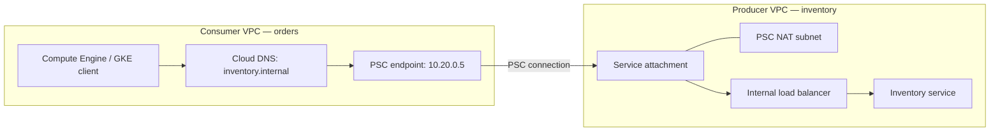
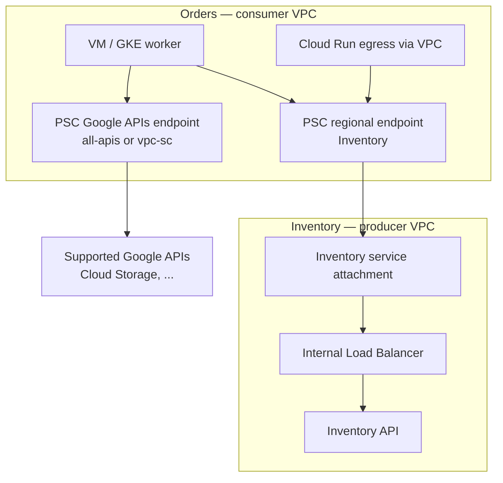

# Private Service Connect for Services and APIs

When an application running in Google Cloud needs to call Cloud Storage, BigQuery, Cloud SQL, or an internal API provided by another team, the question is not simply "can it connect?". The architecture team must also determine **which address is accessed, which path traffic takes, who is permitted to connect, which service actually receives requests, and how to verify connectivity without overly broadening network exposure**.

**Private Service Connect (PSC)** is a private connectivity capability within Google Cloud's VPC ecosystem. PSC can create an internal IP access point from a **consumer** network to a service published by a **producer**, or to supported Google APIs. PSC helps decouple the two networks' boundaries and control access paths, but it does not automatically replace application authentication, IAM, encryption, firewalls, or VPC Service Controls.

This lesson belongs to the **VPC and Routing** chapter of module `CLOUD_PROVIDERS_GCP`. Examples connect project/IAM/VPC organization with Compute Engine, GKE, Cloud Run, storage, databases, releases, and observability. The goal is to choose the right **PSC type, IP scope, DNS, permissions, and verification criteria** before production deployment.

## 1. Learning Outcomes

After this lesson, learners will be able to:

1. Explain consumer, producer, endpoint, service attachment, NAT subnet, and PSC backend.
2. Distinguish a PSC endpoint for **Google APIs bundles** from an endpoint for a **published service** in another VPC.
3. Understand why a Google APIs endpoint uses a **global internal IPv4**, whereas an endpoint to a published service normally uses a **regional internal IP** in the same region as the service attachment.
4. Identify the roles of Cloud DNS/Service Directory, VPC routing, firewalls, IAM, and hybrid connectivity.
5. Read PSC configurations and status using `gcloud`; design a workflow for creating endpoints, verifying HTTP/TLS, and troubleshooting `PENDING`, `REJECTED`, or DNS errors.
6. Choose PSC when appropriate, comparing it with Private Google Access, Private Services Access, VPC Network Peering, and Cloud NAT.

## 2. Mental Model: Consumer and Producer

| Role/component | Where it lives | Function |
| --- | --- | --- |
| **Consumer** | Project/VPC of the calling application | Owns the endpoint, internal IP, and client-side access policies. |
| **Producer** | Project/VPC of the provider, or Google | Operates the target service and publishes allowed connectivity. |
| **PSC endpoint** | Consumer VPC | Forwarding rule with an internal IP where clients send traffic toward the PSC target. |
| **Service attachment** | Producer side of a published service | Exposes a service via a supported load balancer, declaring NAT subnets and consumer acceptance rules. |
| **PSC NAT subnet** | Producer VPC of a published service | Supplies IPs to translate the source address of consumer connections; completely distinct from Cloud NAT for outbound Internet. |
| **PSC backend** | Consumer load balancer configuration | Uses a PSC network endpoint group as a backend when load balancer routing/policies are needed. |

Example of an "Orders" team accessing an "Inventory" API operated by another team:



The consumer calls an **address inside its own VPC**, without needing full access to the producer's network. The producer accepts or rejects the connection based on service attachment policy. The application must still implement its own authentication/authorization if data requires protection.

**PSC is not network-wide VPC peering.** Clients do not gain paths to all subnets, VMs, or databases of the producer; the consumer only accesses the published service through the configured endpoint/backend.

## 3. Two Very Different PSC Scenarios

| Criterion | Endpoint to global **Google APIs** | Endpoint to a **published service** |
| --- | --- | --- |
| Target | `all-apis` or `vpc-sc` API bundles provided by Google | Producer's service attachment URI, e.g., an internal API or PSC-supported managed service. |
| Consumer address | **Global internal IPv4**, belonging to the VPC; address does not reside within any existing subnet range | **Regional internal IP** drawn from a consumer subnet in the same region as the service attachment (IPv4; IPv6 in supported configurations). |
| Forwarding rule | **Global forwarding rule** | **Regional forwarding rule** |
| Usage scope | Resources across multiple regions in the VPC can use it; supported hybrid connectivity possible | By default, same-region clients; consumer global access only if supported by the service and enabled. |
| Producer / NAT subnet | Google manages the API bundle; you do not create service attachments/NAT subnets | Producer manages the service attachment, NAT subnet, backend load balancer, and accept/reject. |
| DNS | Can auto-configure names under `p.googleapis.com` via Service Directory; check API name mapping | Create private DNS or use Service Directory registration/producer domain where supported. |
| Access control | APIs still require OAuth/IAM or corresponding auth | Connection acceptance is a network control; application auth remains independent. |

Beyond these two core flows, PSC also supports **backends for Google APIs** (via supported load balancers), **regional/multi-regional Google APIs**, service connection policies for certain managed services, and network attachments/interfaces for reverse connectivity. Never apply instructions meant for global API bundles blindly to every PSC type.

## 4. PSC for Google APIs: When You Want Your Own Chosen Internal IP

With standard Google APIs access, names like `storage.googleapis.com` can resolve to publicly routable IP addresses. When Google Cloud resources call those IPs, traffic may stay on Google's network; that **does not mean** it uses a private endpoint IP inside your VPC.

PSC for Google APIs lets you place one or more **global internal IPv4 addresses** inside your VPC to access supported APIs. This is useful when you want to separate access paths by workload group, enforce explicit egress rules, or route requests from on-premises over VPN/Interconnect to a known private IP.

### 4.1. Choosing an API Bundle

| Bundle | Scope | When to consider |
| --- | --- | --- |
| `all-apis` | Most Google APIs and services on the supported list; equivalent scope to `private.googleapis.com` VIPs | Workloads needing many APIs, including APIs not supported by VPC Service Controls. |
| `vpc-sc` | Only APIs and services supported by VPC Service Controls; equivalent scope to `restricted.googleapis.com` VIPs | Wanting to restrict connectivity strictly to APIs supported by VPC Service Controls. |

Choosing `vpc-sc` **does not automatically create a VPC Service Controls perimeter**. A perimeter is a data-protection policy configured separately; account IAM still governs permissions to call Cloud Storage, BigQuery, or other resources. Both bundles only support protocols/targets listed in documentation, not a general TCP proxy for arbitrary Internet hosts.

Example: a VM that only needs to call Cloud Storage and Pub/Sub can use a PSC API endpoint, yet the VM's service account still needs specific permissions on the bucket or topic. If the VM lacks permission, successful network connectivity will simply carry the request to receive a `403` error.

### 4.2. IP Scope and DNS Differ

For a **global Google APIs endpoint**, the IP must be a **single IPv4 address** reserved for `PRIVATE_SERVICE_CONNECT` on the VPC; it **must not lie inside any existing primary/secondary subnet range or prohibited overlapping ranges**. This differs from a published service endpoint, which takes an IP from a regional subnet.

When creating the endpoint, Service Directory can set up a private zone `p.googleapis.com` and API records such as `storage-ENDPOINT_NAME.p.googleapis.com`. The default API name `storage.googleapis.com` **does not automatically switch to PSC** merely because the endpoint exists. You must use the generated PSC name or configure private DNS matching how the client calls the API, while maintaining valid TLS hostname/SNI.

### 4.3. API Endpoint Configuration Example (Illustrative, Mutates Resources)

Assume consumer project `orders-net-dev`, VPC `orders-vpc`, and address `10.255.0.5` already verified not to overlap any subnet/prohibited route. The operator needs appropriate IAM (such as `roles/compute.networkAdmin`; DNS/Service Directory management requires separate permissions), corresponding APIs enabled, and change approval for the environment.

```bash
# MUTATING COMMANDS - run only in an authorized sandbox.
PROJECT_ID="orders-net-dev"
NETWORK="orders-vpc"
ADDRESS_NAME="psc-google-api-ip"
ENDPOINT_NAME="pscgoogleapi"

# 1. Reserve a global internal IP for PSC Google APIs.
gcloud compute addresses create "$ADDRESS_NAME" \
  --project="$PROJECT_ID" \
  --global \
  --purpose=PRIVATE_SERVICE_CONNECT \
  --addresses=10.255.0.5 \
  --network="$NETWORK"

# 2. Create a global forwarding rule targeting the API bundle.
gcloud compute forwarding-rules create "$ENDPOINT_NAME" \
  --project="$PROJECT_ID" \
  --global \
  --network="$NETWORK" \
  --address="$ADDRESS_NAME" \
  --target-google-apis-bundle=all-apis
```

This illustrates placing a **global address + global forwarding rule** pair; it does not yet fully configure DNS, clients, firewalls, or hybrid networks. In production, consider Terraform/IaC, owners, labels, quotas, costs, and rollback procedures.

**Read back without modifying resources:**

```bash
gcloud compute addresses describe psc-google-api-ip \
  --project=orders-net-dev --global

gcloud compute forwarding-rules describe pscgoogleapi \
  --project=orders-net-dev --global

gcloud compute forwarding-rules list \
  --project=orders-net-dev --global \
  --filter='target:(all-apis OR vpc-sc)'
```

### 4.4. Testing from an Actual Client Inside the VPC

A VM or workload **in the consumer network** is the right place to test DNS and traffic paths. Run:

```bash
# Check the PSC name; exact name depends on endpoint/DNS created.
nslookup storage-pscgoogleapi.p.googleapis.com

# Test the Google APIs endpoint at HTTP level; per Google documentation:
curl -v http://10.255.0.5/generate_204
```

If the PSC endpoint for Google APIs is working, the probe query can return HTTP `204`. `ping`/ICMP **is not a valid verification test** because API endpoints do not respond to ping. When verifying permissions on a real API, use an authenticated tool (`gcloud` or a client library) from the same workload and confirm requests use the intended DNS/endpoint.

## 5. PSC Published Service: Exposing Services Across VPCs

For a service provided by another team or organization, the producer can use a **supported internal load balancer** to front backends and create a **service attachment** publishing a private endpoint for consumers. The consumer creates a forwarding rule in its own VPC pointing to the service attachment URI. Overall structure:

```text
CONSUMER
  client -> endpoint IP (regional forwarding rule)
                         |
                         v
PRODUCER
  service attachment -> internal load balancer -> service backend
           |
           +-- NAT subnet to SNAT consumer connection sources
           +-- connection preference / consumer accept list
```

### 5.1. Producer Responsibilities

The producer must prepare:

1. A healthy service (VM, GKE, or supported backend) and a **load balancer** compatible with PSC; verify health checks and listeners/ports.
2. One or more dedicated **PSC NAT subnets** solely to supply NAT source addresses for PSC flows. Do not confuse these with VM subnets or Cloud NAT.
3. A **service attachment** referencing the load balancer and NAT subnet, along with connection preferences.
4. Consumer acceptance rules: either auto-accept or explicitly accept by a list of allowed projects/VPCs/endpoints. For multi-party environments, explicit accept lists are generally easier to govern.
5. Application authentication mechanisms (e.g., mTLS, tokens, OAuth, or service-layer IAM where appropriate) and error monitoring.

Example service attachment URI:

```text
projects/inventory-prod/regions/asia-southeast1/serviceAttachments/inventory-api
```

The URI is an identifier **published by the producer to consumers**, not an HTTP URL and not a backend machine IP.

**NAT subnet sizing:** addresses in the NAT subnet can be consumed per connected endpoint/backend. An undersized subnet prevents a new consumer from connecting even while the application backend is healthy. As a common rule, each PSC connection consumes one or two IPs from the NAT subnet depending on configuration; account for propagated connections and unusable reserved subnet addresses as well.

### 5.2. Consumer Responsibilities

The consumer needs to know:

- The consumer VPC and project containing the endpoint;
- The **service attachment** region, and a consumer subnet in that same region;
- Available IP space in the subnet, plus routing and egress firewalls to the endpoint;
- The service attachment URI provided by the producer;
- Connection acceptance rules, quotas, and producer points of contact;
- Internal DNS so applications use a stable name instead of an IP;
- Application authentication methods and TLS certificates.

An endpoint published via a service attachment is **regional**; the endpoint's region must match the service attachment's region. By default, only clients in the same region can reach it. Depending on producer-supported features, the **PSC global access** option lets consumers in other regions access the endpoint; it does not move the service attachment to another region.

### 5.3. Example Creating an Endpoint to a Published Service (Illustrative)

Assume `orders-vpc`, subnet `orders-subnet-sea1` in `asia-southeast1`, an active service attachment, and producer acceptance of the consumer:

```bash
# MUTATING COMMANDS - run only when authorized in a sandbox.
CONSUMER_PROJECT="orders-net-dev"
REGION="asia-southeast1"
NETWORK="orders-vpc"
SUBNET="orders-subnet-sea1"
PSC_IP_NAME="inventory-psc-ip"
PSC_ENDPOINT="inventory-psc"
ATTACHMENT="projects/inventory-prod/regions/asia-southeast1/serviceAttachments/inventory-api"

# 1. Address in the consumer's regional subnet.
gcloud compute addresses create "$PSC_IP_NAME" \
  --project="$CONSUMER_PROJECT" \
  --region="$REGION" \
  --subnet="$SUBNET"

# 2. Regional forwarding rule pointing to the producer's service attachment.
gcloud compute forwarding-rules create "$PSC_ENDPOINT" \
  --project="$CONSUMER_PROJECT" \
  --region="$REGION" \
  --network="$NETWORK" \
  --address="$PSC_IP_NAME" \
  --target-service-attachment="$ATTACHMENT"
```

Do not add `--allow-psc-global-access` unless you have verified the producer service supports it; not every published service allows this option. With **Shared VPC**, the subnet and network may belong to the host project while the endpoint lives in a service project; use the corresponding resource URIs and IAM.

Read back configuration and status:

```bash
gcloud compute forwarding-rules describe inventory-psc \
  --project=orders-net-dev \
  --region=asia-southeast1

gcloud compute forwarding-rules list \
  --project=orders-net-dev \
  --filter='target~serviceAttachments'
```

The PSC connection status field (commonly shown as `pscConnectionStatus` in forwarding rule details) distinguishes whether the producer has accepted or is still pending. Only when status is `ACCEPTED` and networking, DNS, firewalls, and backends are healthy can application requests succeed.

## 6. Understanding Connection Acceptance and Endpoint States

A producer can choose to accept all matching connections automatically or **explicitly approve** consumers via allow/reject lists. Certain Google-managed services follow their own acceptance workflows.

| Status / symptom | Common meaning | Action |
| --- | --- | --- |
| `PENDING` | Request submitted; producer has not yet accepted or acceptance conditions not complete | Contact the producer; check accept lists and connection limits/quotas. |
| `ACCEPTED` | Producer accepted the PSC connection | Proceed to verify DNS, egress firewalls, TLS, listeners, and backend health. |
| `REJECTED` | Producer or policy rejected the connection | Check reject lists, accept lists, Organization Policy, and consumer scope. |
| `NEEDS_ATTENTION` / other state | Condition requires attention depending on service and endpoint type | Read exact status and service docs; do not guess from the name. |
| Forwarding rule creation fails | Wrong region, IP, VPC, URI, quota, or permissions | Check infrastructure configuration before diagnosing the application. |

If a producer changes its acceptance policy, the effect on **already ACCEPTED** connections can depend on connection reconciliation settings. Do not assume modifying the accept list immediately terminates all active sessions; the producer must check policy and revocation procedures.

When a producer publishes an API shared across many consumers, clearly document SLAs/SLOs, application-level quotas, authorization processes, incident recovery, and versioning requirements. PSC only solves the network access path.

## 7. DNS, TLS, Routing, and Firewalls: Four Steps That Must Align

An endpoint can be created properly yet clients still fail to connect because DNS resolves wrongly, egress is blocked, or the TLS certificate does not match the hostname.

### 7.1. DNS

- **API bundle endpoint:** Service Directory can create private zone `p.googleapis.com` and names like `storage-pscgoogleapi.p.googleapis.com`. If the app uses `storage.googleapis.com`, design a DNS override or configure the client to use the right endpoint, accounting for certificates and hostnames.
- **Published service:** the consumer can create a private Cloud DNS zone, e.g., `inventory.internal`, pointing an A record to the regional endpoint IP. If the producer supports domains and Service Directory registration, that integration can be leveraged.
- **Hybrid:** on-premises clients do not automatically see VPC private zones; you need DNS forwarding/inbound policies and routing paths to query and reach the right IP.

Never create a wildcard DNS override across all of `googleapis.com` without testing companion APIs like Artifact Registry, GKE, Cloud Run, and compatibility behaviors. Misconfiguration can cause widespread outages or send requests to an endpoint that does not support that API.

### 7.2. Connectivity and Routing

The consumer needs a path to the endpoint IP. For a published service, the endpoint resides in a consumer VPC subnet and deploys in the service attachment's region. For a global Google APIs endpoint, the IP has VPC-internal global scope and does not belong to a standard subnet.

Access from on-premises can use Cloud VPN/Cloud Interconnect with appropriate route advertisements and DNS setup. **VPC Network Peering is not generally transitive:** one VPC seeing another does not mean all third parties can reach an endpoint along that path unless PSC feature documentation explicitly supports that scenario.

### 7.3. Firewalls and Network Policies

Consumer egress firewalls can block traffic to internal endpoints. Network firewall rules, hierarchical firewall policies, and product-specific mechanisms must still be evaluated. On the producer side, the load balancer and backends must accept PSC-NATted traffic alongside appropriate health checks.

**PSC does not mean "the network is already secure":** sensitive data still needs authorization, encryption, identity checks, query controls, and logging. Private networking shrinks exposure surface but does not replace zero trust.

### 7.4. TLS and Live Testing

From a consumer VM:

```bash
# Published service: verify DNS maps to the PSC endpoint IP.
nslookup inventory.internal

# Test TLS connection using the hostname matching the producer's certificate.
curl --verbose --connect-timeout 5 https://inventory.internal/health

# Cross-check forwarding rule status via CLI (run from a terminal with IAM).
gcloud compute forwarding-rules describe inventory-psc \
  --project=orders-net-dev --region=asia-southeast1
```

An `ACCEPTED` endpoint and DNS pointing to the right IP **do not guarantee** the health endpoint will return `200`. The application may require a token, the backend may be unhealthy, or the certificate may have the wrong name. Never use `curl -k` to disable TLS verification as a "fix"; fix the certificate, hostname, and trust chain properly.

## 8. Distinguishing PSC from Other Connectivity Options

| Technology | Primary purpose | When to choose |
| --- | --- | --- |
| **PSC endpoint for Google APIs** | Access supported Google APIs via a global internal IP in the consumer VPC | Need dedicated IP/path for APIs and controllable DNS/routing, including supported hybrid scenarios. |
| **PSC endpoint for published service** | Consumer accesses a single service via a service attachment without full network peering | Multiple teams, multiple projects/VPCs, or third parties offering private APIs/DBs. |
| **Private Google Access** | Lets resources without external IPs reach supported Google APIs/services over Google's private path | Need to use Google APIs without necessarily creating a custom-IP PSC endpoint. |
| **Private Services Access** | Establishes private connectivity to certain managed services via VPC-peering-based links and allocated IP ranges | The chosen service requires the PSA model; verify per product. |
| **VPC Network Peering** | Exchanges routes between VPCs within supported scope | Need network-to-network connectivity; accept IP overlap and non-transitivity constraints. |
| **Cloud NAT** | Outbound egress for workloads without external IPs | Clients must reach Internet/public endpoints; Cloud NAT does not publish a private API between two VPCs. |
| **Cloud VPN / Cloud Interconnect** | Connects on-premises networks and Google Cloud | Hybrid requirements exist; can combine with PSC or other API access methods. |

Choose technology based on the **connection target**. Running an application on Cloud Run does not automatically mandate PSC; Cloud Run has appropriate VPC egress mechanisms, and PSC is only needed if the target service/API is designed to be reached via PSC. Likewise, Cloud SQL can use different private connection options depending on instance type and product capabilities.

## 9. PSC for Managed Services and Complex Architectures

Not every Google-managed service sets up PSC the exact same way. Some products, such as supported Cloud SQL configurations, allow connecting via PSC using a **managed service attachment**. Consumers may need to create an endpoint or use automated connection mechanisms per product documentation.

Related capabilities:

- **Service connection policy:** for supported managed services, network administrators can allow services to automatically create PSC connections per policy inside the consumer VPC. Verify network scope, subnets, service classes, and quotas.
- **PSC backends:** PSC network endpoint groups serve as backends for supported load balancers. This helps when load balancing, TLS termination, policies, or centralized entry points are needed; it is not identical to a direct forwarding-rule endpoint.
- **PSC interfaces / network attachments:** a reverse integration pattern where producer workloads use connections granted by consumers via network attachments; problem space and permissions differ from traffic-receiving endpoints.

Before designing PSC connectivity for Cloud SQL, AlloyDB, Apigee, Cloud Run, or other products, read that product's dedicated support page. Verify who the producer is, who manages the service attachment, whether accept lists or allowed projects are needed, which regions/addresses/DNS apply, and whether multi-region/global access is supported.

## 10. Security When Deploying PSC

PSC is a connectivity layer. A secure design requires additional control layers:

1. **IAM for network administration:** separate permissions to create forwarding rules/addresses, create service attachments, edit Cloud DNS/Service Directory, edit VPC firewalls, and manage policies. `roles/compute.networkAdmin` is a broad network management role; scope grants strictly to what is needed.
2. **Connection acceptance:** producers accept only approved consumers; cap connection counts and audit connected lists over time.
3. **Application-layer authentication and authorization:** OAuth/OIDC, mTLS, or appropriate service mechanisms. A private IP is not a user identity.
4. **TLS:** use valid certificates, verify hostnames, encrypt data per policy; never leak secrets in network logs.
5. **VPC Service Controls if applicable:** design perimeters and verify API bundle compatibility; the `vpc-sc` bundle does not configure a perimeter itself.
6. **Observability and auditing:** monitor endpoint/service attachment configs, accepted connections, backend errors, latency, timeouts, DNS changes, and IAM changes.
7. **Environment separation:** separate production/dev by project, VPC, owner, addressing, and DNS permissions; avoid sharing one broad endpoint across all environments without justification.

Check **Organization Policy** on both producer and consumer when creating or accepting PSC connections. If an organization prohibits a connection type, a service attachment accept list will not necessarily override that constraint.

## 11. Reliability, Scalability, and Cost

| Category | Risk | Pre-production verification |
| --- | --- | --- |
| **NAT subnet** | Insufficient IPs for endpoint/backend counts or propagated connections | Calculate current/projected consumers, IPs consumed per connection, and usable addresses. |
| **Quotas and limits** | Exceeding quotas for forwarding rules, internal IPs, or PSC connections | Check quotas per project/region, check target limits, and configure proactive alerts. |
| **Region** | Consumer and service attachment in different regions; global access unsupported | Check region pairs, producer features, and DR paths during a region outage. |
| **Service availability** | Endpoint accepted yet producer LB/backend is unhealthy | Health checks, latency/error-rate SLOs, producer failure drills. |
| **DNS** | Wrong records, zone invisible to clients, stale cache | Query DNS from VMs/GKE/on-prem along each path, check TTLs and fallbacks. |
| **Security** | Connectivity exists without auth; overly broad policies | Verify IAM, application auth, accept lists, egress firewalls, and audits. |
| **Cost** | Endpoint/data-processing charges, load balancers, DNS, network transfer | Estimate using PSC pricing, traffic volume, regions, and related resources; verify in live Cloud Billing. |

Costs can arise from PSC components, data processing, load balancers, inter-region data transfer, Cloud DNS, and auxiliary network resources. Billing models vary by endpoint/backend, producer/consumer, and traffic type; never look solely at VM or database charges and assume PSC connectivity is free.

**Never assume an endpoint guarantees HA.** If backends sit in a single zone, if the producer deploys in only one region, or if DNS relies on an untested setup, PSC does not create regional resilience on its own. You must independently design failover, health checks, SLOs, runbooks, and testing.

## 12. Ordered Error Diagnostics

A practical workflow:

1. **Identify PSC type:** Google APIs bundle or published service? Global or regional endpoint? Do not pass `--global` to describe a regional published service endpoint.
2. **Verify existence and status:** address, forwarding rule, target, `pscConnectionStatus`; if the producer manages the service attachment, verify accept/reject lists and quotas.
3. **Verify DNS from the client:** does the exact name used by the application resolve to the right internal endpoint IP? Do on-premises clients use the right forwarding?
4. **Inspect networking:** VPC/subnet/region, egress firewalls, routes, and supported global access/peering/hybrid features.
5. **Inspect service and TLS:** producer load balancer/backend health, listeners/ports, certificates; call using a valid hostname.
6. **Inspect application layer:** authentication, IAM/API permissions, token scopes, timeouts, and logs/traces.
7. **Inspect quotas/costs and recent changes:** forwarding rules, NAT subnet capacity, DNS records, service attachment target changes, billing/cost guardrails.

| Symptom | Hypothesis worth testing | How to narrow down |
| --- | --- | --- |
| `nslookup` returns a public IP for an intended private name | Missing matching Cloud DNS private zone/record on client network | Run DNS from the client VPC itself and compare against endpoint IP. |
| Stuck in `PENDING` | Producer hasn't accepted, missing connection limit, or service-specific approval | Read connection status and ask the producer to inspect the accept list. |
| `REJECTED` | Consumer rejected by accept/reject policy or org policy | Compare project/VPC/endpoint IDs and policies; do not blindly recreate endpoints. |
| `ACCEPTED` yet `curl` times out | Egress firewall, route, target load balancer/backend, or region mismatch | Check ports and health, VPC Network Intelligence Center where applicable. |
| `403` from Cloud Storage API | Network reached the API, yet identity/IAM/VPC-SC denied it | Check access token, IAM, perimeter, and response body. |
| `TLS certificate mismatch` | DNS hostname does not match producer's certificate | Check DNS, SNI, hostname, CA chain; do not disable verification. |
| PSC Google APIs endpoint does not respond to ping | ICMP is not supported | Use HTTP `/generate_204` or an authenticated API call. |
| Creating regional endpoint reports wrong address | Used IP outside subnet, wrong region, or global PSC APIs IP | Select a regional internal address in the exact subnet and attachment region. |

### Suggested Read-Only Inspection Commands

```bash
# List forwarding rules and addresses for review.
gcloud compute forwarding-rules list --project=orders-net-dev
gcloud compute addresses list --project=orders-net-dev

# Google APIs endpoint is global.
gcloud compute forwarding-rules describe pscgoogleapi \
  --project=orders-net-dev --global

# Published service endpoint is regional.
gcloud compute forwarding-rules describe inventory-psc \
  --project=orders-net-dev --region=asia-southeast1

# Producer side if granted read IAM:
gcloud compute service-attachments describe inventory-api \
  --project=inventory-prod --region=asia-southeast1
```

Never post access tokens, internal service addresses, or sensitive IAM configurations on public tickets. Record sufficient operational details: resource names, regions, statuses, timestamps, and request/correlation IDs if available.

## 13. Case Study: Orders Using PSC for APIs and Private Services

A development team operates an ordering system:

- **Orders:** API running on Cloud Run, a worker on GKE, and a legacy processing VM. Transaction data is stored in Cloud SQL; images in Cloud Storage.
- **Inventory:** an internal service owned by another team, exposed via an internal load balancer in a producer VPC.
- **Security:** requires limiting unnecessary Internet access, allowing only designated API connections, and protecting credentials.

Selected architecture:



Note: this diagram is purely logical. **Cloud Run requires appropriate VPC egress configuration** to reach PSC endpoints; do not assume every Cloud Run service automatically uses VPC endpoints merely by sharing a project. Cloud SQL requires evaluating dedicated connectivity options based on instance capabilities and specific requirements.

### Design Decisions

1. Choose a PSC Google APIs endpoint for workloads needing a fixed internal IP to call APIs; verify `all-apis` vs. `vpc-sc` needs and IAM authorization.
2. Inventory producer publishes a service attachment, and the consumer creates a regional PSC endpoint. Only approved projects/VPCs can connect; the Inventory app still requires its own token.
3. Use private Cloud DNS record `inventory.internal` and verify from GKE/VM/Cloud Run along each access path.
4. Define SLOs, health checks, quotas, and fallback handling if the Inventory producer suffers an outage; Orders must never block indefinitely on a single Inventory request.
5. Tag network resources with owner, environment, and cost center labels; monitor traffic, egress, and PSC charges in Cloud Billing.

### Pre-Release Checklist

- [ ] Identified consumer/producer, project names, VPCs, regions, and owners on both ends.
- [ ] Correct endpoint type: global Google APIs or regional published service.
- [ ] Valid, non-overlapping IPs and subnets; sufficient producer NAT subnet capacity if applicable.
- [ ] DNS from the right workloads resolves to the PSC IP; TLS hostname/certificate valid.
- [ ] Producer accepted the consumer; endpoint is in the expected state.
- [ ] IAM, firewalls, service authentication, and VPC Service Controls (if any) verified.
- [ ] Tested HTTP/APIs and failure modes; metrics, logs, alerts, and runbooks in place.
- [ ] Reviewed quotas, costs, and regional recovery capabilities.

## 14. Practice Exercises

### Exercise A — Identify the Right Endpoint Type

Team A wants a VM without an external IP to call `storage.googleapis.com`. Team B wants GKE to call Team C's private API in another VPC. Propose a PSC path for each team and explain differences in **IPs, forwarding rule scope, DNS, and identity**. When might Private Google Access suffice for Team A?

### Exercise B — `PENDING` Error

The Orders team created a regional forwarding rule pointing to `projects/inventory-prod/regions/asia-southeast1/serviceAttachments/inventory-api`. The endpoint is in `PENDING` state. List three things the producer must check before the consumer team changes DNS or application code.

### Exercise C — DNS Resolves to a Public IP

A VM in a VPC has a PSC Google APIs endpoint `10.255.0.5`, yet `nslookup storage.googleapis.com` still returns public IPs. Explain why, and state two ways the client can reach the right endpoint: using the generated `p.googleapis.com` name or configuring an appropriate DNS override. Why should TLS verification never be disabled?

### Exercise D — Multi-Region Service Design

The Inventory producer runs only in `asia-southeast1`, while the consumer has workloads in `asia-southeast1` and `asia-east1`. Evaluate producer-supported PSC global access, network latency risks, and a scenario where the producer region goes down. Describe plans to guarantee RTO/RPO and metrics to monitor.

### Exercise E — Investigating a `403` Error

A VM reaches the PSC Google APIs endpoint and gets a response from Cloud Storage, yet bucket read requests return `403`. List the order of checks for tokens, IAM, org/perimeter, API scopes, and bucket policies. Explain why creating another forwarding rule is not the solution.

### Self-Check Questions

1. Does a PSC endpoint let the consumer access every producer subnet like VPC peering?
2. Why does a Google APIs endpoint use a global IP while a published service endpoint must match the attachment's region?
3. What is the difference between a producer's PSC NAT subnet and Cloud NAT for outbound Internet?
4. Is a VPC Service Controls perimeter automatically created when selecting the `vpc-sc` bundle?
5. Is an endpoint in `ACCEPTED` state enough to guarantee the API returns `200`?
6. Why must you test DNS from the actual client rather than only from a developer laptop?
7. What cost sources and operational risks must be accounted for before using PSC in production?

**Mnemonic workflow:** determine whether the target is **Google APIs or a published service** → pick PSC type and IP scope → check consumer/producer, region, subnet, acceptance → configure DNS/routing/firewalls → verify TLS and application permissions → monitor reliability, quotas, and costs.

## 15. Official Documentation

- [Private Service Connect overview](https://cloud.google.com/vpc/docs/private-service-connect)
- [Private Service Connect compatibility](https://cloud.google.com/vpc/docs/private-service-connect-compatibility)
- [About accessing global Google APIs through endpoints](https://cloud.google.com/vpc/docs/about-accessing-google-apis-endpoints)
- [Access global Google APIs through endpoints](https://cloud.google.com/vpc/docs/configure-private-service-connect-apis)
- [About published services](https://cloud.google.com/vpc/docs/about-vpc-hosted-services)
- [About accessing published services through endpoints](https://cloud.google.com/vpc/docs/about-accessing-vpc-hosted-services-endpoints)
- [Access published services through endpoints](https://cloud.google.com/vpc/docs/configure-private-service-connect-services)
- [Manage published services](https://cloud.google.com/vpc/docs/manage-private-service-connect-services)
- [Configure Private Google Access](https://cloud.google.com/vpc/docs/configure-private-google-access)
- [Private Service Connect pricing](https://cloud.google.com/vpc/network-pricing#private-service-connect)

Feature limits, producer capabilities, Google APIs routing behavior, VPC Service Controls policies, and pricing may vary by service. Before deploying, verify endpoint types, regions, service attachment URIs, quotas, and security requirements against current official documentation.
