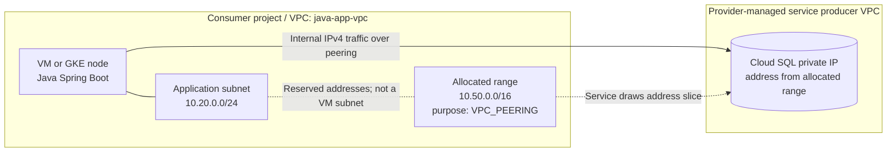
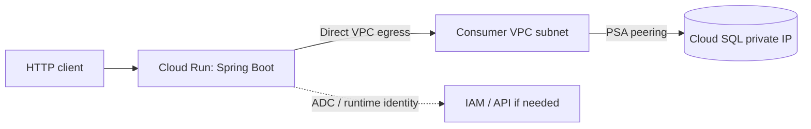
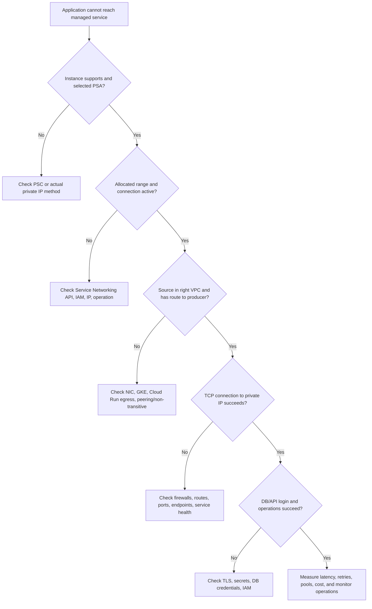

# Private Services Access and Connecting to Managed Services

## 1. Problem: A Java Application Needs a Private Connection to a GCP Service

A Spring Boot application deployed on **Compute Engine**, **Google Kubernetes Engine (GKE)**, or **Cloud Run** needs to connect to **Cloud SQL for PostgreSQL** or another managed service. The development team wants to avoid exposing the database to the Internet, manage IP addresses deliberately, keep latency low, and control traffic paths. The question arises: how do resources running in the **project's VPC** communicate with resources running in a **VPC managed by Google or a service provider**?

**Private services access (PSA)** is a private connectivity option for services supporting this model. PSA establishes a connection based on **VPC Network Peering** between the service consumer's VPC (*service consumer*) and the service producer's VPC (*service producer*). Resources can communicate using **internal IPv4 addresses**, without traversing the public Internet for this path. PSA commonly appears in Cloud SQL private IP architectures and several other managed services.

In the **VPC and Routing** chapter of the **CLOUD_PROVIDERS_GCP** module, this lesson connects PSA with project organization, IAM, VPC networking models, Cloud Run/GKE/Compute Engine choices, and operating storage and database services. The focus is on **understanding the boundary between the two networks, configuring IP and route resources, choosing PSA or another option based on requirements, testing, and troubleshooting**.

### Learning Objectives

After studying this lesson, you will be able to:

1. Explain **consumer VPC**, **producer VPC**, **allocated IP range**, **private connection**, and the role of the **Service Networking API**.
2. Distinguish **PSA**, **Private Service Connect (PSC)**, **Private Google Access**, **Direct VPC egress/Serverless VPC Access**, and standard **VPC Network Peering**.
3. Plan CIDRs to avoid overlap with subnets, routes, on-premises networks, and other connected networks.
4. Configure and verify PSA using **Google Cloud Console**, **gcloud**, or **Terraform**; connect a managed service such as Cloud SQL.
5. Explain why a private connection **does not automatically grant IAM permissions, does not authenticate databases, and does not solve all routing paths**.
6. Diagnose missing API/permission errors, IP range exhaustion, CIDR collisions, missing routes, authentication failures, and resulting network charges.

## 2. How Does PSA Architecture Work?

### 2.1. Consumer, Producer, and the Connection Between Two Networks

Imagine an enterprise owns a VPC named `java-app-vpc` containing a VM or GKE node running Java. Google Cloud creates or manages a separate VPC on the **service producer** side to run the subscribed service, such as a Cloud SQL instance. Although both reside on Google Cloud infrastructure, the two VPCs remain **two distinct network domains**.

PSA links them via VPC Network Peering. The user prepares an **allocated IP range** in the consumer VPC; the producer allocates addresses from this reserved range for its service resources. Traffic between the two sides uses internal routes created/exchanged across the peering connection according to Google Cloud rules.



**Important:** the range `10.50.0.0/16` in the diagram is an **illustrative example**; use it only if confirmed not to collide with existing networks and future plans. Never create a VM subnet out of a range reserved for PSA; resources in the producer VPC consume it per service mechanics.

### 2.2. Two Mandatory Steps Before Using the Service

PSA comprises two distinct infrastructure configuration steps:

1. **Reserve an allocated IPv4 range** in the consumer VPC, with purpose `VPC_PEERING` and global scope.
2. **Create a private connection** between the consumer VPC and service producer via the **Service Networking API** (`servicenetworking.googleapis.com`), specifying the allocated range name.

Only after that do you **create/configure an instance** of the PSA-supported service (such as Cloud SQL private IP) so it receives an address from the producer side. Creating an allocated range **does not automatically** create a connection; creating a connection **does not automatically** create a database.

| Component | Who manages it? | What is it used for? |
| --- | --- | --- |
| Consumer VPC and subnets | Service user, possibly in a Shared VPC host project | Where applications/nodes enter the private network |
| Allocated range | User reserves in the consumer VPC | Prevents the producer from allocating addresses colliding with planned networks |
| Private connection / peering | Service Networking together with provider | Exchanges routes between consumer and producer VPCs |
| Producer VPC and service subnets | Google or managed service provider | Hosts service-side addresses/resources |
| Managed service instance | User configures the service; producer operates infrastructure | Cloud SQL, Filestore, Memorystore, etc. depending on support |
| IAM, firewalls, database authentication | Configured at their respective layers | Restricts who can create/manage resources and who can actually connect/use them |

### 2.3. PSA Is Not a General Transit Connection

Because it relies on **VPC Network Peering**, PSA inherits peering limitations:

- **Non-transitive routing:** if VPC A has a PSA connection to a producer and VPC B peers with A, B **does not automatically** reach the producer through A.
- Routes are shared according to peering **subnet/custom route import-export** rules. On-premises networks traversing VPN/Interconnect must configure route export/import and advertise appropriate return paths.
- Both sides must avoid **overlapping** addresses. A custom route overlapping the reserved range can reduce allocatable IP capacity, even if the UI still shows the range appearing large enough.
- **IPv6 allocated ranges are not supported** for PSA; the described model uses internal IPv4 addresses.
- Not every managed service supports PSA; check official lists and per-product options.

Therefore, "peered with a VPC that has PSA" does not mean "has a route to Cloud SQL." Verify the path from the **actual source** to the **actual destination**.

## 3. How Does PSA Differ from Other Private Access Options?

Feature names easily cause confusion because they all mention "private." They solve different boundaries.

| Mechanism | Target and model | When to use? | Limits to remember |
| --- | --- | --- | --- |
| **Private services access (PSA)** | Consumer VPC ↔ Producer VPC via peering | Managed services supporting PSA, e.g., Cloud SQL private IP under PSA model | Non-transitive; requires reserving a range and creating a connection |
| **Private Service Connect (PSC)** | Consumer accesses a private endpoint/backend pointing to a published service or Google APIs | Need service-level managed entry point, network separation, or multi-VPC connectivity when supported | Configures endpoints, service attachments, or service connection policies under PSC model; distinct from PSA |
| **Private Google Access (PGA)** | VMs **without external IPs** call **Google APIs/services** via Google service addresses | Calling Cloud Storage API, BigQuery API, and supported Google APIs | Enabled per **subnet** with DNS/route/firewall checks; does not replace PSA to reach Cloud SQL private IP |
| **Direct VPC egress** | Cloud Run workloads send egress into a chosen VPC | Cloud Run connecting to internal addresses, including destinations reached via PSA | Only an **outbound path from Cloud Run into the VPC**; does not create PSA itself |
| **Serverless VPC Access** | Connector linking serverless workloads to a VPC | When using a connector instead of Direct VPC egress | Has its own connector lifecycle, capacity, and cost |
| **Cloud NAT** | Address translation for eligible outbound traffic | Internal workloads needing Internet access without individual external IPs | Does not create a PSA connection and does not replace private IP access to managed services |
| **Cloud VPN / Cloud Interconnect** | Connects on-premises to a VPC | Internal users needing access into GCP networks | Reaching producers via PSA also requires appropriate route exports/advertisements |

Quick differentiation examples:

- **VM reading Cloud Storage objects via API** → evaluate **Private Google Access** or **PSC for Google APIs**, depending on deployment; do not configure PSA just to call `storage.googleapis.com`.
- **VM connecting to Cloud SQL PostgreSQL via private IP** → can use **PSA**, or **PSC** if supported by Cloud SQL and your chosen architecture.
- **Cloud Run connecting to Cloud SQL private IP via PSA** → requires **PSA on the VPC** **and** a **Cloud Run egress path into the VPC** such as Direct VPC egress.
- **Contractor needing access to a private service published from another VPC** → evaluate a **PSC endpoint** rather than defaulting to full-network peering.

### 3.1. Cloud SQL Now Offers Both PSA and PSC

Among **Cloud SQL for PostgreSQL** private IP options, Google Cloud supports both **Private services access** and **Private Service Connect**; current documentation recommends evaluating PSC for its flexibility in address management, scaling, and access control. In new projects' instance creation UIs, PSC may be the default selection. That **does not make PSA wrong**: many existing systems still use PSA and many managed services support it.

Choose based on VPC/consumer count, on-premises and cross-cloud requirements, endpoint control, specific service support, quotas, and migration plans. **Never assume every private-IP Cloud SQL instance uses PSA.** Before altering networking, confirm which option the existing instance actually uses.

## 4. Planning Addresses, Routes, IAM, and Shared VPC

### 4.1. Designing IPv4 Ranges Before Reserving

Suppose an enterprise has:

| Purpose | Illustrative range | Notes |
| --- | --- | --- |
| Application subnet in `asia-southeast1` | `10.20.0.0/24` | VMs, GKE nodes, or Cloud Run Direct VPC egress |
| Another workload subnet | `10.21.0.0/24` | Internal consumer VPC resources |
| Allocated range reserved for PSA | `10.50.0.0/16` | **Reserved specifically** for producers; do not create application subnets here |
| On-premises network | `172.20.0.0/16` | Connected via VPN/Interconnect if present |

These are **sample** ranges only, not configurations guaranteed to fit a live system. Check at minimum: current/future subnets, GKE secondary ranges, connected VPCs, NCC spokes, on-premises IPs, VPN/Interconnect routes, **custom static/dynamic routes**, and organization-wide IP planning.

Per Google Cloud guidance, for Google services, **/24 is the minimum** for a PSA allocated range in supported cases and **/16 is commonly recommended** for room to grow. Cloud SQL in particular may require **/24 slices available per region and database type** depending on service architecture. If planning multiple regions, multiple DB engines, or adding Memorystore/Filestore, avoid undersized ranges.

**Why can a seemingly large range still report IP exhaustion?** Google Cloud excludes blocks that cannot be allocated due to route overlaps or already-consumed slices. A reserved range does not mean all addresses remain permanently allocatable. Use **Network Analyzer** or PSA IP utilization inspection tools and check subranges already consumed by producers.

### 4.2. Required IAM and APIs

Before modifying networking, the deployer typically needs:

- **Service Networking API** (`servicenetworking.googleapis.com`) to create the private connection and **Compute Engine API** (`compute.googleapis.com`) to manage VPCs and global addresses.
- Appropriate network permissions, typically **Compute Network Admin** (`roles/compute.networkAdmin`) on the project owning the VPC for authorized operators/automation.
- Permission to enable APIs if inactive, and separate roles to create service instances like Cloud SQL; never grant Owner for all tasks just for convenience.
- Clear identification of **VPC host project** and **service project** when using Shared VPC. Allocation/connection setup happens in the project owning the VPC; enable APIs and permissions across both projects as required.

**PSA only solves IP connectivity.** Users still need IAM to administer instances; applications still need authentication and permissions inside the database or service itself. A private IP connection does not automatically encrypt every protocol end-to-end or replace TLS, DB auth, and secret management.

## 5. Hands-On gcloud: Configuring PSA for a Sample VPC

This section is a **lab runnable in a test project**, not commands automatically executed by reading. Subsequent service steps **create billable resources** and can impact infrastructure if run in the wrong project. Verify the project and CIDRs with the network team before running. Examples use Bash; PowerShell requires updating line continuations or running single-line commands.

**Lab assumptions:** custom-mode VPC named `java-app-vpc`, subnet `java-app-subnet` in `asia-southeast1`, application prefix `10.20.0.0/24`, PSA allocation `10.50.0.0/16`. In real deployments, choose ranges verified not to collide with existing systems.

### Step 1 — Select Project and Enable APIs

```bash
gcloud config set project YOUR_PROJECT_ID
gcloud services enable compute.googleapis.com servicenetworking.googleapis.com
```

If creating Cloud SQL later, also enable `sqladmin.googleapis.com` and ensure billing/quotas/permissions match. On Shared VPC, perform networking actions in the **host project** and verify API requirements in the **service project**.

### Step 2 — Create or Select Consumer VPC

If a suitable VPC already exists, **do not create a new VPC**. For an empty lab project:

```bash
gcloud compute networks create java-app-vpc --subnet-mode=custom

gcloud compute networks subnets create java-app-subnet \
  --network=java-app-vpc \
  --region=asia-southeast1 \
  --range=10.20.0.0/24
```

This subnet is where workloads obtain IPs. The PSA range below will be **completely distinct** from this subnet.

### Step 3 — Reserve a Global Allocated Range for PSA

```bash
gcloud compute addresses create java-psa-range \
  --global \
  --purpose=VPC_PEERING \
  --addresses=10.50.0.0 \
  --prefix-length=16 \
  --network=java-app-vpc \
  --description="Reserved for managed service producers"

gcloud compute addresses list --global --filter="purpose=VPC_PEERING"
```

The name `java-psa-range` is the **reservation** name, not Cloud SQL's IP address. `--global` indicates the scope of the allocated range; it does not mean the database service will be deployed across all regions. If you prefer not to pick a range manually, you can omit `--addresses` so Google Cloud picks an available block of the specified size, though you must still cross-check with your organization's IP plan.

### Step 4 — Create Private Connection via Service Networking

```bash
gcloud services vpc-peerings connect \
  --service=servicenetworking.googleapis.com \
  --ranges=java-psa-range \
  --network=java-app-vpc

gcloud services vpc-peerings list --network=java-app-vpc
```

The `connect` command may return a **long-running operation**. Wait for the operation to finish and inspect status:

```bash
gcloud services vpc-peerings operations describe --name=OPERATION_NAME
```

The verification command must show the connection along with the associated allocated range before creating a managed service. In Console, navigate to **VPC networks → select network → Private services access → Allocated IP ranges for services / Private connections to services** to verify.

### Step 5 — Create Cloud SQL Using PSA Private IP

In **Cloud SQL → Create instance → PostgreSQL → Connections**, select **Private IP**, choose **Private Service Access (PSA)**, and specify `java-app-vpc` along with the allocated range if prompted by the UI. After creation, inspect the instance's **Private IP**.

An instance creation command using PSA might resemble the example below (verify Cloud SQL CLI version and flags when practicing):

```bash
gcloud beta sql instances create java-pg-lab \
  --project=YOUR_PROJECT_ID \
  --database-version=POSTGRES_16 \
  --cpu=2 \
  --memory=4GB \
  --region=asia-southeast1 \
  --network=projects/YOUR_PROJECT_ID/global/networks/java-app-vpc \
  --no-assign-ip \
  --allocated-ip-range-name=java-psa-range
```

On **Shared VPC**, `--project` may be the service project while `--network` must point to the **host project**. Creating a real Cloud SQL instance incurs instance/storage/backup charges; creating it is optional if you are only learning PSA configuration. Before creating, verify SKU, permissions, and how to delete test resources.

### Step 6 — Verify from the Service Side

```bash
gcloud sql instances describe java-pg-lab \
  --format="json(region,ipAddresses,settings.ipConfiguration)"
```

The output should reflect the instance using a private IP and the selected network. **Successful instance creation only proves the control plane**; it does not yet prove a Java application at the actual source can connect. The next section explains reaching PSA from VMs/GKE/Cloud Run.

## 6. Entry Points into PSA from Compute Engine, GKE, and Cloud Run

### 6.1. Compute Engine

A VM is attached to the **consumer VPC that has the private connection**, has a valid route to the service's private IP, and uses an appropriate TCP client (such as PostgreSQL JDBC). **The VM does not need an external IP** for this PSA connection path.

Sample verification workflow:

1. Confirm the VM's NIC is in the **exact VPC** and subnet.
2. Read the managed service's private IP and port (e.g., PostgreSQL `5432`).
3. Confirm matching routes and firewall/egress policies; if hierarchical firewalls exist, evaluate hierarchical firewall policies too.
4. On an authorized test machine, run `nc -vz DB_PRIVATE_IP 5432` or an equivalent tool to check TCP; next, use a PostgreSQL/JDBC client to test DB authentication.

Merely testing TCP connectivity does not verify table read permissions. Merely logging into the database does not prove the application handles transactions/timeouts properly.

### 6.2. GKE

For GKE, workloads run inside Pods using separate IP ranges and communicate through nodes/VPC. When accessing PSA:

- Verify **cluster VPC**, node subnet, Pod secondary ranges, and workload outbound path. Never assume clusters in the same project share the same VPC.
- Check **NetworkPolicy** if enabled, egress firewalls, in-cluster DNS, and the Java service's connection pool.
- When running multiple clusters/regions, account for **non-transitive peering** and actual network routing rules.
- Never confuse **Workload Identity Federation for GKE** (granting application identity to call Google APIs) with **PSA** (IP connectivity to managed services).

If GKE sits in VPC A while PSA-backed Cloud SQL sits in VPC B, and A merely peers with B, there is **no guaranteed** transitive path through B to the producer. Design a model supporting direct connectivity or choose PSC when service/architecture fits.

### 6.3. Cloud Run: Requires Configuring an Egress Path into the VPC

Cloud Run does not sit directly inside a consumer VPC subnet the way VMs do. For a service to call Cloud SQL's private IP over PSA, configure supported **Direct VPC egress** or a **Serverless VPC Access connector** to route traffic into the PSA-connected VPC.

Example deploying Cloud Run from an existing image:

```bash
gcloud run deploy java-api \
  --image=REGION-docker.pkg.dev/PROJECT_ID/REPOSITORY/IMAGE:TAG \
  --region=asia-southeast1 \
  --network=java-app-vpc \
  --subnet=java-app-subnet \
  --vpc-egress=private-ranges-only \
  --no-allow-unauthenticated
```

Replace all placeholders with actual image/parameter values. With `private-ranges-only`, traffic to eligible internal addresses flows through the VPC; if **all** outbound traffic must go through the VPC, select `all-traffic` and design Internet/NAT/PGA paths as needed. Direct VPC egress also requires matching subnet region, sufficient available IPs, and network usage permissions.

**PSA and Direct VPC egress are complementary configurations**—you cannot enable just one and expect the entire chain to work.



TCP connectivity to Cloud SQL still requires DB login/permissions; if using **Cloud SQL Java Connector**, **Cloud SQL Auth Proxy**, or IAM DB authentication, configure the corresponding prerequisites and permissions. Choose the private IP access approach per Cloud SQL guidelines and the Java libraries you use.

## 7. Spring Boot Example Connecting to Cloud SQL PostgreSQL Private IP

This is an **application-layer** example illustrating how PSA delivers traffic to the DB. Private connectivity is handled at the network layer; Java still uses the **PostgreSQL JDBC driver**, HikariCP, or an equivalent library—there is no "PSA SDK" for SQL queries.

### 7.1. DataSource Configuration

```yaml
spring:
  datasource:
    url: jdbc:postgresql://${DB_PRIVATE_IP}:5432/${DB_NAME}
    username: ${DB_USER}
    password: ${DB_PASSWORD}
    hikari:
      maximum-pool-size: 5
      connection-timeout: 10000
```

This is a **minimal configuration for lab use**: environment variables/secrets must be supplied to the workload, and the database/database user must already exist. In production, manage passwords via **Secret Manager** or an appropriate secret provider; enforce **TLS and strong authentication** per Cloud SQL policy, and consider Cloud SQL Java Connector/Auth Proxy or IAM DB authentication where supported by your deployment. **A private IP does not mean connections are automatically encrypted at the application layer.**

### 7.2. Small Repository to Test Connectivity

```java
package dev.example.gcp;

import org.springframework.jdbc.core.JdbcTemplate;
import org.springframework.stereotype.Repository;

@Repository
public class DatabaseHealthRepository {
    private final JdbcTemplate jdbcTemplate;

    public DatabaseHealthRepository(JdbcTemplate jdbcTemplate) {
        this.jdbcTemplate = jdbcTemplate;
    }

    public boolean canQueryDatabase() {
        Integer result = jdbcTemplate.queryForObject(
                "SELECT 1", Integer.class);
        return Integer.valueOf(1).equals(result);
    }
}
```

This example uses Spring JDBC and the PostgreSQL JDBC driver; matching Spring Boot dependencies are required. **Never expose a public database health endpoint** just for testing. When Cloud Run scales up instance counts, total DB connections can reach **instance count × pool size**; cap concurrency and implement graceful failure handling during database outages.

### 7.3. Clearly Separating Four Error Categories

| Status | What does it mean? | What to check |
| --- | --- | --- |
| Cannot resolve service name | DNS issue | Hostname, DNS zone, runtime resolver |
| Timeout on TCP connect to private IP | Likely network/route/firewall/port issue or target not serving | Consumer VPC, PSA status, peering route, egress, firewall, private IP |
| PostgreSQL returns authentication error | TCP reached DB, but credentials/DB role invalid | DB user, password/IAM auth, TLS, database name |
| Application gets `PERMISSION_DENIED` managing instance via Cloud SQL API | Missing IAM permissions on control plane | Service account, Cloud SQL IAM roles, API enablement |

Investigate the **network path first**, then **protocol/database authentication**, and only finally conclude whether the issue lies in Java code or admin permissions.

## 8. Automating PSA with Terraform

Terraform helps when Java teams maintain multiple dev/staging/prod environments or rebuild networks for CI/CD. The snippet below creates **VPC + subnet + allocated range + private connection**, without creating Cloud SQL:

```hcl
variable "project_id" {
  type = string
}

provider "google" {
  project = var.project_id
}

resource "google_compute_network" "consumer" {
  name                    = "java-app-vpc"
  auto_create_subnetworks = false
}

resource "google_compute_subnetwork" "app" {
  name          = "java-app-subnet"
  region        = "asia-southeast1"
  ip_cidr_range = "10.20.0.0/24"
  network       = google_compute_network.consumer.id
}

resource "google_compute_global_address" "psa_range" {
  name          = "java-psa-range"
  purpose       = "VPC_PEERING"
  address_type  = "INTERNAL"
  address       = "10.50.0.0"
  prefix_length = 16
  network       = google_compute_network.consumer.id
}

resource "google_service_networking_connection" "psa" {
  network                 = google_compute_network.consumer.id
  service                 = "servicenetworking.googleapis.com"
  reserved_peering_ranges = [google_compute_global_address.psa_range.name]
}
```

**Usage prerequisites:** required APIs and permissions must be granted; replace CIDRs with planned ranges; Terraform may need explicit dependency/API enablement management if the environment is not bootstrapped. When creating a Cloud SQL instance via Terraform, set `ip_configuration.private_network` to reference the exact network and depend on `google_service_networking_connection.psa`.

Outside the lab, parameterize names/VPCs/regions/CIDRs and use a secure state backend. **Never run `terraform destroy` on a shared PSA connection** while Cloud SQL or other services still depend on it; deleting the peering can sever connectivity to many resources even if the databases themselves are not deleted.

## 9. Shared VPC, On-Premises Networks, and DNS

### 9.1. Shared VPC: Resources in Different Projects Sharing One Network

In Shared VPC, the **host project** owns the VPC/subnets; **service projects** can own Cloud SQL or applications using that network. Thus:

1. The network admin prepares the allocated range and private connection in the **host project**.
2. Required APIs are enabled in both host and service projects per service requirements, along with IAM for deployers on the appropriate projects.
3. The Cloud SQL instance references the **host VPC's resource path**; do not confuse the DB-owning project with the network-owning project.
4. Workloads in service projects must have subnet usage permissions and paths configured for the right VPC.

Do not create separate PSA connections in each service project when multiple projects share **one consumer VPC**.

### 9.2. Connecting On-Premises via VPN or Interconnect

Suppose an enterprise's internal network (e.g., `172.20.0.0/16`) connects to the consumer VPC over Cloud VPN or Cloud Interconnect. Users want data center staff to reach a PSA service.

By default, the producer typically learns the consumer VPC's **subnet routes**, not routes to arbitrary on-premises sources. You must:

- **Export custom routes** appropriately from the consumer to producer peering so the producer knows how to return traffic to on-premises.
- **Advertise** required PSA prefixes from Cloud Router/hybrid links back to on-premises.
- Check source addresses, non-overlapping routes, firewall appliances, and service rules; some non-RFC1918 sources need separate configuration.
- Ensure VPN/Interconnect terminates in the **exact VPC/Shared VPC hosting PSA**, since peering does not support transitive hops through another VPC.

Follow the [hybrid connectivity guide for PSA](https://cloud.google.com/vpc/docs/configure-private-services-access#configure-hybrid-connectivity) and service requirements. Avoid blindly exporting all routes without evaluating route conflicts, especially when Google API/Private Google Access ranges are involved.

### 9.3. DNS When Using Managed Services

PSA provides a **path to internal addresses**, not automatic resolution for arbitrary domain names. Depending on the service, you may use the private IP directly, product-provided DNS names, or Cloud DNS private zones.

Some service producers support **DNS peering** so the producer can resolve names in the consumer's private DNS zones. **Cloud SQL does not support that DNS peering feature** per PSA documentation, so you cannot rely on DNS peering as a universal solution for all managed services. If using hostnames for Java DB connections, verify actual DNS records and visibility from the workload.

## 10. Security, Reliability, and Cost

### 10.1. Private Networking Does Not Replace Authentication

PSA eliminates the need to expose managed services on public IPs, but does not automatically guarantee "all connections are secure." You need at least three layers:

- **Network:** restrict sources with routes, subnets, egress policies, and appropriate firewalls. Verify whether the producer service requires specific controls.
- **Identity and application:** IAM to create/manage services, Cloud SQL authentication/IAM DB auth for login, TLS where required, and secret rotation.
- **Governance:** organization policies, VPC Service Controls where supported by service/scenario, audit logging, inventory, and peer-reviewed/IaC changes.

In many scenarios, VPC Service Controls protect **Google APIs access** at service/data perimeters; it is **not equivalent** to peering and does not automatically block arbitrary TCP traffic to private IPs. Never rely on VPC SC alone as a substitute for network connectivity design and DB authentication.

### 10.2. Reliability and Failure Blast Radius

PSA is a single network connection serving **multiple managed service instances** when supported. Uncontrolled edits to allocated ranges or deleting the connection can impact multiple databases/managed services in the same VPC. When assessing HA, consider:

- **Region/zone** placement of Java workloads and databases, latency, and failure domains.
- **DB HA, backups, replicas, and maintenance** per Cloud SQL features—PSA does not provide these itself.
- **Spare IP headroom** to scale services/regions as new databases are created.
- **Serverless connectivity paths** (subnets with enough IPs, egress settings, connectors if used).
- **Recovery runbooks** for peering failures, quota exhaustion, and VPC migrations.

### 10.3. Costs to Account For

Never conclude "private" means "zero cost." Depending on the model, costs may include **inter-region/inter-zone data transfer**, Cloud SQL/managed service charges, Cloud Run/VM/GKE resources, Serverless VPC Access connectors, Cloud NAT, or Cloud DNS. Review [VPC pricing](https://cloud.google.com/vpc/network-pricing) and each service's pricing page; PSA is not an automatic cost optimization tool.

## 11. Layer-by-Layer PSA Troubleshooting

| Symptom | Common cause | Check and resolution |
| --- | --- | --- |
| `SERVICE_NETWORKING_NOT_ENABLED` creating Cloud SQL private IP | Service Networking API not enabled in the required project | Enable `servicenetworking.googleapis.com`/`compute.googleapis.com` in project/VPC owner |
| `gcloud services vpc-peerings connect` fails | Missing role, API, or allocated range | Verify Network Admin/permissions, network/range names, and operation details |
| `ALLOCATION_EXHAUSTED` or unable to allocate new private IP | Range too small/consumed/route overlap | Check utilization, CIDR plan, consider **adding** another valid allocated range |
| DB created yet no private IP shown | Instance configured for PSC/public-only or wrong network selected | Inspect `settings.ipConfiguration` and actual connectivity option |
| VM/GKE cannot open TCP to private IP | Wrong VPC, missing route, firewall/egress, or target not serving | Check NIC/cluster network, peering status, and reachability |
| Cloud Run cannot connect to DB | Direct VPC egress/connector not configured or subnet in wrong region | Check revision and outbound network config, IP capacity, and network IAM |
| On-premises times out while VMs in VPC connect fine | Missing return route or Cloud Router advertisement | Check custom route export, advertised PSA prefixes, and where VPN terminates |
| VPC B peers with VPC A (which has PSA) yet cannot reach DB | **Peering is non-transitive** | Design a supported direct path rather than expecting B→A→producer |
| TCP connects yet JDBC returns credential error | PostgreSQL auth layer, TLS, or DB user | Check secrets, database name, IAM DB auth/connector if used |
| Reading `storage.googleapis.com` fails even though PSA is healthy | Wrong private API access mechanism | Check Private Google Access/PSC for Google APIs, DNS, and routes |
| Internal DNS fails to resolve via managed service | Missing suitable DNS zone/record or service does not support peered DNS | Check Cloud DNS private zones and service DNS rules |

### 11.1. Suggested Inspection Flow



Infrastructure checks should be run from a **read-only** account sufficient to view networks and connections. In live systems, avoid enabling logs that dump full passwords/connection strings. **Connectivity Tests**, **Network Analyzer**, route info, VPC Flow Logs, and service logs can help pinpoint failing segments; check each tool's support scope for managed services.

## 12. Common Misconceptions

1. **"Private services access is the same as Private Google Access."** False. PSA peers with a service producer's VPC; PGA lets internal-only VMs access supported Google APIs/services.
2. **"Once an allocated range exists, the database can definitely connect."** You also need the connection, service instance, right VPC, and paths from workloads.
3. **"VPC Peering works like a transit VPN across VPCs."** False. Peering does not automatically forward routes from a third network.
4. **"Cloud Run supports PSA so no networking setup is needed."** Cloud Run still needs an egress path into the consumer VPC to call the service's internal address.
5. **"Choosing private IP means no TLS/password is needed."** Private IP only governs the network path; it does not replace authentication/encryption.
6. **"A /24 IP range has 256 addresses, enough for any scale."** Addresses may be reserved per service/region/DB type; plan headroom and check IP utilization.
7. **"PSA is safe to delete anytime because it's a shared link."** Deleting the connection can break connectivity to all managed services sharing that connection.
8. **"All managed services use the exact same API/technique."** Products vary across PSA, PSC, Private Google Access, or custom methods; read the **specific service's** docs.
9. **"Putting the database and app in the same project guarantees connectivity."** What matters is the consumer VPC, network mode, IPs/routes, firewalls, and app permissions.
10. **"Using internal addresses means network cost is zero."** Resource fees, data transfer, and associated networking components still apply.

## 13. Hands-On Exercises and Completion Criteria

### Exercise A — Architecture Design (No GCP Project Needed)

Draw three components: Spring Boot VM `10.20.0.10` in the consumer VPC; allocated range `10.50.0.0/16`; private-IP Cloud SQL PostgreSQL in the producer VPC. Mark where **IPs are reserved**, where **peering is created**, where **admin IAM** applies, and where **database authentication** happens. Explain why a VM subnet must not draw addresses from the PSA allocated range.

### Exercise B — Build PSA in a Test Project

With appropriate network permissions and billing: create a custom-mode VPC, subnet, global allocated range, and private connection; inspect `gcloud services vpc-peerings list`. You do not need to create Cloud SQL if the goal is solely verifying the PSA connection. Capture/record the VPC name, reserved range, operation result, private connection name, and connection status.

### Exercise C — Access Cloud SQL from Java

With an authorized lab Cloud SQL instance, create a private-IP instance using **PSA**, run a Java app in the same consumer VPC or Cloud Run with Direct VPC egress into the right subnet. Use JDBC to test `SELECT 1`, then intentionally pass wrong DB credentials to distinguish **authentication errors** from **network errors**. Delete test resources after collecting results.

### Exercise D — Route Analysis and Technology Selection

A system has two VPCs (application and data), one on-premises network, and three managed services. Answer:

- Can the second VPC automatically traverse the first VPC's peering to reach PSA? **No: non-transitive.**
- What does on-premises need to reach the producer VPC? **Hybrid connectivity into the exact consumer VPC, plus appropriate route exports and advertisements.**
- For a private-only VM calling the Cloud Storage API, is PSA the default choice? **No: evaluate PGA or PSC for Google APIs.**
- When Cloud SQL must accept connections from multiple VPCs, what should be evaluated? **PSC per Cloud SQL support and endpoint/addressing/scalability requirements.**

### Checklist

- [ ] I can explain that PSA is a **consumer VPC ↔ producer VPC** connection using **VPC Network Peering**.
- [ ] I know a global `VPC_PEERING` allocated range and a private connection are **two separate steps**.
- [ ] I do not use the PSA range for VM/GKE subnets and have checked for route/CIDR collisions.
- [ ] I know the required APIs/IAM, especially when using **Shared VPC**.
- [ ] I can distinguish PSA, PSC, PGA, Direct VPC egress, and Cloud NAT.
- [ ] I can create/inspect a private connection and verify a managed service has a private IP.
- [ ] I can explain why VPC peering does not transit from a third network.
- [ ] I can test **network → TCP → database/API authentication** in the proper order.
- [ ] I can identify impacts of deleting a connection, IP exhaustion, cross-region latency, and network charges.
- [ ] I can put the configuration into Terraform/IaC and write a runbook for incident scenarios.

PSA is an important tool for Java workloads on GCP to communicate privately with managed services following the producer/consumer VPC model. Its value lies in a **controlled internal IPv4 connection path**, paired with proper IP and route planning, IAM permissions, and service-layer authentication. As systems expand across multiple VPCs, environments, or hybrid links, evaluate **Private Service Connect** and each product's supported networking options rather than assuming PSA meets every need.

## 14. Google Cloud Reference Documentation

- [Private services access — overview, supported services, limitations](https://cloud.google.com/vpc/docs/private-services-access)
- [Configure private services access — allocated range, connection, hybrid routes](https://cloud.google.com/vpc/docs/configure-private-services-access)
- [Private access options for services — PSA, PSC, PGA](https://cloud.google.com/vpc/docs/private-access-options)
- [Private Service Connect overview](https://cloud.google.com/vpc/docs/private-service-connect)
- [Private Google Access](https://cloud.google.com/vpc/docs/private-google-access)
- [Cloud SQL for PostgreSQL — Private IP configuration options](https://cloud.google.com/sql/docs/postgres/private-ip)
- [Cloud SQL for PostgreSQL — Configure private services access](https://cloud.google.com/sql/docs/postgres/configure-private-services-access)
- [Cloud SQL for PostgreSQL — Connect from Cloud Run](https://cloud.google.com/sql/docs/postgres/connect-run)
- [Cloud Run — Direct VPC egress](https://cloud.google.com/run/docs/configuring/vpc-direct-vpc)
- [Google Cloud VPC pricing](https://cloud.google.com/vpc/network-pricing)
