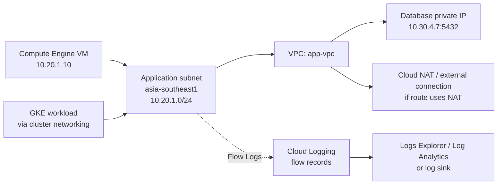

# VPC Flow Logs and Traffic Observability on Google Cloud

When a Compute Engine VM cannot connect to Cloud SQL over a private IP, or a GKE application suddenly transmits large volumes of outbound data, the first question is usually: **where is traffic coming from and going to, over which ports, and at what volume?** Inspecting VPC, subnet, route, and firewall configurations reveals the *intended path*, whereas observability data identifies *the actual communication flows recorded*.

**VPC Flow Logs** is a network traffic observability capability in Google Cloud. It provides information about IP flows as aggregated and sampled records, useful for analyzing connectivity, monitoring trends, spotting anomalous traffic, and supporting network planning. This is a topic in the **VPC and Routing** chapter of module `CLOUD_PROVIDERS_GCP`, where learners progress from project organization, IAM, and VPCs to deploying Compute Engine, GKE, Cloud Run, storage and database services, and then operating reliability and cost.

Most importantly: **VPC Flow Logs show what was observed and recorded; they do not guarantee capturing every packet and do not replace evidence of firewall decisions.**

## 1. Learning Objectives

After this lesson, you will be able to:

- Explain what a **flow** is and read IP address, port, protocol, timestamp, byte count, and metadata attributes.
- Determine VPC Flow Logs applicability across Google Cloud networks and the relationship between **global VPCs**, **regional subnets**, projects, and workloads.
- Enable, inspect, and search flow logs for a subnet via Console, `gcloud`, and Cloud Logging.
- Distinguish **VPC Flow Logs**, **Firewall Rules Logging**, **Cloud NAT logging**, **Cloud Monitoring**, and connectivity testing tools.
- Recognize the implications of **sampling**, **aggregation**, **metadata**, **filtering**, **log routing**, and **cost**.
- Design an investigation workflow across Compute Engine, GKE, Cloud Run, Cloud SQL, and connected networks.
- Avoid drawing false conclusions when **logs are absent**, when traffic is NATted, or when logs lack application data.

## 2. What Do VPC Flow Logs Record?

A **network flow** is typically identified by a set of connection attributes often called a **5-tuple**:

1. Source IP address — `source IP`.
2. Source port — `source port`.
3. Destination IP address — `destination IP`.
4. Destination port — `destination port`.
5. IP protocol — `protocol`, such as TCP (`6`) or UDP (`17`).

These attributes help answer **who is connecting to whom and over which protocol**. Flow Log records can also include observation window start/end times, packet and byte counts, observation direction or point, and metadata about VMs, VPCs, subnets, projects, or traffic characteristics where available and configured.

Example:

```text
Source:      10.20.1.10:51020
Destination: 10.30.4.7:5432
Protocol:    TCP
Time window: 10:15:00–10:15:30
Volume:      18 KiB (illustrative)
```

Assuming the application VM has IP `10.20.1.10` and the database uses `10.30.4.7:5432`, such a record suggests TCP traffic occurred between those two addresses and the PostgreSQL port during the recorded interval. **You cannot conclude from a single flow record alone that SQL queries succeeded or that all packets arrived intact.**

### 2.1. Illustrative JSON Data

A simplified record might look like this:

```json
{
  "connection": {
    "src_ip": "10.20.1.10",
    "src_port": 51020,
    "dest_ip": "10.30.4.7",
    "dest_port": 5432,
    "protocol": 6
  },
  "start_time": "2026-11-19T03:15:00Z",
  "end_time": "2026-11-19T03:15:30Z",
  "bytes_sent": 18432,
  "packets_sent": 28
}
```

This is a **simplified educational example**, not an actual record from a live project. Specific fields and metadata can vary by feature, configuration mode, and data version. When writing live queries, open a real record from your own system to confirm exact attribute paths.

### 2.2. VPC Flow Logs Are Not Packet Capture

| Question | How far do Flow Logs help? |
| --- | --- |
| Which VM exchanged data with which IP? | Can analyze source/destination IPs and metadata when they appear in logs. |
| Which ports are commonly used in communication? | Can aggregate `dest_port` and protocol statistics. |
| When did traffic spike sharply? | Can track sampled and aggregated traffic volume over time. |
| What URL, HTTP headers, or SQL payload did the packet contain? | **No**; Flow Logs do not record application payloads. |
| Did every single packet traverse the network? | **Not guaranteed**; Flow Logs involve sampling, aggregation, and collection scopes. |
| Did the firewall allow or deny a specific request? | **Cannot be confirmed from Flow Logs alone**; requires Firewall Rules Logging and related data. |
| Did a TCP handshake or application transaction complete? | A single flow record is **not enough** to conclude this. |

Because they contain no payloads, Flow Logs suit **observing flows and trends**. When you need to inspect application messages, use application logs, traces, request logs, or appropriate, authorized packet-level tools.

## 3. Where Do Flow Logs Sit in VPC Architecture?

In Google Cloud, a **VPC network** is a global resource, while a **subnet** belongs to a region. Workloads use network interfaces or connection paths into the VPC; flow log collection mechanisms have specific scopes and conditions.

An illustrative diagram:



This is a **logical** diagram and does not imply all traffic passes through a single VPC appliance. Google Cloud VPC uses software-defined networking, and features such as routes, firewalls, NAT, peering, or hybrid links follow their own rules.

### 3.1. Subnet-Level Configuration and Other Management Options

A common way to use VPC Flow Logs is **enabling logging on a subnet**. For deployments or features supported by Google Cloud, there are also other ways to manage VPC Flow Logs configurations via different APIs/administrative levels. When choosing a method, consult current documentation regarding **supported traffic sources, scope, configuration precedence, and billing**.

In this lab, we use **subnet-based VPC Flow Logs** because it can be inspected directly via `gcloud compute networks subnets`.

Points to remember:

- **Enabling logging does not alter routing or firewalls** on the subnet.
- Logging can be configured where **traffic is supported and observable**; do not assume all cross-network connections appear in a single project.
- In **Shared VPC**, subnets belong to the **host project**; identify the exact project owning the subnet and where logs are written/routed before querying.
- Two subnets in different regions, different VPCs, or different projects can have independent logging configurations, log viewing permissions, and costs.

### 3.2. Which Workloads Appear in Logs?

| Source/destination | How to reason during investigation |
| --- | --- |
| **Compute Engine VM** | Identify which subnet the NIC attaches to, source/destination IPs, region, and project of the NIC/subnet. |
| **GKE** | Check cluster network mode, nodes, alias IP ranges, Pod IPs, NAT/SNAT, and supported logging/metadata; logs may reflect different observation points. |
| **Cloud Run** | Check the egress path into the VPC via **Direct VPC egress** or the matching connector. Do not assume inbound HTTP to Cloud Run appears in subnet flow logs. |
| **Cloud SQL private IP** | Cross-check IP/port and path from client to service, but Flow Logs will not show SQL statements or DB login outcomes. |
| **Cloud NAT / internet** | Check how addresses are translated and cross-reference NAT logs when needed; do not assume both pre-NAT and post-NAT appear in one record. |
| **On-premises via VPN/Interconnect** | Check routes, VPN/Interconnect paths, collection points, and where flows actually traverse. |

Visibility in VPC Flow Logs depends on traffic source, connectivity method, and configuration. **Absence of a flow in one subnet is insufficient to prove traffic does not exist.**

## 4. How Do VPC Flow Logs Differ from Other Network Observability Tools?

Choosing the right data source saves investigation time.

| Tool | Questions it answers well | What not to expect |
| --- | --- | --- |
| **VPC Flow Logs** | Which IPs communicate with which IPs, what ports/protocols, and what recorded traffic volume over time? | Payloads, every packet, or exact per-packet firewall decisions. |
| **Firewall Rules Logging** | Which traffic matched a logging-enabled firewall rule; rule and action metadata per supported mechanism? | Guaranteed full coverage of all VPC flows or application content. |
| **Cloud NAT logging** | Information about NAT translations or NAT errors per enabled logging mode. | Replacing Flow Logs when analyzing all internal VPC communication. |
| **Connectivity Tests (Network Intelligence Center)** | Analyzes **expected reachability** based on network paths, routes, firewalls, and conditions modeled by the tool. | Proving the real application successfully transferred data in the past. |
| **Cloud Monitoring / metrics** | Error trends, latency, throughput, or system health via metrics. | Providing 5-tuples for individual flows without an appropriate log source. |
| **Application Cloud Logging** | HTTP statuses, DB connection errors, request IDs, auth errors. | Replacing IP-layer network path evidence. |
| **Packet Mirroring and suitable packet capture tools** | Deeper packet inspection in supported and authorized environments. | Being a low-cost or zero-privacy-risk solution; requires dedicated setup. |

**Example:** `Connection timed out` when a VM connects to `10.30.4.7:5432`. Connectivity Tests may uncover an invalid firewall rule or route; Firewall Rules Logging may show a deny rule firing; Flow Logs reveal recorded flows; database logs show whether the application reached PostgreSQL. **Combining sources** yields reliable conclusions.

## 5. Parameters Governing Log Quality and Cost

Flow Logs use **sampling** and **aggregation** to bound data volume. This directly affects analysis results.

### 5.1. Sampling: Not Every Flow Gets a Record

The sampling rate represents the fraction of eligible data within feature scope selected to be recorded/retained per service mechanics. Depending on the VPC Flow Logs method, the process may involve packet sampling followed by aggregation and record sampling.

- Higher rates help observe short/rare flows better, but increase log volume and cost.
- Lower rates suit high-volume trend analysis, but **may miss** brief connections.
- Sampling `0.5` does not mean "exactly half of every VM's connections will be stored." It is a statistical sampling mechanism, not a per-flow coverage guarantee.

For security or rare-incident investigations, understand confidence bounds and supplement with appropriate log sources rather than treating missing logs as proof of no connection.

### 5.2. Aggregation Interval: Grouping Over Time Windows

Flow Logs can aggregate a flow's data across time windows. Short windows help analyze fluctuations close to when they occurred, but produce more records. Long windows reduce record counts and may blur exact sub-interval timing details.

For example, a TCP connection lasting several minutes may appear as multiple aggregated records across intervals rather than one record per packet. Never count records and conclude that equals the number of **unique connections** without inspecting the schema and aggregation behavior.

### 5.3. Metadata: More Context, Also More Data

Metadata fields (when supported and configured) help identify **VMs, projects, VPCs, subnets, regions, Kubernetes or network attributes**, rather than bare hard-to-trace IPs. However:

- Metadata is not guaranteed on every flow type or connectivity method.
- Metadata may be absent when endpoints cannot be resolved or are not enabled.
- Storing excessive metadata increases volume, cost, and data-protection obligations.

### 5.4. Filtering and Log Routing

Depending on the configuration method, you can select/limit collected data per service capabilities, then process via **Cloud Logging Log Router**:

- **Logs Explorer:** near-real-time incident investigation.
- **Log Analytics or BigQuery:** historical queries, aggregating by service/IP/port for periodic analysis.
- **Log sinks to supported destinations:** exporting records to appropriate storage or processing pipelines.
- **Exclusions and retention:** managing volume/cost and storage duration per organization policy.

Distinguish **filtering at the source** from **filtering/routing after logs reach Cloud Logging**: they affect data recoverability and billing differently. Check current Logging, sink, and destination pricing models. Never turn off all logs solely to cut costs while production investigation needs remain.

## 6. Hands-On: Enabling Flow Logs for a Subnet

**Assumed context:** project `orders-prod` has VPC `orders-vpc` and subnet `orders-app-subnet` in `asia-southeast1`. A VM or workload with a valid VPC path sends traffic to a private-IP database. We will enable logging on the subnet and query records in Cloud Logging.

The commands below are **illustrative commands**. Substitute project ID, subnet, and region for an authorized system. Enabling Flow Logs modifies logging configuration and can incur log storage/processing charges; run only with administrative permissions in an authorized environment.

### 6.1. Inspect Before Enabling

```bash
PROJECT_ID="orders-prod"
REGION="asia-southeast1"
SUBNET="orders-app-subnet"

# Inspect subnet, VPC, CIDR, and current logging configuration
gcloud compute networks subnets describe "$SUBNET" \
  --project="$PROJECT_ID" \
  --region="$REGION" \
  --format="yaml(name,network,ipCidrRange,enableFlowLogs,logConfig)"
```

Before making changes, confirm:

1. Exact **project owning the subnet**; with Shared VPC, this may be the host project.
2. Subnet is in the required **region**.
3. The workloads and paths to observe involve this subnet.
4. Appropriate IAM permissions to update the subnet and view logs.
5. FinOps/SRE teams are aware of log volume and retention impact.

### 6.2. Enable Flow Logs

Example for subnet-based logging:

```bash
gcloud compute networks subnets update "$SUBNET" \
  --project="$PROJECT_ID" \
  --region="$REGION" \
  --enable-flow-logs
```

This is a **configuration write operation**, not a read command. Once enabled, you can further adjust aggregation interval, sampling rate, and metadata in Console or via corresponding `gcloud` flags if supported by the feature/method. Check existing values before choosing a collection level.

Read back status:

```bash
gcloud compute networks subnets describe "$SUBNET" \
  --project="$PROJECT_ID" \
  --region="$REGION" \
  --format="yaml(name,enableFlowLogs,logConfig)"
```

Seeing `enableFlowLogs: true` in the configuration confirms the subnet setting is enabled; **it does not prove** a specific flow has appeared yet. Supported traffic must occur, and sampling, log ingestion latency, view permissions, and log routing also apply.

### 6.3. Inspect in Console

In Google Cloud Console:

1. Select the project owning the subnet.
2. Open **VPC network → VPC networks** and locate the target subnet (UI navigation paths may vary).
3. Inspect/adjust Flow Logs in the subnet configuration section.
4. Open **Logging → Logs Explorer** in the project receiving the logs.
5. Filter records by log ID, resource, and time range, then inspect connection/metadata fields.

Do not use "no logs in the first minute" to conclude the configuration is broken. Verify actual traffic occurred, ingestion/processing delay into Cloud Logging, and log filtering/retention settings.

## 7. Querying VPC Flow Logs with Cloud Logging

When using **subnet-based VPC Flow Logs**, records typically carry log ID `compute.googleapis.com/vpc_flows` and monitored resource type `gce_subnetwork`. For other logging setups/sources, verify the actual resource type and log ID rather than copying filters blindly.

### 7.1. Viewing Recent Records

**Logs Explorer** filter:

```text
resource.type="gce_subnetwork"
log_id("compute.googleapis.com/vpc_flows")
```

Select a **time range** matching the test window. If multiple subnets have logging enabled, add monitored resource label filters seen on a live record.

Read-only CLI command example:

```bash
gcloud logging read \
  'resource.type="gce_subnetwork" AND log_id("compute.googleapis.com/vpc_flows")' \
  --project="$PROJECT_ID" \
  --freshness=1h \
  --limit=20 \
  --format=json
```

Log reading permissions are typically granted via appropriate IAM roles such as **Logs Viewer**, though additional permissions may be needed depending on log type, log bucket, or restricted data. An account permitted to view VMs does not automatically have permission to read all logs.

### 7.2. Filtering an IP Pair or Port

Suppose you are investigating traffic from VM `10.20.1.10` to a database on TCP port `5432`:

```text
resource.type="gce_subnetwork"
log_id("compute.googleapis.com/vpc_flows")
jsonPayload.connection.src_ip="10.20.1.10"
jsonPayload.connection.dest_port=5432
```

If you need a specific IP pair:

```text
resource.type="gce_subnetwork"
log_id("compute.googleapis.com/vpc_flows")
jsonPayload.connection.src_ip="10.20.1.10"
jsonPayload.connection.dest_ip="10.30.4.7"
jsonPayload.connection.protocol=6
```

This is a **one-way filter**. A traffic exchange may emit records for the reverse direction, and IPs/ports can change due to NAT/SNAT or actual paths. If results are empty, relax conditions one by one and inspect the real record structure before drawing conclusions.

### 7.3. Discovering Unexpected Connections

From available records, SRE teams can look for:

- Sources contacting an unusual number of destinations or unexpected destination ports.
- Connections going to unplanned public addresses.
- Sharp spikes in bytes/packets after a release or route/NAT change.
- Traffic associated with dev projects seemingly targeting production resources.

**Methodology warning:** An unusual IP or port is only an indicator to investigate, not proof of an attack on its own. Cross-check asset inventory, DNS, deployments, firewall logs, application logs, and real operational context.

## 8. Scenario 1: VM Cannot Connect to Cloud SQL via Private IP

Assume:

- VM `orders-worker` has IP `10.20.1.10` in subnet `orders-app-subnet`.
- Cloud SQL has private IP `10.30.4.7` and PostgreSQL listens on TCP `5432`.
- The application reports `connection timeout` after a configuration change.

### 8.1. Methodical Investigation

**Step 1 — Verify the actual endpoint:** check which hostname/IP and port the application actually uses, and whether it connects via private IP, public IP, or a proxy/connector. Do not assume the app config points to `10.30.4.7`.

**Step 2 — Check the expected network path:** read subnet configuration, routes, firewalls/connectivity links between the app network and Cloud SQL; run **Connectivity Tests** if the connection type is supported. Check VPC requirements, private services access/Private Service Connect, or the Cloud SQL connection model in use.

**Step 3 — Query flow logs:** filter by `src_ip=10.20.1.10` and `dest_port=5432` in the appropriate log destination. Observe timestamps, destinations, packet/byte counts, and available metadata.

**Step 4 — Cross-check other sources:** inspect Firewall Rules Logging, Cloud SQL logs/metrics, application logs, and recent deployment events.

**Step 5 — Fix the root cause:** e.g., wrong IP in app config, missing firewall rule, invalid network path, or exhausted DB connection capacity. Never change multiple variables simultaneously without data.

### 8.2. Interpreting Observations

| Observed result | What can be inferred | What cannot yet be concluded |
| --- | --- | --- |
| Flow exists to `10.30.4.7:5432` | Matching traffic was recorded at the collection point. | Database login and SQL queries succeeded. |
| Traffic goes to a different IP | App/NAT/DNS may be steering traffic to an unexpected target. | The system is definitely under attack. |
| No matching records | No traffic observed in the queried logs. | Zero packets were ever sent. |
| Firewall log shows deny | The logged rule rejected matching traffic. | Every packet of the entire session was captured by one record. |
| App log says `authentication failed` | Connection likely reached the app/database auth stage. | The problem definitely lies in VPC routing. |

The key is combining evidence from the right **network layer**, **service layer**, and **application layer**.

## 9. Scenario 2: GKE Generates a Sudden Surge in Internet Egress Traffic

A service running on GKE in project `orders-prod` experiences rising egress charges, and logs show many flows to public IPs. The team needs to identify which workload is generating the traffic.

Workflow:

1. **Confirm cost and timeframe:** in Billing/Monitoring, pinpoint the dates, region, traffic type, and time of spike.
2. **Identify observation points:** which subnet and secondary ranges do cluster nodes and Pods use, is SNAT performed, does traffic go through Cloud NAT or another path?
3. **Enable/inspect Flow Logs on supported sources:** pull records with public destination IPs, aggregate total volume by IP/port/time window; note sampling and metadata.
4. **Cross-reference Kubernetes:** which Pods/namespaces/deployments are scheduled on those nodes, which service accounts, which revisions were recently deployed, are batch jobs or backups running?
5. **Inspect Cloud NAT logs and application logs:** NAT can alter IP addresses at the observation point; app logs help identify specific HTTP endpoints or tasks.
6. **Mitigate impact:** restrict unnecessary outbound traffic per available network policies, fix the traffic-generating job, and set cost and network behavior alerts.

**Never infer directly from a source IP in Flow Logs that it belongs to a specific Pod** if masquerading/SNAT is active or Kubernetes metadata is missing. Cross-check identities at the collection point and active address translation rules.

## 10. Scenario 3: Cloud Run Cannot Reach a Private Resource

A Cloud Run service needs to call a backend over the VPC. In the design diagram, the service is configured with **Direct VPC egress** (or another Google Cloud-supported VPC connection method).

Investigation steps:

- Verify the live **Cloud Run revision** and actual egress configuration, region, and chosen VPC/subnet; do not rely solely on desired config in IaC code.
- Check the backend's private address, DNS resolution, and target port.
- Use Flow Logs along the **logging-supported** VPC path to view relevant traffic; do not assume direct inbound HTTPS to Cloud Run appears in subnet logs.
- Check firewalls, routes, ingress/egress settings, and service-specific access controls.
- Cross-check Cloud Run request/container logs, backend logs, Cloud Monitoring, and Connectivity Tests where supported.

A `403` on a Cloud Run request may be caused by **backend IAM/authorization**, not routing. A `timeout` error may be network-related, or caused by an overloaded application or backend. **Having Flow Logs does not eliminate the need for application-layer observability.**

## 11. Investigation Workflow When VPC Flow Logs Are Missing

Missing records are a signal to check **observability setup** before citing them as proof of a broken network:

1. **Right project?** With Shared VPC, the subnet may live in the host project; logs might be routed elsewhere.
2. **Right subnet and region?** VPCs are global, subnets are regional; the workload may use a different NIC/subnet.
3. **Is logging enabled for the right traffic source?** Check subnet config or the active collection mechanism.
4. **Did real traffic occur?** Confirm the application actually initiated connections at that time; note workloads may pool/reuse connections.
5. **Is the time window wide enough?** Check UTC/timezones, aggregation intervals, and Cloud Logging ingestion delay.
6. **Sampling or filters?** Brief flows can be missed by sampling; overly narrow IP/port filters can exclude records.
7. **Log Router/exclusions/retention?** Logs may be routed out of the viewed bucket or past retention.
8. **Missing log view permissions?** An account may see VMs yet lack permissions to read the corresponding log bucket.
9. **Special connectivity traits?** NAT, Cloud Run/GKE, hybrid, traffic bypassing the expected collection point, or unsupported product paths.

After verifying all of the above without seeing logs, use **complementary tools** such as Connectivity Tests, firewall logs, NAT logs, Cloud Monitoring, application logs, and route checks.

## 12. Designing Network Observability for Dev/Staging/Prod Environments

An enterprise manages:

```text
Organization
└── Folder: workloads
    ├── Folder: dev
    │   └── Project: orders-dev
    ├── Folder: staging
    │   └── Project: orders-staging
    └── Folder: prod
        ├── Project: orders-prod
        └── Project: payments-prod
```

Flow Logs design should match **risk, investigation needs, and cost**, rather than applying one rigid configuration across every subnet.

| Aspect | Dev | Staging | Prod |
| --- | --- | --- | --- |
| Observation purpose | Connectivity checks and debugging. | Verifying network paths pre-release, incident drills. | Incident investigation, security, performance, and egress trends. |
| Detail level | Moderate sampling/metadata; increase when needed. | Can raise detail during test phases. | Select sampling/aggregation per criticality and storage budget. |
| Log access | Authorized developers per project. | QA/SRE by role. | SRE/Security/Network Operations with least privilege. |
| Retention | Matches debugging needs. | Matches release cycles. | Matches investigation and security/compliance mandates. |
| Alerting | Critical outage alerts. | Connectivity/latency outside test baselines. | Combine Monitoring, firewall/NAT logs, app errors, and budgets. |

### 12.1. IAM Permissions to Consider

Anyone enabling Flow Logs needs **source modification permissions**, such as updating the corresponding subnet. Analysts need permission to view logs in Cloud Logging scoped to specific resources/log buckets. Network, SRE, and security teams may require distinct roles.

**Never grant `roles/owner` across the entire Organization** just to enable Flow Logs or query logs. When designing Shared VPC, separate permissions on the **host project**, **service projects**, and log-viewing permissions after routing.

### 12.2. Cost, Sensitive Information, and Retention

Flow Logs can incur costs based on ingested, stored, analyzed, and exported log volume. A high-traffic subnet with high sampling, rich metadata, and short aggregation intervals can generate massive record counts.

Even without payloads, **IPs, endpoints, and connection patterns** can still reveal system topology or user behavior. Therefore:

- Grant log read/export permissions on a least-privilege basis.
- Choose retention aligned with legal, security, and practical investigation needs.
- Export data only to approved BigQuery/Pub/Sub/storage destinations.
- Balance sampling, aggregation, metadata, and log routing using real usage data.
- Track Logging and destination storage costs; set budget alerts where appropriate.

### 12.3. Flow Logs and Application Reliability

Flow Logs help investigate **network traffic**, but are not a direct SLO indicator. For Cloud Run and GKE, continue measuring error rate, latency, request volume, and saturation; for Cloud SQL, monitor CPU, connections, disk, and query errors; for VPCs, supplement with Connectivity Tests and firewall/NAT logs.

During an incident, asking *"Are there VPC Flow Logs records?"* is one evidence-gathering step—**not the sole criterion for judging service health**.

## 13. Practice Exercises

### Exercise A — Reading a Flow Record

Given an illustrative record:

```text
src_ip:       10.4.1.20
src_port:     51000
dest_ip:      10.5.2.15
dest_port:    443
protocol:     6
start_time:   11:00:00
end_time:     11:01:00
bytes_sent:   262144
```

Answer:

1. Which IP protocol and destination port is this?
2. Can you definitively conclude which URL was called?
3. Does `bytes_sent` accurately represent every byte of the connection?

**Answers:** (1) Protocol `6` is TCP; destination port `443` is commonly used for HTTPS, though the record alone does not prove the application completed a valid HTTPS session. (2) No; Flow Logs do not contain URLs/payloads. (3) Not necessarily; depends on sampling, aggregation, observation point, and record direction.

### Exercise B — Missing Logs During a Connection Attempt

VM `10.20.1.10` cannot connect to database `10.30.4.7:5432`. Logs Explorer shows zero records with `src_ip=10.20.1.10`.

List at least **six** causes to check before concluding no traffic occurred.

**Hint:** project/host project, subnet/region, logging enabled, sampling, time window, filters, log view permissions, log routing, whether the workload actually sent requests, and whether NAT/another path exists.

### Exercise C — Choosing the Right Tool

Match each question to the right tool:

| Question | Priority tool |
| --- | --- |
| "Which destination IPs and ports appear in recorded traffic?" | **VPC Flow Logs**. |
| "Which firewall rule is logged as denying a connection?" | **Firewall Rules Logging**, when logging is enabled on the rule. |
| "Do configured routes and firewalls permit a path per Google Cloud analysis?" | **Connectivity Tests**. |
| "Which API returned HTTP 500 and what is the stack trace?" | **Application logs/Cloud Logging**. |
| "Did NAT emit any related translation/error events?" | **Cloud NAT logging/metrics**. |
| "Is the service meeting its latency SLO and error budget?" | **Cloud Monitoring/SLI-SLO metrics**. |

### Exercise D — Optimizing Observability and Cost

A prod subnet generates huge volumes of Flow Logs, Cloud Logging costs are rising, yet the operations team rarely queries data older than 30 days. Propose three ways to reduce cost while preserving investigation capability.

**Suggested answers:**

1. Tune sampling and aggregation intervals based on needed detail, avoiding arbitrary changes during active incidents.
2. Select appropriate metadata/filters and manage Log Router/exclusions per retention policies.
3. Review retention and storage destinations; separate long-term analytics needs from near-real-time troubleshooting.

Never slash log volume merely to hit an arbitrary percentage target; first define **what data Security/SRE teams strictly require** for incident response and compliance.

## 14. Operational Checklist

- [ ] Identified VPC, subnet, region, subnet-owning project, and related projects.
- [ ] Know which mechanism enables Flow Logs and which traffic sources are supported.
- [ ] Have approved sampling, aggregation, metadata, and retention settings.
- [ ] Know the exact log ID/monitored resource in Logs Explorer and log-reading permissions.
- [ ] Prepared filters by IP, port, protocol, time, and resource for rapid investigation.
- [ ] Understand that **no flow record does not mean no packets**.
- [ ] Have Firewall Rules Logging, Cloud NAT logs, Connectivity Tests, and application logs available when needed.
- [ ] Check Cloud Run/GKE/NAT/SNAT before attributing a flow to a specific Pod or service.
- [ ] Monitor Logging costs and enforce access control on logs.
- [ ] Have runbooks for database connection failures, egress spikes, and service outages.

## 15. Key Takeaways

- **VPC Flow Logs** observe recorded IP flows, helping analyze sources, destinations, ports, protocols, and traffic volumes.
- Records are **sampled and aggregated**; therefore you cannot prove every packet, TCP handshake completion, application success, or firewall verdict solely from Flow Logs.
- **VPCs are global networks; subnets are regional.** When enabling and querying logs, identify the exact subnet, project, Shared VPC host project, and traffic path.
- Use **Logs Explorer** to query flows; combine **Firewall Rules Logging, Cloud NAT logging, Connectivity Tests, Monitoring, and application logs** to isolate root causes.
- Across **Compute Engine, GKE, Cloud Run, and Cloud SQL**, understand observation points and the effects of NAT/SNAT, ingress/egress, private IPs, and service permissions.
- Sampling, aggregation, metadata, retention, and log routing balance **investigation capability, security, and cost**.
- Traffic observability is one layer of reliable operations alongside IAM, security policies, application monitoring, and cost governance.

### Google Cloud Reference Documentation

- [VPC Flow Logs overview](https://cloud.google.com/vpc/docs/about-flow-logs)
- [Using VPC Flow Logs](https://cloud.google.com/vpc/docs/using-flow-logs)
- [VPC Firewall Rules Logging](https://cloud.google.com/vpc/docs/firewall-rules-logging)
- [Cloud NAT logging](https://cloud.google.com/nat/docs/monitoring)
- [Cloud Logging — Logs Explorer](https://cloud.google.com/logging/docs/view/logs-explorer-interface)
- [Cloud Logging — Log Router](https://cloud.google.com/logging/docs/routing/overview)
- [Network Intelligence Center — Connectivity Tests](https://cloud.google.com/network-intelligence-center/docs/connectivity-tests/concepts/overview)
- [Cloud Run Direct VPC egress](https://cloud.google.com/run/docs/configuring/vpc-direct-vpc)
