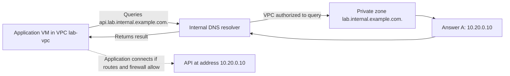

# Cloud DNS Private Zones and Internal Resolution

> **Chapter:** DNS and Hybrid Connectivity  
> **Module:** CLOUD_PROVIDERS_GCP  
> **Module Scope:** Explore Google Cloud from project organization, IAM, and VPC to Compute Engine, GKE, Cloud Run, storage services, and databases. Through deployment scenarios, learners learn how to choose services, secure resources, automate releases, and monitor reliability and cost.

An internal application often needs to call a database, API, or server by a **memorable name** instead of hardcoding IP addresses in source code. On Google Cloud, **Cloud DNS private managed zones** let you create DNS records that are only resolved from **authorized VPC networks**. Administrators can use a name such as `api.lab.internal.example.com.` to return an internal address `10.20.0.10` for workloads inside a VPC, without publishing that record to the public DNS system.

Understanding private zones properly helps you design consistent Compute Engine, GKE, and VPC-connected service environments, control resolution scope, handle names in hybrid environments, and avoid hard-to-spot errors such as receiving `NXDOMAIN` when querying from the wrong VPC or using an unsuitable DNS server.

## Learning Objectives

After this lesson, you will be able to:

1. Distinguish between **public zones**, **private managed zones**, **forwarding zones**, **DNS peering zones**, and Google Cloud-provided VM internal DNS names.
2. Explain the role of **authorized VPC networks**, DNS suffixes, record sets, TTL, FQDNs, and the internal resolver `169.254.169.254`.
3. Describe the name resolution flow from a VM inside a VPC, especially when private zones, public zones, and DNS suffixes overlap.
4. Create a private zone, add an `A` record, and verify it with `gcloud` and, when a suitable VM is available, with `dig`.
5. Diagnose errors involving `NXDOMAIN`, missing permissions, wrong VPCs, caching, custom resolvers, and network connectivity.
6. Recognize when **DNS forwarding**, **DNS peering**, or **inbound forwarding** is needed for on-premises connectivity, Shared VPC, and multi-VPC environments.

## 1. What Problem Does Internal DNS Solve?

DNS turns a name into data such as an IPv4 address, IPv6 address, or another target name. For example, an application queries `api.lab.internal.example.com.` to obtain `10.20.0.10`, then establishes a TCP/HTTPS connection to that address.



In this diagram, **DNS returns the address**, while the network and application determine whether the connection succeeds. An `A` record pointing to `10.20.0.10` does not create a VM or API at that address, does not open firewall rules, and does not grant IAM permissions.

### Comparing DNS Solutions on Google Cloud

| Component | Nature | When to Use |
|---|---|---|
| **Cloud DNS public managed zone** | Records published through the public DNS system per domain delegation | Websites, public endpoints, domain verification |
| **Cloud DNS private managed zone** | Authoritative record source for a DNS suffix, available to authorized VPCs/targets | Internal APIs, servers, internal services |
| **Cloud DNS forwarding zone** | Forwards queries for a DNS suffix to target DNS servers | Resolving names managed by on-premises DNS or other DNS servers |
| **Cloud DNS peering zone** | Lets a consumer VPC query a namespace using a producer VPC's resolution mechanism | Sharing resolution capabilities across VPCs via DNS peering |
| **Compute Engine internal DNS** | Internal names provided by Google Cloud for VMs under the internal model | Finding VMs by platform-managed internal names |
| **Cloud DNS server policy** | Controls DNS features such as inbound forwarding or alternative outbound servers | Hybrid designs, custom resolution routing |

A private zone typically uses a DNS suffix under a **domain controlled by the organization**, such as `lab.internal.example.com.` (an example domain used here). Avoid choosing names that could collide with public DNS, internal system names, or `.local` which is commonly used for multicast DNS.

## 2. Structure of a Private Managed Zone

Cloud DNS manages **zones**; a zone contains **resource record sets**. In the example:

```text
Cloud DNS private managed zone
  Managed zone name: lab-private-zone
  DNS suffix:        lab.internal.example.com.
  Visibility:        private
  Authorized VPCs:   lab-vpc

Records:
  api.lab.internal.example.com.  A     300  10.20.0.10
  db.lab.internal.example.com.   A     300  10.20.0.20
  app.lab.internal.example.com.  CNAME 300  api.lab.internal.example.com.
```

**Managed zone name** is the Cloud DNS resource name in the project, used with `gcloud` and the API. **DNS suffix (`dnsName`)** is the DNS name portion the zone manages; record names must fall within that namespace. These two values have different meanings.

| Field | Meaning | Example |
|---|---|---|
| **Managed zone name** | Management ID of the zone in Cloud DNS | `lab-private-zone` |
| **DNS name/suffix** | The DNS suffix the zone is responsible for | `lab.internal.example.com.` |
| **Visibility** | Public or private | `private` |
| **Authorized networks** | VPC networks allowed to query the private zone | `lab-vpc` |
| **Record name** | FQDN of the record | `api.lab.internal.example.com.` |
| **Record type** | DNS data type | `A`, `AAAA`, `CNAME`, `TXT` |
| **TTL** | Number of seconds resolvers/caches can keep the result | `300` seconds |
| **RDATA** | Data returned by the record | `10.20.0.10` |

### 2.1. FQDN and Trailing Dots

DNS uses Fully Qualified Domain Names (**FQDN**). A trailing dot such as `api.lab.internal.example.com.` denotes an absolute name; when running commands or checking records, use an FQDN with a trailing dot to prevent resolvers from appending DNS search suffixes.

Examples:

- `api.lab.internal.example.com.` — absolute name.
- `api` — short name; only works if the OS or application has a matching search domain configured.
- `app.lab.internal.example.com.` — can be a `CNAME` record pointing to `api.lab.internal.example.com.` if properly configured.

Do not write applications that depend on short names like `api` if you do not control the DNS search domains across containers, VMs, and clusters.

### 2.2. Records and TTL

| Type | Characteristics | Example Usage |
|---|---|---|
| **A** | Name → IPv4 | `api... → 10.20.0.10` |
| **AAAA** | Name → IPv6 | Endpoints with supported IPv6 addresses |
| **CNAME** | One name is an alias for another | `app... → api...` |
| **TXT** | Application-formatted text data | Internal metadata, compatible verification mechanisms |
| **MX / SRV** | Mail server or service location info | Compatible application use cases |
| **SOA / NS** | System-managed zone metadata | Cloud DNS creates/manages required records upon zone creation |

**TTL is not a server lifetime.** It indicates how long data may be cached according to resolver rules. Lowering TTL before changing an IP can shorten how long stale records are cached, but it does not guarantee every client updates immediately; resolvers and application libraries may maintain their own caches.

A `CNAME` cannot be used as a way to add an `A`-type value to the same name when DNS rules disallow coexistence. Before switching from A to CNAME, inspect existing record sets.

## 3. Who Can See a Private Zone?

The most important aspect of a private managed zone is that **query scope is bound to authorized VPC networks**. When creating or updating a zone, the administrator selects one or more VPC networks permitted to use that zone. A private zone is not automatically exposed on the Internet, nor is it automatically visible to every project in the organization.

```text
Cloud DNS private zone: lab.internal.example.com.
              |
              +-- Authorized: VPC A  -> can resolve names in the zone
              |
              +-- Authorized: VPC B  -> can resolve if added
              |
              +-- Unauthorized VPC C -> does not receive data from this private zone
              |
              +-- Internet users     -> cannot look up private records
                  from public DNS merely by knowing the FQDN
```

**Authorization here applies to the DNS namespace**, not server access permission. Being able to resolve an IP does not mean you can connect to that IP; conversely, an allowed network path to an IP does not automatically make a private DNS zone visible in another VPC.

### 3.1. Which Project Does the Private Zone Live In?

A zone is a resource inside a project. Authorized VPCs can be in the same project, whereas Shared VPC or cross-project binding models require appropriate IAM and binding design.

- **Simple lab:** the zone lives in the learning project, attached to a VPC in that project.
- **Shared VPC:** typically the private zone is created in the **host project** and attached to the Shared VPC network; service projects sharing that network gain appropriate resolution capabilities. **Cross-project binding** can also be used if properly configured and permitted.
- **Multiple VPCs:** you must explicitly authorize additional supported VPCs or design DNS peering/forwarding per architecture, rather than assuming VPC Network Peering automatically shares all private DNS records.

Do not grant `roles/dns.admin` broadly at the project level just so a workload can **query** DNS; zone administration permission allows **modifying records** and affects many applications.

### 3.2. How Do Queries from a VM Work?

Compute Engine VMs use internal DNS via the metadata server `169.254.169.254` in standard configurations. For VMs configured to use the platform-supported DNS resolver, DNS requests are processed according to the VPC scope and applicable DNS policies.

This has two operational consequences:

1. **Querying from inside a VM in an authorized VPC** is the right test for a private zone record along the standard resolution path.
2. **Browser-based Cloud Shell, personal laptops, and public DNS resolvers** do not automatically act as clients inside an authorized VPC. Running `dig` in Cloud Shell may not return private records even when the zone is completely valid.

A VM using a custom DNS server may bypass the Cloud DNS resolution path if that server does not forward queries properly. Do not conclude that Cloud DNS is broken just because `dig` via another DNS server returns the wrong result.

## 4. Name Resolution Order and Split-Horizon DNS

**Split-horizon DNS** is a model where the same FQDN can return **different results depending on the query source**. For example:

| Query Origin | Queried Name | Expected Result |
|---|---|---|
| VM in a VPC authorized for the private zone | `api.internal.example.com.` | `10.20.0.10` |
| Internet client querying public DNS | `api.internal.example.com.` | No private record; sees only public records if published |
| VM in another unauthorized VPC | `api.internal.example.com.` | Does not see data from this private zone; result depends on other DNS sources |

To set up split-horizon for the same suffix, an organization can maintain a **private zone** for internal VPCs and a separate **public zone** for public answers. Both zones can share the same DNS suffix while managing different record sets and query sources.

### 4.1. Longest Suffix Match

Suppose a VPC is authorized to use both:

- Private zone `internal.example.com.`.
- More specific private zone `dev.internal.example.com.`.

When a VM queries `api.dev.internal.example.com.`, the private zone `dev.internal.example.com.` is the **more specific** matching suffix. That zone is responsible for answering, even if a record with the same name exists in `internal.example.com.`.

If the selected zone is authoritative for the name but **does not contain the queried record**, the resolver may return `NXDOMAIN` or the appropriate negative response. The resolver **does not automatically fall back to public DNS for the same name** just because the record does not exist in an authoritative private zone. This is a common reason why an active public name suddenly stops resolving after creating a private zone that covers the entire suffix.

### 4.2. Other Processing Steps

DNS processing order in a VPC also depends on **DNS server policies**, **DNS response policies**, private/forwarding/peering zones, Compute Engine internal DNS, and public DNS. A VPC with an **outbound server policy with alternative name servers** can route resolution to those DNS servers ahead of standard VPC mechanisms.

Do not oversimplify this into a rule that "private zones always have the highest priority" in every setup. To diagnose issues, first check whether any server policy, response policy, or cluster-scoped DNS policy is active. GKE can use additional in-cluster DNS components; queries from Pods and nodes must be evaluated against the actual cluster configuration.

**Warning about CNAME:** Subsequent query behavior after receiving a CNAME is governed by specific rules that Google Cloud updates according to published schedules; therefore, when building CNAME chains involving both private and public zones, always consult the **Name resolution order** documentation at deployment time rather than assuming every query step follows the same order across all versions.

## 5. Practice: Creating a Private Zone and an A Record

This is a **DNS resource creation** lab; deploying a VM, GKE cluster, or Cloud SQL is not required. To verify actual resolution results, use **an existing lab VM inside the exact authorized VPC**. Without a VM, you can still verify the zone and record configuration via the Console or `gcloud`, though that is **not yet** a test of the resolution path from a workload.

### 5.1. Preparation

You will need:

- A **sandbox project** where you are permitted to manage Cloud DNS and an existing **VPC network** in that project (or a Shared VPC network permitted by the network admin).
- The **Cloud DNS API** enabled and an identity with appropriate permissions, such as DNS Administrator at the assigned scope. Attaching a private zone to a VPC may also require network permissions.
- An internal DNS suffix that **does not conflict** with public names, Compute Engine hostnames, other private zones, or organizational policies.
- A sample IPv4 address for the lesson only, such as `10.20.0.10`. To reach a real application, this address must be replaced with an **address owned by a running service**.
- Someone monitoring **Cloud Billing**, because Cloud DNS charges for zones/queries based on type and usage; having a budget alert alone does not cap costs.

**Consistent example throughout:**

| Variable | Example Value | Meaning |
|---|---|---|
| `PROJECT_ID` | `my-gcp-dns-lab` | Project containing the zone |
| `NETWORK_NAME` | `lab-vpc` | VPC authorized to resolve |
| `ZONE_NAME` | `lab-private-zone` | Cloud DNS resource name |
| `DNS_SUFFIX` | `lab.internal.example.com.` | Zone's DNS suffix |
| `RECORD_FQDN` | `api.lab.internal.example.com.` | Sample record name |
| `RECORD_IP` | `10.20.0.10` | Illustrative A record value |
| `TTL` | `300` seconds | Nominal cache duration |

These names and IPs are **placeholders** and are not guaranteed to exist or match your network.

### 5.2. Method A — Google Cloud Console

1. Go to the [Google Cloud Console](https://console.cloud.google.com/) and select the **correct project**.
2. Open **Network services → Cloud DNS → Create zone** (menu names may vary slightly by UI version).
3. Select **Private** for **Zone type/Visibility**.
4. Enter zone name `lab-private-zone` and DNS name `lab.internal.example.com.`.
5. Under **Options**, choose the default private zone type (do not select forwarding/peering if you want to create authoritative records directly).
6. Under **Networks**, select **VPC `lab-vpc`** or a VPC authorized by the network owner.
7. Review the DNS suffix, project, and authorized VPC, then create the zone.
8. Open the zone → **Add record set**. Enter the record name `api` or the FQDN as shown by the Console, choose **Type A**, TTL **300** seconds, and IPv4 `10.20.0.10`. Save the record.
9. Reopen the record list to confirm the FQDN, type, TTL, and RDATA.

Do not try to "verify a private zone" by creating a public zone with the same suffix or adding records to the public DNS system. This lab **only uses a private zone**.

### 5.3. Method B — Cloud Shell / gcloud

Sign in with the proper identity and select the sandbox project. In Cloud Shell (Bash), replace all placeholders before running:

```bash
PROJECT_ID="my-gcp-dns-lab"
NETWORK_NAME="lab-vpc"
ZONE_NAME="lab-private-zone"
DNS_SUFFIX="lab.internal.example.com."
RECORD_FQDN="api.lab.internal.example.com."
RECORD_IP="10.20.0.10"

# Check identity, project, and VPC; these commands are read-only
gcloud auth list --filter="status:ACTIVE"
gcloud projects describe "$PROJECT_ID" \
  --format="table(projectId,name,lifecycleState)"
gcloud compute networks describe "$NETWORK_NAME" \
  --project="$PROJECT_ID"

# List existing managed zones before creating to avoid overwriting or suffix conflicts
gcloud dns managed-zones list --project="$PROJECT_ID"
```

An authorized user enables the DNS API if needed:

```bash
# Run only if the API is not yet enabled and enabling APIs is permitted
gcloud services enable dns.googleapis.com --project="$PROJECT_ID"
```

Create the private managed zone:

```bash
gcloud dns managed-zones create "$ZONE_NAME" \
  --project="$PROJECT_ID" \
  --dns-name="$DNS_SUFFIX" \
  --description="Private DNS zone for GCP learning lab" \
  --visibility=private \
  --networks="$NETWORK_NAME"
```

The `--networks` flag selects authorized networks. This example uses a VPC in the same project; with Shared VPC/cross-project binding, you must use the proper network identifier, IAM permissions, and supported configuration.

Create an `A` record set:

```bash
gcloud dns record-sets create "$RECORD_FQDN" \
  --project="$PROJECT_ID" \
  --zone="$ZONE_NAME" \
  --type=A \
  --ttl=300 \
  --rrdatas="$RECORD_IP"
```

**Expected outcome:** If all permissions and settings are valid, the zone exists with private visibility and the record `api.lab.internal.example.com.` has value `10.20.0.10`. This only confirms the DNS mapping; it **does not prove an API is listening on the sample IP**.

### 5.4. Verifying Configuration Without Creating a VM

```bash
# Inspect DNS suffix, visibility, and VPCs authorized to use the zone
gcloud dns managed-zones describe "$ZONE_NAME" \
  --project="$PROJECT_ID" \
  --format="yaml(name,dnsName,visibility,privateVisibilityConfig)"

# List all record sets in the zone
gcloud dns record-sets list \
  --zone="$ZONE_NAME" \
  --project="$PROJECT_ID"

# Filter specifically for the A record to avoid confusion with SOA/NS
gcloud dns record-sets list \
  --zone="$ZONE_NAME" \
  --name="$RECORD_FQDN" \
  --type=A \
  --project="$PROJECT_ID"
```

**Checkpoint:** The zone has `dnsName=lab.internal.example.com.`, `visibility=private`, and VPC `lab-vpc` in the authorized list; the `A` record has RDATA `10.20.0.10` and TTL `300`.

### 5.5. Verifying Actual Resolution from a VM in the VPC

If you have an existing VM **located in the authorized VPC `lab-vpc`** with `dig` installed, run the following **on that VM**:

```bash
# Query Google Cloud's DNS metadata server directly from the VM
dig @169.254.169.254 api.lab.internal.example.com. A

# Verify whether the VM resolves via its default resolver
dig api.lab.internal.example.com. A

# Compare the response type and handling server
dig @169.254.169.254 api.lab.internal.example.com. A +noall +answer
```

The expected output is an `A` record for `api.lab.internal.example.com.` returning `10.20.0.10`. On Linux environments with a DNS stub resolver (such as systemd-resolved), a default `dig` command may show the local stub server; check the actual forwarding path rather than assuming every VM displays `169.254.169.254` on the `SERVER` line.

**Important:** Do not run `dig @169.254.169.254` from your personal machine or Cloud Shell and treat that output as a test of a private zone inside a VPC. This metadata resolver address is intended for supported Google Cloud VM environments; Cloud Shell is not automatically placed inside your private VPC just because you manage the same project.

## 6. Updating Records and Understanding Cache Impact

Suppose the API moves from `10.20.0.10` to `10.20.0.11`. A user with record-editing permissions can update RDATA:

```bash
# Update only if the record belongs to the lab zone and the new IP is a valid target
gcloud dns record-sets update "$RECORD_FQDN" \
  --project="$PROJECT_ID" \
  --zone="$ZONE_NAME" \
  --type=A \
  --ttl=300 \
  --rrdatas="10.20.0.11"

# Confirm the updated value in Cloud DNS
gcloud dns record-sets list \
  --zone="$ZONE_NAME" \
  --name="$RECORD_FQDN" \
  --type=A \
  --project="$PROJECT_ID"
```

A resolver may continue holding the old address **until the cached record expires**. If you need near-zero-downtime traffic shifting, DNS design is only part of the solution: the application needs health checks, load balancing, rollout/rollback, and an appropriate transition window. Do not set TTL to 0 or flip records back and forth as a substitute for a release strategy.

Even after clients receive the new address, DNS still does not guarantee `10.20.0.11` has a valid network path. You must verify routes, firewall rules, IAM, and the target application. Do not use `ping` success or failure as sole proof for an HTTP/HTTPS system.

## 7. Private DNS in Hybrid and Multi-VPC Environments

A private managed zone fits when **Cloud DNS is where you directly manage authoritative records**. For multi-network systems or data center connectivity, additional mechanisms are often needed to keep namespace management in the right place.

### 7.1. Forwarding Zone: Cloud DNS Querying On-Premises DNS

Suppose on-premises systems already manage `corp.example.com.`. Instead of duplicating every record into Cloud DNS, you can design a **Cloud DNS forwarding zone** for that suffix, forwarding queries from the VPC to on-premises DNS servers over **Cloud VPN** or **Cloud Interconnect**.

```text
VM in VPC
   |
   +--> Cloud DNS forwarding zone: corp.example.com.
             |
             +--> On-premises DNS server (e.g., 10.50.0.53)
                         |
                         +--> Enterprise-managed records
```

This is a **forwarding** model, not a private managed zone storing authoritative records itself. You must verify the target DNS IP, bidirectional hybrid network reachability, UDP/TCP port 53 firewall rules, and appropriate routes. In some standard forwarding modes, requests to private DNS targets may originate from a source range used by Cloud DNS (such as `35.199.192.0/19`); check the documentation for your specific forwarding setup to configure firewall and return routes accurately.

### 7.2. Inbound Forwarding: On-Premises Querying Private Names in GCP

If an on-premises DNS server needs to resolve `api.lab.internal.example.com.` stored in a GCP private zone, you cannot simply point queries to public DNS and expect private records back.

Typical design:

1. Create a **Cloud DNS inbound server policy** on the VPC in a supported manner.
2. Use the **inbound forwarding entry points** provided by Google Cloud for the appropriate network and region.
3. On the on-premises DNS server, create a **conditional forwarder** for the target suffix pointing to those entry points.
4. Ensure Cloud VPN/Interconnect, routes, firewall rules, and administrative permissions work bidirectionally.
5. Query from on-premises to verify. Do not assume that having a VPN connection automatically forwards DNS.

Note that the exact DNS policy type, entry points, and service limits must be confirmed in current documentation; never pick an arbitrary VM IP as an "inbound Cloud DNS endpoint."

### 7.3. DNS Peering Is Different from VPC Network Peering

A **DNS peering zone** allows a **consumer VPC** to send queries for a DNS suffix to the resolution mechanism of a **producer VPC**. This is a **one-way** resolution relationship by configuration; it is not the same as peering that carries data packets between two VPCs.

Example:

```text
Consumer VPC: app-vpc
    |
    | DNS peering zone for suffix prod.example.com.
    v
Producer VPC: shared-services-vpc
    |
    +--> private zone / forwarding zone / internal DNS
         per producer VPC resolution mechanism
```

VPC Network Peering or Cloud VPN establishes IP paths between networks, but **does not automatically make one VPC an authorized network** for a private zone in another VPC. DNS peering or proper network authorization must be configured separately; once the name resolves, the application still needs network routes and firewall rules to connect.

### 7.4. Shared VPC and GKE

- With **Shared VPC**, select the right **host project and Shared VPC network** when managing private zones; design cross-project bindings if record management must be delegated by service project.
- With **GKE**, Pods may query via **CoreDNS/kube-dns/Cloud DNS** depending on cluster configuration. Kubernetes internal namespaces (such as `svc.cluster.local`) differ from VPC private zones you create; understand cluster DNS policies and modes to predict the exact resolution path.
- With **Cloud Run** and managed services using VPC connectivity, do not assume all DNS requests follow the exact same path as a VM without checking how the service connects to the VPC, its resolver behavior, and current product documentation.

## 8. Governance, Security, and Reliability

### 8.1. Private DNS Is Not a Complete Security Layer

A private zone restricts **record resolution within its supported scope**; it does not encrypt connections, isolate applications by itself, authenticate requests, or stop clients from reaching an IP if another network path exists.

In real deployments, combine:

- **IAM:** grant DNS record management permissions only to the right people/pipelines; avoid sharing admin roles unnecessarily.
- **VPC firewall and routes:** control paths to destinations and service ports.
- **Application authentication:** HTTPS/TLS, IAM, or appropriate application-level authentication.
- **Naming governance:** maintain a suffix catalog, zone ownership, dev/staging/prod separation, and prevent collisions and uncontrolled edits.
- **Audit/monitoring:** review zone/record changes, admin access, and DNS query logging when needed and authorized.
- **Cost:** Cloud DNS charges based on resources/queries; logging can increase log volume and cost.

### 8.2. Query Logging and Sensitive Information

Cloud DNS supports query logging for certain private DNS configurations per supported features. Queried DNS names can reveal architectural details such as system names, environments, or service names. Only enable and store logs according to purpose, retention period, access controls, and organizational data protection policies.

**Private zones do not support DNSSEC** per service limitations. This does not mean Google Cloud publicly exposes private records, but you should understand the trust and security model of internal DNS rather than assuming every public zone feature exists.

### 8.3. Preventing Namespace Collisions

Before creating a zone:

1. Check existing suffixes in the same VPC and related DNS policies.
2. Avoid creating overly broad private zones (such as all of `example.com.`) if you only need `dev.internal.example.com.`. A broad zone can "shadow" public records sharing the same suffix for authorized VPCs.
3. Assign namespace management per team or product to prevent overlapping updates.
4. Standardize FQDN conventions for Compute Engine, GKE, and Cloud Run applications; avoid hardcoding IPs in configuration unless necessary.
5. Check special records like CNAME, SOA/NS, and reverse lookup configuration if both name → IP and IP → name resolution are required.

## 9. Cleaning Up Lab Resources

After finishing practice, if the private zone was created **solely for testing** and no workloads use it, delete the test record and then delete the zone. The following commands perform real operations; run them only after verifying `PROJECT_ID`, `ZONE_NAME`, and `RECORD_FQDN`. Do not delete shared zones or zones containing records owned by others.

```bash
printf 'Project: %s\nZone: %s\nRecord: %s\n' \
  "$PROJECT_ID" "$ZONE_NAME" "$RECORD_FQDN"

# Read all records before deleting so you do not miss records created by others
gcloud dns record-sets list \
  --zone="$ZONE_NAME" \
  --project="$PROJECT_ID"

# Delete only the lab's A record
gcloud dns record-sets delete "$RECORD_FQDN" \
  --zone="$ZONE_NAME" \
  --type=A \
  --project="$PROJECT_ID"

# Delete the zone only after confirming no custom records need to be kept
gcloud dns managed-zones delete "$ZONE_NAME" \
  --project="$PROJECT_ID"

# Verify the zone is no longer in the list
gcloud dns managed-zones list --project="$PROJECT_ID"
```

If you created additional `CNAME` or `A` records in the lab zone, delete them according to ownership and verify again. **Do not delete system SOA/NS records individually** to try to clear a zone. Once no user-managed records remain, deleting the zone through Cloud DNS will clean up the zone resource.

If the VPC used for the lab contains other resources, **keep the VPC intact**. This lesson only owns the private managed zone and records you created; there is no need to delete VMs, networks, VPNs, Cloud Routers, or another team's resources.

## 10. Troubleshooting Internal Resolution

When name lookup fails, distinguish between **DNS configuration**, **lookup result**, and **post-IP connectivity**.

| Symptom | Possible Cause | How to Check |
|---|---|---|
| `gcloud dns record-sets list` shows the record, but `dig` from VM returns wrong result | VM is in an unauthorized VPC, different DNS policy/resolver, or cache | Check VM NIC/VPC, authorized networks, query `@169.254.169.254` |
| `NXDOMAIN` inside VPC even though public DNS has the name | A more specific matching private zone exists, but lacks the record | Check suffix and record existence in private zone; do not assume fallback |
| `NXDOMAIN` when using short name `api` | Incorrect search domain or invalid FQDN | Query FQDN with trailing dot |
| `dig` in Cloud Shell does not return private IP | Cloud Shell is not automatically in the authorized VPC | Run test from a VM inside the VPC or supported resolution environment |
| `dig` returns old IP after update | Cache TTL, local resolver, or client cache | Check record in Cloud DNS, compare direct query, and wait for cache expiry |
| Resolver returns `SERVFAIL` | Forwarding target unreachable, broken DNS policy, or target server issue | Inspect forwarding policy/zone, routes, UDP/TCP 53, logs, and target status |
| DNS succeeds, but application fails to connect | Missing route, firewall block, service not listening, or auth rejection | Check IP, routes, firewall, port, TLS, and application logs |
| Another VPC cannot look up the record | Not in authorized networks; DNS peering not configured | Check VPC/zone attachment or DNS peering setup |
| On-premises cannot resolve GCP private names | Missing inbound forwarding or conditional forwarder | Check DNS server policy, entry points, VPN/Interconnect, and return routes |
| Cloud DNS forwarding to on-premises times out | DNS target blocked, missing route/return path, or invalid target IP | Check query source range, bidirectional routes, firewall, and DNS listener |
| Cannot create zone or record | API not enabled, wrong IAM permissions, name/suffix conflict | Check `dns.googleapis.com`, roles, quotas, DNS suffix, and existing resources |
| Record is correct, but Kubernetes Pod sees different result | CoreDNS/kube-dns, cluster policy, or cache | Check Pod and cluster DNS configuration, and test from an appropriate node/VM |

### Step-by-Step Diagnostic Workflow

1. **Identify the client:** VM, GKE Pod, Cloud Run, or on-premises host? Which network is it in?
2. **Identify the queried name:** Is the FQDN exact and within the zone's suffix?
3. **Identify the resolution source:** Default resolver, alternative DNS policy, or self-managed DNS server?
4. **Identify which zone is selected:** Does a more specific zone, forwarding zone, peering zone, or response policy apply?
5. **Verify the record:** Are the record type (A/AAAA/CNAME), TTL, and RDATA correct?
6. **If an IP is returned:** Check routing, firewall, TLS, and the application. Successful DNS alone does not prove the service is reachable.
7. **If results are inconsistent:** Check TTL/caching, DNS forwarding targets, query logging, and recent policy changes.

## 11. Deployment Scenarios

### Scenario A — Internal API Changes Address

A development team has an API running behind an internal load balancer and needs a stable name `orders.dev.internal.example.com.` for VMs in the dev VPC. They create a private zone with suffix `dev.internal.example.com.`, an A record pointing to the load balancer's internal frontend address, and authorize only the dev VPC.

When backend VM addresses change, the frontend DNS name remains stable as long as the frontend IP does not change. If the frontend address must change, update the record through a controlled process with appropriate TTL and transition window. Do not use DNS as a replacement for load balancer health checks.

### Scenario B — Private Zone Exists, but Production VM Cannot Look It Up

The zone `internal.example.com.` belongs to the dev project and only authorizes `dev-vpc`. Production VMs live in `prod-vpc`, and even though they are in the same organization, they cannot see private records from this zone.

The fix is to confirm ownership and environment isolation. If production truly needs the same namespace, consider authorizing the production VPC on a centrally managed zone or designing DNS peering; avoid opening broad connectivity or permissions just to fix a single DNS query.

### Scenario C — Data Center Needs to Call an API in GCP

An enterprise has Cloud VPN connectivity, on-premises DNS, and a GCP service named `api.gcp.internal.example.com.` in a private zone. IP routing over VPN works, but the name does not resolve.

The solution requires **inbound forwarding** from on-premises to Cloud DNS, a conditional forwarder for the suffix, proper network/return paths, and verification from an on-premises host. Having a VPN connection does not mean DNS is automatically bridged.

### Scenario D — Private Zone "Shadows" a Public Record

A public website uses `auth.example.com.`, while operations creates a private zone `example.com.` for a VPC and forgets to add the `auth.example.com.` record. In authorized VPCs, users may receive `NXDOMAIN` for a name that exists on the Internet.

The fix is to pick a narrow internal suffix, design split-horizon completely, and adjust private DNS records/zones through proper change control. Never assume the resolver will query public DNS after an authoritative private zone answers that the name does not exist.

## 12. Self-Check Questions

**1. Does creating a private zone in a project automatically allow every VPC in the organization to look up its records?**  
**Hint:** No. Query scope depends on authorized VPCs and any configured DNS linking mechanisms.

**2. Do `lab-private-zone` and `lab.internal.example.com.` mean the same thing?**  
**Hint:** No. The first is the zone's management resource name; the second is the DNS suffix that the zone manages.

**3. Does configuring an A record pointing to IP `10.20.0.10` open the HTTPS port to that IP?**  
**Hint:** No. DNS only resolves names; networking, firewalls, TLS, and the target service must still work.

**4. Why must you test `dig` from a VM inside an authorized VPC rather than only from Cloud Shell?**  
**Hint:** Cloud Shell is not placed inside the authorized VPC by default; queries must go through a DNS resolver matching the zone's scope.

**5. If private zone `internal.example.com.` exists but lacks `db.internal.example.com.`, will the resolver definitely query public DNS to find that name?**  
**Hint:** No. A matching authoritative zone can return a negative response and will not fall back to the public zone for the same name.

**6. When applications in a VPC need to resolve names still managed by on-premises DNS, should you consider a private managed zone or a forwarding zone?**  
**Hint:** A forwarding zone is typically appropriate for forwarding queries to existing authoritative DNS, avoiding duplicating every record.

**7. Does DNS peering create IP connectivity between two VPCs?**  
**Hint:** No. DNS peering handles namespace resolution paths; network connectivity must be designed separately.

**8. Why does lowering TTL to 60 seconds not guarantee every client sees the new IP in exactly 60 seconds?**  
**Hint:** Resolvers/application caches may still hold earlier results under the previous TTL or maintain their own caches; record updates and cache expiration are not instantaneous events.

## Key Takeaways

- **Cloud DNS private managed zones** store authoritative internal records for a managed DNS suffix, visible to **authorized VPC networks**.
- **The project owning a zone differs from the VPCs authorized to query it**; IAM permissions to manage a zone also differ from an application's ability to use DNS.
- **Resolver and query origin matter:** test private DNS from a VM/workload inside the appropriate VPC, and avoid drawing conclusions from public resolver results.
- **An authoritative private zone can shadow public names sharing the same suffix**; understand longest suffix match and response policies/forwarding when designing split-horizon DNS.
- **DNS forwarding, inbound forwarding, and DNS peering** serve different resolution directions in hybrid/multi-VPC environments and do not automatically create routes or grant IP access.
- **DNS is only the step to find the destination.** Actual connectivity still requires routing, firewalls, authentication, and a working application; monitor TTL, logging, admin permissions, and costs throughout the lifecycle.

## Official References

- [Google Cloud — Cloud DNS overview](https://cloud.google.com/dns/docs/overview)
- [Google Cloud — DNS zones overview](https://cloud.google.com/dns/docs/zones/zones-overview)
- [Google Cloud — Create, modify, and delete zones](https://cloud.google.com/dns/docs/zones)
- [Google Cloud — Add, update, and delete records](https://cloud.google.com/dns/docs/records)
- [Google Cloud — Name resolution order](https://cloud.google.com/dns/docs/vpc-name-res-order)
- [Google Cloud — Troubleshoot Cloud DNS](https://cloud.google.com/dns/docs/troubleshooting)
- [Google Cloud — Best practices for Cloud DNS](https://cloud.google.com/dns/docs/best-practices)
