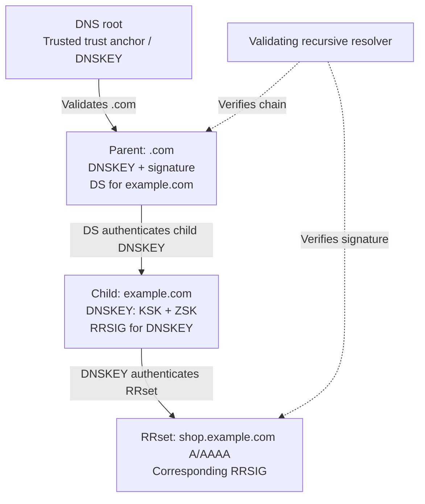
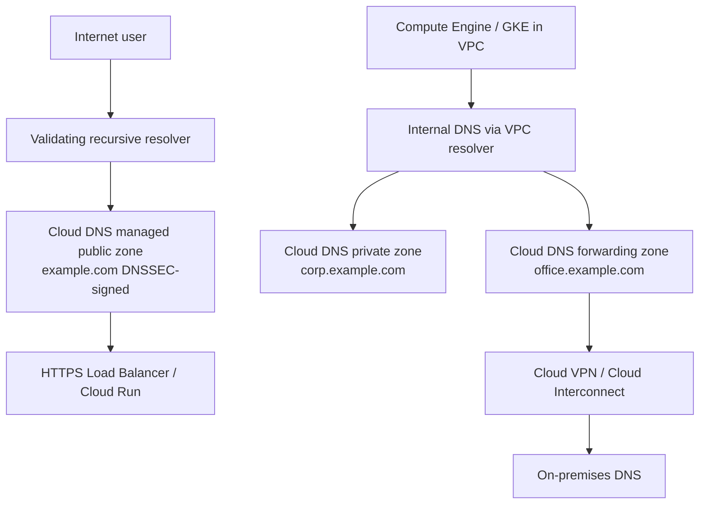

# DNSSEC and Protecting DNS Integrity

## 1. Why Do DNS Resolution Results Need Protection?

When a user enters `shop.example.com`, their device must look up the IP address or other DNS records to connect. If an attacker tricks a resolver into accepting **forged DNS records**, a browser or backend service can send traffic to an unintended server. This threat is commonly described through **DNS spoofing**, **cache poisoning**, and attacks on domain name resolution.

**DNS Security Extensions (DNSSEC)** extend the DNS protocol with **digital signatures**. A resolver that supports **DNSSEC validation** can verify whether the received data was truly signed by the operator of the corresponding zone and whether the data was altered in transit. DNSSEC is especially useful when Google Cloud applications expose public domains for **Cloud Run, GKE, Compute Engine, Cloud Load Balancing**, or a gateway into on-premises systems.

In the **CLOUD_PROVIDERS_GCP** module, this lesson connects **Cloud DNS**, IAM, and project governance with **VPCs, hybrid connectivity, high availability, and release automation**. Accurate and secure DNS is a prerequisite for many application flows, even when compute and database resources are already well designed.

After this lesson, you will be able to:

1. Explain what DNSSEC **validates** and what DNSSEC **does not protect against**.
2. Distinguish `DNSKEY`, `RRSIG`, `DS`, `KSK`, `ZSK`, and denial-of-existence records `NSEC`/`NSEC3`.
3. Describe the **chain of trust** from the DNS root to parent and child zones.
4. Enable DNSSEC for a **Cloud DNS managed public zone**, retrieve the DS record, and coordinate with the domain registrar.
5. Verify signatures using `dig`, `delv`, or DNSSEC analysis tools, and know how to investigate `SERVFAIL`.
6. Plan enabling DNSSEC, key rollovers, DNS provider migrations, and disabling DNSSEC without disrupting the system.
7. Distinguish between protecting **public authoritative DNS** and **private DNS/hybrid DNS** resolution inside a VPC.

> **Example conventions:** `example.com`, `shop.example.com`, and the Project IDs in this lesson are illustrative. `example.com` is a reserved documentation domain; never arbitrarily update registrars, nameservers, or zones serving production. Mutating commands are shown to illustrate the workflow and must be reviewed before execution.

## 2. What Problem Does DNSSEC Solve?

Standard DNS is a distributed resolution system. When looking up an `A` or `AAAA` record, a device typically interacts with a **recursive resolver**, which may query **authoritative name servers** to find the answer.

Relying solely on traditional DNS, answers are not authenticated by a signature from the zone owner by default. DNSSEC adds a mechanism allowing resolvers to **verify DNS data origin authentication and record integrity**.

| Property | Provided by DNSSEC? | Explanation |
| --- | --- | --- |
| **DNS data authentication** | Yes, when a chain of trust exists and the resolver validates | Helps detect data that does not match a verifiable signature |
| **DNS integrity** | Yes, for validly signed DNS data | Prevents altering record contents while still passing validation |
| **Proof that a name/record does not exist** | Yes, via signed denial-of-existence | `NSEC` or `NSEC3` allows verification of negative responses |
| **DNS query encryption** | No | Observers can still see queries/responses if the transport is unencrypted |
| **Hiding application IPs** | No | Public `A`/`AAAA` records still contain public addresses |
| **HTTPS server authentication or HTTP encryption** | No | TLS, certificates, and application controls are still required |
| **Preventing all forms of domain hijacking** | No | Registrar access, IAM, DNS provider accounts, and credentials must still be protected |
| **DDoS protection / uptime guarantee** | No | Separate redundant architecture, monitoring, and infrastructure protection are required |

**DNSSEC does not replace TLS.** DNSSEC helps a resolver verify DNS records; TLS protects the application connection and verifies server identity via certificates. **DNS over HTTPS (DoH)** and **DNS over TLS (DoT)** encrypt the channel between client and resolver, but by themselves they do not replace **DNSSEC signatures** on authoritative data.

## 3. Components of DNSSEC

| Component | Role | Practical Mapping |
| --- | --- | --- |
| **DNSKEY** | Record carrying a **public key** used to verify signatures | Published in the signed zone |
| **KSK (Key Signing Key)** | Key used to sign the `DNSKEY` set, anchoring trust from the parent | The KSK public key is the input used to generate/match `DS` |
| **ZSK (Zone Signing Key)** | Key used to sign most record sets in the zone | `A`, `AAAA`, `MX`, `TXT`, etc. have corresponding signatures |
| **RRSIG** | Digital signature of an RRset (records sharing name and type) | Contains type, algorithm, validity window, and key tag |
| **DS (Delegation Signer)** | Record in the **parent zone** referencing a child zone key | Usually submitted through the domain registrar to the TLD registry |
| **NSEC / NSEC3** | Signed proof that a name or record type does not exist | Helps prevent forged `NXDOMAIN` or no-data responses |
| **NS** | Record delegating DNS to authoritative nameservers | Determines where resolvers query the authoritative zone |
| **TTL** | Record cache duration | Must be coordinated with DS/DNSKEY/RRSIG during changes or rollovers |

### 3.1. How Do KSK and ZSK Work Together?

To avoid using a single key for every operation, DNSSEC typically splits responsibilities:

1. **ZSK** signs RRsets in the zone, generating `RRSIG` records.
2. **KSK** signs the DNSKEY RRset to authenticate the DNSKEYs published by the zone.
3. The **parent zone** publishes a `DS` record linking to a child zone DNSKEY, typically the KSK.
4. A **validating resolver** follows the link from a trust anchor down through parent/child and verifies the signature of the queried record.

**Cloud DNS manages private keys and signing** for a managed public zone when DNSSEC is enabled. Administrators can inspect public DNSKEYs, DS records, and DNSSEC status; normally there is no need to download private keys to sign records manually.

According to Cloud DNS documentation, the **ZSK is rotated automatically**; the **KSK does not have a fully automatic rotation mechanism** because changing a KSK requires coordination with the registrar/parent DS. Whenever changing a KSK or DNS provider, you must plan synchronization of the chain of trust. Do not interpret "managed DNSSEC" as "every key changes automatically without operator action."

### 3.2. A DS Record Has Four Basic Fields

A DS record is typically formatted as follows (this is a **fictional string**, not for configuring a real domain):

```text
<key-tag> <algorithm> <digest-type> <digest>
12345     13          2             A1B2C3D4... (illustration)
```

- **Key tag:** short identifier used to locate the associated DNSKEY.
- **Algorithm:** key/signature algorithm, which must match the DNSKEY.
- **Digest type:** hash algorithm used to produce the digest.
- **Digest:** hash value of the corresponding DNSKEY.

Do not edit or guess the digest manually. **Copy the DS provided by Cloud DNS**, verify all four fields accurately, and only submit it to the parent zone via the registrar when ready.

## 4. Chain of Trust: What Makes Signatures Meaningful

Having `RRSIG` in a zone is **not enough** for resolvers to trust that zone. A resolver must build a **chain of trust** from a **trust anchor** it already trusts (typically the DNS root) down to the zone containing the target domain.



For `example.com`, the chain goes root → `.com` → `example.com`; for `api.sub.example.com` when `sub.example.com` is **delegated as an independent zone**, the NS/DS and DNSKEY of `sub.example.com` must also be evaluated separately.

### Three Conditions for End-to-End Protection

1. **Child zone is signed:** DNSSEC in Cloud DNS is `on`, and authoritative nameservers publish appropriate DNSKEY and RRSIG records.
2. **Parent has a valid DS:** the registrar/registry must support DNSSEC, and the child zone's DS must be published accurately in the parent zone. For a delegated subdomain, the DS resides in the corresponding parent zone.
3. **Resolver validates:** the resolver used by clients must actually perform **DNSSEC validation**; merely receiving records with `RRSIG` without checking them does not provide full protection.

If **no DS exists at the parent**, the zone may be signed, yet resolvers generally **lack a complete chain of trust** to validate data as a secure zone. If a **DS exists but does not match the DNSKEY/signatures**, validating resolvers usually treat the zone as **bogus** and may return `SERVFAIL`.

Do not confuse `SERVFAIL` with `NXDOMAIN`: `NXDOMAIN` means the name does not exist according to resolution results, whereas `SERVFAIL` indicates resolution failed due to various errors, one of which is DNSSEC validation failure.

## 5. DNSSEC Support Scope in Cloud DNS

Cloud DNS supports several types of managed zones, but **not every type uses DNSSEC**.

| DNS Zone / Flow Type | Can DNSSEC Be Enabled Directly in Cloud DNS? | Notes |
| --- | --- | --- |
| **Managed public zone** | **Yes** | Cloud DNS signs data and manages DNSKEY/ZSK; requires parent DS and validating resolvers |
| **Managed private zone in VPC** | **No** | Private zones do not support DNSSEC in Cloud DNS; access scope depends on authorized VPCs and policies |
| **Forwarding zone to on-premises DNS** | Does not sign the zone on behalf of the target server | Cloud DNS forwards queries; DNSSEC validation depends on supporting resolvers along the path |
| **Peering / internal Compute Engine DNS** | Cannot be assumed to be DNSSEC-signed zones | Internal/peering resolution mechanisms have separate behavior |
| **Delegated public subdomain as a new zone** | Yes, if the public zone is signed and DS is properly placed at the parent | Both NS delegation and chain of trust must be verified |

A **hybrid** environment can simultaneously have a **DNSSEC-signed public zone** for Internet-facing domains, **private zones** for internal names, and **forwarding zones** reaching on-premises DNS. Do not promise that enabling DNSSEC on a public zone will automatically sign all internal names across Cloud VPN/Interconnect.

### Operation Limits on Large Zones

According to Cloud DNS documentation, **DNSSEC cannot be enabled or disabled on a managed zone that currently has more than 3,000 resource record sets**. For a zone of that size, consider creating a new zone with the same DNS suffix in the desired signing state, migrating DNS data, and updating delegation in a controlled manner. This is a real DNS migration that can impact users if NS, DS, and cache timing synchronization steps are missed.

### DNSSEC States

| State | Meaning | Common Use Case |
| --- | --- | --- |
| `off` | Cloud DNS does not sign the zone | Zone does not yet use DNSSEC or has been properly disabled |
| `on` | Cloud DNS signs the zone and manages keys in normal mode | Public zone operating normally with DNSSEC |
| `transfer` | Mode for migrating a signed zone; pauses automatic key rotation and assists migration operations | Changing DNS operators while preserving the chain of trust |

**`transfer` is not the default choice for enabling DNSSEC on a zone.** Use `on` for standard deployments and follow dedicated migration instructions when `transfer` is required.

## 6. Procedure to Enable DNSSEC on a Managed Public Zone

Suppose you own the public domain `example.com` and have a Cloud DNS project `acme-dns-prod`. A safe workflow consists of **evaluating the zone, enabling signing, retrieving DS, configuring the registrar, and verifying end-to-end**.

### Step 1: Check the Zone and Access Permissions

```bash
# Read-only command: list zones in the project
gcloud dns managed-zones list --project=acme-dns-prod

# Read-only command: inspect a specific zone
gcloud dns managed-zones describe public-example \
  --project=acme-dns-prod

# Read-only command: inspect existing record sets
gcloud dns record-sets list \
  --zone=public-example \
  --project=acme-dns-prod
```

Check `visibility=public`, `dnsName`, and `dnssecConfig`. If `public-example` does not exist yet, only create the zone after confirming the exact domain name, project, and administrative permissions.

Required permissions typically belong to `roles/dns.admin` on the appropriate project; you must also have **permission to manage DNS delegation/DS at the registrar**. Google Cloud IAM **does not automatically grant** access to a domain registrar.

### Step 2: Create a New Zone with DNSSEC Enabled (If None Exists)

```bash
# Illustrative zone creation command: do not run against an unauthorized domain
gcloud dns managed-zones create public-example \
  --project=acme-dns-prod \
  --dns-name=example.com. \
  --description="Public zone with DNSSEC" \
  --visibility=public \
  --dnssec-state=on
```

Note: `public-example` is the **managed zone name in the project**; `example.com.` is the **DNS suffix**. They are not the same identifier. A name with a trailing dot (`example.com.`) is a **fully qualified domain name**.

If you already have a valid public managed zone and its record set count is within applicable limits, you can enable DNSSEC on the existing zone:

```bash
# Illustrative state change command
gcloud dns managed-zones update public-example \
  --project=acme-dns-prod \
  --dnssec-state=on
```

When only inspecting, use Console → **Cloud DNS → Zones → Zone details** to view DNSSEC; when ready to enable or disable, choose **Edit** and change the state after the approval process.

### Step 3: Inspect the DNSKEYs Generated by Cloud DNS

```bash
# Read-only: view public DNSSEC keys
gcloud dns dns-keys list \
  --zone=public-example \
  --project=acme-dns-prod
```

The output may show keys of type `KEY_SIGNING` and `ZONE_SIGNING`. For an unsigned zone, the DNSKEY list may be empty. Do not confuse public DNSKEYs with **private keys**: the tool exposes public key information and metadata for verification.

### Step 4: Retrieve the DS Record for the Registrar

Google Cloud can output the DS based on the KSK:

```bash
# Read-only: return the DS record of the KSK
gcloud dns dns-keys list \
  --project=acme-dns-prod \
  --zone=public-example \
  --filter='type=keySigning' \
  --format='value(ds_record())'
```

You can also go to **Cloud DNS → Zone details → Registrar setup** to copy the DS. The output includes key tag, algorithm, digest type, and digest; all of them must match the DNSKEY published by the zone.

### Step 5: Add the DS in the Parent Zone via the Registrar

For a domain like `example.com`, the typical steps are:

1. Sign in to the registrar managing the domain registration.
2. Open the **DNSSEC/DS records** section (UI labels may vary).
3. Enter the exact DS shown by Google Cloud, confirming that both the registrar and TLD support DS configuration.
4. Verify the **NS delegation**: the parent must point to the actual authoritative nameservers of the Cloud DNS zone being used.
5. Wait for parent records, resolver caches, and delegation to propagate; this can take **24 hours or longer** depending on TTLs.

**Do not manually create a DS record inside the child zone itself as a substitute for the DS at the parent.** For a registrar-registered domain, the DS must appear in the **parent zone**; the registrar is where this record is usually submitted/coordinated. For a **delegated subdomain** (such as `api.example.com`), the parent zone `example.com` may need both `NS` and `DS` for the subdomain.

### Step 6: Verify Both Authoritative Data and Recursive Validation

Do not stop once the Console displays `DNSSEC: On`. Test with a DNSSEC-validating resolver and confirm that the DS at the parent actually links to the zone's signing keys.

## 7. Verifying with dig, delv, and Visual Tools

The commands below **only perform DNS reads** and do not create Google Cloud resources. They require `dig` (typically in dnsutils/BIND tools) or `delv` installed on your workstation.

### 7.1. Viewing DNSKEY and RRSIG Records

```bash
# Query the zone's public DNSKEY, requesting DNSSEC data
dig @8.8.8.8 example.com. DNSKEY +dnssec

# Query an A record along with its signature if present
dig @8.8.8.8 shop.example.com. A +dnssec

# Query the DS record published by the parent
dig @8.8.8.8 example.com. DS +dnssec
```

**Quick explanation:**

- `+dnssec` sets the **DO** flag to request DNSSEC records where applicable; **`dig` itself does not validate** the full chain of trust.
- Seeing `RRSIG` and `DNSKEY` shows the zone serves signed data, **not that the signature is valid by itself**.
- `DS` must be published at the parent matching the KSK; a resolver might cache stale data.
- If the output includes the `ad` flag from a **trusted validating resolver** with proper query settings, it signals that the resolver evaluated the data as authenticated. `AD` does not replace independent validation if you do not trust the intermediate resolver.

### 7.2. Testing Validated Resolution

```bash
# delv performs DNSSEC validation itself using configured trust anchors
delv shop.example.com. A

# With dig, inspect response status/flags from a validating resolver
dig @8.8.8.8 shop.example.com. A +dnssec
```

With `delv`, examine the validation outcome and any validation errors. When testing with `dig`, check `status: NOERROR` or `SERVFAIL`, the `ad` flag, the returned records, and the actual DNSSEC state of the zone. A domain without a DS at the parent may still resolve DNS normally, yet lack a chain of trust to the child zone.

### 7.3. Checking Against an Authoritative Nameserver

```bash
# See which NS records the parent delegates to
dig example.com. NS

# Replace ACTUAL_NS with an authoritative NS obtained from zone details
dig @ACTUAL_NS example.com. DNSKEY +dnssec
dig @ACTUAL_NS shop.example.com. A +dnssec
```

Querying an authoritative NS directly confirms where the data is served, but **is not equivalent** to resolving through a validating recursive resolver. Test both paths.

### 7.4. Visual Verification Tools

Tools such as **DNSViz**, **Zonemaster**, or the **Verisign DNSSEC debugger** can graph the parent DS, DNSKEY, algorithms, RRSIGs, and breaks in the chain of trust. Use them on a test zone before publishing a production DS.

## 8. TTL, Signature Validity Windows, and Operational Conditions

**TTL** governs how long a DNS record can be cached, whereas **RRSIG** carries **absolute inception/expiration timestamps**. If TTLs are configured too long relative to signatures, resolvers may have to refresh data or run into trouble if signatures expire.

Cloud DNS recommends avoiding TTLs **longer than 259,200 seconds (3 days)** for DNSSEC-signed zones. Signing lifetimes, refresh intervals, and certain timing parameters are managed by Cloud DNS. Do not assume you can manually tune every RRSIG interval.

When changing NS records, adding/removing DS records, or migrating DNS providers, account simultaneously for:

- TTLs of `NS`, `DS`, and `DNSKEY` at parent and child.
- Caching behavior of recursive resolvers.
- Valid signatures on record sets.
- Overlapping periods where old and new authoritative nameservers both serve data.
- A rollback plan if DNSSEC validation starts failing.

**A DNS change that looks complete in the Console may still not be complete for every resolver on the Internet.** Cloud DNS configuration, registrar state, and external cache state are three separate domains that must be verified independently.

## 9. Signing Algorithms, NSEC/NSEC3, and Key Management

Cloud DNS lets you select supported signing algorithms and denial-of-existence modes. For example, advanced documentation illustrates configuring **ECDSAP256SHA256** for both KSK and ZSK, together with **NSEC**:

```bash
# Use only after reviewing compatibility, DS, and the change plan
gcloud dns managed-zones update public-example \
  --project=acme-dns-prod \
  --dnssec-state=on \
  --ksk-algorithm=ECDSAP256SHA256 \
  --ksk-key-length=256 \
  --zsk-algorithm=ECDSAP256SHA256 \
  --zsk-key-length=256 \
  --denial-of-existence=NSEC
```

This command is for **syntax illustration only**: algorithm parameters must be set **before enabling signing** or must follow the proper disable/change/re-enable sequence. **Do not run directly** on a production zone with an active DS just to swap algorithms; turning off signing out of order can cause validating resolvers to return `SERVFAIL`. Changing signing options on an already-signed zone requires registrar coordination and impact review beforehand.

### 9.1. How Do NSEC and NSEC3 Differ?

- **NSEC** publishes adjacent records in canonical DNS order to prove a name does not exist. This mechanism can allow an observer to **enumerate names** in the zone (zone walking).
- **NSEC3** uses hashed names to make name enumeration harder, though it is **not an absolute hiding feature** and carries processing, size, and performance trade-offs.

**Do not treat DNSSEC as a tool for keeping hostnames secret.** Names in public DNS are published data; if internal hostnames must stay confidential, design private DNS and appropriate network connectivity.

### 9.2. Key Rollovers and DNS Provider Migration

| Operation | What Does Cloud DNS Handle? | What Must the Operator Do? |
| --- | --- | --- |
| **Record signing and RRSIG updates** | Managed by Cloud DNS for DNSSEC-enabled zones | Monitor DNS, TTLs, DNSKEY/DS, and resolution health |
| **ZSK rollover** | Cloud DNS rotates ZSKs automatically | Monitor and avoid arbitrarily editing signed data |
| **KSK rollover** | Not fully automatic per Cloud DNS docs | Coordinate with the registrar to update DS and the trust chain workflow |
| **Changing DNS operator** | Supports `transfer` mode for compatible migration cases | Synchronize DNSKEY/DS/NS, pause rotation if needed, wait out TTLs, test on a low-impact zone |
| **Changing algorithms** | Supported algorithm set and zone state constraints apply | Evaluate algorithm, resolver compatibility, and disable/change/enable/DS plan |

For a migration **preserving continuous DNSSEC**, both old and new providers as well as the registrar must support the procedure, including publishing multiple DS records, exchanging **public DNSKEYs**, and timing NS updates. `transfer` mode is for changing DNS operators; do not treat it as a safe generic way to "copy a zone" in every scenario.

If the new provider **does not support the required DNSSEC migration**, Cloud DNS documentation instructs you to **deactivate DNSSEC at the registrar first**, complete the migration, and then **re-enable and reactivate**. During that window, the zone has no DNSSEC chain of trust; evaluate the risk and any record types relying on DNSSEC before proceeding.

## 10. Disabling DNSSEC in the Right Order

This is a sensitive operation because **a parent DS pointing to a zone that is no longer signed** can cause resolution to fail at validating resolvers.

Procedure for a managed public zone that must continue serving the domain:

1. **Read current configuration:** verify the registrar, NS delegation, DNSKEYs, and DS at the parent.
2. **Remove the DS at the registrar/parent** using approved administrative access, then wait for the old DS to expire from caches. This can take **24 hours or longer**.
3. **Verify** that the DS has been removed from the parent and resolvers are no longer relying on the old DS before turning off signing.
4. **Disable DNSSEC in Cloud DNS**:

```bash
# Illustrative state change after the DS has been safely removed
gcloud dns managed-zones update public-example \
  --project=acme-dns-prod \
  --dnssec-state=off
```

5. Check resolution from multiple validating resolvers and monitor user errors.

**Never reverse the order** by setting `dnssec-state` to off before removing the DS at the parent. Do not treat `dnssec-state=off` as a quick fix for a `SERVFAIL` error without first understanding the chain of trust.

## 11. DNSSEC in a Hybrid Architecture: What Is Protected?

Suppose an enterprise has:

- **Public DNS:** `shop.example.com` exposing an application on Cloud Load Balancing or Cloud Run.
- **Private DNS on Google Cloud:** `db.corp.example.com` pointing to an internal service in a VPC.
- **On-premises DNS:** `erp.office.example.com` resolved by a DNS server in the data center.
- **Cloud VPN / Cloud Interconnect:** providing IP connectivity to on-premises systems.



### Three Resolution Paths with Different Properties

| Flow | DNSSEC Signed by Cloud DNS? | Protection Layer / Dependencies |
| --- | --- | --- |
| User → validating resolver → `shop.example.com` | **Yes**, if the public zone has a complete DS chain | DNSSEC validation; HTTPS/TLS still protects the application |
| Workload in VPC → Cloud DNS private zone | **No**, because private zones do not support DNSSEC | Authorized networks, IAM, zone admin permissions, VPC, DNS policies |
| Workload in VPC → forwarding zone → on-premises DNS | **Not automatically** from public zone DNSSEC | Validating resolver selection/config, forwarding, VPN/Interconnect path, firewalls |

In hybrid DNS, **Cloud DNS forwarding** sends queries to upstream servers as configured; it does not turn an internal zone into an authoritative DNSSEC-signed zone. If DNSSEC validation is needed for **public domains** over a forwarding path, inspect which resolver performs validation and how DNSSEC records are carried; never assume having Cloud VPN automatically protects DNS integrity.

### Role of Private DNS and IAM Permissions

Cloud DNS private zones are visible only to authorized VPCs. This **limits query scope**, which is cryptographically different from DNSSEC. Network and security teams should:

1. Assign record create/edit permissions with least-privilege IAM, such as appropriate Cloud DNS roles.
2. Protect admin access to VPCs, DNS server policies, and forwarding zones.
3. Monitor DNS record changes via Cloud Audit Logs and DNS queries via supported logging mechanisms.
4. Permit both UDP and TCP port **53** on the hybrid path when running forwarding.
5. Design redundant DNS servers and links to minimize impact if on-premises DNS becomes unavailable.

Do not use "private zones don't support DNSSEC" as a reason to publish internal data into public DNS. The two zone types solve **different security problems**.

## 12. Common Errors and How to Investigate Them

| Symptom | Possible Cause | How to Verify / Fix |
| --- | --- | --- |
| `DNSSEC: On` in Cloud DNS, but `dig DS` shows no DS | Registrar/parent not configured yet or not propagated | Retrieve the KSK DS; verify at registrar and parent authoritative NS |
| Resolver returns `SERVFAIL` after adding DS | Wrong DS, KSK/DNSKEY mismatch, invalid RRSIG, or broken chain | Compare parent DS with Cloud DNS; run DNSViz/`delv`; review recent key changes |
| Resolver returns `NOERROR` without `ad` flag | Resolver does not validate, incomplete chain of trust, or query flags differ | Test with an independent validating resolver, DS, and DNSKEY/RRSIG |
| `dig +dnssec` shows RRSIG, yet app still hits wrong IP | DNSSEC may not be validated, registrar/zone altered legitimately via compromised account, or app-layer issue | Check validation, DNS change logs, registrar security, and TLS |
| Domain stops resolving after disabling DNSSEC | Parent still has cached DS | Restore chain of trust per approved procedure; remove DS in proper order |
| Domain breaks after changing registrar/NS | Old/new provider NS/DS/DNSKEY out of sync | Reconcile parent NS/DS, child DNSKEY, TTLs, and migration plan |
| Cannot enable DNSSEC on a private zone | Zone type does not support DNSSEC | Keep private DNS as designed; use IAM/VPC/DNS policies |
| Cannot enable/disable DNSSEC on a large public zone | RRset count exceeds operation limit | Design a new zone/migration with controlled NS and DS cutover |
| Internal DNS over VPN returns `SERVFAIL` | Forwarding target unavailable, routing/firewall issue, or timeout | Check Cloud DNS forwarding, UDP/TCP 53, upstream DNS, and VPN/Interconnect path |
| Some resolvers succeed while others fail after a change | Cache TTL, propagation delay, algorithm/format, or inconsistent chain | Test multiple validating resolvers, parent NS, and authoritative servers |

### Systematic Investigation Procedure

1. **Scope the issue:** public domain or private DNS? Does it affect all clients or only one network/resolver?
2. **Check authoritative side:** which project holds the Cloud DNS zone? Are `visibility`, `dnssecConfig.state`, `NS`, `DNSKEY`, and `RRSIG` accurate?
3. **Check the parent:** do `NS` delegation and `DS` match the serving zone?
4. **Check a validating resolver:** run `delv` or a DNSSEC analyzer; distinguish `SERVFAIL` from `NXDOMAIN`.
5. **Review recent changes:** were KSK, algorithms, registrar, NS, or DNS provider recently changed? Have TTLs expired?
6. **If hybrid:** check forwarding targets, ACLs, firewalls, UDP/TCP 53, routes, and on-premises DNS responsiveness.
7. **Record and remediate safely:** restore the chain of trust and verify from multiple resolvers; never disable signing haphazardly.

### An Advanced Check with dig

```bash
# Result from a validating resolver requesting DNSSEC
dig @8.8.8.8 shop.example.com. A +dnssec

# Diagnostic only: enable Checking Disabled (CD) in the query
dig @8.8.8.8 shop.example.com. A +dnssec +cdflag
```

If a normal query returns `SERVFAIL` while querying with the **CD flag** returns data, a **DNSSEC validation failure is a hypothesis worth investigating**. This alone is not proof: inspect DNSViz/`delv` and compare DS/DNSKEY. **Never configure applications to bypass validation long-term to mask an error.**

## 13. Operations, IAM, Cost, and Reliability

DNSSEC is part of **infrastructure control**, not a set-and-forget toggle.

### 13.1. Separation of Duties

| Role | Permissions and Responsibilities |
| --- | --- |
| **DNS administrator** | Manage Cloud DNS public zones/record sets, enable signing, read DNSKEY/DS per IAM |
| **Domain registrar administrator** | Update NS delegation, publish/remove DS at parent, manage domain registration account security |
| **Security team** | Change approval policies, auditing, signature verification, and monitoring the chain of trust |
| **SRE/Platform** | Monitor latency, DNS incidents, runbooks/rollbacks, coordinate deployments with Cloud Run/GKE/LB |
| **Application team** | Manage hostnames and HTTPS/TLS; do not modify DNSSEC/registrar beyond granted permissions |

`roles/dns.admin` can permit managing Cloud DNS resources within an IAM scope, but **it is not equivalent to access at the domain registrar**. If a principal's registrar account is compromised, an attacker can change delegation or DS; DNSSEC by itself does not protect against a **cryptographically valid change made via a hijacked account**.

### 13.2. Additional Layers of Protection

- Enable **MFA** and tightly govern registrar accounts, Cloud Console access, and DNS update pipelines.
- Apply **least-privilege IAM** for zone administration and record edits; separate dev/prod via projects or appropriate organization policies.
- Monitor **Cloud Audit Logs** when zones/records change; monitor externally for discrepancies between expected NS/DS/DNSKEY and authoritative responses.
- Use HTTPS/TLS for Cloud Run, GKE ingress, or load balancers; DNSSEC does not replace TLS.
- Before major changes, write a runbook and rehearse on a test domain to protect application **SLOs**.
- Evaluate Cloud DNS, query, logging, and related service costs using **current pricing**; DNSSEC does not mean free queries or lower query costs.

### 13.3. Real-World Scenario: Online Store

An online store routes `checkout.example.com` to an HTTPS Load Balancer backed by GKE/Cloud Run and Cloud SQL. The operations team plans to migrate its authoritative public zone to Cloud DNS and enable DNSSEC.

**Goal:** users reach the signed DNS address accurately; the service does not suffer `SERVFAIL` on validating resolvers during the NS transition.

A rollout plan might include:

1. Inventory all DNS records to preserve: `A`, `AAAA`, `CNAME`, `MX`, `TXT`, `CAA`, `NS`, and other critical records; verify TTLs.
2. Create the Cloud DNS public zone, migrate records, and enable DNSSEC on the new zone.
3. Compare old and new records and verify DNSKEY/RRSIG; prepare NS/DS at the registrar.
4. Select a DNSSEC migration approach supported by both old and new providers; if interrupting the chain of trust is unavoidable, assess risk before removing DS.
5. Update delegation/DS in the proper sequence, wait out TTLs, and verify across multiple validating resolvers.
6. Monitor error rates, DNS queries, and HTTPS endpoints; keep a rollback plan ready.

**Design point:** the system still needs load balancer/backend redundancy, database HA/backups, and runbooks. DNSSEC only solves **DNS data authentication and integrity**; it does not guarantee checkout availability on its own.

## 14. Practice Exercises Without Modifying Production

### Exercise 1: Analyzing a Chain of Trust

Suppose public zone `example.com` has valid DNSKEY and RRSIG records, yet the `.com` parent **has no DS**.

1. Can a validating resolver construct a complete chain of trust to `example.com`?
2. Does `dig example.com DNSKEY +dnssec` showing records prove the zone is protected end-to-end?
3. What action is required at the registrar?

**Hints:** (1) Incomplete chain of trust; (2) No; (3) Publish the exact DS, wait for propagation, and verify via a validating resolver.

### Exercise 2: Reading Zone Metadata with gcloud

With read access to an authorized Cloud DNS project:

```bash
gcloud dns managed-zones list --project=PROJECT_ID
gcloud dns managed-zones describe ZONE_NAME --project=PROJECT_ID
gcloud dns dns-keys list --zone=ZONE_NAME --project=PROJECT_ID
```

Answer:

- Is the zone public or private?
- What is `dnssecConfig.state`?
- Which DNSKEYs are published? How are KSK and ZSK distinguished?
- What step remains if the public zone is signed but the registrar has no DS yet?

### Exercise 3: Investigating Two Failure Modes

**Case A:** `delv shop.example.com A` reports a validation error after changing the DS at the registrar. List what to inspect: parent DS, zone DNSKEY, RRSIG, authoritative NS, TTL, and KSK change history.

**Case B:** A VM in a VPC cannot resolve `erp.office.example.com` over VPN. The public Cloud DNS zone for `example.com` still has DNSSEC signing working normally. Explain why you should check the forwarding zone, on-premises DNS, routes, and UDP/TCP 53 firewalls rather than modifying the public zone's DS.

### Exercise 4: Choosing the Right Sequence When Disabling

Reorder these actions to avoid a service outage:

1. Turn off `dnssec-state` in Cloud DNS.
2. Remove the DS at the registrar/parent.
3. Wait for the old DS to expire from caches and verify.
4. Verify resolution after the change.

**Answer:** **2 → 3 → 1 → 4**. Never do `1 → 2` because validating resolvers may still trust the old DS after the child zone has stopped signing.

### Exercise 5: Designing an Operations Policy

One team only has permission to deploy Cloud Run, while another manages the registrar and Cloud DNS. Write a short runbook for three cases: **launching a new public domain**, **migrating authoritative DNS operators**, and **investigating `SERVFAIL`**. The runbook must identify decision owners, DS/NS responsibilities, signature checks, cache windows, and rollback plans.

## 15. DNSSEC Checklist for Google Cloud Systems

- [ ] Identified the **public authoritative zone** serving the domain and its exact Project ID.
- [ ] Verified scope: DNSSEC is supported for managed **public zones**, and does not apply directly to private zones.
- [ ] Confirmed the registrar/TLD supports DNSSEC and access to update **DS** exists.
- [ ] Child zone DNSSEC is `on` with valid KSK/ZSK DNSKEYs and RRSIGs.
- [ ] Parent zone publishes a **DS matching the DNSKEY**; NS delegation points to the right authoritative zone.
- [ ] Tested with at least one **validating resolver** and a chain-of-trust analyzer.
- [ ] Documented TTLs, RRSIG validity, KSK/ZSK rotation, and NS/DS change policies.
- [ ] Never remove/disable DNSSEC in Cloud DNS before the old DS expires at the parent/caches.
- [ ] For hybrid DNS, verify private zones/forwarding separately alongside VPN/Interconnect, DNS paths, and resolver validation.
- [ ] Cloud DNS IAM and registrar access are protected with separation of duties, MFA, and auditing.
- [ ] Monitoring, `SERVFAIL` handling, migration rehearsal, and rollback plans are in place.
- [ ] Large-zone limits, costs, outage risks, and application SLOs have been evaluated.

## 16. Official Google Cloud Documentation

The following links serve as technical references during implementation. Check current support status and `gcloud` syntax at the time of operation:

1. [Cloud DNS – DNS Security Extensions (DNSSEC) overview](https://cloud.google.com/dns/docs/dnssec)
2. [Manage DNSSEC configuration](https://cloud.google.com/dns/docs/dnssec-config)
3. [Activate DNSSEC at your registrar](https://cloud.google.com/dns/docs/registrars)
4. [View DNSSEC keys](https://cloud.google.com/dns/docs/dnskeys)
5. [Use advanced DNSSEC](https://cloud.google.com/dns/docs/dnssec-advanced)
6. [Migrate or transfer DNSSEC-enabled zones](https://cloud.google.com/dns/docs/dnssec-migrate)
7. [Cloud DNS – Key terms and private zones](https://cloud.google.com/dns/docs/key-terms)
8. [Cloud DNS – Best practices for hybrid DNS](https://cloud.google.com/dns/docs/best-practices)
9. [Cloud DNS – Troubleshooting](https://cloud.google.com/dns/docs/troubleshooting)
10. [Cloud DNS – Managed zones CLI reference](https://cloud.google.com/sdk/gcloud/reference/dns/managed-zones)

**Key takeaway:** DNSSEC fully protects DNS data only when **the zone is signed**, **the parent has a matching DS**, and **recursive resolvers actually validate**. On Google Cloud, implement this on **public Cloud DNS**, coordinate access at the **domain registrar**, and design internal/hybrid DNS separately. Protecting the chain of trust is just as important as flipping a setting in the Console.
