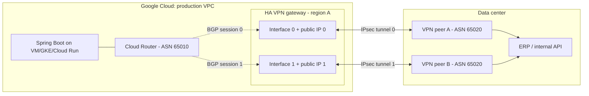
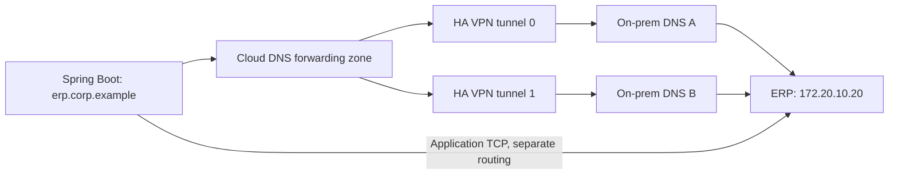
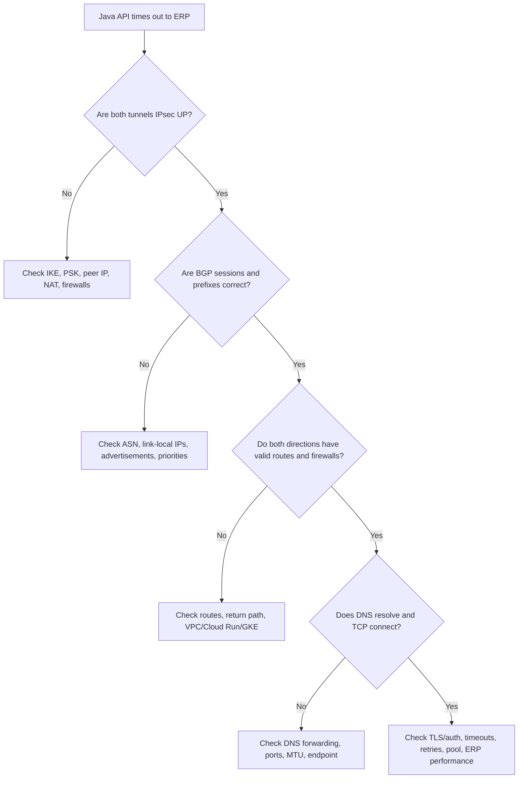

# HA VPN and Redundant Connectivity Design

## 1. Hybrid Connectivity Challenge for Java Systems

An enterprise is gradually migrating its Java applications from its private data center (**on-premises**) to **Google Cloud**. Spring Boot APIs running on **Cloud Run** or **GKE** need to call an ERP system still located at the office; applications on **Compute Engine** must query internal services; operations teams need private IP access to troubleshoot incidents. The public Internet does not provide an encrypted private network path between two sites, while a single VPN tunnel becomes a single point of failure whenever an appliance, IPsec session, or transit path fails.

Google Cloud's **High Availability VPN (HA VPN)** provides gateways engineered for high availability, with **two interfaces** and **IPsec tunnels** using **dynamic BGP routing** via **Cloud Router**. When both the Google Cloud side and the peer side are fully designed, the system can maintain connectivity if one tunnel or appliance fails. However, "having HA VPN" does not guarantee the entire application always stays up: the enterprise network, ISPs, DNS, firewalls, target services, and Java software all participate in the reliability chain.

In the **DNS and Hybrid Connectivity** chapter of the **CLOUD_PROVIDERS_GCP** module, this lesson focuses on **HA VPN and redundant connectivity design**: dual-tunnel architecture, peer-side design, BGP failover, bidirectional routing, internal DNS, monitoring, failure testing, and balancing reliability against cost.

### Learning Outcomes

After this lesson, you will be able to:

1. Describe the components of **HA VPN gateway, external peer VPN gateway, VPN tunnel, Cloud Router, BGP session**, and source/destination networks.
2. Draw at least two redundant connectivity topologies and explain Google Cloud's **99.99% SLA** conditions for HA VPN.
3. Choose between **active-active** and **active-passive**, understand the role of **BGP route priority/MED**, ECMP, and the difference between tunnel status and application health.
4. Design CIDR ranges, ASNs, BGP link-local IPs, redundant paths, firewalls, DNS forwarding, and failover scenarios.
5. Perform a lab creating a gateway/Cloud Router, configuring two tunnels, and inspecting status via the Console or `gcloud`.
6. Identify alerts, failover tests, and costs to track before taking a hybrid system to production.

## 2. Foundation: Why One VPN Tunnel Is Not Enough

### 2.1. Required Layers in a Connection

Connectivity between a Google Cloud VPC and an enterprise consists of multiple layers, each of which can fail independently:

| Layer | Components | When a Failure Occurs |
| --- | --- | --- |
| Addressing and Internet path | Public gateway IPs, ISPs, carriers, NAT if any | The two endpoints cannot exchange IPsec packets |
| Tunnel security | IKE/IPsec security associations, shared secret, ciphers | Handshake fails; tunnel does not come up |
| Routing | Cloud Router, BGP peers, advertised/learned routes | Tunnel may remain up, yet no route exists to the subnet |
| Access policy | GCP/on-premises firewalls, NetworkPolicies | Route is valid, yet TCP/UDP traffic is blocked |
| Name resolution | Cloud DNS, on-premises DNS, forwarding | IP ping works, yet hostname lookup fails |
| Application | Spring Boot, JDBC, timeouts, retries, connection pools | Network recovers, yet requests still error out or hang on broken sessions |

HA VPN provides redundancy for properly configured layers; it does not automatically add redundancy to every other component.

### 2.2. HA VPN, Classic VPN, and Cloud Interconnect

| Option | Characteristics | When to Consider |
| --- | --- | --- |
| **HA VPN** | IPsec, two interfaces on gateway, **dynamic BGP** via Cloud Router | On-premises ↔ Google Cloud connectivity needing high availability, with BGP-capable peer equipment |
| **Classic VPN** | Legacy VPN model; can use static routing or BGP depending on setup | Legacy systems or equipment that cannot meet HA VPN requirements; evaluate upgrading |
| **Dedicated/Partner Interconnect** | Dedicated connectivity via carrier/partner, depending on architecture | High data transfer needs, consistent latency, or private circuit requirements |
| **HA VPN over Cloud Interconnect** | IPsec protecting traffic running over Interconnect | When both dedicated connectivity and IPsec encryption are required |

**Cloud VPN sends IPsec over the public Internet**, although data inside the tunnel is encrypted. For dedicated physical circuits or high bandwidth, compare **Cloud Interconnect**. For small-to-medium systems, HA VPN is often a reasonable starting point if enterprise appliances support IKE/IPsec and BGP. Check pricing, features, and limits by region and connection type.

## 3. HA VPN Architecture Components

### 3.1. HA VPN Gateway

An HA VPN gateway is a **regional** resource attached to one **VPC network** with **two interfaces**, numbered `0` and `1`. When creating a standard IPv4 gateway, Google Cloud allocates **two external IPs**, one per interface; these IPs serve as **IPsec tunnel** endpoints, not internal VM IP addresses.

HA VPN supports IPv4 and IPv6 IP stack types depending on gateway configuration and product requirements. The hands-on section below uses **IPv4** for clarity; if IPv6 is required, choose the appropriate stack type, tunnel/BGP sessions, and IPv6 routes rather than simply swapping IPv4 addresses for IPv6.

### 3.2. Peer Gateway and IPsec Tunnels

A **peer VPN gateway** is the VPN device at the data center or partner network. Google Cloud represents the remote side with an **external VPN gateway** resource declaring one or more public interfaces. Each **VPN tunnel** links an HA VPN interface to a peer interface; both ends must match IKE/IPsec parameters and authentication keys.

A pair of tunnels can carry traffic for the same set of subnets. Which tunnel carries a given flow is determined by **BGP and route priorities**. An IPsec tunnel showing `ESTABLISHED` only proves the tunnel has an active session—it does not prove all routes and backend applications are ready.

### 3.3. Cloud Router and BGP Sessions

Cloud Router exchanges routing information with the VPN peer's **BGP router**. On the Google Cloud side, each tunnel connects to a **Cloud Router interface** and a **BGP peer/session**. Cloud Router manages the **control plane** to learn and advertise routes; **it is not a server forwarding individual data packets**.

For IPv4 BGP, the two ends of a tunnel typically use **link-local** addresses from `169.254.0.0/16`; when configured manually, each BGP interface uses a distinct `/30` subnet that must not overlap other BGP sessions in the same VPC. Choose distinct **ASNs** for Google Cloud Router and the peer so they do not conflict in the BGP session; example private ASNs are `65010` and `65020`.



The BGP arrows represent **route exchange**; actual application data paths go through the IPsec tunnels rather than through Cloud Router like a proxy. The diagram shows two physical peers to illustrate **peer-side redundancy**.

## 4. Topology Design and SLA Conditions

### 4.1. Two Tunnels Must Use Both Interfaces

For a configuration to meet Google Cloud's **99.99% SLA** condition when connecting HA VPN to a qualifying peer, there must be **at least one tunnel on each interface** of the HA VPN gateway. Two tunnels both terminating on interface `0` while leaving interface `1` empty **do not** meet this requirement. Tunnels and BGP must also be configured according to a Google Cloud-supported topology.

**99.99% is a service/configuration SLA condition**, not a guarantee that the end-to-end system will always achieve that exact figure. ISP outages, peer router failures, data center power loss, DNS failures, or application bugs can still bring the system down.

### 4.2. Three Peer-Side Options

| HA VPN → Peer Topology | Configuration | Actual Peer Redundancy |
| --- | --- | --- |
| **Two separate VPN peers**, each with one public IP | Tunnel 0: GCP interface 0 → Peer A; Tunnel 1: GCP interface 1 → Peer B | Strong when both peers have truly independent power, networks, and ISPs |
| **One VPN peer with two public IPs/interfaces** | Two tunnels, each GCP interface to a different IP on the peer | Path/interface redundancy; **one physical device** can still be a single point of failure |
| **One VPN peer with one public IP** | Two tunnels, each GCP interface to the same peer address | Supported topology if the peer gateway has **internal redundancy**; shared failure risk depends on the appliance |

Google Cloud documents that single- or dual-peer topologies—including a single public IP—can be configured to qualify for the **99.99% Google Cloud SLA** when requirements are met. However, to achieve high end-to-end availability, enterprises should evaluate **appliances, ISPs, power, routing, and peer failover** rather than checking only the GCP SLA criteria.

If an enterprise has two server rooms or ISPs, identify the exact failure domains: two devices sharing the same switch, fiber path, or power feed still lack complete redundancy. Additional gateways or multi-site connectivity may be needed when disaster recovery requirements exceed a single site.

### 4.3. HA VPN Between Two Google Cloud VPCs

Two VPCs can use an HA VPN gateway in each network to connect to each other. With **two gateways in the same region** and fully configured tunnel pairs `interface 0 ↔ interface 0` and `interface 1 ↔ interface 1`, this topology can qualify for a **99.99% SLA**. When **two HA VPN gateways are in different regions**, Google Cloud documentation states a **99.9% SLA** for that topology. Because VPCs are global resources, two same-region gateways can still connect workloads located in other regions depending on dynamic routing mode.

This is a key point when designing a hub-spoke network with HA VPN: **gateway placement** directly affects the SLA, not just VM or GKE cluster placement.

## 5. Active-Active, Active-Passive, and Failover Behavior

### 5.1. Two Tunnels "Up" vs. Two Routes "In Use"

With HA VPN, **both tunnels and both BGP sessions** can be `ESTABLISHED` even when the system is designed as **active-passive**. "Passive" usually just means the route over that path has **lower priority**, not that the tunnel is shut down or lacks an IPsec handshake.

| Mechanism | Route Configuration | Advantages | Risks |
| --- | --- | --- | --- |
| **Active-active** | Same prefix advertised with equal priority; can use **ECMP** | Distributes traffic across multiple tunnels, increasing aggregate capacity | If one tunnel fails, traffic shifts onto the remaining path; spare capacity headroom is required |
| **Active-passive** | Same prefix with different priorities, preferring the primary path | Easy to size normal usage against one path; standby ready | May not utilize full combined bandwidth during normal operation |

Google Cloud generally recommends **active-passive with a single HA VPN gateway**, and considering **active-active** when using **multiple HA VPN gateways**; either design must measure post-failover bandwidth against application needs. Avoid arbitrarily setting active-passive across multiple gateways/tunnels in ways that leave standby capacity poorly utilized.

### 5.2. BGP, MED, and Path Selection

For a destination prefix like `172.20.0.0/16`, the peer appliance can advertise that route on both BGP sessions. **MED/route priority** influences the path from GCP to on-premises; **base advertised priority** on Cloud Router influences how the peer prefers paths from on-premises into the VPC. In environments with multiple ASNs, vendor BGP policies, or other BGP paths, check other attributes in the peer's path selection process.

Conceptual example (not direct `gcloud` syntax):

```text
On-premises prefix: 172.20.0.0/16
Tunnel 0 / BGP 0: learned route priority 100 (preferred)
Tunnel 1 / BGP 1: learned route priority 200 (backup)

GCP → on-premises: normally selects tunnel 0 while route/tunnel is valid.
When tunnel 0 fails: corresponding route is withdrawn; tunnel 1 can be selected.
On-premises → GCP: return preference must be configured on the peer router.
```

In Google Cloud, a **lower priority number generally has higher preference** among routes of equal prefix length and matching selection criteria. Inspect actual route selection rather than claiming a single MED parameter dictates every path. With ECMP, **a single flow usually follows one path** due to flow hashing; do not assume a single TCP connection can combine the bandwidth of two tunnels.

### 5.3. Convergence After Failure

When a tunnel drops, Cloud Router **withdraws dynamic routes learned over that tunnel**, and an alternate path is selected from remaining routes. Detection and convergence time depend on IKE/DPD, BGP keepalive/hold timers, peer equipment, the network, and route propagation. Some packets or existing TCP connections may fail during rerouting.

For Spring Boot calling an on-premises ERP:

- Set **connect timeout**, **read timeout**, and a total retry budget for HTTP/JDBC clients.
- Retry only when operations are **safe/idempotent** or carry an idempotency key; never automatically replay money transfers or order creations without reconciliation.
- Use connection pools with stale-connection checks and appropriate timeouts; TCP connections over the old tunnel may no longer be usable.
- Monitor API **p95 latency, error rate, and timeouts** alongside tunnel/BGP status; tunnel UP is not sufficient to assess service objectives.

## 6. Network Planning, BGP, and Routing Boundaries

### 6.1. Addressing Table for Practice Example

| Component | Example | Role |
| --- | --- | --- |
| Google Cloud VPC subnet | `10.20.0.0/16` | VM/GKE nodes/application egress |
| On-premises subnet | `172.20.0.0/16` | ERP and internal services |
| BGP tunnel 0 | `169.254.10.1/30` (GCP), `169.254.10.2` (peer) | Link-local BGP peering |
| BGP tunnel 1 | `169.254.11.1/30` (GCP), `169.254.11.2` (peer) | Backup link-local BGP peering |
| Cloud Router ASN | `65010` | Google Cloud-side ASN |
| Peer router ASN | `65020` | Data center-side ASN |

These values are **illustrative** and not safe to copy verbatim into a real network if IP/ASN overlaps exist. The two BGP `/30` ranges must be distinct within the same VPC; both ends of each tunnel belong to the same link-local subnet. The VPN gateway's public IPs and the peer's IPs are **IPsec termination addresses**, separate from BGP link-local IPs and application IPs.

### 6.2. VPC Dynamic Routing Mode

A VPC can be configured for **regional** or **global dynamic routing**. In **regional mode**, route learning and advertisement are scoped to the region, limiting where dynamic routes take effect. When VMs/GKE in multiple regions need to reach on-premises through one HA VPN, evaluate **global mode** and adjust route priorities, firewalls, and propagation accordingly.

Do not assume a global VPC means all BGP routes are automatically advertised to every region in every scenario. With **Shared VPC**, distinguish between the **host project** owning the network/VPN/Cloud Router and **service projects** containing workloads.

### 6.3. Firewalls, NAT, IKE/IPsec, and MTU

The public path between gateways must permit IKE/IPsec exchange per device and environment (typically **UDP 500**, **UDP 4500 for NAT-T**, and ESP where applicable). Configure the peer and on-premises firewalls with the exact external IPs of both HA VPN interfaces. If the peer sits behind NAT, verify supported **one-to-one NAT** requirements; do not assume every type of port translation is compatible.

On the VPC, firewalls apply to workloads; **having a VPN tunnel does not automatically permit TCP/443, TCP/5432, or any application port**. Open ingress/egress by specific source/destination, follow least privilege, and distinguish VM/GKE firewalls from data center firewalls.

**MTU** is another important factor. Standard Cloud VPN gateway MTU is **1460 bytes**, while **payload MTU is lower** due to IPsec encapsulation and depends on ciphers, IP version, and NAT-T. If a Java API hangs when transferring large files while small requests succeed, check **Path MTU Discovery**, required ICMP messages, and MSS clamping at the peer. Never tune MTU by guessing without measuring packet sizes and paths.

## 7. Illustrative Deployment with gcloud

These commands are for a **learning project or approved test network** and were not executed during this lesson. They only set up the Google Cloud side of the connection; you **must coordinate with the peer administrator** to configure matching IKE/IPsec, BGP, and ACLs. The commands use **Bash** syntax—substitute the exact project/region/network/IPs, ensure sufficient IAM permissions (typically network admin), and enable the **Compute Engine API**.

### Step 1 — Verify VPC, Region, and Create Cloud Router

```bash
gcloud config set project YOUR_PROJECT_ID
gcloud services enable compute.googleapis.com

# Use an existing VPC or create one in an authorized lab.
gcloud compute networks list
gcloud compute networks subnets list --regions=asia-southeast1

gcloud compute routers create java-hybrid-router \
  --network=YOUR_VPC \
  --region=asia-southeast1 \
  --asn=65010
```

Choose ASN `65010` only if it does not conflict with the real topology. With Shared VPC, network/router creation commands must run in the **host project** or with access to the host project.

### Step 2 — Create HA VPN Gateway and Define the Peer

```bash
gcloud compute vpn-gateways create java-ha-vpn \
  --network=YOUR_VPC \
  --region=asia-southeast1 \
  --stack-type=IPV4_ONLY

gcloud compute vpn-gateways describe java-ha-vpn \
  --region=asia-southeast1

# Example peer with two independent public IPs:
gcloud compute external-vpn-gateways create corp-vpn-peer \
  --interfaces 0=PEER_PUBLIC_IP_0,1=PEER_PUBLIC_IP_1
```

Read the two public IPs assigned by Google for **interfaces 0 and 1**, and share these IPs and required security settings with the peer administrator. If in reality there are **two independent VPN devices** or **one device with one IP**, select the matching external peer gateway type per Google Cloud documentation; do not declare two fake IPs if the device only has one.

### Step 3 — Create Two Tunnels on Both Interfaces

The example below specifies the required parameters. `YOUR_STRONG_IKE_PSK` is a **placeholder**, not a safe secret to use. **Never store real PSKs in docs, Git, tickets, or shell history**; because `--shared-secret` places the value on the command line, use your organization's secret management workflow and a secured terminal or permission-controlled Console.

```bash
gcloud compute vpn-tunnels create java-tunnel-0 \
  --region=asia-southeast1 \
  --vpn-gateway=java-ha-vpn \
  --interface=0 \
  --peer-external-gateway=corp-vpn-peer \
  --peer-external-gateway-interface=0 \
  --router=java-hybrid-router \
  --ike-version=2 \
  --shared-secret=YOUR_STRONG_IKE_PSK

gcloud compute vpn-tunnels create java-tunnel-1 \
  --region=asia-southeast1 \
  --vpn-gateway=java-ha-vpn \
  --interface=1 \
  --peer-external-gateway=corp-vpn-peer \
  --peer-external-gateway-interface=1 \
  --router=java-hybrid-router \
  --ike-version=2 \
  --shared-secret=YOUR_STRONG_IKE_PSK
```

You can use **different PSKs for the two tunnels** per security policy, as long as each tunnel pair matches on both ends. Do not set `--local-traffic-selector`/`--remote-traffic-selector` for dynamic-routing HA VPN in the way Classic VPN static/policy-based setups do. Note: the tunnels will not reach `ESTABLISHED` until the peer is configured compatibly.

### Step 4 — Attach Cloud Router Interfaces and BGP Peers

```bash
# Tunnel 0: GCP 169.254.10.1 ↔ peer 169.254.10.2
gcloud compute routers add-interface java-hybrid-router \
  --interface-name=bgp-if-0 \
  --vpn-tunnel=java-tunnel-0 \
  --ip-address=169.254.10.1 \
  --mask-length=30 \
  --region=asia-southeast1

gcloud compute routers add-bgp-peer java-hybrid-router \
  --peer-name=peer-0 \
  --interface=bgp-if-0 \
  --peer-ip-address=169.254.10.2 \
  --peer-asn=65020 \
  --region=asia-southeast1

# Tunnel 1: GCP 169.254.11.1 ↔ peer 169.254.11.2
gcloud compute routers add-interface java-hybrid-router \
  --interface-name=bgp-if-1 \
  --vpn-tunnel=java-tunnel-1 \
  --ip-address=169.254.11.1 \
  --mask-length=30 \
  --region=asia-southeast1

gcloud compute routers add-bgp-peer java-hybrid-router \
  --peer-name=peer-1 \
  --interface=bgp-if-1 \
  --peer-ip-address=169.254.11.2 \
  --peer-asn=65020 \
  --region=asia-southeast1
```

On the peer router, configure **ASN 65020**, matching link-local BGP addresses, advertise the on-premises network prefixes, and accept allowed VPC prefixes. Cloud Router route advertisement rules (default/custom) must be verified against the dynamic routing mode. If the peer uses multiple ASNs or special policy routing, adjust to match the real architecture.

### Step 5 — Check Status and Routes

```bash
gcloud compute vpn-tunnels list \
  --filter="region:(asia-southeast1)"

gcloud compute vpn-tunnels describe java-tunnel-0 \
  --region=asia-southeast1

gcloud compute vpn-tunnels describe java-tunnel-1 \
  --region=asia-southeast1

gcloud compute vpn-gateways get-status java-ha-vpn \
  --region=asia-southeast1

gcloud compute routers get-status java-hybrid-router \
  --region=asia-southeast1
```

In the Console, check **Hybrid Connectivity → VPN** and Cloud Router/BGP sessions. Verify **both tunnels and both BGP sessions**, learned prefixes, advertised prefixes, and HA status. A tunnel UP with a BGP peer DOWN can still disrupt traffic. Finish by testing bidirectional connectivity from real workloads and recording baseline latency/load during normal operation.

## 8. Integrating HA VPN with Hybrid DNS

**HA VPN transports IP packets**; it does not automatically carry your enterprise's DNS resolution. If Spring Boot calls `erp.corp.example`, IP connectivity may work while name lookups fail because Cloud DNS does not know the internal zone; conversely, DNS may return the right IP while routes/firewalls block TCP.

### 8.1. Querying On-Premises DNS from Google Cloud

A typical design is a **Cloud DNS forwarding zone** for `corp.example.` pointing to DNS server IPs in the data center. Cloud DNS receives queries from VPC workloads and forwards them over the hybrid connection. Configure DNS forwarding targets, routes to the on-premises DNS servers, and **UDP/TCP 53 firewall rules**.

Per Cloud DNS documentation, outbound-forwarded queries to on-premises DNS can originate from `35.199.192.0/19`. Therefore, enterprise firewalls/routes must support a **return path to that query source range**, typically requiring **custom route advertisement from Cloud Router** per design, not just routes to VM/GKE subnets.

### 8.2. Querying Google Cloud Private DNS from On-Premises

Configure a **Cloud DNS inbound forwarding policy** so on-premises systems can send queries to Google Cloud inbound forwarding IPs allocated in the relevant VPC/subnet. On on-premises DNS, configure a **conditional forwarder** for `gcp.corp.example.` pointing to those IPs. Routes and firewalls to the exact inbound IPs over HA VPN are required; for high DNS availability, do not point solely to one internal DNS server or a single transport path.

### 8.3. DNS and VPN Redundancy Must Be Tested Together



DNS forwarding and application traffic do not necessarily traverse the exact same tunnel on a per-flow basis. The diagram illustrates **two components that must be protected**, not a suggestion that DNS forwarding automatically balances across two tunnels like two load-balancer endpoints. If the primary DNS server or IP path to the DNS server fails, check **DNS fallback, TTL/caching**, and return routes, as well as application traffic to the target IP.

## 9. HA VPN with Compute Engine, GKE, Cloud Run, and Managed Services

### 9.1. Compute Engine

VMs in the same VPC as HA VPN need routes to on-premises learned via Cloud Router, matching firewall rules, and no higher-priority route blocking the path. VMs do not need external IPs just to reach on-premises over VPN.

### 9.2. GKE

For GKE, verify whether the **node subnet**, **Pod/Service secondary IP ranges**, and **VPC dynamic routes** are properly advertised and accepted. A VPN connection does not automatically authorize Pods; **Kubernetes NetworkPolicies**, VPC firewalls, cluster DNS, and on-premises return route requirements all affect connectivity. Java applications in Pods still need testing for hostnames, TCP, TLS, and authentication.

### 9.3. Cloud Run

Cloud Run does not send all private IP traffic through a VPC by default. To reach an ERP over HA VPN, configure **Direct VPC egress** or a **Serverless VPC Access connector** per supported architecture so traffic to on-premises prefixes enters the **exact VPC** hosting Cloud Router/HA VPN. With `private-ranges-only`, verify the destination CIDR falls within ranges routed via VPC; if the destination is outside supported private ranges, evaluate `all-traffic` and configure routes/NAT for other outbound flows.

Do not confuse a **runtime service account** identity (IAM when calling Google APIs) with IP routing to the ERP: IAM does not replace tunnels, and tunnels do not replace API authentication.

### 9.4. Cloud SQL and Managed Services Over Private Networks

When on-premises needs to reach **Cloud SQL private IP** or a managed service inside a producer VPC, you may also need **Private Services Access (PSA)**, Private Service Connect, or a service-specific mechanism. **VPC Peering lacks transitive routing**, so an on-premises → VPN → consumer VPC → producer VPC path requires checking **route import/export, Cloud Router advertisements, and hybrid connectivity support** for each product. Never assume setting up HA VPN alone suffices to reach every private endpoint in Google Cloud.

## 10. Monitoring and Validating Redundancy

### 10.1. Monitoring Across Three Layers

| Layer | Signals to Check | Tools |
| --- | --- | --- |
| VPN | Tunnel established, IPsec negotiation, bytes/packets sent/received, packet drops | Cloud VPN Console, **Cloud Logging**, **Cloud Monitoring** |
| BGP/routing | Session status, prefixes learned/advertised, HA configured status, next-hop changes | Cloud Router status, HA VPN gateway status, Network Intelligence Center where supported |
| Application | Error rate, p95/p99 latency, timeouts, retries, TCP connection failures, DNS resolution | Spring Boot/Micrometer, logs with correlation IDs, synthetic checks |

Gateway metrics such as `vpn.googleapis.com/gateway/connections` include labels checking **`configured_for_sla`**, **`gcp_service_health`**, and **`end_to_end_health`** per Monitoring documentation. Never treat a normal-looking tunnel bytes chart as sufficient proof that both tunnels are healthy.

### 10.2. Failover Testing Runbook

In a test environment or approved maintenance window:

1. Confirm **both tunnels/BGP peers are UP**; the Java app can reach on-premises endpoints and DNS resolves properly.
2. Record preferred route paths, bandwidth, latency, and baseline errors.
3. **In a controlled manner, disable one tunnel on the peer VPN** or use vendor testing procedures to simulate failure; keep the other tunnel active.
4. Observe BGP route withdrawal/next-hop switch, test **GCP → on-premises** and **on-premises → GCP**, and measure disruption at the application layer.
5. Verify DNS forwarding, especially when losing the path serving the primary DNS server.
6. Restore the tunnel, confirm both BGP sessions return UP and routes revert per policy; check that traffic does not flap abnormally.
7. Save results, logs, alerts, root causes if failover was slow, and refine configuration via change review.

Never test by deleting the gateway or resetting an entire production connection. **The goal is to prove the backup path truly works** and measure application impact, including stale DNS or old TCP sessions.

### 10.3. Essential Alerts

- A single tunnel or BGP session drops, even if the remaining path still carries requests.
- HA VPN gateway reports non-SLA configuration or degraded **end-to-end health**.
- Tunnel bandwidth or packet drops climb toward the design threshold for **single-path failover capacity**.
- DNS timeout rates, ERP 5xx errors, JDBC connection failures, or p95 latency spike after a route change.
- Cloud VPN/Cloud Router configuration modified outside maintenance windows; IAM/firewall changes affecting connectivity.

## 11. Cost, Capacity, and Redundancy Trade-offs

**Redundancy has real costs**: two tunnels, two interface IPs, and peer appliances entail operational, maintenance, IP, and bandwidth expenses. Per [Network Connectivity pricing](https://cloud.google.com/network-connectivity/pricing), Cloud VPN charges by tunnel count and gateway conditions, **IPsec data transfer**, and certain unused public IP scenarios; exact unit rates depend on traffic type and region. **Do not** budget only one tunnel and assume the second tunnel is free.

Estimation model:

```text
Monthly VPN cost ≈ billable tunnels × hours × tunnel unit price
                   + data transfer fees by path
                   + IP/managed networking fees where applicable
                   + enterprise hardware and ISP costs
```

When sizing **post-failover throughput**, suppose two active-active tunnels normally share 1.2 Gbps. If one tunnel fails, the surviving tunnel must handle up to **1.2 Gbps** to maintain full capacity. If each tunnel was sized for only 0.8 Gbps, the system may saturate after failover. That is a hypothetical capacity example, **not an official Google Cloud bandwidth limit**; actual throughput depends on appliances, packet size, RTT, packet loss, and product limits.

For Java workloads with high traffic or dedicated circuit requirements, compare HA VPN against **Interconnect + redundancy** and consider IPsec encryption if needed. Base conclusions on **SLO, RTO, RPO where data sync is involved**, peak bandwidth, cost, and operational effort—not tunnel count alone.

## 12. Common Errors and Diagnostics

| Symptom | Possible Causes | How to Check |
| --- | --- | --- |
| Created one tunnel but expect 99.99% | Second HA VPN interface has no tunnel | `gcloud compute vpn-gateways get-status`, dual-interface topology |
| IKE/IPsec fails to come up | Wrong peer public IP, PSK, cipher, IKE version, NAT/firewall | Tunnel logs, security associations, peer config, UDP 500/4500 |
| Tunnel UP but BGP DOWN | Wrong peer ASN, link-local IP/mask, BGP session, or policy | `gcloud compute routers get-status`, peer config |
| BGP UP but prefixes missing | Peer not advertising, wrong import/export/filter | Inspect learned/advertised routes and BGP policies |
| Only GCP → on-premises works | Missing return route or reverse firewall rule | On-prem route table, both firewalls, traceroute/flow logs |
| When primary tunnel fails, app times out for long | BGP hold time, route convergence, client timeout, or pool holding stale sockets | Correlate tunnel/BGP timestamps with request logs |
| Traffic surge congests tunnel | Active-active lacks N-1 headroom or weak peer | Per-tunnel bytes, drops, RTT, application metrics |
| IP works but DNS fails | Missing forwarding zone, DNS firewall/route, broken DNS server | `nslookup`/`dig`, inbound/outbound forwarding policy, UDP/TCP 53 |
| VM connects, Cloud Run does not | Missing VPC egress or wrong network/subnet | Cloud Run revision VPC settings and routes |
| VM in another region does not learn route | VPC dynamic routing mode/region, advertisement scope | Regional/global mode, Cloud Router advertised routes |
| Unexpected BGP path preferred | MED/priority/AS path or more specific prefix | BGP route selection on both ends; check longest-prefix-match |
| Large files fail while small requests succeed | MTU/MSS/fragmentation or timeouts | ICMP Path MTU Discovery, TCP retransmits, peer MTU |

### Standard Debugging Sequence



Capture an incident timeline: **when the tunnel dropped, when BGP withdrew routes, which requests failed, when DNS cache expired, and how long the app took to recover**. This separates infrastructure failover time from Java client recovery time.

## 13. Practice Exercises

### Exercise A — Topology Design

An enterprise has VPC `10.20.0.0/16` and an ERP at `172.20.0.0/16`. Draw two diagrams: (1) two tunnels to **one peer with two public IPs**, (2) two tunnels to **two independent peer devices**. Mark the failure domains of gateways, ISPs, and power feeds. For each diagram, explain the Google Cloud SLA conditions and enterprise-side risks.

### Exercise B — BGP Analysis

Two tunnels both learn `172.20.0.0/16`, initially with priorities 100 and 200. Describe the GCP outbound path when both are UP; when the priority-100 tunnel goes DOWN; and after it recovers. State what must be checked on the peer to ensure a matching **return path**.

### Exercise C — CLI Practice and Observation

In an authorized project/lab, create an HA VPN gateway and Cloud Router in the same region, and configure two tunnels and BGP to a test peer. Record both external IPs, both BGP `/30` ranges, and the `get-status` output for the VPN gateway and Cloud Router. Without a peer device or billing, build the design table and simulate status outputs instead; do not provision live VPN resources.

### Exercise D — Application Failover Testing

A Spring Boot API calls `https://erp.corp.example/api/inventory` over HA VPN. Configure timeouts, correlation ID logging, and request metrics. In a controlled lab, simulate losing one tunnel, measure failed requests and recovery time, compare against BGP convergence, check DNS, and determine which retries are business-safe.

### Exercise E — Hybrid DNS

Design a Cloud DNS forwarding zone for `corp.example.` and inbound forwarding for internal name `gcp.corp.example.`. List the routes, firewalls, DNS IPs, and configuration files to update on both sides. Explain why having two tunnels UP does not guarantee DNS keeps working after one on-premises DNS server fails.

### Checklist

- [ ] I can distinguish HA VPN, Classic VPN, Interconnect, and HA VPN over Interconnect.
- [ ] I can describe the two HA VPN interfaces, two tunnels, Cloud Router, and BGP sessions.
- [ ] I know the 99.99% SLA depends on dual-interface configuration and does not guarantee peer/application uptime.
- [ ] I can explain active-active, active-passive, ECMP, MED, and route priority.
- [ ] I have a subnet/CIDR plan, two non-overlapping BGP `/30` ranges, ASNs, and return routes.
- [ ] I know how to check tunnels, BGP, learned/advertised routes, and SLA compliance status.
- [ ] I have accounted for firewalls, NAT-T, MTU, Cloud DNS forwarding, and Cloud Run/GKE VPC egress paths.
- [ ] I have a single-tunnel failover plan and verified **bidirectional** connectivity.
- [ ] I monitor tunnel health alongside Java application error rates, latency, and DNS.
- [ ] I have budgeted for both tunnels, traffic, ISP/peer devices, and single-path capacity.

HA VPN becomes a **reliable redundant connection** when both Google Cloud interfaces and peer systems have independent paths, BGP is configured bidirectionally, DNS and firewalls are accurate, and Java applications are engineered to tolerate brief disruptions during route convergence. For production environments, **test failover for real** and measure application outcomes before relying on an HA diagram to claim resilience.

## 14. Google Cloud References

- [Cloud VPN overview](https://cloud.google.com/network-connectivity/docs/vpn/concepts/overview)
- [HA VPN topologies and availability SLA conditions](https://cloud.google.com/network-connectivity/docs/vpn/concepts/topologies)
- [Cloud VPN best practices](https://cloud.google.com/network-connectivity/docs/vpn/concepts/best-practices)
- [Create HA VPN to a peer VPN gateway](https://cloud.google.com/network-connectivity/docs/vpn/how-to/creating-ha-vpn)
- [Cloud Router: route priority](https://cloud.google.com/network-connectivity/docs/router/how-to/updating-priority)
- [Check Cloud VPN status and BGP](https://cloud.google.com/network-connectivity/docs/vpn/how-to/checking-vpn-status)
- [Cloud VPN logs and metrics](https://cloud.google.com/network-connectivity/docs/vpn/how-to/viewing-logs-metrics)
- [Cloud DNS best practices for hybrid DNS](https://cloud.google.com/dns/docs/best-practices)
- [Cloud VPN MTU considerations](https://cloud.google.com/network-connectivity/docs/vpn/concepts/mtu-considerations)
- [Network Connectivity pricing](https://cloud.google.com/network-connectivity/pricing)
