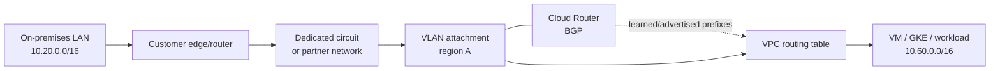
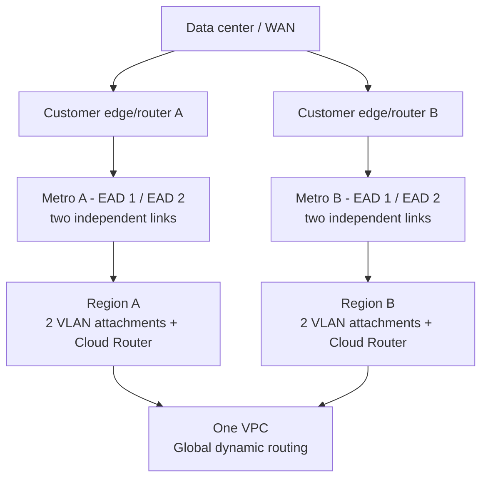
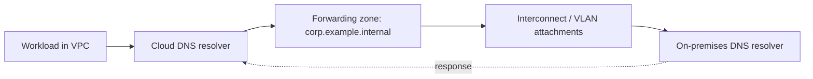

# Dedicated Interconnect and Partner Interconnect

When an enterprise runs part of its system in its own data center (on-premises) and the rest on Google Cloud, services such as Compute Engine, GKE, Cloud Run, Cloud SQL, or internal DNS servers need **stable, redundant, and path-controlled** data exchange. When traffic volume is high or consistent latency is required, relying on the public Internet as the sole connection path may not be suitable. **Cloud Interconnect** provides connectivity paths between an enterprise network and Google's network to support hybrid architectures.

The two core options are **Dedicated Interconnect** and **Partner Interconnect**. Both provide private connectivity between on-premises and a VPC, yet differ in how the physical link is provisioned, location requirements, operational responsibilities, and costs. This lesson belongs to the **DNS and Hybrid Connectivity** chapter and focuses on selection, path design, Cloud Router/BGP configuration, DNS integration, high availability, and troubleshooting.

> Project names, subnets, IP addresses, traffic figures, and diagrams in this lesson are for learning purposes only and do not represent real systems. Commands that create connections or modify networks must be executed in approved environments.

## Learning Objectives

After this lesson, you will be able to:

1. Distinguish Dedicated Interconnect, Partner Interconnect, and HA VPN by bandwidth needs, location, security, SLA, and responsibility model.
2. Explain the roles of **Cloud Interconnect connections**, **VLAN attachments**, **Cloud Router**, **BGP sessions**, **edge availability domains**, **regions**, and **VPCs**.
3. Design provisioning flows for Dedicated and Partner, including cross-connects, pairing keys, L2/L3, and attachment activation.
4. Read routes exchanged via BGP, distinguish **regional/global dynamic routing**, and detect overlapping CIDRs.
5. Model redundancy for 99.9% or 99.99% availability requirements and verify fault tolerance when one link fails.
6. Identify the security layers, encryption, DNS forwarding, firewalls, IAM, and costs to consider in a hybrid architecture.
7. Use the Google Cloud Console and `gcloud` to inspect connection status, VLAN attachments, BGP, and failure causes.

## 1. What Is Cloud Interconnect?

**Cloud Interconnect** is a family of services connecting Google Cloud networks to external networks over dedicated circuits or supported network providers. In the two models covered in this lesson, traffic between the enterprise network and the VPC over Cloud Interconnect **does not traverse the public Internet** the way standard Cloud VPN does.

Two models:

| Criterion | **Dedicated Interconnect** | **Partner Interconnect** |
| --- | --- | --- |
| Connection path | Direct physical connection from customer equipment/routers to Google's network at a supported colocation facility | Indirect connection through a **supported service provider's** network that already connects to Google |
| Best fit | Enterprises needing high bandwidth, able to reach a colocation facility, and wanting physical link control | Enterprises far from colocation, needing less bandwidth, or wanting a carrier to manage connectivity |
| Who provisions the physical link? | Customer coordinates with the colocation/cross-connect provider and Google | Partner Interconnect service provider |
| Bandwidth | Order 10/100/400 Gbps circuits; can bundle multiple circuits within current limits | Purchase **VLAN attachment** capacity in tiers offered by the provider; no need to buy a full 10 Gbps circuit |
| Google Cloud components | Interconnect connection + VLAN attachment + Cloud Router | VLAN attachment + Cloud Router; provider manages the Partner circuit |
| BGP | Cloud Router with enterprise router | L2: Cloud Router ↔ enterprise router; L3: Cloud Router ↔ provider router |
| Off-Google-Cloud costs | Cross-connects, colocation, hardware, and circuit operations | Service fees from the partner, equipment/access circuits per contract |
| What must be controlled | Google edge location, ports/circuits, hardware, LACP, and redundancy | Availability at site, L2/L3 type, partner SLA, pairing, and activation |

**Both use VLAN attachments to bind the connection to a VPC through Cloud Router.** A VLAN attachment is not a VM, a public IP, or a VLAN that automatically appears across the entire enterprise network.

### Comparison with HA VPN

| Mechanism | Transport | Default Encryption | When to Consider |
| --- | --- | --- | --- |
| **Standalone HA VPN** | IPsec tunnels over the public Internet | Yes, IPsec | Quick start, moderate bandwidth, backup path |
| **Dedicated Interconnect** | Direct dedicated circuit to Google | Payload not encrypted automatically | High bandwidth and physical link control required |
| **Partner Interconnect** | Dedicated path via a service provider | Payload not encrypted automatically | Far from colocation, flexible capacity, partner-operated |
| **HA VPN over Cloud Interconnect** | IPsec tunnels running **over** Interconnect VLAN attachments | Yes, IPsec | Need both a private circuit and IPsec traffic encryption |

**Key point:** "Does not traverse the public Internet" **does not mean data is automatically encrypted**. If encryption in transit is required, evaluate **HA VPN over Cloud Interconnect** or **MACsec** on supported connections, alongside application-layer TLS. Security and SLA topologies for each option must be checked separately.

## 2. Understanding Components Before Ordering a Connection

### 2.1 Interconnect Connection

For **Dedicated**, this is a logical connection to Google consisting of one or more physical circuits of the same type. Enterprises can order 10, 100, or 400 Gbps per circuit, subject to circuit count limits in current documentation and facility availability. Hardware, optical standards, and LACP must meet Google specifications.

For **Partner**, customers generally do not create a Dedicated Interconnect connection in their own project: the provider owns the infrastructure/connectivity to Google and delivers service to the customer via pairing.

### 2.2 VLAN Attachment

A **VLAN attachment** (API resource type `interconnectAttachment`) is a **logical, regional connection with configured bandwidth** between an Interconnect link and a Cloud Router. One Interconnect connection can host multiple VLAN attachments, though **configuring aggregate attachment bandwidth higher than physical link bandwidth does not create extra physical capacity**.

A VLAN attachment belongs to **one region**, one **Cloud Router**, and one project. It binds indirectly to **one VPC** because each Cloud Router belongs to a single VPC. Different attachments can serve multiple VPCs/projects as authorized by the organization.

### 2.3 Cloud Router and BGP

**Cloud Router** is a Google-managed route control-plane service using **Border Gateway Protocol (BGP)** to exchange prefixes between external networks and a VPC. Cloud Router manages BGP sessions and dynamic routes; **it is not a packet-processing/forwarding appliance**. Packet forwarding happens on Google Cloud's network infrastructure.

Logically:



The lines depict conceptual flows. BGP exchanges routes, while data flows across the Google edge and VLAN attachment. A BGP session being **UP/ESTABLISHED** is necessary but **not sufficient** to guarantee an application is reachable: firewalls, target addresses, routes, DNS, and service permissions also apply.

### 2.4 Metro, Edge Availability Domain, and Region

- **Metro** is the metropolitan area where Google provides interconnect points of presence.
- **Edge availability domain (EAD)** is an availability zone at Google's network edge; spreading connections across different EADs reduces shared maintenance or outage risk.
- **Region** is the logical location of the VLAN attachment and Cloud Router in the VPC. An attachment's region **is not synonymous** with the physical metro/colocation location.
- **Zones** such as `asia-southeast1-b` are compute zones; do not confuse them with Cloud Interconnect EADs.

Choosing metro and region affects **latency, routing paths, reachable regions, and data transfer costs**.

## 3. Dedicated Interconnect: Model and Provisioning Flow

### Basic Architecture

```text
Enterprise/on-premises                   Google Cloud

LAN -- CE router -- cross-connect -- Google edge
                                       |
                                  Dedicated Interconnect
                                       |
                                  VLAN attachment (regional)
                                       |
                                  Cloud Router (BGP)
                                       |
                                  VPC + workload
```

With a Dedicated connection, the customer orders a circuit to a Google-supported **colocation facility**; if the internal router is not in that facility, a transport circuit to the colocation facility may be needed. Ordering the physical circuit is **separate** from creating a VLAN attachment in the project.

### Deployment Sequence

1. **Design:** Choose metro/colocation, port capacity, optical standards, redundant links, traffic requirements, and colocation/router contracts.
2. **Request Dedicated connection:** Order the connection/circuit via Google Cloud per product documentation. Google issues information such as **LOA-CFA (Letter of Authorization and Connecting Facility Assignment)** for each connection so the colocation provider can install the cross-connect.
3. **Physical connection:** The colocation provider patches the customer port to the Google edge; configure hardware/LACP and verify link state and testing requirements.
4. **Prepare VPC and Cloud Router:** Select the appropriate region, VPC network, and ASN; confirm on-premises CIDRs do not overlap VPC subnets.
5. **Create Dedicated VLAN attachment:** Bind the physical connection to the Cloud Router in the project's region.
6. **Configure on-premises BGP:** Read the VLAN tag, BGP peer IPs, Google ASN, and session details from the attachment/Cloud Router, and configure the peer router.
7. **Verify routes and end-to-end:** Check connection, attachment, BGP, prefix, and firewall status; test from both sides with an authorized application.
8. **Standardize HA/monitoring:** Add independent connections in another EAD/metro per SLO, measure utilization, and test failover.

### Illustrative Command to Create a Dedicated VLAN Attachment

Suppose the Dedicated connection is already ordered and active, and Cloud Router exists in the target region:

```bash
# ILLUSTRATIVE: replace names with valid resources before using.
# This command CREATES a VLAN attachment and may incur charges.
gcloud compute interconnects attachments dedicated create onprem-ded-a \
  --project=retail-net-prod \
  --region=asia-southeast1 \
  --router=cr-hybrid-sg \
  --interconnect=ded-connection-a
```

After running the command, the operator must inspect the attachment and configure matching BGP on the enterprise router. **Never copy a VLAN tag or BGP peer IP from an example** because they must match the actual attachment.

**Changing capacity:** The Dedicated link type chosen when creating a connection (10/100/400 Gbps) cannot simply be changed in place to another type. Moving to a new link type requires planning a new connection and cutover. To consume high capacity, multiple VLAN attachments may be needed.

### Customer-Side Network Requirements

The network team must verify router ports, optics, LACP, dot1q VLANs, BGP, IPs, and device support for the selected circuit link type. Never assume opening a VPC firewall rule alone brings up a physical link.

## 4. Partner Interconnect: Model and Provisioning Flow

Partner Interconnect fits when an enterprise **lacks convenient access to a Google colocation facility** or wants capacity smaller than a full Dedicated circuit. The customer buys connectivity from a **supported service provider**. The provider has connectivity to Google and is responsible for the contracted portion of service delivered to the customer.

```text
Enterprise/on-premises            Partner Provider           Google Cloud

LAN -- CE router ----------> Partner network -----------> Google edge
                                     |                        |
                            Partner connection          VLAN attachment
                                                              |
                                                          Cloud Router
                                                              |
                                                             VPC
```

### Layer 2 and Layer 3

| Partner Type | Who Establishes BGP with Cloud Router? | Characteristics |
| --- | --- | --- |
| **Layer 2 (L2)** | **On-premises** router ↔ **Cloud Router** | Partner transports Layer 2 connectivity; the enterprise manages BGP on its own edge router |
| **Layer 3 (L3)** | **Partner** router ↔ **Cloud Router** | Partner manages BGP toward Google; how on-premises routers connect to the partner depends on the contract |

With Partner Interconnect, Cloud Router is created with **ASN 16550** as required by the product; peer-side connectivity and ASNs must follow the partner's L2/L3 model. **Do not assume every Partner link uses direct BGP between the on-premises router and Google.**

### Provisioning Steps

1. **Select partner:** Check Google-supported providers, locations, L2/L3 types, bandwidths, enterprise–partner SLAs, lead times, and separate fees.
2. **Design region and HA:** Choose VPC, Cloud Router, EADs, number of VLAN attachments, and redundant path split.
3. **Create Partner VLAN attachments** in Google Cloud. Each attachment generates a **pairing key** dedicated to the requested connection.
4. **Send the pairing key to the right partner** along with capacity, location, and contract details. **Keep the pairing key on a protected channel** until pairing completes.
5. **Wait for partner provisioning:** The attachment may sit in `PENDING_PARTNER`; after configuration it transitions to `PENDING_CUSTOMER` or `ACTIVE` depending on activation mode.
6. **Verify provider and activate attachment:** Unless pre-activated, the customer verifies the partner identity and explicitly activates the attachment to allow data flow.
7. **Verify BGP:** For L2, configure BGP on the enterprise router; for L3, the partner manages BGP to Cloud Router and the enterprise coordinates bidirectional route verification.
8. **Test failover, throughput, and DNS** before onboarding critical applications.

### Illustrative Command to Create a Partner VLAN Attachment

```bash
# Cloud Router already exists in the matching region/VPC (ASN 16550).
# This command modifies resources and may incur charges once the partner provisions.
gcloud compute interconnects attachments partner create onprem-partner-a \
  --project=retail-net-prod \
  --region=asia-southeast1 \
  --router=cr-partner-sg \
  --edge-availability-domain=availability-domain-1

# Describe the attachment to retrieve status and pairing key.
gcloud compute interconnects attachments describe onprem-partner-a \
  --project=retail-net-prod \
  --region=asia-southeast1
```

The `pairingKey` field may appear in the output: **never paste the key into public logs, broad tickets, or screenshots sent to the wrong recipient**. Deliver it only over a secure channel to the verified partner.

**Activation:** Pre-activation can suit **L3** connections when you already trust the provider and accept activating the link as soon as the partner finishes configuration. If you want to verify the provider before traffic flows, keep manual activation. For L2, pre-activation usually brings little benefit because the enterprise still must configure BGP.

### Partner Capacity

Partner Interconnect supports many VLAN attachment capacity tiers starting as low as **50 Mbps**. Maximum capacities and allowed tiers can change by product, region, and provider; **not every partner offers every tier**. Check the **Cloud Interconnect limits/pricing** page and actual provider quotes before finalizing the design.

## 5. Routing Decisions with Cloud Router

Cloud Router uses **BGP** to learn prefixes from on-premises and advertise VPC prefixes (or configured **custom advertised routes**). For example:

```text
On-premises: 10.20.0.0/16
VPC subnet: 10.60.10.0/24 (region A)
VPC subnet: 10.60.20.0/24 (region B)

On-prem router advertises: 10.20.0.0/16
Cloud Router advertises: 10.60.10.0/24 [and other eligible prefixes]
```

Once the BGP session is established, the VPC can receive **custom dynamic routes** from Cloud Router with the attachment as next hop; the enterprise receives prefixes advertised by Cloud Router. Routing only works when both the **forward path and return path** are valid.

### 5.1 Regional and Global Dynamic Routing

| VPC Dynamic Routing Mode | High-Level Meaning | Design Impact |
| --- | --- | --- |
| **Regional** | Cloud Router learned routes are scoped to the region per regional rules | Check which region's workloads can use the on-premises routes |
| **Global** | Learned routes are distributed across VPC regions per global rules with priority/cost adjustments | Useful for multi-region; account for cross-region paths and inter-region fees |

**Do not confuse** global dynamic routing with "the network automatically reaches every VPC" or every Google Cloud service. It remains scoped to the VPC and supported routing features, subject to peering/NCC/Shared VPC limits depending on design.

### 5.2 Non-Overlapping CIDRs

If on-premises and the VPC both use `10.20.0.0/16`, route advertisements can cause collisions or misrouting. Before provisioning:

- Build an IPAM plan for RFC1918/IPv6 ranges across data centers, VPCs, GKE Pod/Service CIDRs, and branch networks.
- Keep subnet ranges on both sides **non-overlapping**.
- Verify advertised ranges, priorities/advertisements, and return paths.
- If overlapping CIDRs are unavoidable, design appropriate NAT/translation **per service documentation** before connecting.

### 5.3 Route Advertisement and Load Balancing Across Links

With multiple attachments, **ECMP (equal-cost multipath)** can balance traffic when Google Cloud receives advertisements for the same prefix with matching metrics. On-premises must also configure bidirectional routing and appropriate path selection criteria.

- **MED (Multi-Exit Discriminator):** Use BGP metrics/route priority to steer preferred paths; evaluate both inbound to the VPC and outbound back to on-premises.
- **AS path, prefix filtering:** Apply per router policies and Google Cloud limits; do not advertise `0.0.0.0/0` or overly broad ranges without explicit need and controls.
- **Capacity:** If two links each run at 70% utilization, losing one link will overload the survivor without headroom; design for N-1 before enabling ECMP.
- **Dynamic routing ≠ forwarding policy:** Firewalls, route priorities, VPC peering, or policy-based routes can still affect paths.

### 5.4 Inspecting Cloud Router, Attachments, and BGP

The following commands are **read-only**:

```bash
PROJECT_ID="retail-net-prod"
REGION="asia-southeast1"
ROUTER="cr-hybrid-sg"
ATTACHMENT="onprem-ded-a"

gcloud compute routers describe "$ROUTER" \
  --project="$PROJECT_ID" \
  --region="$REGION"

gcloud compute routers get-status "$ROUTER" \
  --project="$PROJECT_ID" \
  --region="$REGION"

gcloud compute interconnects attachments describe "$ATTACHMENT" \
  --project="$PROJECT_ID" \
  --region="$REGION"

gcloud compute networks describe retail-vpc-prod \
  --project="$PROJECT_ID" \
  --format="yaml(name,routingConfig)"
```

Read `routers get-status` to inspect **BGP peer status**, learned/advertised routes, and routing state returned by the tool. A successful `describe` command **does not prove** packets traverse end-to-end.

## 6. High Availability Design and SLAs

Cloud Interconnect defines **Google-prescribed topologies to qualify for SLAs**. Having a single physical link or a single VLAN attachment **is not sufficient** to meet high SLA tiers, regardless of how a provider markets a "dedicated line."

### 6.1 99.9% Target

For workloads that can tolerate brief interruptions, a **99.9%** topology typically uses **two redundant connections/attachments** in one metro placed in **two different edge availability domains**, following the official diagram for Dedicated or Partner. This is not "two VLANs on one physical circuit": both paths must avoid the single points of failure specified in the documentation.

### 6.2 99.99% Target

For mission-critical production applications, Google recommends a **99.99%** configuration. **Dedicated** and **Partner** have different topology requirements:

| Option | Key Requirements for 99.99% Production Configuration |
| --- | --- |
| **Dedicated Interconnect — multi-region** | At least **4 Dedicated connections** across **2 metros**, two edge availability domains per metro; in the VPC at least **4 VLAN attachments** across **2 regions**, at least one Cloud Router per region, VPC using global dynamic routing |
| **Dedicated Interconnect — single-region** | Supported option using **4 Dedicated connections** across two qualifying facility/EAD combinations **within one metro**, 4 VLAN attachments in one corresponding low-latency region, per Google-defined connection groups/topology |
| **Partner Interconnect** | At least **4 VLAN attachments** across **2 metros/2 regions**, two distinct EADs per metro; **2 Cloud Routers** (one per region) and **global dynamic routing** |

**Note:** These topologies are educational summaries. To qualify for an actual SLA, you must satisfy **all conditions** in current documentation, including topology, BGP router configuration, connection/attachment types, and contract terms. Google's Partner SLA covers only the **segment between the VPC and the provider network**, not automatically the **last mile from the enterprise to the partner**. Review the partner's separate SLA for the end-to-end path.

### 6.3 Example Redundant Model



The diagram illustrates a **multi-region model** to clarify the concept; it does not replace Google's detailed configuration diagrams. For Dedicated, choose connections/EADs, facilities, and attachment mappings as required; for Partner, maintain real contracts/links to providers in two metros.

### 6.4 Failover Succeeds Only When Sufficient Capacity Remains

Suppose two active links share load equally, each rated at 2 Gbps. Peak total load is 3 Gbps:

```text
When both links are up: 3 Gbps < 4 Gbps total
When one link fails:    3 Gbps > 2 Gbps remaining link
                        => risk of congestion or packet drops
```

Designing for **N-1** requires assuming one link is lost and determining how much load the survivor must carry. Account for **effective throughput after overhead**, per-flow limits, packets-per-second, and router/firewall capacity on-premises.

## 7. Security When Using Cloud Interconnect

### 7.1 A Private Path Does Not Mean an Encrypted Path

Cloud Interconnect **does not encrypt traffic by default**. Options:

- **TLS/mTLS** at the application layer on supported services, protecting payloads end-to-end between applications.
- **HA VPN over Cloud Interconnect** when IPsec is desired over Interconnect, with its own cost/quotas and topology.
- **MACsec** when link-layer encryption is required on supported connections; MACsec protects the **covered link segment**, not end-to-end encryption across every router or partner hop.

If policy mandates encryption in transit, confirm the exact **start and end points of encryption**, physical/location support, traffic types, and key management responsibilities.

### 7.2 Firewalls and Access Restrictions

- Maintain **least privilege** using appropriate VPC firewall rules / Firewall Policies; never open all of `10.0.0.0/8` if only one management subnet needs to reach one application.
- Use **IAM** to restrict who can create/modify Interconnect attachments, Cloud Routers, and routes; keep CI/IaC accounts separate.
- Use **Organization Policies** when the organization needs to restrict which VPCs may use Cloud Interconnect.
- For sensitive systems, evaluate **VPC Service Controls**, Private Google Access, and appropriate API restrictions; these controls **do not replace** routing and firewalls.
- With partners, inspect responsibility boundaries, router access, tenant isolation, and pairing key handling.

### 7.3 Network Segmentation and Operations

In large environments, a Shared VPC host network project can be separated from service projects, centralizing routes and IAM. Distinguish the **project owning the Dedicated connection** from the **project owning the VLAN attachment** to assign admin rights and allocate costs accurately.

## 8. How Does Hybrid DNS Traverse Interconnect?

Stable IP connectivity is not enough for applications if hosts **cannot resolve names**. For instance, applications on Compute Engine/GKE need to call `db.corp.example.internal` managed by on-premises DNS; meanwhile, the enterprise needs to resolve private names of Google Cloud services.

A bidirectional design can use **Cloud DNS forwarding zones, inbound DNS forwarding, and DNS policies** as needed:



A **DNS lookup path** requires all of the following:

1. A Cloud DNS forwarding zone pointing to **on-premises DNS IPs** (valid target addresses).
2. VPC/Cloud Router and Interconnect having **routes to the resolver**; many hybrid DNS setups need **custom advertised routes** so reverse-direction DNS return traffic works.
3. Routers/firewalls permitting required DNS traffic, typically **UDP/TCP 53** and the source/target ranges used by the product.
4. On-premises DNS resolvers permitting queries from the corresponding source range, with a return route back.
5. Applications testing both **DNS resolution** and **TCP/HTTPS or database connections** once the IP is resolved.

Do not assume that creating a VLAN attachment makes all internal Google Cloud and on-premises names resolve automatically. For resolving private VPC names from on-premises, design an **inbound DNS server policy** and enterprise forwarders per Cloud DNS documentation.

### DNS and Private Google Access

Accessing **Google APIs** from on-premises over Cloud Interconnect is a separate requirement from accessing VMs by private IP. It may require **Private Google Access for on-premises hosts**, DNS for Google APIs domains, and matching **custom advertised routes**. It does not mean every Google endpoint maps to a VPC private IP. Check the supported APIs/addresses list and VPC Service Controls restrictions if used.

## 9. Costs and Billing Responsibility

Cloud Interconnect costs consist of several components; comparing just "cost per Mbps" is rarely enough.

| Component | Dedicated Interconnect | Partner Interconnect |
| --- | --- | --- |
| Connection/circuit fee | Google bills hourly per connection/circuit | Customer typically pays circuit service fees to the **partner** |
| VLAN attachment fee | Google bills by attachment capacity and duration | Google bills by attachment capacity and duration |
| Data transfer out | Google bills traffic leaving the VPC via the attachment, depending on location and pricing | Similar, billed by Google Cloud; partner may also charge bandwidth fees |
| Data transfer in | Check Google's inbound pricing policy; processing resources may still incur charges | Similar |
| Colocation / cross-connect / last mile | Colocation/telco and network hardware costs | Provider, location, and contract costs |
| HA VPN over Interconnect | Adds HA VPN/tunnel/IP components per deployment type | Similar |
| Inter-region paths | May incur inter-region data transfer charges | May incur inter-region data transfer charges |

**Dedicated connection** charges and **VLAN attachment** charges can belong to **different projects**; **data transfer out** charges attach to the project owning the attachment per Google Cloud billing rules. With Shared VPC or centralized governance, clearly document owner and billing projects.

**Capacity calculation example, not real pricing:**

```text
Two attachments, 1 Gbps each.
Assume 730 hours/month operation.

Attachment-hours = 2 × 730 = 1,460 attachment-hours/month

Data transfer out = 5 TiB/month = 5,120 GiB/month
```

To estimate real costs, enter **location, capacity, connection count, attachment count, outbound GiB, and duration** into [Cloud Interconnect pricing](https://cloud.google.com/network-connectivity/docs/interconnect/pricing) or the pricing calculator, then add partner/cross-connect and other network service costs. Never apply a single global egress unit rate across all regions.

### Cost and Risk Planning

- Provisioned bandwidth can incur charges even before applications generate traffic; do not assume idle connections/attachments are free.
- Partners may charge service, hardware, installation, support, or commitment fees **outside the Google Cloud bill**.
- Network egress between the workload's region and the VLAN attachment's region can incur inter-region charges; optimize placement.
- SLA-compliant redundancy can **multiply connection/attachment counts** and require headroom, making total cost higher than a single-link design.
- Use per-project Cloud Billing budgets/alerts, apply labels where supported, and monitor actual utilization to optimize post-deployment.

## 10. Troubleshooting Hybrid Connectivity Layer by Layer

**Principle:** Never conclude "Google Cloud networking is broken" before isolating the failing layer. Work from physical → attachment → BGP → route → firewall → DNS → application.

| Symptom | Layer to Check | Verification Direction |
| --- | --- | --- |
| Dedicated connection stays down | Physical/optics/LACP | Cross-connect, LOA-CFA, port, transceivers, provider/colocation, and link status |
| Partner attachment `PENDING_PARTNER` | Provisioning | Did the partner receive the right pairing key, location, and capacity? |
| Partner attachment `PENDING_CUSTOMER` | Activation | Have you verified the provider and activated the attachment? |
| Attachment `ACTIVE` yet BGP DOWN | BGP/control plane | ASN, peer IP, VLAN tag, BGP session, on-prem firewall/router, or partner L3 responsibility |
| BGP UP yet on-premises routes missing | Route advertisement | Is on-premises advertising the right prefixes? Prefix filters, BGP policy, and dynamic routing mode |
| Route exists yet TCP fails | Data plane/firewall | Return route, firewall rules, network ACLs, MTU, exact target/port |
| One direction works, the other fails | Asymmetric routing | MED/route priority, return path, and stateful firewalls |
| App reaches IP yet DNS name fails | DNS | Forwarding zone, inbound policy, UDP/TCP 53, custom advertised routes, resolver |
| Losing one link causes sharp latency spike | HA/capacity | Does the N-1 link have enough capacity? ECMP, BGP failover, and edge devices |
| Link UP yet large packets drop | MTU/fragmentation | MTU on VPC, VLAN attachment, routers, firewalls; PMTUD |
| Data transfer cost spikes unexpectedly | Billing/routing | Workload/attachment regions, outbound GiB, cross-region transfer, and partner fees |

### 10.1 Read-Only Inspection Commands

```bash
PROJECT_ID="retail-net-prod"
REGION="asia-southeast1"

# List VLAN attachments (Dedicated/Partner) in the project.
gcloud compute interconnects attachments list \
  --project="$PROJECT_ID"

# Describe a known attachment.
gcloud compute interconnects attachments describe onprem-ded-a \
  --project="$PROJECT_ID" \
  --region="$REGION"

# For Dedicated: inspect provisioned physical connections.
gcloud compute interconnects list \
  --project="$PROJECT_ID"

# Inspect Cloud Router / BGP learned routes.
gcloud compute routers get-status cr-hybrid-sg \
  --project="$PROJECT_ID" \
  --region="$REGION"

# Verify VPC dynamic routing mode.
gcloud compute networks describe retail-vpc-prod \
  --project="$PROJECT_ID"
```

**Distinguish states:** Attachment `ACTIVE` only means the logical link is provisioned/activated; the BGP session might not yet be established. BGP `UP` also does not prove application data reaches the destination server. Inspect each layer and run an appropriate business-level test.

### 10.2 MTU and Applications

Cloud Interconnect VLAN attachments support MTU values such as **1440, 1460, 1500, or 8896 bytes**, depending on attachment type and configuration. **8896 (jumbo frames)** is supported only on certain unencrypted VLAN attachment types. Network teams should align MTU across the VPC, VLAN attachment, and devices on both sides, and test **path MTU** to avoid "small pings work, large transfers hang" issues.

### 10.3 Observability and Alerting

Track key metrics:

- Connection/attachment state and configuration changes.
- BGP session state, learned/advertised prefix counts, and flapping events.
- Inbound/outbound throughput, utilization relative to capacity, and packet drops.
- RTT/latency, packet loss, and failover convergence time.
- DNS latency, `SERVFAIL`/`NXDOMAIN`, timeouts, and application connection failure rate.
- Edge device alerts, LACP/optics, partner tickets, and EAD/metro maintenance notices.

Remember Cloud Router is the **control plane**; looking solely at route counts does not give full visibility into packet forwarding. Use network observability tools, router telemetry, and corresponding service logs.

## 11. Case Study: Connecting a Data Center to an Order Service on GCP

A retail enterprise runs its ERP and internal DNS in a data center. The order API runs on Google Cloud, and business data synchronizes between the ERP and a service tier inside the VPC. The architecture team needs a private path, predictable latency, and resilience if a link goes down.

### Assumed Requirements

| Requirement | Illustrative Value |
| --- | --- |
| On-premises CIDR | `10.20.0.0/16` |
| Google Cloud VPC CIDR | `10.60.0.0/16` |
| Primary workload region | `asia-southeast1` |
| Backup region | Second region per design and availability |
| Egress from GCP to on-premises | 1.2 Gbps peak, lower average |
| Sensitive data | Encryption in transit mandatory |
| Connectivity SLO | 99.99% production target |
| DNS | Must resolve `corp.example.internal` inside the VPC |

### Option A: Dedicated Interconnect

Suitable if the enterprise can reach a Google-supported colocation facility, owns/leases high-speed circuits, and wants direct network hardware control. However, a 1.2 Gbps load may not justify the cost of **minimum Dedicated circuits** plus redundant links; factor in cross-connects and multi-year growth.

If choosing Dedicated, the network team must design the prescribed 99.99% topology with sufficient circuits/attachments/EADs/metros. Because encryption is mandatory, include **HA VPN over Cloud Interconnect** or a supported equivalent encryption layer with clearly verified scope.

### Option B: Partner Interconnect

Suitable when sites are not conveniently near Google colocation or the enterprise wants a provider to deliver private connectivity sized to demand. Choose a partner supporting **sufficient metros/regions, L2 or L3, N-1 capacity, and last-mile SLA commitments**. After generating pairing keys, wait for the provider to provision and activate each attachment.

For a 99.99% target, deploy **4 attachments across 2 regions and 2 metros**, with 2 distinct EADs per metro per topology documentation. Because private links do not encrypt by default, still include HA VPN over Interconnect when payload protection is mandatory.

### Pre-Cutover Testing

1. Reconcile CIDRs and advertised ranges between both networks; block wrong advertisements or overlapping ranges.
2. Verify all BGP peers are UP and learned/advertised prefix counts match expectations.
3. Test IP reachability from ERP to workloads and the return path; check firewalls and latency.
4. Test the Cloud DNS forwarding zone for `corp.example.internal` and UDP/TCP 53 paths.
5. Run upload/download tests across packet sizes and rates, measuring MTU, throughput, and packet loss.
6. **Failover drill:** take down one link or simulate maintenance during an approved window; record recovery time and surviving link utilization.
7. Verify payloads are encrypted as required by security; review audit logs, alerts, and operations IAM permissions.
8. Compare actual vs. estimated costs: attachment fees, outbound data, partner/cross-connect, VPN, and observability.

### Operations Handoff Documentation

The handoff document must record: projects/VPCs, regions/metros/EADs, connection IDs/attachment IDs, ASNs/BGP peers, advertised routes, CIDR ranges, DNS zones, firewalls, provider contacts, contract/ticket numbers, and failover runbooks. Keep pairing keys and sensitive secrets in an appropriate secrets vault rather than widely shared docs.

## 12. Common Design Mistakes

| Misconception | Correction |
| --- | --- |
| "An Interconnect link is an IPsec VPN" | Not encrypted by default; requires HA VPN over Interconnect or another supported encryption mechanism |
| "Having one 10 Gbps link satisfies 99.99%" | SLAs depend on topology and link/EAD/metro/region counts per documentation |
| "Partner only differs from Dedicated in price" | Partner changes operational responsibilities, L2/L3 options, provisioning, last mile, and SLA boundaries |
| "Once BGP is UP, apps can connect" | Bidirectional routes, firewalls, DNS, ACLs, and service health are still required |
| "One VLAN attachment automatically connects all VPCs" | An attachment binds indirectly to one VPC via Cloud Router |
| "The router in Google Cloud forwards every packet" | Cloud Router is the BGP control plane; it is not a data-plane router |
| "Partner pairing keys can be posted publicly" | Keys must be delivered to the verified partner over a secure channel before provisioning |
| "Attachment region doesn't matter" | Region affects dynamic routing, latency, and inter-region data transfer fees |
| "Total attachment bandwidth always equals real throughput" | Constrained by physical circuits/partner limits, per-flow/PPS limits, routers, and infrastructure |
| "Hybrid DNS works automatically once routes exist" | Forwarding, inbound policies, resolvers, return routes, and firewalls must be designed |
| "Two attachments are always enough if one link drops" | Must guarantee **independent failure domains and N-1 capacity** |
| "All costs appear on the Google Cloud bill" | Partner, colocation, cross-connect, and hardware charges arrive on separate bills |

## 13. Practice Exercises

### Exercise 1: Dedicated or Partner?

A data center has no convenient path to Google colocation; initial bandwidth demand is 300 Mbps, and the team wants a carrier to manage connectivity. Which option fits and why?

<details>
<summary>Answer hint</summary>

**Partner Interconnect** is usually more suitable: the provider delivers connectivity from the enterprise site to Google and supports capacities smaller than a Dedicated circuit. Verify availability at the site, L2/L3 options, pricing, end-to-end SLA, and bandwidth upgrade path.
</details>

### Exercise 2: Identifying Components

A Dedicated connection hosts two VLAN attachments in two regions inside the same VPC. What is Cloud Router's role? How many regions and VPCs does one attachment belong to?

<details>
<summary>Answer hint</summary>

Cloud Router exchanges BGP routes; it does not forward packets. Each attachment belongs to **one region**, binds to one Cloud Router, and indirectly binds to **one VPC**; a physical connection can support multiple attachments subject to product limits.
</details>

### Exercise 3: BGP Is UP Yet the App Cannot Connect

On-premises advertises `10.20.0.0/16`; the VPC uses `10.60.0.0/16`. BGP is UP, yet TCP 443 connections to the application fail. List at least five items to check.

<details>
<summary>Answer hint</summary>

Check bidirectional learned/advertised routes, dynamic routing mode, resource IP/region, VPC firewall policies, on-premises firewalls/ACLs, return paths, asymmetric routing, MTU, and application health. If calling by hostname, also check DNS.
</details>

### Exercise 4: Sizing Capacity for Failover

Two redundant links each have 2 Gbps capacity; peak load is 3 Gbps, shared equally when both are active. If one link fails, is the system guaranteed to sustain 3 Gbps?

<details>
<summary>Answer</summary>

No. The surviving link only has 2 Gbps nominal capacity before overhead and other limits, which is below the 3 Gbps load. Increase capacity, add independent links, or implement appropriate load-shedding policies. SLA topology does not replace N-1 capacity planning.
</details>

### Exercise 5: Checking 99.99% Topology Compliance

A production system uses **Partner Interconnect** with two attachments in the same region and same metro, in different EADs. Is this a 99.99% topology per Google guidelines?

<details>
<summary>Answer</summary>

No. For **Partner 99.99%**, official documentation requires at least **4 VLAN attachments across two regions/two metros**, two distinct EADs per metro, two Cloud Routers, and global dynamic routing. Two attachments in a single metro typically fit a lower redundancy tier when all conditions are met.
</details>

### Exercise 6: Security and DNS

An enterprise needs to query `db.corp.example.internal` from a VM inside a VPC over Interconnect, and data over the link must be encrypted. List the required mechanisms.

<details>
<summary>Answer hint</summary>

Design a Cloud DNS forwarding zone pointing to the on-premises DNS server, bidirectional routes, and UDP/TCP 53 firewall rules. For payload encryption, use HA VPN over Cloud Interconnect or an approved mechanism (potentially combined with TLS/mTLS), then verify encryption scope. Never assume Interconnect encrypts automatically.
</details>

### Exercise 7: Investigating a Partner Link Not Passing Traffic

A Partner attachment moves from `PENDING_PARTNER` to `PENDING_CUSTOMER` after the partner completes configuration. What is the next step?

<details>
<summary>Answer hint</summary>

Verify that the attachment is paired with the exact **service provider**, then **activate** it if not pre-activated. Next, verify BGP per the L2/L3 model, routes, and end-to-end connectivity. Never treat `PENDING_CUSTOMER` as proof that BGP is UP.
</details>

### Exercise 8: Cost Estimation

A Dedicated connection serves three attachments across two projects and generates 8 TiB of outbound traffic per month. List the Google Cloud and off-Google-Cloud components to identify before estimating.

<details>
<summary>Answer hint</summary>

Hourly connection/circuit fees, per-VLAN-attachment fees by capacity/duration, data transfer out (**8 TiB = 8,192 GiB**) by location/region, and inter-region or HA VPN fees if applicable; off Google Cloud are colocation, cross-connects, telco circuits, hardware, and operations. Identify which projects own the connection and attachments for cost allocation.
</details>

## 14. Checklist for Production Hybrid Architectures

- [ ] Selected Dedicated or Partner based on bandwidth, location, operating model, timeline, and cost.
- [ ] Inventoried VPCs/projects, regions, metros, EADs, Cloud Routers, VLAN attachments, and providers/cross-connects.
- [ ] Confirmed zero IPv4/IPv6 CIDR overlap and verified advertised prefixes/return routes.
- [ ] Reconciled BGP ASNs, peer IPs, VLAN tags, route priority/MED, and dynamic routing mode.
- [ ] Topology satisfies required SLO/SLA per documentation for the exact Interconnect type.
- [ ] Capacity is sufficient for N-1 failover, including router/firewall and per-flow/PPS limits.
- [ ] Designed encryption (if mandatory), firewalls, IAM, Organization Policies, and operational logging.
- [ ] Tested hybrid DNS, Private Google Access (if used), TCP/UDP 53, and bidirectional paths.
- [ ] Validated MTU/PMTUD, latency, packet loss, and throughput via real testing.
- [ ] Configured alerts for links/attachments/BGP/throughput, failover drill schedule, and provider contacts.
- [ ] Budgeted for Google Cloud fees, partner/colocation fees, and inter-region network charges.
- [ ] Prepared change/rollback plans, diagrams, runbooks, owners, and security handoff documentation.

## Official References

- [Cloud Interconnect overview](https://cloud.google.com/network-connectivity/docs/interconnect/concepts/overview): connection options, BGP, MTU, and encryption.
- [Dedicated Interconnect overview](https://cloud.google.com/network-connectivity/docs/interconnect/concepts/dedicated-overview): physical connections, port capacities, hardware, and VLAN attachments.
- [Partner Interconnect overview](https://cloud.google.com/network-connectivity/docs/interconnect/concepts/partner-overview): providers, L2/L3, pairing, and activation.
- [Cloud Interconnect key terms](https://cloud.google.com/network-connectivity/docs/interconnect/concepts/terminology): Cloud Router, metro, edge availability domain, and VLAN attachment.
- [Create VLAN attachments for Dedicated Interconnect](https://cloud.google.com/network-connectivity/docs/interconnect/how-to/dedicated/creating-vlan-attachments): gcloud commands, router/BGP, and limits.
- [Create VLAN attachments for Partner Interconnect](https://cloud.google.com/network-connectivity/docs/interconnect/how-to/partner/creating-vlan-attachments): pairing keys, activation, and provider configuration.
- [Cloud Router overview](https://cloud.google.com/network-connectivity/docs/router/concepts/overview): BGP exchange and dynamic routes.
- [99.99% availability for Dedicated Interconnect](https://cloud.google.com/network-connectivity/docs/interconnect/tutorials/dedicated-creating-9999-availability): multi-region and single-region topologies.
- [99.99% availability for Partner Interconnect](https://cloud.google.com/network-connectivity/docs/interconnect/tutorials/partner-creating-9999-availability): two-region/two-metro topology.
- [Cloud Interconnect SLA](https://cloud.google.com/network-connectivity/docs/interconnect/sla): SLA conditions and responsibility boundaries.
- [HA VPN over Cloud Interconnect overview](https://cloud.google.com/network-connectivity/docs/interconnect/concepts/ha-vpn-over-interconnect): combining IPsec encryption with Interconnect.
- [Cloud DNS overview](https://cloud.google.com/dns/docs/overview): DNS forwarding, inbound, and outbound policies.
- [Cloud Interconnect pricing](https://cloud.google.com/network-connectivity/docs/interconnect/pricing): connection, VLAN attachment, outbound, and partner charges.
- [Cloud Interconnect troubleshooting](https://cloud.google.com/network-connectivity/docs/interconnect/support/troubleshooting): states and troubleshooting procedures.
