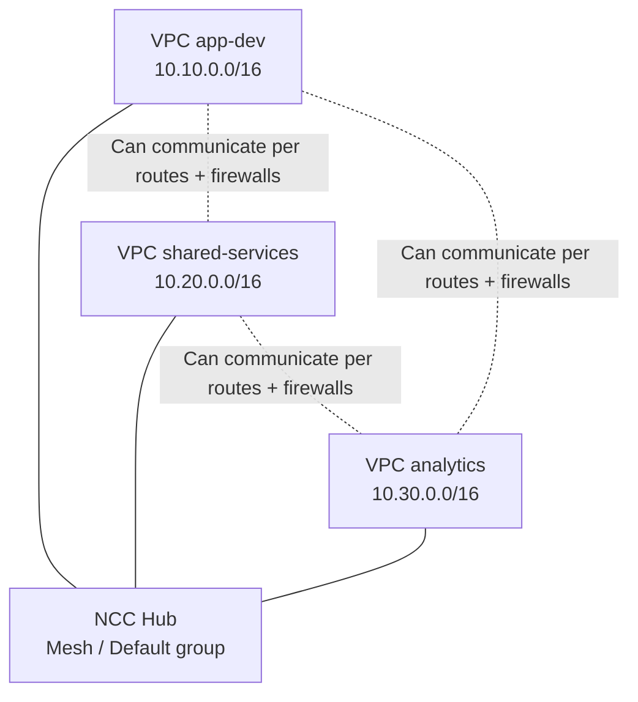
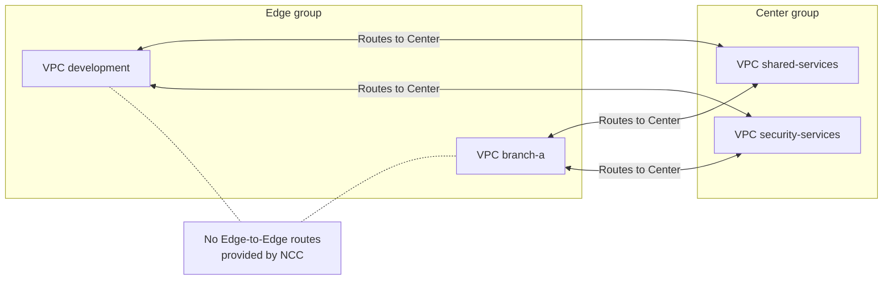
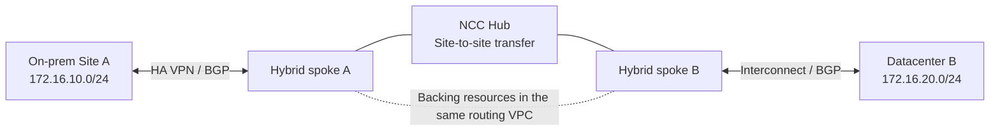
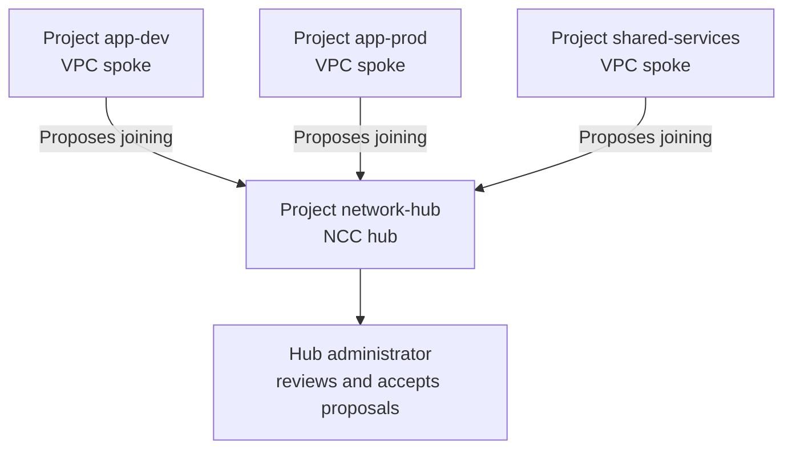
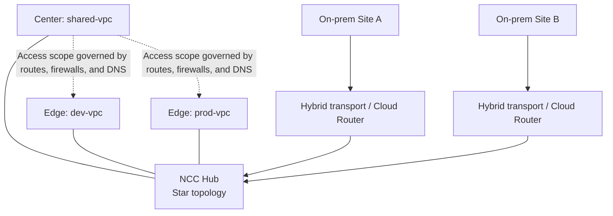

# Network Connectivity Center and Hub-and-Spoke Network Organization

As a Google Cloud environment grows from one VPC in a single project to dozens of VPCs and multiple on-premises sites, connectivity is no longer just "adding another VPN." The infrastructure team must decide **which networks can learn routes to which other networks**, who approves joining the connectivity fabric, whether IP addresses collide, whether traffic is blocked by firewalls, and which applications are impacted if a link fails. **Network Connectivity Center (NCC)** is a Google Cloud service for organizing these connections in a **hub-and-spoke** model.

This lesson belongs to the **DNS and Hybrid Connectivity** chapter of the `CLOUD_PROVIDERS_GCP` module. Across the journey from project organization, IAM, and VPCs to Compute Engine, GKE, Cloud Run, storage, databases, release automation, and reliability/cost monitoring, NCC helps you build a centrally governable connectivity layer across many networks. NCC does not grant IAM permissions, open firewalls, or share DNS automatically; those layers still must be designed together.

## 1. Learning Outcomes

After this lesson, you will be able to:

1. Explain **hubs**, **spokes**, **backing resources**, **spoke groups**, and route paths in NCC.
2. Distinguish **VPC spokes**, **producer VPC spokes**, **hybrid spokes**, and advanced capabilities such as **NCC Gateway spokes**.
3. Compare **mesh** and **star** topologies; recognize the network segmentation behavior of `Center` and `Edge` groups.
4. Understand **VPC-to-VPC**, **site-to-cloud**, and **site-to-site data transfer** scenarios, including Cloud VPN, Cloud Interconnect, and Cloud Router/BGP requirements.
5. Clearly explain why **route propagation does not equal application connectivity**, because DNS, firewalls, return routes, IAM, latency, and quotas are independent layers.
6. Plan IP addresses, traffic flows, admin permissions, and redundancy before creating hubs/spokes.
7. Practice inspecting and creating a **mesh hub with two VPC spokes** in an authorized lab environment, reading back status and route tables, and preparing rollback.
8. Identify operational metrics, routing issues, and cost components when moving NCC into a real environment.

## 2. Why Do We Need Hub-and-Spoke?

Suppose an organization has these projects:

- `app-dev`: VPC for development applications.
- `app-prod`: VPC for production applications.
- `shared-services`: VPC for internal administrative services.
- Two branch offices and one data center using private IPs that need access to Google Cloud resources.

If you build pairwise VPC-to-VPC connections or site connections one pair at a time, the number of relationships to manage grows rapidly. With \(n\) networks where each network needs direct connectivity to every other network, the theoretical number of pairs is:

\[
\frac{n(n-1)}{2}
\]

At \(n=6\), there are 15 pairs; at \(n=12\), there are 66 pairs. This illustrates management complexity—**not** the number of connections NCC must create or the practical limit of VPC Network Peering.

NCC lets you register networks or hybrid resources as **spokes** on a shared **hub**. The hub manages connectivity relationships and route exchange according to configured topology and policies. Instead of operating independent peering pairs, the network team focuses on:

- Which networks may join the hub?
- Which routes are exported/imported and to which spoke group?
- Which networks must remain isolated from each other?
- Do hybrid resources have proper HA and BGP?
- Who approves spokes from other projects?

**Accurate mental model:** An NCC hub is a **route management and orchestration** resource, not a virtual router appliance sitting in every data path. VPC-to-VPC traffic still traverses Google Cloud's network infrastructure along programmed routes; never design a hub as a mandatory transit VM hop. If packet inspection by a security appliance is required, select a dedicated inspection architecture and product capable of supporting it.

## 3. Core Components of NCC

| Component | Role | Scope / Characteristics |
| --- | --- | --- |
| **Hub** | Central point managing spokes, topology, and route exchange | **Global** NCC resource belonging to one project |
| **Spoke** | Represents a resource attached to the hub | **Global** spokes (VPC) and **regional** spokes (hybrid/gateway depending on type) |
| **Backing resource** | Actual network resource referenced by a spoke | VPC network, HA VPN tunnel, VLAN attachment, Router appliance VM, etc. |
| **Spoke group** | Routing group inside a hub | `Default` (mesh); `Center`/`Edge` (star); additional groups in advanced topologies |
| **Hub/group route table** | Stores routes learned and exchanged by NCC | Managed by NCC; used to verify what is advertised |
| **Cloud Router** | Establishes BGP and learns/advertises routes for hybrid links | Route control-plane component for HA VPN/Interconnect/Router appliance |
| **Firewalls and DNS** | Traffic control and name resolution | Separate mechanisms; **not configured automatically by attaching an NCC spoke** |

One hub can attach spokes across multiple regions. A VPC can span subnets across multiple regions; therefore, a VPC spoke is a global resource even though specific VMs or subnets are regional/zonal.

### 3.1. Spoke Types

| Spoke Type | Backing Resource | When to Use | Notes |
| --- | --- | --- | --- |
| **VPC spoke** | A VPC network | Connect this VPC with VPCs on other spokes of the hub | Exports selected **subnet routes**; does not arbitrarily export all static/peering routes |
| **Producer VPC spoke** | Consumer VPC and peering connection to producer | Make services in a producer VPC reachable from appropriate spokes | Subject to specific VPC peering rules; do not assume NCC supports arbitrary transitive peering |
| **Hybrid spoke – HA VPN** | One or more HA VPN tunnels of the same type | Site-to-cloud or site-to-site over encrypted connections | BGP/Cloud Router and HA setup govern routes and redundancy |
| **Hybrid spoke – Interconnect** | Cloud Interconnect VLAN attachments | High-speed private connectivity or supported hybrid links | Requires Cloud Router/BGP and matching Interconnect infrastructure |
| **Hybrid spoke – Router appliance** | Third-party network appliance VMs | Routing through network virtual appliances and specialized cases | Must operate, authorize, make HA, and monitor the appliance VMs |
| **NCC Gateway spoke** | NCC Gateway resource | Multi-cloud connectivity and SSE traffic inspection scenarios | Specialized feature/topology; verify product support and requirements |

A **hybrid spoke** can bind multiple backing resources of the **same type** in one spoke; do not mix HA VPN tunnels and VLAN attachments in the same hybrid spoke. Under the supported NCC model, hybrid spokes belong to the **same project as the hub**. VPC spokes can live in different projects—or even different organizations—but connection acceptance must be governed.

## 4. Two Common Connectivity Topologies: Mesh and Star

### 4.1. Mesh Topology: Spokes Exchange Routes via a Shared Group

**Mesh** is the default hub topology when no other topology is specified. Every spoke in a mesh belongs to the `Default` group; eligible VPC spokes can export subnet routes and receive routes from other spokes in the same group subject to applicable filters and rules.



The diagram depicts **route management/exchange relationships**, not packets flowing through a host running "Hub." In a mesh model, if dev applications **should not** access every other system, you must use appropriate topology/filters and firewalls/IAM; merely placing three spokes around a hub does not create isolation.

### 4.2. Star Topology: Separating Center and Edge Groups

With **star**, NCC creates two spoke groups with separate route tables:

- `Center`: central spokes can receive routes to communicate with spokes in both `Center` **and** `Edge`.
- `Edge`: edge spokes receive routes to the `Center` group, but NCC **does not** distribute direct routes for different `Edge` spokes to talk to each other through the `Edge` group.



Star is useful when edge environments need to reach central services without automatically opening paths to one another. However, **star is not a firewall** and **does not automatically insert a packet inspection hop through Center**. If all flows must be inspected, design dedicated traffic-inspection services/networks and verify traffic actually traverses them.

Certain hybrid configurations impose group placement requirements; for example, a hybrid spoke with **site-to-site data transfer** enabled in a star topology must belong to the `Center` group. Once a hub is created with a preset topology, you cannot switch directly from mesh to star in place; therefore, decide segmentation during the design phase. Beyond mesh/star, NCC also offers hybrid inspection topologies with NCC Gateway for specialized purposes, which is not the default configuration for the lab.

### 4.3. Decision Table

| Requirement | Mesh | Star |
| --- | --- | --- |
| Multiple app VPCs need to communicate in a shared group | Usually simpler | May be unnecessary |
| Each branch/dev VPC should only use shared services | Must carefully design filters/firewalls | `Center`/`Edge` explicitly models the segmentation goal |
| Isolate Edge spokes from other Edge spokes | No group-level segmentation | Enforced via group route table rules |
| Hybrid connectivity hub needs route exchange | Supports hybrid spokes | Group placement restrictions and data transfer options apply |
| Changing topology while running | Requires planned migration | Also requires migration; preset topology cannot be changed directly |

## 5. How Does NCC Exchange Routes?

A **route** indicates which next hop reaches a destination prefix (such as `10.20.0.0/16`). NCC manages part of the **control plane**, distributing eligible routes between spoke groups and VPCs/hybrid links. A successful API call does not prove packets reach the destination.

### 5.1. VPC Spokes: Primarily Export Subnet Routes

Suppose:

| Network | Subnet IP | Type |
| --- | --- | --- |
| `vpc-app` | `10.10.10.0/24` | VPC spoke A |
| `vpc-shared` | `10.20.20.0/24` | VPC spoke B |
| Internal site | `172.16.100.0/24` | Prefix learned by Cloud Router from hybrid spoke |

Expected route flow when topology/filters match:

1. `vpc-app` **exports its subnet route** to the hub.
2. `vpc-shared` exports its subnet route to the hub.
3. The hub distributes A's subnet route to B and vice versa according to the spoke group.
4. With an eligible hybrid spoke, dynamic routes learned over BGP from the internal site can be distributed by NCC to VPC spokes.
5. Each VPC uses effective routes to select the next hop, after which firewalls and connectivity on both ends decide whether packets succeed.

**Important limitation:** A VPC spoke does not arbitrarily export static routes, peering subnet routes, or the VPC's own dynamic routes across the hub. If another VPC Network Peering exists, do not assume subnet routes imported via peering will be re-advertised by NCC. Producer VPC spokes and NCC-supported static next-hop configurations follow their own feature documentation.

### 5.2. Export Filters and Import Filters

NCC lets you filter exported/imported CIDRs, though capabilities differ by spoke type:

- **VPC spokes** use **include/export** or **exclude/export** filters for their subnet ranges. Without an include filter, they export **private IPv4 subnet ranges** (`ALL_PRIVATE_IPV4_RANGES`) by default; they do not export all IPv6 or special IPv4 ranges by default.
- **Hybrid spokes** can export dynamic routes learned via BGP, and use **import filters** to control which routes are sent back to the hybrid peer. Hybrid import defaults vary by site-to-site mode, so never guess.
- **VPC spokes import** routes from their hub group via NCC mechanisms; they do not use the same per-prefix import filters as hybrid spokes.
- Route filters control prefix reachability. They **cannot distinguish** users, TCP ports, or specific data accessed; for that, use firewalls, IAM, and other security layers.

```text
VPC app                 NCC Hub               VPC shared
10.10.10.0/24  --export--> Route table --import--> 10.10.10.0/24
10.20.20.0/24  <--import-- Route table <--export-- 10.20.20.0/24
```

Before creating spokes, build a CIDR table and check for conflicts across **primary and secondary ranges**, including GKE Pod/Service ranges, databases, and hybrid site IPs. NCC is not an automatic NAT tool for overlapping address ranges. Certain specialized NAT features may exist per product design, but should not be treated as an excuse to skip IP planning.

### 5.3. Route Priority and Dynamic State

When multiple routes share a destination, VPC routing evaluates route type, applicability, prefix length, priority, and regional configuration per VPC/Cloud Router rules. With BGP, MED, ASN, and prefix advertisements affect path selection. Never conclude "the path with the lowest ping always wins."

NCC maintains **hub route tables** per spoke group for NCC-managed routes. Meanwhile, each VPC has its own effective routing table. To troubleshoot, inspect both hub routes and the routes actually programmed into the VPC, especially with VPN/Interconnect and multiple regions.

NCC route quotas and VPC quotas can cause missing routes in large configurations. Missing one route in the hub can render an **entire set of destinations unreachable**, even while BGP tunnels report UP; never skip monitoring prefix counts.

## 6. Hybrid Connectivity: Site-to-Cloud and Site-to-Site Are Different Goals

### 6.1. Site-to-Cloud

**Site-to-cloud** is when an office or data center connects to workloads running on Google Cloud. Example: on-premises `172.16.100.0/24` calling an internal API in VPC `10.20.20.0/24`.

Typical building blocks:

1. **Transport:** HA VPN or Cloud Interconnect with created and active tunnels/VLAN attachments.
2. **Routing:** Cloud Router/BGP learning prefixes from on-premises and advertising required GCP prefixes.
3. **NCC spoke:** if hybrid routes must be distributed to other VPC spokes on the hub.
4. **Network access:** firewalls, on-premises routing, DNS, and security policies.
5. **Reliability:** redundant paths, dual interfaces/tunnels, and failover testing.

NCC does not replace setting up physical/VPN connectivity; a hybrid spoke simply represents **existing, properly functioning backing resources**.

### 6.2. Site-to-Site Data Transfer

**Site-to-site data transfer** uses Google Cloud's network as part of a WAN so site A can communicate with site B across hybrid spokes. This is an explicit option—**it is not automatically enabled just because both sites are spokes**.



Constraints to verify:

- **Hybrid spokes with data transfer enabled** in the same hub must reference backing resources in the **same VPC network**.
- To exchange site-to-site routes across **different regions**, the associated VPC's dynamic routing mode must be **global**; same-region setups may not require this.
- Routes from site A must be learned via BGP and **re-advertised** to site B per NCC/Cloud Router configuration.
- Prefixes/ASNs/BGP sessions must meet NCC requirements; routes from sites must not conflict or cause routing loops.
- This mode operates within supported capabilities and regions; traffic transferred between sites is described in service documentation as **best effort**, with no guaranteed bandwidth/latency SLAs for individual site-to-site flows.

**Distinction:** Having global dynamic routing on a VPC gives routes learned from other regions proper scope within the VPC; it does not make Cloud Router or NCC automatically advertise every subnet of every VPC to on-premises.

### 6.3. Limitations by Hybrid Spoke Type

| Spoke | Key Points to Remember |
| --- | --- |
| HA VPN | Uses **HA VPN tunnels**, not Classic VPN tunnels, as NCC backing resources |
| Interconnect | References VLAN attachments; does not point a physical port directly at the hub |
| Router appliance | VMs must have networking/BGP/HA configured; self-managed component |
| Hybrid spoke in star + data transfer | Per topology docs, must reside in the `Center` group |
| Hybrid IPv6 | Certain features may be Preview or product-restricted; verify before production use |

In multi-site designs, choose supported regions, redundant tunnel/attachment counts, and on-premises device layouts matching Cloud VPN/Interconnect HA requirements. Never treat the mere presence of two spokes as proof of SLA compliance.

## 7. One Hub, Many Projects: Centralized Connectivity Governance

An organization often places the hub in a central networking project such as `network-hub`, while each team owns a separate VPC project:



For a **VPC spoke in a different project** from the hub, the spoke admin creates a proposal; the **hub administrator** must accept it for the spoke to become active, unless an appropriate auto-accept mechanism is configured. VPC spokes in the **same project as the hub** are typically accepted automatically by NCC.

This establishes operational boundaries among:

- **Hub admin:** decides topology, manages route groups, and accepts/rejects connections.
- **Spoke/network admin:** manages the VPC network, subnets, and application spoke.
- **Security/Platform:** designs CIDR controls, firewalls, DNS, environment rules, and observability.

Reference roles include `roles/networkconnectivity.hubAdmin`, `roles/networkconnectivity.spokeAdmin`, `roles/networkconnectivity.groupUser`, and `roles/compute.networkAdmin` depending on operations and resource scope. Use least privilege; never grant Owner across the organization just to attach a spoke.

**Shared VPC** can join NCC via an appropriate VPC spoke. However, the host project, service projects, subnet owners, and IAM permissions have distinct relationships; clearly identify who owns the VPC backing resource and which policies apply. Connecting a VPC to a hub does not grant IAM access to servers or databases in other projects.

### When to Choose NCC Over VPC Network Peering or Shared VPC?

| Mechanism | Idea | Usually Fits |
| --- | --- | --- |
| **VPC Network Peering** | Directly connects two VPCs per peering rules | Few networks, simple access patterns, route limits well understood |
| **Shared VPC** | One host VPC shared across service projects | Applications sharing one network domain managed by a central team |
| **NCC VPC spokes** | Multiple separate VPCs join a hub and exchange routes | Many projects/networks needing orchestration and connectivity segmentation |
| **Cloud VPN/Interconnect** | Transport from external sites to Google Cloud | Physical/VPN hybrid links, combinable with NCC to share reachability |
| **NCC + hybrid spokes** | Coordinates routes to hybrid links and, when configured, between sites | Enterprise networks with many sites, VPCs, and centralized governance |

These mechanisms can work together. **NCC is not a new VPC**, nor does it merge all VPCs into a single shared VPC. A VPC spoke can also belong to **only one hub at a time**. VPC Network Peering between two VPCs already connected through the same hub has specific restrictions; running both in parallel for "redundancy" is not supported by default.

## 8. IP Planning and Segmentation Before Attaching Spokes

For example, three networks need non-overlapping address ranges:

| Component | IP Example | Notes |
| --- | --- | --- |
| VPC `vpc-app` | `10.10.0.0/16` | Application subnets may span multiple regions |
| VPC `vpc-shared` | `10.20.0.0/16` | Shared services |
| VPC `vpc-analytics` | `10.30.0.0/16` | Data warehouse / analytics |
| Datacenter A | `172.16.10.0/24` | Advertised via BGP if approved |
| Datacenter B | `172.16.20.0/24` | Needs redundant paths and return routes |
| GKE secondary IP ranges | e.g., `10.40.0.0/16` | Must verify against actual Pod/Service design |

**Check both primary and secondary ranges**; never look only at VPC names. If two spokes advertise incompatible ranges, NCC may reject them, fail to install routes, or trigger route priority issues depending on the case. Renumbering IP ranges after many systems depend on them costs far more effort than planning upfront.

### Example Reachability Matrix for Star

| Source | Destination | Desired | Controls |
| --- | --- | --- | --- |
| Edge `dev` | Center `shared-services` | Yes, port-restricted | NCC routes + firewalls |
| Edge `branch-a` | Center `shared-services` | Yes, subnet-restricted | NCC routes + on-prem firewall |
| Edge `dev` | Edge `branch-a` | No via NCC | Star groups; audit for alternate network paths |
| Center `shared-services` | Edge `dev` | Per application | NCC routes + firewalls |
| Dev | Prod | Blocked by policy | No permitted route, firewalls, IAM; audit bypass peering/VPN |

Star restricts NCC routes, yet if two networks share **another path** (VPN, peering, or appliance), NCC does not block that path itself. When strict isolation is required, inventory every connectivity path.

## 9. NCC and Cloud DNS: IP Connectivity Does Not Mean Name Resolution

Since this chapter covers **DNS and Hybrid Connectivity**, distinguish the two planes:

- **IP routing plane:** NCC, Cloud Router, VPC routes, and BGP deliver packets to destination IPs.
- **Name resolution plane:** Cloud DNS private zones, DNS policies, DNS forwarding/peering, and on-premises DNS determine which IP a hostname resolves to.

Suppose a VM in `vpc-app` needs to call `db.internal.example` in `vpc-shared`. Even after NCC exchanges `10.20.20.0/24`, the VM still does not automatically know what address `db.internal.example` is. To use hostnames, you must:

1. Identify which **DNS zone** is the source of truth for the hostname.
2. Authorize the right VPC to query or deploy forwarding/peering using Cloud DNS-supported mechanisms.
3. For hybrid, establish **DNS query paths** from on-premises to Google Cloud and vice versa if needed, plus firewall rules for resolvers.
4. Verify the DNS answer returns an IP with valid routes and an application listening on that IP/port.
5. Account for split-horizon DNS, TTLs, caching, and name behavior during regional failover.

```text
Application -> DNS query -> Destination IP
            -> NCC/VPC/BGP routing -> Next hop
            -> Firewall/security rules -> Service
            -> Return path -> Application
```

**Never assume** VPC A's Cloud DNS private zone automatically appears in VPC B just because both VPCs are NCC spokes. Nor are TCP/UDP port 53 firewall rules opened automatically when creating a spoke; resolver traffic handling depends on your DNS design.

## 10. Security and Reliability Layers You Cannot Skip

### 10.1. Firewalls, IAM, and Actual Connectivity

Having a route in NCC does not mean traffic is allowed:

- **VPC firewall rules or network firewall policies** may block ingress/egress.
- **Service identity/IAM** on Cloud Run, GKE, or databases may reject API calls even when the network is open.
- **Return routes** must exist and match; one-way paths or asymmetric routes can cause TCP timeouts.
- **NAT, load balancers, Private Service Connect, and proxies** have their own boundaries, not automatically satisfied by NCC subnet routes.
- **Source and destination subnets/regions** can affect which dynamic routes apply.

### 10.2. HA Design

An NCC hub is a global control-plane resource, yet overall system reliability still depends on backing resources. For hybrid, ensure:

1. Multiple tunnels/attachments where required by the product and workload.
2. Redundant Cloud Router/BGP peers matching the architecture.
3. Sufficiently diverse on-premises routers and circuits.
4. Consistent route advertisements and intentional priorities.
5. Health monitoring and single-path failure drills.

For VPC-to-VPC, route exchange may work while the application runs on a single VM or a zonal database; that remains an **application single point of failure**. Network HA does not replace HA design for Compute Engine, GKE, Cloud Run, or Cloud SQL.

## 11. Lab Model: Two VPCs in One Project, One Mesh Hub

To learn the minimal mechanics before adding hybrid links, use **pre-existing** resources in an authorized lab project:

| Component | Example Value | Requirement |
| --- | --- | --- |
| Project | `my-ncc-lab-project` | Billing and Network Connectivity API already enabled by admin |
| New mesh hub | `ncc-lab-hub` | Unused name in the project |
| VPC spoke A | `vpc-app` | **Custom mode VPC**, private IPv4 subnets non-overlapping with VPC B |
| VPC spoke B | `vpc-shared` | Custom mode, non-overlapping private IPv4 subnets |
| Region to check | `asia-southeast1` | Test subnets/VMs in this region if testing traffic |
| Purpose | Observe how subnet routes are exchanged | Do not touch production or live site links |

**Do not create new VPCs, subnets, or VMs just to run this lesson.** The instructions use two existing lab VPCs; if they do not exist yet, prepare them in a separate infrastructure workflow and estimate costs first. Commands starting from hub/spoke creation are **write operations** that can alter reachability and incur NCC charges.

### 11.1. Preflight: Verify Project, VPCs, and Addresses (Read-Only)

Bash in Cloud Shell or a workstation with Google Cloud CLI configured:

```bash
HUB_PROJECT_ID="my-ncc-lab-project"
HUB_NAME="ncc-lab-hub"
VPC_A="vpc-app"
VPC_B="vpc-shared"
CHECK_REGION="asia-southeast1"

gcloud auth list

gcloud projects describe "$HUB_PROJECT_ID" \
  --format="yaml(projectId,projectNumber,lifecycleState)"

# Do both VPCs exist with the expected routing mode/config?
gcloud compute networks describe "$VPC_A" \
  --project="$HUB_PROJECT_ID" \
  --format="yaml(name,autoCreateSubnetworks,routingConfig)"

gcloud compute networks describe "$VPC_B" \
  --project="$HUB_PROJECT_ID" \
  --format="yaml(name,autoCreateSubnetworks,routingConfig)"

# List subnets and IP ranges to detect overlaps.
gcloud compute networks subnets list \
  --project="$HUB_PROJECT_ID" \
  --format="table(name,network.basename(),region.basename(),ipCidrRange)"
```

Also check secondary IP ranges if the network uses GKE, as well as IP ranges reserved for hybrid links. **Auto mode VPCs cannot be used directly as VPC spokes**; depending on policies and resources, admins consider custom mode networks. Switching from auto mode to custom mode is difficult to reverse—never do it just for a lab.

**Permissions:** Creating hubs/spokes requires NCC permissions and permissions on the corresponding VPCs. Reference roles are `roles/networkconnectivity.hubAdmin`, `roles/networkconnectivity.spokeAdmin`, and `roles/compute.networkAdmin` depending on the action. Verify IAM on the lab project; do not ask for Owner just to work with NCC.

### 11.2. Read Existing Hubs/Spokes (Read-Only)

```bash
gcloud network-connectivity hubs list \
  --project="$HUB_PROJECT_ID"

gcloud network-connectivity spokes list \
  --global \
  --project="$HUB_PROJECT_ID"

# If the hub already exists, inspect details before deciding to use it.
gcloud network-connectivity hubs describe "$HUB_NAME" \
  --project="$HUB_PROJECT_ID"
```

The final `describe` command may return `NOT_FOUND` if the hub has not been created yet. That is a normal baseline check, not a reason to create duplicate-named hubs or overwrite existing resources. For an active hub, inspect its spokes and owners before making changes.

### 11.3. Create a Mesh Hub (Write Operation)

Once you have the lab project, confirmed no naming conflicts, and have authorization to create NCC resources:

```bash
gcloud network-connectivity hubs create "$HUB_NAME" \
  --project="$HUB_PROJECT_ID" \
  --policy-mode=PRESET \
  --preset-topology=MESH \
  --description="Lab NCC VPC route exchange"
```

This creates a new **global NCC hub**. Mesh is the default, specified explicitly here so learners understand the topology. Record the initial state so you can clean up resources afterward.

Readback:

```bash
gcloud network-connectivity hubs describe "$HUB_NAME" \
  --project="$HUB_PROJECT_ID"

gcloud network-connectivity hubs groups list \
  --hub="$HUB_NAME" \
  --project="$HUB_PROJECT_ID"
```

With mesh, look for the `Default` group. Do not assume all networks in the project are connected just because the hub exists: without VPC spokes, the hub has no backing networks yet.

### 11.4. Create Two VPC Spokes (Write Operation)

In this lab, the hub and VPCs are in the same project, so create a VPC spoke for each VPC. Use `--global` and explicit network URIs:

```bash
gcloud network-connectivity spokes linked-vpc-network create \
  "spoke-app" \
  --project="$HUB_PROJECT_ID" \
  --hub="$HUB_NAME" \
  --vpc-network="https://www.googleapis.com/compute/v1/projects/$HUB_PROJECT_ID/global/networks/$VPC_A" \
  --include-export-ranges=ALL_PRIVATE_IPV4_RANGES \
  --global

gcloud network-connectivity spokes linked-vpc-network create \
  "spoke-shared" \
  --project="$HUB_PROJECT_ID" \
  --hub="$HUB_NAME" \
  --vpc-network="https://www.googleapis.com/compute/v1/projects/$HUB_PROJECT_ID/global/networks/$VPC_B" \
  --include-export-ranges=ALL_PRIVATE_IPV4_RANGES \
  --global
```

**These commands allow the two VPCs to exchange subnet routes**, so run them only in a lab project with non-overlapping CIDRs and verified firewalls. They do not add VM ingress rules and do not share Cloud DNS private zones with the other VPC.

Readback:

```bash
gcloud network-connectivity spokes describe "spoke-app" \
  --project="$HUB_PROJECT_ID" \
  --global

gcloud network-connectivity spokes describe "spoke-shared" \
  --project="$HUB_PROJECT_ID" \
  --global

gcloud network-connectivity hubs list-spokes "$HUB_NAME" \
  --project="$HUB_PROJECT_ID"
```

Check `ACTIVE` state on each spoke and its backing VPC. If a spoke is in a different project from the hub, a **proposal/acceptance** workflow is required; same-project spokes are usually accepted automatically. An API call succeeding while the spoke is not yet `ACTIVE` does not mean the two networks are connected.

### 11.5. Inspect Hub Route Tables and Effective Routes

```bash
gcloud network-connectivity hubs route-tables list \
  --hub="$HUB_NAME" \
  --project="$HUB_PROJECT_ID"

# For mesh, the route table is usually named default-route-table.
gcloud network-connectivity hubs route-tables routes list \
  --hub="$HUB_NAME" \
  --route_table="default-route-table" \
  --effective-location="$CHECK_REGION" \
  --project="$HUB_PROJECT_ID"
```

When inspecting routes, verify:

- Destination prefixes of subnets in `vpc-app` and `vpc-shared`.
- Route type, source spoke, and next hop where returned by the tool.
- Effective location of the route; results can differ across regions when hybrid dynamic routes exist.
- Status, filters, and whether the route actually appears in the target VPC's routing table.

**If a subnet is missing**: verify the actual subnet exists, is an export-eligible private IPv4 subnet, the spoke is `ACTIVE`, there are no IP conflicts, and hub/group route tables are accurate. Never add manual static routes to mask an uninvestigated issue.

### 11.6. Test Reachability (Read / Application Test, When Lab VMs Exist)

If both VPCs have test VMs in the right subnets, test connectivity with an appropriate tool (TCP connection or test app). Never open broad ports or assign external IPs just to run `ping`. A VM may block ICMP via firewall even when routes are valid. Test results should verify:

1. Whether the hostname resolves to the right IP.
2. Whether routes to the destination IP exist forward and return.
3. Which protocols and ports target firewalls/applications allow.
4. Whether the application connection succeeds or times out / gets refused.
5. If an issue occurs, whether logs/flow logs provide enough data to separate routing from firewalls.

## 12. Extension Exercise: Star Topology and Edge Isolation

To segment by network role, consider a **new hub** with star topology, separate from the mesh hub you just practiced on. Design example only: do not reuse the lab hub name.

```bash
# Example CREATING A NEW STAR hub in an approved lab project.
gcloud network-connectivity hubs create "ncc-star-lab" \
  --project="$HUB_PROJECT_ID" \
  --policy-mode=PRESET \
  --preset-topology=STAR
```

When adding VPC spokes, pass `--group=Center` or `--group=Edge` matching your design and the group names returned by listing hub groups; documentation may display group identifiers in normalized forms. With star, choosing a group is **mandatory** for VPC spokes.

Non-executed example:

```bash
# ILLUSTRATIVE ONLY: verify the exact hub and group before using.
gcloud network-connectivity spokes linked-vpc-network create \
  "spoke-center" \
  --project="$HUB_PROJECT_ID" \
  --hub="ncc-star-lab" \
  --vpc-network="https://www.googleapis.com/compute/v1/projects/$HUB_PROJECT_ID/global/networks/$VPC_B" \
  --group="Center" \
  --global
```

To test segmentation, place application spokes that should not connect to one another in `Edge` and the shared services spoke in `Center`. Then inspect the **route tables of both groups** and test traffic per the reachability matrix. NCC star does not automatically block connectivity over other paths the VPCs may already have.

## 13. Real-World Hybrid Expansion: HA VPN, Interconnect, Cloud Router

The VPC-to-VPC lab proves only one part of NCC. When adding on-premises, prepare **transport and BGP first** before attaching backing resources to a hybrid spoke.

### 13.1. Design Steps for HA VPN

1. Identify peer/on-premises routers and site IP ranges.
2. Create the **HA VPN gateway, tunnels**, and external peer gateway as required.
3. Configure **Cloud Router** and BGP sessions, defining ASNs, advertised prefixes, and learned routes.
4. Verify tunnel/BGP health using Google Cloud and on-premises network tools.
5. Create the hybrid spoke pointing to valid **HA VPN tunnels** in the required region and project.
6. Choose site-to-cloud or enable site-to-site data transfer once the architecture satisfies constraints.
7. Verify route export/import filters, hub route tables, Cloud Router learned/advertised routes, and traffic flows.
8. Run single-tunnel failover drills and confirm the application recovers within target RTO/RPO where applicable.

**Never copy tunnel creation commands from sample docs without specific peer addresses, ASNs, keys, and a connectivity plan.** These parameters are governed by networking teams and can incur charges, downtime, or hard-to-revert configurations.

### 13.2. BGP Routes to Expect

| Path | Source | Expected |
| --- | --- | --- |
| Site A → Google Cloud | On-prem router advertises `172.16.10.0/24` | Cloud Router learns the prefix accurately |
| Google Cloud → Site A | Cloud Router advertises approved GCP subnets | On-prem router learns routes, no missing return path |
| Site A → Site B via NCC | Hybrid spokes A/B and eligible site-to-site setup | Site B learns A's prefixes and vice versa |
| VPC spoke → Site A | NCC hub has valid dynamic routes from hybrid spoke | VPC has routes to `172.16.10.0/24` and firewalls permit |
| Site A → VPC spoke | VPC spoke routes advertised via Cloud Router per supported setup | On-prem has routes to GCP subnets; not learned automatically without proper config |

A common mistake is that the **VPC learns on-prem routes**, yet on-prem **does not learn return routes to the VPC**. Both NCC and Cloud Router require valid route advertisement configuration, especially when combining VPC spokes with hybrid spokes in a routing VPC.

## 14. Separating Governance Roles and Access Control

A multi-project topology usually involves multiple teams. Define clear boundaries:

| Operational Role | Decides | Evidence to Inspect |
| --- | --- | --- |
| **Network architecture** | Mesh/star, CIDR plan, hybrid transport, routing policies | Network diagrams, reachability matrix |
| **NCC hub admin** | Hubs, groups, accept/reject spoke proposals | Hub policies, spoke states, audit logs |
| **VPC spoke admin** | Select VPC, create spoke, subnet export ranges | VPC details, export filters, route tables |
| **Cloud Router/BGP owner** | ASNs, MED, peers, advertisements | BGP session status, learned/advertised routes |
| **Security** | Firewalls, network segmentation, threat inspection | Firewall policies, deny flows, reviews |
| **Platform/application owner** | DNS, ports, service identity, application health | DNS tests, logs, endpoint health |
| **FinOps** | Budgets, cost allocation, data egress | Billing reports, project mapping, alerts |

A spoke admin can manage their own VPC, yet cannot necessarily accept a spoke into a hub owned by another project. NCC permissions **do not automatically grant access to business data** in other projects.

## 15. Monitoring Operations and Costs

### 15.1. Metrics to Monitor

- **Hub/spoke state:** whether spokes are active, pending approval, or inactive.
- **NCC route tables:** subnet/dynamic prefix counts, unexpected routes, routes dropped due to quotas.
- **Hybrid health:** status of VPN tunnels, VLAN attachments, and Cloud Router BGP sessions.
- **Traffic:** connection volume and network quality from supported logs/metrics; VPC Flow Logs where enabled in the right places.
- **Policy/IAM changes:** who added spokes, updated route filters, switched groups, or accepted proposals.
- **Application-level:** latency, connection timeouts, DNS errors, and firewall blocks at source/destination.

Cloud Monitoring, Cloud Logging, audit logs, and Connectivity Tests help verify each layer. **Connectivity Tests** simulate/evaluate paths within supported scope, but do not replace real application traffic tests and return-path verification.

### 15.2. Cost Components That May Apply

| Component | Costs to Check | Notes |
| --- | --- | --- |
| **NCC spokes** | Hourly spoke usage while active | Depends on spoke type, state, and NCC pricing |
| **NCC data transfer** | Outbound/processed traffic per billing model | Watch traffic origins and cross-region paths |
| **HA VPN** | Tunnels and data transfer | Billed separately from NCC where applicable |
| **Cloud Interconnect** | Ports, attachments, data transfer | Pricing depends on connection type, location, and partner |
| **Router appliance** | Compute Engine VMs, disks, traffic/licensing | Appliances require HA and operations |
| **Logs/Monitoring** | Ingestion, retention, and analysis of telemetry | Configure appropriate retention |
| **Cross-region traffic** | Inter-region data transfer fees | Never assume hub-routed traffic is always free |

**There is no single flat price** for every topology. Consult official pricing by spoke type and location, and combine with Cloud Billing budgets/alerts on spoke-owning projects. Remember: budget alerts do not automatically shut down NCC or block spending.

## 16. Controlled Lab Cleanup

If you created only a new mesh hub and two VPC spokes in the lab, **delete the spokes first, then delete the hub**. Do not delete VPCs, VPNs, or attachments that existed before the lab.

Before deleting, verify whether anyone else is using the resources or connections:

```bash
gcloud network-connectivity hubs list-spokes "$HUB_NAME" \
  --project="$HUB_PROJECT_ID"

gcloud network-connectivity spokes describe "spoke-app" \
  --project="$HUB_PROJECT_ID" --global

gcloud network-connectivity spokes describe "spoke-shared" \
  --project="$HUB_PROJECT_ID" --global
```

**Only when authorized to clean up the lab and after confirming no workloads are impacted**, run the following (all are destructive/write operations):

```bash
# DESTRUCTIVE DELETE COMMANDS - RUN ONLY IN AN APPROVED LAB.
gcloud network-connectivity spokes delete "spoke-app" \
  --global --project="$HUB_PROJECT_ID"

gcloud network-connectivity spokes delete "spoke-shared" \
  --global --project="$HUB_PROJECT_ID"

gcloud network-connectivity hubs delete "$HUB_NAME" \
  --project="$HUB_PROJECT_ID"
```

If spokes from other projects remain attached to the hub, the hub administrator may need to reject them or coordinate with spoke owners rather than assuming permission to delete them. Deleting a hub generally requires detaching or rejecting associated spokes first. Changing network connectivity can disrupt application flows even when VMs and databases are untouched.

## 17. Layer-by-Layer Troubleshooting

| Symptom | Likely Cause | Next Check |
| --- | --- | --- |
| Hub creation fails | Network Connectivity API disabled, missing IAM, quota, or duplicate name | Project ID, API, NCC roles, `hubs list` |
| VPC spoke not ACTIVE | Cross-project spoke not yet accepted by hub admin, unmet permissions/conditions | `hubs list-spokes`, proposal status |
| VPC spoke rejected at creation | Auto mode VPC, CIDR overlap, already attached to another hub, or product limit | VPC type, all subnet ranges, existing spoke attachments |
| Route exists from A to B yet TCP times out | Firewall, app not listening, missing return route | NCC/VPC routes, firewalls, DNS, app health |
| Cloud Router UP yet site cannot reach VPC spoke | Missing import/export, custom advertisement, wrong routing mode | BGP learned/advertised routes, hybrid filters, hub routes |
| Site A sees Site B yet receives no data | On-prem firewall, asymmetric routing, MTU, app, or security appliance | End-to-end test, logs on both sides, and return path |
| Cannot resolve private hostnames between two VPCs | Private zone not shared/forwarded properly | Cloud DNS private zones, DNS policies/forwarding |
| An Edge spoke still reaches another Edge spoke | Another connectivity path exists outside NCC, or wrong target tested | VPC Peering, VPN, proxies, firewalls, route path |
| Routes suddenly vanish as prefix count grows | Quota limit, filter, or BGP change | Quotas, hub route tables, Cloud Router logs |
| Costs rise after adding spokes | Spoke-hour fees, data transfer, VPN/Interconnect | Billing breakdown by project/SKU/traffic |

**Keep your diagnostic order consistent:**

1. Check **spokes/hub** and project/group.
2. Check **exported routes**, **imported routes**, and effective route tables.
3. For hybrid, check **tunnels/attachments/BGP** and advertised routes.
4. Check **firewalls**, DNS, return paths, and application ports.
5. Check logs, quotas, recent changes, and regional health.

Never open firewalls to `0.0.0.0/0` or elevate IAM to Owner just to "make it work." Fixes must address the exact layer blocking traffic.

## 18. Design Scenario: Multi-Environment Sales System

An enterprise has a dev team in Vietnam, applications on GKE/Cloud Run in Google Cloud, and two on-premises sites. Dev needs shared services, production needs the data center ERP, and the two environments must not freely access each other.

Assumptions:

- `shared-vpc` hosts management services, DNS, and monitoring.
- `dev-vpc` hosts the development environment.
- `prod-vpc` hosts the production system.
- On-premises Site A uses `172.16.10.0/24`; Site B uses `172.16.20.0/24`.
- All VPC addresses are non-overlapping and part of a validated IP plan.

A preliminary design:



**Note:** This diagram illustrates logical organization; hybrid spokes have specific group requirements when site-to-site data transfer is enabled. To keep dev and prod completely isolated, verify every connectivity path and route exchange condition outside the hub as well. Real designs may require **two separate hubs** for two trust domains or another topology, rather than placing everything on one star hub.

### Requirement-Driven Decisions

| Question | Decision to Document |
| --- | --- |
| May Dev call APIs in Prod? | If not, avoid direct routes and block at firewalls/IAM; audit alternate paths |
| Do the two on-prem sites need direct communication via Google Cloud? | If yes, evaluate site-to-site data transfer and a single routing VPC |
| Where is the backup data center? | Choose regions, links, BGP, and failover policies |
| Which internal DNS names must resolve from sites and VPCs? | Separate DNS private zones, forwarding/peering, and resolver controls |
| Is cross-cloud traffic inspection required? | Evaluate NCC Gateway/SSE features or a dedicated appliance architecture |
| Who owns the hub/spokes? | Roles and approval workflow between network and application teams |
| What cost level is acceptable? | Estimate spoke-hours, traffic, and transport; set budget alerts |

## 19. Self-Practice Exercises

### Exercise 1 – Does NCC Replace Firewalls?

Two VPC spokes are `ACTIVE` in a mesh hub. `vpc-a` has subnet `10.10.1.0/24`; `vpc-b` has subnet `10.20.1.0/24`. A VM in A cannot reach TCP 5432 on a database in B, even though the route appears in the hub.

*Guided answer:* NCC only solves reachability at the routing layer. Check effective route tables of A/B, ingress/egress firewalls, the database port, ACLs, authentication, and the return path. Never treat an NCC route as proof that traffic is permitted.

### Exercise 2 – Choosing a Topology

There are three VPCs: `app-dev`, `app-staging`, and `shared-services`. Dev and staging may use DNS/monitoring from `shared-services`, but must not automatically have routes to each other.

*Guided answer:* Consider **star** with `shared-services` in `Center` and `app-dev`/`app-staging` in `Edge`, combined with firewalls and DNS. Verify no other VPC peering or VPN directly links dev and staging.

### Exercise 3 – Peering/Transit Misconception

VPC A peers with VPC X. A joins NCC alongside VPC B. The admin expects B to automatically learn all subnets of X through A.

*Guided answer:* Do not assume transitivity. A VPC spoke does not export A's peering subnet routes. If a producer service must be shared under a supported model, evaluate a producer VPC spoke; other connections must be designed separately.

### Exercise 4 – Site-to-Site Across Two Regions

Two hybrid spokes on the same hub connect sites across two regions, both with data transfer enabled. BGP is UP, yet site-to-site routes do not behave as expected.

*Guided answer:* Check whether the backing resources of both data-transfer hybrid spokes are in the **same VPC**, **global** dynamic routing mode is enabled, ASNs/BGP peers and route advertisements/import filters are right, regions are supported, Cloud Router learned/advertised routes are present, and return-path firewalls allow traffic.

### Exercise 5 – Cross-Project Approval

The application team in project A proposes a VPC spoke to join a hub in network project B. The spoke is not `ACTIVE` even though the `create` command succeeded.

*Guided answer:* For cross-project spokes, the hub admin usually must **accept the proposal**, unless valid auto-accept is configured. Check `hubs list-spokes`, permissions, and link state; do not repeatedly recreate the spoke.

### Exercise 6 – DNS Across NCC

After connecting VPC A and B via NCC, a host in A can ping an IP in B, yet `api.b.internal` fails to resolve.

*Guided answer:* NCC does not automatically share Cloud DNS private zones. Check private zone authorization, DNS peering/forwarding, resolvers, DNS port paths, split-horizon, and TTL; only once the name resolves should you troubleshoot the application tier.

### Exercise 7 – Route Filters

A VPC spoke exports only private IPv4 subnet ranges. The network also has an IPv6-only subnet and a non-RFC-1918 IPv4 range.

*Guided answer:* Those subnets are not exported by default. Check `include-export-ranges`/`exclude-export-ranges`, IPv6 support on the relevant services, quotas, and the impact of updating filters.

### Exercise 8 – Lab Cleanup

A lab created a hub and two VPC spokes, and you want to delete them without losing existing VMs or subnets.

*Guided answer:* Confirm which spokes were created by the lab and that applications no longer rely on the routes; delete the spokes first, then delete the hub. Do not delete pre-existing VPCs/subnets/VMs; verify final state and change logs.

## 20. Checklist Before Deploying NCC

- [ ] Selected the use case: VPC-to-VPC, site-to-cloud, or site-to-site.
- [ ] Selected the right **mesh/star** topology and understand a hub's topology cannot be changed in place after creation.
- [ ] Mapped the organization, hub-owning project, spoke-owning projects, and administrators.
- [ ] Identified spoke types, backing resources, and global/regional scope.
- [ ] Checked all primary/secondary CIDRs with no unapproved overlap.
- [ ] Classified exported/imported prefixes and know default filters for VPC/hybrid spokes.
- [ ] Understand which routes are not exported, such as peering routes, static routes, and VPC spoke limits.
- [ ] Verified cross-project spoke proposals and `ACTIVE` status.
- [ ] For hybrid: valid VPN/Interconnect/Cloud Router/BGP, route advertisements, and HA.
- [ ] For site-to-site: backing resources in the same VPC where required; global dynamic routing for cross-region.
- [ ] Verified DNS, firewalls, return paths, access controls, and application health.
- [ ] Have ways to inspect hub route tables, VPC routes, logs, and quotas.
- [ ] Estimated spoke-hour, traffic, and hybrid transport fees, and set budget alerts.
- [ ] Prepared failover drills, peer-reviewed changes, and rollback/lab cleanup steps.

## 21. Official Documentation

When building real environments, always verify support levels and syntax for the current Google Cloud release:

- [NCC overview](https://cloud.google.com/network-connectivity/docs/network-connectivity-center/concepts/overview): hub components, spoke types, and core limits.
- [NCC use cases](https://cloud.google.com/network-connectivity/docs/network-connectivity-center/concepts/use-cases): VPC-to-VPC, site-to-cloud, and site-to-site.
- [Preset connectivity topologies](https://cloud.google.com/network-connectivity/docs/network-connectivity-center/concepts/connectivity-topologies): mesh, star, and route groups.
- [VPC spokes overview](https://cloud.google.com/network-connectivity/docs/network-connectivity-center/concepts/vpc-spokes-overview): route exchange, peering, filters, and quotas.
- [Work with hubs and spokes](https://cloud.google.com/network-connectivity/docs/network-connectivity-center/how-to/working-with-hubs-spokes): commands to create and manage spokes.
- [Configure a hub](https://cloud.google.com/network-connectivity/docs/network-connectivity-center/how-to/vpc-configure-hub): creating mesh/star hubs and managing groups.
- [Spoke filters](https://cloud.google.com/network-connectivity/docs/network-connectivity-center/concepts/spoke-filters-overview): include/export, exclude/export, and import filters.
- [Site-to-site data transfer](https://cloud.google.com/network-connectivity/docs/network-connectivity-center/concepts/data-transfer): requirements for data transfer over Google Cloud.
- [View hub route tables and routes](https://cloud.google.com/network-connectivity/docs/network-connectivity-center/how-to/vpc-view-hub-route-table): inspecting routes.
- [Cloud DNS private zones](https://cloud.google.com/dns/docs/zones): DNS private zones, DNS peering, and forwarding.
- [NCC pricing](https://cloud.google.com/network-connectivity/docs/network-connectivity-center/pricing): spoke and data transfer charges.
- [NCC troubleshooting](https://cloud.google.com/network-connectivity/docs/network-connectivity-center/support/troubleshooting): diagnosing NCC errors.

To design a resilient hub-and-spoke network, start from **who needs to talk to whom**, move to **which routes must exist**, and only then select hubs, spokes, filters, and hybrid transports. Finally, verify in **both directions** that DNS resolves accurately, firewalls permit traffic, applications are healthy, and costs stay within budget. That is what turns an NCC topology diagram into a truly operational connectivity system.
