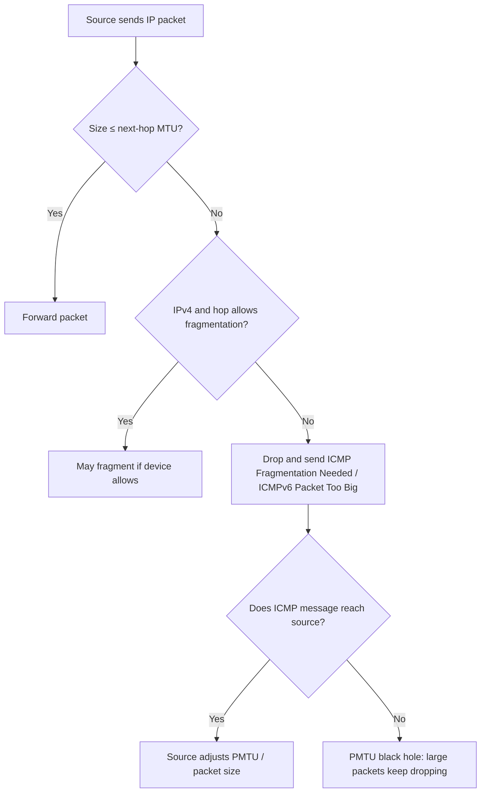
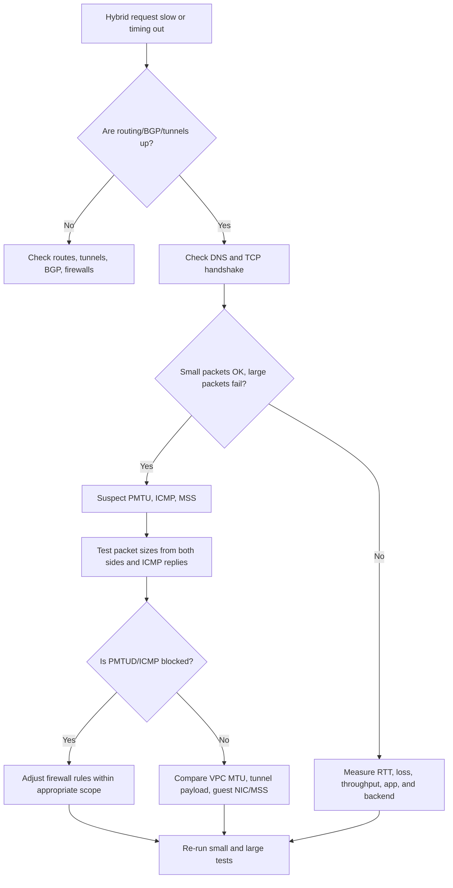
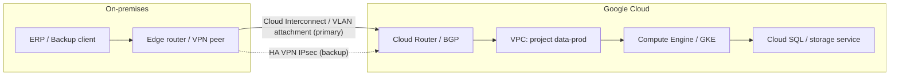

# MTU, Fragmentation, and Bandwidth on Hybrid Connections

A hybrid system spanning an **on-premises data center** and Google Cloud can run into a puzzling situation: Cloud VPN or Cloud Interconnect is up, BGP reports the right routes, small pings succeed, yet large file transfers, database queries, or backup syncs hang or run extremely slowly. The cause may lie in **incompatible MTU, blocked Path MTU Discovery (PMTUD), inappropriate TCP MSS, packet-per-second limits, or a bandwidth bottleneck on one segment of the path**.

This lesson belongs to the **DNS and Hybrid Connectivity** chapter of the `CLOUD_PROVIDERS_GCP` module. The VPC, Cloud VPN, Cloud Interconnect, and Cloud Router concepts below help learners deploy secure connectivity for Compute Engine, GKE, Cloud Run, storage services, and databases—while evaluating reliability, performance, and data transfer costs before going to production.

> **Key mindset:** An active BGP session or an established TCP connection proves only part of the path. To confirm system readiness, test packet sizes, data streams, latency, packet loss, real throughput, and behavior after failover.

## 1. Learning Objectives

After this lesson, you will be able to:

1. Explain the differences between **interface/VPC MTU**, **path MTU**, **tunnel payload MTU**, **TCP MSS**, and **bandwidth**.
2. Distinguish IPv4 packets that can fragment under certain conditions from IPv6, which requires the sender to adjust packet size; understand the impact of the IPv4 `DF` flag.
3. Identify the roles of ICMP *Fragmentation Needed* and ICMPv6 *Packet Too Big* in PMTUD and the *PMTU black hole* phenomenon.
4. Select viable MTUs for VPCs, Cloud VPN, HA VPN over Cloud Interconnect, and VLAN attachments based on actual device values.
5. Analyze why a 10 Gbps link may not push a single 10 Gbps TCP stream, or why many small packets can hit a pps limit before reaching the Gbps ceiling.
6. Execute a step-by-step measurement and diagnostic procedure from a Compute Engine VM to on-premises, recording results before changing configuration.

## 2. Distinguishing Commonly Confused Quantities

| Concept | Practical Definition | Example |
| --- | --- | --- |
| **Interface/VPC MTU** | Maximum size of an **IP packet** configured to pass through an interface/network segment, including IP header and payload | VPC default `1460` bytes; standard Ethernet `1500` bytes |
| **Path MTU (PMTU)** | Largest IP packet able to traverse the **entire end-to-end path**, considering intermediate hops | VPC is 1500, yet IPsec tunnel carries only 1406 inner bytes → effective PMTU does not exceed 1406 |
| **Tunnel gateway MTU** | MTU announced at the Google tunnel gateway; distinct from the inner unencapsulated packet size it can carry | Cloud VPN gateway MTU `1460` bytes |
| **Tunnel payload MTU** | Largest **pre-encapsulation/pre-encryption** IP packet a tunnel can transport under a given configuration | With certain AEAD ciphers on IPv4 Cloud VPN, may be `1406` bytes without NAT-T |
| **TCP MSS** | Maximum bytes of **TCP data** in a segment (excluding IP/TCP headers) | IPv4 TCP without options: MSS is approximately `PMTU - 40` |
| **Throughput / goodput** | Measured rate at the network layer / useful application data rate | 1 Gbps link achieves 600 Mbps or 55 MB/s backup rate |
| **PPS** | Packets per second; can be an independent appliance/tunnel limit | VPN can hit its pps cap even when Gbps looks low |
| **RTT** | Round-trip time to send a request and receive a reply; affects TCP and chatty round-trip apps | 60 ms RTT on a hybrid link |

**MTU is measured in bytes, bandwidth in bits per second, and file size usually in bytes.** Because `1 byte = 8 bits`, a 1 Gbps link has a theoretical ceiling of 125 MB/s before subtracting overhead, packet loss, and other limits. In practice, distinguish Mbps (megabits/s) from MB/s (megabytes/s), and do not equate an MTU value with application MSS.

### 2.1. How Are Packets Encapsulated?

A TCP packet traversing Cloud VPN typically has these layers:

```text
Application: business data
   |
   v
TCP segment: [TCP header | application data]        <-- MSS counts application data only
   |
   v
Inner IP packet: [Inner IP header | TCP segment]    <-- PMTU of the original IP packet
   |
   v
IPsec/ESP: [Outer IP | ESP + padding/auth ... | Inner IP packet]
   |
   v
Transit link: MTU limit for the outer packet
```

IPsec adds an outer IP header, ESP header, IV, authentication tag, padding, and sometimes a UDP header if NAT Traversal (NAT-T) is used. Overhead depends on cipher, gateway IP version, and NAT-T. Therefore, **tunnel gateway MTU does not equal payload MTU**; you cannot take MTU 1460 and assume every 1420-byte TCP payload passes through the VPN.

### 2.2. Quick Formula for IPv4 TCP

For standard IPv4 (20-byte IP header) and standard TCP header (20 bytes), without IP/TCP options:

\[
\mathrm{MSS}_{\mathrm{IPv4}}\ \approx\ \mathrm{PMTU} - 20 - 20
= \mathrm{PMTU} - 40
\]

For a path with a 1406-byte PMTU:

\[
\mathrm{MSS}_{\mathrm{IPv4}}\ \approx\ 1406 - 40 = 1366\ \mathrm{bytes}
\]

For standard IPv6 (40-byte IPv6 header) and standard TCP header (20 bytes), the approximation is `PMTU - 60`. Extension headers, options, and other encapsulations can reduce usable payload size; measure on the live path and check hardware docs rather than treating the formula as always exact.

## 3. IPv4 and IPv6 Fragmentation: What Happens If Packets Are Too Large?

**IP fragmentation** splits an IP datagram into smaller pieces to fit a link; it is not a bandwidth optimization mechanism. When a single fragment is lost, reassembly fails, causing higher-layer retransmissions and extra CPU/latency.

### 3.1. IPv4 and the Don't Fragment (DF) Flag

- With IPv4 `DF=1`, routers must not split the datagram. If a packet exceeds the next hop's MTU, the router can drop it and return ICMP *Destination Unreachable – Fragmentation Needed* (type 3, code 4), usually indicating the usable MTU.
- With IPv4 `DF=0`, the protocol allows some routers to fragment; however, **that does not mean every Google Cloud component will fragment**. For example, Cloud VPN has specific restrictions on pre- vs. post-encapsulation fragmentation.
- If ICMP MTU notifications are blocked, the sender may keep transmitting oversized packets; small transfers still succeed, while large requests/responses time out.

### 3.2. IPv6 Requires the Source to Adapt

Intermediate routers do not fragment IPv6 packets. If a hop cannot forward a packet, it sends ICMPv6 **Packet Too Big** so the sender reduces packet size or handles sizing at the source. Therefore, unconditionally blocking ICMPv6 breaks PMTUD and many fundamental network functions.

### 3.3. Decision Flow Across a Hop



Do not conclude that firewalls must open all ICMP from all sources. Permit **the exact ICMP/ICMPv6 types needed for PMTUD** according to your governance model, sources/destinations, and enterprise security policy.

## 4. MTU Values to Remember on Google Cloud

According to Google Cloud documentation, a VPC has a default MTU of 1460 bytes and allows configuring from **1300 to 8896 bytes** when not restricted by specialized configurations. Values of 1500 and 8896 are commonly used for compatible workloads. When using VPN or Interconnect, effective MTU along the hybrid path depends on **connection type and configuration at each end**.

| Technology / Scope | Documented Level | What to Verify |
| --- | --- | --- |
| **VPC network** | Default `1460`; configurable from `1300` to `8896` | VM NIC MTU, GKE Pod CNI, peered networks, tunnels, and related services |
| **Cloud VPN (Classic/HA), gateway MTU** | `1460` bytes | **Payload MTU is smaller** due to IPsec; depends on cipher, IPv4/IPv6 gateway, and NAT-T |
| **HA VPN over Cloud Interconnect, gateway MTU** | `1440` bytes | Jumbo frames not supported on encrypted VLAN attachments |
| **Cloud Interconnect VLAN attachment** | `1440`, `1460`, `1500`, `8896` | Use larger MTU only when VPC, VMs, on-prem, and provider all support it |
| **Google APIs via VPC** | Does not support end-to-end jumbo frames to Google Front Ends | Allow TCP MSS negotiation to work; do not expect GFE to accept 8896-byte packets |
| **Compute Engine NIC** | Should match the MTU of the VPC containing the NIC | Standard Linux images usually get DHCP Option 26; standard Windows images may need manual tuning |

These are **configuration limits**, not guarantees that every real-world path supports that MTU. Even a single hop with a lower MTU forces PMTU down or requires the sender to size packets appropriately.

References: [VPC MTU](https://cloud.google.com/vpc/docs/mtu), [Cloud VPN MTU considerations](https://cloud.google.com/network-connectivity/docs/vpn/concepts/mtu-considerations), [Cloud Interconnect overview](https://cloud.google.com/network-connectivity/docs/interconnect/concepts/overview).

## 5. Cloud VPN: IPsec Overhead and Payload Limits

For Cloud VPN, **gateway MTU** is 1460 bytes, yet the tunnel's **payload MTU** is smaller due to encryption/encapsulation. This often causes issues when an on-premises side allows 1500-byte inner packets while the VPN tunnel only transports smaller packets.

Illustrative values from Cloud VPN documentation:

| VPN Path and Sample Configuration | Gateway MTU | Payload MTU (Inner IP Packet) | Notes |
| --- | ---: | ---: | --- |
| Cloud VPN via IPv4 gateway, certain AES-GCM AEAD suites, no NAT-T | 1460 | **1406** | Specific to a particular cipher suite; not universal across all encryption suites |
| Same configuration with NAT-T | 1460 | **1398** | UDP encapsulation consumes an extra 8 bytes |
| Cloud VPN via IPv6 gateway, certain AES-GCM AEAD suites, no NAT-T | 1460 | **1386** | Outer IPv6 adds 20 bytes compared to outer IPv4 |
| HA VPN over Cloud Interconnect, IPv4 gateway, certain AEAD | 1440 | **1386** | Does not use jumbo MTU of unencrypted attachments |

Non-AEAD ciphers can yield **different** payload MTUs; consult the per-cipher table in [Cloud VPN MTU considerations](https://cloud.google.com/network-connectivity/docs/vpn/concepts/mtu-considerations). Determine the exact IKE/IPsec proposal and whether NAT-T is active before settling on MSS/PMTU values.

### 5.1. Prefragmentation and MSS Clamping

Cloud VPN uses **MSS clamping** so TCP SYN/SYN-ACK packets advertise an appropriate MSS when traversing the tunnel. For non-TCP traffic, source/peer devices must emit packets fitting payload MTU. Google's documentation notes that the **peer VPN gateway** should support *prefragmentation*: fragmenting when necessary **before IPsec encryption and encapsulation**. Cloud VPN **does not support fragmentation after encapsulation**.

When a packet does not fit the path and `DF=1`, the system can send ICMP Fragmentation Needed or ICMPv6 Packet Too Big. Inspect ingress firewall rules to the sending VM and on-premises firewall policies to ensure these notifications can return to the sender.

### 5.2. Calculating MSS from Payload MTU

Example for IPv4 Cloud VPN with AEAD, no NAT-T:

```text
Tunnel gateway MTU               1460 bytes
IPsec tunnel payload MTU         1406 bytes
IPv4 header (no options)          -20 bytes
TCP header (no options)           -20 bytes
--------------------------------------------
Theoretical TCP MSS              1366 bytes
```

If NAT-T lowers payload MTU to 1398, the corresponding MSS for basic IPv4 TCP is **1358**. This value is an **illustrative calculation**; do not manually hardcode it across every host or peer because TCP MSS clamping and PMTUD already handle negotiation. When troubleshooting, document where clamping currently occurs and test before modifying anything.

### 5.3. Why Shouldn't You Raise VPC MTU to 8896 to "Fix VPN"?

VPC MTU cannot raise Cloud VPN's payload MTU beyond IPsec limits. If a VM has NIC MTU 8896 while the tunnel only carries ~1400-byte inner IP packets, the system must still shrink packets via TCP MSS/PMTUD or lower the source interface MTU in specific cases. Cloud VPN **does not support jumbo frames**, so raising VPC MTU without designing the entire path can make issues harder to diagnose.

## 6. Cloud Interconnect: Benefits and Limits of Jumbo Frames

Cloud Interconnect (Dedicated or Partner) connects a VPC to external networks through a **VLAN attachment**. Attachments currently support MTUs of **1440, 1460, 1500, or 8896 bytes** depending on type and configuration. To actually transmit 8896-byte packets, the VPC, endpoint VMs/on-premises routers, VLAN attachment, and all intermediate devices must support that size.

| Attachment MTU | When to Consider | What to Verify |
| ---: | --- | --- |
| 1440 | Default for many VLAN attachments; used in encrypted HA VPN over Interconnect | Does anything in the network send larger than 1440? |
| 1460 | Matches default VPC 1460 | VM NICs, on-prem systems, and partner link aligned |
| 1500 | Matches standard Ethernet 1500 when entire path supports it | VPC configured to 1500; routers/VMs aligned |
| 8896 | Jumbo frames on eligible **unencrypted** VLAN attachments | VPC, on-prem, devices/partner, loss monitoring, and quotas |

**Encrypted VLAN attachments used with HA VPN over Cloud Interconnect do not support jumbo frames** and have a documented MTU of 1440. Do not copy an 8896 configuration from unencrypted Interconnect onto an encrypted attachment.

### 6.1. Why Can Jumbo Frames Improve Throughput?

For a given amount of data, larger packets reduce the number of packets processed, reducing per-packet overhead and **pps** pressure. This can help when a system is bottlenecked by packet processing or CPU. However, if the application is limited by RTT, I/O, backend speed, congestion control, attachment rate, or packet loss, a larger MTU will not necessarily improve performance.

Idealized example for 1 Gbps of data on a link, ignoring all overhead:

```text
Case A: each packet carries ~1.4 KB -> ~89,000 packets/s
Case B: each packet carries ~8.8 KB -> ~14,200 packets/s
```

This is purely a back-of-the-envelope division to show how packet size affects packet rate; **it is not a Google-guaranteed throughput figure**. When planning jumbo frames, also account for memory, offloads, firewall appliances, GKE/CNI, and backup paths that may fail over to a VPN that does not support jumbo frames.

### 6.2. Record VLAN Attachment Settings Before Changing

Read-only commands:

```bash
gcloud compute networks describe HYBRID_VPC \
  --project=PROJECT_ID \
  --format="yaml(name,mtu)"

gcloud compute interconnects attachments describe ATTACHMENT_NAME \
  --project=PROJECT_ID \
  --region=REGION \
  --format="yaml(name,mtu,bandwidth,operationalStatus,state,router)"
```

With Partner Interconnect, the service provider may enforce actual MTU/bandwidth limits outside Google Cloud's configuration. Confirm with the partner and attachment-type documentation before planning an MTU increase.

## 7. MTU Changes on VPC, VMs, and GKE Can Cause Disruption

Changing VPC MTU is not like bumping an application variable. Google Cloud recommends configuring Compute Engine NICs with the same MTU as the VPC; Linux VMs from public OS images usually obtain MTU via DHCP Option 26, whereas Windows VMs from public images may default to 1460 and require manual adjustment. Custom images may ignore DHCP settings.

Per Google Cloud's VPC MTU change guide, you must **stop Compute Engine instances before changing the VPC MTU**; rebooting inside the guest OS does not guarantee the NIC picks up the new VPC MTU. Multi-NIC workloads can also have different MTUs per attached VPC.

On GKE, Pod MTU depends on the CNI, cluster mode, and VPC MTU. GKE Autopilot inherits from the VPC per documentation, whereas some GKE Standard CNI configurations/versions may use a fixed value or inherit. Therefore, before raising MTU for Pod traffic, inspect the node interface, Pod interface, overlays/encapsulation (if any), and CNI support.

**Never update MTU across all of production just to test a hypothesis.** Check the PMTU of the failing flow, and inspect ICMP and MSS first; if system-level changes are needed, schedule a maintenance window, canary, and verifiable rollback.

## 8. Path MTU Discovery (PMTUD) and the "Black Hole" Phenomenon

PMTUD lets a sender discover the largest packet size that can traverse a path. With IPv4, the sender transmits packets with DF set; if too large, a router returns *Fragmentation Needed*. With IPv6, the router sends *Packet Too Big*. TCP and some protocols include additional detection/adjustment mechanisms; nevertheless, misconfigured ICMP filtering can still make connections unstable.

### Symptoms Suggesting a PMTU Issue

- TCP handshake succeeds and small `ping` works, yet HTTP uploads/downloads or queries returning large payloads hang.
- Connections to Cloud SQL or internal APIs stall on large responses while small queries behave normally.
- One direction flows while the other times out due to **asymmetric routing** or a one-way firewall rule.
- After a route change or failover from Interconnect to VPN, packets that previously fit a jumbo path no longer fit the tunnel.
- Retransmissions/timeouts climb while total bandwidth stays low; applications report long timeouts.

These symptoms **do not prove** MTU is the sole cause. They can also stem from firewalls, flow control, congestion, CPU, TLS, databases, or application bugs. Measure and isolate.

### 8.1. Non-Destructive Testing Mindset



Never disable firewalls or drop all MTUs to an arbitrary number as a default troubleshooting step. Test each hypothesis and record metrics before and after.

## 9. Measuring MTU and PMTU with Observational Commands

Example using a Linux VM in a consumer VPC and an on-premises Linux host; replace target variables with **IPs in an authorized test environment**.

### 9.1. Reading NIC MTU and Kernel Routes on Linux

```bash
# All interfaces and MTUs on a Linux VM.
ip -brief link

# Interface details; replace ens4 with actual NIC name.
ip link show dev ens4

# View the route the kernel picks for the on-prem destination.
ip route get 10.40.1.20

# Probe path MTU; results depend on ICMP and intermediate devices.
tracepath -n 10.40.1.20
```

On Compute Engine, VPC MTU is a **VPC** setting; guest NIC MTU can differ if the OS was customized. Therefore, read `ip link` on the VM and `gcloud compute networks describe` from the management side to compare.

### 9.2. Probing with IPv4 Ping and DF

On many Linux distributions with `iputils ping`:

```bash
# IPv4: ping -s sets ICMP data bytes.
# 1378 + 8-byte ICMP header + 20-byte IPv4 header = 1406 bytes.
ping -4 -M do -s 1378 -c 4 10.40.1.20

# Try a smaller size to isolate the threshold.
ping -4 -M do -s 1300 -c 4 10.40.1.20
```

**No ping reply does not prove PMTU is wrong:** the target host may block ICMP Echo. A `Frag needed and DF set` message is a very different signal from `Request timed out`. If the tunnel uses another cipher or encapsulation, `1378` is just an illustrative probe based on a 1406-byte payload MTU—do not treat it as a universal constant for every tunnel.

On Windows:

```powershell
# Display actual MTUs of Windows interfaces.
Get-NetIPInterface | Select-Object InterfaceAlias, AddressFamily, NlMtu

# IPv4: -f sets DF, -l sets ICMP payload bytes.
ping -4 -f -l 1378 10.40.1.20
```

Do not use `-f` (DF) for IPv6: IPv6 PMTU and fragmentation work differently. To verify IPv6, inspect ICMPv6 Packet Too Big and use IPv6-capable tools.

### 9.3. Measuring Both Directions

Suppose TCP uploads from on-premises to Cloud Storage via an in-VPC proxy time out, while downloads work normally. Measure:

1. On-prem source → GCP VM.
2. GCP VM → on-prem source.
3. Each path's TCP handshake and packet-size ICMP errors.
4. Each attachment/tunnel actually selected (active/active, ECMP, failover).

One direction may traverse Cloud Interconnect while the reverse traverses Cloud VPN. Testing only from the VM toward on-premises easily misses asymmetric paths. Also check firewall rules for **ICMP errors returning to the sender**, not just permission to `ping` the server.

### 9.4. Capturing Packets When Justified

On hosts you manage, `tcpdump` can observe packet sizes, TCP SYN MSS, ICMP, and retransmissions:

```bash
# Focus on one target with a small capture count to avoid sensitive data exposure.
sudo tcpdump -ni ens4 'host 10.40.1.20 and (tcp or icmp)' -c 100
```

If the guest uses TSO/GSO/GRO, packets seen in a host capture **may appear larger than the MTU on the wire** due to offloading. Do not conclude the network is sending jumbo packets based solely on a host-side capture. Never save sensitive payloads into shared capture files; use header-only captures/filters in operational workflows.

## 10. Bandwidth vs. Throughput: Why Aren't You Getting Nominal Speed?

**Bandwidth** is theoretical or configured capacity, **throughput** is the measured rate of packets crossing the link, and **goodput** counts only useful application data received successfully. Common limiting factors:

| Bottleneck | Impact | Measurement and Mitigation Example |
| --- | --- | --- |
| Tunnel/attachment capacity | Total throughput cannot exceed the weakest link's capacity | Compare VLAN bandwidth, tunnel metrics, partner limits |
| Packet rate (pps) | Small packets hit pps limits before saturating Gbps | Measure packets/s and packet size distribution; avoid excessive tiny packets |
| RTT + TCP window | One stream cannot keep enough bytes in flight to fill a long pipe | Measure RTT, TCP window/autotuning, BDP, and TCP metrics |
| Loss/retransmission | TCP shrinks congestion window; applications time out | Measure loss, retransmissions, queue drops, interface errors |
| CPU/crypto | IPsec encryption or packet processing on gateway/router/VM becomes bottleneck | Watch CPU, interrupts, offloads, ciphers, packet sizes |
| Single flow / ECMP | Multiple tunnels or attachments do not split a single flow evenly | Test multiple independent flows; verify 5-tuple pathing |
| Application and storage | Database, disk, API quotas, or single-threaded process caps rate | Measure storage throughput, DB latency, concurrent requests |
| Cost/safety | Pushing all traffic over an expensive or non-redundant path | Design traffic engineering, alerts, and failover headroom |

### 10.1. Cloud VPN Bandwidth and PPS Limits

Cloud VPN documentation states each tunnel supports up to **250,000 packets/s combined ingress and egress**, roughly **1–3 Gbps depending on average packet size**. That is an upper limit under documented conditions, not a guarantee that one TCP flow always reaches 3 Gbps.

Approximate IP packet throughput at 250,000 pps:

\[
\text{bit/s} \approx \text{packet/s} \times \text{bytes/packet} \times 8
\]

At an average of **1,400 bytes/packet**: `250,000 × 1,400 × 8 = 2.8 Gbps` before subtracting overhead. At **500 bytes/packet**, only about `1.0 Gbps`. Therefore, when monitoring, always check **both bytes/s and packets/s**. Never try to push MTU to unsupported sizes to bypass tunnel limits.

When higher throughput is needed, consider multiple HA VPN tunnels/gateways and appropriate routing design; traffic distribution depends on BGP/ECMP, flow structure, and peer hardware. Reserve failover capacity rather than treating the sum of all tunnels as usable bandwidth during a single-path outage.

### 10.2. Cloud Interconnect Bandwidth and Per-Flow Limits

A VLAN attachment has its own configured capacity alongside physical link, per-flow bandwidth, and packet-rate limits. Network Connectivity documentation specifies **up to 10 Gbps and 1,000,000 pps for a single flow on a VLAN attachment** under supported conditions; an actual flow can still be constrained lower by attachment capacity, packet size, source/destination, and other factors.

A 20 Gbps attachment does not enable a single TCP stream to reach 20 Gbps by itself. To utilize aggregate capacity, multiple parallel flows and sufficient sources/destinations may be needed. Never "benchmark one file copy" and conclude a VLAN attachment is limited to single-flow speed.

### 10.3. RTT and Bandwidth-Delay Product (BDP)

BDP represents how much data must be in flight to fill the available bandwidth at a given RTT:

\[
\mathrm{BDP\ (bytes)} \approx \frac{\mathrm{bandwidth\ (bit/s)} \times \mathrm{RTT\ (s)}}{8}
\]

For a path capable of **1 Gbps** with **60 ms** RTT:

\[
\mathrm{BDP} = \frac{1,000,000,000 \times 0.06}{8}
= 7,500,000\ \mathrm{bytes} \approx 7.5\ \mathrm{MB}
\]

If the effective TCP window is much smaller than BDP, a single flow struggles to fill the pipe even when the link is idle. However, increasing the window will not fix packet loss, pps limits, CPU ceilings, or a PMTU black hole.

## 11. Controlled Throughput Measurement

You can run `iperf3` between **two team-controlled hosts**, one on-premises and one test VM in the VPC. Keep tests short, verify ports/firewalls and maintenance timing to avoid impacting production, and never point tests at third-party services.

On the authorized server host:

```bash
iperf3 --server --port 5201
```

On the client host:

```bash
# Single TCP flow for 15 seconds.
iperf3 --client 10.40.1.20 --port 5201 --time 15

# Four concurrent flows, useful for spotting per-flow bottlenecks.
iperf3 --client 10.40.1.20 --port 5201 --parallel 4 --time 15

# Reverse traffic direction while still initiating from the same client.
iperf3 --client 10.40.1.20 --port 5201 --reverse --time 15
```

Watch Cloud Monitoring and the on-premises router simultaneously: ingress/egress throughput, pps, drops, retransmissions, CPU, VPN tunnel metrics, and VLAN attachment utilization. Multi-stream tests can generate heavy load; coordinate with network admins so other services are not congested.

### Illustrative Test Results Table

| Test | Fictional Result | Hypothesis to Verify |
| --- | --- | --- |
| TCP 1 flow, Interconnect | 3.2 Gbps | May reflect RTT/window, endpoint CPU, per-flow limit, or backend |
| TCP 4 flows, Interconnect | 11.8 Gbps | System may be per-flow or client limited; compare against attachment capacity |
| TCP 1 flow, backup VPN | 0.8 Gbps | Check tunnel pps, crypto CPU, MTU, and loss |
| Small ping over VPN | Succeeds | Does not prove large packets or business traffic work well |
| Large DF ping | `Frag needed` | PMTU is likely below guest NIC config; measure exact threshold |

These numbers **are not Google Cloud benchmarks or SLAs**. They illustrate how to form hypotheses and design tests: if four flows run significantly faster than one flow, investigate flow/window limits; if shrinking packet size stops timeouts yet lowers throughput, check both MTU and pps.

## 12. Case Study: Syncing On-Premises Data to Google Cloud

An enterprise runs an ERP in its data center, Cloud SQL for internal apps, and Compute Engine/GKE processing data in a GCP project. Hybrid connectivity uses **Cloud Interconnect as primary** and **HA VPN as backup**, with Cloud Router exchanging routes over BGP. The goal is nightly batch data transfer while ensuring internal APIs do not hang after failover.

### 12.1. Architecture and Path



The diagram shows routing logic; Cloud Router is the BGP control plane managing and advertising routes, not a device forwarding every data-plane packet. Connectivity to Cloud SQL/storage must use each service's supported access path rather than assuming every application endpoint sits directly on the hybrid link.

### 12.2. Post-Failover Incident

In normal operation, on-premises VMs send 1500-byte IP packets over Interconnect without issue. When the primary path fails, BGP shifts traffic to HA VPN. The VPN tunnel has a **payload MTU below 1500**. If the source/peer fails to handle PMTUD or ICMP errors are blocked, large packets drop and the sync job stalls—even though BGP learned the backup route.

Steps to take:

1. Confirm routes actually shifted to HA VPN via Cloud Router status and the on-prem router.
2. Check gateway MTU/payload MTU for the tunnel cipher and NAT-T; compare against NIC/router MTUs.
3. Probe with small and increasing DF packets from both directions; check ICMP MTU responses.
4. Check MSS clamping and prefragmentation on the peer before changing MTUs across all hosts.
5. Re-measure TCP throughput, packet loss, and sync app behavior after failover.
6. Set up alerts and a runbook for future failovers.

### 12.3. Budgeting Bandwidth for Backups

Suppose **500 GB of useful data** must transfer in a 2-hour window; ignoring compression and overhead for a lower-bound estimate:

\[
\mathrm{Required\ goodput}
= \frac{500 \times 10^9 \times 8}{2 \times 3600}
\approx 556\ \mathrm{Mbps}
\]

Adding 30% headroom for overhead, retries, and variance gives a **test target budget** of roughly `0.8 Gbps` goodput, which must then be verified with real workload traffic. You cannot derive exact tunnel counts from simple division alone because pps, packet sizes, flow counts, RTT, and on-premises capacity all matter.

If backups must continue during VPN failover, measure **available VPN capacity**, not just primary Interconnect capacity. Verify enough headroom remains for transactional APIs, telemetry, and high-priority traffic. Reliability must be evaluated against the weakest backup path that still must satisfy requirements.

## 13. Ordered Diagnostic Procedure

| Step | What to Check | Tools / Hints | When to Stop Guessing About MTU |
| --- | --- | --- | --- |
| 1. Failure scope | Which endpoints, timing, on-prem → GCP or reverse? | Logs, traces, flow logs, tickets, recent deploys | If only one endpoint has an app bug, investigate app in parallel |
| 2. Underlying link | VPN tunnels, VLAN attachments, BGP routes, and firewalls | `gcloud compute vpn-tunnels describe`, attachment describe, Cloud Router status | If routes/tunnels are down, fix routing first |
| 3. NIC & network config | VPC MTU, guest NIC, peer router MTU, GKE overlay | `gcloud compute networks describe`, `ip link` | If no path exists to target IP, fix routes/firewalls |
| 4. PMTU | Largest passing packet size, ICMP errors | `ping -M do`, `tracepath`, packet capture | If small and large packets drop identically, suspect another cause |
| 5. TCP & tunnel | SYN/SYN-ACK MSS, IPsec cipher/NAT-T, MSS clamping | Packet capture, VPN peer config | If PMTU is fine yet still slow, measure loss/RTT |
| 6. Capacity | Bps, pps, flow count, CPU, bandwidth, RTT, BDP | Monitoring, rate-limited iperf3 | If disk/DB is bottlenecked, raising MTU will not help |
| 7. Failover | Do primary and backup paths behave similarly? | Controlled failover test, SLO/alerts | If backup path lacks capacity, update architecture |

These read-only commands help learners inspect infrastructure:

```bash
# VPC MTU.
gcloud compute networks describe HYBRID_VPC \
  --project=PROJECT_ID --format="yaml(name,mtu)"

# VLAN attachment MTU, capacity, and status.
gcloud compute interconnects attachments describe ATTACHMENT_NAME \
  --project=PROJECT_ID --region=REGION \
  --format="yaml(name,mtu,bandwidth,operationalStatus)"

# VPN tunnel and cipher/status.
gcloud compute vpn-tunnels describe VPN_TUNNEL_NAME \
  --project=PROJECT_ID --region=REGION

# BGP peers and Cloud Router dynamic routes.
gcloud compute routers get-status CLOUD_ROUTER_NAME \
  --project=PROJECT_ID --region=REGION
```

Never place pre-shared keys, credentials, packet capture payloads, or sensitive internal network details in publicly shared documents. Live traffic tests require an authorized test environment because they can impact production and incur network charges.

## 14. Common Mistakes

1. **Assuming VPC MTU 1460 is Cloud VPN's payload MTU:** IPsec adds overhead, so the tunnel carries smaller inner IP packets.
2. **Raising VPC MTU to jumbo frames to speed up VPN:** Cloud VPN does not support jumbo frames; verify end-to-end PMTU.
3. **Blocking ICMP/ICMPv6 errors thinking they are unrelated to data:** breaks PMTUD and causes large packets to time out.
4. **Confusing IPv4 fragmentation with IPv6:** IPv6 routers do not fragment like IPv4; the source must handle Packet Too Big messages.
5. **Using one DF ping threshold for every path:** thresholds vary by IP version, cipher, NAT-T, encapsulation, and failover path.
6. **Reading interface MTU and assuming the whole path supports it:** PMTU is constrained by the smallest-MTU hop.
7. **Believing TCP handshake proves good throughput:** bulk transfers can still suffer loss, queuing, PMTU black holes, or other bottlenecks.
8. **Measuring Mbps while ignoring pps:** small packets can hit packet-processing limits before saturating bandwidth.
9. **Testing one flow and inferring total Interconnect capacity:** individual flows have their own limits and depend on RTT/window.
10. **Sizing failover using primary link Gbps:** backup VPN paths have different MTU and capacity; test under real load.
11. **Changing MTU on VMs/GKE/attachments without planning:** can disrupt already working traffic flows.
12. **Testing only one direction:** asymmetric paths, firewalls, or BGP path choices make one-way tests unrepresentative.

## 15. Practice Exercises

### Exercise A — Calculating TCP MSS and Probing with DF

A Cloud VPN tunnel has a payload MTU of 1406 bytes, with inner IPv4/TCP traffic without options. Compute the baseline MSS, then compute the payload size for Linux `ping -M do -s SIZE` to produce an exact 1406-byte IP packet. If NAT-T lowers payload MTU to 1398 bytes, how do both numbers change?

**Verification hint:** for IPv4/TCP, subtract 40 bytes; for IPv4/ICMP Echo, subtract 28 bytes. Calculations do not replace live testing on the tunnel and ICMP policy checks.

### Exercise B — Comparing Cloud Interconnect and Cloud VPN

A VPC has MTU 1500, a VLAN attachment has MTU 1500, and backup HA VPN has payload MTU 1406. An on-premises app sends large IPv4 packets with DF=1. Build a comparison matrix for the primary path and backup path: MTU-limiting hop, required ICMP messages, MSS handling, and behavior if a PMTU black hole occurs.

### Exercise C — Explaining Why Throughput Falls Short of Bandwidth

A VLAN attachment is provisioned at 20 Gbps, yet one `iperf3` stream reaches only 4 Gbps while 8 streams reach 15 Gbps. List hypotheses: RTT/BDP, TCP window, per-flow limits, CPU, packet rate, loss, and congestion. Propose minimal measurements to isolate each cause.

### Exercise D — VPN Packet Rate Problem

A tunnel has a documented limit of 250,000 pps combined ingress/egress. Calculate approximate IP packet throughput for average packet sizes of 500 bytes and 1400 bytes. Why can neither result be treated as guaranteed application goodput or an SLA?

### Exercise E — Safe Rollout

An enterprise wants to raise VPC MTU from 1460 to 8896 to optimize backups. Identify the areas to check: Compute Engine NIC/guest OS, GKE, VLAN attachments/partner, backup VPN, on-prem devices, firewall endpoints, Google APIs, service limits, maintenance window, before/after tests, and rollback.

### Self-Check Questions

1. Distinguish interface MTU, path MTU, Cloud VPN gateway MTU, and payload MTU.
2. Why does a small packet succeeding not prove large packets over the same path will succeed?
3. How do ICMP Fragmentation Needed and ICMPv6 Packet Too Big support PMTUD?
4. Does Cloud VPN support fragmentation **after** IPsec encapsulation or jumbo frames?
5. Can HA VPN over Interconnect use a VLAN attachment MTU of 8896?
6. Why do multiple tunnels or VLAN attachments not automatically make a single TCP flow faster?
7. Why should you monitor packet rate, throughput, and RTT together when optimizing hybrid connectivity?
8. What evidence should be captured before changing MTU in production?

**Study workflow to remember:** inspect VPC/guest/attachment/tunnel MTUs → determine PMTU on primary and backup paths → verify ICMP/PMTUD, MSS, and encapsulation → measure bidirectional RTT/loss/pps/throughput → check service and application limits → adjust settings only after measurements and a verification plan are in place.

## 16. Official Documentation

- [Google Cloud VPC Maximum transmission unit](https://cloud.google.com/vpc/docs/mtu)
- [Change the MTU setting of a VPC network](https://cloud.google.com/vpc/docs/change-mtu-vpc-network)
- [Cloud VPN MTU considerations](https://cloud.google.com/network-connectivity/docs/vpn/concepts/mtu-considerations)
- [Cloud VPN overview and network bandwidth](https://cloud.google.com/network-connectivity/docs/vpn/concepts/overview)
- [Cloud VPN quotas and limits](https://cloud.google.com/network-connectivity/docs/vpn/quotas)
- [Cloud Interconnect overview](https://cloud.google.com/network-connectivity/docs/interconnect/concepts/overview)
- [Create Dedicated Interconnect VLAN attachments](https://cloud.google.com/network-connectivity/docs/interconnect/how-to/dedicated/creating-vlan-attachments)
- [Cloud Interconnect quotas and limits](https://cloud.google.com/network-connectivity/docs/interconnect/quotas)
- [HA VPN topologies for higher bandwidth](https://cloud.google.com/network-connectivity/docs/vpn/concepts/topologies-increase-bandwidth)
- [HA VPN over Cloud Interconnect](https://cloud.google.com/network-connectivity/docs/interconnect/concepts/ha-vpn-interconnect)

Supported MTUs, per-cipher payload MTUs, quotas, and per-flow throughput can change by service type or configuration version. In live environments, verify figures against the console/API, peer hardware profiles, and Google Cloud documentation applicable to your exact connection.
