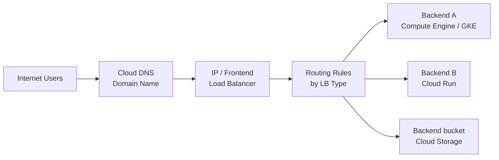
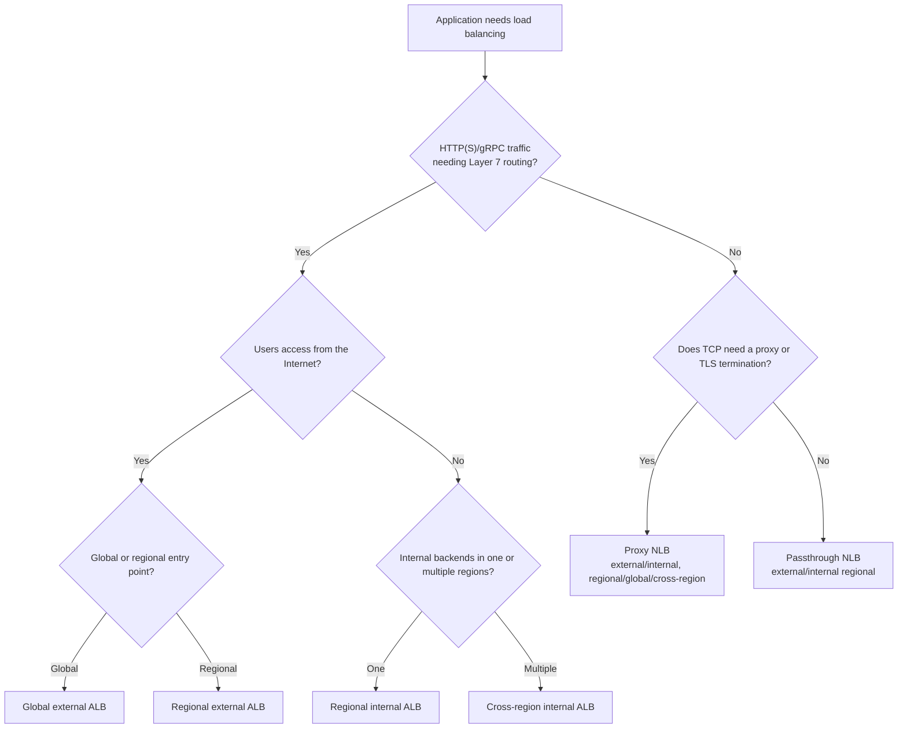
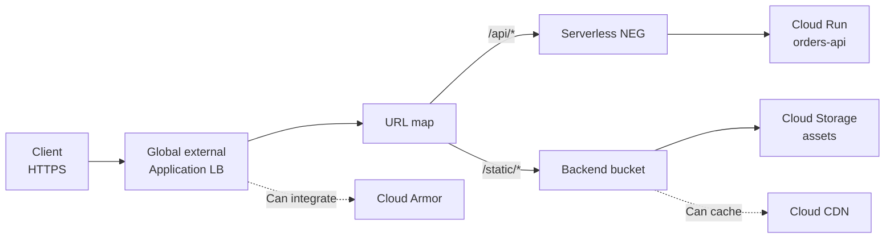

# Cloud Load Balancing Portfolio and Selection Criteria

When deploying an application to Google Cloud, the question is not only **whether to run on Compute Engine, GKE, or Cloud Run**, but also **where users enter the application**. An e-commerce system must serve HTTPS from the Internet, an internal API only allows corporate network access, while a real-time gaming application may use UDP. Different requirements lead to different **Cloud Load Balancing** choices.

This lesson belongs to the **Load Balancing and Content Delivery** chapter of the `CLOUD_PROVIDERS_GCP` module. In the Google Cloud learning path from projects, IAM, and VPC to Compute Engine, GKE, Cloud Run, storage services, and databases, learners need to know how to choose a load balancer, protect resources, automate releases, and monitor **reliability, latency, and cost**. This lesson focuses on the **Cloud Load Balancing portfolio and decision-making process**, laying the foundation for deeper configuration and operations lessons.

## 1. Learning Objectives

After this lesson, you will be able to:

1. Distinguish between **Application Load Balancer**, **proxy Network Load Balancer**, and **passthrough Network Load Balancer**.
2. Explain the selection axes: **Layer 7/Layer 4, external/internal, global/regional/cross-region, proxy/passthrough**.
3. Identify the roles of **frontend, forwarding rule, target proxy, URL map, backend service, health check, backend, and network endpoint group (NEG)**.
4. Choose the appropriate load balancer type for **HTTP(S), gRPC, TCP, UDP** scenarios, public/private, single-region/multi-region, with or without preserving the client source IP.
5. Consider backend compatibility with **Compute Engine, GKE, Cloud Run**, content delivery via **Cloud CDN**, and security with supported mechanisms such as **Cloud Armor**.
6. Ask key questions about **high availability, latency, data residency, logging, quotas, and cost** before deciding.

## 2. Where Does a Load Balancer Sit in the Architecture?

A **load balancer** receives traffic at an entry point (frontend) and distributes it to backends capable of serving requests. Depending on the type, a load balancer can **inspect and route based on HTTP** or only process **Layer 4 connection/packet information**.

Example of a website:



The diagram only illustrates the types of backends that **can** be used in compatible load balancer configurations; not every single LB supports all backends shown in the diagram simultaneously. DNS resolves names to the frontend IP address, while the **load balancer actually distributes traffic**. Cloud DNS itself is not a Layer 7 load balancer.

### 2.1. Concepts in a Load Balancing Configuration

| Component | Role | Notes |
| --- | --- | --- |
| **Frontend / IP address** | The address and port that clients connect to. | Can be a public IP or internal IP; global/regional scope depends on the LB type. |
| **Forwarding rule** | Associates the IP, protocol, port, and traffic control component according to the LB architecture. | Global or regional is a key attribute of the rule. |
| **Target proxy** | Terminates client-side connections and opens connections to backends in the proxy model. | HTTP(S), TCP, or SSL proxy type depends on the product. |
| **URL map** | Routes HTTP(S) by host, path, and supported conditions. | Present in Application Load Balancer; not a capability of passthrough LB. |
| **Backend service** | Centralizes backend selection policies and service parameters. | Can use instance groups, NEGs, or supported backend types. |
| **Health check** | Checks backend status to avoid sending traffic to unhealthy endpoints. | Support rules differ across backend groups; for example, serverless NEGs do not use health checks the same way VM instance groups do. |
| **Instance group / NEG / backend bucket** | Holds the endpoints or objects serving traffic. | Support depends on the LB type; a backend bucket typically serves content delivery from Cloud Storage via a compatible ALB. |

**Cloud Load Balancing is a traffic distribution service**; it does not provision or scale VMs/Pods on its own. For Compute Engine, Managed Instance Groups (MIG) or the GKE autoscaler handle resource scaling mechanisms according to their own configurations.

## 3. Four Most Important Classification Questions

### 3.1. Layer 7 or Layer 4?

**Application Load Balancer (Layer 7)** understands HTTP/HTTPS semantics (and supported application protocols such as HTTP/2 and gRPC in appropriate configurations). It can use hostnames, URL paths, headers, or supported advanced rules to select a backend.

Example:

```text
https://shop.example.com/api/orders  → orders-api backend
https://shop.example.com/api/pay    → payments-api backend
https://shop.example.com/assets/*   → static content backend
```

**Network Load Balancer (Layer 4)** is suited for TCP, UDP, or network protocols supported by a specific product. It does not provide URL path-based routing like an ALB. An NLB can be either **proxy** or **passthrough**: two models with different connection characteristics and source IP behavior.

### 3.2. External or Internal?

- **External:** frontend for clients accessing from the Internet per service design, with appropriate firewall policies, authentication, and protection mechanisms. "External" **does not mean** all backends must have public IPs.
- **Internal:** frontend is a private address serving connections within a VPC or from allowed networks via appropriate connectivity, depending on the product's global access/cross-region capabilities. An internal LB does not automatically become a public endpoint.

**Example:** a customer-facing website should consider an external ALB; an admin API used only between internal services should consider an internal ALB or internal NLB depending on the protocol.

### 3.3. Global, Regional, or Cross-Region?

- **Global:** entry point and load distribution using the product's global mechanism, capable of using a global frontend IP and backends in supported regions. Suitable for many multi-region public applications.
- **Regional:** frontend and processing components are deployed within a single region, usually paired with backends in that region per product requirements. Suitable for regional constraints or single-region internal needs.
- **Cross-region internal:** internal LB category supporting distribution across regions according to a supported architecture. Requires dedicated design for connectivity, access permissions, regions, data control, and cost.

**Frontend scope does not automatically determine data location.** A global frontend can still route requests to a backend in a single region, or multiple regions if configured. Nor can choosing a global LB be treated as guaranteeing multi-region failover when there is only one backend.

### 3.4. Proxy or Passthrough?

| Characteristic | **Proxy LB** | **Passthrough LB** |
| --- | --- | --- |
| Connection | LB terminates the client connection and creates a connection to the backend. | Traffic is forwarded to the backend without creating two separate proxy connections. |
| Protocol visibility | Proxy ALB can understand HTTP; proxy NLB handles TCP/TLS at its respective layer. | Distributes based on address, port, protocol, and backend selection mechanism. |
| Client source IP at backend | Typically sees the proxy's address; HTTP can pass info via headers like `X-Forwarded-For`, depending on configuration. | Typically preserves the client source IP address at the packet level when supported by the architecture. |
| HTTP host/path routing | Yes, with an appropriate ALB. | No. |
| Protocols | HTTP(S), TCP/TLS depending on proxy type. | TCP/UDP and protocols supported by the specific passthrough type. |
| Use cases | Web/API, TLS termination, L7 routing, or TCP proxy. | UDP applications, source IP preservation requirements, direct L4 connection handling. |

When choosing, determine **at which layer the server needs to see the original source IP**. With ALB, applications typically obtain the client IP from headers added by a trusted proxy system. Do not trust every `X-Forwarded-For` header sent by clients directly without proper proxy configuration and anti-spoofing parsing rules.

## 4. Cloud Load Balancing Portfolio

Google Cloud categorizes load balancers into **Application Load Balancer**, **proxy Network Load Balancer**, and **passthrough Network Load Balancer**. Within each family are public/private variants and deployment scopes. "Classic" names exist to refer to the previous configuration generation and should be distinguished from current offerings.

### 4.1. Application Load Balancer (ALB) — Layer 7 HTTP(S)

| Variant | Frontend Scope | When to Consider |
| --- | --- | --- |
| **Global external Application Load Balancer** | External, global | Public websites/APIs needing a global entry point, host/path routing, multiple regions, or supported edge capabilities. |
| **Regional external Application Load Balancer** | External, regional | Public HTTP(S) applications with single-region operational requirements or needing regional characteristics. |
| **Regional internal Application Load Balancer** | Internal, regional | Internal APIs/web apps requiring HTTP routing within a single region. |
| **Cross-region internal Application Load Balancer** | Internal, multi-region by design | Internal HTTP(S) applications needing backends across multiple regions and supported internal distribution/failover mechanisms. |
| **Classic Application Load Balancer** | External, classic architecture | Existing systems requiring maintenance/compatibility evaluation; do not assume classic and the modern global external ALB share the same feature set. |

**Key capabilities:** HTTP host/path routing, TLS termination, support for HTTP/2/gRPC/HTTP/3/WebSocket depending on the variant and configuration requirements, integration with supported HTTP backends. Do not assume every ALB supports every edge feature, every NEG type, or every form of session affinity.

With **Cloud Run**, a common choice is an **external Application Load Balancer** connected via a **serverless NEG**. This approach can bring multiple serverless services under a single domain, combine compatible edge features, and manage Internet access at the layer in front of Cloud Run. Restricting Cloud Run ingress to prevent access outside the intended path must still be configured separately.

### 4.2. Proxy Network Load Balancer — Proxied TCP/TLS

| Variant | Scope | When to Consider |
| --- | --- | --- |
| **Global external proxy Network Load Balancer** | External, global | TCP services needing a proxy at a global entry point and distribution across supported backend capabilities. |
| **Regional external proxy Network Load Balancer** | External, regional | Public TCP services needing a regional entry point/proxy. |
| **Regional internal proxy Network Load Balancer** | Internal, regional | Internal TCP needing a proxy model within a region. |
| **Cross-region internal proxy Network Load Balancer** | Internal, multi-region by design | Internal TCP needing distribution across regions per supported features. |
| **Classic proxy Network Load Balancer** | External, classic | Legacy TCP/SSL proxy configurations requiring maintenance or upgrade evaluation. |

A Proxy Network Load Balancer processes **TCP** at the connection level. Supported TLS/SSL proxy configurations can terminate TLS at the frontend, but **do not become an HTTP URL router** just because traffic runs on port 443. To route by HTTP hostname/path, evaluate an ALB.

**Important limitation:** a proxy NLB is not an option for UDP. If the application requires the direct client source IP at the backend or does not want a proxy terminating connections, evaluate a passthrough NLB.

### 4.3. Passthrough Network Load Balancer — Non-Proxy Layer 4

| Variant | Scope | When to Consider |
| --- | --- | --- |
| **External passthrough Network Load Balancer** | External, regional | Public TCP/UDP services needing packet/connection distribution to backends and source information preservation via supported mechanisms. |
| **Internal passthrough Network Load Balancer** | Internal, regional | TCP/UDP or supported protocols in a private network requiring direct Layer 4 routing. |

This group fits many **non-HTTP TCP/UDP** systems: for example, UDP game servers, TCP telemetry systems, or internal services needing Layer 4 connectivity. Always verify the exact list of supported protocols, backend selection behavior, health check support, and address/port limits for the variant you plan to deploy.

**Do not confuse an internal passthrough NLB with a regional internal ALB:** both have internal IPs, but an ALB understands HTTP requests, whereas a passthrough NLB does not route based on `/api/orders` or headers.

## 5. Quick Comparison Table for Architecture Decisions

| Primary Requirement | Starting Option to Evaluate | Why |
| --- | --- | --- |
| Public HTTPS website, host/path routing, clients across multiple regions | **Global external ALB** | Layer 7 and a global entry point. |
| Public HTTPS website/API where frontend/backend require a regional design | **Regional external ALB** | Controls HTTP(S) traffic at the regional scope. |
| HTTP API used only within a single-region private network | **Regional internal ALB** | Regional internal HTTP routing. |
| Internal HTTP API that must support multiple regions | **Cross-region internal ALB** | Provides multi-region internal distribution per supported design. |
| Public TCP service needing a proxy or TLS termination at the frontend | **External proxy NLB** matching scope | TCP/TLS proxy functionality without requiring URL routing. |
| Internal TCP service needing a proxy | **Internal proxy NLB** | Proxy model in an internal network; choose regional/cross-region as required. |
| Public UDP application | **External passthrough NLB** | Distributes UDP at Layer 4 in supported configurations. |
| Internal TCP/UDP needing source address preservation | **Internal passthrough NLB** | Direct Layer 4 connection to backends. |
| Public Cloud Run under a custom domain, needing multi-API routing | **External ALB + serverless NEG** | Integrates HTTP(S) with serverless backends. |
| Delivering images/video/static assets, needing edge caching | **Supported ALB + Cloud CDN + appropriate backend** | Reduces requests to backends and shortens the path for cacheable content. |

This table is only a **starting point** and does not replace evaluating product limitations. For example, an HTTP solution on Compute Engine may also need to account for Cloud CDN, Cloud Armor, data residency, NEG type, and budget.

### 5.1. Minimal Decision Tree



The leaf nodes still require verifying **supported protocols**, source IP requirements, network paths, capacity, and backend support. For instance, gRPC does not mean every L7 product is automatically compatible with every HTTP/2 mode and health check; you must check the protocol requirements at both the frontend and backend of the selected ALB.

## 6. Choosing by Protocol and Connection Behavior

### 6.1. HTTP(S), gRPC, WebSocket, and Application Routing

For websites and REST APIs, an ALB is usually appropriate if you need:

- **TLS termination** at the frontend to manage certificates and TLS policies at the entry point.
- **Host/path routing**, e.g., serving `/api/*`, `/images/*`, and `/admin/*` from different backends under the same domain.
- **HTTP-based observability**, request logs, and supported HTTP metrics.
- **Edge security** and **CDN** when supported by the LB/backend variant.

For **gRPC**, you must verify the HTTP/2 versions, TLS, and backend communication modes supported by the ALB. WebSockets and long-lived connections require checking timeouts, connection limits, graceful shutdown capabilities, and behavior when backends change.

**Do not use an ALB to route an arbitrary UDP protocol.** The name "Application" does not mean it supports every application-layer protocol.

### 6.2. TCP and End-to-End Connection Needs

A custom TCP protocol can use a **proxy NLB** when a proxy model, global frontend IP, or TLS termination capabilities supported by that variant are needed.

If the application requires the backend to see the **original client IP** and handle TCP communication at the packet level via Layer 4 mechanics, evaluate a **passthrough NLB**. With a proxy NLB, backends typically see connections originating from the proxy; some configurations can forward client information via the **PROXY protocol** when supported and properly enabled. The backend must be able to parse the PROXY protocol if used.

UDP scenarios such as voice/gaming/telemetry typically point to a passthrough NLB, though backend compatibility, health check methods, and specific protocol limits must be checked.

### 6.3. Session Affinity

Load balancing does not guarantee that every request from the same user will always land on the same backend, especially during scaling, backend changes, or health failures. Some products support specific session affinity options, but:

- **Session affinity is not a substitute for stateless design.**
- For web apps, store sessions/tokens and shared state in an appropriate data store (if needed), rather than relying solely on a single Pod/VM's RAM.
- For long-lived TCP connections, backend changes or deployments can drop connections. Implement client retry/reconnect logic, reasonable timeouts, and graceful draining per platform capabilities.

## 7. Choosing by Exposure, Networking, and Location

### 7.1. Distinguishing Public Entrypoint from Public Backend

An external ALB can use an **external frontend IP** while backend VMs/GKE nodes reside solely in a private network under supported models. Backend protection must rely on firewalls, VPC architecture, and LB configuration; do not assign public IPs directly to every VM just because the website needs to be public.

In Cloud Run, if the design requires public traffic to flow through an ALB to enforce edge policies, configure **appropriate ingress settings** for the service and test direct invocation paths to prevent unintended bypasses. Do not assume creating an ALB automatically blocks every other path to the backend.

### 7.2. Internal LBs Still Require Connectivity Design

An internal LB has a frontend inside a VPC or supported private network scope. Clients in the same VPC, another VPC, or on-premises can **only reach it** when routing/connectivity, firewalls, and the specific internal LB type's requirements allow it.

Components to check:

- VPC, subnets, IP ranges, and Shared VPC if used.
- **Proxy-only subnet** for internal/regional proxy load balancers when required by that architecture.
- Firewalls to backends and health check/proxy traffic flows per product guidelines.
- Cloud VPN, Cloud Interconnect, VPC Network Peering, or an appropriate connectivity solution if clients reside in another network.
- Enabling **global access** or using a cross-region variant when cross-region access is required and supported by the product.

**Caution:** the name "internal" does not mean every source across the organization can automatically connect. Private addressing, inter-network routing, and IAM are distinct layers.

### 7.3. Global LB When Data Must Stay in One Region

Suppose the business requires order data to be processed exclusively in `asia-southeast1`. A global frontend can still forward requests to backends in that region, but you must verify the entire **data path**, logs, caching, TLS, auxiliary services, and residency policies.

Choosing a **regional external ALB** can make the location model easier to reason about in some cases. However, the LB choice itself **does not prove** the entire application meets data residency requirements; you must examine where backends run, Cloud Storage/Cloud SQL locations, backups, logs, and specific compliance mandates.

## 8. Backend Compatibility: Compute Engine, GKE, Cloud Run, Storage

| Backend/Workload | Common Pattern | What to Verify |
| --- | --- | --- |
| **Compute Engine MIG** | VMs in a managed instance group attached to a compatible LB backend service. | Named ports if needed, health checks, autohealing, autoscaling, backend capacity, firewall rules. |
| **GKE** | GKE Ingress/Gateway or compatible configs create and manage LB objects, often using NEGs for Pods. | Ingress/Gateway class, controller, readiness, service/NEG, policies, permissions, and LB scope. |
| **Cloud Run** | **Serverless NEG** as a backend for a supported ALB. | Region, supported ALB type, ingress restrictions, domain/TLS, and how serverless backend health and scaling work. |
| **Cloud Storage** | **Backend bucket** via a supported ALB; can pair with Cloud CDN. | Public vs. protected content, cacheability, invalidation, and supported LB/CDN features. |
| **TCP/UDP services on VMs** | Instance group or valid endpoint for a proxy/passthrough NLB. | Protocols, ports, source IP, health checks, and connection sessions. |
| **Cloud SQL** | Database service with its own connection endpoints and HA model. | Do not assume Cloud SQL can be placed directly behind an HTTP ALB; applications/backends should connect via mechanisms supported by Cloud SQL. |

### 8.1. Cloud Run and Serverless NEGs

A common architecture:



To use this properly, verify that serverless NEGs and backend buckets are supported in the chosen ALB variant, along with the URL map configuration, certificates, Cloud Run ingress policy, and Cloud Storage access permissions. **You cannot apply a VM health check verbatim to a serverless NEG**: Cloud Run has its own health, scaling, and instance management mechanisms.

### 8.2. GKE and LB Configuration Ownership

With GKE, an **Ingress** or **Gateway** can be translated by a controller into Google Cloud Load Balancing components. If operators simultaneously edit controller-managed resources manually, configurations can be overwritten or drift out of sync.

Operational rules:

1. Choose the management layer upfront: **GKE manifests + controller** or **infrastructure-as-code managing the LB outside GKE**.
2. Identify the exact Ingress/Gateway class and deployed LB; do not assume every Ingress creates the same ALB variant.
3. Verify NEGs, backend policies, health/readiness probes, and routing rules.
4. Assign least-privilege IAM permissions to principals managing LBs, certificates, networks, and GKE resources.

## 9. Cloud CDN, Cloud Armor, and Related Services

### 9.1. Cloud CDN: Caching the Right Content

**Cloud CDN** caches cacheable content close to users, working alongside compatible **external Application Load Balancer** configurations and supported backend types. It is useful for product images, CSS/JS, public documents, and infrequently changing content.

Potential benefits:

- Fewer requests reaching backends and lower load on Cloud Run/VMs.
- Lower latency for objects served from cache.
- Reduced backend capacity consumption when cache hit ratio is high, though **CDN costs** still apply.

Before enabling:

- Define policies for **cache-control, TTL, cache keys, and invalidation**.
- Check which content carries cookies, tokens, or private data.
- Avoid accidentally caching personalized responses, payment data, or APIs not safely designed for caching.
- Monitor **cache hit ratio**, latency, egress volume, and cost.

**Cloud CDN is not a standalone load balancer.** It is a content delivery capability that pairs with a compatible LB/backend type.

### 9.2. Cloud Armor: Edge-Layer Protection

**Cloud Armor** provides security policies, such as rule-based traffic filtering and defense against certain attack classes according to product capabilities. Depending on the **LB type, backend, and scope**, it can support WAF, rate limiting, and other features.

When evaluating Cloud Armor, answer:

1. Which **security policy** types do the chosen LB variant and backends support?
2. Where should policies be applied and for which traffic?
3. Is there a risk of bypass via direct backend addresses?
4. Are test scenarios in place to avoid blocking legitimate customers (false positives)?

Do not assume every passthrough/proxy/internal LB offers the exact same WAF features as a global external ALB. Nor should Cloud Armor be viewed as a complete replacement for IAM, application authentication, or VPC firewalls.

### 9.3. Cloud DNS, Certificates, and Identity

- **Cloud DNS**: provides records pointing domains to the appropriate frontend; DNS itself does not perform LB-level HTTP backend health checks.
- **TLS certificates**: HTTPS frontends require certificates with valid domains, management/renewal configuration, and supported TLS versions.
- **IAM/Identity-Aware Proxy (IAP)**: internal or administrative applications requiring user authentication can evaluate IAP on supported ALB/backend types. IAP is not enabled automatically just by choosing an internal ALB.
- **Cloud NAT**: serves outbound connectivity needs for private resources; it does not replace a frontend load balancer receiving inbound requests.

## 10. Three Load Balancer Selection Examples (Plus One Multi-Region TCP Case)

### 10.1. Example A — Global E-Commerce

**Requirements:** users from many countries access via HTTPS; `/orders`, `/payments` APIs, and product images share a single domain; scalable Cloud Run applications, needing web protection and asset caching.

**Starting choice:** **global external Application Load Balancer**.

**Explanation:**

1. HTTP(S) and host/path routing are Layer 7 requirements.
2. A global frontend suits a distributed user base; configure backends in permitted regions.
3. Cloud Run can integrate via corresponding **serverless NEGs**.
4. Static content can use a **backend bucket and Cloud CDN**, after confirming safe cache policies.
5. **Cloud Armor** can protect supported flows; check Cloud Run ingress settings so traffic follows the intended path.

**Further checks needed:** user data residency, Cloud SQL region/HA, cross-region egress costs, certificates, URL map, CDN cache policy, rollback conditions, and 4xx/5xx observability.

### 10.2. Example B — Internal HR API

**Requirements:** HTTP API exclusively for internal applications in `asia-southeast1`, no public IP allowed; backends are GKE services or MIGs.

**Starting choice:** **regional internal Application Load Balancer**.

**Explanation:** requires HTTP host/path routing, private connectivity, and single-region scope. VPC/subnets, proxy-only subnet when required, firewall/proxy traffic, health checks, and client routing must be configured properly.

If you later need an internal entry point with backends in multiple regions, evaluate a **cross-region internal ALB** and inter-network/inter-region connectivity; do not assume an existing regional internal ALB provides multi-region failover.

**Common mistake:** choosing an external ALB and merely hiding the domain in internal DNS. An obscure domain is **not** a network boundary; if the entry point is external, you must still control access and harden the service as a public endpoint.

### 10.3. Example C — Multiplayer Game Using UDP

**Requirements:** Internet clients connect over UDP to dedicated servers; servers need source information and fast packet processing; no HTTP URL map needed.

**Starting choice:** **external passthrough Network Load Balancer**.

**Explanation:** UDP and Layer 4 requirements rule out Application LB or TCP proxy NLB. You must inspect source IP preservation mechanisms, flow distribution methods, health checks, and handling when backends are replaced.

**Further checks needed:** supported port counts, VM scaling capabilities, timeouts/flow affinity, firewall rules, network quotas, appropriate DDoS protection, and packet loss/latency observability. If the game serves multiple continents, a regional passthrough NLB does not automatically become a global system; player sharding or multi-region DNS/routing architecture must be designed separately.

### 10.4. Example D — Multi-Region Internal TCP Service

**Requirements:** custom TCP application for internal backends across two regions, not using HTTP, accepts a proxy model, and wants an internal entry point for multi-region needs.

**Choice to evaluate:** **cross-region internal proxy Network Load Balancer**.

**Rationale:** TCP and proxy characteristics combined with internal/cross-region requirements. You must verify backend capabilities, VPC connectivity, proxy-only subnets/regions, certificates if using TLS, timeouts, connection handling, and inter-region costs per the specific documentation.

If the top requirement is **preserving the client source IP at the backend** or UDP is needed, revisit evaluating an **internal passthrough NLB** and an appropriate regional topology.

## 11. Availability, Failover, and Scalability

Choosing the LB type is only the first part of designing for reliability.

### 11.1. Health Checks and Backend Selection

For **VMs/MIGs/endpoint NEGs**, health checks are configured to evaluate whether a backend can serve traffic using the appropriate protocol and check path. A health check that only checks a port returning `200 OK` can miss deeper failures, such as an application losing connectivity to Cloud SQL.

Therefore, you should:

- Determine whether the probe should check **liveness** or **readiness**.
- Allow health check/proxy traffic through the firewall according to documentation.
- Choose appropriate healthy/unhealthy thresholds, intervals, and timeouts.
- Monitor backend status during rollouts, autoscaling, and failover.
- Separately check how **serverless NEG** backends behave, as they do not operate identically to MIG health checks.

### 11.2. A Global Frontend Does Not Mean Multi-Region Resilience

A global external ALB can provide a global entry point, but if the only backend is in `asia-southeast1`, a backend/region outage can still cause downtime. To reduce single-region dependency:

1. Design backends in multiple regions **supported by the LB type and service**.
2. Verify that health, failover, and traffic policies behave as intended.
3. Resolve data consistency, storage regions, session state, and database replication.
4. Conduct drills using load testing and controlled backend failure scenarios.

Do not treat "global" as automatic proof of meeting an SLA or RTO/RPO. Those commitments depend on backends, networking, data, operational processes, and redundancy architecture as a whole.

### 11.3. Connection Draining and Rollouts

Replacing VM instances, Pods, or service revisions while users are connected can drop requests/sessions. Depending on the LB and backend type, design **connection draining, graceful shutdown, readiness, retries, idempotency**, and processing time limits.

For HTTP APIs, retries can create **duplicate requests**; write-heavy systems need idempotency keys or deduplication mechanisms. For long-lived TCP/UDP connections, clients should have a reconnection strategy.

## 12. Observability, Security, and Cost in Operations

### 12.1. What to Measure

| Observability Area | Example Metrics/Signals | Meaning |
| --- | --- | --- |
| **Frontend** | Requests, connections, bytes, latency per LB capabilities. | Are users experiencing bottlenecks at the entry point? |
| **HTTP ALB** | `4xx` and `5xx` rates, backend latency, routing errors. | Distinguish client errors, application errors, and proxy path errors. |
| **Backend health** | Healthy/unhealthy backends, count of ready endpoints. | Are there enough backends available to serve traffic? |
| **Security** | Cloud Armor outcomes, blocked request counts, and false positives. | Are security policies targeting traffic accurately? |
| **CDN** | Cache hit/miss, egress, requests, and latency. | Is caching reducing load and improving user experience? |
| **Cost** | Traffic through LB, egress, CDN, edge services, logging. | Is total cost proportional to the value delivered? |

In practice, metrics, logs, and dimension details differ across ALB, proxy NLB, and passthrough NLB. Do not assume a Layer 4 configuration provides the same full HTTP request logs as an ALB.

### 12.2. Cost Items to Factor into Design

Beyond Compute Engine/GKE/Cloud Run backend pricing, costs may include:

- **Forwarding rules / load balancing components** and usage per the product's pricing model.
- Data processed through the LB, cross-region traffic, or Internet egress; network service tier if applicable.
- **Cloud CDN**: request counts, cache egress, cache fill, and related line items.
- **Cloud Armor**, policy evaluation, logging, and other security services when used.
- Log/metric storage costs and auxiliary resources.

Do not use "global" or "regional" as the sole cost criterion. Build a realistic traffic model (requests/s, response size, cache hit ratio, cross-region traffic ratio) and consult the **pricing page for the specific LB type**. For multi-environment systems, attribute costs by project and owning team.

### 12.3. Security Questions Before Opening a Public Endpoint

1. Does the frontend strictly need to be **public** per business requirements?
2. Can backends be accessed directly, bypassing WAF/routing?
3. Are TLS certificates, TLS version policies, rotation, and domains properly managed?
4. Are IAM, application authentication, Cloud Armor, firewalls, and ingress aligned?
5. Could `/admin`, `/internal`, or private APIs be accidentally exposed publicly?
6. Are logs and alerts sufficient to detect attacks, routing errors, and cost spikes?

## 13. Hands-On: Inspecting Cloud Load Balancing Configuration

Examples of **read-only** `gcloud` commands. The operator needs permissions to view Compute Engine and load balancing resources in the project:

```bash
PROJECT_ID="orders-prod"
REGION="asia-southeast1"

# View declared entry points
gcloud compute forwarding-rules list --project="$PROJECT_ID"

# View details of a global forwarding rule
gcloud compute forwarding-rules describe FRONTEND_RULE \
  --global \
  --project="$PROJECT_ID"

# Or if the rule is regional
gcloud compute forwarding-rules describe FRONTEND_RULE \
  --region="$REGION" \
  --project="$PROJECT_ID"

# Components commonly found in an Application Load Balancer
gcloud compute url-maps list --project="$PROJECT_ID"
gcloud compute backend-services list --project="$PROJECT_ID"
gcloud compute health-checks list --project="$PROJECT_ID"
gcloud compute network-endpoint-groups list --project="$PROJECT_ID"
```

**Do not run both describe commands simultaneously** for the same rule name before identifying its scope. Choose `--global` or `--region` based on the `list` command output. Each LB has a different resource model; a passthrough NLB does not necessarily have a URL map or target HTTP proxy.

When reading an existing configuration, record findings using this template:

| Question | Data to Find |
| --- | --- |
| Is the frontend public or private? | IP, forwarding rule, scheme. |
| Global, regional, or cross-region? | Forwarding rule scope and LB type. |
| Which protocol/port? | IP protocol, port range, target proxy if present. |
| Is there HTTP routing? | URL map, host/path rules, and backend service. |
| What is the actual backend? | MIG, zonal NEG, serverless NEG, backend bucket, etc. |
| Is traffic controlled? | TLS, ingress, IAM, firewall, Cloud Armor per supported model. |
| Are backends ready? | Health/readiness and count of healthy backends by backend type. |
| Cost and system behavior? | Logs, metrics, CDN, traffic/egress. |

### 13.1. Two Common Pitfalls When Inspecting Configurations

**Pitfall A — "There is a forwarding rule, but no URL map."** This can be completely normal if it is a **Network Load Balancer**, because not every product uses an HTTP proxy and URL map architecture. Identify the LB type first.

**Pitfall B — "The LB reports healthy, but the application still returns 500."** A backend can pass a simple health check yet fail on business logic, Cloud SQL queries, or downstream dependencies. Cross-check request logs, application logs, backend latency, database status, and routing paths. Never just tweak the health check to mask an application error.

## 14. Load Balancer Selection Exercises

**Scenario 1.** An e-commerce website serves global users over HTTPS, needs to route `/api/*` to Cloud Run and `/static/*` to Cloud Storage, and plans to use a CDN. Which LB type do you choose to start with? Why?

**Scenario 2.** An HTTP API is used exclusively by internal systems in `asia-southeast1`, backed by GKE. Public IPs are prohibited. Which type do you choose?

**Scenario 3.** A game server accepts UDP connections from the Internet and needs to preserve source address information. Should you use an external proxy NLB because it supports TCP proxy?

**Scenario 4.** An internal TCP system needs to distribute traffic to backends in two regions, has no URL routing requirements, and can use a proxy. Which type should you evaluate?

**Scenario 5.** A team deploys a global external ALB but only configures backends in one region. Can they claim the system is multi-region fault-tolerant?

**Scenario 6.** An HTTP backend does not see the client IP in the connection's source IP field, yet needs to log user IPs. In an ALB architecture, what should be checked?

**Scenario 7.** The design team wants to use Cloud CDN to cache API responses containing each user's private payment data. What needs to be evaluated before deployment?

### Answers and Explanations

1. **Global external Application Load Balancer** is a sensible starting choice for HTTP(S) host/path routing and a global entry point. Verify compatibility with **serverless NEGs**, **backend buckets**, and Cloud CDN; design safe caching rules.
2. **Regional internal Application Load Balancer**: provides HTTP routing in a private network within one region; you must also configure the VPC, subnets, firewalls, backends, and GKE controller.
3. **No.** A proxy NLB serves TCP/TLS per support, not UDP. Evaluate an **external passthrough NLB** and its UDP/source IP limits.
4. Evaluate a **cross-region internal proxy Network Load Balancer**, then verify connectivity, backend scope, proxy behavior, and costs.
5. **Not yet.** A global frontend does not automatically create backends in a second region, data replication, or failover policies; these must be fully designed and rehearsed.
6. Inspect **headers managed by a trusted proxy**, such as `X-Forwarded-For` in an appropriate HTTP model, and configure anti-spoofing header parsing. The proxy may appear as the source IP of the connection to the backend.
7. Evaluate cacheability, `Cache-Control`, cache keys, tokens/cookies, personal data, invalidation, and CDN policies. Do not cache private data without a design that prevents cross-user data leakage.

## 15. Project Decision Checklist

Before opening a ticket to provision a load balancer, complete this checklist:

- [ ] Specify **HTTP(S)/gRPC, TCP, or UDP**; whether Layer 7 routing is needed or only Layer 4.
- [ ] Choose **external/internal** based on who is permitted to access it.
- [ ] Choose **global/regional/cross-region** based on topology, location, and data requirements.
- [ ] Decide **proxy/passthrough** based on TLS termination, source IP, protocol, and long-lived connections.
- [ ] Verify that the LB **supports the intended backend** (MIG, NEG, serverless NEG, backend bucket).
- [ ] Define DNS, TLS, URL routing, firewall, VPC, ingress, and IAM.
- [ ] Evaluate Cloud CDN, Cloud Armor, and IAP according to what the **LB variant** supports.
- [ ] Design health/readiness checks, scaling, timeouts, draining, and a multi-region plan if needed.
- [ ] Have dashboards, alerts, logging, 4xx/5xx tracking, backend health monitoring, and incident response ready.
- [ ] Budget for LB pricing, network egress, edge services, CDN, logs, and backend costs.
- [ ] Check quotas, technical limits, and resource administration permissions.
- [ ] Rehearse failover/rollback and verify there are no unintended direct backend access paths.

## 16. Key Takeaways

**Choosing Cloud Load Balancing starts with the protocol and target audience**, followed by network scope and location:

- **Application Load Balancer** for HTTP(S) and Layer 7 routing.
- **Proxy Network Load Balancer** for proxied TCP/TLS connections when URL routing is not needed.
- **Passthrough Network Load Balancer** for direct Layer 4 needs, especially UDP or when source IP preservation is required.
- Within each group, narrow down **external/internal** and **global/regional/cross-region** per supported product features.
- Integration with **GKE, Compute Engine, Cloud Run, Cloud Storage, Cloud CDN, and Cloud Armor** is a practical criterion, not just the LB family name.
- **A global frontend does not automatically guarantee multi-region fault tolerance**; availability also depends on backends, data, health checks, autoscaling, and operations.
- Selecting the right load balancer helps optimize latency, protect applications, and control costs right from the design phase.

### Google Cloud References

- [Cloud Load Balancing overview](https://cloud.google.com/load-balancing/docs/load-balancing-overview)
- [Application Load Balancers](https://cloud.google.com/load-balancing/docs/application-load-balancer)
- [Proxy Network Load Balancers](https://cloud.google.com/load-balancing/docs/proxy-network-load-balancer)
- [Passthrough Network Load Balancers](https://cloud.google.com/load-balancing/docs/passthrough-network-load-balancer)
- [Load balancing health checks](https://cloud.google.com/load-balancing/docs/health-checks)
- [Cloud CDN overview](https://cloud.google.com/cdn/docs/overview)
- [Cloud Armor overview](https://cloud.google.com/armor/docs/cloud-armor-overview)
- [Cloud Run with load balancing](https://cloud.google.com/run/docs/integrating/load-balancing)
