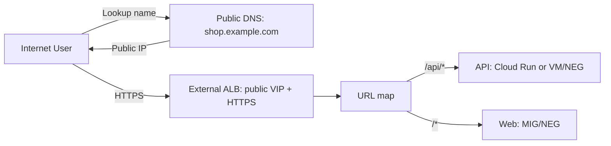
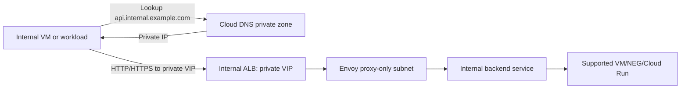

# External and Internal Application Load Balancers

> **Chapter:** Load Balancing and Content Delivery  
> **Module:** CLOUD_PROVIDERS_GCP  
> **Module Scope:** Explore Google Cloud from project organization, IAM, and VPC to Compute Engine, GKE, Cloud Run, storage services, and databases. Through deployment scenarios, learners know how to select services, protect resources, automate releases, and monitor reliability alongside cost.

A system may need a public HTTPS address for customers to place orders, while also needing a private API accessible only to internal applications and employees on the corporate network. Google Cloud provides **Application Load Balancer (ALB)** to receive and distribute HTTP/HTTPS requests at **Layer 7**. Depending on the client source and how backends are deployed, you choose an **External Application Load Balancer** (Internet-facing) or an **Internal Application Load Balancer** (internal IP address inside a VPC).

The difference is not merely using a public IP versus a private IP. The ALB type also determines **geographic scope**, the ability to select backends across multiple regions, proxy deployment mechanics, access from other VPCs or hybrid networks, supported features, and pricing.

## Learning Objectives

After this lesson, you will be able to:

1. Explain Layer 7 ALB and distinguish it from Layer 4 Network Load Balancer.
2. Identify the **global external**, **regional external**, **regional internal**, and **cross-region internal** modes, and distinguish the **classic** mode.
3. Describe the request path through **forwarding rule, target proxy, URL map, backend service/backend bucket, and health check**.
4. Understand proxy-only subnets, VIP addresses, TLS, host/path routing, and internal access boundaries.
5. Choose the right ALB for public websites, enterprise APIs, multi-region architectures, and Compute Engine, GKE, and Cloud Run backends.
6. Practice inspecting configurations via Console/`gcloud`, verifying connectivity from appropriate locations, and building a resource cleanup plan.

## 1. What Is an ALB and What Problem Does It Solve?

An Application Load Balancer receives **HTTP or HTTPS**, terminates client connections at the proxy, reads application-layer information such as hostname, path, and headers, and forwards requests to backends according to configuration. It is a **proxy load balancer**, not a device that forwards raw packets unchanged from client to server.

```text
Client
  │ HTTP/HTTPS
  ▼
Frontend VIP + port (forwarding rule)
  │
  ▼
Target HTTP(S) proxy
  │
  ▼
URL map (host/path/routing rules)
  │
  ├── /api/*    ──> Backend service: API
  ├── /images/* ──> Compatible backend service or backend bucket
  └── /*        ──> Backend service: web
                       │
                       ▼
                Supported instance group / NEG / backend
```

Common functions:

- **A stable frontend:** users access a single DNS name/IP even when underlying VMs or endpoints change.
- **Request distribution:** selects backends based on load balancing algorithms, health status, and product configuration.
- **Host/path routing:** `api.example.com` or `/api/*` is handled by a different backend than `/static/*`.
- **TLS termination:** the ALB can handle HTTPS and use configured certificates; the connection from the proxy to the backend is a separate connection with its own protocol and security.
- **Scalability/resilience:** supports multiple backends and failover options within the scope allowed by each mode.
- **Protection/observability/acceleration:** integrates features such as Cloud Armor, logging, and Cloud CDN depending on the **ALB type, backend, and specific support conditions**.

**ALB vs. Network Load Balancer:** ALB is appropriate when you need HTTP/HTTPS logic and URL-based routing. Network Load Balancer is appropriate when the primary requirement is TCP/UDP or Layer 4 protocols/connection patterns supported by the product. Do not choose an ALB to distribute UDP just because its name says "load balancer".

## 2. What Application Load Balancer Modes Exist?

Google Cloud distinguishes **external/internal** alongside **global/regional/cross-region**. The term **classic** refers to a legacy external mode still supported for corresponding deployments.

| Mode | Client VIP | Backend Scope | Proxy Mechanism & Key Requirements | Suitable Use Cases |
|---|---|---|---|---|
| **Global external ALB** | Global public IP, using Premium Tier | Backends can span multiple regions | Google Front Ends (GFEs) on Google's global network; `EXTERNAL_MANAGED` | Public websites and APIs serving users across multiple regions |
| **Regional external ALB** | Regional public IP | Backends within a single region | Managed Envoy proxy, **proxy-only subnet** in the region; `EXTERNAL_MANAGED` | Public HTTP(S) requiring regional resource residency/configuration |
| **Classic ALB** | Public frontend; legacy mode with separate tier/scope rules | Depends on Premium/Standard Tier and configuration | GFE; load balancing scheme `EXTERNAL` | Primarily when maintaining existing classic architectures or compatibility features |
| **Regional internal ALB** | Private VIP in a subnet in one region | Backends in the same region as the ALB | Envoy, **proxy-only subnet** with purpose `REGIONAL_MANAGED_PROXY`; `INTERNAL_MANAGED` | Same-region internal APIs, apps within a VPC or connected networks |
| **Cross-region internal ALB** | Regional private VIP; frontends can be configured in multiple regions | Backends can span multiple regions | Envoy; proxy-only subnet with purpose `GLOBAL_MANAGED_PROXY` in required regions; `INTERNAL_MANAGED` | Multi-region internal services, cross-region failover |

### 2.1. Global External Mode

Global external ALB is often the choice for systems needing a public address and backends spanning multiple regions. GFEs receive requests on Google's network infrastructure and distribute them to appropriate backends based on configuration, health/capacity, and availability.

A **global public VIP** does not mean all application data is stored everywhere. Backends, databases, and data residency policies must still be designed separately. If there is only one backend region and that region experiences an outage, the global ALB **does not automatically create** a standby backend in another region.

### 2.2. Regional External Mode

Regional external ALB receives Internet requests through a public frontend tied to one region and uses **Envoy proxy** to forward them to backends in that region. This is a regional HTTP(S) ALB; it **does not automatically fail over** to backends in another region like a global external ALB with multi-region backends.

Regional external ALB can use **Premium or Standard Network Service Tier** depending on supported configurations. Because it uses Envoy, it requires a **proxy-only subnet** in the corresponding region and VPC.

### 2.3. Regional Internal vs. Cross-Region Internal

Regional internal ALB uses a **private VIP** from a subnet; by default, clients access it within the applicable regional scope. If you want clients in other regions within the VPC to send requests to a regional internal ALB, you can enable the **global access** option when supported by the architecture. However, enabling global access **does not turn a regional backend into a multi-region backend**.

Cross-region internal ALB allows backends in multiple regions and clients from multiple regions within the VPC under supported models. Each of its frontend VIPs is still a **regional internal address**, not a public anycast IP. If you configure multiple VIPs in different regions, you can combine them with **Cloud DNS routing policies** to direct clients to the appropriate VIP; backend failover must also be configured and tested.

**Remember:** "internal" describes reachability over private networks as configured, not that only a single project is allowed to call it. VPC, Shared VPC, hybrid connectivity, and service policies determine valid client sources.

## 3. Components of an ALB

### 3.1. Frontend: Address, Port, and Forwarding Rule

A **forwarding rule** declares the IP address, protocol/port, and target proxy of the ALB.

- External: global or regional public IP depending on mode.
- Internal: private IP in a subnet in the corresponding region and attached to a VPC.
- HTTP typically uses port `80`, HTTPS typically uses `443`; the product may support other ports per forwarding rule constraints.
- Public/private DNS maps friendly names to the corresponding VIP. **Creating a forwarding rule does not automatically create a DNS record.**

**VIP (Virtual IP)** is the address clients connect to. Do not take an IP from the **proxy-only subnet** as the VIP; the proxy-only subnet is reserved exclusively for Google-managed proxies.

### 3.2. Target Proxy and TLS Certificates

A **Target HTTP proxy** handles HTTP requests; a **Target HTTPS proxy** handles HTTPS and requires valid certificate configuration per product/mode. For HTTPS:

1. The client validates the domain name and establishes a TLS connection to the VIP.
2. The proxy handles TLS and inspects the decrypted HTTP request.
3. The proxy forwards the request to the backend using a protocol supported by the backend service.

The **client → ALB** connection and the **ALB → backend** connection are two separate hops. HTTPS on the frontend **does not automatically ensure** the backend also uses HTTPS; if a workload requires end-to-end encryption, design the backend protocol/TLS and verify support and appropriate certificates/trust.

### 3.3. URL Map: Host and Path Routing

The **URL map** determines which backend a request is sent to. Logic example:

```text
Host: shop.example.com
  /api/*       -> api-backend-service
  /assets/*    -> static-backend (if the backend type is supported by the mode)
  /*           -> web-backend-service

Host: admin.example.com
  /*           -> admin-backend-service
```

Rule ordering, host/path matching rules, and advanced features like header matching/actions/rewrites depend on the mode. In real configurations, inspect the **default service** so unmatched requests receive an intentional result; never let an administrative path accidentally fall through to a public backend.

### 3.4. Backend Service and Backend Types

A **backend service** describes how the ALB communicates with and distributes requests to backends within its scope and feature set. Supported backends include:

- **Managed instance group (MIG):** VMs running applications; can combine with autoscaling and health checks.
- **Zonal network endpoint group (NEG):** groups of `IP:port` endpoints, suited for workloads/containers and architectures requiring endpoint-level management.
- **Serverless NEG:** connects to supported serverless backends such as Cloud Run; health check behavior, permissions, and scaling differ from VMs.
- **Hybrid/Internet/PSC NEGs:** serve specialized connectivity patterns, only when the ALB mode and NEG type are compatible.
- **Backend bucket:** uses Cloud Storage for static content in supported **external ALB modes**; not available by default on internal ALBs.

**Not all of the backend types above are supported in every mode.** Before deciding, check the backend support matrix for the specific product, region, and Network Service Tier. If a backend service uses instance groups or NEGs, choose the right type and combination rules; do not arbitrarily mix backend types into the same service.

### 3.5. Health Check and Backend Status

For VM/endpoint backends requiring health checks, the ALB uses a check mechanism to determine whether an endpoint can handle requests before routing traffic to it.

Example:

```text
GET /healthz  ->  HTTP 200  -> healthy
GET /healthz  ->  HTTP 500  -> unhealthy
Connection timeout          -> unhealthy
```

This is an illustration; the healthy verdict also depends on the protocol, thresholds, and health check configuration. The `/healthz` URL should reflect real serving readiness at a reasonable level; do not configure a health check on an endpoint that always returns 200 while critical dependencies are broken.

**Serverless NEGs do not use VM/backend instance group health checks in the same way.** Do not require learners to create a health check for a Cloud Run serverless NEG simply because a generic ALB diagram shows a health check.

## 4. Traffic Path: How Do External and Internal Differ?

### 4.1. External ALB for a Public Website



**Flow:** DNS returns the public IP; the client connects to the frontend; the target proxy and URL map process the request; the backend service selects an endpoint. With global external, Google Front Ends receive requests on global infrastructure; with regional external, Envoy proxies handle them in regional mode.

### 4.2. Internal ALB for a Private API



**Flow:** a client with network reachability to the private VIP queries the internal name; the forwarding rule routes the request to Envoy; Envoy opens a new connection to the backend. Permission to query the Cloud DNS private zone, reachability to the VIP, firewall rules, and application permissions are **separate prerequisites**.

### 4.3. Can an External Frontend Connect to Non-Public Backends?

Yes. In many architectures, backend VMs **do not need external IPs attached** just to receive traffic from an external ALB. The ALB is the public entry point, and the proxy connects to backends via the product's mechanism; backends still need appropriate firewalls and valid routes/health checks. This reduces the need to expose application ports directly to the Internet.

For **Cloud Run**, pay attention to ingress settings and invoker permissions. Integrating a serverless NEG with an ALB does not mean every Cloud Run service should allow direct Internet access. Ingress settings and authentication must follow the supported serverless load balancing model.

## 5. Proxy-Only Subnet: An Operational Distinction

For ALBs using **Envoy proxy** in regional/cross-region modes, GCP requires a **proxy-only subnet**: an IP range dedicated to Google-managed proxies. Addresses from this subnet become the **source addresses** when the proxy initiates connections to backend VMs/endpoints, which determines the required firewall rules.

| Mode Using Envoy | Proxy-Only Subnet Purpose | Scope |
|---|---|---|
| Regional external ALB | `REGIONAL_MANAGED_PROXY` | Each network/region requires an active proxy-only subnet for this purpose |
| Regional internal ALB | `REGIONAL_MANAGED_PROXY` | Shared with compatible regional Envoy-based load balancers in the network/region |
| Cross-region internal ALB | `GLOBAL_MANAGED_PROXY` | Required in regions where proxies for the cross-region architecture reside |
| Global external ALB / Classic ALB | Does not use a proxy-only subnet under the GFE model | GFEs manage ingress/proxying on global infrastructure |

**Do not confuse the proxy-only subnet with the backend or frontend subnet.**

```text
VPC: app-vpc
├── app-subnet: 10.10.0.0/24
│   ├── Internal ALB VIP: 10.10.0.50
│   └── Backend VM:       10.10.0.10
└── proxy-only-subnet: 10.129.0.0/23
    └── Google-managed Envoy proxy IPs
```

When the proxy sends requests to a backend VM, traffic can carry a **source IP from `10.129.0.0/23`**. Therefore, the backend firewall must allow this exact range to the exact application port, and typically also needs rules for health checks per documentation. Opening the backend port to `0.0.0.0/0` just to "fix" a health check failure is overly permissive.

### Example Command to Create a Proxy-Only Subnet (Lab Project Only)

The following commands are only an example for a **regional internal ALB** or **regional external ALB**, assuming an existing custom VPC. **Do not run if the VPC/region already has a proxy-only subnet shared by other services.**

```bash
# Enter only approved project, network, region, and CIDR values
PROJECT_ID="my-gcp-lb-lab"
NETWORK_NAME="app-vpc"
REGION="asia-southeast1"

# Inspect existing networks, subnets, and purposes before creating
gcloud compute networks subnets list \
  --project="$PROJECT_ID" \
  --regions="$REGION"

# Create only when no suitable REGIONAL_MANAGED_PROXY subnet exists
gcloud compute networks subnets create proxy-only-lab \
  --project="$PROJECT_ID" \
  --network="$NETWORK_NAME" \
  --region="$REGION" \
  --range="10.129.0.0/23" \
  --purpose=REGIONAL_MANAGED_PROXY \
  --role=ACTIVE
```

The sample CIDR must be replaced if it overlaps with existing subnets, hybrid networks, or production ranges. **Do not use this purpose to build a cross-region internal ALB**: cross-region mode requires `GLOBAL_MANAGED_PROXY` per its design. A proxy-only subnet is shared infrastructure; if existing ALBs use it, **do not delete that subnet** when cleaning up a lab.

## 6. Security: TLS, Firewalls, Cloud Armor, and IAP

### 6.1. TLS and Backend Connections

If serving HTTPS:

1. Have a **DNS name** and a valid certificate for the frontend domain.
2. Choose a certificate provisioning/management method supported by the ALB mode, such as Google-managed or self-managed certificates as required.
3. Configure the target HTTPS proxy and an appropriate TLS policy.
4. Define the ALB → backend protocol and backend protection/authentication policies.
5. Test from a real client to verify the handshake, hostname, and certificate chain.

**HTTP → HTTPS redirects** can be configured using mechanisms supported by the mode; do not assume enabling an HTTPS listener automatically redirects all HTTP requests to HTTPS.

### 6.2. Firewalls and Health Checkers

The proxy type determines the **source IP of connections reaching backend VMs**:

- **Global external/Classic using GFE:** backend VMs/NEGs require firewall rules for GFE and health-checking sources per documentation; common IPv4 ranges in supported cases are `35.191.0.0/16` and `130.211.0.0/22`.
- **Regional external/internal using Envoy:** backend VMs require rules from the **proxy-only subnet**, plus health check sources per backend type/mode requirements.
- **Serverless NEG:** traffic to serverless backends uses a separate mechanism; VM firewall rules do not apply verbatim as they do with instance groups.

Source ranges, especially for IPv6 and specialized backends, can differ; consult the official **Firewall rules for load balancing** table before configuring. Adding an overly broad rule can unintentionally expose a backend you meant to keep private.

### 6.3. Cloud Armor, IAP, and API Access

**Cloud Armor** provides L7 protection features such as traffic filtering policies and certain DDoS/WAF protections for supported products, backends, and modes. It does not replace user authentication or in-app authorization.

**Identity-Aware Proxy (IAP)** can add a user access control layer for compatible ALB/backend configurations. **Cloud CDN and IAP cannot be enabled together on the same backend service** where the product defines them as mutually exclusive. Always check the feature matrix before designing a backend that needs both public caching and IAP.

For internal APIs, a private VIP restricts network reachability, but application-layer authentication and authorization are still required. An internal ALB does not automatically replace Identity and Access Management policies for Cloud Run, GKE, or downstream services.

## 7. ALB and Content Delivery with Cloud CDN

An e-commerce website typically includes dynamic pages/APIs and static content:

```text
https://shop.example.com/
  /api/orders       -> application backend
  /api/products     -> application backend
  /assets/logo.webp -> cacheable content
  /images/item.jpg  -> cacheable content
```

**Cloud CDN** can store content at edge caches when attached to a **supported external Application Load Balancer and backend**, reducing latency and repeated requests to the origin for objects with appropriate cache policies. Cloud CDN **is not a default feature of internal ALBs**.

Key distinctions:

- **Load balancing:** selects backends or processes traffic.
- **CDN caching:** stores eligible response copies at the edge, governed by cache mode, `Cache-Control`, TTL, and related rules.
- **Cloud Storage backend bucket:** commonly used for static files with external ALBs in supported modes; do not assume a backend bucket is available on a regional internal ALB.
- **Cloud Armor:** protects requests according to policy; can integrate with L7 services per product capabilities.

Never accidentally cache private content, user cookies/sessions, order data, or responses containing sensitive information. Responses with `Cache-Control: private` or `no-store` must be handled carefully according to your cache policy and chosen mode. Responses that change after updates need a TTL/invalidation plan where appropriate.

## 8. Two Design Problems in the Same Application

Suppose a system has a public web frontend and a reporting service intended solely for employees.

### Part A — Public Web/App

**Requirements:** customers in multiple regions send HTTPS requests to `shop.example.com`; static pages are cached, `/api/*` routes to the API backend, and multi-region redundancy is preferred.

**Candidate Solution:**

1. **Global external ALB** with a public VIP and public DNS.
2. Target HTTPS proxy, certificate for `shop.example.com`, and host/path URL map.
3. Backend services pointing to API/web endpoints in regions where they are actually deployed; static assets use a backend mechanism supported by ALB/CDN.
4. Health checking for VM/NEG backends when required; Cloud Run serverless NEGs are handled differently.
5. Cloud Armor, Cloud CDN for cacheable content, logging, and alerting.

**Remaining Risks:** multi-region backends do not automatically make the database multi-region or guarantee consistency; data, user sessions, retries, and end-to-end failover must be designed.

### Part B — Internal API

**Requirements:** applications inside the VPC call `reports.internal.example.com`; no public frontend allowed; backends in one region; clients from other regions may be needed.

**Candidate Solution:**

1. **Regional internal ALB** with a private VIP in a VPC subnet.
2. Proxy-only subnet `REGIONAL_MANAGED_PROXY` for that region.
3. Compatible VM/NEG or serverless backends in the same region; appropriate URL map and health checks.
4. **Cloud DNS private zone** for the internal hostname; only authorized VPCs/networks receive the corresponding records.
5. Enable **global access** if clients in other regions need to reach the private VIP and the product/architecture supports it.

If active backends in multiple regions and automatic traffic failover to healthy regions are needed later, evaluate a **cross-region internal ALB** with `GLOBAL_MANAGED_PROXY` proxy-only subnets in the architecture's regions.

## 9. Hands-On: Selecting an ALB in the Console

This section walks through designing and inspecting configurations. Actually creating an ALB can incur charges for forwarding rules, processed traffic, backends, data transfer, health checking, Cloud Armor/CDN, and related resources. **Only create resources in an authorized sandbox project with a planned budget.** You do not need to create a new ALB if the lesson objective is solely inspecting configurations and choosing a mode.

### 9.1. Preparation Before Creation

1. Determine whether **clients come from the Internet or a private network**.
2. Determine whether backends are **MIG, zonal NEG, serverless NEG, backend bucket, or another supported type**.
3. Determine whether backends reside in **one or multiple regions**; and whether clients are in one or multiple regions.
4. Select VPC/subnets if using internal or regional Envoy modes, and verify the proxy-only subnet.
5. Prepare a **health check endpoint** for VMs/NEGs when needed and minimal sufficient firewall rules.
6. Prepare DNS/certificates if using an HTTPS hostname.
7. Confirm IAM permissions, quotas, Billing status, and budgets/alerts before creating.

### 9.2. Creating an External ALB via Console (High-Level Workflow)

1. Open **Network services → Load balancing → Create load balancer**.
2. Choose **Application Load Balancer (HTTP/HTTPS)** and **External/Public facing**.
3. Choose **Global** or **Regional** per the table in Section 2; prefer the mode matching your actual backends. If an existing system uses classic, confirm compatibility requirements before changing modes.
4. Name the ALB; configure the **frontend** with IP, port, and protocol. For HTTPS, select a certificate.
5. Create/select the **backend service** and corresponding backends. Configure a health check if required by the backend type.
6. Configure **host and path rules**, default backend, logging, and Cloud Armor/CDN features supported by the mode.
7. If **regional external**, ensure the proxy-only subnet is created or provisioned via the Console flow.
8. Review all resources and create the ALB; open the details page to inspect the forwarding rule, frontend IP, and backend health.
9. Once the frontend is ready, add a public DNS record pointing to the VIP, verify certificates, and test requests via the domain.

**Test connectivity:** from an authorized Internet client, run:

```bash
curl -I https://shop.example.com/
curl -v https://shop.example.com/healthz
```

These are illustrative commands; `shop.example.com` is not a live lab application. Returning `200` or `404` depends on the URL map and application. Observe TLS, HTTP status, redirects, headers, and backend health rather than concluding from a single status code.

### 9.3. Creating an Internal ALB via Console (High-Level Workflow)

1. Open **Network services → Load balancing → Create load balancer**.
2. Choose **Application Load Balancer**, **Internal**.
3. Choose **Regional** if backends are in one region only; choose **Cross-region** if multi-region backends are required and properly designed.
4. Select the VPC, region, subnet for the **frontend private VIP**, and certificates/protocol if needed.
5. Ensure the appropriate **proxy-only subnet**: `REGIONAL_MANAGED_PROXY` for regional internal; `GLOBAL_MANAGED_PROXY` for cross-region internal.
6. Create the backend service with the right scope, backends, and health checks; configure URL map, target proxy, and forwarding rule.
7. Verify firewall rules from the proxy-only subnet range to backend ports and from health checkers if required by backends.
8. Create a **private** Cloud DNS record for the hostname if needed. Verify authorized VPCs and name resolution rules.
9. Use a VM/workload **with network reachability to the VIP** to send requests; clients in other regions can be used when global access or cross-region mode is configured appropriately.

Example query from a **VM inside an authorized VPC**, not from an Internet-connected laptop without private connectivity:

```bash
# Run from a VM/host with connectivity to the private VIP
dig reports.internal.example.com. A
curl -v http://reports.internal.example.com/healthz
```

If using HTTPS and private DNS, certificate/TLS trust must also be designed for the internal domain. Do not add `-k` to `curl` to bypass certificate verification as a "deployment solution".

## 10. Hands-On: Inspecting ALB Configuration with gcloud (Read-Only)

The following commands are **read-only**; they are suitable for a project that already has an ALB or a lab project where an administrator granted view access.

```bash
PROJECT_ID="my-gcp-lb-lab"        # Replace with actual project ID
REGION="asia-southeast1"         # Replace with region where ALB is deployed

# Check identity and project
gcloud auth list --filter="status:ACTIVE"
gcloud projects describe "$PROJECT_ID" \
  --format="table(projectId,name,lifecycleState)"

# List frontend forwarding rules in the project
gcloud compute forwarding-rules list --project="$PROJECT_ID"

# List defined route/backend configs and health checks
gcloud compute url-maps list --project="$PROJECT_ID"
gcloud compute backend-services list --project="$PROJECT_ID"
gcloud compute health-checks list --project="$PROJECT_ID"

# Inspect subnets, including proxy-only subnets if present
gcloud compute networks subnets list --project="$PROJECT_ID"
```

### 10.1. Identifying the Mode from a Forwarding Rule

Once you know the **name and scope** of the forwarding rule from the `list` output, run the corresponding `describe` command:

```bash
# Example for a GLOBAL frontend
gcloud compute forwarding-rules describe GLOBAL_RULE_NAME \
  --global \
  --project="$PROJECT_ID" \
  --format="yaml(name,IPAddress,IPProtocol,portRange,loadBalancingScheme,target)"

# Example for a REGIONAL frontend
gcloud compute forwarding-rules describe REGIONAL_RULE_NAME \
  --region="$REGION" \
  --project="$PROJECT_ID" \
  --format="yaml(name,IPAddress,IPProtocol,ports,portRange,loadBalancingScheme,target,network,subnetwork)"
```

`GLOBAL_RULE_NAME` and `REGIONAL_RULE_NAME` are placeholders; do not run them literally. Cross-reference:

| Field | How to Read It |
|---|---|
| `loadBalancingScheme: EXTERNAL_MANAGED` | Modern external ALB; check global/regional scope to identify the mode |
| `loadBalancingScheme: EXTERNAL` | Could be classic ALB or another load balancing type; inspect target/protocol |
| `loadBalancingScheme: INTERNAL_MANAGED` | Internal managed proxy; scope/resources determine regional vs. cross-region |
| `region`/`--global` | Indicates whether the forwarding rule has regional or global scope |
| `IPAddress` | VIP; check whether it is public/private and its corresponding network |
| `target` | Target HTTP(S) proxy attached to the forwarding rule |

**Looking only at `loadBalancingScheme` is not enough to conclude.** A project may use forwarding rules for Network Load Balancers or other products, and cross-region internal also uses `INTERNAL_MANAGED`. Follow the chain `forwarding rule → target proxy → URL map → backend service` to identify it accurately.

### 10.2. Tracing the Backend and Checking Health

Once you know the backend service and scope, run:

```bash
# GLOBAL backend service - run only if the resource is actually global
gcloud compute backend-services describe GLOBAL_BACKEND_NAME \
  --global --project="$PROJECT_ID"

# REGIONAL backend service - run only if the resource is actually regional
gcloud compute backend-services describe REGIONAL_BACKEND_NAME \
  --region="$REGION" --project="$PROJECT_ID"
```

In the output, inspect `protocol`, `backends`, `healthChecks` (if applicable), balancing settings, and logging. For instance group/NEG backends with health checking, continue by checking **backend health** in the Console or the command appropriate for the backend type. An empty `healthChecks` field **is not necessarily an error** if it is a serverless NEG backend.

**Do not modify a production backend service just to test routing.** A change to a URL map, health check, timeout, or cache setting can affect all traffic even if the edit command looks small.

## 11. Operational Observability, Reliability, and Cost

### 11.1. Signals to Monitor

| Signal | Possible Cause | Action to Take |
|---|---|---|
| Spike in `5xx` from ALB | Unhealthy backends, timeouts, no available backends, or app errors | Inspect LB logs, backend health, and application logs |
| Spike in `4xx` | Wrong URL/host, auth failure, or access policy | Distinguish 403/404 generated by the ALB vs. the application |
| Increased request latency | Slow backend, network, database, or high load | Monitor p95/p99 latency, CPU, DB, and network |
| Drop in healthy backends | Health check failures or too few ready endpoints | Check endpoints, firewall rules, probes, and autoscaling |
| Regional ALB hits regional outage | Architecture is single-region only | Evaluate global external or cross-region internal per HA targets |
| Low CDN cache hit ratio | Uncacheable content or suboptimal TTL/rules | Inspect cache keys, `Cache-Control`, and hit/miss ratio |
| Increasing LB/egress cost | Increased traffic, requests, cross-region transfer, CDN/logging, or backends | Review Billing Reports by service/SKU and measure actual traffic |

Google Cloud Monitoring and Cloud Logging help track requests, errors, latency, and backends depending on product/config. Set alerts aligned with user objectives, such as `5xx` rate or sustained p95 latency breaches, paired with Billing budget alerts.

### 11.2. Fault Tolerance

For global external or cross-region internal ALBs, having backends in multiple regions is a **prerequisite for designing** failover, not an automatic guarantee of data safety.

You also need to design:

- Backends in multiple regions with appropriate health checks or endpoint readiness.
- Data replicated/synchronized per business requirements and **RPO/RTO** targets.
- Session state, retries, and idempotency when requests are routed to a different backend.
- Sufficient spare capacity to absorb traffic when one region fails.
- Failure/failover and rollback testing procedures.

If the workload actually relies on a single database in one region, a multi-region ALB can still depend on that database. Evaluate fault tolerance **from frontend to data**, not just by looking at the "global" label.

### 11.3. Cost

An ALB can incur charges from **forwarding rules, data processed, traffic transfer, backends, and add-on features**, depending on product and usage. VMs, GKE nodes, Cloud Run, Cloud Storage, Cloud Armor, Cloud CDN, and Cloud Logging also have their own pricing models.

Before hands-on practice:

1. Use the **Google Cloud Pricing Calculator** and the Load Balancing pricing page to estimate load.
2. Identify regions, Network Service Tier, cross-region traffic, and egress costs.
3. Set **Cloud Billing budgets and alert thresholds**, remembering that budgets do not cap spending.
4. If you only need to learn mode differences and structure, prefer **read-only** inspection on pre-provisioned resources rather than spinning up a full LB + VMs + certificates and leaving them running.

## 12. Common Errors and Troubleshooting

| Symptom | Possible Cause | Resolution |
|---|---|---|
| Cannot create regional internal ALB | Missing suitable proxy-only subnet in network/region | Check subnet purpose `REGIONAL_MANAGED_PROXY`, CIDR, and IAM |
| Cannot create cross-region internal ALB | Used regional mode's proxy-only subnet by mistake or missing subnet in target region | Verify `GLOBAL_MANAGED_PROXY` and multi-region architecture |
| Frontend works but backends are unhealthy | Wrong health check path/port, firewall blocking health checks | Inspect endpoint, health checker source rules, and instance group/NEG status |
| Backend VMs only receive traffic after opening firewall very wide | Missing rule for GFE/proxy-only subnet | Identify exact mode and source IP, create narrowly scoped rules |
| Public HTTPS certificate error | Hostname mismatch, invalid/unprovisioned cert, or DNS not pointing to VIP | Check DNS, TLS certificate status, and target proxy |
| Client in another region cannot reach regional internal VIP | Global access disabled or routing/firewall mismatch | Check global access setting, VPC, and client connectivity |
| Internet client cannot reach internal ALB | Internal VIP is not a public frontend | Use an external ALB if Internet-facing is truly needed; or use allowed private connectivity |
| `404` even though backends are healthy | URL map/host/path mismatch or app returning 404 itself | Inspect default route and access logs; test with exact hostname/path |
| `502`/`503` spike | No healthy backends, backend timeout, TLS/protocol error, or app crash | Cross-check LB error reason, backend health, and logs |
| Cloud Run behind ALB returns 403 | Ingress or authentication/authorization misconfiguration | Check serverless NEG configuration, Cloud Run ingress/IAM |
| Users see stale content | Cloud CDN/client caching per TTL/cache key | Inspect cache rules and perform appropriate invalidation |
| Charges continue after deleting ALB | Retained frontend IP, VMs/NEGs, prior CDN traffic, or delayed billing reporting | Inventory dependent resources and inspect Billing Reports |

**Flow-Based Troubleshooting Process:**

1. **DNS:** does the hostname resolve to the right VIP?
2. **Frontend:** are the VIP, port, scheme, mode, and certificate correct?
3. **URL map:** which route and default backend does the request match?
4. **Backend:** are the backend type, endpoints, and health state valid?
5. **Network:** are the proxy-only subnet / GFE health-check ranges and firewalls properly configured?
6. **Application:** is the backend returning proper responses, and are auth/TLS/timeouts reasonable?
7. **Logging/Billing:** are there request traces, config changes, and related costs?

## 13. Cleaning Up ALB Resources in a Lab Project

An ALB is composed of **multiple resources**. When deleting, inventory both dedicated and shared pieces; do not assume deleting the load balancer entry in the Console cleans up all related VMs, IPs, buckets, or proxy-only subnets.

### Inventory Before Deleting

```bash
PROJECT_ID="my-gcp-lb-lab"   # Real sandbox project

gcloud compute forwarding-rules list --project="$PROJECT_ID"
gcloud compute target-http-proxies list --project="$PROJECT_ID"
gcloud compute target-https-proxies list --project="$PROJECT_ID"
gcloud compute url-maps list --project="$PROJECT_ID"
gcloud compute backend-services list --project="$PROJECT_ID"
gcloud compute health-checks list --project="$PROJECT_ID"
gcloud compute networks subnets list --project="$PROJECT_ID"
gcloud compute addresses list --project="$PROJECT_ID"
```

### Deletion Principles

1. **Confirm ownership:** project name, ALB, frontend IP, backend service, URL map, proxy, health check, NEG, instance group, and any shared resources.
2. **Stop frontend usage:** update DNS/traffic per procedure if serving users; avoid deleting a production VIP that still carries traffic.
3. **Delete the forwarding rule** belonging to the lab ALB and continue removing the target proxy, URL map, backend service, or backend bucket **only when no other ALB references them**.
4. **Delete health checks and NEGs** created by the lab, if no other workload uses them.
5. **Handle VMs/instance groups, certificates, static IPs, Cloud Armor/CDN, and DNS records** according to their own lifecycle and ownership; do not treat them as automatically deleted with the ALB.
6. **Keep the proxy-only subnet** if shared by other load balancers or Envoy-based products; only delete a dedicated lab subnet after checking all dependencies.
7. **Verify read-only** via resource lists and Billing Reports. Charges may appear with a delay after cleanup.

**Do not run a single bulk delete command** across all project resources. Different global/regional modes require the exact scope on `delete` commands; accidentally deleting a shared URL map or backend service can disrupt other applications.

## 14. Applied Scenarios

### Scenario A — E-Commerce Website with Customers Across Countries

Customers access `shop.example.com` over HTTPS; the site serves globally and has APIs in two regions. **Global external ALB** is a fitting candidate if multi-region distribution is required and data policies allow it. The team configures public DNS/VIP, certificates, URL map, multi-region backends, and considers Cloud CDN for static assets. Data replication, retries, and active monitoring still need to be designed.

### Scenario B — Admin Portal Used Only Inside a VPC

An admin app runs on VMs in `asia-southeast1`, restricted to clients on the connected corporate network. A **regional internal ALB** with a private VIP, proxy-only subnet, and appropriate firewalls can meet this need. A Cloud DNS private zone provides the name `admin.internal.example.com`. Application authentication is still necessary; never assume knowing an internal IP is sufficient authorization.

### Scenario C — Internal Service with Two-Region Redundancy

An internal API serves applications across multiple regions; the team wants requests to shift to region B's backend if region A fails. **Cross-region internal ALB** fits better than regional internal in terms of backend scope. The team deploys backends and proxy-only subnets in the required regions, appropriate private frontend VIPs/DNS routing, and tests data consistency and failover.

### Scenario D — Cloud Run Wanting a Single Public HTTPS Entry Point

A team has a Cloud Run API and wants a custom domain frontend, URL routing, certificates, and Cloud Armor. They can consider an **external ALB with a serverless NEG** per supported mode. This differs from VM setups: do not mechanically apply VM health checks and proxy-to-VM firewalls to a serverless NEG; pay attention to Cloud Run ingress and authentication.

## 15. Self-Check Questions

**1. Why is an ALB called a Layer 7 load balancer?**  
**Answer:** because it processes HTTP(S) and can route based on hostname, path, and application-layer attributes, rather than looking solely at connection IP addresses/ports.

**2. Does a regional internal ALB need a public IP?**  
**Answer:** no. The frontend uses a private VIP; clients need network reachability and appropriate access conditions.

**3. Does enabling global access on a regional internal ALB automatically distribute backends across multiple regions?**  
**Answer:** no. Global access expands the regional scope of clients that can reach the VIP; a regional backend still remains in one region.

**4. Does a cross-region internal ALB use a single global anycast public VIP like a global external ALB?**  
**Answer:** no. Cross-region internal uses regional private VIPs, and multiple frontends with DNS routing can be configured to direct clients.

**5. Why must a proxy-only subnet not be used as the subnet holding backend VM IPs?**  
**Answer:** that subnet is reserved exclusively for managed Envoy proxies; proxy source addresses to backends come from it, while VIPs/backends use addresses from other appropriate subnets.

**6. Must a Cloud Run serverless NEG backend have a VM health check identical to a managed instance group?**  
**Answer:** no. Health-check behavior depends on the backend type; serverless NEGs use a different mechanism.

**7. Is enabling Cloud CDN appropriate to cache all `/api/orders` responses containing user details?**  
**Answer:** no. Personal data must be protected and cache policies respected; private responses should generally not be cached.

**8. If you have a global external ALB but only run one backend in one region, does the whole system have multi-region HA?**  
**Answer:** not yet. You must deploy backends and data dependencies across multiple regions and test failover.

**9. When receiving 503s from an ALB, what should be checked first?**  
**Answer:** forwarding rule/URL map, backend health, health checks, firewalls, and application logs; then check timeouts, capacity, and recent changes.

**10. After deleting a forwarding rule, can you conclude no further charges remain?**  
**Answer:** no. Retained IPs, backend VMs/NEGs, other features, or delayed billing data may still exist; perform an inventory and check billing reports.

## Key Takeaways

- **External ALB** receives HTTP(S) from the Internet; **Internal ALB** uses a private VIP within a VPC and permitted network scope.
- **Global external** distributes to multi-region backends; **regional external** and **regional internal** restrict backends to one region; **cross-region internal** supports multi-region backends.
- **Forwarding rule → target proxy → URL map → backend service/endpoint** is the component chain needed for both design and troubleshooting.
- **Proxy-only subnets** are dedicated to Envoy-based ALBs per mode: `REGIONAL_MANAGED_PROXY` differs from `GLOBAL_MANAGED_PROXY`.
- **TLS, firewalls, Cloud Armor, Cloud CDN, IAM, and health checks** serve distinct roles; verify feature compatibility and protect every transit hop.
- **HA and cost are design responsibilities**: multiple backends/regions must be provisioned, configured, monitored, and rehearsed; ALB resources and related components must be cleaned up according to ownership.

### Official References

- [Google Cloud — Application Load Balancer overview](https://cloud.google.com/load-balancing/docs/application-load-balancer)
- [Google Cloud — External Application Load Balancer overview](https://cloud.google.com/load-balancing/docs/https)
- [Google Cloud — Internal Application Load Balancer overview](https://cloud.google.com/load-balancing/docs/l7-internal)
- [Google Cloud — Choose a load balancer](https://cloud.google.com/load-balancing/docs/choosing-load-balancer)
- [Google Cloud — Proxy-only subnets for Envoy-based load balancers](https://cloud.google.com/load-balancing/docs/proxy-only-subnets)
- [Google Cloud — Firewall rules for load balancing](https://cloud.google.com/load-balancing/docs/firewall-rules)
- [Google Cloud — Cloud CDN overview](https://cloud.google.com/cdn/docs/overview)
- [Google Cloud — Cloud Load Balancing pricing](https://cloud.google.com/vpc/network-pricing#lb)
