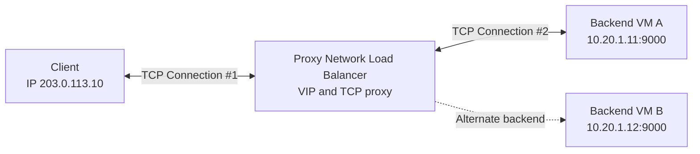
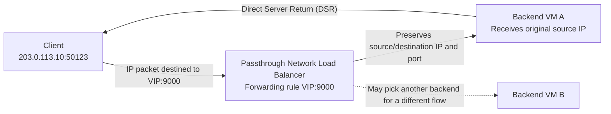
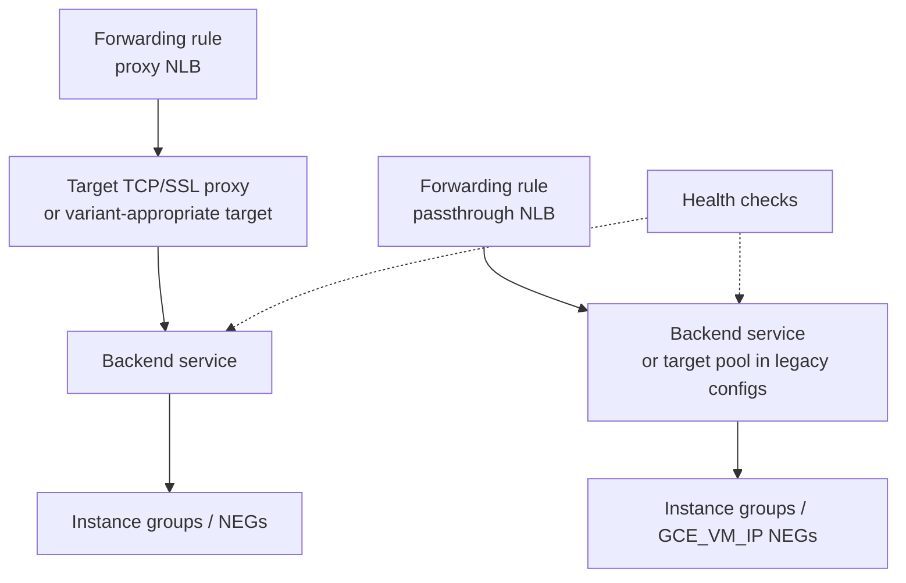
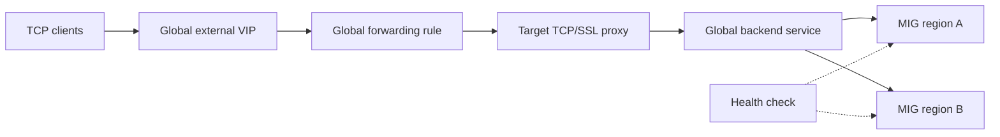

# Proxy Network Load Balancer and Passthrough Network Load Balancer

## 1. The Network-Layer Load Balancing Problem

Suppose an enterprise deploys applications on Google Cloud: a TCP service handling transactions, a server cluster receiving UDP data, an internal administration system accessed over VPN, and a website running on Cloud Run. These systems all need to accept many connections, distribute load, and avoid sending traffic to unavailable servers. Yet **where to load balance, for which protocol, and how much connection metadata to preserve** determines which load balancer type to use.

Google Cloud has two main **Network Load Balancer** families operating primarily at **Layer 4**:

- **Proxy Network Load Balancer:** implements a **TCP reverse proxy**. Connections from clients terminate at the proxy; the proxy opens a new TCP connection to the backend.
- **Passthrough Network Load Balancer:** distributes **IP packets to backends without acting as a reverse proxy**. Backends terminate connections directly and receive the original client source IP address.

Both models offer **external** (serving connections from the Internet) and **internal** (serving connections inside a VPC or networks connected to the VPC) options, though protocol support, deployment scope, and backend protection mechanisms differ. Within the **CLOUD_PROVIDERS_GCP** module, this knowledge connects to Project/IAM structure, VPC/subnets/firewalls, Compute Engine, GKE, Cloud Run, databases, observability, reliability, and cost.

**After this lesson, learners will be able to:**

1. Describe the TCP flow of a proxy NLB and the packet flow of a passthrough NLB using diagrams.
2. Compare preservation of **client source IP**, **TLS termination**, **TCP/UDP**, regional scope, and health check mechanisms.
3. Distinguish **global, cross-region, regional, internal, and external** variants according to current product specifications.
4. Choose a load balancer for public TCP, public UDP, internal TCP services, and systems requiring TLS.
5. Understand the roles of **forwarding rule, target proxy, backend service, instance group/NEG, health check, and firewall**.
6. Inspect configurations with `gcloud`, analyze connectivity failures, and plan safe operations.

> **Scope:** This lesson covers architectural comparisons and educational deployment examples. Supported capabilities of each Network Load Balancer type vary by mode and release stage. Resource creation commands must only be run in authorized projects and may incur costs.

## 2. Understanding the Two Traffic Paths First

### 2.1. Proxy Network Load Balancer: Two TCP Connections



For example, a client connects to the load balancer's public IP and TCP port 9000. The proxy accepts this connection, selects a healthy backend, and opens **another connection** to the backend. From the backend's network socket perspective, the **peer IP is usually the proxy**, not the original client IP. On supported variants, the **PROXY protocol** can pass client address and port metadata to the backend application; the application must understand this protocol.

A key benefit is that the proxy can perform **TCP termination**, remap frontend/backend ports where supported, and, on compatible external variants, perform **TLS/SSL offload** at the load balancer. However, it **does not natively understand URL paths, cookies, or HTTP headers** like an Application Load Balancer.

### 2.2. Passthrough Network Load Balancer: Packets Straight to Backends



Passthrough **does not accept and recreate** a TCP connection. Packets arriving at the backend VM preserve the **client's source IP** and the **forwarding rule's destination IP**, along with the protocol and port (for port-based protocols). The backend handles the connection itself, performs any TLS handshake, and responds **directly** to the client (*direct server return*, DSR).

This makes passthrough suitable when **applications need to see the source IP at the packet level**, process UDP, or use certain IP protocols beyond TCP. In return, backends must handle TLS themselves and applications must listen on the **VIP or a wildcard address**, not only on the internal IP directly bound to the NIC.

### 2.3. Core Comparison Table

| Criterion | Proxy Network Load Balancer | Passthrough Network Load Balancer |
| --- | --- | --- |
| Model | L4 **reverse proxy**, two TCP connections | L4 **pass-through**, no new connection created |
| Primary protocols | **TCP** (with/without SSL/TLS depending on variant) | **TCP, UDP**, plus other IP protocols depending on variant |
| Client source IP at backend | Backend sees proxy IP; can receive metadata via **PROXY protocol** if supported | **Preserves original source IP** in packets arriving at backend |
| Destination IP seen at backend | Connection to backend address | **Forwarding rule VIP** |
| TLS termination | Available on **global/classic external SSL proxy**; not supported by every proxy NLB | **No**; backends terminate TLS themselves |
| SSL certificate at LB | Yes, on compatible external SSL proxy variants | No certificates attached for TLS offload at the LB |
| Frontend → backend port remapping | Port remapping supported | Protocol and port are forwarded to backends unchanged |
| Response path | Via proxy ↔ backend connection; proxy replies to client | Backend replies directly to client (**DSR**) |
| Multi-region distribution | External global and internal cross-region variants exist | **Global external passthrough** exists depending on product status; regional external/internal usually restrict backends to one region |
| Backends | Instance groups, NEGs, and backend types compatible with variant | Typically instance groups or zonal `GCE_VM_IP` NEGs |
| Firewall on backend VMs | Allow health checkers and **proxy/GFE/proxy-only subnet IPs** | Allow health checkers and **actual client IPs** |
| Typical applications | TCP services wanting a proxy, frontend TLS, or multi-region routing | UDP, original source IP logging, network apps needing direct packet handling |

**Two common misconceptions:** "Proxy NLB is Layer 4" does not mean it supports UDP; "Passthrough NLB has an external IP" does not mean Google Cloud decrypts TLS at the frontend. Choose based on **protocol and actual traffic path**, not merely the word "Network".

## 3. Map of Google Cloud Variants

### 3.1. Proxy NLB Types

| Variant | Frontend | Backend Scope | Key Characteristics |
| --- | --- | --- | --- |
| **Global external proxy NLB** | External anycast IP, Premium Tier | Can have backends in multiple regions per config | GFE-based; supports TCP proxy and **SSL proxy**; load-balancing scheme `EXTERNAL_MANAGED` |
| **Classic proxy NLB** | External; global in Premium, regional in Standard | Depends on network tier/config | GFE-based; target TCP proxy or target SSL proxy; scheme `EXTERNAL` |
| **Regional external proxy NLB** | External, chosen region | Regional | Envoy-based, **TCP only** at frontend (no SSL offload); scheme `EXTERNAL_MANAGED` |
| **Regional internal proxy NLB** | Internal VIP in region | Regional backends | Envoy-based; TCP proxy; **global access** can be enabled for clients conditionally; scheme `INTERNAL_MANAGED` |
| **Cross-region internal proxy NLB** | Regional internal VIPs; multiple VIPs can be used | Backends in multiple regions | Envoy-based; automatically routes to healthy backends in other regions per config; scheme `INTERNAL_MANAGED` |

**GFE** stands for *Google Front End*, the Google-managed proxy layer at appropriate network locations. **Envoy-based** uses Google-managed Envoy proxies with a **proxy-only subnet** in the VPC. You cannot apply a single generic firewall rule set to every row in the table.

For example, a regional internal proxy NLB does not automatically send traffic across multiple regions just because clients can access it from other regions when global access is enabled; **regional backend scope** remains a limit of that load balancer type. Cross-region internal has distinct multi-region backend capabilities.

### 3.2. Passthrough NLB Types

| Variant | Frontend | Backend Scope | Protocols / Notes |
| --- | --- | --- | --- |
| **Regional external passthrough NLB** | External regional IP | Backends in same region | TCP, UDP, ESP, GRE, ICMP, ICMPv6; supports Premium/Standard Tier per config; scheme `EXTERNAL` |
| **Internal passthrough NLB** | Internal regional IP | Backends in same region | TCP, UDP, and other supported IP protocols such as SCTP, ESP, AH, GRE; scheme `INTERNAL` |
| **Global external passthrough NLB** | External global IP | Can have backends in multiple regions | Premium Tier; scheme `EXTERNAL_PASSTHROUGH`; **verify Preview/GA status and usage conditions** before deploying |

Older documentation may refer to **external TCP/UDP Network Load Balancer**, or describe only regional external passthrough; product names and features have evolved over time. At the time of writing, Google Cloud overview documentation lists **global external passthrough NLB** with release status that should be verified directly when using it.

**Do not assume passthrough is always regional-only**, nor assume all variants support global scope, identical protocols, identical health checks, or identical quotas. Pick the exact row in the table before writing IaC.

### 3.3. External vs. Internal: Who Can Connect?

- **External:** allows clients on the Internet to send traffic to the frontend IP per configuration; applications still require appropriate firewalls, security, and authentication.
- **Internal:** frontend IP lies within private network scope; typically serves clients in the VPC or networks connected via VPC Peering, Cloud VPN, Cloud Interconnect, and supported mechanisms.
- **Regional internal passthrough:** defaults to same-region clients; **global access** can be enabled for clients from other regions, while backends remain in the load balancer's region.
- **Cross-region internal proxy:** internal frontend with distribution capability to backends across multiple regions, supporting HA and multi-region governance goals.

A private IP does not mean the service authenticates users automatically. IAM governs managing Google Cloud configuration; internal protocols, TLS/mTLS, application ACLs, and firewalls govern who can use the service.

## 4. TCP, UDP, and TLS: Choosing at the Right Layer

### 4.1. TCP Proxy Differs from HTTP Proxy

A TCP proxy can forward bytes of an application protocol running over TCP without understanding HTTP request semantics. If you need to **route by hostname, URL path, header, cookie, or HTTP method**, look at **Application Load Balancer (ALB)**. For websites running on **Cloud Run**, a common choice is an **external Application Load Balancer with a serverless NEG** when an HTTP(S) load balancer frontend is needed.

Proxy Network Load Balancer is more suitable when the requirement is **balancing TCP connections** for a protocol that does not need Layer 7 HTTP/HTTPS rules.

### 4.2. TLS Offload Exists Only on Supported Variants

Example of clients accessing a custom TCP service over TLS:

```text
Client --TLS--> Global/classic external SSL proxy NLB
                  --TCP or TLS (per supported backend protocol)--> Backend
```

When using a compatible **SSL proxy**, the load balancer holds the frontend certificate, completes the TLS handshake with the client, and then forwards traffic over a new connection to the backend. The backend can use a TLS-protected connection if supported by the product/configuration; do not treat TLS offload as end-to-end security if the backend leg runs plaintext over an uncontrolled network path.

Conversely:

```text
Client --TLS packets--> Passthrough NLB --TLS packets--> Backend
Backend holds its own certificate/private key and performs the TLS handshake.
```

**Regional external proxy NLB handles TCP only**, without frontend SSL offload like global/classic SSL proxy. Internal proxy NLB is also designed for TCP proxying; do not assume adding a certificate to its frontend turns it into an SSL proxy.

### 4.3. UDP or Other IP Protocols

For **UDP** traffic (such as certain gaming systems, telemetry, or self-managed DNS), choose a **passthrough** variant supporting UDP. For **ESP/GRE/ICMP**, check the protocol support table of the chosen external/internal variant. A TCP proxy will not accept UDP simply because both belong to Layer 4.

### 4.4. Need to See Client Source IP

If the application uses the source IP for fraud detection, audit logging, or access restrictions, distinguish:

- **Passthrough:** source IP is in the **directly received packet**, observable via packet capture.
- **Proxy:** backend sees the proxy as the peer; **PROXY protocol** on supported variants can pass the original client IP/port in a dedicated header. This is not HTTP `X-Forwarded-For` when using a pure TCP proxy.
- **Application Load Balancer:** HTTP metadata is typically passed via HTTP headers, suitable for web applications but not the default behavior of Network Load Balancers.

Enable PROXY protocol only when backend software is configured to parse this header; if the backend expects application payload starting at byte zero, a PROXY header can break the protocol.

## 5. Configuration Components to Distinguish

A Network Load Balancer typically comprises the following resources. The presence and scope of each component vary by load balancer type.

| Resource | Function | What to Check During Review |
| --- | --- | --- |
| **Frontend IP address** | IP clients connect to | Internal/external, global/regional, IPv4/IPv6, static/ephemeral |
| **Forwarding rule** | Pairs IP + protocol + port with backend/target processing path | `loadBalancingScheme`, scope, protocol, port(s), target/backend |
| **Target TCP/SSL proxy** | TCP/TLS termination point of a **proxy NLB** when using that mechanism | `targetTcpProxy` vs. `targetSslProxy`, certificate if SSL, proxy header |
| **Backend service** | Groups backends, health checks, and distribution policies | Global/regional scope, backend protocol, balancing/affinity |
| **Instance group / NEG** | Group of VMs or endpoints actually running the service | Endpoint type, network, region/zone, named ports if applicable |
| **Health check** | Evaluates whether backends can receive traffic | Protocol, port, path, timeout, thresholds, scope, and firewall |
| **Firewall rule / firewall policy** | Allows or blocks packets to backends by source/port | Whether actual source is client, GFE, or proxy-only subnet |
| **Proxy-only subnet** | Supplies IPs for **Envoy proxies** in managed regional/cross-region variants | CIDR, appropriate purpose, region, firewall to backends |
| **Cloud DNS record** | Points domain name to frontend IP | TTL, DNSSEC if public zone, IP change plan |

### 5.1. Proxy and Passthrough Reference Different Targets



For a proxy NLB, the proxy executes **load balancing logic** between client and backend. For backend-service-based passthrough, the forwarding rule attaches directly to the backend service; there is no target TCP proxy. **Target pool-based regional external passthrough** is a legacy configuration with its own component model; when learning new architectures, prioritize **backend service-based** setups unless maintaining legacy systems is required.

### 5.2. A Health Check Is Not a Business Transaction Test

A **TCP health check** can confirm a port accepts connections without proving order placement succeeds. An HTTP/HTTPS health check can test an endpoint returning an expected status code, if exposed by the software. For UDP workloads using passthrough, health checks **do not send UDP packets to probe**; backends typically need a **TCP/HTTP** endpoint to report the UDP service's health.

If the load balancer finds no healthy backends, traffic serving capability is impacted; fallback behavior when all backends fail varies by product. Design readiness probes tied to real serving capacity rather than merely checking that the OS is alive.

## 6. Firewalls and Traffic Sources: Essential Differences

### 6.1. Proxy NLB

For **GFE-based** global/classic external proxy NLBs, traffic to backends originates from Google's proxy infrastructure IP ranges. For **Envoy-based** regional external/internal/cross-region internal proxy NLBs, connections from the proxy to backends typically originate from the VPC's **proxy-only subnet**. Health checks have their own source ranges depending on backend/checker type.

Therefore, backend firewall rules may need to:

1. Allow TCP to the **backend serving port** from **GFE proxy ranges** or the **proxy-only subnet** (depending on mode).
2. Allow **health check probes** to the exact health check port from the documented source ranges.
3. Restrict destinations via target tags, service accounts, or appropriate firewall mechanisms, avoiding overly broad rules.

Firewalls on **backend VMs** are not the same as blocking clients in front of an **external proxy frontend**. Specific LB types may have separate frontend protection mechanisms or policies; do not assume an ingress firewall rule on a VM prevents requests from reaching the load balancer itself.

### 6.2. Passthrough NLB

Passthrough backends **receive the client's true source IP**. Thus, to accept legitimate traffic, ingress firewalls must allow client sources per policy, while separately allowing **health check probes**. Allowing only health checker ranges without client ranges can result in green health checks while real connections fail.

With external passthrough, opening source `0.0.0.0/0` permits all IPv4 clients to the specified port; use this only when the service genuinely must be public and has appropriate protections. With internal passthrough, restrict by internal CIDRs or VPN/Interconnect connectivity needs and inspect egress rules as well.

### 6.3. Health Check Ranges Depend on Variant

Health check source ranges are **not identical** across global external passthrough, regional external passthrough, internal passthrough, and proxy NLBs. Some configurations use Google health checkers, while others use Envoy-proxied health checks. Because IP ranges and support conditions can be updated, check [Health checks overview](https://cloud.google.com/load-balancing/docs/health-check-concepts) directly instead of copying rules from another LB type.

For example, **internal passthrough IPv4 VM backends** commonly use `35.191.0.0/16` as a health check source range; for **global external passthrough**, Google Cloud publishes **different ranges**. Never reuse one sample range blindly across every system.

## 7. Connection Distribution, Affinity, and Backends

### 7.1. Load Distribution Is Not "Per-Packet Round Robin"

Network Load Balancers use connection/flow distribution algorithms and settings suited to each product. With **passthrough**, a TCP/UDP flow is assigned to a backend via backend selection and **connection tracking**; individual packets are not randomly bounced to different VMs, as that would break connection state.

With **proxy NLB**, the proxy selects a backend for each new connection and may factor in health, geography, load levels, or traffic management settings depending on the variant. Balancing modes and session affinity options differ across product lines.

### 7.2. Session Affinity

If an application relies on session state on a single VM, session affinity can keep related connections leaning toward the same backend, but it **does not guarantee state survives VM failure or replacement**. Well-designed systems store shared sessions externally or support recovery.

With passthrough, understand connection tracking and failover behavior. With proxy, understand connection lifetimes and behavior when a backend becomes unhealthy. Never treat any affinity setting as a guarantee that "every connection from the same IP will always reach the same VM forever".

### 7.3. Reliability Does Not Come Automatically from One Load Balancer

A load balancer with health checks but only **one backend VM** does not survive a VM failure. To meet realistic SLOs:

- Use multiple backends, considering spreading across multiple **zones** within a region.
- For regional outage resilience, choose an **LB type supporting multi-region backends**, and deploy databases/data replication and failover accordingly.
- Configure health checks reflecting true readiness, sensible timeouts, and backend capacity.
- Use managed instance groups/autoscaling where appropriate; monitor errors and latency from the client side.
- Test rolling deployments, backend loss, zone loss, and all-backends-unhealthy scenarios.

**Do not confuse multi-region TCP routing with full transaction recovery.** The load balancer is only one piece; databases, storage, queues, DNS, authentication, and on-premises connectivity must also have recovery plans.

## 8. Rules for Choosing a Load Balancer per Application

A practical decision workflow:

1. **Which protocol?** If HTTP(S) needing path/header/cookie routing, evaluate **Application Load Balancer** first. If UDP/ESP/GRE needing passthrough, choose an appropriate **passthrough NLB**. If pure TCP wanting a proxy, evaluate **proxy NLB**.
2. **Does the application need source IP at the packet layer?** If yes, passthrough usually fits. If it only needs to log client IP and the backend supports PROXY protocol, a proxy NLB may work depending on variant.
3. **Where does TLS terminate?** Need offload at the LB → evaluate **external global/classic SSL proxy** or ALB; need TLS straight to the application → passthrough.
4. **Where do clients come from?** Internet → external; VPC/hybrid → internal, per supported routing and connectivity.
5. **Are backends in one or multiple regions?** Choose an appropriate global/cross-region type, or regional if sufficient.
6. **Other constraints:** IP version, network tier, subnets, IAM, quotas, backend type, firewalls, health checks, logging, cost, and release stage.

### Quick Selection Matrix

| Scenario | First Option to Evaluate | Why |
| --- | --- | --- |
| Public custom TCP app, multi-region backends | **Global external proxy NLB** | TCP proxy and multi-region backends; consider SSL proxy if TLS offload is needed |
| TCP service in a VPC, backends in one region only | **Regional internal proxy NLB** or **internal passthrough NLB** | Choose proxy for TCP proxying; passthrough if source IP/packet handling is needed |
| Internal TCP service needing failover to another region | **Cross-region internal proxy NLB** | Multi-region backends and internal VIP by design |
| UDP game server needing real client source IP | **External passthrough NLB** | UDP and packet preservation; choose regional/global per support and requirements |
| UDP transmission system inside VPC/hybrid | **Internal passthrough NLB** | Backends receive UDP directly using an internal IP |
| TLS app on VMs that must hold its own private keys | **Passthrough NLB** | TLS terminates at the VM, not offloaded at the LB |
| HTTPS website on Cloud Run with URL path routing | **Application Load Balancer** | HTTP(S)/L7 features and serverless NEG |
| Traffic only needs a static IP without multiple backends | Consider a direct endpoint if appropriate | Do not add an LB by default if there is no distribution/HA need |

**No single type is best for all cases.** Proxy adds a processing tier and connection management features; passthrough keeps packet paths closer to the application while pushing TLS/protocol configuration responsibility onto backends.

## 9. Scenario 1: Public TCP Service with Multiple Backends

A software vendor runs a custom TCP protocol on port `9000` serving customers across regions. The service uses VMs in managed instance groups across two regions; operations wants users to connect to one stable IP and automatically shift away from unhealthy backends.

### 9.1. Solution Evaluation

If **backends can sit behind a TCP proxy** and do not strictly require packet-level source IP preservation, a **global external proxy NLB** is worth evaluating. The team can choose:

- **Target TCP proxy** to proxy regular TCP connections while letting the app manage TLS if used.
- **Target SSL proxy** on supported variants for TLS termination at the frontend.
- **Backend service** with appropriate instance groups/NEGs, health checks, and distribution policies.
- **Forwarding rule + global external IP** and a Cloud DNS record for the domain.

Do not confuse with an HTTP load balancer: if the payload is a binary TCP protocol, URL path routing is irrelevant.

### 9.2. Backend Visibility

Without PROXY protocol, socket logs on the VM will record the **proxy's source IP**, not the customer's. For client-IP-based anti-spam, verified metadata is needed and the app must be configured to read the right field. When choosing a load balancer for a legacy app that lacks PROXY protocol support, check whether the application can be modified before committing.

### 9.3. Component Deployment View



**Read-only** commands to inspect existing configuration:

```bash
# Replace PROJECT_ID and object names with actual values
gcloud compute forwarding-rules list --project=PROJECT_ID
gcloud compute target-tcp-proxies list --project=PROJECT_ID
gcloud compute target-ssl-proxies list --project=PROJECT_ID
gcloud compute backend-services list --project=PROJECT_ID
gcloud compute health-checks list --project=PROJECT_ID
```

`list` does not guarantee a user has permission to view every project, resource, or variant; for details, use `describe` with the resource's exact `--global` or `--region` flag.

## 10. Scenario 2: Internal Passthrough NLB for a TCP Service

A payment application in a VPC needs to call an internal-only TCP service on port `9000`. Developers require backend VMs to see the real source IP for network controls; no TLS termination at the load balancer is needed.

An **Internal passthrough Network Load Balancer** fits evaluation. Suppose the organization has:

```text
Project:             acme-lb-lab
Region:              asia-southeast1
VPC:                 demo-vpc
Subnet:              demo-subnet
Subnet CIDR:         10.20.10.0/24
Internal VIP:        10.20.10.50
Instance group:      demo-ig (asia-southeast1-a)
Service port:        9000/TCP
```

### 10.1. Prerequisites Before Running

- VPC/subnet already exist and the VIP is reserved within the subnet range; do not reuse an IP assigned to another resource.
- Backend VMs exist in the instance group, with the application **listening on port 9000** on `0.0.0.0` or the VIP as configured.
- The executing principal has IAM permissions to create Compute Engine load balancing resources, health checks, and modify firewall rules; the Compute Engine API is enabled.
- Backends respond to valid traffic and a TCP health check on port 9000; the project has adequate quotas and billing.

**This is an illustrative example that may incur charges.** Do not provision production resources simply by swapping the project name.

### 10.2. Health Check and Backend Service

```bash
# Create regional TCP health check
gcloud compute health-checks create tcp demo-hc \
  --region=asia-southeast1 \
  --port=9000 \
  --project=acme-lb-lab

# Create regional backend service for internal passthrough
gcloud compute backend-services create demo-be \
  --region=asia-southeast1 \
  --load-balancing-scheme=INTERNAL \
  --protocol=TCP \
  --health-checks=demo-hc \
  --health-checks-region=asia-southeast1 \
  --project=acme-lb-lab

# Attach the prepared instance group
gcloud compute backend-services add-backend demo-be \
  --region=asia-southeast1 \
  --instance-group=demo-ig \
  --instance-group-zone=asia-southeast1-a \
  --project=acme-lb-lab
```

### 10.3. Create the Internal Frontend Forwarding Rule

```bash
gcloud compute forwarding-rules create demo-fr \
  --region=asia-southeast1 \
  --load-balancing-scheme=INTERNAL \
  --ip-protocol=TCP \
  --ports=9000 \
  --network=demo-vpc \
  --subnet=demo-subnet \
  --address=10.20.10.50 \
  --backend-service=demo-be \
  --backend-service-region=asia-southeast1 \
  --project=acme-lb-lab
```

Frontend IP `10.20.10.50` sits inside the internal subnet. Backend VMs receive packets with the **client source IP** and **VIP destination IP**. The application must bind to the proper IP/port; binding solely to the NIC's private IP without accepting the VIP can cause connections to fail.

### 10.4. Firewalls for Clients and Health Checks

This model needs **two allowed flows**: client → backend to serve the app, and Google health checker → backend to evaluate readiness. Example scoped to VMs carrying network tag `demo-lb-backend`:

```bash
# Example: allow clients only from the designated internal range
gcloud compute firewall-rules create allow-demo-ilb-clients \
  --network=demo-vpc \
  --direction=INGRESS \
  --action=ALLOW \
  --rules=tcp:9000 \
  --source-ranges=10.20.0.0/16 \
  --target-tags=demo-lb-backend \
  --project=acme-lb-lab

# Example for internal passthrough IPv4 health checkers;
# verify current source ranges in official docs before deploying
gcloud compute firewall-rules create allow-demo-ilb-health \
  --network=demo-vpc \
  --direction=INGRESS \
  --action=ALLOW \
  --rules=tcp:9000 \
  --source-ranges=35.191.0.0/16 \
  --target-tags=demo-lb-backend \
  --project=acme-lb-lab
```

Backend VMs must actually carry the `demo-lb-backend` tag. With Shared VPC, firewalls live in the **host project owning the network**, while forwarding rules/backends or VMs may belong to projects per supported deployment rules; adjust permissions and `--project` accordingly. Do not extrapolate a single-project example into assuming all multi-project setups configure identically.

### 10.5. Post-Deployment Verification

```bash
# Read-only: inspect forwarding rule VIP, scheme, and backend service
gcloud compute forwarding-rules describe demo-fr \
  --region=asia-southeast1 \
  --project=acme-lb-lab

# Read-only: inspect backend and health status
gcloud compute backend-services describe demo-be \
  --region=asia-southeast1 \
  --project=acme-lb-lab

gcloud compute backend-services get-health demo-be \
  --region=asia-southeast1 \
  --project=acme-lb-lab
```

From a client VM **authorized to reach the internal VIP**, test connectivity using a suitable TCP tool, such as:

```bash
# Run only from a test client inside the permitted network
nc -vz 10.20.10.50 9000
```

A successful `nc` result only proves a connection opened; it **does not prove business transactions work**. Send real application payloads, inspect server logs/source IPs, monitor errors/latency, and simulate an unhealthy backend.

## 11. Scenario 3: Public UDP and Preserving Source IP

Suppose a self-managed game service runs on UDP port `27015`. The software needs to see client IP/port at the network socket level and maintain per-flow state. **Regional external passthrough NLB** is the natural starting point; if multi-region backends behind a single frontend IP are genuinely required, examine **global external passthrough** and verify its release status/features at deployment time.

The architecture includes a **UDP external forwarding rule**, a backend service supporting that traffic type, an appropriate instance group/zonal NEG, and a separate TCP/HTTP health check. VMs must handle real UDP traffic, while the health check endpoint reports readiness based on game server health.

**Do not use a TCP proxy** for UDP traffic; nor should you choose passthrough solely on the assumption of "guaranteed higher performance" without measuring throughput, CPU, latency, network cost, and security needs. Each distribution mode has distinct algorithms, limits, and costs.

If the software also uses TCP for control and UDP for data, configure **appropriate forwarding rules and backend protocols** supported by the passthrough type. Do not attempt to combine multiple protocols into one rule when the product does not support it.

## 12. Measuring Reliability, Security, Performance, and Cost

### 12.1. Metrics to Monitor

| Metric | Role | Example Questions |
| --- | --- | --- |
| **Backend health** | Know which backends can receive traffic | How many backends are healthy per zone? |
| **New/active connections** | Assess TCP load levels | Are concurrent connections exceeding backend limits? |
| **Throughput and bytes** | Track network usage and cost | Where is ingress/egress growth coming from? |
| **Connection errors/resets/timeouts** | Detect network and backend faults | Is the client or the proxy closing connections? |
| **Client-side latency** | Actual perceived quality | Are p95/p99 affected under load spikes or failover? |
| **Firewall drops / VPC Flow Logs** | Investigate blocked packets | Is the source GFE, proxy-only subnet, or client? |
| **Cost by SKU/project** | Maintain budget and forecasts | How much do load balancing, data processing, egress, VMs, and NAT consume? |

Google Cloud Monitoring provides metrics per LB type and resource, though metric names and logging granularity differ across variants. Do not assume every Network LB provides **per-request HTTP logs** like an Application Load Balancer. With passthrough, **VPC Flow Logs, firewall logging, and application logs** are often needed to inspect TCP/UDP flows.

### 12.2. IAM and Governance Scope

The networking team may manage IPs, forwarding rules, and load balancing configs; the application team manages instance groups and backend VMs; the security team manages firewalls/policies. IAM permissions must be scoped per **project** and **Shared VPC host/service projects** in multi-project setups.

When opening an Internet-facing load balancer, identify exact principals permitted to edit frontends/backends and audit IAM before changes. **Network Load Balancer does not authenticate clients like a login system**, and does not replace TLS, mTLS, or application-level authentication.

### 12.3. Cost Is More Than Just Load Balancer Fees

Total cost may include:

- Forwarding rules or load balancing components per pricing model and network tier.
- Data processed/traffic and **network egress** across regions or out to the Internet.
- Instance group VM compute, persistent disks, and health check/monitoring/logging fees where applicable.
- A proxy-only subnet does not necessarily have a separate subnet line item, though traffic and associated services can still incur charges.
- Cloud NAT, Cloud VPN, Cloud Interconnect, or additional load balancers if used in the architecture.

Consult [Cloud Load Balancing pricing](https://cloud.google.com/load-balancing/pricing) and **Cloud Billing SKUs** at deployment time. Never use Application Load Balancer unit prices to estimate a Network Load Balancer. Never assume Premium Tier, Standard Tier, global, and regional share the same pricing.

### 12.4. Pre-Production Testing

A test suite should cover: 1 healthy backend, N healthy backends, one backend losing connectivity, a zone outage, rapid load ramp-up, firewall blocking health checks, backend overload, and frontend DNS changes. Record detection time, error rate, and recovery behavior against the workload's **SLO and RTO/RPO** (if applicable). If the setup has multi-region backends, test real regional failover before claiming high reliability.

## 13. Troubleshooting: From Symptom to Root Cause

| Symptom | Possible Cause | Where to Check |
| --- | --- | --- |
| Cannot connect to frontend VIP | Wrong IP, network tier, protocol/port, routing, firewall, or no healthy backends | `forwarding-rules describe`, DNS, backend health, and firewalls |
| Backends are **unhealthy** | Health check source not allowed, endpoint listening on wrong port, process crashed | Health check config, firewall, VM service/OS logs |
| Health check is green but clients cannot connect | Firewall allows health checks only, not clients (passthrough); wrong application bind | Compare actual packet source, client CIDR, VIP, listen address |
| Proxy NLB backend only logs proxy IP | Expected reverse proxy behavior | Check enabling **PROXY protocol** and updating app parser |
| Passthrough backend sees no packets | VM binds only NIC IP instead of VIP/wildcard; firewall/routing issue | Check socket bind (`0.0.0.0` or VIP), tcpdump, and target tags |
| TCP works but UDP fails | Chose TCP proxy NLB or TCP-only forwarding rule | Choose passthrough NLB supporting UDP; verify scheme |
| TLS handshake fails | Wrong TLS termination point, certificate/protocol/backend mode mismatch | Distinguish target SSL proxy vs. TLS on VM; inspect certs and logs |
| Internal connection from another region fails | Global access disabled on internal LB or incompatible backend/client scope | Inspect regional/cross-region mode and global access setting |
| Envoy proxy NLB cannot reach backend | Missing firewall rule for **proxy-only subnet**, wrong subnet purpose | Check VPC/subnets, Envoy ranges, serving port, and health checks |
| Cannot shift traffic to another region | Using a regional LB or invalid cross-region backend | Inspect frontend/backend scope, global/cross-region mode |
| No traffic visible in LB logs | Some variants do not provide per-request logging like HTTP LB | VPC Flow Logs, firewall logs, backend application logs |
| Unexpected cost | Egress, regional/cross-region transfer, VMs, NAT, LB SKUs | Billing reports by service/SKU/project and actual traffic |

### Investigation Workflow

1. **Identify the exact variant** from the forwarding rule: scheme, global/regional, external/internal, protocol, frontend port.
2. **Inspect the target and backend service**; identify instance groups/NEGs and health checks.
3. **Verify expected source IP**: real client for passthrough; GFE/Envoy for proxy.
4. **Verify firewalls**, health checkers, proxy-only subnet if needed, and OS/app listeners.
5. **Use a client in the right network** (Internet vs. VPC/hybrid) to test TCP/UDP with realistic payloads.
6. **Check logs/metrics**, correlating failure timestamps with deployment, IAM, or firewall changes.
7. Apply the minimal change resolving the root cause, verifying both allowed connections and connections that must be denied.

Never "fix" an error by opening `0.0.0.0/0` on all ports or granting IAM Owner across the entire project. Such changes mask symptoms while introducing severe system risk.

## 14. Common Misconceptions

| Misconception | Accurate Understanding |
| --- | --- |
| "Every L4 load balancer supports both TCP and UDP." | **Proxy NLB uses TCP**; UDP requires **passthrough NLB** or another supporting solution. |
| "Proxy NLB preserves client source IP at the backend socket like passthrough." | Backends see the proxy IP; use **PROXY protocol** if supported by the variant and application. |
| "Passthrough NLB can offload TLS at the frontend." | TLS terminates at the backend VM. |
| "Regional external proxy NLB is also an SSL proxy." | Regional external proxy handles TCP; SSL offload belongs to compatible global/classic external SSL proxies. |
| "Having a VIP guarantees requests reach the VM." | You still need healthy backends, correct routing/firewalls, and an app listening on the right port/IP. |
| "Splitting backends into two projects automatically isolates traffic between them." | Projects are administrative boundaries; traffic depends on networking/firewalls and app configuration. |
| "A passing TCP health check means all transactions succeed." | Health checks must reflect readiness; business logic errors can still occur. |
| "If an internal regional LB supports multi-region clients, backends are also multi-region." | Client global access is distinct from multi-region backend capability. |
| "Passthrough is always regional." | Global external passthrough also exists per current docs; check release status/features. |
| "Network Load Balancer automatically makes all dependencies reliable." | Data, databases, identity, DNS, and other components still need their own HA/DR. |

## 15. Exercises and Verification Questions

### Exercise 1: Choose the Architecture

For the following four requirements, choose the LB type and explain:

1. Custom TCP on port 9200, Internet clients, backends in two regions, wanting TLS offload at the LB.
2. UDP game on port 27015, needing unmodified client source IP at the VM.
3. Internal admin TCP service, single region only, clients from VPC and Cloud VPN.
4. HTTPS website running on Cloud Run, needing URL path routing.

**Hints:** (1) Global/classic external SSL proxy NLB if protocol/TLS fits; (2) external passthrough NLB; (3) internal passthrough or regional internal proxy depending on source IP requirement; (4) Application Load Balancer.

### Exercise 2: Trace the Packet Path

A client `198.51.100.10:54000` accesses VIP `203.0.113.50:9000`.

- With **passthrough NLB**, which source IP does the backend see? Which destination address?
- With **proxy NLB**, what is typically the peer IP at the backend socket?
- If the backend needs the client IP via **PROXY protocol**, what must change in the application?

**Answer:** Passthrough preserves source `198.51.100.10` and destination VIP `203.0.113.50`; proxy establishes a separate connection with the proxy's source IP. An application behind a proxy must parse the PROXY header sent by the LB, when supported by the variant.

### Exercise 3: Diagnose a Failure

An internal passthrough LB has two VMs; both pass health checks as healthy, yet clients cannot connect. List at least four verifiable causes.

**Hints:** firewall only allows health checker sources and not clients; VMs bind only NIC IP; wrong frontend protocol/port; client outside VPC/region scope; routing or policy blocking traffic; app not handling real payload.

### Exercise 4: Use Read-Only Commands in an Authorized Project

```bash
gcloud compute forwarding-rules list --project=PROJECT_ID
gcloud compute backend-services list --project=PROJECT_ID
gcloud compute health-checks list --project=PROJECT_ID
```

Pick one Network Load Balancer you have permission to view, and record its **scheme, scope, protocol, port, target/backend, instance group/NEG type, health check, and expected source IP seen by the backend**. You do not need to create or delete resources to complete this exercise.

### Exercise 5: Plan Downtime Reduction

A TCP application currently runs on a single VM and needs to be upgraded to survive a zone failure. Outline:

- How to place at least two backends across multiple zones with health checks.
- When to choose proxy vs. passthrough based on source IP/TLS requirements.
- Which firewall rules must permit which exact sources.
- How to measure connection error rate, failover time, and cost.
- Procedures for DNS/frontend IP cutover, rollback, and fault testing before production.

## 16. Pre-Deployment Checklist for Network Load Balancer

- [ ] Clearly identify the **application protocol**: HTTP(S) needing L7 vs. pure TCP/UDP needing L4.
- [ ] Choose **proxy** vs. **passthrough** based on TCP connections and client source IP.
- [ ] Define the **TLS termination** point and certificate management.
- [ ] Verify **external/internal**, **global/cross-region/regional**, network tier, and release status.
- [ ] Select IP/port, forwarding rule, target proxy/backend service matching the **load-balancing scheme**.
- [ ] Verify supported backend types and backend region/zone placement.
- [ ] Design health checks aligned with readiness and know the probe source ranges for the exact variant.
- [ ] Open firewalls for the right **client sources** (passthrough) or **GFE/proxy-only subnet** (proxy), plus health checks.
- [ ] Passthrough backends listen on VIP or wildcard; proxy backends parse PROXY headers if enabled.
- [ ] Verify IAM and permissions for Shared VPC, firewalls, compute, and backend services/NEGs.
- [ ] Have load testing, failover drills, rollback, monitoring, and SLO definitions ready.
- [ ] Estimate LB, compute, data processing, Internet/inter-region egress, and logging/NAT fees based on real billing accounts and SKUs.
- [ ] Establish administrative access paths and an investigation playbook if frontend/health checks or networking fail.

## 17. Official Google Cloud Documentation

These pages help verify choices, terminology, and commands before deployment:

1. [Choose a load balancer](https://cloud.google.com/load-balancing/docs/choosing-load-balancer)
2. [Proxy Network Load Balancer overview](https://cloud.google.com/load-balancing/docs/proxy-network-load-balancer)
3. [Passthrough Network Load Balancer overview](https://cloud.google.com/load-balancing/docs/passthrough-network-load-balancer)
4. [External proxy Network Load Balancer overview](https://cloud.google.com/load-balancing/docs/tcp)
5. [Internal proxy Network Load Balancer overview](https://cloud.google.com/load-balancing/docs/tcp/internal-proxy)
6. [Regional external passthrough NLB – backend service overview](https://cloud.google.com/load-balancing/docs/network/networklb-backend-service)
7. [Internal passthrough Network Load Balancer overview](https://cloud.google.com/load-balancing/docs/internal)
8. [Global external passthrough Network Load Balancer](https://cloud.google.com/load-balancing/docs/network/global-networklb-architecture)
9. [Health checks overview – probe ranges, backend health](https://cloud.google.com/load-balancing/docs/health-check-concepts)
10. [Firewall rules for load balancing](https://cloud.google.com/load-balancing/docs/firewall-rules)
11. [Set up an internal passthrough NLB](https://cloud.google.com/load-balancing/docs/internal/setting-up-internal)
12. [Cloud Load Balancing pricing](https://cloud.google.com/load-balancing/pricing)

**Core Takeaway:** **Proxy NLB** fits when a **TCP reverse proxy** is needed, potentially with TLS offload on supported external variants; **passthrough NLB** fits when **preserving packets/source IP**, supporting UDP, and letting backends handle connections directly are required. The final decision must also verify **frontend type, backend regions, firewalls/health checks, data, reliability, and cost** for the specific workload.
