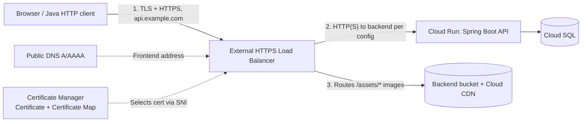
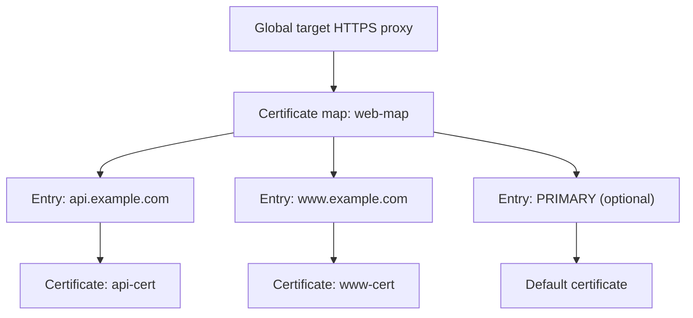
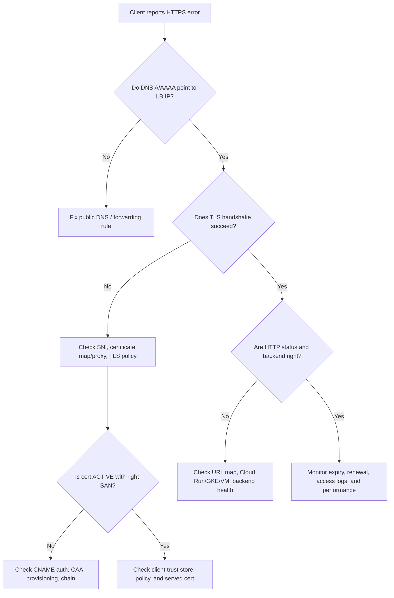

# Certificate Manager and TLS Certificate Management

## 1. Why Does a Java Application Need TLS Certificate Management?

Suppose a development team runs a **Spring Boot** REST API on **Cloud Run**, a static frontend served through **Cloud Storage + Cloud CDN**, and an internal service on **GKE**. Users access `https://api.example.com` or `https://www.example.com`. For browsers and Java HTTP clients to trust the connection, the system must present a **valid TLS certificate** for the exact domain, signed by a Certificate Authority (CA) trusted by the client, and not expired.

A certificate is not merely provisioned once. It has a lifecycle: **prove domain control → issue certificate → deploy to endpoint → verify → renew/rotate → revoke or delete**. When multiple projects, load balancers, environments, and domains coexist, manual management easily causes certificate expiration outages, private key leaks, or downtime from misconfigured HTTPS proxies.

**Google Cloud Certificate Manager** centralizes creating, importing, attaching, and managing TLS certificates for supported Google Cloud endpoints, especially **Cloud Load Balancing**. The **Load Balancing and Content Delivery** chapter of the **CLOUD_PROVIDERS_GCP** module uses Certificate Manager to explain how to protect Java APIs, choose where TLS terminates, coordinate certificates across multiple hostnames, and operate services with appropriate reliability, security, and cost.

### Learning Outcomes

After this lesson, you will be able to:

1. Understand the relationship between **TLS, X.509 certificates, SAN, SNI, private keys, CAs**, and HTTPS load balancers.
2. Choose between **Google-managed public**, **Google-managed private**, or **self-managed** certificates based on requirements.
3. Distinguish **DNS authorization** from **load balancer authorization**, and understand how to use **certificate maps**, **map entries**, and **target HTTPS proxies**.
4. Deploy a Google-managed certificate for a **global external Application Load Balancer** using the DNS authorization workflow, verify provisioning status, and inspect the live served certificate.
5. Explain certificate configuration differences across **global, regional, and cross-region** load balancers and **Cloud Run/GKE/Cloud CDN**.
6. Configure TLS policies, monitor renewals, rotate certificates, and investigate TLS failures without confusing them with Java backend errors.

## 2. Where Does TLS Operate in the Request Path?

An HTTPS load balancer typically **terminates TLS at the frontend**: the client and load balancer perform the TLS handshake; the load balancer selects a backend using URL maps/routing rules. The **load balancer → backend** leg is a separate connection, which can be HTTP, HTTPS, or another protocol depending on the backend service and load balancer type. A frontend certificate **does not automatically enable end-to-end TLS** to every backend.



This diagram illustrates an architecture with a **global external Application Load Balancer**, a serverless NEG for Cloud Run, and a backend bucket for static content; live routing also requires URL maps, backend services, forwarding rules, DNS, and access permissions. **Certificate Manager handles only one slice of the system:** certificate resources and deploying certificates onto TLS termination points.

### 2.1. A Basic TLS Handshake

1. The client resolves the domain name to an IP address and connects to the HTTPS endpoint (usually port 443).
2. The client sends **ClientHello**, usually including **Server Name Indication (SNI)** specifying the target hostname.
3. The HTTPS proxy selects the certificate matching SNI and its certificate config, and returns the certificate chain.
4. The client checks the **hostname in SAN**, validity window, signature chain to a trusted CA, and TLS policy; both sides establish session keys.
5. Once the handshake succeeds, HTTP requests/responses travel over the encrypted connection to the frontend.

**TLS does not determine which users are authorized to call an API.** After the handshake, Spring Security, Identity-Aware Proxy (if deployed), IAM, Cloud Armor, and application authorization still play their distinct roles.

### 2.2. Easily Confused Concepts

| Concept | Meaning | Common Mistake |
| --- | --- | --- |
| **Common Name (CN) / Subject Alternative Name (SAN)** | List of hostnames a certificate is authorized to represent; modern clients validate SAN | Certificate is valid/unexpired, yet does not include `api.example.com` |
| **SNI** | Hostname the client sends during the TLS handshake so the server picks the right certificate | Multiple domains share one IP, but the map lacks the right entry |
| **Private key** | Secret key proving ownership of the certificate | Committing keys into Git, container images, or logs |
| **Certificate chain** | Leaf and intermediate certificates linking to a trusted CA | Missing intermediate causes validation failures on certain clients |
| **Wildcard** | E.g., `*.example.com` typically covers `api.example.com`, not `example.com` or `a.b.example.com` | Assuming one wildcard covers every subdomain depth |
| **TLS policy** | Minimum TLS version and cipher rules allowed by the HTTPS proxy | Legacy clients fail handshakes after tightening policy |
| **Certificate status** | Issuance/renewal state in Certificate Manager | Certificate is `ACTIVE` yet not attached to the proxy receiving traffic |

## 3. Choosing Certificate Types in Certificate Manager

### 3.1. Google-Managed Certificates

Google Cloud is responsible for **requesting issuance, storing private keys for managed certificates, deploying, and auto-renewing** based on service capabilities and authorization state. For public HTTPS endpoints, this is usually the preferred choice because it reduces manual toil. Issuing CAs, validity periods, and renewal internals can evolve by product; do not build operational schedules assuming every certificate always has a 90-day lifespan.

**Critical condition not to overlook:** Google can only issue/renew a public certificate while domain control remains proven. Accidentally deleting DNS authorization records, misconfiguring CAA to block the CA, unexpected DNS changes, or breaking domain validation can cause renewals to fail—even while Java workloads run normally.

### 3.2. Self-Managed Certificates

The organization **obtains certificates itself** from a CA and uploads both **certificate chain + private key** into Certificate Manager. This suits cases requiring specific CAs, domains, or issuance policies, though operations must manage **expiration dates, certificate/key rotation, incident procedures, and strict key read permissions**.

Google Cloud does not automatically replace an expired self-managed certificate with an externally issued one. Never store private keys in source repositories, CI artifacts, chat, or documentation. When running import commands, assess key exposure risks across files, logs, and execution environment permissions.

### 3.3. Google-Managed Privately Trusted Certificates

For certain internal connections, requirements may call for certificates issued by an enterprise **private CA**. Certificate Manager can integrate with **Certificate Authority Service (CA Service)** to manage private certificates on supported resources. Clients must trust that private root/intermediate CA; public browsers **do not automatically trust** a private CA the way they trust public CAs.

| Requirement | Certificate Type to Evaluate | Primary Responsibility |
| --- | --- | --- |
| Public API/web, valid domain, wanting auto-renewal | **Google-managed public** | Google handles keys/issuance/renewal; ops maintains DNS, IAM, and connectivity |
| Custom PKI workflow, certificates from a specific CA | **Self-managed** | PKI/DevOps team protects keys and handles rotation |
| Internal endpoints needing trust via org CA | **Google-managed private + CA Service**, if supported by model | Org CA Service/trust configuration and Certificate Manager |

**Version note:** Google Cloud documentation currently distinguishes classic Certificate Manager from **Certificate Manager (2nd gen)** with broader management capabilities. At the time of writing, several 2nd gen features remain in **Pre-GA/Preview**. Commands and examples in this lesson use the classic Certificate Manager workflow for load balancing; when deploying, read documentation for the exact generation and feature scope.

## 4. Certificate Manager Configuration Components

### 4.1. Certificate Resource

Represents an X.509 certificate and its management method. Key fields to inspect: **resource name, location/scope, domain list, provisioning state, expiration date, issuer, and authorization**. One certificate can include multiple SAN domains, though packing too many hostnames from unrelated apps into a single certificate widens the blast radius of renewal failures or DNS changes.

### 4.2. Domain Authorization

Used for **Google-managed public certificates**. Two mechanisms exist:

- **Load balancer authorization**: the CA verifies domains via DNS configuration and the load balancer's serving path; **no dedicated authorization CNAME record is needed**. Both the load balancer and DNS must serve the required configuration. Does not support wildcards and applies only to supported global setups.
- **DNS authorization**: Certificate Manager provides a **CNAME record to prove domain control**, and administrators place that exact record in authoritative public DNS. Allows obtaining certificates **before the load balancer receives live traffic**, supports wildcards, and handles complex setups like intermediary CDNs.

Do not use DNS authorization for self-managed certificates: domain control was already verified during external issuance.

### 4.3. Certificate Map and Certificate Map Entry

For load balancers compatible with **certificate maps**, a **certificate map** holds entries mapping **hostname → certificate(s)**. A target HTTPS proxy can reference a certificate map; the proxy uses SNI to select a certificate for incoming connections.



Per Certificate Manager's selection logic: **exact hostnames** take priority over wildcards; if no exact match exists, wildcards are checked; if nothing matches, the **PRIMARY** entry (if configured) may be used. PRIMARY is not a license to serve the wrong domain: clients still validate the certificate's SAN and may reject the connection.

A certificate map entry can bind **multiple certificates** (within current limits) to support different key types or phased rotation. If a target HTTPS proxy has both a certificate map and directly attached certificates in compatible configs, the **certificate map takes precedence**. This matters when migrating from legacy attachments to maps.

### 4.4. Target HTTPS Proxy, Forwarding Rule, and SSL Policy

The **forwarding rule** accepts traffic on the frontend IP/port, while the **target HTTPS proxy** terminates TLS and uses the URL map/backends for routing. An **SSL policy** is a separate resource from a certificate: it governs minimum TLS version and cipher suites/profiles during client handshakes with the proxy.

When HTTPS throws certificate errors, inspect **which certificate the proxy is actually serving**, not merely whether a certificate exists in the Console. An `ACTIVE` certificate is not guaranteed to be attached to the right target proxy, certificate map entry, or frontend pointed to by DNS.

## 5. Global, Regional, and Cross-Region Load Balancers Use Certificates Differently

Not every load balancer attaches certificates the same way. Below are the **primary deployment patterns** per current documentation; always double-check the compatibility matrix when choosing products or versions:

| TLS Termination Point | Common Certificate Manager Usage | Note |
| --- | --- | --- |
| **Global external Application Load Balancer** | Attach a **global certificate map** to the global target HTTPS proxy | Supports Google-managed or self-managed per config |
| **Classic Application Load Balancer** | Attach a certificate map to the global HTTPS proxy | Verify LB generation differences during upgrades |
| **Regional external Application Load Balancer** | Attach **regional certificate directly** to the regional target HTTPS proxy | Does not use a global certificate map like global mode |
| **Regional internal Application Load Balancer** | Attach **regional certificate directly** to the regional target HTTPS proxy | Private frontends still need certificates trusted by clients |
| **Cross-region internal Application Load Balancer** | Attach supported certificate **directly** to the global HTTPS proxy | Check specific location/scope and DNS authorization mechanics |
| **Global external proxy Network Load Balancer** | Certificate maps supported for corresponding TLS proxy cases | Different from L7 HTTPS routing setup |
| **Media CDN** | Global certificates per Media CDN configuration | Distinct CDN endpoint flow, not identical to Application LB |

**Java example:** a Spring Boot API on Cloud Run behind a **global external Application Load Balancer** can use a **certificate map** on the global HTTPS proxy. Moving that same API to a **regional external Application Load Balancer** requires operations to switch to **regional certificates and direct attachment**, not simply replacing `--global` with `--region` in every command.

### 5.1. Cloud CDN and HTTPS

Cloud CDN delivers content through caches tied to load balancing; in a **Cloud CDN + external Application Load Balancer** architecture, the certificate for `assets.example.com` is configured on the **load balancer's HTTPS frontend**. CDN image caching does not create or replace TLS certificates. When a third-party CDN sits **in front of** the load balancer, evaluate DNS authorization because load balancer authorization may fail domain validation through an intermediary proxy.

### 5.2. Cloud Run, GKE, and Compute Engine

- **Cloud Run:** when using a custom domain via an external Application Load Balancer with a **serverless NEG**, the certificate belongs on the load balancer's HTTPS frontend. Cloud Run also offers separate custom domain / managed HTTPS features; avoid mechanically applying Certificate Manager commands to `run.app` endpoints.
- **GKE:** if Spring Boot runs in Pods, frontend certificates are managed alongside the **Ingress/Gateway controller** and the created load balancer type. Check whether the controller supports certificate map/references; avoid manual attachments that the controller will overwrite.
- **Compute Engine:** if VMs run Spring Boot behind an HTTPS load balancer, Java does not necessarily need to load the frontend certificate into the JVM. If the app also exposes a direct HTTPS port, the application's certificate is a **separate TLS configuration** from the load balancer's certificate.

## 6. Choosing DNS Authorization vs. Load Balancer Authorization?

| Question | DNS Authorization | Load Balancer Authorization |
| --- | --- | --- |
| Needs a dedicated DNS record? | **Yes**: CNAME provided by Certificate Manager | **No** dedicated auth record, though domain must still point to LB |
| Request cert before frontend serves live traffic? | **Possible** | Usually requires LB/DNS live and reachable from the Internet |
| Supports wildcards? | **Yes**, subject to domain naming rules | **No** |
| Works for regional certificates? | **Yes**, appropriate DNS authorization type | **No** |
| Third-party CDN or proxy in front of LB? | Often more suitable | Verification may fail |
| Common pitfalls | Wrong/unpropagated CNAME, CAA, missing DNS perms | A/AAAA points to wrong IP, port 443 closed, cert not attached |

### 6.1. Two Types of DNS Authorization

Certificate Manager supports DNS authorization types such as **`FIXED_RECORD`** and **`PER_PROJECT_RECORD`**. **Per-project** authorization ties domain verification more clearly to a specific project and is required by several paths, including **regional Google-managed certificates**. Each type has its own CNAME naming format; **do not guess the CNAME is `_acme-challenge.example.com`**. Retrieve the exact `dnsResourceRecord.name` and `dnsResourceRecord.data` from Certificate Manager and create the record at your DNS provider.

### 6.2. Wildcard, Apex, SAN, and CAA

A certificate containing `*.example.com` protects `api.example.com` and `www.example.com`, but does not automatically protect **`example.com`**. If both apex/root and wildcard are needed, the certificate must include both names and certificate map entries must match served hostnames.

**CAA (Certificate Authority Authorization)** records restrict which CAs may issue certificates for a domain. Certificate Manager may use **Google Trust Services (`pki.goog`)** and **Let's Encrypt (`letsencrypt.org`)** in supported public configurations. For **per-project DNS authorization** and regional certificates, documentation specifies **Google Trust Services** as the issuing CA, so CAA must permit `pki.goog` whenever CAA records are present. A valid CNAME paired with a blocking CAA record will still fail issuance or renewal.

**DNS control is a critical security permission.** Anyone allowed to modify authorization CNAMEs can influence issuance and renewal of public TLS certificates for the domain. Separate duties among DNS operators, Certificate Manager operators, and load balancer operators in larger organizations.

## 7. Lab: Google-Managed Certificate for a Global HTTPS Load Balancer

Goal: deploy a public certificate for `api.example.com` on a **global external Application Load Balancer** that already has an HTTPS frontend and a **global target HTTPS proxy**. This is a **test environment** example; **replace the domain with one you genuinely control**. `example.com` is illustrative only and cannot be used to obtain certificates for someone else's domain.

These steps **do not create a new backend, forwarding rule, or load balancer**. To complete end-to-end, you need a compatible load balancer with an existing global target HTTPS proxy, a domain with editable public DNS, a billing account, and appropriate permissions.

### Step 1 — Prepare IAM, APIs, and Environment Info

You need permissions to manage Certificate Manager (such as `roles/certificatemanager.editor` depending on task), manage HTTPS proxies/load balancing, and manage DNS zones. Follow **least-privilege IAM**: a certificate automation service account does not need Owner over the entire project.

```bash
gcloud config set project YOUR_PROJECT_ID
gcloud services enable certificatemanager.googleapis.com compute.googleapis.com

# Identify the exact global HTTPS proxy receiving requests:
gcloud compute target-https-proxies list
```

In the commands below, replace `api.example.com` with a domain you control; replace `EXISTING_GLOBAL_HTTPS_PROXY` with the real proxy name. If the load balancer serves production traffic, do not alter its certificate map without a deployment, testing, and rollback plan.

### Step 2 — Create DNS Authorization

Example choosing **`PER_PROJECT_RECORD`** and location `global`:

```bash
gcloud certificate-manager dns-authorizations create api-dns-auth \
  --domain=api.example.com \
  --type=PER_PROJECT_RECORD \
  --location=global

gcloud certificate-manager dns-authorizations describe api-dns-auth \
  --location=global \
  --format="yaml(dnsResourceRecord)"
```

The `describe` output contains record type `CNAME`, `dnsResourceRecord.name`, and `dnsResourceRecord.data`. **Copy the exact real name and value** into your domain's authoritative **public DNS** (Cloud DNS or your DNS provider). The sample line below is *structural only*, not the actual record your system will generate:

```text
<dnsResourceRecord.name from Certificate Manager>  CNAME  <dnsResourceRecord.data>
```

Wait for DNS propagation and verify with `dig CNAME RECORD_NAME_FROM_DESCRIBE` or an equivalent DNS tool. Propagation depends on TTL, caching, and DNS provider. Keep the authorization CNAME in place **throughout the lifetime** of the Google-managed certificate for renewals.

### Step 3 — Create the Google-Managed Certificate

```bash
gcloud certificate-manager certificates create api-cert \
  --domains=api.example.com \
  --dns-authorizations=api-dns-auth \
  --location=global

gcloud certificate-manager certificates describe api-cert \
  --location=global
```

Check **`managed.state`** and **`managed.authorizationAttemptInfo`** if present. States to understand:

| State | Meaning and Action |
| --- | --- |
| **`PROVISIONING`** | Issuance/renewal in progress; check DNS, CAA, authorization, and allow time for processing |
| **`ACTIVE`** | Certificate issued; **does not yet prove** it is attached to the right frontend |
| **`FAILED`** | Error halted issuance retries; inspect failure reason, fix config, and create a new resource per troubleshooting docs |

Do not repeatedly delete/recreate certificates while waiting for DNS propagation; doing so can trigger CA rate limits. With multiple SANs, **all domains must pass verification** before the certificate becomes fully operational.

### Step 4 — Create a Certificate Map and Hostname Entry

These steps apply to a **global HTTPS proxy supporting certificate maps**:

```bash
gcloud certificate-manager maps create java-web-map

gcloud certificate-manager maps entries create api-entry \
  --map=java-web-map \
  --hostname=api.example.com \
  --certificates=api-cert

gcloud certificate-manager maps entries describe api-entry \
  --map=java-web-map
```

Wait until `api-entry` is ready to serve (inspect the map entry state). You can add `www.example.com` via a matching certificate/entry; **URL routing rules** still must be configured separately in the URL map/backend service.

### Step 5 — Attach the Map to the Global Target HTTPS Proxy

Once the certificate is `ACTIVE` and the map entry is ready:

```bash
gcloud compute target-https-proxies update EXISTING_GLOBAL_HTTPS_PROXY \
  --certificate-map=java-web-map \
  --global

gcloud compute target-https-proxies describe EXISTING_GLOBAL_HTTPS_PROXY \
  --global
```

Changing the certificate map on a proxy can impact **every hostname served by that proxy**. Before updating, confirm existing domains have matching entries or an appropriate fallback. Once a map is attached, older certificates attached directly to the proxy may no longer be used because the map takes priority.

### Step 6 — Point HTTP(S) DNS and Test Live Serving

The **CNAME used for DNS authorization** differs from the **A/AAAA record** directing users to the load balancer's IP. Once the frontend IP/forwarding rule is ready, configure public DNS for the app's hostname per your frontend design. With **DNS authorization**, certificate issuance can succeed **before** pointing A/AAAA; however, live requests still need the right frontend IP.

```bash
# Verify exact hostname and certificate served by the frontend:
openssl s_client \
  -connect LOAD_BALANCER_IP:443 \
  -servername api.example.com \
  -showcerts

# Test HTTPS request to target IP while preserving Host/SNI:
curl -v --resolve api.example.com:443:LOAD_BALANCER_IP \
  https://api.example.com/health
```

When inspecting output, verify **SAN, issuer, validity dates, chain**, hostname, and TLS verification. If `/health` does not exist or requires authentication, requests may return HTTP 401/404 even when TLS is completely valid. Never use `curl -k` as a way to "fix" certificate errors; that flag merely skips TLS verification and hides the root cause.

## 8. When Using Regional or Cross-Region HTTPS Load Balancers

The regional workflow **is not** an exact copy of the global example. For regional external/internal Application Load Balancers, Certificate Manager supports **regional certificates** attached **directly** to the **regional target HTTPS proxy**, instead of a global certificate map. Regional Google-managed public certificates require **per-project DNS authorization** in the matching location.

Illustrative example for an **existing regional HTTPS proxy** in `asia-southeast1` (adjust to your real DNS authorization, resources, and LB):

```bash
gcloud certificate-manager dns-authorizations create regional-api-auth \
  --domain=regional.example.com \
  --type=PER_PROJECT_RECORD \
  --location=asia-southeast1

# Create CNAME from dnsResourceRecord.name/data before requesting the certificate.
gcloud certificate-manager dns-authorizations describe regional-api-auth \
  --location=asia-southeast1

gcloud certificate-manager certificates create regional-api-cert \
  --domains=regional.example.com \
  --dns-authorizations=regional-api-auth \
  --location=asia-southeast1

# Only once the certificate is ready, attach to the matching proxy:
gcloud compute target-https-proxies update EXISTING_REGIONAL_HTTPS_PROXY \
  --region=asia-southeast1 \
  --certificate-manager-certificates=regional-api-cert
```

**Cross-region internal Application Load Balancer** uses a distinct certificate attachment mechanism with a global proxy and supported certificate scope; consult the **cross-region** guide rather than passing `--region` out of habit. Certificate location, scope, LB type, target proxy, and DNS authorization must **all align**.

## 9. Self-Managed Certificates: When and How to Rotate?

If corporate policy mandates externally issued CA certificates, the **self-managed** flow typically includes:

1. Generate CSR/private key in an approved key management environment; obtain a certificate with the exact SANs from the CA.
2. Save **leaf certificate + intermediate chain** in valid PEM format, storing the private key separately with strict access controls.
3. Import into a new **Certificate Manager resource**; verify domain names, expiration, and that the private key matches the certificate.
4. Update the map entry or direct attachment per LB model; verify live TLS handshakes.
5. Delete the old certificate only after verifying every frontend and confirming rollback readiness.

Example import command for a global resource:

```bash
gcloud certificate-manager certificates create enterprise-cert-v2 \
  --certificate-file=PATH_TO_CHAIN_PEM \
  --private-key-file=PATH_TO_PRIVATE_KEY_PEM \
  --location=global
```

Run only on secured machines/runners; avoid leaking real private keys into transcripts, Git, or shared artifacts. On large systems, **deploy the new certificate alongside the old one**, measure successful TLS handshakes, and only then remove the old certificate; check limits on certificates per map entry and key algorithm selection rules.

**An expired certificate and a compromised private key are two different incidents.** Expiration requires timely rotation; key compromise may require re-issuance, revoking the certificate via the CA, rotating keys, and auditing wherever the key was used.

## 10. TLS Policies, Hostname Routing, and Security Boundaries

### 10.1. An SSL Policy Is Not a Certificate

A certificate proves domain identity and public key; an **SSL policy** governs TLS negotiation such as **minimum TLS version** and cipher suites/profiles. When configuring, prefer profiles meeting organizational security standards (e.g., **MODERN** or **RESTRICTED** if clients support them), consider TLS 1.2/1.3, and test real devices/clients.

Example creating a global policy for study:

```bash
gcloud compute ssl-policies create java-api-tls-policy \
  --profile=MODERN \
  --min-tls-version=1.2
```

The new policy takes effect only when attached to the **corresponding HTTPS/SSL target proxy** per load balancer type. If tightening TLS suddenly breaks handshakes for older Java clients, inspect **JDK/HTTP client** capabilities, ciphers, and trust stores; do not automatically blame Spring Boot application code.

### 10.2. HTTP to HTTPS and HSTS

A certificate only protects HTTPS connections when clients actually use HTTPS. To minimize plaintext HTTP traffic, configure **HTTP → HTTPS redirects** on supported frontends, use HTTPS-only links, and enable **HSTS** once you have verified every covered hostname properly serves HTTPS. Before enabling HSTS with `includeSubDomains` or `preload`, audit all subdomains; misconfiguration can lock users out of services that do not yet support HTTPS.

### 10.3. mTLS, Cloud Armor, and Authentication

If **client certificate authentication** (mTLS) is needed at an Application Load Balancer, Google Cloud offers supported trust config / Frontend mTLS features depending on LB type. This requires a **trust anchor and client verification policy**; a **Google-managed public server certificate** does not become a client certificate.

**Cloud Armor** addresses HTTP(S) protection at the network/edge application layer; **IAM/IAP** and Spring Security handle identity and access authorization via distinct models. TLS secures the transport channel and endpoint identity—it does not restrict whether an already-connected client can call `POST /admin/users`.

## 11. Spring Boot Behind an HTTPS Load Balancer

### 11.1. TLS Offloading and Forwarded Headers

When HTTPS terminates at the load balancer, Spring Boot may receive **HTTP** on the backend hop, depending on the backend protocol. The application may need to know the original request was HTTPS to build absolute URLs or issue accurate redirects. Trust headers such as `X-Forwarded-Proto` only when coming through a **trusted proxy** with controlled ingress.

Illustrative Spring Boot configuration:

```yaml
server:
  forward-headers-strategy: native
  servlet:
    session:
      cookie:
        secure: true
        http-only: true
```

Exact support depends on Spring Boot/embedded server version and request paths. Never accept forwarded headers from arbitrary Internet clients, as attackers can spoof scheme/host values. For Cloud Run behind an external Application Load Balancer, evaluate **ingress restricted to internal and Cloud Load Balancing**, paired with **authentication/direct-access prevention** per business requirements.

### 11.2. Scenarios Where the Certificate Does Not Live in the JVM

| Scenario | Where Server TLS Cert Is Managed | Java Notes |
| --- | --- | --- |
| Client → Global Application LB → Cloud Run | Certificate Manager on LB frontend | Spring Boot reads original scheme properly; secures app/API |
| Client → Regional HTTPS LB → GKE/VM | Regional certificate attached to HTTPS proxy | Check ingress controller/URL map, backend firewalls |
| Java service → external HTTPS API | **Target server** presents its certificate | Java client checks trust store, hostname, TLS versions |
| LB → backend over HTTPS | **Backend-side** TLS per LB policy | Verify how backend certificates are validated in the LB model |
| Direct Java HTTPS endpoint without LB | Certificate/keystore on Java server or direct proxy | Manage certs/keys and renewal on that endpoint itself |

A `javax.net.ssl.SSLHandshakeException` on an **outbound Java client** may involve the JDK trust store/CA, hostname, or target protocol; editing the certificate on the inbound HTTPS load balancer **will not fix it** if the client is calling a different TLS endpoint.

## 12. Certificate Lifecycle Operations and Automation

### 12.1. Inventory and Permissions

Maintain an inventory mapping **hostname → owner → project → certificate resource → location → type → target proxy → authorization method → expiration/rotation date**. Define who can edit DNS, CAs, certificates, and LBs. Assign IAM roles by duty; for example, Certificate Manager admin roles do not automatically grant permission to reconfigure every load balancer.

Across `dev`, `staging`, and `prod`, separate certificates by responsibility and blast radius. Avoid one giant certificate covering every domain: an authorization failure on one domain can disrupt issuance/renewal for a multi-SAN certificate.

### 12.2. Auto-Renewal Still Requires Monitoring

Google-managed certificates **renew automatically**, yet you must still monitor:

- **`managed.state`**, `managed.authorizationAttemptInfo`, authorization errors, and state transitions.
- Whether **domains and CNAME records** proving domain control remain intact.
- Whether **CAA records** still permit the issuing CA across DNS changes between renewals.
- Whether the certificate is actively serving live traffic, matches its map/entry/proxy, and presents a non-expiring chain to clients.
- Configuration change logs for IAM, Certificate Manager, DNS, and HTTPS proxies, with alerts matched to your monitoring stack.

For self-managed certificates, track expiration dates with early-warning alerts providing enough lead time to procure and deploy replacements. Combine inventory tools, Cloud Monitoring, and **external TLS checks** for two independent telemetry signals.

### 12.3. Infrastructure as Code and CI/CD

Terraform or equivalent tools can manage **DNS authorizations, certificates, certificate maps, map entries, and proxy attachments** using supported resources. In pipelines:

1. Validate domain lists, locations, IAM, and DNS records to be created.
2. Provision DNS authorization/certificate; let provisioning complete and **verify state**.
3. Prepare certificate map entries for all hostnames on the proxy; review the infrastructure plan diff.
4. Switch the proxy to the new map/certificate using a **rollback-ready procedure**.
5. Test live certificates with `openssl`/HTTP clients and confirm backend behavior; do not stop at "Terraform apply succeeded".

Certificate Manager/CAs enforce quotas and issuance rate limits; avoid automatically deleting and recreating the same certificate on every application build. **Deploying a new Java revision** and **rotating frontend TLS certificates** are usually two independent lifecycles.

## 13. Troubleshooting: From DNS to Java Backend

| Symptom | Layer to Inspect | Specific Checks |
| --- | --- | --- |
| Certificate stuck `PROVISIONING` | Domain authorization | `dnsResourceRecord`, public CNAME, CAA, `authorizationAttemptInfo` status |
| Certificate `FAILED` | Certificate Manager/CA | `managed.provisioningIssue` and `authorizationAttemptInfo.failureReason`; fix root cause and recreate per docs |
| `CNAME_MISMATCH` error | DNS authorization | Exact CNAME name/data match, authoritative zone, TTL |
| CAA failure | CA policy | Check `pki.goog` or `letsencrypt.org` depending on auth type; watch per-project rules |
| LB authorization fails | Public DNS and endpoint | A/AAAA points to right forwarding IP, port 443 open, proxy serving, not masked by another CDN |
| Certificate `ACTIVE` but client gets old cert | Certificate map/target HTTPS proxy | Is map attached? Does entry match hostname? Multiple IPs/LBs? |
| SNI `api.example.com` receives `www.example.com` cert | SNI selection / map entry | Exact/wildcard/PRIMARY entry, hostname and SANs, proxy receiving traffic |
| Browser reports `ERR_CERT_COMMON_NAME_INVALID` | Hostname/SAN | Does URL domain match SAN, and is wildcard depth valid? |
| Java client reports `PKIX path building failed` | CA/trust chain | Intermediate chain, root CA in JDK trust store, enterprise TLS interception |
| TLS handshake failure after tightening SSL policy | TLS version/ciphers | JDK, client HTTP stack, minimum TLS and profile on proxy |
| TLS OK but HTTP 502/503 | Load balancing/backend | Health checks, NEG/backend service, Cloud Run/GKE/VM logs, timeouts |
| HTTPS OK but redirect loop | Scheme/forwarded headers | HTTPS redirect frontend, Spring forwarded headers, cookie/HSTS policy |
| Cert nearing expiry despite auto-renew | Renewal/DNS/CA | Is DNS authorization still intact? Did CAA change? Is public DNS globally consistent? |

### Suggested Debugging Workflow



### Useful Inspection Commands

```bash
gcloud certificate-manager certificates list --location=global
gcloud certificate-manager certificates describe api-cert --location=global
gcloud certificate-manager dns-authorizations describe api-dns-auth --location=global
gcloud certificate-manager maps entries list --map=java-web-map
gcloud compute target-https-proxies describe EXISTING_GLOBAL_HTTPS_PROXY --global

# Read-only: use your real test environment public domain and IP.
dig api.example.com A
dig api.example.com AAAA
openssl s_client -connect LOAD_BALANCER_IP:443 -servername api.example.com -showcerts
```

In large environments with multiple IPs/regions, test **all relevant frontends**. Users in another region might receive different DNS responses due to caching/GeoDNS or inconsistent DNS records; Google-managed certificates also require domain validation to succeed from multiple vantage points.

## 14. Security, Reliability, and Cost

**Security:** prefer Google-managed certificates where suitable, enforce least-privilege IAM, safeguard self-managed private keys, restrict DNS permissions, and verify CAA and SSL policies. Protect APIs with dedicated authorization; TLS and Cloud CDN do not replace authorization logic in Java.

**Reliability:** split certificate groups by domain/application or failure boundary, keep old certificates active during cutovers, monitor renewals, and verify live certificates directly on TLS endpoints. Never delete maps, entries, or DNS authorizations still in use, especially when multiple load balancers share resources.

**Cost:** Certificate Manager has **pricing based on certificate count** and certain key/connection charges in specific scenarios; Cloud Load Balancing, Cloud CDN, Cloud DNS, Network Egress, and backends also have their own pricing. There is a free tier for a number of certificates per project under current policies, though the overall HTTPS stack is not free. Check [Certificate Manager pricing](https://cloud.google.com/certificate-manager/pricing) and individual load balancer pricing before finalizing architecture.

**Operational limits:** quotas for certificates, SANs, maps/entries, key types, and supported features vary by scope/load balancer type. Check limits and 2nd gen release status before building multi-domain pipelines or relying on newer capabilities.

## 15. Three-Tier Practice Exercises

### Exercise A — Distinguish TLS Layers (Foundational)

A Spring Boot API on Cloud Run is served at `api.example.com` behind an external HTTPS load balancer. Diagram the **client → frontend TLS → backend** path; identify where certificates are managed, who checks hostname/SAN, where user authentication is enforced, and why backend-leg TLS might be needed separately. Explain the difference between HTTP 401, a TLS handshake failure, and HTTP 503.

### Exercise B — Google-Managed Certificate (Intermediate)

Using a test domain you genuinely own, execute **DNS authorization → certificate → map/entry → global HTTPS proxy**, then verify:

1. The `CNAME` DNS authorization record has the exact name/value from Certificate Manager.
2. `managed.state=ACTIVE`; explain `PROVISIONING` and `FAILED` states.
3. The certificate map entry for the hostname is ready to serve and the map is attached to the right proxy.
4. `openssl s_client` presents the expected SAN/issuer/chain when passing SNI.
5. `curl` to the endpoint returns the expected HTTP result; the backend remains protected by appropriate IAM/authorization.

If you lack a domain or billing account, use sample DNS records and flow diagrams as a **design exercise** without creating billable resources.

### Exercise C — Certificate Migration and Rollback Verification (Advanced)

Suppose a load balancer serves two hostnames, `api.example.com` and `assets.example.com`; the frontend serves a Spring Boot API and images via Cloud CDN. Plan a **migration from self-managed to Google-managed**:

- Provision certificates/map entries for **both hostnames**; keep old certificates during a parallel overlap window.
- Define a change window, test SNI for both domains, measure TLS errors, and set rollback criteria.
- Verify `assets` and `api` hit the intended URL/backend routes, certificates, and distinct HSTS settings if needed.
- Simulate **removing the authorization CNAME**, analyzing why traffic might not break immediately yet subsequent renewals face risk.
- Document DNS owners, IAM roles, certificate check schedules, and associated costs.

### Self-Assessment Checklist

- [ ] I can distinguish certificate, private key, SAN, SNI, CA, HTTPS proxy, and SSL policy.
- [ ] I know when to choose Google-managed public, private CA, or self-managed certificates.
- [ ] I understand DNS authorization, load balancer authorization, and CAA, and know wildcard limitations.
- [ ] I distinguish certificate maps on global LBs from regional direct attachments.
- [ ] I can create/inspect DNS authorizations, certificates, maps, entries, and HTTPS proxies via `gcloud`.
- [ ] I verify both `ACTIVE` state **and** the actual certificate presented on the frontend.
- [ ] I know Cloud CDN, Cloud Run, and GKE can have different certificate attachment paths.
- [ ] I never leave private keys in source code, logs, CI artifacts, or shared files.
- [ ] I have plans for auto-renewal monitoring, rotation/rollback, and DNS/IAM access controls.
- [ ] I can separate TLS handshake failures, hostname mismatches, client trust issues, and HTTP backend errors.

The goal of managing TLS with Certificate Manager is to ensure **accurate endpoint identity, reliable issuance/renewal pipelines, and verifiable live certificates** on every access path. For Java applications on Google Cloud, sound HTTPS configuration must be paired with accurate routing, application security, error observability, and rollback-ready change procedures.

## 16. Official Google Cloud References

- [Certificate Manager overview and supported load balancers](https://cloud.google.com/certificate-manager/docs/overview)
- [Certificate Manager core components](https://cloud.google.com/certificate-manager/docs/core-components)
- [Domain authorization types](https://cloud.google.com/certificate-manager/docs/domain-authorization)
- [Deploy global Google-managed certificate with DNS authorization](https://cloud.google.com/certificate-manager/docs/deploy-google-managed-dns-auth)
- [Deploy regional Google-managed certificate](https://cloud.google.com/certificate-manager/docs/deploy-google-managed-regional)
- [How certificate selection and SNI work](https://cloud.google.com/certificate-manager/docs/certificate-selection-logic)
- [Certificate Manager troubleshooting](https://cloud.google.com/certificate-manager/docs/troubleshooting)
- [Certificate Manager best practices](https://cloud.google.com/certificate-manager/docs/certificate-manager-best-practices)
- [Use SSL policies on load balancers](https://cloud.google.com/load-balancing/docs/use-ssl-policies)
- [Certificate Manager pricing](https://cloud.google.com/certificate-manager/pricing)
- [Certificate Manager 2nd gen overview](https://cloud.google.com/certificate-manager/docs/v2/overview)
