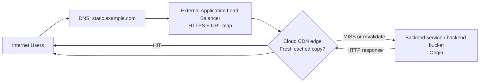
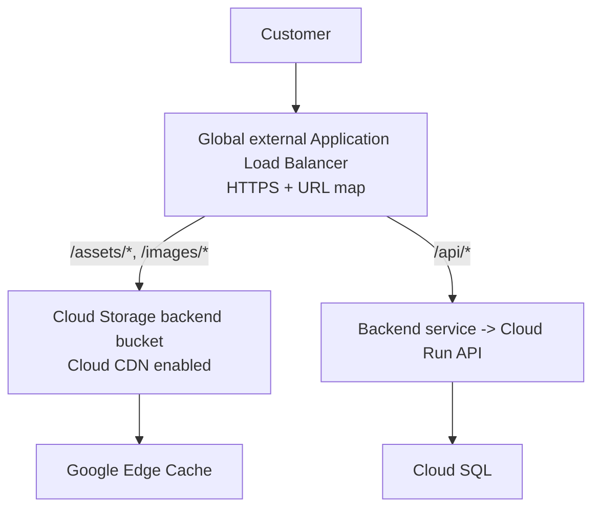

# Cloud CDN, Cache Keys, and Cache Invalidation

A retail application serves millions of requests for product images, CSS, JavaScript, and landing pages every day. If every request hits Cloud Storage or instances running on Compute Engine, GKE, or Cloud Run, the system has to process the exact same content repeatedly. Latency increases when users are far from the deployment region, while bandwidth costs and origin load rise alongside it. **Google Cloud CDN** helps serve eligible content from **edge caches** close to users, reducing repeated requests back to the origin.

Caching must be designed carefully: two different URLs can accidentally share the same **cache key**, a modified object can continue being served from cache, and an overly broad **invalidation** can hit the origin with a sudden traffic spike. Within the **Load Balancing and Content Delivery** chapter of the **CLOUD_PROVIDERS_GCP** module, this lesson connects Cloud CDN with external Application Load Balancers, backend buckets/services, IAM, content protection, release automation, reliability observability, and cost.

> Domain names, URL maps, backends, projects, and all traffic numbers in this lesson are illustrative examples only. Commands that modify configuration or purge caches must be reviewed and executed in the exact authorized environment project.

## Learning Objectives

After this lesson, you will be able to:

1. Describe the request path through **external Application Load Balancer → Cloud CDN edge cache → origin** and distinguish cache hit, miss, fill, and revalidation.
2. Choose **cache modes** and HTTP response headers for static assets, updatable public content, and personalized endpoints.
3. Design a **cache key policy** using protocol, hostname, path, and query strings, and understand the differences between a **backend service** and a **backend bucket**.
4. Choose TTLs, versioned URLs, negative caching, and stale-serving strategies without compromising security.
5. Execute targeted **cache invalidation** via Console or `gcloud`: single files, prefixes, hostnames, cache tags, and supported advanced matchers.
6. Monitor cache hit ratio, cache fill, egress, errors, and latency, and correlate them with Google Cloud Billing.
7. Write release, rollback, and cache-incident investigation runbooks backed by telemetry evidence.

## 1. Where Does Cloud CDN Sit in the Architecture?

Cloud CDN integrates with supported **external Application Load Balancers**; you enable caching on the corresponding **backend service** or **backend bucket**. Backends can serve content from application services—such as instance groups, GKE via appropriate backends, serverless NEGs/Cloud Run when supported—or a **Cloud Storage backend bucket** for static objects.



This diagram simplifies the HTTP flow. A cache does not behave like a standalone VM you SSH into; it runs distributed across Google's edge locations. At a given edge location, an object can be **evicted** before its TTL expires, or never cached if the request was ineligible.

### Concepts to Distinguish

| Concept | Meaning | Impact |
| --- | --- | --- |
| **Origin** | Source backend holding data/logic that returns HTTP responses | Called on cache misses or when revalidation is needed |
| **Cache lookup** | Searching for an object matching the cache key | May incur charges per Cloud CDN pricing policy |
| **Cache hit** | Edge holds a valid copy and serves the request | Usually reduces origin calls |
| **Cache miss** | No suitable cached object exists or can be used | Can hit the origin and trigger a cache fill |
| **Cache fill** | Reading content from origin into the edge cache | Can incur cache fill data charges |
| **Revalidation** | Checking a stale object with origin via metadata like ETag | Saves re-downloading the full body when origin returns 304 |
| **TTL** | Duration an object is considered fresh per cache policy | TTL does not guarantee the object stays in edge memory |
| **Invalidation** | Marks cached content as no longer usable | Subsequent requests re-fetch content where applicable |
| **Eviction** | Cache proactively drops an object due to storage policy | Distinct from expiration and invalidation operations |

### How Cloud CDN Differs from Cloud Storage and Cloud Run

**Cloud Storage** holds source objects and metadata; **Cloud Run** or app backends generate HTTP responses; **Cloud CDN** caches eligible responses before users need to reach the origin. Cloud CDN is **not a database**, does not replace application authorization, and does not guarantee every request will be served from cache.

For example, an image `/products/123.webp` can be cached effectively, whereas `/api/me/orders` contains the signed-in user's orders and must avoid shared caching. The same load balancer can still route both groups to different backends and cache policies.

## 2. How Does a Request Flow Through the Cache?

Suppose a client requests:

```text
GET https://static.example.com/images/shoe.webp?v=4
```

1. The External Application Load Balancer receives the HTTPS request and the URL map identifies the appropriate backend.
2. The edge computes the **cache key** according to the active backend/cache key policy.
3. If a **fresh** copy exists for that key, Cloud CDN returns the response from cache; the origin does not serve the body for this request.
4. If no suitable copy exists, Cloud CDN forwards the request to the backend and evaluates whether the response is **cacheable** based on mode, headers, method, status, and other rules.
5. Once cached, subsequent requests with the matching cache key can reuse that object.
6. When the object becomes stale, Cloud CDN can **revalidate** (e.g., via `If-None-Match`/`ETag`) or fetch fresh content according to rules and stale-serving capabilities.

Do not rely solely on a **`.webp` file extension** to conclude a response will definitely be cached. Cloud CDN inspects content type (`Content-Type`), headers, status codes, and policies; the origin might return `private`, `no-store`, or `Set-Cookie`, preventing caching under standard modes.

### Cache Hit Ratio Example

Given **1,000,000 requests with cache lookups**, if 800,000 are served from the edge per the metric definition:

```text
Cache hit ratio = 800,000 / 1,000,000 × 100 = 80%
Cache misses or non-hit lookups = 200,000
```

This is a mathematical example, **not a benchmark or SLA guarantee**. A high hit ratio does not automatically prove optimal speed or cost: personalized content must remain protected even if excluding it from cache lowers the overall hit ratio.

## 3. Cache Modes: How Cloud CDN Decides What to Cache

Cloud CDN supports three major **cache modes**:

| Mode | Core Behavior | Reference Use Case |
| --- | --- | --- |
| `CACHE_ALL_STATIC` | Automatically caches successful responses with eligible static content types unless prevented by directives; honors cache headers and uses default TTL where eligible | Common images, CSS, JS, and static files |
| `USE_ORIGIN_HEADERS` | Relies on freshness metadata supplied by the origin (e.g., `Cache-Control`/`Expires`) to decide caching | Systems managing TTLs per URL/content type at the origin |
| `FORCE_CACHE_ALL` | Applies configured TTLs overriding certain origin cache directives and can cache successful responses marked `private`/`no-store` | **Strictly controlled public content only**, with evaluated risk |

**`FORCE_CACHE_ALL` is especially risky** for APIs using cookies, tokens, or per-user responses. This mode can ignore origin `Cache-Control: private`/`no-store` directives; therefore, **never use it** for account info, shopping carts, orders, invoices, or private content.

### Cache Mode and Response Content Type

In `CACHE_ALL_STATIC`, Cloud CDN automatically recognizes standard static MIME types. **HTML** and **JSON** are not cached automatically like static images; caching public HTML/JSON requires explicit response headers, the right mode, and verification that nothing personalized is included.

Example HTTP response suited for a static image with a versioned path:

```http
HTTP/1.1 200 OK
Content-Type: image/webp
Cache-Control: public, max-age=86400, s-maxage=86400
ETag: "shoe-v4"
```

Example response that must not enter shared caches:

```http
HTTP/1.1 200 OK
Content-Type: application/json
Cache-Control: private, no-store
Vary: Authorization
```

**`Cache-Control: private` does not replace authorization.** An endpoint containing sensitive data must still enforce authentication and authorization on the backend. Also, never enable `FORCE_CACHE_ALL` on a backend serving that endpoint.

### Headers Controlling Freshness

| Header / Directive | Purpose | Notes |
| --- | --- | --- |
| `Cache-Control: max-age=N` | Freshness for caches per HTTP semantics | Browsers may cache separately |
| `Cache-Control: s-maxage=N` | Freshness for shared caches; usually overrides `max-age` | Used when CDN needs a different TTL than browsers |
| `CDN-Cache-Control` | Standardized header targeting CDN behavior | Evaluated by Cloud CDN ahead of generic `Cache-Control` |
| `Cache-Control: public` | Indicates response is eligible for shared caching if other rules allow | Not a mechanism to "grant access" to private data |
| `Cache-Control: private` | Prevents shared caching in normal modes | `FORCE_CACHE_ALL` can override this |
| `Cache-Control: no-store` | Instructs caches not to store the response per HTTP | Do not rely solely on this header if `FORCE_CACHE_ALL` is set |
| `ETag`, `Last-Modified` | Metadata enabling conditional revalidation | Revalidation must still be supported by the origin |
| `Set-Cookie` | Response sets a cookie | Usually makes responses uncacheable; other rules still apply |
| `Vary` | Varies cached responses by request headers | Unsupported values or missing key differentiation can prevent caching |

Cloud CDN provides **client TTL** to influence browser-side caching age and **default/max TTL** governed by the cache mode. Check current parameter tables in documentation since defaults and limits can evolve; never assume increasing the CDN TTL clears already-stored browser caches.

### TTL, Stale Content, and Origin Outages

An object with a 1-hour TTL can be evicted before 1 hour. After the TTL expires, Cloud CDN may contact the origin to refresh it. When **serve-while-stale** is enabled and the origin becomes temporarily unavailable, the edge can serve the stale copy for the configured window under supported conditions. Serving stale content works well for product images, but **must not be applied casually** to inventory counts, checkout prices, or strongly consistent data.

## 4. Cache Key: Which Identifier Decides Hit vs. Miss?

A cache key is the logical identifier used to look up cached objects. A URL can include:

```text
https://static.example.com/images/shoe.webp?width=640&utm_source=email
│       │                  │                └ query string
│       │                  └ path
│       └ hostname
└ protocol
```

For a **backend service**, the default cache key uses the **full request URI**: protocol, host, path, and query string. For a **backend bucket (Cloud Storage)**, the default **omits protocol and host** from the key and includes only Cloud Storage–recognized query parameters (such as `generation`); you can append additional query parameters as supported by backend buckets.

Therefore, **do not apply a backend service cache key rule verbatim to a backend bucket**.

### Key Comparison Table

| Two Requests | Backend Service (Default Key) | Backend Bucket (Default Key) |
| --- | --- | --- |
| `http://a.example.com/p.png` and `https://a.example.com/p.png` | Different due to protocol | Usually same key if pointing to same bucket/object |
| `https://a.example.com/p.png` and `https://b.example.com/p.png` | Different due to host | Usually same key if pointing to same bucket/object |
| `/p.png?v=1` and `/p.png?v=2` | Different due to query | On backend buckets, query `v` is not part of the default key |
| `/p.png?generation=1` and `/p.png?generation=2` | Different due to query | `generation` is recognized by Cloud Storage and can distinguish keys |

With URL rewriting, multiple hostnames, multiple backends, and complex routes, always test live behavior. The table describes **default rules** before applying custom policies.

### 4.1 Include/Exclude Protocol and Host

Only omit **protocol** from the key when HTTP and HTTPS genuinely return the **exact same content** and security policy does not require separating them. Only omit **host** when multiple hostnames are guaranteed to serve identical responses; two tenants can share the path `/logo.png` while serving **different logos**.

Dangerous mistake:

```text
tenant-a.example.com/logo.png -> Logo A
tenant-b.example.com/logo.png -> Logo B
Cache key omits hostname -> risk of serving Logo A to Tenant B
```

This can cause brand mix-ups or multi-tenant data isolation bugs. For user-specific content, the risk is even more severe.

### 4.2 Query Strings and Cache Fragmentation

Suppose the system uses `?width=640` to serve a resized image, while `?utm_source=email` is solely for campaign analytics. If the default key includes all query params:

```text
/shoe.webp?width=640&utm_source=email
/shoe.webp?width=640&utm_source=social
```

these two requests generate two keys even when the bodies are identical, causing **cache fragmentation**. A sound backend service policy might **include only `width`** (and `format` if used) in the key, ignoring tracking parameters.

Conversely, if the origin generates **different content by `locale` or `variant`**, never strip those parameters from the key:

```text
/product-card?locale=vi -> Vietnamese
/product-card?locale=en -> English
Omitting locale from key -> risk of serving the wrong language
```

### 4.3 Include List and Exclude List

- **Include list**: only listed query parameters become part of the key; useful when you know the exact parameters that alter the response.
- **Exclude list**: most query parameters enter the key, excluding confirmed tracking parameters that do not affect the body.
- Never combine conflicting include/exclude lists on the same configuration in ways unsupported by the API.
- Changing the key policy can temporarily drop hit ratios because new keys differ from old keys. Changing the cache key **does not purge** all previously cached entries.

### 4.4 HTTP Headers and Cookies

Cache key policies and `Vary` rules have specific support for responses varying by request headers. Never assume Cloud CDN automatically segments caches by every cookie or every `Authorization` token. **Never use shared caching for personalized responses** unless explicitly designed per documentation, security-reviewed, and proven that each principal only receives authorized content.

## 5. Configuring Cache Keys via Console and gcloud

In [Cloud CDN in the Google Cloud Console](https://console.cloud.google.com/net-services/cdn), select the backend/origin → **Edit** → **Cache key** configuration. For a backend service, choose default or **Custom**, toggle Protocol/Host/Query string components, and configure query parameter lists.

### Inspect Before Editing

```bash
PROJECT_ID="retail-prod-01"
BACKEND_SERVICE="retail-image-backend"
BACKEND_BUCKET="retail-assets-backend"

# Inspect existing backend service and CDN policy (read-only).
gcloud compute backend-services describe "$BACKEND_SERVICE" \
  --project="$PROJECT_ID" --global \
  --format="yaml(name,enableCDN,cdnPolicy)"

# For a Cloud Storage backend bucket, inspect current config.
gcloud compute backend-buckets describe "$BACKEND_BUCKET" \
  --project="$PROJECT_ID" \
  --format="yaml(name,enableCdn,cdnPolicy)"
```

These names and `--global` apply to a **global backend service**; for backends in other products/regions, use the exact scope and backend type supported by Cloud CDN.

### Example: Configuring a Query Include List for a Backend Service

This command **modifies configuration**; run it only after the team confirms response bodies vary solely by `width`/`format` and **not** by excluded parameters:

```bash
gcloud compute backend-services update retail-image-backend \
  --project=retail-prod-01 --global \
  --cache-key-include-query-string \
  --cache-key-query-string-whitelist="width,format"
```

Before applying to production, check for unexpected URLs containing query parameters that change responses, such as `locale`, `token`, `tenant`, `generation`, `range`, or app-specific params. If the origin varies by an excluded parameter, this config causes **different responses to collapse into one key**, potentially producing wrong results or data leaks.

For backend buckets, because default keys differ from backend services, consult `gcloud compute backend-buckets update` docs and configure a dedicated **query string include list** if you want cache-busting via `?v=123`. To reduce risk, prefer **versioned filenames/paths** instead of query parameters when serving objects from Cloud Storage.

## 6. What Is Cache Invalidation and When Should You Use It?

**Invalidation** instructs Cloud CDN to mark matching cached responses **unusable** before their normal expiration. On the next request, Cloud CDN must fetch fresh data from the origin/refresh path. Invalidation **does not**:

- edit or delete files in Cloud Storage;
- alter responses generated by Cloud Run/VM/GKE;
- guarantee clearing previously stored browser caches;
- replace access-control management, credential revocation, or database rollbacks;
- protect the origin from overload right after a broad cache purge.

### Three Content Update Strategies

| Strategy | How It Works | When to Use |
| --- | --- | --- |
| **TTL / HTTP revalidation** | Wait for freshness expiry or revalidate with origin | Content changes on an acceptable schedule |
| **URL versioning** | Publish a new URL: `/assets/app.v42.js`, `/images/v5/shoe.webp` | **Preferred** for static assets with versioned builds/deploys |
| **Invalidation** | Purge matching keys/paths/tags prior to TTL | Urgent logo/banner swaps, fixing broken content, rollbacks, or retracting public content |

Google Cloud documentation recommends **versioning** as the default strategy for cacheable content because it avoids wide invalidations. Changing the filename or path is usually more reliable than `?v=...` when backend buckets do not include query strings in their cache key.

### Invalidation Differs from Changing the Cache Key

Changing `cacheKeyPolicy` only alters **how keys are computed for new requests**. Some old entries may stop matching, yet new keys can still collide with old ones; key changes cannot be treated as a **full purge**. When old cached content must be removed due to a security incident or wrong data, run proper invalidation and verify it.

## 7. Cache Invalidation by Path and Hostname

Cloud CDN supports invalidation via the **Cloud CDN console** or **URL maps**. First identify the real URL map, project, and hostname:

```bash
# Read-only: list URL maps in the project.
gcloud compute url-maps list --project=retail-prod-01

# Read-only: inspect path matchers/host rules/backends.
gcloud compute url-maps describe retail-external-web-map \
  --project=retail-prod-01
```

### 7.1 Purge a Specific File

The following command modifies cache state:

```bash
gcloud compute url-maps invalidate-cdn-cache retail-external-web-map \
  --project=retail-prod-01 \
  --host="static.example.com" \
  --path="/images/shoe.webp"
```

If `--host` is omitted, path invalidation defaults to **all hostnames on the URL map**. When multiple websites/tenants share one load balancer, specify the hostname to limit blast radius.

### 7.2 Purge a Directory / Prefix

```bash
# Purge content under /images/ on the specified hostname.
gcloud compute url-maps invalidate-cdn-cache retail-external-web-map \
  --project=retail-prod-01 \
  --host="static.example.com" \
  --path="/images/*"
```

The `*` wildcard is supported only at the **end of a path pattern**. `/images/*` matches paths starting with `/images/`. Be careful with `/image*` because it can match `/images/...`, `/image-old...`, and any other path starting with `/image`.

### 7.3 Purge All Paths

```bash
# WARNING: broad purge; can hit the origin with heavy traffic.
gcloud compute url-maps invalidate-cdn-cache retail-external-web-map \
  --project=retail-prod-01 \
  --path="/*"
```

Reserve this for emergencies or approved major architectural cutovers. Prefer **specific host + path** to avoid origin thundering herds and long cache warm-up periods.

### Easily Confused Path Rules

- Paths must start with `/`; do not include `?` or `#` in an invalidation path.
- For `/images.php?item=123` and `/images.php?item=456`, invalidating by **path** `/images.php` affects all query variants of that path; you cannot target only `item=123` by path alone.
- With URL rewrites on the load balancer, the invalidation path must match the **pre-rewrite path sent by the client**.
- `--async` can submit the request without waiting for CLI completion; monitor operation status/logs before claiming the purge has propagated.

## 8. Advanced Matchers: Wildcard Host, Cache Tags, Status, Content Type, and Backend

Current Cloud CDN documentation describes invalidation filters beyond `host + path`. These options are especially handy when multiple URLs share a release label or when only one subset of responses must be evicted. Check **supported `gcloud` and API versions**, as advanced matchers may require updated API versions.

| Matcher | Usage | Example |
| --- | --- | --- |
| **Host** | Single exact hostname | `static.example.com` |
| **Wildcard host** | Single subdomain level | `*.example.com` matches `a.example.com`, not `example.com` or `x.a.example.com` |
| **Path / prefix** | Single file or paths sharing a prefix | `/assets/app.js`, `/assets/*` |
| **Cache tag** | Matches `Cache-Tag` of cached responses | `release-2026-11` |
| **HTTP status** | Matches HTTP status of cached responses | `404` for negative caching |
| **Content type** | Matches MIME type | `text/css`, `image/webp` |
| **Backend service / bucket** | Limits purge to one origin in the URL map | `retail-image-backend` |

Combining different matcher types **narrows** targets via simultaneous conditions (AND); specifying multiple cache tags in one request evaluates tags with **OR** logic. The current limit for a single tag-based invalidation request is **up to 10 tags**.

### 8.1 Cache Tags

The origin can attach tags to responses before caching:

```http
HTTP/1.1 200 OK
Content-Type: text/css
Cache-Control: public, max-age=86400
Cache-Tag: release-v42, frontend
```

You can then invalidate by tag:

```bash
# Modifies cache: purges responses tagged release-v42.
gcloud compute url-maps invalidate-cdn-cache retail-external-web-map \
  --project=retail-prod-01 \
  --host="static.example.com" \
  --tags="release-v42"
```

Tags only help when the **origin actually includes `Cache-Tag` on cached responses**. They are not inferred automatically from filenames or Git commits. Use clearly scoped tags such as release IDs or object groups; never put PII or tokens into tags.

### 8.2 Purge Only Negative-Cached 404s

When an object is temporarily missing at the origin and **negative-cached as 404**, after uploading the file the edge may keep serving 404 briefly. Instead of purging all images:

```bash
gcloud compute url-maps invalidate-cdn-cache retail-external-web-map \
  --project=retail-prod-01 \
  --host="static.example.com" \
  --path="/images/*" \
  --http-status=404
```

Note that `negativeCaching` is **not enabled by default** in standard cache policies; investigate cached 404 issues only after confirming negative caching or matching headers/policies are active.

### 8.3 Purge by Content Type or Backend

```bash
# Purge only CSS under a prefix instead of all file types.
gcloud compute url-maps invalidate-cdn-cache retail-external-web-map \
  --project=retail-prod-01 \
  --host="static.example.com" \
  --path="/assets/*" \
  --content-type="text/css"

# Purge cache only for one backend bucket on the URL map.
gcloud compute url-maps invalidate-cdn-cache retail-external-web-map \
  --project=retail-prod-01 \
  --backend-bucket="retail-assets-backend" \
  --path="/images/*"
```

If the backend resides **in another project** via cross-project service referencing, the backend matcher may require the **full resource path** with project number per documentation. Do not pass a bare backend name if the backend is outside the URL map's project.

### 8.4 REST API and Matcher API Version

For basic invalidation, the API endpoint is:

```http
POST https://compute.googleapis.com/compute/v1/projects/PROJECT_ID/global/urlMaps/URL_MAP_NAME/invalidateCache
Content-Type: application/json

{"host":"static.example.com","path":"/images/*"}
```

Recent documentation for advanced matchers uses **API version 2026-11-01** via query parameter `$apiVersion=2026-11-01` (URL-encode `$` as `%24` in REST calls). Always rely on that API version's schema/matchers when integrating, and test in staging before applying to production.

## 9. Negative Caching, TTL, and Error Responses

**Negative caching** allows bounded caching of supported error or redirect responses, instead of forwarding every request for a missing URL to the origin.

For example, when negative caching is enabled, default policies may cache:

| HTTP Status | Meaning | Reference Default Negative TTL |
| --- | --- | --- |
| `301`/`308` | Permanent redirect | 10 minutes |
| `404` | Not found | 120 seconds |
| `410` | Gone | 120 seconds |
| `405` | Method not allowed | 60 seconds |
| `501` | Not implemented | 60 seconds |

These durations are **reference policy values**, active only when negative caching is enabled. Override settings and status support vary by mode/status; never casually cache 5xx responses if doing so keeps serving errors from the edge after the origin recovers.

### Scenario: New Image Returns 404, Then Gets Uploaded

1. A user requests `/images/new-product.webp` before the file exists on the origin; if 404 is negative-cached, the edge can hold that 404.
2. The pipeline uploads the file to Cloud Storage.
3. Verify the object exists with the right metadata/ACLs.
4. If immediate availability is required, invalidate by **path and HTTP status 404**.
5. Re-request the URL from a test client, inspect logs/cache lookups, and confirm HTTP 200.

Fixing the file at the origin **does not automatically evict** negative-cached responses already stored at the edge.

## 10. Signed URLs, Authenticated Content, and Data Safety

Cloud CDN supports mechanisms such as **signed URLs** and **signed cookies** for controlling content access via signed URLs/cookies. However, **signing a URL does not mean responses aren't cached**: content served via signed URLs can still be eligible for caching even when the origin sets restrictive cache directives under supported policies.

### Data Protection Rules

1. Separate **public cacheable content** from **private data**: carts, accounts, orders, invoices, tokens, profiles, and user/tenant-scoped data.
2. Separate backend/path policies whenever possible: public `/assets/*` and uncached `/api/private/*`.
3. Return `Cache-Control: private, no-store` on personal responses and never use `FORCE_CACHE_ALL` on that backend.
4. Never strip `tenant`, `user`, or content-determining parameters from the cache key hoping client-side authorization will protect the data.
5. Inspect `Authorization`, `Set-Cookie`, and `Vary` in requests/responses, and verify actual behavior for your cache mode.
6. When using signed URLs/cookies, review **access scope, key rotation, signature expiration, and caching behavior**; never sign URLs for strictly private documents if policy forbids shared caching.
7. Run cross-account/cross-tenant tests in staging to catch response leaks.

Dangerous example:

```text
GET /api/orders?user=alice -> Alice's data
GET /api/orders?user=bob   -> Bob's data

If the origin is cacheable and the cache key drops "user",
both requests share a key -> data leak.
```

In production, the **right solution** is typically not shared-caching personalized endpoints and enforcing authorization at the backend. If a leak occurs, simultaneously **stop new caching**, invalidate stored objects, audit logs, and execute your security incident playbook; invalidation alone does not fix the root cause.

## 11. Observing Cache Behavior with Logging and Monitoring

Cloud CDN exposes Console metrics such as **total requests**, **cache hit ratio**, **cache egress**, **cache fill**, and **4xx/5xx error ratio**. When logging is enabled on supported load balancers/backends, logs can show:

| Log Field | Meaning |
| --- | --- |
| `httpRequest.cacheHit` | Whether served from cache when field is present |
| `httpRequest.cacheLookup` | Whether a cache lookup occurred |
| `httpRequest.cacheFillBytes` | Bytes fetched from origin to fill cache when applicable |
| `httpRequest.cacheValidatedWithOriginServer` | Whether the cache hit went through origin revalidation |
| `jsonPayload.statusDetails` | `response_from_cache`, `response_from_cache_validated`, or `response_sent_by_backend`, etc. |
| `jsonPayload.cacheId` | Edge cache instance/location serving the response |
| `httpRequest.requestUrl` | Request URL to cross-check path, host, and query |

Logs can use **sampling** or omit certain requests depending on configuration. Boolean fields set to `false` may be **omitted** from log entries, so do not infer "no `cacheHit` field means no lookup occurred".

### Logs Explorer Queries

Example finding cache hits from the load balancer (adjust project, scope, and actual resource type):

```text
resource.type="http_load_balancer"
httpRequest.cacheHit=true
httpRequest.cacheValidatedWithOriginServer!=true
```

Find cache-miss requests forwarded to the backend:

```text
resource.type="http_load_balancer"
httpRequest.cacheLookup=true
jsonPayload.statusDetails="response_sent_by_backend"
```

Find submitted invalidations:

```text
protoPayload.serviceName="compute.googleapis.com"
protoPayload.methodName="v1.compute.urlMaps.invalidateCache"
```

An invalidation request typically logs both initiation and completion. If using `--async`, verify the **final outcome** rather than assuming CLI acceptance meant completion.

### Recommended Dashboards / SLOs

Monitor broken down by **hostname, URL prefix, response status, and origin/backend** to pinpoint causes:

- **Cache hit ratio** for static assets; compare pre/post-deploy windows and geography.
- **Origin request rate/CPU/latency** after invalidations or when key fragmentation increases.
- **Cache fill bytes** and **cache egress bytes** to track load and cost.
- **p95/p99 latency** and 4xx/5xx, separating edge errors, backend errors, and origin timeouts.
- **Invalidation events** and executing principals via IAM/audit logs.
- **Security checks**: requests carrying `Authorization`, cookies, personalized responses, and `no-store` policies.

**Do not optimize at all costs for a 100% hit ratio.** A healthy system intentionally sends critical requests to the backend to guarantee fresh data and proper authorization.

## 12. Cloud CDN Cost and Cache Efficiency

Cloud CDN billing distinguishes **cache lookup requests**, **cache data transfer out (egress)**, and **cache fill**. Cache misses can also incur load balancing processing fees, Cloud Storage operations, or other origin costs. Pricing varies by network region, volume tier, and actual SKUs; never apply one flat unit price globally.

Hypothetical demand example:

| Metric | Reference Value |
| --- | ---: |
| Static asset requests | 12,000,000/month |
| Average body size | 100 KiB/request |
| Cache hit ratio | 80% |
| Assumed hits | 9,600,000 |
| Assumed misses | 2,400,000 |

Simplifying to 100 KiB body per request and ignoring headers/compression:

```text
Total body served      = 12,000,000 × 100 KiB
                       ≈ 1,144.41 GiB
Body from hits         = 9,600,000 × 100 KiB
                       ≈ 915.53 GiB
Body from misses       = 2,400,000 × 100 KiB
                       ≈ 228.88 GiB
```

This calculation only models payload volume. **Actual cache fill does not automatically equal "body from misses"** due to partial/range responses, revalidation, request coalescing, compression, eviction, and other factors. Network billing can also count response headers/trailers and separate SKU units. To estimate accurately:

1. Gather request counts, geography, response sizes, cache hit ratio, origin location, fill, and origin operations from real telemetry.
2. Use [Cloud CDN pricing](https://cloud.google.com/cdn/pricing) and the [Google Cloud Pricing Calculator](https://cloud.google.com/products/calculator), keeping time window and currency consistent.
3. Compare total **CDN + load balancer + origin + network egress + Cloud Storage operations** without double-counting traffic.
4. Model 60%/80%/95% hit ratio scenarios to see sensitivity in origin load, fill, and cost, without assuming all requests are byte-identical.
5. Track actual spend in Cloud Billing, checking SKUs and variance against assumptions.

Optimizing cache keys to raise hit ratios can cut origin costs while still preserving **content accuracy and security**.

## 13. Case Study: Releasing an E-Commerce Site with Images, JS, and APIs

A team releases an e-commerce platform on Google Cloud:



The diagram shows **logical routing**; at runtime, requests hit the edge/CDN before the origin. `/api/*` in this design **does not enable Cloud CDN** because most responses carry personalized content. If a public API endpoint is proven cacheable, create a dedicated policy/backend with security testing.

### Cache Policy by URL Group

| URL Group | Content | Strategy |
| --- | --- | --- |
| `/assets/app.v42.js` | Hashed/versioned JS build | Long cache, versioned filename |
| `/assets/styles.v42.css` | Versioned CSS | Long cache, new URL per release |
| `/images/products/123-v5.webp` | Public product image | Cache by metadata and versioned path |
| `/campaign/banner.webp` | Daily-changing banner | Shorter TTL or targeted invalidation on update |
| `/api/catalog/public` | Public catalog if user-independent | Cacheable via tested headers/keys |
| `/api/me/orders` | Authenticated orders | `private, no-store` and **no shared caching** |

### Scenario A — Safe Release

1. Build produces `app.v42.js` and `styles.v42.css`; upload to Cloud Storage with proper content types and cache metadata.
2. Verify the new files exist via the origin and new HTTPS URLs.
3. Update public HTML or the entrypoint to reference version 42 assets.
4. If old HTML is cached, let a short TTL expire or invalidate **only the HTML path**; do not purge all of `/assets/*`.
5. Monitor cache fill/hit ratio. Keep version 41 assets temporarily to support browsers/clients holding old HTML.
6. To roll back, point HTML back to version 41 assets still stored at the origin; verify asset download paths before shifting traffic.

### Scenario B — Broken Banner Needing Immediate Replacement

Banner `/campaign/banner.webp` is cached with a long TTL yet shows the wrong content:

1. Upload the corrected image to the origin, verifying object generation, content type, and `Cache-Control`.
2. Verify the URL map, backend bucket, and hostname.
3. Invalidate `--host=static.example.com --path=/campaign/banner.webp`.
4. Wait for invalidation completion, re-request from test locations, and observe `response_from_cache`/`response_sent_by_backend`.
5. If users still see the old image, check **browser cache/client TTL**, URL rewriting, and target objects; consider switching to a new versioned URL.

### Scenario C — Tenant-Mixing Cache Key Risk

A new feature customizes images via `?tenant=...`, while the backend service uses an include list containing only `width`:

1. **Halt deployment** or separate the API path from caching before release.
2. Verify whether responses vary by tenant and contain private data.
3. If private: disable shared caching; if public yet distinct per tenant, the cache key must distinguish `tenant` alongside independent security controls.
4. If old keys could hold wrong data, invalidate the assessed scope and log a security incident per policy.
5. Add tests for 2–3 tenants sharing the same path with different bodies to verify zero cross-serving.

## 14. Diagnostic Runbook When Caching Misbehaves

Follow the order **path → cacheability → key → freshness → invalidation → origin**:

| Symptom | Hypothesis to Check | Verification Steps |
| --- | --- | --- |
| Cache hit ratio near 0% | CDN not enabled, traffic hitting wrong backend | Check URL map/backend, `enableCDN`, and logs |
| Images cache, HTML/JSON don't | Mode/MIME/headers disallow caching | Inspect `Content-Type`, `Cache-Control`, and mode |
| Many URLs with identical bodies have low hits | Tracking query params fragmenting keys | Inspect `utm_*`, include/exclude lists, and origin behavior |
| Another tenant's content appears | Key omitted response-varying param, or private data cached | Stop traffic/leak, disable shared cache, purge, investigate security |
| Newly uploaded object still returns 404 | Negative-cached 404 or wrong object path | Check origin, negative caching, invalidate path + status |
| Old image still served after update | Edge TTL, browser cache, or URL rewrite | Inspect logs, headers, invalidation scope, and version URLs |
| Origin CPU spikes after purge | Overly broad invalidation caused cold cache | Check request rate, rate limits, coalescing; narrow scope next time |
| Purge reports success yet content unchanged | Origin still returning old content, wrong project/host/path | Query origin directly; verify URL map and pre-rewrite path |
| CDN bill increases | Higher egress, request volume, fill, or region mix | Check Cloud Billing SKUs, metrics, and updated estimates |
| CDN keeps serving stale data | Serve-while-stale, origin unreachable, TTL/headers | Inspect stale policy, origin health, and revalidation logs |

### Read-Only Diagnostic Commands

```bash
PROJECT_ID="retail-prod-01"
URL_MAP="retail-external-web-map"
BACKEND_BUCKET="retail-assets-backend"

gcloud compute url-maps describe "$URL_MAP" \
  --project="$PROJECT_ID"

gcloud compute backend-buckets describe "$BACKEND_BUCKET" \
  --project="$PROJECT_ID" \
  --format="yaml(name,enableCdn,cdnPolicy)"

# Read-only check of live response headers from test hostname.
curl -I "https://static.example.com/images/shoe.webp?v=4"

# Read-only check of recent invalidation logs; requires Cloud Logging view perms.
gcloud logging read \
  'protoPayload.methodName="v1.compute.urlMaps.invalidateCache"' \
  --project="$PROJECT_ID" --limit=10
```

`curl -I` sends a **HEAD** request, which may not fully represent GET behavior or response bodies; test with `GET` when needed and compare `Cache-Control`, `Age`, `ETag`, and `Content-Type`. Never treat the absence of an `Age` header as sole proof of no caching. Logs/metrics may also be sampled.

## 15. IAM Permissions and Change Control

Not every developer needs permission to purge caches across an entire project. Invalidation can affect performance, cost, and end users.

| Task | Permissions / Roles to Consider | Recommendation |
| --- | --- | --- |
| View URL maps | `compute.urlMaps.get`, `compute.urlMaps.list` | Grant appropriate read-only roles |
| Perform cache invalidation | `compute.urlMaps.invalidateCache` (plus URL map read perms) | Least-privilege custom role when used by pipelines |
| Edit backend service / CDN policy | Corresponding backend service update permissions | Require IaC/review, separated from app deploy permissions |
| Edit backend bucket / cache policy | Corresponding backend bucket update permissions | Require review since it impacts caching for the entire origin |
| Write files to Cloud Storage origin | Appropriate object storage permissions | Separate origin writes from CDN purges where possible |
| View logs/metrics | Cloud Logging/Monitoring permissions | Restrict to ops and authorized investigators |

Predefined roles like `roles/compute.networkAdmin` or `roles/compute.loadBalancerAdmin` include invalidation permissions, yet are usually **far broader** than needed to purge a single path. In CI/CD, scope roles tightly and constrain which project, URL map, and host/path the pipeline can target.

A release pipeline should include **input validation** to prevent a small static asset release from turning into `--path="/*"` in production. Log the command, approver, reason, target, timestamp, and completion status in your ticket/release record.

## 16. Pitfalls to Avoid

| Misconception | Correction |
| --- | --- |
| "Enabling Cloud CDN automatically caches every response" | Only responses meeting mode, header, content type, method, and other rules are cached |
| "Backend bucket cache keys work just like backend services" | Buckets omit host/protocol by default and handle query parameters differently |
| "Removing query params from keys only boosts hit ratio" | Can cause wrong content delivery or data leaks |
| "`private, no-store` is always safe even with `FORCE_CACHE_ALL`" | `FORCE_CACHE_ALL` can ignore those directives |
| "Adding `?v=5` always creates a new cache key" | Backend buckets ignore query `v` in keys unless configured |
| "Purging `/images/*` deletes files in the bucket" | Invalidation only affects cached responses, never origin objects |
| "Purging a path with a query string targets just one query value" | Path invalidation does not differentiate individual query variants |
| "Completed purge means browsers see the new version instantly" | Browser caches persist until client TTL; origin must also hold the new version |
| "All cache hits are free" | Cloud CDN still charges for cache lookups and egress per pricing structure |
| "A high hit ratio proves the app is working properly" | You must still verify security, freshness, latency, and availability |
| "Signed URLs always prevent caching" | Signed content can still be cached per supported mechanisms |
| "Broad invalidation is the best deploy workflow" | Prefer versioned assets and narrowly targeted purges |

## 17. Hands-On Exercises

### Exercise 1 — Analyze Default Cache Keys

Two URLs hit the same backend service: `https://static.example.com/p.png?v=1` and `https://static.example.com/p.png?v=2`. Do they share the same cache key? What if you switch to a default Cloud Storage backend bucket?

<details>
<summary>Answer Hint</summary>

With a default backend service: **different keys** because query strings are included. With a default backend bucket: parameter `v` is not among Cloud Storage's recognized query parameters, so they **can share the same key** if path and bucket match. For reliable versioning, use `p.v1.png`/`p.v2.png` or configure a supported query key include list.
</details>

### Exercise 2 — Design an Include List

An image API resizes by `width` and `format`, while `utm_campaign` does not change the body. Propose a query include list and one mandatory check before applying.

<details>
<summary>Answer Hint</summary>

The include list can be `width,format`. Before editing, verify **every query parameter that changes responses** (such as `tenant`, `locale`, `quality`), authorization, and personal data; run comparison tests across variants to ensure keys never collapse unintentionally.
</details>

### Exercise 3 — Choose a Cache Mode

One backend serves both public `/assets/*` and personalized `/api/me/*`. Why is enabling `FORCE_CACHE_ALL` on the entire backend dangerous?

<details>
<summary>Answer Hint</summary>

Because this mode can ignore `private`/`no-store` sent by the origin, causing per-user responses to enter shared caches. Split backends/cache policies and never cache personal endpoints; cache only verified public content.
</details>

### Exercise 4 — Path-Based Invalidation

You have `/image.php?id=1` and `/image.php?id=2`. Is running `--path="/image.php?id=1"` valid to purge only `id=1`?

<details>
<summary>Answer</summary>

No. Path patterns cannot contain `?` and do not filter by query string. Purging `/image.php` invalidates all query variants of that path; if per-variant precision is required, use distinct cache tags per response or versioned paths.
</details>

### Exercise 5 — 404 After Upload

An image not yet on the origin gets negative-cached as 404. After uploading the right file, users still see 404. What do you do?

<details>
<summary>Answer Hint</summary>

Verify the object is at the right path and backend and is fetchable from the origin. Check negative caching; run targeted invalidation by host/path and `--http-status=404` if supported; wait for completion, re-test from a client, and inspect logs/cache behavior.
</details>

### Exercise 6 — Higher Bill Despite Higher Hit Ratio

Cache hit ratio rises from 60% to 90%, yet the total Cloud CDN bill increases. Is this a contradiction?

<details>
<summary>Answer</summary>

No. Total requests and egress to users may have grown, or geography/traffic mix may have shifted, driving higher lookup/egress fees even as origin load dropped. Compare requests, cache egress, fill, origin costs, and Billing SKUs over the same period.
</details>

### Exercise 7 — Releasing a New Frontend Version

A frontend serves `app.js` and `styles.css` with long TTLs. Propose a release strategy that avoids purging the entire CDN.

<details>
<summary>Answer Hint</summary>

Publish `app.v42.js` and `styles.v42.css` (or content hashes), update HTML to reference the new URLs, and leave old assets temporarily for older clients. Set an appropriate TTL on HTML, invalidating only HTML or a narrow prefix if needed; test rollback and origin availability.
</details>

### Exercise 8 — Distinguish Cache Layers

After a successful invalidation and confirming the origin has the new banner, a group of users still sees the old banner. List at least four causes to check.

<details>
<summary>Answer Hint</summary>

Browser cache/client TTL, service worker cache, wrong URL map/hostname or invalidation path, another origin backend still serving old content, URL rewriting, differing cache keys, or requests hitting a different load balancer. Use logs, headers, and versioned URLs to isolate the cause.
</details>

## 18. Cloud CDN Operations Checklist

- [ ] External Application Load Balancer → URL map → backend service/bucket → origin diagram matches reality.
- [ ] Clear record of which backends have Cloud CDN enabled and which cache mode applies.
- [ ] Public static assets carry proper `Content-Type`, `Cache-Control`, and TTLs.
- [ ] Personalized/authenticated content is excluded from shared caches; verified across multiple accounts/tenants.
- [ ] Cache keys include the right protocol/host/path/query per **backend type**, avoiding fragmentation and data leaks.
- [ ] Versioned URL strategy exists for assets; query-string versioning on backend buckets has been explicitly verified.
- [ ] Default/client/max TTLs, stale serving, negative caching, and browser caching have been evaluated.
- [ ] Invalidation pipelines strictly scope URL map, host, path, status/tag/backend wherever possible.
- [ ] IAM permissions are verified and large-scope purges require review.
- [ ] Dashboards track cache hit ratio, cache fill, egress, origin load, latency, and error rates.
- [ ] Rollback plans, audit logs, incident runbooks, and post-deploy verification are in place.
- [ ] Costs for Cloud CDN, load balancing, origin, and Cloud Storage are estimated and reconciled in Cloud Billing.

## Official References

- [Cloud CDN overview](https://cloud.google.com/cdn/docs/overview): architecture, origins, and cache hit ratio.
- [Caching overview](https://cloud.google.com/cdn/docs/caching): cache modes, HTTP headers, cacheability, TTL, and cache keys.
- [Customize cache keys](https://cloud.google.com/cdn/docs/using-cache-keys): backend services/buckets, host/protocol/query, and include/exclude lists.
- [Cache invalidation overview](https://cloud.google.com/cdn/docs/cache-invalidation-overview): principles, matchers, paths, and versioning.
- [Invalidate cached content](https://cloud.google.com/cdn/docs/invalidating-cached-content): Console/CLI/REST, host/path, tags, status, content type, backend, and verification.
- [Use negative caching](https://cloud.google.com/cdn/docs/using-negative-caching): status codes and TTLs for error/redirect responses.
- [Content delivery best practices](https://cloud.google.com/cdn/docs/best-practices): versioning, caching, and targeted invalidation.
- [Logs and metrics for caching](https://cloud.google.com/cdn/docs/logging): cache hit/miss, validation, `cacheId`, cache fill, and Monitoring.
- [Cloud CDN pricing](https://cloud.google.com/cdn/pricing): cache lookups, cache egress, cache fill, and cost calculation.
- [Cloud CDN signed URLs and signed cookies](https://cloud.google.com/cdn/docs/using-signed-urls): content protection mechanisms and caching limits for signed content.
- [Google Cloud Pricing Calculator](https://cloud.google.com/products/calculator): estimating architecture costs before deployment.
