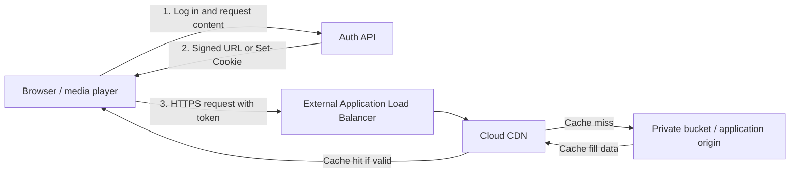
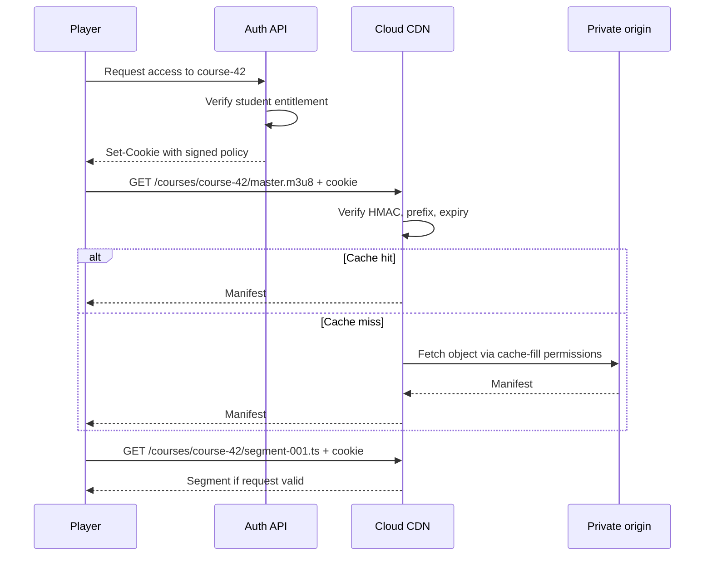

# Signed URLs, Signed Cookies, and Protecting Distributed Content

An online learning platform hosts videos exclusively for students who purchased a course. If you only protect the HTML page behind a login while placing HLS files, PDFs, or original images inside a public Cloud Storage bucket, viewers can copy the URL and share the content. If you only enable Cloud CDN without protecting the origin, requests bypassing the authorization mechanism can still fetch the files. The system needs **application-level content authorization, time-bounded access grants at the delivery layer, and origin protection**.

In Google Cloud, **Cloud CDN signed URLs** and **signed cookies** allow a backend that has already authenticated a user to issue time-limited access credentials. Cloud CDN verifies the signature before serving requests carrying valid signed tokens. This lesson belongs to the **Load Balancing and Content Delivery** chapter of the `CLOUD_PROVIDERS_GCP` module, connecting Cloud Load Balancing, IAM, VPC, Cloud Storage, Cloud Run, Compute Engine/GKE, release automation, reliability, and cost.

> **Security principle:** Signed URLs and signed cookies are **bearer credentials**: anyone holding them can use them within the granted scope and lifetime. They do not replace login, business authorization, HTTPS, origin protection, or proper revocation mechanisms.

## 1. Learning Outcomes

After this lesson, you will be able to:

1. Explain the path of a request from the browser through the Application Load Balancer and Cloud CDN to the origin.
2. Distinguish **Cloud CDN signed URL**, **Cloud CDN signed cookie**, and **Cloud Storage V4 signed URL**.
3. Choose the right mechanism for a single file, multiple files under a path, HLS/DASH video, and object uploads.
4. Understand the `Expires`, `KeyName`, `Signature`, and `URLPrefix` fields as well as cookie attributes such as `Domain`, `Path`, `Secure`, `HttpOnly`, and `SameSite`.
5. Design a private bucket or authenticated application origin so content cannot leak through bypass paths.
6. Test signed/unsigned requests, cache hits/misses, expired tokens, prefix mismatches, and key rotation workflows.

## 2. Protected Content Delivery Architecture

Cloud CDN is typically enabled on a **backend bucket** backed by Cloud Storage or a **backend service** of an external Application Load Balancer. An auth API running on Cloud Run, GKE, or another system verifies user entitlement before signing.



This model has **two authorization decision points**, with distinct responsibilities:

- **Auth API** decides *who may view what*, based on user accounts, course enrollments, licenses, purchases, subscription windows, or business rules. Only trusted services hold the signing key.
- **Cloud CDN** checks *whether the incoming request carries a valid, unexpired, in-scope signature*. The CDN does not inherently know whether the viewer paid or logged out.
- **Origin** must still block direct access paths and requests not authenticated by the CDN, while granting scoped cache-fill permissions to Cloud CDN.

A viewer does not need a Google account: your application handles business authentication and issues a time-bounded bearer credential. Once a valid signed token is presented, the CDN can serve content from cache without calling the Auth API for every single segment.

## 3. Three Signing Mechanisms Easily Confused

| Criterion | Cloud CDN Signed URL | Cloud CDN Signed Cookie | Cloud Storage V4 Signed URL |
| --- | --- | --- | --- |
| Verification target | Cloud CDN on the matching backend | Cloud CDN on the matching backend | Cloud Storage |
| How sent | Query parameters in URL | HTTP cookie named `Cloud-CDN-Cookie` | `X-Goog-*` query parameters |
| Scope | Specific URL or signed `URLPrefix` | `URLPrefix` covering a group of URLs | One request to one object, specific HTTP method |
| Algorithm | HMAC-SHA1 with CDN signing key | HMAC-SHA1 with CDN signing key | V4 canonical request using Cloud Storage–supported algorithm |
| Best suited for | Single PDF, file, or image downloads | Multi-segment HLS/DASH, file libraries | Direct uploads/downloads against Cloud Storage |
| Trade-offs | Link contains bearer token, easily shared/logged | Browser cookie policies, domain/path/cross-site behavior | Storage-specific mechanism; does not enable CDN signed requests |

**These URL formats are not interchangeable.** Cloud CDN signs with `Expires`, `KeyName`, and `Signature`; Cloud Storage V4 uses `X-Goog-*` parameters. A Cloud Storage V4 signed URL has a maximum lifetime of **604,800 seconds (7 days)**. A Cloud Storage signed URL does not become a valid CDN signed URL, nor does it replace origin protection rules.

If you need to grant upload permission via `PUT` into Cloud Storage, evaluate Cloud Storage V4 signed URLs or an application upload flow. Cloud CDN signed URLs are primarily used for content delivery and reads through the CDN.

## 4. What Does Cloud CDN Actually Verify?

Cloud CDN verifies signed requests when Cloud CDN is enabled on the backend and at least one signed request key is attached. Key cases:

| What Does the Viewer Send? | How Do CDN and Origin Handle It? |
| --- | --- |
| Valid, unexpired signed URL | CDN may serve from cache or fetch from origin. |
| Valid signed cookie, path inside `URLPrefix` | CDN may serve from cache or fetch from origin. |
| Corrupted signature, expired, wrong prefix | CDN rejects, typically `403 Forbidden`, even if object is cached. |
| Neither `Signature` nor `Cloud-CDN-Cookie` | CDN **does not block automatically**; on a cache miss, the request can reach the origin. |
| Unsigned request with a valid unsigned cache entry | CDN may serve the cached unsigned content. |
| Invalid signed URL paired with valid cookie in same request | CDN prioritizes checking the signed URL due to the `Signature` query parameter; does not fall back to the cookie. |

**This is the core security point:** Cloud CDN separates cache entries for signed and unsigned requests; however, if the origin accepts unsigned requests and returns private content, signing fails to protect the resource as intended. For web origins, reject unsigned/unauthorized requests; for buckets, never grant public access.

If Cloud CDN is not enabled on a backend or the URL map routes a path to a different backend, attaching a signing key to one backend will not enforce checks on that other path. Protection must cover every path reaching the same content.

## 5. Cloud CDN Signed URL for a Single Resource

### 5.1. Format and Expiration

A basic signed URL looks like:

```text
https://media.example.com/files/manual.pdf?Expires=1790000000&KeyName=key-2026-11&Signature=BASE64URL_HMAC
```

| Field | Role |
| --- | --- |
| Original URL | Access path through the CDN; scheme, hostname, path, and original query affect the full-URL signature. |
| `Expires` | Unix timestamp **in seconds**; must be in the future. |
| `KeyName` | Name of the key attached to the matching backend bucket or backend service. |
| `Signature` | HMAC-SHA1 digest computed with the raw 16-byte secret key, base64url-encoded. |

To sign this URL, compute the HMAC over the string **without `Signature`**:

```text
https://media.example.com/files/manual.pdf?Expires=1790000000&KeyName=key-2026-11
```

Then append `&Signature=...`. Fields, ordering, and casing are all significant. If the original URL already contains a query string, append `&Expires=...&KeyName=...`; otherwise start with `?Expires=...`. Never alter parameter order, re-encode paths, change hostnames, or insert `:443` after signing.

A signed URL can be used by **anyone holding the link** until it expires or the key is revoked. Pick a short TTL proportional to risk; never treat an "unguessable" URL as authentication.

### 5.2. Signing a `URLPrefix`

Cloud CDN also supports one signed URL for an entire group of URLs sharing a prefix. In that case, the signature covers only:

```text
URLPrefix=BASE64URL_PREFIX&Expires=1790000000&KeyName=key-2026-11
```

For example, `BASE64URL_PREFIX` is the base64url encoding of:

```text
https://media.example.com/courses/course-42/
```

With this form, a single signing token can attach to multiple URLs matching the prefix without computing a separate HMAC per path. However, additional business query parameters sit outside the signed portion, so verify that the app/origin and cache keys properly separate data variants.

**Common prefix mistake:** prefix `https://media.example.com/videos` also matches `/videos-private` due to string prefix matching. To scope to the `/videos/` directory, **end the prefix with a `/`**. Keep prefixes narrow at the course/tenant/asset level rather than signing the entire `/`.

### 5.3. Generating a Signed URL via gcloud

If a signing key is already configured, this command generates a URL for testing without modifying infrastructure:

```bash
gcloud compute sign-url \
  "https://media.example.com/files/manual.pdf" \
  --key-name=key-2026-11 \
  --key-file=./cdn-key.b64 \
  --expires-in=15m
```

This command takes a file containing the base64url-encoded key and prints a signed URL usable with `GET`/`HEAD`. Never save the output or key file into logs, Git, public issues, or shared shell history. When issuing at scale inside an application, sign directly in a trusted backend rather than shelling out to the CLI for every viewer.

## 6. Signed Cookies for Multiple URLs and Video Players

An HLS video includes `master.m3u8`, multiple `variant.m3u8` playlists, and hundreds of `.ts`/`.m4s` segments. Signing every segment individually complicates playback, rendition switching, and cache management. A **signed cookie** lets the CDN enforce a single policy across many paths matching a prefix.

The HTTP cookie must be named **`Cloud-CDN-Cookie`** and its value contains exactly four **colon-separated** fields:

```text
URLPrefix=BASE64URL_PREFIX:Expires=1790000000:KeyName=key-2026-11:Signature=BASE64URL_HMAC
```

To sign, compute HMAC-SHA1 over the exact string **without Signature**:

```text
URLPrefix=BASE64URL_PREFIX:Expires=1790000000:KeyName=key-2026-11
```

Cloud CDN validates `URLPrefix` as the base64url encoding of the full URL including scheme/hostname/path. End the prefix with `/` at directory boundaries. A signed cookie for `https://media.example.com/courses/course-42/` does not allow downloading `https://media.example.com/courses/course-43/`.

Example header (uppercase words are placeholders):

```http
Set-Cookie: Cloud-CDN-Cookie=URLPrefix=BASE64URL_PREFIX:Expires=1790000000:KeyName=key-2026-11:Signature=BASE64URL_HMAC; Domain=media.example.com; Path=/courses/course-42/; Max-Age=900; Secure; HttpOnly; SameSite=Lax
```

| Component | Who Uses It | Notes |
| --- | --- | --- |
| `Expires` **inside cookie value** | Cloud CDN | Once expired, CDN rejects access even if the browser still holds the cookie. |
| `Max-Age` or `Expires` **outside cookie value** | Browser | Controls how long the browser stores/sends the cookie; distinct from token expiry. |
| `Domain` | Browser | Must match the content hostname. The cookie-issuing server must be allowed to set that `Domain` per cookie rules. |
| `Path` | Browser | Scope narrowly to the course/asset where feasible. |
| `Secure` | Browser | Sends cookie only over HTTPS. |
| `HttpOnly` | Browser | Prevents JavaScript from reading the cookie via `document.cookie`; does not stop all XSS/CSRF risks. |
| `SameSite` | Browser | Choose `Lax`/`Strict` or `None; Secure` depending on cross-site context and browser policies. |

If the Auth API lives at `auth.example.com` while media lives at `media.example.com`, design cookie issuance so it is **domain-valid**—for example via an endpoint on the media host or a parent domain where appropriate. One subdomain cannot arbitrarily set a cookie scoped solely to a sibling subdomain; nor do cookies automatically travel across distinct hostnames.

Signed cookies are sent automatically according to browser cookie policies; to use them with cross-domain HLS/DASH players, test player behavior, CORS, credentials, and real third-party cookie restrictions. A cookie only grants access within the signed `URLPrefix`, regardless of whether the browser `Path` attribute is broader.

## 7. Writing a Signer Yourself to Understand HMAC-SHA1

The Python snippet below illustrates generating a **Cloud CDN signed URL** and **signed cookie value** from a raw 16-byte secret key stored in an environment variable as base64url. This code does not modify any GCP resources.

```python
import base64
import hashlib
import hmac
import os
import time


def b64url(data: bytes) -> str:
    return base64.urlsafe_b64encode(data).decode("ascii")


def get_key(encoded: str) -> bytes:
    padded = encoded + "=" * (-len(encoded) % 4)
    key = base64.urlsafe_b64decode(padded)
    if len(key) != 16:
        raise ValueError("Cloud CDN signing key must be 16 bytes")
    return key


def signature(key: bytes, message: str) -> str:
    digest = hmac.new(key, message.encode("utf-8"), hashlib.sha1).digest()
    return b64url(digest)


key = get_key(os.environ["CDN_SIGNING_KEY_B64URL"])
name = os.environ["CDN_SIGNING_KEY_NAME"]
expiry = int(time.time()) + 15 * 60

# A: sign an exact single file; sample URL has no query parameters yet.
url = "https://media.example.com/files/manual.pdf"
to_sign = f"{url}?Expires={expiry}&KeyName={name}"
signed_url = f"{to_sign}&Signature={signature(key, to_sign)}"

# B: sign a policy covering all segments of a course.
prefix = "https://media.example.com/courses/course-42/"
encoded_prefix = b64url(prefix.encode("utf-8"))
policy = f"URLPrefix={encoded_prefix}:Expires={expiry}:KeyName={name}"
cookie_value = f"{policy}:Signature={signature(key, policy)}"

# In production, return signed_url/Set-Cookie over HTTPS;
# never log keys, signed URLs, or cookie_value.
```

Notice `&` in signed URLs versus `:` in signed cookie policies. HMAC must use the **raw key bytes**, not the base64url text directly as the secret. Do not guess and switch the algorithm to SHA-256: Cloud CDN signed requests use **HMAC-SHA1**, whereas Cloud Storage V4 uses different signing rules.

For URLs with query strings, production code must follow exact concatenation, encoding, and parameter ordering rules from Cloud CDN docs. Verify signatures against the CLI before shipping in production.

## 8. Managing Signing Keys in Cloud CDN

Cloud CDN stores **signed request keys** on a backend bucket or backend service. The command name `add-signed-url-key` does not restrict keys to URLs: the same key type validates both **signed URLs and signed cookies**. A key consists of a name and a shared secret (16 raw bytes), not a service account JSON key.

### 8.1. Generating a Random Key and Storing It Safely

Example in a Linux sandbox:

```bash
# COMMAND CREATES A SECRET FILE; run only in authorized environments.
umask 077
openssl rand 16 | openssl base64 -A | tr '+/' '-_' > cdn-key.b64
```

This file contains the base64url-encoded 16 random bytes and must keep minimal read permissions. Never commit it to Git, attach it to issues, print it in CI logs, send it in chat, or bake it into public container images. In production, consider **Secret Manager** so signers read keys under controlled access; define a key owner and rotation procedure.

### 8.2. Attaching the Key to the Right Backend

The following examples **modify GCP configuration**; run only once backends are prepared and you have proper permissions:

```bash
# If origin is a Cloud Storage backend bucket:
gcloud compute backend-buckets add-signed-url-key CDN_BACKEND_BUCKET \
  --project=PROJECT_ID \
  --key-name=key-2026-11 \
  --key-file=./cdn-key.b64

# If origin is a backend service (e.g., NEG/MIG):
gcloud compute backend-services add-signed-url-key CDN_BACKEND_SERVICE \
  --project=PROJECT_ID \
  --key-name=key-2026-11 \
  --key-file=./cdn-key.b64
```

Signing keys are configured on the **backend bucket/service**, not directly on the URL map. Cloud CDN must be enabled on the backend to enforce signatures; adding a key without enabling CDN does not restrict access as intended. If the URL map routes `/files/` and `/videos/` to two separate backends, each backend must have the right keys configured.

Inspect key names/configs without retrieving secret values:

```bash
gcloud compute backend-buckets describe CDN_BACKEND_BUCKET \
  --project=PROJECT_ID

gcloud compute backend-services describe CDN_BACKEND_SERVICE \
  --project=PROJECT_ID --global
```

Secret key values are never returned by Google Cloud `describe` APIs. Cloud CDN enforces a limit of **at most three signed request keys per backend** per current documentation; reserve a slot for the new key during rotation.

## 9. Protecting the Origin Against Bypass

### 9.1. Two Request Types the Origin Must Account For

A request with a valid signature on a cache miss is forwarded to the origin via cache fill. An **unsigned** request can also be forwarded by the CDN to the origin. If a web origin returns private content with HTTP `200` for both, anyone can fetch private content via the unsigned path.

Therefore:

- **The origin must reject unauthorized requests**, including unsigned requests for protected content.
- Direct paths to the origin (bypassing Cloud CDN/load balancer) must not publicly expose those same files.
- Error response caching must be safe; never return sensitive content with headers causing unsigned responses to be cached publicly.
- Test both **cache hits** and **cache misses**; one successful signed request does not prove the bucket is private.

| Origin | Mandatory Measure | Pitfall |
| --- | --- | --- |
| **Cloud Storage backend bucket** | Keep non-public; grant appropriate read permissions to the Cloud CDN cache-fill service account | Granting `allUsers` object read access and relying solely on CDN signatures. |
| **Backend service on GKE/Compute Engine/Cloud Run** | Authenticate requests properly at origin, reject unsigned; restrict direct access paths | App accepts every request simply because it came from a load balancer IP. |
| **External origin** | Use origin authentication where supported by product/load balancer, plus origin-side checks | Origin host is public and serves content without credentials. |

For backend services, Cloud CDN can strip signed URL query parameters before forwarding a cache-miss request to the origin; documentation notes the `x-client-request-url` header carries the original viewer URL when URL signing is active. **Never trust a header a client could spoof via a bypass path** without protecting, authenticating, and restricting paths to the origin. For cookies, cookies are forwarded per CDN behavior; the origin must know how to validate them at the application layer.

### 9.2. Private Buckets Must Grant Permissions for Cache Fill

If the origin is a private Cloud Storage bucket, Cloud CDN needs permission to read objects. After adding at least **one signing key** to a backend bucket in a project, Cloud CDN creates a service account for cache fills:

```text
service-PROJECT_NUMBER@cloud-cdn-fill.iam.gserviceaccount.com
```

Bucket administrators can grant read permission:

```bash
# MODIFIES IAM - requires approval and exact target bucket.
gcloud storage buckets add-iam-policy-binding gs://PRIVATE_BUCKET \
  --member="serviceAccount:service-PROJECT_NUMBER@cloud-cdn-fill.iam.gserviceaccount.com" \
  --role="roles/storage.objectViewer"
```

This service account belongs to Cloud CDN and may not appear in your project's own service accounts list. Order matters: **add the key first to trigger creation of the cache-fill service account, then grant bucket permissions**. When Domain Restricted Sharing / Organization Policies are active, granting IAM to this principal may require an organization-approved exception.

Never make a bucket public as a "quick fix" for `403` cache-fill errors. Verify the exact project number, backend bucket, principal, and IAM binding, then test: valid requests through the CDN succeed, while direct requests to Cloud Storage without proper credentials are denied.

## 10. Distinguishing Signature, Cookie, and Cache TTLs

A media segment might stay cached for one hour while a signed cookie is valid for only 15 minutes. If a user requests it after 20 minutes, the CDN checks signature/expiration and rejects it even though the object is still cached. **A cache hit does not skip signature verification.**

| Lifetime | Who Enforces It | Meaning |
| --- | --- | --- |
| `Expires` in signed URL/cookie policy | Cloud CDN | Limits request authorization window. |
| `Max-Age`/`Expires` on HTTP cookie | Browser | Limits how long the browser stores and sends the cookie. |
| `signed-url-cache-max-age` | Cloud CDN cache | Maximum time a signed response is cached before revalidation/cache fill. |
| `Cache-Control`/object versioning | Browser/origin/CDN per policies | Content freshness and which variants are eligible for caching. |

For signed requests, `signed-url-cache-max-age` defaults to **one hour** and can be adjusted as needed:

```bash
# MODIFIES CONFIG - example 15-minute max cache age.
gcloud compute backend-buckets update CDN_BACKEND_BUCKET \
  --project=PROJECT_ID \
  --signed-url-cache-max-age=15m
```

The CDN can cache signed responses regardless of backend `Cache-Control` per signed-request caching rules; do not assume application headers alone prevent caching signed content. Before using signed access for per-user responses, audit **cache keys**, URL paths, query parameters, and response variance.

### 10.1. Dedicated Cache Rules for Per-User Content

Suppose `GET /statement.pdf` returns different invoices depending on a session cookie. If multiple users hit the same URL/path and the CDN shares one cache entry after validating their signed tokens, one user can receive **another user's document**. Avoid caching such responses under a shared path; generate unique per-account object keys with narrow scopes, or serve via an uncached backend where appropriate.

For HLS, immutable segments can be cached efficiently. However, if a manifest embeds per-student signed URLs, never cache that manifest under a shared cache key. Signed cookies usually keep segment URLs uniform without embedding tokens into every file.

### 10.2. Why Do Query Strings and `URLPrefix` Affect Caching?

Full signed URLs bind the original query parameters in the signature. `URLPrefix` signing does not sign extra business query parameters; if those queries change the returned body, configure cache keys properly so variants do not collide. Meanwhile, different signatures for the same base URL can share the same signed cache entry per Cloud CDN mechanics. Never expect each signature to create a user-isolated cache copy.

## 11. Key Rotation, Expiration, and Access Revocation

An issued bearer token cannot be revoked for **a single user** simply by deleting their login session. Options include:

1. **Sign with short TTLs:** e.g., 5–15 minutes for sensitive content as an illustrative policy, balanced against media player behavior, video length, refresh latency, and sharing risk.
2. **Renew from Auth API:** issue fresh tokens only after confirming the student's entitlement is still active.
3. **Planned rotation:** add a new key to the backend, switch signers to the new key, wait for all old tokens to expire plus an operational buffer, then remove the old key.
4. **Emergency revocation:** if a key leaks, delete the key from the backend to immediately invalidate all signed requests using it; legitimate viewers sharing that key are also impacted.
5. **Narrow blast radius:** separate sensitive content across backends/prefixes or design origin access controls to limit the impact of a single key leak.

Rotation illustration:

```text
Phase 1: backend holds key-old (active) and key-new (registered)
Phase 2: signer issues all new URLs/cookies with key-new
Phase 3: monitor 403 rate, confirm last tokens signed with key-old expired
Phase 4: delete key-old; record audit/change ID
```

Only authorized principals/automation should add or delete signing keys. Never put keys in public config files; use secret stores and least-privilege IAM. A signing key is not a service account key and has no per-user revocation mechanism.

## 12. Case Study: Paid Course Videos and Documents

Suppose a system includes:

- `learn.example.com`: website and Auth API (Cloud Run) handling login, course purchases, and student entitlements.
- `media.example.com`: HTTPS domain behind load balancer + Cloud CDN.
- A private Cloud Storage bucket holding `/courses/course-42/master.m3u8`, segments, subtitles, and PDFs.
- A Cloud CDN backend bucket with a signing key; the bucket grants object read access only to the cache-fill service account.

### 12.1. Selecting Signed Access by Resource

| Content | Choice | Explanation |
| --- | --- | --- |
| Single downloadable PDF guide | CDN signed URL for the exact file, short TTL | Client uses the URL directly; easy one-off grant. |
| HLS manifest and hundreds of segments for a course | CDN signed cookie scoped to `/courses/course-42/` | Avoids signing every segment and rewriting manifests. |
| Public banners, logos, course previews | Standard CDN caching | Public content does not need signing. |
| Student submissions visible only to admins | Backend enforcing explicit IAM/session checks or separate delivery | Bearer signed URLs may not meet strict per-user audit controls. |
| Browser file uploads | Cloud Storage V4 signed URL or dedicated upload API | Write permissions to objects differ from CDN GET delivery. |

### 12.2. Video Playback Sequence



The Auth API must verify **entitlement specifically for `course-42`**. If a student bought only `course-42` and the app signed prefix `/courses/`, they could access other courses. When playback exceeds the TTL, the app needs a cookie-refresh flow and handling for potential `403`s between segments.

### 12.3. Defense in Depth

- **TLS:** all viewer and token-issuance paths use HTTPS; cookies set `Secure` and `HttpOnly`.
- **Bucket/IAM:** never grant `allUsers` on paid content; grant `roles/storage.objectViewer` to the cache-fill principal scoped to the right bucket.
- **Backend signer:** store keys in Secret Manager; issue URLs/cookies only after entitlement checks; never log tokens.
- **Cache:** immutable segments can safely share cache; manifests or responses with per-student data must separate cache keys or bypass caching.
- **Observability:** monitor playback errors, CDN hit ratio, token refresh failures, origin latency, and billing.
- **Anti-piracy:** signed requests do not prevent authorized users from saving files or screen-recording; evaluate watermarking or DRM if explicitly required.

## 13. Entitlement and Cache Test Matrix

| Test | Input | Expected Result |
| --- | --- | --- |
| Valid signed URL | Right key/host/path, unexpired | Content returned; valid on both cache hit and cache miss. |
| Valid signed cookie | Cookie with right prefix and hostname | In-scope content returned. |
| Tampered signature | Flip one byte in `Signature` | CDN returns `403`. |
| Expired `Expires` | Stale token while object still cached | CDN returns `403`, never serving solely due to cache hit. |
| Wrong `URLPrefix` | Cookie for `/course-42/` used on `/course-43/` | CDN rejects. |
| Missing signature | No token in request | Origin must reject private content; CDN does not block unsigned misses by default. |
| Bypass CDN | Direct call to bucket/backend without credentials | Cannot access private content. |
| Valid cookie, invalid URL `Signature` | Malformed signed URL | CDN evaluates URL first; does not fall back to cookie. |
| Cache miss with private bucket | Valid token when CDN must fetch object | Cache-fill principal has read access; no `403` from origin. |
| Revoked key | Token signed with deleted key | Rejected; monitor customer impact. |

HTTP test commands (use only with content/URLs you are authorized to test):

```bash
# Private content without signature must be rejected.
curl --silent --show-error --output /dev/null \
  --write-out 'unsigned_http=%{http_code}\n' \
  "https://media.example.com/files/manual.pdf"

# Use a signed URL issued by the app in a test environment.
# Never paste real tokens into logs/tickets or shared shell history.
curl --silent --show-error --output /dev/null \
  --write-out 'signed_http=%{http_code}\n' \
  "SIGNED_CDN_URL"

# Use an issued signed cookie, never the signing key itself.
curl --silent --show-error --output /dev/null \
  --write-out 'cookie_http=%{http_code}\n' \
  --cookie "Cloud-CDN-Cookie=SIGNED_COOKIE_POLICY" \
  "https://media.example.com/courses/course-42/master.m3u8"
```

Never use `curl -k` to skip certificate verification. Record HTTP status, cache status, timestamp, and request ID if available; redact query signatures and HTTP cookies in logging systems.

### 13.1. Diagnostic Table

| Symptom | Hypothesis | How to Check |
| --- | --- | --- |
| `403` with unexpired token | Wrong key name, URL/port/query order, clock skew, prefix, or signature | Compare exact signed bytes, backend key name, Unix time, and scheme/hostname. |
| `403` only on cache miss | Origin denies Cloud CDN cache fill | Check cache-fill service account and bucket IAM; never make bucket public to fix. |
| File opens without signature | Public origin, different backend route, or unsigned content cached | Check URL map/backends and direct origin paths; fix permissions. |
| Cookie not sent to `media.example.com` | `Domain`, `Path`, `Secure`, `SameSite`, or browser blocking cookie | Inspect browser DevTools Set-Cookie/Network and manifest/segment domains. |
| Playback stalls mid-video | Token expired, refresh failed, clock skew | Monitor `403` errors and pre-expiry refresh timing. |
| User B sees User A's content | Personalized response sharing a cache key | Split object keys, adjust cache strategy, and audit private data. |
| Signed URL fails despite valid signed cookie | CDN prioritizes signed URL query | Strip malformed query; use one mechanism cleanly per request. |
| Low cache hit ratio | Varying URLs, TTL, query/key, or uncacheable content | Analyze cache logs, URL variants, object versions, and traffic patterns. |

## 14. Combining with Cloud Armor, IAM, and Monitoring

| Component | Role | What Remains Needed at App Layer |
| --- | --- | --- |
| HTTPS Load Balancer / TLS | Encrypts and routes requests | Ensure signed URLs and hostnames/certificates match. |
| Cloud CDN | Caches and validates signed requests | Auth API decides who receives signed tokens. |
| Cloud Armor | WAF/rate limiting/abuse controls per supported features | Never use Cloud Armor as a substitute for course purchase checks. |
| IAM / Organization Policy | Controls who edits CDN/buckets/backends/secrets | Never hand signing keys to viewers; keep content authorization in app. |
| Secret Manager | Protects signing keys | Rotation, secret access audits, controlled backend key updates. |
| Origin protection | Blocks unauthorized requests and bypass paths | Test both CDN and direct origin. |
| Monitoring/Logging/Billing | Tracks errors, hit ratio, latency, egress, and cost | Never log raw signatures/cookies; interpret `403`s in context. |

A solid security policy documents: who manages signing keys, who issues tokens, token scopes, maximum lifetimes, revocation procedures, how the origin is tested, and recovery steps if the signing service goes down.

## 15. Cost and Reliability

Signed requests incur no separate signing fee, yet rejected requests can still generate **cache lookup charges**. Total content delivery cost includes load balancing, egress, CDN, origin cache fill, storage, log ingestion, and security services. If cache hit ratios are low, origin load or costs can climb even when most viewers are legitimate.

| Decision | Benefit | Risk / What to Measure |
| --- | --- | --- |
| Short token | Shrinks exposure window if leaked | Refresh frequency, playback error rate, Auth API load. |
| Long token | Fewer renewals | Longer window during which leaked links/cookies can be shared. |
| Broad cookie prefix | Covers many segments easily | Over-permissioning if prefix spans multiple courses/tenants. |
| Long cache TTL | Reduces cache fill and latency | Slower content updates; requires versioning, cache keys, and invalidation. |
| Short cache TTL | Easier content updates | Higher origin cost and latency. |
| Separate keys per backend group | Limits blast radius of a key leak | Higher operational overhead and quota/rotation management. |

When the Auth API goes down, viewers holding valid tokens can keep watching until expiry, while new users or players needing refreshes are impacted. Track SLOs across the Auth API, CDN, origin, and media player; separate token-expiry errors from network and backend failures.

## 16. Hands-On Exercises

### Exercise A — Pick the Right Mechanism

An organization has per-student private PDFs, multi-segment HLS videos, public banner images, and homework uploads to Cloud Storage. Choose **CDN signed URL**, **CDN signed cookie**, **Cloud Storage V4 signed URL**, or public caching for each case. Specify where signatures are verified, HTTP methods, lifetimes, and how the origin is protected.

### Exercise B — Investigate an Unsigned Request Leak

A website issues signed URLs for `private.pdf`, yet stripping the `Expires/KeyName/Signature` query parameters still downloads the file. Form hypotheses: public bucket, web origin returning `200`, routing to another backend, or cached unsigned content. Write a step-by-step investigation and remediation plan that does not break valid public objects.

### Exercise C — Dangerous `URLPrefix`

A signer issues cookies for prefix `https://media.example.com/courses/42`. Why could `/courses/420/` match? Provide the corrected prefix and three test URLs (allowed, disallowed, query variant) to verify.

### Exercise D — Signature Failure After URL Mutation

A signer signs `https://media.example.com/files/doc.pdf?version=2`, yet a browser changes it to `version=3` and a proxy inserts `:443` into the hostname. Explain which bytes of the full-URL signature changed and why it returns `403`. Contrast with `URLPrefix` signing (which does not sign extra business query parameters).

### Exercise E — Zero-Downtime Rotation

A backend has one active key; signed cookies have a maximum TTL of 30 minutes. Plan adding a new key, issuing with the new key, monitoring `403`s, waiting for old keys to expire, and deleting the old key. If a key leaks and must be deleted immediately, what impact do viewers and operations experience?

### Exercise F — Three Lifetimes

A segment has 20 minutes of cache TTL left, the signed cookie expired 5 minutes ago, and the browser still retains the cookie for another 30 minutes. Does the CDN serve the video? If a request omits the cookie, which part of the system decides the outcome? Distinguish `Expires` in the policy, cookie `Max-Age`, and `signed-url-cache-max-age`.

### Self-Check Questions

1. Why is a signed URL a bearer credential rather than a login session?
2. What does the CDN verify when a request carries `Signature`?
3. Why must the origin still block unsigned requests?
4. What is the required cookie name for signed cookies, and in what order are fields signed?
5. How does a Cloud CDN signed URL differ from a Cloud Storage V4 signed URL?
6. Why should a `URLPrefix` end with `/`?
7. On a cache hit, does the CDN ignore `Expires`?
8. Why should query signatures or signed cookies never be logged?
9. When does a video player need to refresh its cookie?
10. What is the impact of emergency revocation of a signing key on legitimate viewers?

**Workflow to remember:** check business entitlement → choose single URL or URL group → sign with a protected key → configure the Cloud CDN backend properly → protect the origin → deliver HTTPS tokens with narrow lifetime/prefix → test valid/invalid/expired/bypass/cached cases → monitor, rotate keys, and track costs.

## 17. Official References

- [Cloud CDN content access control](https://cloud.google.com/cdn/docs/authenticate-content)
- [Use signed URLs](https://cloud.google.com/cdn/docs/using-signed-urls)
- [Use signed cookies](https://cloud.google.com/cdn/docs/using-signed-cookies)
- [Cloud CDN overview](https://cloud.google.com/cdn/docs/overview)
- [Cloud CDN caching](https://cloud.google.com/cdn/docs/caching)
- [Cloud CDN with backend bucket](https://cloud.google.com/cdn/docs/setting-up-cdn-with-bucket)
- [Cloud Storage signed URLs](https://cloud.google.com/storage/docs/access-control/signed-urls)
- [Cloud Storage V4 signing](https://cloud.google.com/storage/docs/access-control/signing-urls-manually)
- [Cloud Armor overview](https://cloud.google.com/armor/docs/cloud-armor-overview)
- [Cloud CDN pricing](https://cloud.google.com/cdn/pricing)

Key limits, cache settings, backend-type capabilities, and Cloud Storage access controls can evolve by product. Before production deployment, consult documentation for your **exact load balancer, backend type, signing mechanism, and origin policy** alongside your organization's governance requirements.
