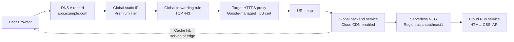
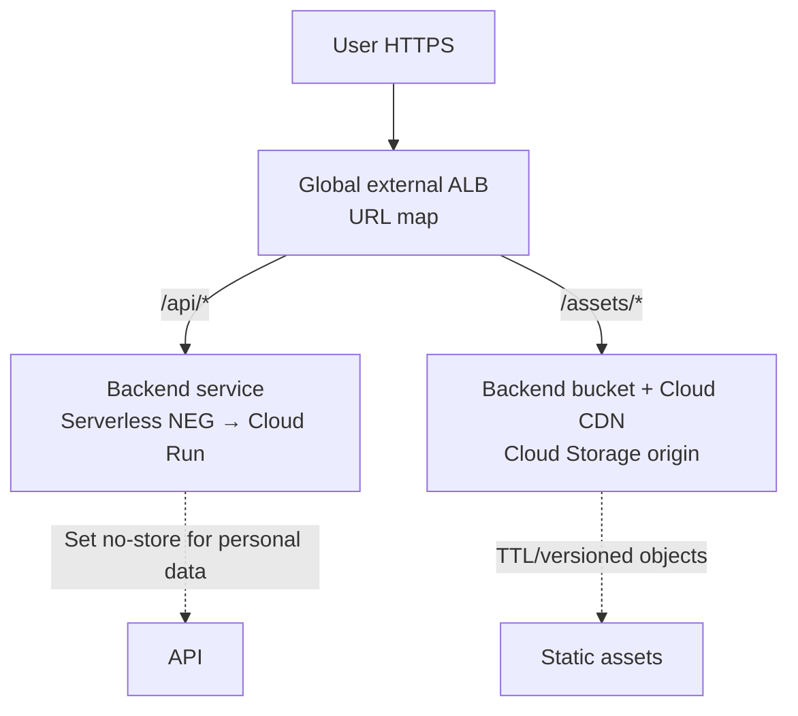

# Hands-On: Publishing an HTTPS Application with CDN

A new web application working fine via Cloud Run's default URL does not mean it is ready for public release. To publish the application under a custom domain, you need an **HTTPS entry point**, **TLS certificates**, **DNS**, **backend routing**, and—when serving images, CSS, and JavaScript to many users—**Cloud CDN** to reduce latency and origin fetches.

This lesson belongs to the **Load Balancing and Content Delivery** chapter of the `CLOUD_PROVIDERS_GCP` module. Within the broader scope from project organization, IAM, and VPC to Compute Engine, GKE, Cloud Run, storage, databases, release automation, and cost/reliability monitoring, this hands-on lab walks through a complete end-to-end flow: **Cloud Run app → serverless NEG → global external Application Load Balancer → HTTPS with managed certificate → Cloud CDN**. Learners will see how to publish a service, prevent uncacheable content from being cached, and verify every layer with real tools.

## 1. Objectives and Deliverables

After this lesson, you will be able to:

1. Distinguish the responsibilities of **Cloud Run**, **serverless Network Endpoint Group (NEG)**, **backend service**, **URL map**, **target HTTPS proxy**, **forwarding rule**, **TLS certificate**, and **Cloud DNS**.
2. Design a **global external Application Load Balancer** with `EXTERNAL_MANAGED` to expose an app under a custom domain.
3. Enable **Cloud CDN** on a Cloud Run backend and cache only designated public responses.
4. Understand the differences between **TLS termination**, HTTP routing, CDN edge caching, and IAM/runtime identity.
5. Deploy a small lab app serving HTML, static CSS, and a dynamic API endpoint, configured with distinct `Cache-Control` headers.
6. Use `gcloud` and `curl` to verify configurations, DNS, certificate status, cache hits/misses, HTTP status codes, and application paths.
7. Lock down direct access via the default `run.app` URL once the load balancer works, when appropriate for the design.
8. Analyze cache safety boundaries, logs, budgets, and post-lab resource cleanup.

**Expected end result:** visiting `https://app.example.com` with a real domain you own displays the lab page. `/assets/app.css` is cached per origin headers, while `/api/time` and HTML carrying `private, no-store` are not stored in Cloud CDN. The certificate reports `ACTIVE`, the HTTPS path works, and logs/CDN status explain the observed behavior.

Names such as `YOUR_PROJECT_ID`, `app.example.com`, and example resource names are **placeholders**. Only run write commands in an **authorized lab project** with a **real domain** whose DNS records you are permitted to edit. The lab uses resources that can incur charges; this lesson is a guide and does not execute changes on learners' projects.

## 2. HTTPS and CDN Architecture in Google Cloud



A common misconception in the diagram is thinking **CDN is a separate container or server you deploy yourself**. When Cloud CDN is enabled on an external Application Load Balancer's backend service, eligible responses are served from Google's edge network. Requests lacking a matching cache entry proceed to the Cloud Run backend.

### 2.1. Role of Each Component

| Component | Responsibility | Scope in This Lab |
| --- | --- | --- |
| **Cloud Run service** | Runs the app, generates HTTP responses and cache headers | Regional |
| **Serverless NEG** | References the Cloud Run service so the backend service can route to it | Regional, same region as Cloud Run |
| **Backend service** | Groups backends, configures Cloud CDN policy, logging | Global |
| **URL map** | Picks backend service by host/path; lab uses one default backend | Global |
| **Target HTTPS proxy** | Terminates TLS using certificate and applies URL map | Global |
| **Forwarding rule** | Listens on `IP:443` and forwards connections to target proxy | Global |
| **Global static IP** | Fixed address for DNS to point to | Global, Premium Tier |
| **Google-managed SSL certificate** | Automates TLS certificate lifecycle after domain validation succeeds | Global in the lab's Compute Engine SSL cert setup |
| **Cloud DNS or DNS provider** | Resolves domain name to the forwarding rule's IP | Independent DNS system |

The word "global" describes the load balancer's resource/entry-point scope; it **does not mean** the Cloud Run application runs multi-region. If there is only one Cloud Run service in a single region, a region-wide outage can still interrupt the app even though clients connect to a global IP. Multi-region DR requires designing redundant backends and data.

### 2.2. Live Request Flow

1. Browser queries DNS to obtain the IP for `app.example.com`.
2. Client opens an HTTPS connection on port 443; the load balancer presents the certificate for the hostname.
3. Target HTTPS proxy evaluates the URL map and selects the backend service.
4. Cloud CDN checks whether a valid cached copy exists for the cache key.
5. **Cache hit:** response served from the edge, saving an origin fetch. **Cache miss:** request proceeds to the serverless NEG and Cloud Run.
6. Cloud Run produces the response; Cloud CDN evaluates HTTP headers, method, response status, cache mode, and other rules to decide whether to store a copy.

Not every request reaches the origin. Thus Cloud Run invocation counts may be lower than total client requests, though **egress, cache fill, and logging costs still apply**.

## 3. Choosing the Right Load Balancer and CDN for the Job

Google Cloud offers several load balancing products. This lesson selects a **global external Application Load Balancer**, operating at Layer 7 HTTP(S) using `EXTERNAL_MANAGED` and **Premium Network Service Tier**. This design supports serverless NEGs to Cloud Run, custom domains, TLS certificates, Cloud CDN, and protection features like Cloud Armor.

| Option | Characteristics | When to Consider |
| --- | --- | --- |
| **Global external Application Load Balancer** | Global VIP, supports multiple backend types and Cloud CDN | Public websites/APIs needing edge delivery, TLS, and host/path routing |
| **Regional external Application Load Balancer** | Regional entry point and resources, with specific proxy-only subnet requirements | Services targeting one region with localization requirements |
| **Internal Application Load Balancer** | Internal entry point | Private APIs across VPCs/workloads, not public websites |
| **External proxy Network Load Balancer** | Proxy-layer TCP load balancing | Non-HTTP protocols not needing URL routing or CDN |
| **Direct Cloud Run domain mapping** | Domain points directly to service per product feature | Simpler path, yet lacks full parity with HTTPS load balancer and Cloud CDN |
| **Cloud CDN vs. Media CDN** | Cloud CDN integrates with Application Load Balancer; Media CDN targets specialized media delivery | Pick based on content, routing, video delivery needs, and feature support |

With a Cloud Run **serverless NEG**, the load balancer does not configure Compute Engine health checks like an instance group backend. Monitor application health via Cloud Run metrics, logs, and real HTTP probes. Never habitually create VM health-checker firewall rules if your backend is solely a serverless NEG.

## 4. Prerequisites Before Provisioning Resources

### 4.1. Permissions and Infrastructure

You need:

- A **Google Cloud project** with billing enabled and permissions to create/update Cloud Run, Compute Engine load balancers, serverless NEGs, IPs, and certificates.
- **Google Cloud CLI** installed or Cloud Shell, authenticated with an active account.
- **Cloud Run**, **Compute Engine**, plus **Cloud Build** and **Artifact Registry** APIs if deploying Cloud Run from source; required service agents and permissions must also be ready.
- A **hostname under a domain you own**, such as `app.example.com`, with permission to create or update `A` DNS records. Never use a domain you do not control.
- A Cloud Run app permitting requests through the load balancer. For public apps, public access settings must comply with IAM/organization policies; never practice this on sensitive data.
- Least-privilege permissions: load balancer deployers need required Compute Engine roles; Cloud Run deployers need service permissions and `iam.serviceAccounts.actAs` if specifying a runtime service account.

Provisioning a global IP, frontend forwarding rule, certificate, backend service, Cloud CDN, and Cloud Run can incur charges even with low traffic. Use a lab project and **clean up resources when done**.

### 4.2. Setting Bash Variables

The remaining examples assume a Bash shell. PowerShell on Windows uses different variable and line-continuation syntax.

```bash
# Replace before running; must be a project/domain you own.
PROJECT_ID="YOUR_PROJECT_ID"
REGION="asia-southeast1"
DOMAIN="app.example.com"
RUN_SERVICE="cdn-demo-web"

IP_NAME="cdn-demo-ip"
NEG_NAME="cdn-demo-neg"
BACKEND_NAME="cdn-demo-backend"
URL_MAP="cdn-demo-map"
CERT_NAME="cdn-demo-cert"
HTTPS_PROXY="cdn-demo-https-proxy"
HTTPS_RULE="cdn-demo-https-rule"

gcloud --version
gcloud auth list
gcloud projects describe "$PROJECT_ID" \
  --format="yaml(projectId,projectNumber,lifecycleState)"
```

**Avoid relying ambiguously on the default project:** all potentially mutating commands in this lesson pass `--project` or use verified parameters. Example names belong solely to lab resources. If any name already exists, verify its owner/state and choose a different name instead of overwriting.

### 4.3. Checking APIs and Permissions Before Deploying

```bash
# Read-only: check enabled services.
gcloud services list \
  --project="$PROJECT_ID" \
  --enabled \
  --format="value(config.name)"

# Read-only: check whether the Cloud Run service name is already taken.
gcloud run services list \
  --project="$PROJECT_ID" \
  --region="$REGION"

# Read-only: inspect IPs and forwarding rules with similar names.
gcloud compute addresses list \
  --project="$PROJECT_ID" \
  --global

gcloud compute forwarding-rules list \
  --project="$PROJECT_ID" \
  --global
```

If APIs are disabled or IAM is insufficient, ask an authorized administrator to prepare roles/services in the lab project. Never elevate yourself to Owner/Editor or switch to a production project just "to make commands run".

## 5. Creating a Sample App with Public Assets and a Dynamic API

To measure caching directly, prepare an app exposing three URLs:

| URL | Content | Expected HTTP Cache Header | Cloud CDN |
| --- | --- | --- | --- |
| `/` | HTML linking to CSS | `private, no-store` | Do not cache |
| `/assets/app.css` | Identical CSS for all users | `public, s-maxage=300, max-age=60` | Eligible to cache |
| `/api/time` | Server timestamp per request | `private, no-store` | Do not cache |

This app uses no database or personal cookies, making it safe for testing. In real applications, authenticated APIs, user data, carts, or tokens must be classified carefully **before enabling CDN**.

### 5.1. Sample Files on Your Local Machine

In a separate directory **outside the lesson repository**, create `main.py`:

```python
from datetime import datetime, timezone

from flask import Flask, Response, jsonify

app = Flask(__name__)


@app.get("/")
def home():
    html = """<!doctype html>
<html lang="en">
<head>
  <meta charset="utf-8">
  <title>Google Cloud HTTPS + CDN Lab</title>
  <link rel="stylesheet" href="/assets/app.css">
</head>
<body>
  <main>
    <h1>Hello from Cloud Run</h1>
    <p>This page's CSS is cached at Cloud CDN.</p>
    <p>API time: <code>/api/time</code></p>
  </main>
</body>
</html>"""
    response = Response(html, mimetype="text/html")
    response.headers["Cache-Control"] = "private, no-store"
    return response


@app.get("/assets/app.css")
def stylesheet():
    css = """
body { font-family: system-ui, sans-serif; margin: 3rem; }
main { max-width: 50rem; margin: auto; }
h1 { color: #155e75; }
"""
    response = Response(css, mimetype="text/css")
    response.headers["Cache-Control"] = (
        "public, s-maxage=300, max-age=60"
    )
    return response


@app.get("/api/time")
def current_time():
    response = jsonify({
        "utc": datetime.now(timezone.utc).isoformat()
    })
    response.headers["Cache-Control"] = "private, no-store"
    return response
```

Create `requirements.txt`:

```text
Flask>=3.0,<4
gunicorn>=22,<26
```

Create `Procfile` so Cloud Run source deployment knows how to start the server:

```text
web: gunicorn --bind :$PORT main:app
```

Do not create extra source files inside the module's knowledge folder; these three files are solely examples for a live Cloud Run lab project.

### 5.2. Deploying to Cloud Run

Inside the directory containing the three sample files, after verifying project/region and deploy permissions, run the **write command creating the service and build artifacts**:

```bash
gcloud run deploy "$RUN_SERVICE" \
  --project="$PROJECT_ID" \
  --region="$REGION" \
  --source="." \
  --allow-unauthenticated \
  --ingress=all
```

If your organization prohibits unauthenticated public Cloud Run services, **do not attempt to bypass that policy**. You can practice the design/read-only portions and coordinate with an administrator for an approved lab environment; a serverless NEG to public Cloud Run in this pattern requires compatible access policies.

Deploying from source may store images in Artifact Registry and invoke Cloud Build; running the command does not exempt IAM/cost governance.

Verify after deploying:

```bash
gcloud run services describe "$RUN_SERVICE" \
  --project="$PROJECT_ID" \
  --region="$REGION" \
  --format="yaml(metadata.name,status.url,spec.template.spec.serviceAccountName)"

RUN_URL="$(gcloud run services describe "$RUN_SERVICE" \
  --project="$PROJECT_ID" --region="$REGION" \
  --format='value(status.url)')"

# Read-only response checks; at this stage Cloud Run still allows ingress=all.
curl -sSI "$RUN_URL/assets/app.css"
curl -sSI "$RUN_URL/api/time"
```

At this step, expect `Cache-Control: public, s-maxage=300, max-age=60` on CSS and `Cache-Control: private, no-store` on the API. You should not see Cloud CDN indicators yet because the load balancer has not been created.

## 6. Creating the Serverless NEG and Global Backend Service

### 6.1. Creating a Serverless NEG Pointing to Cloud Run

A serverless NEG must reside in the **same region** as the Cloud Run service it references. This writes network configuration:

```bash
gcloud compute network-endpoint-groups create "$NEG_NAME" \
  --project="$PROJECT_ID" \
  --region="$REGION" \
  --network-endpoint-type=SERVERLESS \
  --cloud-run-service="$RUN_SERVICE"
```

Read back:

```bash
gcloud compute network-endpoint-groups describe "$NEG_NAME" \
  --project="$PROJECT_ID" \
  --region="$REGION"
```

You do not need to create a VM instance group, VPC health-check firewall rules, or a proxy-only subnet for this **global external ALB with serverless NEG** example.

### 6.2. Creating the Backend Service and Enabling Cloud CDN

Choose `USE_ORIGIN_HEADERS`. In this mode, successful responses are cached only when the origin provides valid caching headers; `no-store` HTML/APIs are excluded from public caching. The command below **creates the backend service and enables Cloud CDN**:

```bash
gcloud compute backend-services create "$BACKEND_NAME" \
  --project="$PROJECT_ID" \
  --global \
  --load-balancing-scheme=EXTERNAL_MANAGED \
  --enable-cdn \
  --cache-mode=USE_ORIGIN_HEADERS \
  --enable-logging \
  --logging-sample-rate=1.0 \
  --custom-response-header='Cache-Status: {cdn_cache_status}'
```

The custom `Cache-Status` header helps observe cache behavior during the lab; in production, decide whether exposing cache debug metadata to clients is appropriate. 100% sampling makes lab inspection easy, yet can generate significant log volume and cost under heavy traffic.

Attach the serverless NEG to the backend service:

```bash
gcloud compute backend-services add-backend "$BACKEND_NAME" \
  --project="$PROJECT_ID" \
  --global \
  --network-endpoint-group="$NEG_NAME" \
  --network-endpoint-group-region="$REGION"
```

Readback:

```bash
gcloud compute backend-services describe "$BACKEND_NAME" \
  --project="$PROJECT_ID" \
  --global \
  --format="yaml(name,loadBalancingScheme,enableCDN,cdnPolicy,backends,logConfig)"
```

Confirm `EXTERNAL_MANAGED`, `enableCDN: true`, and a backend referencing the serverless NEG in the right region. If the Cloud Run service cannot be found, verify region, name, and permissions before recreating the NEG.

## 7. Creating the URL Map

The URL map selects the backend service for incoming requests. Since the demo app has one origin, all paths route to the same backend; **HTTP response headers** decide which paths get cached.

```bash
gcloud compute url-maps create "$URL_MAP" \
  --project="$PROJECT_ID" \
  --default-service="$BACKEND_NAME"
```

Read back:

```bash
gcloud compute url-maps describe "$URL_MAP" \
  --project="$PROJECT_ID" \
  --global
```

Larger apps can use a URL map to split paths:

- `/api/*` → backend service for dynamic APIs.
- `/assets/*` → backend service or Cloud Storage backend bucket for static assets with CDN enabled.
- `/*` → default backend for the website.

This **path-based backend separation** strategy is helpful when APIs and assets have different caching/IAM policies. In this lab, a single Cloud Run backend remains safe provided the origin emits exact headers and uses `USE_ORIGIN_HEADERS`. **Never enable `FORCE_CACHE_ALL` on a backend serving private data.**

## 8. Allocating a Global IP and Creating a Google-Managed Certificate

### 8.1. Reserve a Global IPv4 Address

This command provisions a **static public IP address** in Premium Tier:

```bash
gcloud compute addresses create "$IP_NAME" \
  --project="$PROJECT_ID" \
  --global \
  --ip-version=IPV4 \
  --network-tier=PREMIUM
```

Fetch the IP to use for DNS checks:

```bash
LB_IP="$(gcloud compute addresses describe "$IP_NAME" \
  --project="$PROJECT_ID" \
  --global \
  --format='value(address)')"

echo "$LB_IP"
```

Never guess an IP from examples and never overwrite an A record serving a production system. If a hostname already carries live traffic, prepare a migration plan, inspect TTLs, and account for certificate provisioning/cutover timing.

### 8.2. Create a Google-Managed Certificate

Use a **real hostname you own**:

```bash
gcloud compute ssl-certificates create "$CERT_NAME" \
  --project="$PROJECT_ID" \
  --global \
  --domains="$DOMAIN"
```

The certificate may stay in `PROVISIONING` until domain validation and DNS/IP alignment succeed. The Google-managed certificate here is a **Compute Engine SSL certificate resource** on the load balancer; do not confuse it with Certificate Manager certificate maps, which have separate workflows and resources.

Check status:

```bash
gcloud compute ssl-certificates describe "$CERT_NAME" \
  --project="$PROJECT_ID" \
  --global \
  --format="yaml(name,managed.status,managed.domainStatus)"
```

Never attach a self-signed certificate just to "get HTTPS working" for end users. With managed certificates, verify DNS records, CAA records if any, and certificate status before treating the app as having valid TLS.

## 9. Creating the HTTPS Frontend on Port 443

Create the target HTTPS proxy referencing the URL map and certificate:

```bash
gcloud compute target-https-proxies create "$HTTPS_PROXY" \
  --project="$PROJECT_ID" \
  --global \
  --url-map="$URL_MAP" \
  --ssl-certificates="$CERT_NAME"
```

Create the global forwarding rule using the reserved IP:

```bash
gcloud compute forwarding-rules create "$HTTPS_RULE" \
  --project="$PROJECT_ID" \
  --global \
  --load-balancing-scheme=EXTERNAL_MANAGED \
  --network-tier=PREMIUM \
  --address="$IP_NAME" \
  --target-https-proxy="$HTTPS_PROXY" \
  --ports=443
```

Readback:

```bash
gcloud compute target-https-proxies describe "$HTTPS_PROXY" \
  --project="$PROJECT_ID" \
  --global

gcloud compute forwarding-rules describe "$HTTPS_RULE" \
  --project="$PROJECT_ID" \
  --global
```

If the target proxy is missing the certificate reference or the forwarding rule points to the wrong IP/port, fix the **exact resource** after reviewing the change. At this stage, clients have an HTTPS entry point, though the certificate may **not yet** be active and DNS does not yet point to it.

### 9.1. Do We Need HTTP Port 80?

This lab **creates only HTTPS 443**. Port 80 is omitted to avoid accidental plaintext traffic during learning. If production requires redirecting `http://` to `https://`, configure an **HTTP-to-HTTPS redirect** using a dedicated forwarding rule/proxy/URL map or the Console's redirect option. **Never** create a port 80 forwarding rule pointing straight to the app assuming it acts as a redirect.

### 9.2. Where Does TLS Terminate?

Clients establish TLS with the load balancer's HTTPS proxy. The certificate secures the **client → load balancer** leg; it does not describe connections from the load balancer to backends, nor does it replace IAM, app logic, API authentication, or data security. With a serverless NEG, Google Cloud manages the integration hop to Cloud Run; you must still configure appropriate access and ingress controls.

## 10. Configuring DNS and Waiting for `ACTIVE` Certificate

At the DNS provider hosting the authoritative zone for your domain, add or update:

```text
Name:   app.example.com.
Type:   A
Value:  <LB_IP retrieved in Step 8>
TTL:    300    (reference lab value)
```

This is a **user-impacting DNS change**. Only modify DNS for an authorized lab hostname. If Cloud DNS manages the zone, admins can create the A record via Cloud DNS; if a third-party provider hosts it, edit it there. Creating a record in a **non-authoritative** Cloud DNS zone will not route Internet traffic via that record.

Verify:

```bash
# Check DNS resolution from your current resolver.
dig +short A "$DOMAIN"

# Compare against the load balancer's allocated IP.
echo "$LB_IP"

# Read the LB certificate status.
gcloud compute ssl-certificates describe "$CERT_NAME" \
  --project="$PROJECT_ID" \
  --global \
  --format="yaml(managed.status,managed.domainStatus)"
```

If `dig` is unavailable, use `nslookup "$DOMAIN"`. Also check `AAAA` records if the hostname has IPv6: if `AAAA` still points to legacy infrastructure, some clients will miss the new load balancer. `CAA` records can also affect certificate issuance; review them per Google Cloud guidance.

**Confirm HTTPS is complete only when certificate and domain statuses succeed—typically `ACTIVE`.** Certificate issuance and DNS/config propagation take time; never disable TLS verification or use `curl -k` as a substitute for verification. Never assume a certificate is active merely because the `create` command succeeded.

## 11. Testing HTTPS, Routing, and Content

Once DNS resolves to the global IP and the certificate is active:

```bash
# Verify TLS and HTML response.
curl -sS -D - -o /dev/null "https://$DOMAIN/"

# Verify CSS carries caching headers.
curl -sS -D - -o /dev/null "https://$DOMAIN/assets/app.css"

# Verify dynamic API returns no-store.
curl -sS -D - -o /dev/null "https://$DOMAIN/api/time"
```

Checklist of observations:

| Check | Expected Result |
| --- | --- |
| Domain resolution | A record matches LB IP |
| TLS/HTTPS | Valid certificate for hostname, zero verification errors |
| `/` | `200 OK` and `Cache-Control: private, no-store` |
| `/assets/app.css` | `200 OK`, `Content-Type: text/css`, and `Cache-Control: public, s-maxage=300...` |
| `/api/time` | `200 OK`, JSON with timestamp near call time, `private, no-store` |
| LB backend | URL map → backend service → serverless NEG → right Cloud Run |
| HTTP port 80 | Not deployed in this lab; does not imply an HTTP redirect exists |

When testing the VIP before DNS cuts over (provided the certificate is already eligible), `curl --resolve "$DOMAIN:443:$LB_IP" "https://$DOMAIN/"` targets the specific IP **while sending the right hostname/SNI**. Because Google-managed certificates require valid DNS/IP alignment for provisioning, `--resolve` does not substitute for creating the A record needed for domain validation.

### 11.1. Distinguishing Errors by Layer

- `NXDOMAIN`: hostname lacks a DNS record or zone delegation is broken.
- `TLS handshake/certificate mismatch`: certificate not active, domain mismatch, DNS/IP/CAA wrong.
- `404`: app lacks the path or URL map routing mismatch; check logs.
- `403`: Cloud Run ingress/IAM, Cloud Armor, or other policy blocking access.
- `502/503`: backend/NEG/service unavailable or routing failure; inspect load balancer/Cloud Run logs.
- `200` with wrong HTML: URL map/backend service pointing to wrong origin, stale cached object, or unupdated deployment.

When troubleshooting, start at DNS/TLS, then frontend, backend, and app; never grant Owner or flip on public ingress recklessly just to "make it work".

## 12. Verifying Cloud CDN Cache Hit/Miss via Response Headers

With `USE_ORIGIN_HEADERS` and the demo app, Cloud CDN can cache `/assets/app.css`. Call the **exact same URL** multiple times without adding random query params that would create new cache keys:

```bash
# Real GET requests; not just HEAD, as cache eligibility can differ.
curl -sS -D - -o /dev/null \
  "https://$DOMAIN/assets/app.css"

curl -sS -D - -o /dev/null \
  "https://$DOMAIN/assets/app.css"

curl -sS -D - -o /dev/null \
  "https://$DOMAIN/assets/app.css"
```

Observe the custom `Cache-Status` header configured on the backend service; Cloud CDN can report states such as hit or miss. However, **do not assume the second of three initial calls is guaranteed to hit**. Caches are distributed across edge locations; objects may not yet be stored, may be ineligible, or may have been evicted. Several requests and backend service logs may be needed to confirm.

Test the API:

```bash
curl -sS "https://$DOMAIN/api/time"
curl -sS "https://$DOMAIN/api/time"

# Inspect headers rather than just the body.
curl -sS -D - -o /dev/null \
  "https://$DOMAIN/api/time"
```

Each API call should return a fresh origin timestamp and `private, no-store`. Timestamps can look identical if called rapidly or rounded, so inspecting **caching headers and logs** is more reliable than a single observation.

## 13. Which Factors Govern Cloud CDN Caching?

### 13.1. Cache Modes

| Cache Mode | Core Mechanism | When to Use |
| --- | --- | --- |
| `CACHE_ALL_STATIC` | Default in many Cloud CDN CLI configs; caches eligible static MIME types per rules while honoring cache directives | Static websites with assets carrying sensible cache headers |
| `USE_ORIGIN_HEADERS` | Caches only successful responses carrying valid origin caching directives | **This lab:** caches CSS only while other endpoints control headers explicitly |
| `FORCE_CACHE_ALL` | Overrides many `Cache-Control` directives to cache successful responses | Use only after classifying content; **dangerous for APIs/personal data** |

Additional rules apply to HTTP methods, response statuses, `Authorization`, `Vary`, object size, cookies/headers, and backend config. Setting `public` alone does not guarantee every response is always cached; conversely, enabling `FORCE_CACHE_ALL` can accidentally cache private responses.

### 13.2. Understanding `Cache-Control`, TTL, and Cache Keys

CSS example:

```http
HTTP/2 200
Content-Type: text/css
Cache-Control: public, s-maxage=300, max-age=60
```

- `public`: content may be shared across multiple users.
- `s-maxage=300`: instructs shared caches like Cloud CDN to retain the response up to ~300 seconds subject to product limits.
- `max-age=60`: instructs browsers/private caches to retain the copy for ~60 seconds.
- After TTL, the edge may revalidate or re-fetch from the origin; **TTL does not guarantee the object remains in cache**, as eviction can happen sooner.

API example:

```http
HTTP/2 200
Content-Type: application/json
Cache-Control: private, no-store
```

`no-store` instructs caches not to store the response; `private` indicates the response is specific to one client and must not enter shared caches. This is a clean header pair for dynamic or sensitive endpoints.

A **cache key** can include host, scheme, path, and query string per backend policy. If images generate many tracking queries like `?tracking=...`, edges store duplicate copies and hit ratio drops. Yet stripping query params from cache keys can cause **variant collisions** if queries alter real data; design cache key policies only after understanding application behavior.

### 13.3. Caching Does Not Mean Optimizing the Entire Website Blindly

| Content | Reference Handling |
| --- | --- |
| Public CSS/JS/images with versioned filenames | Long appropriate TTL; bump filename on new releases |
| Infrequently changing public HTML | Short TTL, with a purge process on version changes |
| HTML for logged-in users | `private, no-store` unless a stricter verified design exists |
| Public info API tolerating slight staleness | Cacheable with suitable TTL after reviewing queries and authorization |
| Profile, order, token, or cart APIs | Do not cache on shared CDN by default |
| 404/5xx | Check **negative caching** and how long errors can linger in cache |

Some setups also support route-specific cache policies and `CDN-Cache-Control` to govern edges separately from browsers. This lab intentionally starts with standard headers so learners grasp the underlying mechanics.

## 14. Cloud Run Ingress and Preventing Load Balancer Bypass

During initial deployment, `--ingress all` lets you verify the app directly via `run.app`. Once the HTTPS load balancer works, to ensure Internet users flow exclusively through the load balancer (for CDN/Cloud Armor/ingress controls), **restrict ingress**:

```bash
# Impactful change on the Cloud Run service.
gcloud run services update "$RUN_SERVICE" \
  --project="$PROJECT_ID" \
  --region="$REGION" \
  --ingress=internal-and-cloud-load-balancing
```

Verify again:

```bash
gcloud run services describe "$RUN_SERVICE" \
  --project="$PROJECT_ID" \
  --region="$REGION" \
  --format="yaml(metadata.annotations,status.url)"

# Test from the Internet via the LB hostname.
curl -sS -D - -o /dev/null "https://$DOMAIN/"
```

`internal-and-cloud-load-balancing` permits traffic arriving via the external Application Load Balancer while restricting direct Internet requests to the `run.app` URL per ingress behavior. To disable the default route further, Cloud Run also offers **disable default URL**; evaluate impact on internal tools, schedulers, monitoring, and existing callers first.

**Do not confuse ingress with application authentication.** Restricting ingress forces traffic through the load balancer; it does not require users to log in. If the app must be private, design IAM/auth, Cloud Armor, or IAP per product support. **IAP is incompatible with Cloud CDN on the same backend** in documented models; never enable both without checking current feature matrices.

## 15. Observing with Cloud Logging and Cloud Monitoring

### 15.1. Enabling Logging on the Backend Service

Backend creation used:

```text
--enable-logging
--logging-sample-rate=1.0
```

With a global external Application Load Balancer, request logs can include:

- `httpRequest.requestUrl` and `httpRequest.status`.
- `httpRequest.cacheLookup` or `httpRequest.cacheHit`.
- `jsonPayload.statusDetails`, such as `response_from_cache` or `response_sent_by_backend`.
- Cache ID, latency, response bytes, and backend info depending on request/log type.

Read recent logs via CLI:

```bash
gcloud logging read \
  'resource.type="http_load_balancer" AND httpRequest.requestUrl:"/assets/app.css"' \
  --project="$PROJECT_ID" \
  --limit=20 \
  --format="table(timestamp,httpRequest.status,httpRequest.cacheHit,jsonPayload.statusDetails)"
```

If no logs appear, verify project, sampling, Cloud Logging read permissions, filter syntax, and time range. A missing log line alone is not proof that the CDN isn't working.

### 15.2. Interpreting Cache Status

| Log Signal | Typical Meaning | Where to Check |
| --- | --- | --- |
| `response_from_cache` or `httpRequest.cacheHit=true` | Request served from cache | Hit ratio, TTL, and content correctness |
| `response_sent_by_backend` with `cacheLookup=true` | Lookup occurred, yet had to fetch from origin | Headers, cold cache, cache key, status code |
| `response_from_cache_validated` | Cache revalidated with origin | Conditional requests, `ETag`/`Last-Modified` |
| Elevated `403`s | IAM/Cloud Armor/ingress or app auth | Backend config, policies, and request path |
| Elevated `5xx`s | Origin/NEG/LB/app errors | Cloud Run logs, request latency, latest deploy |

Cloud CDN cache hit ratio and cache egress are useful metrics, yet **a high cache hit ratio does not mean the application is healthy or safe**. A mis-cached personal API can boast a high hit ratio while leaking data; always verify content cacheability first.

### 15.3. SLOs, Performance, and Operations

Track at minimum:

1. **TLS/certificate:** certificate `ACTIVE`, expiration/managed status, hostname match.
2. **Traffic:** request count, HTTP 4xx/5xx rates, latency.
3. **Cache:** hit ratio by requests/bytes, cache fills, miss rate, and cost.
4. **Origin:** Cloud Run request count, startup latency, concurrency, instance scaling, and app errors.
5. **Security:** Cloud Armor rule matches if enabled, anomalous patterns, API authentication.
6. **Cost:** LB fees, CDN egress, cache fill, Cloud Run compute, build/image/logging costs.

SLO targets must reflect user expectations and origin fault tolerance. Edge CDN offloads traffic, yet **does not replace redundant backends, database HA, or cross-region DR plans**.

## 16. Updating Assets and Invalidation

The CDN may continue serving an older CSS version until its TTL expires. Two release approaches:

**Preferred approach:** use versioned filenames or content hashes such as `/assets/app.v2.css` or `/assets/app.a81f.css`. Each release gets a unique URL, favoring long cache lifetimes and clean rollbacks. HTML pages reference the new filename.

**Alternative approach:** **invalidate** specific objects on the URL map after updating the origin. This modifies CDN caches and can trigger fresh cache fills.

```bash
# Use only for the lab URL map and modified asset.
gcloud compute url-maps invalidate-cdn-cache "$URL_MAP" \
  --project="$PROJECT_ID" \
  --path="/assets/app.css" \
  --host="$DOMAIN"
```

Re-test HTTPS and responses after invalidation. **Do not purge `/*` by default**: doing so evicts many objects at once, spikes origin load, and can increase costs. Invalidation cannot fix application bugs, DNS/TLS errors, or delete origin objects.

## 17. Cloud CDN, Backend Buckets, and Scaling Options

This lab uses a **Cloud Run serverless NEG** so learners understand an HTTPS frontend and caching for a live app. For larger websites, another pattern is often more efficient:



A **backend bucket** points to a Cloud Storage bucket to serve static assets; Cloud CDN is enabled separately on the backend bucket. Access control options differ between **public buckets** and **private bucket access** with supported CDN mechanisms. Never assume every bucket must be public, and never grant `allUsers` on a bucket holding sensitive data.

Reference syntax for creating a backend bucket **for an existing lab bucket with appropriate access settings**:

```bash
# Write example: creates a CDN-enabled backend bucket.
gcloud compute backend-buckets create "static-assets-backend" \
  --project="$PROJECT_ID" \
  --gcs-bucket-name="YOUR_ASSET_BUCKET" \
  --enable-cdn \
  --cache-mode=CACHE_ALL_STATIC
```

To use both API and asset backends together, update the URL map with host/path rules and test routes. When configuring a private Cloud Storage origin, follow its dedicated guide and required cache modes; `FORCE_CACHE_ALL` may be used in properly configured private-bucket setups, yet remains **unsuitable for caching personal data**. Never run this example against a real bucket without verifying IAM and security.

## 18. Security When Publishing Over HTTPS

HTTPS protects only part of the transport path; application security requires defense in depth.

| Risk | Mitigation |
| --- | --- |
| Certificate inactive or hostname mismatch | Monitor `managed.status` and DNS A/AAAA/CAA; never disable TLS verification |
| Direct `run.app` bypasses Cloud CDN/Cloud Armor | After verifying LB, set `internal-and-cloud-load-balancing`; consider disabling default URL |
| Caching personal data/tokens | `private, no-store`, `USE_ORIGIN_HEADERS`, separate backends/paths where needed |
| Website/API attack traffic | Cloud Armor WAF/rate limiting per design and supported tier |
| Insufficient IAM to deploy | Grant least-privilege Compute/Cloud Run roles; separate deployer and runtime service accounts |
| API exposed to unauthenticated users | Application authentication; never mistake HTTPS for a login system |
| XSS/CSRF/SQL injection | Application security testing, security headers, and data protection layers |
| Sensitive data leaks in logs | Redact/omit credentials, tokens, sensitive emails; govern retention and read access |
| Cloud Run region outage | Design multi-region backends/data if required by RTO/RPO |

When apps use sessions/cookies, set `Secure`, `HttpOnly`, and `SameSite` flags appropriately and audit caching on related responses. Avoid collapsing `Authorization`, query strings, or cookies into shared cache keys without understanding data-leak risks.

## 19. CDN Calculation and Evaluation Exercise

Suppose a site serves 100,000 downloads of a 100 KiB CSS file per day. If 80% are served by the edge and 20% hit the origin:

- Origin requests for this file drop from 100,000 to **20,000**.
- Estimated cache hits: **80,000**.
- Theoretical origin egress for this file drops from roughly **9.54 GiB** to roughly **1.91 GiB**, assuming identical response sizes and ignoring revalidation and overhead.

This is an illustrative calculation, **not a billing forecast**. Cloud CDN still bills per service pricing rules, including cache egress, cache fill, LB processing, network egress, origin compute, and other line items. Estimate real costs using Google Cloud pricing tables and your project/region Billing data.

Questions to ask before picking a TTL:

1. How often does the asset change?
2. Must users see updates immediately, or is a few minutes of staleness acceptable?
3. Are URLs versioned, or is manual invalidation required?
4. Does the response ever depend on cookies, accounts, or permissions?
5. Is caching certain error codes like `404` acceptable?
6. Can you observe cache hits/misses and detect stale/wrong content?

## 20. Troubleshooting Layer by Layer

| Symptom | Suspected Layer | Useful Checks |
| --- | --- | --- |
| DNS fails to resolve | DNS/zone | A record, NS delegation, TTL, authoritative zone |
| DNS points to old IP | DNS migration | A/AAAA, DNS provider's proxy/CDN, resolver cache |
| TLS stuck `PROVISIONING` | Certificate/domain validation | A/AAAA, CAA, forwarding rule/proxy, `managed.domainStatus` |
| HTTPS returns 404 | URL map or app | URL map default backend, Cloud Run paths, logs |
| HTTPS returns 403 | IAM/ingress/Cloud Armor | Cloud Run public access, security policy, request route |
| HTTPS returns 502/503 | Backend or deployment | NEG region, Cloud Run status, logs, rollout |
| CSS always misses | Cloud CDN/cache policy | `enableCDN`, `USE_ORIGIN_HEADERS`, `Cache-Control`, cache key, logs |
| Time API gets cached | Wrong origin/cache mode | `no-store`, backend mode, cache bypass, response variants |
| Old asset still seen after release | Browser/CDN cache | URL versioning, cache TTL, targeted invalidation |
| Origin request count spikes | Cache misses/invalidation/traffic | Headers, cache hit ratio, purge patterns |
| Direct `run.app` still public | Cloud Run ingress | `internal-and-cloud-load-balancing`, default URL setting |
| Unexplained cost increase | Billing/CDN/LB/Cloud Run | Billing reports by SKU, log sampling, cache fill, and egress |

**Diagnostic order:** DNS → TLS → forwarding rule/proxy → URL map → backend service/NEG → Cloud Run → cache policy and logs. For private resource errors, check IAM/Cloud Armor and ingress status before concluding the backend crashed.

## 21. Cleaning Up the Lab Without Disrupting Other Apps

**Delete only resources created by this lab**, and only after confirming the hostname no longer serves real users. When tearing down a load balancer, proceed from frontend to backend while cleaning up DNS.

### 21.1. Inventory Before Deleting

```bash
gcloud compute forwarding-rules describe "$HTTPS_RULE" \
  --project="$PROJECT_ID" --global

gcloud compute target-https-proxies describe "$HTTPS_PROXY" \
  --project="$PROJECT_ID" --global

gcloud compute url-maps describe "$URL_MAP" \
  --project="$PROJECT_ID" --global

gcloud compute backend-services describe "$BACKEND_NAME" \
  --project="$PROJECT_ID" --global

gcloud compute network-endpoint-groups describe "$NEG_NAME" \
  --project="$PROJECT_ID" --region="$REGION"
```

At your DNS provider, remove or update the A record **via controlled change management**. If direct Cloud Run access is still needed after removing the LB, evaluate ingress/URL settings and security impact **before removing the frontend**.

### 21.2. Deleting the Lab's LB/CDN Resources

All commands below **tear down the HTTPS entry path**; run only after verifying exact project and resource names:

```bash
gcloud compute forwarding-rules delete "$HTTPS_RULE" \
  --project="$PROJECT_ID" --global

gcloud compute target-https-proxies delete "$HTTPS_PROXY" \
  --project="$PROJECT_ID" --global

gcloud compute ssl-certificates delete "$CERT_NAME" \
  --project="$PROJECT_ID" --global

gcloud compute url-maps delete "$URL_MAP" \
  --project="$PROJECT_ID" --global

gcloud compute backend-services delete "$BACKEND_NAME" \
  --project="$PROJECT_ID" --global

gcloud compute network-endpoint-groups delete "$NEG_NAME" \
  --project="$PROJECT_ID" --region="$REGION"

gcloud compute addresses delete "$IP_NAME" \
  --project="$PROJECT_ID" --global
```

The Cloud Run service and Artifact Registry images/build artifacts must be evaluated separately because they may be shared or hold deployment assets. **Never delete buckets, databases, or projects** just because you are cleaning up this lab. If the Cloud Run app was created solely for this lab and has no remaining dependents, delete it separately after recording results.

### 21.3. Post-Cleanup Verification

- Lab forwarding rule, target proxy, certificate, URL map, backend service, NEG, and static IP no longer appear in lists.
- No DNS records remain pointing to the released lab IP.
- Billing/Monitoring show no lab LB/CDN resources continuing to accrue recurring charges once billing reporting catches up.
- If keeping the Cloud Run service, its ingress and routing still match intended security posture.
- Archive configurations/test telemetry needed for review before deleting logs or resources.

## 22. Applied Exercises

### Exercise 1 — Choose Where to Cache

A website has a public `/assets/logo.svg`, a shared product catalog `/api/products`, and per-user orders `/api/orders`.

**Solution guide:** the logo can have a long cache; the catalog can use a short TTL if staleness is acceptable and cache keys are verified; orders must avoid shared caching using `private, no-store` or an equivalent verified approach. Never enable `FORCE_CACHE_ALL` on this mixed backend.

### Exercise 2 — SSL Not Active

You created a certificate, yet `managed.status=PROVISIONING` while `curl https://app.example.com` throws a TLS error.

**Solution guide:** verify the domain is real and validly owned, A/AAAA points to the LB IP, proxy/forwarding rule attaches the certificate, CAA records, `managed.domainStatus`, and propagation time. Never use `curl -k` as proof the lab succeeded.

### Exercise 3 — Distinguish Serverless NEG from VM Backend

A teammate wants to create a health check and firewall rules for Google health checkers so the load balancer can reach Cloud Run.

**Solution guide:** a serverless NEG to Cloud Run does not use instance-group-style health checks. Inspect Cloud Run service/region, NEG, ingress/IAM, and logs instead. VM backend health checks are a separate case.

### Exercise 4 — CDN Always Misses

`/assets/app.css` returns `Cache-Control: private, no-store` due to a Flask bug, even though `--enable-cdn` is set on the backend.

**Solution guide:** under `USE_ORIGIN_HEADERS`, the response is not stored in shared cache. Fix the origin to return `public, s-maxage=...` for genuinely public assets and re-measure; never switch to `FORCE_CACHE_ALL` to paper over the bug.

### Exercise 5 — Updated CSS, Yet Users See Old Colors

The website updates `/assets/app.css` while a 1-hour TTL is active.

**Solution guide:** prefer asset versioning/content hashing and update HTML to reference the new file; if keeping the same URL is mandatory, run targeted invalidation on the URL map. Check both browser cache and CDN cache.

### Exercise 6 — Bypassing Cloud Armor/CDN

An app is accessed via `https://app.example.com` with Cloud Armor, yet someone still reaches the public `run.app` URL directly.

**Solution guide:** apply `internal-and-cloud-load-balancing` after verifying the LB path; evaluate disabling the default URL and testing internal callers. LB security policies do not automatically apply to direct requests bypassing the load balancer.

### Exercise 7 — Compute Origin Traffic

20,000 requests for an image with a 75% hit ratio. How many requests hit the origin, ignoring revalidation and other conditions?

*Answer:* 5,000 origin requests, 15,000 hits. This is not a dollar savings estimate without knowing object size and pricing tiers.

### Exercise 8 — Clean Up Resources in Order

A lab contains a forwarding rule, proxy, cert, URL map, backend service, serverless NEG, and a pre-existing Cloud Run service.

**Solution guide:** verify owners, DNS, and dependencies; remove rule → proxy → cert → URL map → backend → NEG → lab IP. Do not delete the pre-existing Cloud Run service or any resources outside the lab.

## 23. Pre-Production Release Checklist

- [ ] Project, region, Cloud Run service, and deploy permissions verified.
- [ ] Domain under administrative control, DNS A/AAAA/CAA accurate, migration plan ready if serving live traffic.
- [ ] Global IP, forwarding rule 443, HTTPS proxy, certificate, URL map, and backend linked properly.
- [ ] Google-managed certificate `ACTIVE`; `curl` verifies valid TLS without bypassing verification.
- [ ] Serverless NEG in the same region as Cloud Run; backend service uses `EXTERNAL_MANAGED`.
- [ ] Cloud CDN enabled on backends needing caching; cache mode chosen intentionally.
- [ ] Public content carries appropriate `Cache-Control`; personal APIs and private HTML are uncached.
- [ ] Cache hits/misses tested via real GET requests, logs, and end-to-end client-to-backend checks.
- [ ] Cloud Run direct ingress leaves no unintended bypass paths.
- [ ] Authentication/IAM, Cloud Armor/WAF/rate limiting, and application policies verified.
- [ ] Logging, monitoring, and alerts for 5xx/latency/cache in place, with sensitive data redacted from logs.
- [ ] Fault tolerance of the **Cloud Run origin and database** evaluated, including full-region outages.
- [ ] Asset versioning/invalidation/rollback plan documented.
- [ ] Cost estimates and budget alerts set for load balancer, CDN, Cloud Run, egress, and logging.
- [ ] Cleanup/DNS-cutover and rollback runbooks ready.

## 24. Official Google Cloud Documentation

These pages document syntax and behavior to verify against current service versions:

- [Global external Application Load Balancer with Cloud Run](https://cloud.google.com/load-balancing/docs/https/setup-global-ext-https-serverless): serverless NEG, backend service, URL map, frontend.
- [Cloud CDN with serverless backends](https://cloud.google.com/cdn/docs/setting-up-cdn-with-serverless): enabling Cloud CDN for Cloud Run, App Engine, and Cloud Run functions.
- [Cloud CDN caching overview](https://cloud.google.com/cdn/docs/caching): cacheability, response headers, cache keys, and cache modes.
- [Change Cloud CDN cache modes](https://cloud.google.com/cdn/docs/using-cache-modes): `CACHE_ALL_STATIC`, `USE_ORIGIN_HEADERS`, and `FORCE_CACHE_ALL`.
- [Cloud CDN logging](https://cloud.google.com/cdn/docs/logging): cache hits/misses and log fields.
- [Invalidate cached content](https://cloud.google.com/cdn/docs/invalidating-cached-content): targeted invalidation by path/host.
- [Google-managed SSL certificates](https://cloud.google.com/load-balancing/docs/ssl-certificates/google-managed-certs): DNS, domain validation, and statuses.
- [Cloud Run ingress](https://cloud.google.com/run/docs/securing/ingress): `internal-and-cloud-load-balancing`, default URL, and access controls.
- [Cloud CDN backend bucket with Cloud Storage](https://cloud.google.com/cdn/docs/setting-up-cdn-with-bucket): static asset delivery architecture.
- [Cloud Load Balancing pricing](https://cloud.google.com/load-balancing/pricing): frontend/backend/load balancer charges.
- [Cloud CDN pricing](https://cloud.google.com/cdn/pricing): cache egress, cache fill, and related charges.
- [Cloud Run pricing](https://cloud.google.com/run/pricing): origin compute and request fees.

An HTTPS application with CDN is only truly production-ready when **users resolve the right DNS, TLS is valid, the load balancer routes requests to the right origin, responses are cached only when safe, and the system has full operational telemetry**. Verify every layer and keep a rollback path ready before exposing live traffic.
