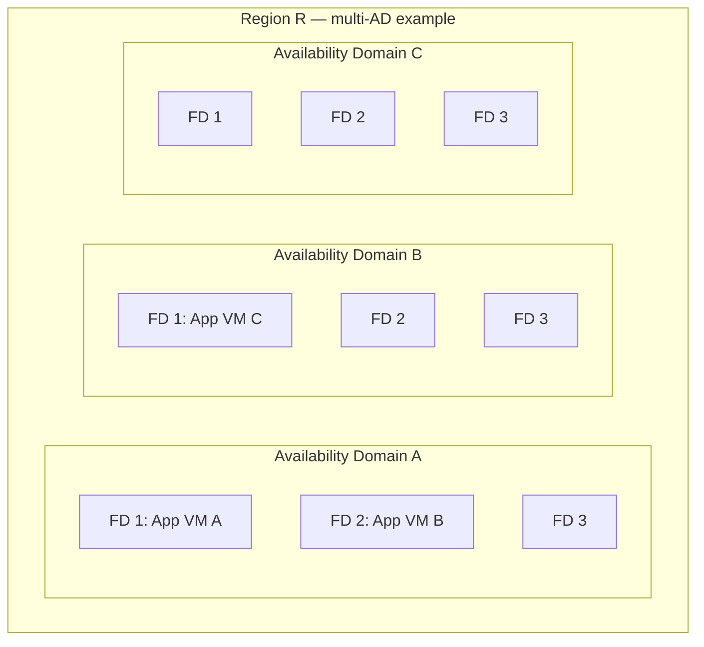

# Region, Availability Domain, and Fault Domain

## Objectives and Scope

In Oracle Cloud Infrastructure (OCI), deployment location determines which infrastructure failures can affect application components simultaneously. Three concepts to distinguish are **Region**, **Availability Domain (AD)**, and **Fault Domain (FD)**. Knowing their names is the first step; when designing, you must also determine where resources reside, how data is protected, and where traffic shifts during a failure.

This lesson belongs to the **Oracle Cloud Infrastructure Overview** chapter, laying the foundation for practical labs on VCN, Compute, storage, Oracle databases, and infrastructure automation. After this lesson, you can:

- Describe the Region → AD → FD relationship and the boundaries of each fault-isolation scope.
- Distinguish physical resource placement from administrative scope using tenancy, compartments, and IAM.
- Explain why two VMs alone are not enough to prove an application has high availability.
- Check actual ADs and FDs and create an appropriate deployment plan for a small lab.

Region details and service behaviors were cross-checked against Oracle documentation as of **20/11/2026**. When deploying, check the list of regions, number of ADs, available services, and current capacity of your own tenancy; do not copy AD names from another account.

## 1. Relationship Among the Three Location Levels

According to [Physical Architecture Concepts](https://docs.oracle.com/en-us/iaas/Content/GSG/Concepts/concepts-physical.htm), a region is a geographic area; an AD consists of one or more data centers within a region; an FD is a grouping of hardware and infrastructure inside an AD. Each AD has three FDs.

| Level | Located Within | Design Significance |
| --- | --- | --- |
| Region | An OCI geographic area | Determines deployment location and the scope for evaluating regional outages |
| Availability Domain | A region | Separates components across infrastructure domains with greater independence within the same region |
| Fault Domain | An AD | Distributes resources to reduce simultaneous impact from hardware faults or Compute maintenance |

The following diagram illustrates a multi-AD region. The names `Region R`, `AD-A`, `AD-B`, and `AD-C` are only learning labels, not values used directly in APIs.



A and B in the diagram are in the same AD but different FDs; C is in a different AD from both of those machines. If the goal is to keep an application instance running when all of AD-A becomes unavailable, placing only A and B in two FDs inside AD-A does not meet that goal.

The name `FAULT-DOMAIN-1` has meaning within a specific AD. When describing placement, state the full tuple **region, AD, FD**; writing only “machine in FD 1” does not identify the machine's fault domain.

## 2. Region: Geographic Choice and Service Scope

### 2.1. Do Not Assume Every Region Has Three ADs

A region has one or more ADs. At the reference date, Oracle's region table lists `ap-singapore-1` with one AD and `eu-frankfurt-1` with three ADs. Retrieve the list and AD count from [Regions and Availability Domains](https://docs.oracle.com/en-us/iaas/Content/General/Concepts/regions.htm).

Suppose a guide asks you to create two VMs in AD 1 and AD 2. If the region you are using has only one AD, you must adjust the lab goal: you can practice spreading across FDs within the available AD, but must clearly note that tolerance for losing an entire AD has not been tested. Do not rename an FD to an AD just to match a guide's diagram.

### 2.2. Choosing a Region Based on Application Requirements

When choosing a region, evaluate user location, data residency requirements, services needed, number of ADs, and relationships with dependent systems at the same time. Oracle presents these criteria in [Cloud Foundation — Selecting a Region for Deployment](https://docs.oracle.com/en/cloud/foundation/cloud_architecture/governance/regions.html).

For a Java application serving users in Vietnam, measure latency to available regions rather than only looking at distance on a map. Then check where the database and frequently called services are located. A VM close to users that queries a database in a very distant region may still respond slowly.

You can use a decision table before deployment:

| Criterion | Information to Gather |
| --- | --- |
| Users | Primary access locations, acceptable latency |
| Data | Residency, backup location, and permitted recovery location requirements |
| Services | Whether required services, features, and shapes exist in the region |
| Fault tolerance | Need to survive loss of a machine, an FD, an AD, or an entire region |
| Operations | How the operations team can test, fail over, and rebuild the system |
| Cost | Cost of standby resources, storage, and data transfer for the option |

These are design questions. A region appearing in OCI's list does not prove the tenancy has permission or capacity to create every configuration there.

### 2.3. Home Region and the Active Region in the Console

The home region is tied to initial account information and identity resources; it cannot be changed after the tenancy is provisioned. A tenancy can use subscribed regions subject to account terms and limits. Selecting a different region in the Console does not move existing VMs or VCNs to that region. See [Managing Regions](https://docs.oracle.com/en-us/iaas/Content/Identity/Tasks/managingregions.htm).

When a resource is not visible, verify the right region and compartment before concluding the resource was deleted. For regional resources, the wrong filter can show an empty list even while the resource exists in another region.

## 3. Availability Domain: Infrastructure Isolation Scope Within a Region

ADs within the same region are designed to be independent in components such as power, cooling, and internal AD networking. Between ADs there is high-bandwidth, low-latency connectivity. An outage in one AD is unlikely to make other ADs in the same region unavailable from the same infrastructure cause. Refer to [Cloud Foundation — Availability & Fault Domains](https://docs.oracle.com/en/cloud/foundation/cloud_architecture/governance/regions.html).

From this characteristic, you can place two application instances in two ADs to reduce dependence on a single AD. However, the application only keeps serving if the remaining layers also keep working: network entry point, data, authentication, configuration, and capacity of the surviving instance.

### 3.1. Example of Two VMs With a Single Data Point of Failure

Suppose an order-management system has:

```text
App VM A: AD-A
App VM B: AD-B
Single database: AD-A
```

If AD-A becomes unavailable, B may still run its Java process yet cannot read or write orders. The appropriate conclusion is **the application tier is distributed across ADs, while the data tier still depends on AD-A**. There is no basis to claim the whole service tolerates an AD outage.

When drawing diagrams, include the database, file storage, and dependent services. A diagram showing only two VM icons easily hides the remaining single point of failure.

### 3.2. AD Names Are Tenancy-Scoped

Oracle uses AD names with a tenancy-specific prefix. ADs sharing the same number across two tenancies do not necessarily point to the same physical data center. Therefore, retrieve AD names from your own tenancy via the Console or API; do not treat a name string in a tutorial as a universal value. See [Your Tenancy's Availability Domain Names](https://docs.oracle.com/en-us/iaas/Content/General/Concepts/regions.htm).

In automation code, pass the resolved AD name or map it by deployment configuration. Avoid tying business logic to the assumption “the first element in the list is always the desired location”.

## 4. Fault Domain: Hardware Distribution Within an AD

FDs support **anti-affinity**: spreading instances so they do not sit on the same physical hardware inside an AD. The goal is to reduce simultaneous impact from hardware faults or Compute maintenance within one FD. This remains inside the AD scope, so machines in different FDs still share dependence on that AD. Refer to [Resilience and Availability FAQ — Fault Domains](https://www.oracle.com/cloud/iaas/faq.html).

Example in a region with only one AD:

```text
Region R
└── AD-A
    ├── FAULT-DOMAIN-1: app-01
    ├── FAULT-DOMAIN-2: app-02
    └── FAULT-DOMAIN-3: unused
```

This layout is useful when `app-01` and `app-02` serve the same function and the system can route traffic to the healthy machine. If application B only runs reports while application A accepts orders, placing them in different FDs does not create a standby for accepting orders.

### 4.1. Specifying Placement vs. Letting the System Allocate

When creating a Compute instance, you can specify an FD; if unspecified, OCI picks a placement and attempts to spread according to capacity. For an instance pool, the default is also capacity-based distribution; you can request even distribution across selected FDs. When an FD lacks capacity, a strict distribution requirement can cause creation or scaling operations to fail. See [Regions and Availability Domains — Fault Domains](https://docs.oracle.com/en-us/iaas/Content/General/Concepts/regions.htm) and [Managing Instance Pools](https://docs.oracle.com/en-us/iaas/Content/Compute/Concepts/instance-pools.htm).

Both choices serve different goals:

- For a single-machine lab, letting OCI choose the FD may be sufficient for observation and connectivity goals.
- For a lab exercise requiring two application instances in two FDs, define the required placement and verify the result after creation.

Do not infer placement solely from VM count. If a configuration requires different FDs yet creation fails, record that the goal was not met instead of silently placing both in one FD.

### 4.2. Different FDs Do Not Fix Shared Software Faults

Two instances in two FDs can fail together if both receive a bad release, both have an expired certificate, or both depend on a data service that is down. Hardware isolation must be paired with release practices, health checks, and application state handling.

In a Java lab, you can design each VM to run the same application version, use clearly managed configuration, and avoid keeping critical login sessions only in one machine's memory. Only then should you test how stopping one application instance affects users.

FD distribution should be based on interchangeable components. For a configuration with only one web server and one database without redundancy, Oracle recommends placing both in the same FD to reduce the number of separate fault domains that can take down the entire application. This recommendation does not make the system HA; to improve service continuity, add appropriate redundancy. See [Best Practices for Your Compute Instances — Fault Domains](https://docs.oracle.com/en-us/iaas/Content/Compute/References/bestpracticescompute.htm).

## 5. Resource Scopes Directly Affect Design

### 5.1. Compartment Is an Administrative Scope

A compartment organizes resources and helps apply access permissions. It does not represent a data center or a physical fault domain. For example, a bucket belongs to a compartment yet is still created in a specific region, as described in [Overview of Object Storage](https://docs.oracle.com/en-us/iaas/Content/Object/Concepts/objectstorageoverview.htm).

Therefore, changing organization from `lab-a` to `lab-b` is not an infrastructure redundancy strategy. Two VMs in the same compartment can still be in different ADs; two VMs in different compartments can still sit inside the same AD.

### 5.2. Compute Requires AD and FD Placement

The AD is a required selection when creating a Compute instance. You can place instances in the same AD or different ADs depending on performance and redundancy requirements. See [Overview of the Compute Service](https://docs.oracle.com/en-us/iaas/Content/Compute/Concepts/computeoverview.htm).

A design inventory table should separate these columns:

| Resource | Region | AD | FD | Compartment | Function |
| --- | --- | --- | --- | --- | --- |
| `app-01` | R | AD-A | FD-1 | `lab` | Receives HTTP requests |
| `app-02` | R | AD-A | FD-2 | `lab` | Same function as `app-01` |
| `db-01` | R | AD-A | FD-3 | `data` | Only database in the example |

The values R and AD-A are illustrative symbols. The table shows FD distribution, yet all three components remain in the same AD. It also shows that the `data` compartment does not add physical independence for the database.

### 5.3. VCN and Regional Subnets

A VCN is created within a region. A subnet can be AD-specific or regional; Oracle recommends regional subnets because they are more flexible when designing across ADs. A regional subnet allows VNICs of instances in multiple ADs within the same region to use that subnet. It does not automatically give a VM an extra copy in another AD. See [Overview of VCNs and Subnets](https://docs.oracle.com/en-us/iaas/Content/Network/Tasks/Overview_of_VCNs_and_Subnets.htm).

For example, you can place `app-01` in AD-A and `app-02` in AD-B, both using one regional subnet for the application tier. If you use a subnet tied only to AD-A, that same subnet cannot be used for an instance in AD-B.

When changing placement, check subnet compatibility, network routing paths, and traffic-allowing rules. Changing AD while overlooking networking can create a running machine that does not participate in serving traffic.

### 5.4. Block Volumes and Boot Volumes Are Tied to an AD

A volume can only be attached to an instance in the same AD. You cannot take a block volume in AD-A and attach it directly to a VM in AD-B. A volume backup can be restored as a new volume in a different AD within the same region; backups can be copied to another region and restored there according to service capabilities. See [Overview of Block Volume — Regions and Availability Domains](https://docs.oracle.com/en-us/iaas/Content/Block/Concepts/overview.htm).

Design implication: if VM A uses a volume holding application data, VM B in another AD does not automatically have that data just because the same software is installed. You need to define how data is replicated or restored, how long that takes, and the consistency state of the restored copy.

Backups must also be restore-tested. A plan that only states “backups exist” does not indicate how quickly the application can resume operation.

### 5.5. Regional Services Have Their Own Availability Mechanisms

Object Storage is a regional service, not tied to a specific Compute instance. Regional scope does not automatically mean data has been replicated to another region. See [Overview of Object Storage](https://docs.oracle.com/en-us/iaas/Content/Object/Concepts/objectstorageoverview.htm).

For OCI Load Balancer, redundancy also depends on AD count and subnet type. In a single-AD region, primary and standby remain in the same AD and therefore cannot fail over to another AD if that entire AD goes down. Refer to [Load Balancer Types](https://docs.oracle.com/en-us/iaas/Content/Balance/Concepts/load_balancer_types.htm).

For Oracle database services, read the deployment model and HA/DR mechanisms of the specific service chosen. Do not mechanically apply a two-VM layout to every Database service, nor assume a managed service already meets every application recovery target.

## 6. From Resource Placement to Application Availability

**High availability (HA)** aims to maintain service against failures within the design scope. **Disaster recovery (DR)** adds recovery after a major outage. Oracle's [Resiliency](https://docs.oracle.com/en-us/iaas/Content/cloud-adoption-framework/era-resiliency.htm) document discusses using FDs, ADs, and multiple regions in these approaches.

The following table is a design analysis for learning examples, not a guarantee that choosing placement alone keeps an application running continuously:

| How App Replicas Are Placed | Distribution Achieved | What Still Must Be Solved |
| --- | --- | --- |
| Two VMs same FD, same AD | Two serving processes | Still share hardware FD fault domain; review placement |
| Two VMs different FDs, same AD | Reduced dependence on one FD | Still depends on AD; need traffic failover and data protection |
| Two VMs different ADs, same region | Reduced dependence on one AD | Still depends on region and shared services |
| Two environments in two regions | Recovery site outside primary region | Need data replication, routing, configuration, and failover runbook |

### 6.1. Lab Example in a Single-AD Region

Suppose you want to practice with a Java API that has two application instances. The lab goal is that when one application process stops, users can still reach the API through the configured entry point.

Learning plan:

1. Place two VMs with the same function in two different FDs inside the available AD.
2. Configure the entry point to distribute traffic to both instances and detect an unhealthy instance.
3. Keep critical data in a clearly managed location; document the limits of the data tier.
4. Test the capacity of one VM when the other VM stops serving.
5. Record failure detection time, failed request rate, and recovery time.

Results only prove behavior against the failure tested. **Stopping one process does not fully simulate losing an entire FD or AD.** Do not use that result to claim AD-level fault tolerance has been verified.

### 6.2. Design Example for Surviving Loss of One AD

Suppose the ordering application must keep serving when one AD becomes unavailable. The design must place an application instance in another AD and eliminate single dependence on the failed AD.

Questions to answer before deployment:

- Is the service entry point still reachable when that AD is down?
- Does order data have a usable copy in the surviving scope?
- Do authentication components, uploaded files, and queues still work?
- Does the remaining application instance have enough capacity to handle the load?
- Is the failover mechanism automatic or does it require an operator, and has it been tested?

For Compute, Oracle also recommends designing standby nodes in different ADs and backing up data in [Best Practices for Your Compute Instances](https://docs.oracle.com/en-us/iaas/Content/Compute/References/bestpracticescompute.htm). Exact configuration still depends on the services and data requirements of the system.

### 6.3. When Another Region Is Needed for DR

Two ADs in the same region still share the regional geographic scope. If recovery requirements include a region-wide outage, consider an environment in another region along with mechanisms to preserve data and switch service.

Two metrics to lock down are:

- **RTO (Recovery Time Objective):** target time to restore service after an outage.
- **RPO (Recovery Point Objective):** acceptable data loss expressed as a time interval.

Refer to [Disaster Recovery](https://docs.oracle.com/en-us/iaas/Content/cloud-adoption-framework/disaster-recovery.htm). For example, targets of a 60-minute RTO and 15-minute RPO are requirements set by the operations team; recovery testing must be used to evaluate whether they are met. Having created a VM in a second region does not prove those two targets are achieved.

Do not equate replication with backup. For example, Object Storage replication can propagate delete operations to the destination depending on service policy, so recovery from accidental deletion must be designed separately. See [Object Storage Replication](https://docs.oracle.com/en-us/iaas/Content/Object/Tasks/usingreplication.htm).

## 7. Observing Actual Placement With the Console and CLI

### 7.1. Checking in the Console

If lab resources already exist, observe them in order:

1. Select the correct tenancy and region in the Console.
2. Select the compartment containing the resource and open Compute instance details.
3. Locate Availability Domain and Fault Domain information under details or placement.
4. Open the VNIC's subnet to determine whether the subnet is regional or AD-specific.
5. Open the associated boot volume or block volume and cross-check its AD against the instance.
6. Record the placement of application instances and all dependent data components.

If no VM exists yet, you can view AD choices in the instance creation form to understand the environment. You do not need to submit the creation request to complete this inspection. Field names and section positions in the Console may change; look for AD, FD, and placement information.

### 7.2. Listing ADs With the OCI CLI

The command section assumes the OCI CLI is installed, credentials are configured, and you have permission to read the required information. Replace placeholder strings before running; do not put private keys into commands or shared notes.

PowerShell example:

```powershell
$tenancyOcid = 'REPLACE_WITH_YOUR_TENANCY_OCID'
$regionId = 'REPLACE_WITH_SUBSCRIBED_REGION_ID'

oci iam availability-domain list --compartment-id $tenancyOcid --region $regionId --all --query 'data[].name' --output json
```

The command returns AD names in the queried tenancy and region context. `--region` takes a region identifier, such as `ap-singapore-1` if the tenancy can use that region. Copy the exact full AD name from the output; do not construct prefixes yourself or take illustrative names from the lesson.

CLI documentation notes that result order may vary, so do not rely on element position to hardcode an AD for an architecture. Refer to [OCI CLI — availability-domain list](https://docs.oracle.com/en-us/iaas/tools/oci-cli/latest/oci_cli_docs/cmdref/iam/availability-domain/list.html).

### 7.3. Listing FDs in an AD

Use the exact full AD name obtained in the previous step:

```powershell
$adName = 'PASTE_FULL_AD_NAME_FROM_ABOVE_RESULT'

oci iam fault-domain list --compartment-id $tenancyOcid --availability-domain $adName --region $regionId --all --query 'data[].name' --output json
```

The expected output format is a list of FD names:

```json
[
  "FAULT-DOMAIN-1",
  "FAULT-DOMAIN-2",
  "FAULT-DOMAIN-3"
]
```

This is a read/list operation; it does not create or move VMs. If access is denied, verify the active profile, tenancy, region, and corresponding IAM permissions; do not change placement to work around an authentication error. Refer to [OCI CLI — fault-domain list](https://docs.oracle.com/en-us/iaas/tools/oci-cli/latest/oci_cli_docs/cmdref/iam/fault-domain/list.html).

## 8. Designing With Cost Control and Feasibility

Increasing the number of application instances means increasing the resources to manage. Multi-AD or multi-region options may also add data resources, storage, data transfer, network entry points, and operational effort. Before choosing, list components along with quantity, placement, and retention duration; check pricing and current account terms.

For an introductory lab, learning outcomes can be split into two levels:

- **Observation:** list ADs/FDs, inspect existing resource placement, and draw a dependency diagram.
- **Deployment when feasible:** create application instances with chosen placement, test traffic failover, and clean up resources after the session.

There is no need to expand a lab across multiple regions merely to memorize terms. If you lack permissions or budget, a diagram accurately documenting the limits of the current environment is still a useful outcome.

### 8.1. Capacity Differs From Desired Placement

Architecture configuration describes desired placement; actual provisioning depends on capacity and applicable limits. With an instance pool, a requirement for even distribution across FDs can fail if one FD lacks room, as described in [Managing Instance Pools](https://docs.oracle.com/en-us/iaas/Content/Compute/Concepts/instance-pools.htm).

When an error occurs, record:

```text
Region:
Requested AD:
Requested FD or system-chosen:
Shape and instance count:
Error message:
Actual placement of created instances:
Whether the fault-tolerance goal is still met:
```

If you adjust placement to finish the lab, update the diagram and conclusions accordingly. Do not keep the claim “two different FDs” when the final outcome no longer satisfies it.

### 8.2. Preserve Reproducibility and Measure Outcomes

When learning automation, store region parameters, AD names, and FD requirements in configuration suited to each environment. Keep ways to rebuild the application, network settings, and data recovery procedures. Post-deployment placement inventory helps detect drift between intended configuration and running resources.

When testing availability, measure from the user's perspective: does the endpoint respond, is the data accurate, and do requests complete? A VM's `RUNNING` state is only an infrastructure signal, not verification of the entire service.

## 9. Misconceptions to Avoid

| Common Misconception | Appropriate Understanding |
| --- | --- |
| Every region has three ADs | AD count varies by region; check the actual region |
| Each FD is an independent data center | FDs sit inside an AD and provide isolation at a smaller scope than an AD |
| Different compartments mean redundancy | Compartments serve organization and access control; physical location must be checked separately |
| Having two VMs means HA | They need the same function, proper distribution, working data, and working traffic failover |
| A regional subnet makes a VM survive an AD outage | Subnets cover networking scope; each VM still has a specific AD placement |
| A volume can attach to a VM in any AD | Direct attachment requires the same AD; restoring to another AD requires appropriate mechanisms |
| Different FDs survive losing an entire AD | Those FDs are still in the same AD |
| Having a bucket means off-region backup | Storage location and actual replication or backup configuration must be checked |
| Stopping one VM proves region fault tolerance | Test results are valid only within the scope of the simulated failure |

## 10. Practice: Mapping Fault Domains for a Small Application

This exercise prioritizes observation and design; deploy further only when permissions, capacity, and budget allow.

### Step 1 — Identify the Environment

Choose a region in use. Record the region identifier, observed AD count, full name of each AD, and list of FDs in one AD. You can use the Console or the two CLI commands above.

### Step 2 — Inventory Application Components

Build a table for the Java application containing planned or existing components:

```text
HTTP entry point:
First application instance:
Second application instance, if any:
Database:
File storage and data to retain:
Required external/supporting services:
```

For each component, add region, AD/FD if the service has that scope, compartment, and redundancy mechanism. Write “not applicable” for fields that do not fit; do not invent an FD for a bucket just to fill every column.

### Step 3 — Choose One Fault-Tolerance Goal

Choose a specific goal, such as “the API keeps serving when one application instance is down”. Then mark which components must stay alive to complete a read or write request.

If raising the goal to “survive loss of one AD”, redraw placement and specify the plan for data, entry point, and remaining capacity. If the region has only one AD, note that this goal cannot be tested by spreading to a second AD in the current region.

### Step 4 — Describe the Test and Its Limits

Clearly write the simulated action, observed signals, success criteria, and how to restore the environment. For example, stopping one application process and measuring HTTP requests through the entry point tests traffic failover against a process failure; it is not equivalent to a full AD outage.

### Step 5 — Finalize Documentation

Expected outputs include a Region → AD → FD diagram, placement table, fault-tolerance goal, and list of dependencies that remain single points of failure. If deployed, add actual observed results and clean up resources that do not need to be kept.

You complete this lesson when you can explain **where resources sit, which failures are isolated, and which dependencies can still take the application down**. This forms the basis for choosing VCN, Compute, storage, and database options in subsequent lessons.