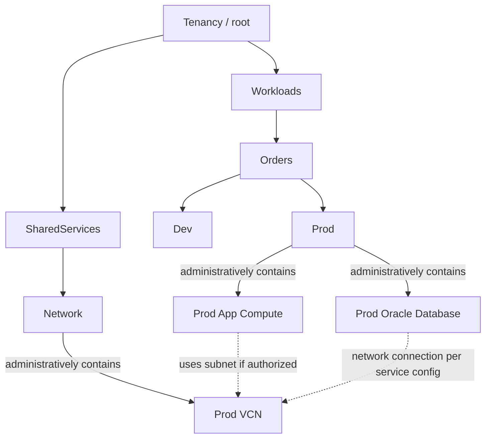

# Tenancy, Compartments, and Resource Hierarchy Model

## Objectives and Context

Before creating a VCN, Compute instance, or Oracle Database on Oracle Cloud Infrastructure (OCI), operators need to answer: which organization owns the resources, which team is responsible, who has management permissions, and where are costs tracked?

In the **Oracle Cloud Infrastructure Overview** chapter of the **CLOUD_PROVIDERS_ORACLE** module, this lesson explains tenancy, compartments, and the resource hierarchy tree. This is the foundation for deploying OCI infrastructure with authorization, monitoring, automation, and cost control. A clear compartment tree also helps organize environments for high-availability solutions; the tree itself does not create application availability.

After this lesson, learners can:

- Distinguish tenancy, root compartment, child compartments, and service resources.
- Read a compartment tree and determine administrative scope.
- Explain the relationship among compartments, regions, and inherited IAM permissions.
- Propose ways to organize Dev/Prod, shared resources, and learning environments.
- Create a lab compartment tree, verify the right parent, and identify the impact of move operations.

## 1. Tenancy Is OCI's Top-Level Governance Space

When an organization begins using OCI, the tenancy is the governance space containing that organization's resources and related configurations. A tenancy has a name, OCID, and home region; administrators can view this information on the tenancy details page. [Tenancy information in OCI](https://docs.oracle.com/en-us/iaas/Content/General/tenancy/managingtenancy.htm).

Within this lesson's scope, picture it as:

```text
Organization Tenancy
  ├── Governance and identity configuration
  ├── Compartments
  └── OCI service resources
```

One tenancy can hold multiple environments, multiple operations teams, and resources across multiple regions that the tenancy has subscribed to. Everything belonging to the same tenancy does not mean every user can view or modify every resource.

### Tenancy Differs From Users and Login Accounts

An engineer signs in with an authorized identity to work inside the tenancy. That person is not the tenancy. Multiple users can work in the same tenancy with different permission scopes.

For example:

- The networking team manages VCNs and route tables.
- The application team deploys Compute for the Dev environment.
- The database team manages the Prod database.
- The finance team views usage and cost information within its granted scope.

You do not need to create a new tenancy for each server or team member. For separating administration within the same organization, compartments are usually one of the first tools to consider.

### Home Region Is Not Where Every Resource Must Reside

The home region is important information for the tenancy and certain identity administration operations. It does not mean all Compute, VCN, or database resources must reside in that region.

For example, an organization can deploy applications in one region and recovery resources in another subscribed region. Learners must check each service's scope and design cross-region deployment separately, rather than inferring resource placement solely from the home region.

## 2. Root Compartment and Child Compartments

The **root compartment** is the root level of the compartment tree in a tenancy. In OCI administrative terminology, tenancy is also used to refer to the root scope when writing many policies.

Below root, administrators can create compartments and continue creating child compartments. Compartments are used to organize resources and define the scope of many governance mechanisms.

Simple example:

```text
Tenancy / root compartment
├── SharedServices
│   ├── Network
│   └── Security
├── Workloads
│   └── Orders
│       ├── Dev
│       └── Prod
└── Sandbox
```

In this tree:

- `Dev` has `Orders` as its direct parent.
- `Orders` sits under `Workloads`.
- `Network` and `Security` are two sibling compartments.
- `Sandbox` is separated to clarify accountability for experimental resources.

A compartment has a name, description, OCID, and parent relationship. OCI supports nested compartment trees up to six levels deep below root under the current limit; do not exhaust the depth merely because the system permits it. [Managing compartments and limits](https://docs.oracle.com/en-us/iaas/Content/Identity/Tasks/managingcompartments.htm).

### Why Not Put All Resources in Root?

If every server, VCN, database, and experimental tool sits in root, per-project authorization and tracking owners become harder. A policy change at the tenancy scope can also have a very broad impact.

A sensible design choice is to reserve root for objects required at that level and shared governance settings, then place workloads into compartments with clear purposes.

This is an organizational choice, not a rule that OCI forbids creating service resources in root. Nor should you arbitrarily move system objects out of root just to make the tree look tidy.

## 3. Compartments Organize Resources Logically

A compartment is not a server, a subnet, or a folder containing configuration files. It is an OCI governance object.

When creating a resource that supports compartments, operators typically must specify the compartment containing that resource. For a resource such as a Compute instance, which compartment it belongs to is part of the resource's governance metadata.

Example table for the ordering system:

| Resource | Planned Governance Compartment | Meaning |
| --- | --- | --- |
| VCN for Dev | `SharedServices:Network` | Networking team is responsible |
| VCN for Prod | `SharedServices:Network` | Same management team, but a separate VCN |
| Compute running Dev app | `Workloads:Orders:Dev` | Dev team operates within granted scope |
| Compute running Prod app | `Workloads:Orders:Prod` | Production permissions are managed separately |
| Prod system database | `Workloads:Orders:Prod` | Follows the environment scope in this design |
| Personal experimental resources | `Sandbox` | Has an owner and expiration period |

Colons in the table describe the path through the compartment tree. They are not a single compartment name containing that whole string.

### Compartment Relationships Differ From Technical Relationships

A Compute instance can belong to an application compartment while using a subnet in a VCN managed by the networking team in another compartment, when service configuration and access permissions allow.

Similarly, Compute and a database sitting in the same compartment does not guarantee the two can communicate. Connectivity still depends on the VCN, subnets, routes, security rules, endpoints, and running services.



In the diagram, dashed edges represent technical dependencies. They do not turn the VCN into the parent compartment of the instance or database.

### A Resource Cannot Belong to Two Compartments Simultaneously

For standard service resources that have a compartment field, at any given time a resource has one compartment containing it. If you need multi-dimensional reporting such as responsible team, project, and cost center, combine the compartment tree with tags instead of trying to place the same resource into multiple branches.

Service-managed objects have their own ownership and dependency rules. Do not assume every OCI resource type is created, viewed, or moved identically to a Compute instance.

## 4. Compartments and Regions Are Two Different Dimensions

Compartments are tenancy-wide in scope and are not restricted to a single region. Meanwhile, many service resources such as VCNs or Compute instances are created and viewed by region. [Working with resources across regions](https://docs.oracle.com/en-us/iaas/Content/GSG/Concepts/working-with-regions.htm).

For example:

```text
Compartment: Workloads:Orders:Prod
  ├── Instance A in the first region
  └── Instance B in the second region
```

Two instances can belong to the same compartment yet not the same region. When opening the Compute page in the first region, a user will not necessarily see instance B.

| Action | What Changes | What to Check Separately |
| --- | --- | --- |
| Switch active region in the Console | Region scope of the service page | Currently selected compartment |
| Select another compartment | Governance scope of the list | Currently active region |
| Move a resource to another compartment | Where the resource is governed | Specific behavior of the service |
| Deploy a resource in another region | Placement of the new resource | Networking, data, redundancy, and cost |

There is no “drag a Compute instance to another compartment” action that turns it into a cross-region replica. Moving governance location and moving deployment location are two different problems.

### Common Scenario: Resource Not Visible

An engineer opens `Workloads:Orders:Prod` and does not see the instance created the day before. Before concluding the resource was deleted, check:

1. Are you signed into the right tenancy?
2. Is the right region selected?
3. Is the right compartment or child-compartment view scope selected?
4. Does the current identity have permission to view that resource type?
5. Are name, state, or time filters excluding the resource from the list?

This check avoids creating a duplicate resource for the same purpose just because you were viewing the wrong scope.

## 5. Compartments Provide the Scope for IAM

Creating a new compartment does not automatically grant permissions to a specific development team. Users can perform actions only when their identity is allowed by an appropriate policy, including permissions granted from a higher level.

A policy typically expresses four parts:

```text
To whom → what level of action → on which resource type → in which scope
```

The following policy example is assumed to be created at root. The group `OrdersDevReaders` already exists in the `Default` identity domain:

```text
Allow group Default/OrdersDevReaders to read instance-family in compartment Workloads:Orders:Dev
```

Intended meaning: the group can read resources in the Compute instance family within the specified Dev compartment. This is not a policy allowing creation of an entire Compute environment with networking and volumes.

Another policy for the networking team:

```text
Allow group Default/NetworkAdmins to manage virtual-network-family in compartment SharedServices:Network
```

This policy scopes network resources in the specified branch. It does not automatically grant database administration permissions in `Workloads:Orders:Prod`.

Domain names, group names, and compartment paths must match the actual environment. OCI supports qualifying groups by identity domain and specifying compartments by name, path, or OCID. [IAM policy components](https://docs.oracle.com/en-us/iaas/Content/Identity/policieshow/Policy_Basics.htm), [how to specify compartment scope](https://docs.oracle.com/en-us/iaas/Content/Identity/policysyntax/location.htm).

### Policy Storage Location Differs From Statement Scope

Two questions must be separated:

- In which compartment is the policy created and managed?
- On which scope of resources does the statement inside the policy grant permissions?

For example, a policy located at root can still grant access only to `Workloads:Orders:Dev`. That does not turn the granted permission into tenancy-wide access.

Policy location relates to permission to manage the policy itself and the scope to which the policy can apply. Do not grant broad policy-management rights to a team that only needs to view instances. [Policy attachment and how policies work](https://docs.oracle.com/en-us/iaas/Content/Identity/Concepts/policies.htm).

## 6. Inherited Permissions Flow From Parent to Child

If a policy allows managing a resource family in a parent compartment, that permission can also apply to child compartments in the branch. [Policy inheritance in OCI](https://docs.oracle.com/en-us/iaas/Content/Identity/Concepts/policies.htm).

Consider a policy created at root:

```text
Allow group Default/OrdersOperators to manage instance-family in compartment Workloads:Orders
```

With the example tree, this scope includes both `Dev` and `Prod` under `Orders`. If the goal is only to let the group operate on Dev, placing the scope at `Orders` is too broad.

Conversely, granting permissions at `Workloads:Orders:Dev` does not automatically create permissions in the sibling branch `Prod`.

### Permission Evaluation Example

Suppose an engineer belongs to the `OrdersOperators` group above and also to the `OrdersDevReaders` group:

| Resource Location | Permission From Example | Explanation |
| --- | --- | --- |
| Instance in Orders:Dev | Has manage permission from parent policy | An additional read policy does not narrow manage permission |
| Instance in Orders:Prod | Has manage permission from parent policy | Prod is inside the Orders branch |
| VCN in SharedServices:Network | Not granted by these two policies | Different branch and different resource family |

The table only evaluates the two policies in the scenario; it does not conclude a user's total permissions in a real tenancy. They may belong to other groups or be granted permissions through other policies.

### Why Adding a Narrow Policy Is Not Enough to Restrict Access

If a user already has broad permissions from a parent level or another group, adding a `read` statement in Dev does not override the existing `manage` permission.

To achieve read-only access in Dev, inspect all relevant permission sources and fix the overly broad grant. Do not assume a child compartment can automatically “mask” permissions granted from above with a narrower policy.

In operations, anyone testing permissions should use a lab identity without tenancy-wide admin rights. If testing with an admin account, succeeding in accessing Prod does not prove the Dev policy exceeded its scope.

## 7. Identity Domains, Groups, and Compartments Have Different Roles

In a tenancy using IAM identity domains, a domain organizes identity objects such as users and groups. Compartments organize resources and help define governance scope.

Every tenancy has a Default identity domain at root, containing the initial administrator user and the Administrators group under OCI's default model. Administering another identity domain does not equate to having tenancy-wide administrative rights. [Default identity domain](https://docs.oracle.com/en-us/iaas/Content/Identity/domains/the_default_domain.htm).

| Concept | Primary Responsibility |
| --- | --- |
| Identity domain | Manages identities, sign-in, and related identification settings |
| User | User identity |
| Group | Collection of identities for group-based authorization |
| Policy | Grants permission to perform actions within a defined scope |
| Compartment | Organizes resources and provides governance scope |

Creating an `Orders` compartment does not automatically create a group of the same name. Creating an `OrdersDevelopers` group also does not automatically create a compartment or grant access to the Orders project.

A clear operational design connects these concepts via policies: which group can do what in which compartment. This lays the groundwork for authorization when later deploying networking, databases, and automation tools.

## 8. Designing a Compartment Tree Around Responsibilities and Lifecycle

No single compartment tree fits every organization. You can start with three questions:

1. Who is responsible for operating the resources?
2. Which environments need separate permissions and change processes?
3. Which resources share a lifecycle or governance requirements?

### Project-First Then Environment Model

```text
Workloads
└── Orders
    ├── Dev
    ├── Test
    └── Prod
```

This model is convenient when a product team owns the entire system lifecycle. To grant access only for Dev, select the Dev branch directly; to grant permissions at the project level, evaluate the impact on Prod as well beforehand.

### Environment-First Then Project Model

```text
Environments
├── NonProd
│   ├── Orders
│   └── Inventory
└── Prod
    ├── Orders
    └── Inventory
```

This model can fit when an organization has a centralized production team. However, a policy placed at `Prod` will cover more projects than a policy placed on a single project child compartment.

### Shared Resources and Sandbox

A shared branch can hold networking managed by the platform team, security tools, or shared monitoring resources. Each service still needs placement suited to its characteristics; not every object has to be lumped into one branch merely because multiple teams use it.

A sandbox should have an owner, usage limits, and cleanup rules. Separating a branch only expresses scope; IAM, quotas, cost tracking, and operational procedures must be added to achieve the desired outcome.

### Avoid Over-Splitting Too Early

Creating a compartment per instance makes the tree hard to track when instances are replaced frequently. If two resource groups share the same owners, lifecycle, and permissions, they can stay in the same compartment and use tags for further classification.

Conversely, when Dev and Prod need different permissions, merely adding a tag `Environment=Prod` may not adequately enforce the governance boundary the organization wants. Choose the tree and policies first, then use tags to add reporting dimensions.

## 9. How Do Compartments, Tags, Budgets, and Quotas Work Together?

These four mechanisms support different purposes:

| Mechanism | Primary Question |
| --- | --- |
| Compartment | Within which governance scope does the resource sit? |
| Tag | By which attributes is the resource classified? |
| Budget | Has spending exceeded or is it likely to exceed alert thresholds? |
| Quota | How much resource consumption is allowed within this scope? |

### Tags Add Multi-Dimensional Reporting

Example tag set for lab resources:

```text
Owner = platform-training
Environment = dev
CostCenter = learning
Application = orders
```

This is an illustrative convention, not a pre-created tag namespace. When implementing defined tags, create the namespace and appropriate usage permissions.

Do not assume tagging a compartment automatically tags all existing resources inside it. If you need default values for new resources, look into tag defaults and verify actual behavior. For existing resources, verify actual tags rather than inferring them from tree position.

### Budgets Are for Tracking and Alerting

Budgets can track spending by compartment, including child compartments, or by tag. A budget is a soft threshold and supports alerts; it is not an automatic mechanism guaranteeing all services stop when a dollar amount is reached. [How OCI Budgets work](https://docs.oracle.com/en-us/iaas/Content/Billing/Concepts/budgetsoverview.htm).

For example, a lab budget helps the team notice spending exceeding plan. Operators must still inspect running resources and execute appropriate handling procedures.

### Quotas Limit Resource Consumption

Compartment quotas allow administrators to allocate certain supported resource types. When defining quotas, check the service family, quota name, and regional, availability-domain, or global scope. Service limits can still act as a lower cap that resources must obey. [Quota syntax and scope](https://docs.oracle.com/en-us/iaas/Content/Quotas/Concepts/quota_policy_syntax.htm).

A quota is not a monetary ceiling covering all costs. For instance, limiting one CPU type does not automatically cap all volumes, databases, storage, and logs. Cost-control design should combine appropriate quotas, budgets, usage tracking, and resource cleanup.

## 10. Practice: Creating a Lab Compartment Tree

This exercise only creates the governance structure; it does not require creating Compute or databases yet. Perform it in the tenancy and lab scope where the learner has been granted permissions.

Target tree:

```text
Tenancy / root
└── OCI-Lab
    ├── Dev
    └── Prod
```

`Prod` here is only a simulated branch name for learning permission scopes, not an actual production environment.

### Step 1: Confirm Scope

Sign into the right tenancy, view the tenancy OCID, and confirm permission to create compartments under the intended parent. If the organization already has a parent dedicated to training, use that parent instead of creating a new branch at root.

Record the name, OCID, and parent of each object during the exercise. OCIDs help distinguish compartments that share the same name across different branches.

### Step 2: Create the Parent and Two Child Compartments

In the Console, find Compartments under Identity, select the appropriate parent, and create `OCI-Lab`. Then open `OCI-Lab` details and create `Dev` and `Prod` underneath it.

Verify the parent field on each creation. If you accidentally choose root when creating Dev, the resulting tree will differ from the target even though the compartment name is right.

### Step 3: Re-Read the Tree

Confirm:

- Dev and Prod share the OCID of OCI-Lab as their parent.
- OCI-Lab has the parent matching the granted scope.
- Descriptions indicate these are training resources.
- No duplicate branch was created for the same purpose as an existing lab compartment.

### OCI CLI Illustration on PowerShell

The following snippet assumes the CLI is installed, authentication is configured, and the identity has permission to create compartments under root. This is code for learners to practice with, not commands already run on the learner's behalf.

```powershell
$tenancyId = '<your-tenancy-ocid>'

$labCompartmentId = oci iam compartment create `
    --compartment-id $tenancyId `
    --name 'OCI-Lab' `
    --description 'Lab on tenancy and compartments' `
    --query 'data.id' --raw-output

if ($LASTEXITCODE -ne 0) {
    throw 'Failed to create compartment OCI-Lab.'
}

$devCompartmentId = oci iam compartment create `
    --compartment-id $labCompartmentId `
    --name 'Dev' `
    --description 'Dev branch of the lab' `
    --query 'data.id' --raw-output

if ($LASTEXITCODE -ne 0) {
    throw 'Failed to create compartment Dev.'
}

$prodCompartmentId = oci iam compartment create `
    --compartment-id $labCompartmentId `
    --name 'Prod' `
    --description 'Simulated Prod branch of the lab' `
    --query 'data.id' --raw-output

if ($LASTEXITCODE -ne 0) {
    throw 'Failed to create compartment Prod.'
}

oci iam compartment get --compartment-id $devCompartmentId
oci iam compartment get --compartment-id $prodCompartmentId
oci iam compartment list --compartment-id $labCompartmentId --all
```

In the `create` command, `--compartment-id` specifies the parent where the new compartment is created. In the `get` command, the same parameter name specifies the compartment to read. Do not put the tenancy OCID into every command just because it is the first OCID a learner sees.

Examples of compartment creation commands are introduced by Oracle in [Getting Started with the CLI](https://docs.oracle.com/en-us/iaas/Content/GSG/Tasks/gettingstartedwiththeCLI.htm). If the environment requires IAM operations in the home region, configure a profile or select the region per administrator instructions.

The script is not idempotent: if a run stops after creating OCI-Lab, check existing resources before continuing rather than picking random names and creating another tree.

### Step 4: Illustrating Policy Scope

Suppose group `LabDevReaders` in the `Default` domain has been created. Someone with policy management permissions can use the following statement at root for the lab tree matching the example:

```text
Allow group Default/LabDevReaders to read instance-family in compartment OCI-Lab:Dev
```

To test resource read permissions, an actual lab instance in Dev and a suitable reference resource in Prod are needed, prepared by an authorized person. Do not create paid resources solely to confirm a compartment tree.

Use an identity that holds only the permissions being tested, then verify read capability in Dev and restricted scope in Prod. Not seeing a resource can also be due to the wrong region or filter, so always cross-check with a lab administrator identity.

Do not broaden a policy to `in tenancy` just to make a test operation stop returning an error.

## 11. Moving Resources and Moving Compartments

Two operations have similar names yet different impacts.

### Moving a Resource to Another Compartment

For example, moving an experimental instance from Sandbox to Dev changes where the instance is governed, if the resource type and service conditions permit.

Do not assume every dependent resource will move along with it. Some dependencies may follow the resource while others require separate handling; read the service's rules before proceeding. Permissions in the destination compartment apply after the move. [Moving a resource between compartments](https://docs.oracle.com/en-us/iaas/Content/Identity/compartments/To_move_a_resource_to_a_different_compartment.htm).

Before moving a resource, determine whether operators still have permissions at the destination, which automation references use the old compartment, and where dependent resources reside.

### Moving an Entire Compartment to Another Parent

For example:

```text
Before: Workloads:Orders:Dev
After:  Sandbox:Dev
```

At this point, the entire Dev branch and its contents change governance position in the tree. Inherited permissions from the old parent and the new parent must be re-evaluated.

A group with permissions at Workloads may lose its inherited permission path into Dev; a group with permissions at Sandbox may gain permissions over the moved branch. Other permission sources must still be reviewed. [Impact of moving a compartment](https://docs.oracle.com/en-us/iaas/Content/Identity/compartments/Working_with_Compartments.htm).

Policies containing paths, quotas, tags, and reporting tools must also be checked. Do not assume changing the parent is merely editing a display label with no governance impact.

### Cleaning Up Compartments

A compartment must be emptied before deletion. Check resources across regions, child compartments, and policies attached to the compartment; an empty Compute page does not prove a compartment has no remaining resources. [Managing and deleting compartments](https://docs.oracle.com/en-us/iaas/Content/Identity/Tasks/managingcompartments.htm).

In a lab, delete only branches and resources created by the exercise, after confirming no one else is using them. Do not use compartment deletion as a substitute for resource inventory.

## 12. Identifying and Handling Common Misconceptions

| Misconception | Correct Operational Understanding |
| --- | --- |
| Each region has its own copy of a compartment | Compartments are tenancy-wide in scope; service resources can be regional |
| Creating a compartment gives the dev team access | Appropriate policies or pre-existing permissions are required |
| Dev and Prod in two compartments means networking is blocked | Network connectivity still depends on VCN configuration and security controls |
| Same compartment means sharing one VCN | Compartments do not require resources to sit in the same network |
| A read policy at Dev lowers manage rights from the parent | You must fix the existing overly broad permission grant |
| A budget will automatically stop all services | Budgets primarily track and alert on soft thresholds |
| Changing compartment creates a copy in another region | It is a governance change, not cross-region replication |
| Tagging a compartment tags all resources inside it | Check tag defaults and actual tags on each resource |
| The right name is enough to select a compartment | Check both the path and the OCID |

A structured way to troubleshoot access errors is to verify identity, tenancy, region, compartment, effective policies, and permissions on dependent resources. For example, someone allowed to create instances in Dev may still lack permission to use a subnet located in a shared networking compartment.

Do not resolve every error by adding `manage all-resources in tenancy`. Identify which operation lacks permission and the scope needed to complete the exact task.

## 13. Self-Check of Understanding

Use the tree `SharedServices`, `Workloads:Orders:Dev`, and `Workloads:Orders:Prod` to answer:

1. Does an instance belonging to Dev that resides in a different region from the one selected in the Console necessarily appear?
2. If a group can manage instance-family at Orders, how does that permission affect Prod?
3. If the database and Compute sit in the same compartment, what else must be checked for them to connect?
4. If Dev is moved to another parent, why must both lost permissions and newly gained permissions be reviewed?
5. When cost reports need grouping by project and cost center, how can compartments and tags work together?

A complete answer should state governance scope, deployment location, and technical dependencies, rather than relying only on folder names or resource names.

## 14. Key Takeaways

A **tenancy** is the top-level governance space; **compartments** build a resource organization tree and provide the scope for many governance mechanisms. **IAM policies** connect identities to permissions within that scope, while **regions** determine the placement of many service resources.

When designing an Oracle system on OCI, start from team responsibilities, environments, and resource lifecycles. Then combine compartments with IAM, networking, tags, quotas, budgets, and monitoring. A clear tree gives Compute, storage, and database deployments a solid governance footing from the outset.