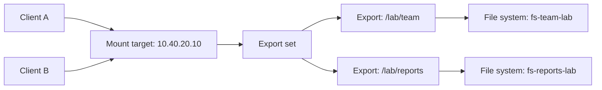

# File systems, mount targets, and export paths

## 1. Context and objectives

In the **File Storage** chapter of the **CLOUD_PROVIDERS_ORACLE** module, this lesson explains how an application accesses a shared file system on Oracle Cloud Infrastructure. You will connect storage concepts with Compute, VCN, compartment, and IAM, while identifying decisions that affect operability, availability, and cost.

Suppose two instances running a Java application need to read the same set of documents and exchange input files. If each machine stores files on its own boot volume, they cannot automatically see each other's data. OCI File Storage provides a network file system so clients can share access according to granted permissions.

After this lesson, you will be able to:

- Distinguish between a file system, mount target, export, and export set.
- Correctly read a mount address consisting of an endpoint and an export path.
- Distinguish between an export path, a mount point on the client, and a path inside the file system.
- Deploy a lab sharing data between two Linux clients.
- Isolate network errors, export errors, and file permission errors; understand the impact of unmounting or deleting resources.

The commands are examples for an authorized OCI environment, not an instruction to execute on the machine holding this documentation. Illustrative IPs, OCIDs, resource names, and accounts must be replaced with your lab values. The basic NFS example below assumes `AUTH_SYS` without Kerberos or a TLS tunnel configured yet.

## 2. What does File Storage provide?

OCI File Storage is a managed network file system service. The service supports NFSv3 and NLM for file locking. Clients with appropriate network connectivity can share access to the directory tree; you do not need to build your own VM as an NFS server for this lab. [Oracle: Overview of File Storage](https://docs.oracle.com/en-us/iaas/Content/File/Concepts/filestorageoverview.htm).

To choose the right model, start from how the application uses data:

| Access model | How the application sees data | Example needs |
| --- | --- | --- |
| File storage | Files and directories mounted into the operating system | Multiple machines reading the same documents or sharing a processing directory |
| Block storage | Block device managed by the operating system or software | Data drive for a single machine or storage design with its own coordination mechanism |
| Object storage | Objects accessed via API | Storing objects by key, integrating via HTTP or SDK |

A bucket does not inherently have the same semantics as a mounted filesystem. Similarly, attaching the same block volume to multiple machines does not automatically create a safe shared filesystem. You must choose based on access requirements while checking workload support conditions.

For Oracle Database, do not infer that simply succeeding with an NFS mount means the configuration meets all database requirements. Deployment type, version, support matrix, locking, latency, and backup strategy still need to be designed separately.

## 3. Four resources and one mount point on the client

### File system: where the data tree resides

A **file system** is the resource that holds files, directories, and their metadata. It has its own OCID and exists independently of the directory name a client chooses for access.

For example, the file system `fs-team-lab` might contain `incoming`, `processed`, and `reports` directories. Renaming the resource's display name is not the same as renaming individual files inside it.

### Mount target: the NFS endpoint in the network

A **mount target** is a managed network access point placed in a chosen subnet. It provides an IP or DNS name for clients to connect to. One mount target can serve multiple file systems through exports; you do not need to create a new mount target for every file system by default. [Oracle: Managing Mount Targets](https://docs.oracle.com/en-us/iaas/Content/File/Tasks/managingmounttargets.htm).

A mount target is an entry point to data, not a directory and not a local disk on the client.

### Export: linking a file system to an access address

An **export** links a file system to a mount target's export set, with an export path along with client access options. It answers the question: which path at this endpoint does a client use to access which file system, and under what rules?

### Export set: a mount target's collection of exports

An **export set** groups the exports provided by a mount target. When working via CLI or API, distinguish the export set OCID from the mount target OCID and file system OCID.

Illustrative diagram:



Export rules determine how a file system is exposed through a mount target. A file system can also be exported through another mount target subject to service conditions; having an additional endpoint does not create an additional copy of the data. [Oracle: NFS Exports and Export Options](https://docs.oracle.com/en-us/iaas/Content/File/Tasks/exportoptions.htm).

### Mount point: a directory chosen by the client

A **mount point** is a local directory where the operating system attaches the remote filesystem to the client's directory tree. It is not an OCI resource with an OCID.

Client A might use `/mnt/team-share`, while client B uses `/srv/team-share` to access the same file system. Two different local names do not split the data into two copies.

## 4. Distinguishing three types of paths

Consider the command:

```bash
sudo mount -t nfs -o vers=3,proto=tcp,hard \
  10.40.20.10:/lab/team /mnt/team-share
```

| Component | Role |
| --- | --- |
| `10.40.20.10` | IP of the mount target |
| `/lab/team` | Export path at the mount target |
| `/mnt/team-share` | Mount point on the client |
| `/incoming/order-101.csv` | Example path relative to the root inside the file system |

After mounting the export above, the example file is accessed on client A at:

```text
/mnt/team-share/incoming/order-101.csv
```

If client B mounts the same export at `/srv/team-share`, the corresponding path is:

```text
/srv/team-share/incoming/order-101.csv
```

The export path does not automatically create `lab/team` directories in the data. Therefore, do not append it again as `/mnt/team-share/lab/team/incoming/order-101.csv`.

In the OCI model, the export path identifies the file system at the mount target and is independent of both the path inside the file system and the client's mount point. [Oracle: Paths in File Systems](https://docs.oracle.com/en-us/iaas/Content/File/Concepts/filesystempaths.htm).

Design consequence: setting two different export names does not create two independent data areas. To separate data, you must design the corresponding file systems, directories, access permissions, and provisioning mechanisms; the path name is only one part of that design.

## 5. Rules for naming export paths

The export path needs to be stable because clients and deployment configurations will reference it. Choose a name that reflects its purpose and does not contain passwords, tokens, or information that must remain confidential.

Important rules include: starting with `/`, having no trailing `/`, containing no `.` or `..` segments, and not creating conflicting parent/child path relationships within the same export set. [Oracle: Creating an Export](https://docs.oracle.com/en-us/iaas/Content/File/Tasks/create-export.htm).

| Paths in the same export set | Evaluation |
| --- | --- |
| `/lab/team` and `/lab/reports` | Two different branches, suitable for the example |
| `/team` and `/team2` | Two different name segments |
| `/lab` and `/lab/team` | Conflict because one path contains the full sequence of segments of the other |
| `/` and `/lab/team` | Conflict with the root path |
| `/lab/team/` | Has a trailing `/`, invalid |
| `/lab/../team` | Contains a `..` segment, invalid |

Do not confuse the rules above with creating parent/child directories inside the filesystem. Inside the data, you can still design a directory tree like `incoming/2026/11` normally according to granted permissions.

An export path cannot be edited directly after the export is created. If a change is needed, you must plan to create or replace the export according to existing resource constraints and update clients. This is not like renaming a local directory. Before making changes, inventory all clients, automatic mount configurations, and applications that depend on the old path.

## 6. Placement: availability domain, subnet, and compartment

A file system is exported through a mount target located in the same availability domain as itself. Clients do not have to be in the same availability domain just to perform NFS access; network conditions and link characteristics must still meet the requirements. [Export creation prerequisites](https://docs.oracle.com/en-us/iaas/Content/File/Tasks/create-export.htm).

When designing the lab, you can choose:

| Component | Illustrative value |
| --- | --- |
| Client subnet | `10.40.10.0/24` |
| Client A | `10.40.10.11` |
| Client B | `10.40.10.12` |
| Mount target subnet | `10.40.20.0/24` |
| Mount target IP | `10.40.20.10` |
| Export path | `/lab/team` |

This is an illustrative addressing scheme and does not guarantee those IPs are free in a real VCN. You must read the IP assigned to the mount target before using it in commands.

Oracle recommends separating the client subnet and mount target subnet to make address control easier and avoid affecting the IP capacity needed by the service. A mount target requires multiple IP addresses; do not count only the single IP appearing in the mount command when planning the subnet. [Oracle: VCN Security Rules for File Storage](https://docs.oracle.com/en-us/iaas/Content/File/Tasks/securitylistsfilestorage.htm).

Compartments help organize resources and administrative permission scopes. Placing the client and file system in two different compartments does not automatically create a firewall between them. Conversely, being in the same compartment does not mean NFS access is permitted.

If the client is on-premises, there must be a network path such as VPN or FastConnect with proper routing. Do not expose NFS to the public Internet as a substitute for a properly designed private connection.

## 7. Independent permission layers

### IAM manages resources, NFS accesses data

IAM controls administrative operations such as viewing, creating, updating, or deleting File Storage resources. File read permissions on a client also depend on the network, exports, and filesystem permission mechanisms. [Oracle: About File Storage Security](https://docs.oracle.com/en-us/iaas/Content/File/Concepts/securitylayers.htm).

Example policy for a group that only observes resources in the lab compartment:

```text
Allow group FileStorageObservers to read file-family in compartment storage-lab
```

The group and compartment names must match the tenancy, including identity domain identifiers if used. The policy above does not grant full infrastructure creation or network configuration permissions, and does not by itself allow a Linux account to read every file over NFS. [Oracle: File Storage policy reference](https://docs.oracle.com/en-us/iaas/Content/Identity/Reference/filestoragepolicyreference.htm).

### The network must serve the right protocols

NFSv3 uses RPC, MOUNT, and locking components, so opening only TCP/2049 is not a complete configuration for every case. For scenarios where the client and mount target are in different subnets, OCI documentation describes the following typical port group:

| Protocol | Destination port at mount target |
| --- | --- |
| TCP | `111`, `2048`, `2049`, `2050` |
| UDP | `111`, `2048` |

You must configure ingress toward the mount target, egress from the client, and stateful or stateless conditions according to the actual scenario. Restrict the source to the permitted client IP or CIDR. Rules for TLS, Kerberos, or other networks may differ from the illustrative table. [OCI security rules example](https://docs.oracle.com/en-us/iaas/Content/File/Tasks/securitylistsfilestorage.htm).

### Export options restrict individual client sources

Export options can specify the source IP/CIDR, read-only or read/write, whether a privileged source port is required, and identity mapping such as root squash. For a two-client lab, one plan is to allow only the two chosen `/32` IPs to access, rather than opening the entire source range.

| Client | Illustrative source | Required data permissions |
| --- | --- | --- |
| A | `10.40.10.11/32` | Read/write |
| B | `10.40.10.12/32` | Read/write for the sharing test |

Pay attention to the order of export options when CIDRs overlap: OCI applies the first matching entry and does not automatically pick the longest prefix. Root squash can map the client's root user to an anonymous identity, so `sudo` on the client does not automatically bypass permissions on the file system. [Oracle: NFS Export Options](https://docs.oracle.com/en-us/iaas/Content/File/Tasks/exportoptions.htm).

### UNIX permissions and application identity

With `AUTH_SYS`, you need to control numeric UIDs/GIDs and file/directory permissions. Having the same username `appuser` with different UIDs on two machines does not guarantee they are treated as the same data owner. Conversely, looking only at the display name from `ls -l` can hide differences in numeric IDs.

Requiring a privileged source port and root squash are protective layers, not cryptographic authentication for each application. Permitted clients and administrative privileges on clients still fall within the trust boundary of the design. For stronger identity requirements, you must design Kerberos or an equivalent supported mechanism.

Standard NFS over a private IP does not include transport encryption by default. OCI provides TLS solutions via `oci-fss-utils` or stunnel, and offers Kerberos options to protect data. The basic mount example in this lesson does not enable those mechanisms yet. [Oracle: In-transit TLS Encryption](https://docs.oracle.com/en-us/iaas/Content/File/Tasks/intransitencryption.htm).

## 8. Creating and inventorying lab resources

A repeatable deployment sequence is:

1. Choose the region, compartment, availability domain, and two subnets according to the design.
2. Prepare an NSG or security list with specific client sources.
3. Create the file system `fs-team-lab`.
4. Create or reuse an appropriate mount target; record its actual IP and the export set OCID.
5. Create the `/lab/team` export linked to the right file system, verifying each export option.
6. Retrieve the sample mount command from the export and cross-check the endpoint before using it.

The file system creation workflow in the Console can also create a mount target and export alongside it. Therefore, after running the wizard, read back the actual resources that were created before manually creating more. A lab does not need two duplicate mount targets just because two clients need to mount the same data.

From an administrative environment with the OCI CLI and appropriate read permissions, you can run an inventory:

```bash
FILE_SYSTEM_OCID='ocid1.filesystem.oc1..EXAMPLE'
MOUNT_TARGET_OCID='ocid1.mounttarget.oc1..EXAMPLE'
EXPORT_SET_OCID='ocid1.exportset.oc1..EXAMPLE'

oci fs file-system get \
  --file-system-id "$FILE_SYSTEM_OCID" \
  --output json

oci fs mount-target get \
  --mount-target-id "$MOUNT_TARGET_OCID" \
  --output json

oci fs export list \
  --export-set-id "$EXPORT_SET_OCID" \
  --all \
  --output json
```

These commands only read resources; they do not create files in NFS. Compare the OCID, availability domain, export set, path, and lifecycle state rather than relying on display names. [CLI: file-system get](https://docs.oracle.com/en-us/iaas/tools/oci-cli/latest/oci_cli_docs/cmdref/fs/file-system/get.html), [mount-target get](https://docs.oracle.com/en-us/iaas/tools/oci-cli/latest/oci_cli_docs/cmdref/fs/mount-target/get.html), [export list](https://docs.oracle.com/en-us/iaas/tools/oci-cli/latest/oci_cli_docs/cmdref/fs/export/list.html).

## 9. Mounting on a Linux client

### Preparing the NFS client and mount directory

Install the appropriate package for the operating system. For example, Oracle Linux can use:

```bash
sudo dnf install nfs-utils
```

For Ubuntu:

```bash
sudo apt-get update
sudo apt-get install nfs-common
```

Next, create a new mount point dedicated to the lab:

```bash
sudo mkdir -p /mnt/team-share
sudo ls -A /mnt/team-share
```

If the directory already contains content or is already mounted, determine its origin before proceeding. Mounting over a directory that has local files does not move those files into NFS; it can temporarily hide them underneath the mount point.

### Mounting and verifying the actual source

After confirming the actual IP and export path:

```bash
sudo mount -t nfs -o vers=3,proto=tcp,hard \
  10.40.20.10:/lab/team /mnt/team-share

findmnt --mountpoint /mnt/team-share \
  -o TARGET,SOURCE,FSTYPE,OPTIONS
```

Use the sample command provided by OCI for the export and adjust it according to your designed requirements. The client must have the NFS package and proper network path. [Oracle: Mounting File Systems From UNIX-Style Instances](https://docs.oracle.com/en-us/iaas/Content/File/Tasks/mountingunixstyleos.htm).

`vers=3` selects NFSv3; `proto=tcp` selects TCP for NFS; `hard` preserves retry behavior when the server does not respond according to hard mount semantics. As a result, I/O operations may wait a long time when connectivity is lost. Do not arbitrarily switch to `soft` just to stop waiting, because that changes how the application receives I/O errors.

Do not check only whether the directory exists. When NFS is not mounted, an application can still write to a local directory of the same name, creating data on the boot volume instead of the shared area. Check `SOURCE` and `FSTYPE` before testing the write flow.

## 10. Testing file sharing between two clients

### Preparing permissions for the application account

Assume the lab account has the same UID/GID on A and B. The administrator needs to prepare the `incoming` directory in the file system and grant appropriate permissions for the application group.

On an administrative client that has mounted the right file system and has an identity authorized to perform the operation, for example application UID/GID `2001:2001`:

```bash
# Run only after confirming data administration permissions and actual UID/GID.
sudo mkdir -p /mnt/team-share/incoming
sudo chown 2001:2001 /mnt/team-share/incoming
sudo chmod 2770 /mnt/team-share/incoming
```

The setgid bit ensures new directories inherit the parent directory's group; file permissions are also affected by umask and how the application creates files. If root squash is blocking the operation above, you must use a controlled initial provisioning procedure, such as an administrative client restricted by IP with temporary permissions approved in the environment. Do not disable squash for all clients or change permissions to `chmod 777` to mask permission errors.

### Creating a small file from client A

Run as the application account with write permission in `incoming`, after verifying the mount:

```bash
mountpoint -q /mnt/team-share || exit 1
id

test_file="$(mktemp /mnt/team-share/incoming/oci-lab.XXXXXX)"
printf 'Created by client A for the OCI File Storage lab.\n' > "$test_file"
printf 'Relative path: incoming/%s\n' "$(basename "$test_file")"
stat -c '%u:%g %a %n' "$test_file"
```

Record the random filename returned. `mktemp` usually creates files readable/writable only by the owner; if you want to test with another account or share by group, you must intentionally grant read permissions. In this example, client B uses the same application UID identity.

### Reading from client B with a different mount point

On B, mount the same endpoint and export at `/srv/team-share`:

```bash
sudo mkdir -p /srv/team-share
sudo mount -t nfs -o vers=3,proto=tcp,hard \
  10.40.20.10:/lab/team /srv/team-share

findmnt --mountpoint /srv/team-share \
  -o TARGET,SOURCE,FSTYPE,OPTIONS
```

Then, using an application account with the matching UID, read the exact filename A just created. In the following example, `oci-lab.ABC123` is an illustrative name that must be replaced:

```bash
cat /srv/team-share/incoming/oci-lab.ABC123
stat -c '%u:%g %a %n' /srv/team-share/incoming/oci-lab.ABC123
```

The expected result is that B reads the exact content A wrote after the file is closed and reopened, with the expected numeric owner. There is no need to copy files over SSH between the two machines.

Multiple clients seeing the same data does not automatically create safe business transactions. If two processes write to the same file concurrently, the application still needs locking design, unique filenames, output publishing patterns, and error handling. A small read/write test is not a benchmark or certification of concurrent workload correctness.

## 11. Automatic mounting and application dependencies

Only after manual mounting works should you add the configuration to the boot mechanism. Example of an `/etc/fstab` line for a standard NFS mount:

```fstab
10.40.20.10:/lab/team /mnt/team-share nfs defaults,_netdev,vers=3,proto=tcp,hard 0 0
```

Cross-check the options against the operating system and application requirements. `_netdev` indicates a network-dependent filesystem; it does not automatically verify that the data is correct or that the application is ready.

If the mount is mandatory, the application must wait for the right filesystem before writing. If the mount is optional, the application needs well-defined behavior when storage is unavailable. Adding `nofail` so the machine continues booting does not solve the risk of the application accidentally writing to the local directory.

Test a reboot once in the lab environment when you have a backup administrative path. The criterion is not only that the instance boots, but also that it mounts the right source and the service can process data. Put client configuration, UID/GID, and application paths into automation so replacement machines maintain the same behavior.

## 12. Layered diagnostics and lifecycle management

### When access fails

| Symptom | Layer to check first | Useful evidence |
| --- | --- | --- |
| Mount timeout | Route, IP, NSG/security list, client firewall | Actual mount target IP, rules for the right source, endpoint status |
| Access denied on mount | Export path and export options | Active export, client source, auth mode, source port requirement |
| Mounted but cannot write | Read-only, squash, UID/GID, and mode bits | `id`, `stat`, mount options, and export options |
| A has the file, B does not see it | Whether both machines mounted the same file system | `findmnt`, export set, path, and file system OCID |
| Directory has files but no NFS mount | Data was written to local disk | Source/FSTYPE and the timestamp when the application started writing |
| DNS mount fails but IP works | DNS resolution or mount tool type | Actual DNS name, resolver, and client support conditions |

Re-fetch the sample mount command from the export to reduce path typos. An export path valid on one mount target is not guaranteed to exist on another mount target. [Oracle: Mount Command Fails](https://docs.oracle.com/en-us/iaas/Content/File/Troubleshooting/exportpaths.htm).

### Unmounting, deleting exports, and deleting mount targets

Before unmounting, stop application write streams and confirm no dependent tasks remain. For the standard NFS mount in this lab:

```bash
sudo umount /mnt/team-share
```

Do not use force or lazy unmount by default just to bypass a busy message. If using a TLS helper, follow that tool's specific unmount method.

| Operation | Impact to understand |
| --- | --- |
| Unmount on A | A stops attaching the filesystem at that mount point; data remains in the remote file system |
| Delete export | Removes the access path through that export; does not delete data in the file system |
| Delete mount target | Deletes the mount target's exports and removes the corresponding access paths; data and snapshots remain |
| Delete file system | Is a data resource deletion operation; must verify permissions, data, and retention policies before executing |

Source: [Oracle: Deleting an Export](https://docs.oracle.com/en-us/iaas/Content/File/Tasks/delete-export.htm), [Deleting a Mount Target](https://docs.oracle.com/en-us/iaas/Content/File/Tasks/delete-mount-target.htm).

A mount target shared by multiple file systems creates shared dependencies. Before changing the endpoint or modifying rules, inventory all affected exports and clients. Deleting files via a mounted path operates on the shared data; do not treat it as "cleaning up a local mount directory".

## 13. Availability, capacity, and cost

A managed service reduces the work of operating an NFS server yourself, yet applications still need to handle network interruptions and storage dependencies. Creating an additional mount target does not turn a file system into a replica in another availability domain; recovery plans must consider data, snapshots, or replication separately according to objectives.

Monitor mount/I/O errors, business latency, client count, and actual usage concurrently. Do not infer from the large capacity displayed by `df` that you have purchased a local disk of that size.

OCI provides metering and quota information with different meanings. `meteredBytes` is used to track billable usage; live data, metadata, snapshots, and clones can cause different measurements. Quotas have their own scopes and calculation methods. [Oracle: File System Usage and Metering](https://docs.oracle.com/en-us/iaas/Content/File/Concepts/FSutilization.htm).

The lab only needs a few small files and an appropriate performance tier. Do not upgrade the performance tier or create extra filesystems just to test a single mount command. When finished, inventory test data, snapshots, filesystems, mount targets, and spawned clients; clean up only resources confirmed to belong to the lab and no longer having dependencies.

## 14. Lab completion criteria

A verifiable lab result should demonstrate:

1. File system, mount target, export set, and export are properly linked via OCID.
2. Clients use the correct endpoint, export path, and their own mount points.
3. Network rules and export options permit only necessary sources.
4. Application accounts have clearly prepared UID/GID and data permissions.
5. Client B can read a file created by A on the same file system, without copying between machines.
6. The application can detect a missing mount to avoid accidentally writing to local disk.
7. There is an inventory of resources, a procedure to stop access, and a lab cleanup plan.

The report should record the linkage diagram, access configuration, `findmnt` output, test filename, and read result from the second client. Mask unnecessary infrastructure details when sharing outside the learning environment.

The core takeaway is separating data, endpoint, and path names: the file system holds data; the mount target provides the network entry point; the export maps the file system to an export path and access permissions; and the mount point is how each client attaches that data into its own directory tree.
