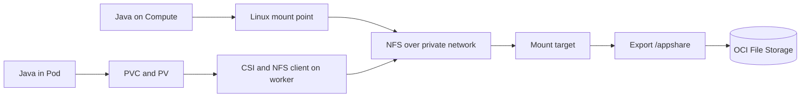

# Connecting NFS from compute instances and Kubernetes

A Java API running across multiple machines may need shared access to uploaded files or processing documents. With Oracle Cloud Infrastructure File Storage, the application accesses a shared filesystem over the network using NFS. On Compute, the operating system mounts the filesystem onto a directory. On Kubernetes, the application typically uses a path passed into the container via a PersistentVolume and PersistentVolumeClaim.

This lesson guides you through two ways to connect to a prepared OCI filesystem, while pointing out the layers to check when mounting succeeds yet the application still cannot write data. The Kubernetes examples focus on OKE with managed worker nodes; self-managed clusters require installing and configuring the corresponding storage integration.

## 1. Path from application to File Storage

| Component | Role |
| --- | --- |
| File system | Holds files, directories, and metadata of the shared data |
| Mount target | Provides the network address for NFS clients to connect to |
| Export and export path | Determines which path at the mount target accesses which filesystem |
| Export options | Controls allowed client sources, access mode, and identity mapping |
| NFS client | Operating system component that handles connections and filesystem operations |
| Mount point | Local directory where the application sees the mounted filesystem |

Assumed example throughout this lesson:

```text
Mount target IP:       10.0.1.10
Export path:           /appshare
Mount point on VM:     /mnt/oci-share
Application directory: order-api
Path inside Pod:       /data/order-api
```

These values must be replaced or verified against your actual environment. The export path on the server and the mount directory on the client are two distinct paths: `/appshare` can be mounted at `/mnt/oci-share` on a VM and `/data` inside a container.



The diagram illustrates the data access path. OCI IAM manages resource operations via the API; file access permissions also depend on the network path, export, and filesystem-level identity.

## 2. Preparing and checking layer by layer

Before mounting, you need an already-created filesystem, mount target, and export; you must know the mount target address and exact export path; and you need a client with a network route to the mount target. If using Kubernetes, identify the node type, storage driver, and identity integrated with OCI.

### 2.1. Network rules

With the standard NFS configuration in the example, OCI guidance for clients and mount targets in two separate subnets specifies the following flows:

| Direction | Protocol | Destination ports |
| --- | --- | --- |
| Client to mount target | TCP | 111, 2048, 2049, 2050 |
| Client to mount target | UDP | 111, 2048 |

Configure ingress on the mount target side and egress on the client side to match allowed sources/destinations. These ports serve multiple RPC/NFS components; opening only TCP 2049 may not be sufficient. If using Kerberos, LDAP, DNS, or another network model, verify the corresponding additional flows. [Oracle: Configuring VCN Security Rules for File Storage](https://docs.oracle.com/en-us/iaas/Content/File/Tasks/securitylistsfilestorage.htm)

Prefer specific source scopes, such as a subnet or managed client group. Cross-check NSGs, security lists, routes, and operating system firewalls. Clients and mount targets can be placed in different subnets if the network path is designed properly.

In OKE, mount operations on managed nodes are performed by the node-side storage component. You must identify the actual source address of the NFS traffic; do not assume allowing only the Pod CIDR is sufficient. When a workload is scheduled onto another worker, that worker must also be able to reach the mount target.

### 2.2. Export options and filesystem permissions

Export options can restrict source CIDR, read-only/read-write, privileged source ports, and identity squash. With root squash, requests from root can be mapped to another UID/GID; therefore, `sudo` on the client does not automatically guarantee administrative permissions over every file on the server. [Oracle: Working with NFS Exports and Export Options](https://docs.oracle.com/en-us/iaas/Content/File/Tasks/exportoptions.htm)

Distinguish the following permission layers:

| Layer | Example verification question |
| --- | --- |
| IAM | Is the operating identity allowed to create or view the filesystem, mount target, and export? |
| Network | Can packets from the right client reach the mount target? |
| Export | Is the source allowed and granted write permission? |
| UID/GID and mode | Does the account running Java have permission to traverse the directory and create files? |
| Application | Does the configured path point to the right mount? |

In the example using `sec=sys`, the UID/GID presented by the client is a key part of file permissions. Standardize UIDs/GIDs across VMs and containers that share data; identical usernames on two machines do not prove their numeric IDs are identical.

## 3. Mounting from a Linux Compute instance

The commands below use a Linux shell on an authorized test VM. This is a hands-on guide, not the output of an already-executed deployment. Operating system administrative privileges are required to install the NFS client and mount; the application does not need to run as root to use a properly permissioned directory.

### 3.1. Installing the NFS client

Choose the command matching your distribution:

```bash
# Oracle Linux and compatible systems using dnf:
sudo dnf install -y nfs-utils

# Or on Ubuntu/Debian, use these commands instead of the one above:
# sudo apt-get update
# sudo apt-get install -y nfs-common
```

Check package repository access according to the VM's network design. When using custom images, confirm that the required NFS utilities are already included in the image or bootstrap process.

### 3.2. Creating a mount point and mounting the export

Check the target directory first to avoid shadowing existing local files. Then:

```bash
MT_IP='10.0.1.10'
EXPORT_PATH='/appshare'
MOUNT_DIR='/mnt/oci-share'

sudo mkdir -p "$MOUNT_DIR"
sudo mount -t nfs \
  -o vers=3,hard,nosuid,resvport,sec=sys \
  "${MT_IP}:${EXPORT_PATH}" "$MOUNT_DIR"

findmnt --mountpoint "$MOUNT_DIR"
```

The example uses NFSv3 with AUTH_SYS. `nosuid` disables set-user-ID/set-group-ID effects on the mount; `resvport` uses a privileged source port, required when the export enforces this option. Do not use `soft` for write workloads just to avoid waiting on I/O: OCI warns of data corruption risks with that mount mode. [Oracle: Mounting File Systems From UNIX-Style Instances](https://docs.oracle.com/en-us/iaas/Content/File/Tasks/mountingunixstyleos.htm)

NFS already provides the filesystem on the service side; do not run `mkfs` as you would on a new block volume. To verify the correct data source, read the `findmnt` output rather than merely checking that the directory exists.

### 3.3. Preparing a directory for the application account

Assume the application in this lesson uses UID/GID `1000:1000`. An administrator with appropriate permissions on the filesystem prepares the `order-api` directory, allowing this identity to traverse and write. If the export maps UID/GID, use the corresponding effective identity when designing permissions.

Check on the VM:

```bash
id
ls -ldn /mnt/oci-share /mnt/oci-share/order-api
```

After confirming the test account has the right permissions, create a file with a dedicated name for this lab:

```bash
printf 'created from compute instance\n' \
  > /mnt/oci-share/order-api/probe-from-vm.txt

cat /mnt/oci-share/order-api/probe-from-vm.txt
```

Do not use root as the sole test identity if Java runs under a different account. Also avoid opening `0777` permissions across the entire export to work around an undiagnosed error.

### 3.4. Auto-mounting after reboot

Example of an `/etc/fstab` line for the test configuration above:

```fstab
10.0.1.10:/appshare /mnt/oci-share nfs vers=3,hard,nosuid,resvport,sec=sys,_netdev,nofail 0 0
```

Preserve all other lines, verify the new configuration, and test during an authorized window. If the filesystem holds mandatory application data, the service must check the mount before writing; `nofail` is not proof that the data is ready when the machine boots.

If the network volume has not mounted yet while the local directory still exists, the application may accidentally write to the boot filesystem. Design startup/readiness checks to detect this situation.

## 4. Connecting on OKE with PV and PVC

OKE supports File Storage through CSI storage integration. There are two flows: using an existing filesystem via a pre-created PV, or using a StorageClass to dynamically provision new resources. This lab uses the static flow so that both the VM and Pods access the designated export. [Oracle: Setting Up Storage for Kubernetes Clusters](https://docs.oracle.com/en-us/iaas/Content/ContEng/Tasks/contengcreatingpersistentvolumeclaim.htm)

| Object | Role in this lesson |
| --- | --- |
| PV | Represents the filesystem/export that the cluster can use |
| PVC | Storage request in a namespace, bound to the PV |
| Deployment | Runs two Pods testing read/write through the same PVC |
| CSI driver | Performs storage integration between Kubernetes and OCI |

`ReadWriteMany` describes the ability to mount read/write from multiple nodes. It does not automatically grant POSIX permissions, lock files on behalf of the application, or turn multiple business writes into a single transaction. `Retain` keeps the storage resource for manual handling after the claim is released. [Kubernetes: Persistent Volumes](https://kubernetes.io/docs/concepts/storage/persistent-volumes/)

### 4.1. Prerequisites before applying manifests

- The test cluster has the appropriate File Storage CSI integration; on managed nodes, verify the driver is registered.
- Worker nodes have network connectivity and export access to `10.0.1.10:/appshare`.
- You know the OCID of the exact filesystem; do not substitute the mount target OCID.
- The `order-api` directory has permissions for the UID/GID used by the Pod.
- The test container image can be pulled from a registry the cluster is permitted to access.

Verification commands on the target cluster:

```bash
kubectl config current-context
kubectl get nodes -o wide
kubectl get csidriver fss.csi.oraclecloud.com
kubectl create namespace fss-lab
```

If the namespace already exists, use the assigned test namespace. In a cluster lacking the corresponding OCI driver, merely specifying the driver name in the PV is not enough to create a working integration.

### 4.2. Creating a PV and PVC for an existing filesystem

In the lab environment, prepare `fss-storage.yaml`:

```yaml
apiVersion: v1
kind: PersistentVolume
metadata:
  name: order-fss-lab-pv
spec:
  capacity:
    storage: 50Gi
  volumeMode: Filesystem
  accessModes:
    - ReadWriteMany
  persistentVolumeReclaimPolicy: Retain
  storageClassName: ""
  mountOptions:
    - vers=3
    - hard
    - nosuid
    - resvport
    - sec=sys
  csi:
    driver: fss.csi.oraclecloud.com
    volumeHandle: "ocid1.filesystem.oc1.REGION.REPLACE_ME:10.0.1.10:/appshare"
---
apiVersion: v1
kind: PersistentVolumeClaim
metadata:
  name: order-fss-lab-pvc
  namespace: fss-lab
spec:
  accessModes:
    - ReadWriteMany
  volumeMode: Filesystem
  storageClassName: ""
  volumeName: order-fss-lab-pv
  resources:
    requests:
      storage: 50Gi
```

Replace the OCID, IP, and export path with actual values. For the OCI File Storage driver, `volumeHandle` has the format `<FileSystemOCID>:<MountTargetIP>:<ExportPath>`. The PVC sets `storageClassName: ""` to use the static PV and avoid having the default StorageClass provision a different storage type. The `50Gi` value in the Kubernetes declaration does not automatically enforce a 50 GiB quota on the File Storage filesystem. [Oracle: Provisioning PVCs on the File Storage Service](https://docs.oracle.com/en-us/iaas/Content/ContEng/Tasks/contengcreatingpersistentvolumeclaim_Provisioning_PVCs_on_FSS.htm)

Apply and check binding:

```bash
kubectl apply -f fss-storage.yaml
kubectl get pv order-fss-lab-pv
kubectl -n fss-lab get pvc order-fss-lab-pvc
```

The PVC should transition to `Bound`. This is evidence of binding at the Kubernetes layer; it does not yet prove a worker can actually mount and write to NFS.

### 4.3. Running two test Pods

The `fss-probe.yaml` file below uses two small containers to test the storage path. This is not yet a Java API deployment manifest. You can replace the image with an equivalent organization-approved test image that includes a shell and the utilities used in the command.

```yaml
apiVersion: apps/v1
kind: Deployment
metadata:
  name: fss-probe
  namespace: fss-lab
spec:
  replicas: 2
  selector:
    matchLabels:
      app: fss-probe
  template:
    metadata:
      labels:
        app: fss-probe
    spec:
      securityContext:
        runAsNonRoot: true
        runAsUser: 1000
        runAsGroup: 1000
      containers:
        - name: probe
          image: busybox:1.37.0
          command: ["sh", "-ec"]
          args:
            - |
              test -d /data/order-api
              printf 'created by %s\n' "$HOSTNAME" \
                > "/data/order-api/probe-${HOSTNAME}.txt"
              cat /data/order-api/probe-from-vm.txt
              sleep 3600
          securityContext:
            allowPrivilegeEscalation: false
            capabilities:
              drop: ["ALL"]
          resources:
            requests:
              cpu: 10m
              memory: 16Mi
            limits:
              cpu: 100m
              memory: 64Mi
          volumeMounts:
            - name: shared-data
              mountPath: /data
      volumes:
        - name: shared-data
          persistentVolumeClaim:
            claimName: order-fss-lab-pvc
```

The example fixes UID/GID to `1000:1000`, matching the prepared directory condition. `runAsUser` and `runAsGroup` define the process identity; they do not automatically change the ownership of existing data. `fsGroup` should also be evaluated alongside driver and export support rather than treated as a fix-all for every permission error. [Kubernetes: Configure a Security Context](https://kubernetes.io/docs/tasks/configure-pod-container/security-context/)

Run and inspect the results:

```bash
kubectl apply -f fss-probe.yaml
kubectl -n fss-lab get pods -l app=fss-probe -o wide
kubectl -n fss-lab logs -l app=fss-probe --prefix=true
kubectl -n fss-lab exec deployment/fss-probe -- \
  sh -c 'id; ls -ln /data/order-api; cat /data/order-api/probe-from-vm.txt'
```

On the VM, read the files created by the Pods:

```bash
ls -ln /mnt/oci-share/order-api
cat /mnt/oci-share/order-api/probe-fss-probe-*.txt
```

Compare Pod names and file contents to confirm clients are using the same data. If both Pods land on the same worker, the result has not yet tested the NFS path from a second worker. When needing to prove multi-node access, place Pods on different workers using an appropriate scheduling policy and record their actual placements.

## 5. Static provisioning and dynamic provisioning

The static flow fits this lab because the filesystem already exists and is shared with the VM. The dynamic flow uses a StorageClass with provisioner `fss.csi.oraclecloud.com`; CSI creates a filesystem and PV for the PVC according to the selected configuration. This flow requires additionally checking the OCI permissions of the provisioner component and the lifecycle of created resources. [Oracle: Provisioning PVCs on the File Storage Service](https://docs.oracle.com/en-us/iaas/Content/ContEng/Tasks/contengcreatingpersistentvolumeclaim_Provisioning_PVCs_on_FSS.htm)

Before choosing an approach in a production system, determine:

- Who owns the filesystem: the platform team or the lifecycle of a single workload?
- Do applications need the same filesystem or separate resources?
- Which export is shared and which client groups can access it?
- When a PVC is deleted, which resources will the reclaim policy and driver affect?
- Are there data backups, recovery procedures, and an approver for data cleanup?

The example in this lesson uses `Retain`, which is not a backup. Before deleting or recreating a PVC/PV, check the association with the filesystem and actual usage status. A PV in `Released` state is not automatically ready to be arbitrarily bound again.

## 6. Integrating into a Java application

When moving from the probe container to the Java API, mount the same PVC into the data path the application is configured to use. For example, `/data/order-api/uploads` is where the application stores files; the JAR and deployment configuration remain managed by the system's release process.

Items to design at the application layer:

| Item | How to verify |
| --- | --- |
| Identity | Does the Java process's UID/GID have the right permissions on the directory? |
| Readiness | Does the application detect loss of access to mandatory data? |
| Concurrent writes | Can two replicas write the same filename or modify the same content? |
| Consistency | How are file writes and database metadata writes coordinated or reconciled? |
| Performance | Are latency and metadata operation counts suitable for the actual workload? |
| Recovery | How is shared data snapshotted/backed up and tested for restoration? |

Multiple replicas mounting the same filesystem do not automatically share Java memory or ensure a batch job runs only once. With shared files, you need an appropriate filename strategy, task ownership, and access coordination.

When NFS or the network is interrupted, I/O operations may block for a long time, especially with a hard mount. Monitor processing times, errors, and dependent service health; an application-level HTTP timeout does not guarantee the underlying filesystem operation has been canceled.

## 7. Encryption and access restrictions

The commands in this lesson use NFS with `sec=sys`; `nosuid` and `resvport` do not enable transport encryption. When network data protection is required, configure an encryption mechanism supported by OCI for your client type, such as OCI File Storage TLS utilities or encryption configuration in the CSI integration. Do not assume that a private IP path means data is encrypted in transit. [Oracle: Using In-transit TLS Encryption](https://docs.oracle.com/en-us/iaas/Content/File/Tasks/intransitencryption.htm)

When deploying, document the authentication mechanism, encryption requirements, client list, and file permission management approach. A change to export options for a new VM can simultaneously impact Pods using the same export; evaluate all clients before making changes.

## 8. Evidence-based troubleshooting

| Symptom | Check first | Next step |
| --- | --- | --- |
| Mount timeout | IP, route, NSG/security list, and client firewall | Confirm full RPC/NFS flows reach the right mount target |
| Access denied on mount | Export path, actual source, and export options | Cross-check client permissions, auth mode, and source port |
| Mounted but write rejected | UID/GID, mode, squash, and read-only | Test with the application account; fix the right permission layer |
| PVC `Pending` | PV, `volumeName`, StorageClass, access mode, and capacity request | Read binding events and cross-check manifests |
| Pod `ContainerCreating` with `FailedMount` | CSI, scheduled worker, network, and export | Inspect Pod events; confirm the failure happens at mount, not only at PVC |
| Pod restarts due to failed probe command | Container logs, directory, and prerequisite files | Distinguish mount failure from missing files or missing permissions |
| VM sees file but Pod does not | `volumeHandle`, export, mountPath, and subdirectory | Confirm both clients truly use the same filesystem/path |
| Works on one worker, fails on another | Source IP, export permissions, network, and node configuration | Check every worker eligible to receive the workload |

Commands to gather Kubernetes evidence:

```bash
kubectl -n fss-lab describe pvc order-fss-lab-pvc
kubectl -n fss-lab describe pod REPLACE_WITH_POD_NAME
kubectl -n fss-lab get events --sort-by=.metadata.creationTimestamp
```

On the VM, you can check `findmnt`, `id` identity, permissions with `ls -ln`, and relevant NFS messages in operating system logs. A successful TCP connection check only verifies the network path portion; it does not prove that the export and file permissions are valid.

## 9. Stopping usage and cleaning up the lab

On Kubernetes, stop the workload using the PVC first. Let kubelet and CSI perform the unmounts they manage; do not SSH into a worker and arbitrarily unmount a path a Pod is using.

```bash
kubectl -n fss-lab delete deployment fss-probe
```

On the VM, stop processes using the data, leave the directory, and then unmount:

```bash
cd /
sudo umount /mnt/oci-share
```

If the mount is busy, find the active task rather than force-unmounting to ignore the cause. When stopping a mount permanently, update the corresponding auto-mount configuration. Unmounting on one client does not delete the filesystem and does not stop other clients from continuing to use it.

Inventory the PVC, PV, export, mount target, and filesystem before deciding on further cleanup. Do not delete a shared filesystem just because the test Pods have stopped.

## 10. Practice exercise

Connect one Linux VM and two Pods on OKE to the same test export. Create separate files from each client and read them back from the other clients. If you want to verify access from two workers, record evidence that the Pods actually ran on two different nodes.

Record:

1. Filesystem OCID, mount target IP, and export path.
2. Mount source and mount point on the VM.
3. Client sources allowed by the export along with required network rules.
4. PV, PVC, namespace, driver, and actual worker nodes of the Pods.
5. UID/GID of the read/write processes and application directory permissions.
6. Test file contents cross-checked between the VM and Pods.
7. How the application reacts when the mount is missing or write permission is denied.

You are done when you can explain the entire path **application → mount → NFS client → network → mount target → export → filesystem**, and distinguish network errors, Kubernetes binding errors, and data permission errors without arbitrarily loosening permissions.
