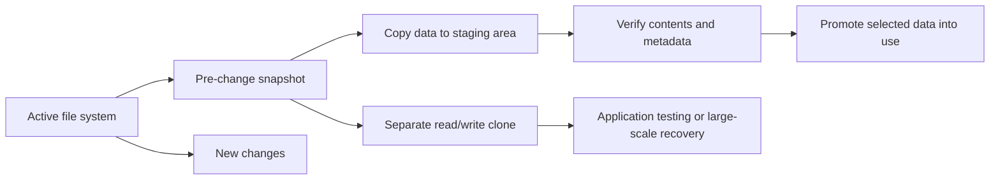

# Snapshots and data recovery on File Storage

Oracle Cloud Infrastructure (OCI) File Storage snapshots capture the state of a file system at a point in time. When a user accidentally deletes a file or a deployment writes bad data, a snapshot can provide a previous version for recovery.

A complete recovery workflow requires selecting the right data point, reading the snapshot, verifying its contents, and bringing the data back to the application in a controlled way. This lesson belongs to the **File Storage** chapter and focuses on two paths: copying data from a snapshot and creating a file system clone for testing or recovery.

## Learning objectives

After this lesson, you will be able to:

- Explain the scope and behavior of a File Storage snapshot.
- Distinguish a snapshot from a clone and a replica used for disaster recovery.
- Prepare data consistency before taking a snapshot.
- Create and inspect snapshots using the Console or OCI CLI.
- Access historical data through the `.snapshot` directory.
- Restore files or directories into a staging area before putting them into use.
- Create a clone from a snapshot and check network, permission, and application dependencies.
- Manage schedules, expiration, snapshot protection locks, monitoring, and cost.

## What does a snapshot capture?

An OCI File Storage snapshot is a consistent view of **the entire file system**, using a copy-on-write mechanism. When a snapshot is created, the service references existing data; as data changes, the versions needed for the historical point are preserved. File systems and snapshots are encrypted at rest. See [Managing Snapshots](https://docs.oracle.com/en-us/iaas/Content/File/Tasks/managingsnapshots.htm).

A snapshot does not capture only the directory currently open in a terminal. If the file system has `reports`, `uploads`, and `config` directories, the file system snapshot covers the corresponding data in all three.

| Component | What does the snapshot mean for it? |
|---|---|
| File contents and directory structure in the file system | State at the capture point can be viewed again |
| Application data not yet written to NFS | Not protected just because a snapshot was created |
| Files on a Compute instance's local disk | Belong to a different storage system |
| Data in a database or another file system | Requires separate protection and coordination mechanisms |
| Mount target, export, and client connection config | Must be inventoried as infrastructure configuration |
| Sessions or state in RAM | Not contents recovered from a snapshot |

A snapshot is a historical data source for reading and recovery. When you need to modify data taken from a snapshot, copy it to a writable location or create a clone; do not modify the historical version directly.

## Distinguishing snapshot, data copy, and clone

| Mechanism | Result | Appropriate scenario |
|---|---|---|
| Snapshot | Point-in-time view of data | Finding an older version or serving as a recovery source |
| Copy from snapshot | Files and directories copied elsewhere | Partial data recovery, verification before writing back |
| Clone from snapshot | New readable and writable file system | Testing a data version or large-scale recovery |
| Replication or replica in another location | Data in another system or location | Recovery when the source is unreachable |

A snapshot on the source file system does not automatically create an independent copy in another region. When a file system is deleted, related snapshots can also be lost by that operation; an external copy outside the source scope is needed to handle this type of incident. See [Securing File Storage](https://docs.oracle.com/en-us/iaas/Content/Security/Reference/filestorage_security.htm).

Therefore, the design must clearly distinguish:

- Recovery from logical errors: typically requires selecting data from before the error occurred.
- Recovery from storage loss or region loss: requires an accessible data source elsewhere.
- Testing: requires a writable environment without impacting production.
- Workload migration: additionally requires cutover planning, networking, and dependencies.

## File system consistency and application consistency

A snapshot that is consistent at the file system level does not mean a multi-file business operation in progress has finished. For example, an application saves a report and updates an index file:

```text
1. Write reports/monthly.csv
2. Update indexes/latest.json
3. Record completion status in the database
```

If a snapshot is taken between steps, the NFS data may reflect a state that the application must inspect or recover on its own. A database in another service is also not automatically captured at the exact same instant.

For workloads requiring application consistency:

1. Identify all writers, including workers, schedulers, and other NFS clients.
2. Pause incoming write operations or use the application's quiesce mechanism.
3. Wait for in-flight tasks to finish per the application's procedure.
4. Flush or checkpoint according to the software's instructions.
5. Create the snapshot and verify the data point.
6. Allow the application to resume writes once the planned conditions are met.

Running `sync` on one client is no substitute for coordinating all writers, database transactions, or application buffers on other clients. If the application only supports crash recovery, rehearse that exact mechanism during recovery drills.

For data spanning multiple file systems, do not assume two separate snapshots form a single atomic transaction covering both.

## Preparation before creating or using a snapshot

### Recording the exact resources

A minimum record includes:

| Group | Information |
|---|---|
| Identification | File system OCID, region, AD, and compartment |
| Access | Mount target, IP or access name, export path, and mount point |
| Data | Directories to protect, writers, and data outside File Storage |
| Recovery point | Snapshot OCID, name, data timestamp, and snapshot type |
| Retention | Expiration, associated policy, and lock status |
| Recovery | Test environment, operator, and acceptance criteria |
| Cost | Owner, tags, clone resources, and cleanup deadline |

Do not select a snapshot solely by the file system's display name. The snapshot name must be matched against **the exact file system**, because different file systems can have snapshots with the same name.

### Distinguishing API permissions from data read permissions

There are three layers to consider:

| Layer | Role |
|---|---|
| OCI IAM | Allows creating, reading metadata, updating, or deleting snapshot resources |
| Network and export | Allows clients to reach the mount target and export per policy |
| Identity and file permissions | Determines whether the client can read source, write destination, or preserve owner/mode |

IAM permission to create snapshots does not automatically grant read access to every file over NFS. Conversely, a client may read files via NFS permissions without having permission to delete snapshots in OCI.

Snapshot operations use File Storage permissions; creating clones or configuring snapshot policies requires corresponding additional permissions. Grant permissions scoped to the task and compartment. See [Details for the File Storage Service](https://docs.oracle.com/en-us/iaas/Content/Identity/policyreference/filestoragepolicyreference.htm).

If a copy operation reports permission errors, check UID/GID, directory permissions, export options, squash settings, and the active authentication method. Do not open the export to all clients or disable permission controls just to bypass errors.

## Lab model

Assume a test file system is mounted on Linux at `/mnt/teamshare`. This lab assumes the mount exposes the root of the file system so `.snapshot` can be accessed.



This lab uses a new directory dedicated to sample data. The Bash and OCI CLI commands below are examples for learners to execute in an authorized environment; this article does not run them automatically.

Before running commands:

- Replace OCIDs and region with actual values.
- Confirm the mount point and export match the file system under test.
- Use only a new lab directory; never use production data paths.
- Confirm there is a destination for recovered data with appropriate permissions.

## Checking the mount and creating sample data

On the Linux client:

```bash
FSS_MOUNT='/mnt/teamshare'

mountpoint -q "$FSS_MOUNT"
findmnt -T "$FSS_MOUNT" -o TARGET,SOURCE,FSTYPE,OPTIONS
```

If `mountpoint` does not confirm this is a mount point, stop and investigate. A local directory with the same name does not prove NFS is mounted. Inspect `SOURCE`, `FSTYPE`, and options to verify the actual mount.

Create data only in a lab directory that does not yet exist:

```bash
LAB_NAME='snapshot-lab-001'
LAB_DIR="$FSS_MOUNT/$LAB_NAME"

if [ -e "$LAB_DIR" ]; then
  printf '%s\n' 'Lab directory already exists; choose a new name.'
  exit 1
fi

mkdir -- "$LAB_DIR"
printf '%s\n' 'revision=1' > "$LAB_DIR/config.ini"
printf '%s\n' 'manifest-for-revision-1' > "$LAB_DIR/.manifest"

cat -- "$LAB_DIR/config.ini"
sha256sum -- "$LAB_DIR/config.ini" "$LAB_DIR/.manifest"
```

Record the contents or checksums for comparison. The `.manifest` file helps verify that the recovery copy method does not omit hidden files.

In this lab, only the newly created sample data exists. For real workloads, perform application-consistency steps before taking the snapshot as described earlier.

## Creating a snapshot via the Console

A typical workflow:

1. Select the right region and compartment.
2. Open **File Storage → File Systems**.
3. Select the file system and verify its OCID.
4. Open the **Snapshots** list and choose **Create Snapshot**.
5. Choose a name that reflects its purpose and avoids sensitive details.
6. Set an expiration if finite retention is planned.
7. Create and wait for the appropriate state.
8. Record the snapshot OCID, name, data timestamp, and actual expiration.

Snapshot names must be unique within the file system per service rules and cannot be changed after creation. See [Creating a Snapshot](https://docs.oracle.com/en-us/iaas/Content/File/Tasks/create-snapshot.htm).

If you already created it in the Console, use that snapshot for subsequent steps; do not run another CLI create command to repeat the same change.

## Creating and inspecting via the OCI CLI

The commands use Bash on a machine with an authenticated OCI CLI. If the OCI admin machine and NFS client are two different machines, re-declare the required variables in the respective shell session; in particular, transfer the exact snapshot name to the NFS client to build the data read path.

```bash
REGION='<region>'
FILE_SYSTEM_ID='ocid1.filesystem.oc1...'
SNAPSHOT_NAME='lab-before-change-001'

oci fs file-system get \
  --region "$REGION" \
  --file-system-id "$FILE_SYSTEM_ID"

oci fs snapshot list \
  --region "$REGION" \
  --file-system-id "$FILE_SYSTEM_ID" \
  --all
```

Read the list before creating to avoid colliding with existing snapshots. Once data is in the desired state:

```bash
oci fs snapshot create \
  --region "$REGION" \
  --file-system-id "$FILE_SYSTEM_ID" \
  --name "$SNAPSHOT_NAME" \
  --wait-for-state ACTIVE \
  --max-wait-seconds 1200
```

The example does not configure an expiration. The lab team should proactively set a retention limit or clean up after testing. To set one at creation time, use `--expiration-time` with a valid future timestamp and explicit timezone.

`ACTIVE` is the state to verify in this workflow. If the command times out, query again instead of immediately creating another snapshot. See [OCI CLI snapshot create](https://docs.oracle.com/en-us/iaas/tools/oci-cli/latest/oci_cli_docs/cmdref/fs/snapshot/create.html).

Retrieve the snapshot OCID from the output:

```bash
SNAPSHOT_ID='ocid1.snapshot.oc1...'

oci fs snapshot get \
  --region "$REGION" \
  --snapshot-id "$SNAPSHOT_ID"
```

Verify the source file system, name, lifecycle state, data timestamp, and expiration if set. When multiple time fields exist, distinguish resource creation time from the data timestamp the snapshot represents; do not infer solely from your own naming string.

Only after the snapshot is ready should you proceed to modifying lab data.

## Accessing historical versions via .snapshot

At the root of the file system, snapshots are accessed via:

```text
<mount-point>/.snapshot/<snapshot-name>/<path-in-file-system>
```

For the example:

```bash
SNAPSHOT_ROOT="$FSS_MOUNT/.snapshot/$SNAPSHOT_NAME"

ls -ld -- "$FSS_MOUNT/.snapshot"
ls -la -- "$SNAPSHOT_ROOT/$LAB_NAME"

cat -- "$SNAPSHOT_ROOT/$LAB_NAME/config.ini"
```

The `config.ini` file inside the snapshot must contain `revision=1`. The path has a single leading dot before `snapshot`; mistakenly using `snapshot` or `.snapshots` leads to a different directory or a not-found error.

OCI supports restoring by copying contents from `.snapshot`; appropriate NFS-compatible tools can be used. See [Restoring from a Snapshot on a Unix-style Instance](https://docs.oracle.com/en-us/iaas/Content/File/Tasks/restore-from-snapshot.htm).

If the mount points to a subdirectory rather than the root assumed by the lab, cross-check the path and access method for that export. Do not alter exports just to make a sample path work.

If the API shows the snapshot exists yet the client cannot read it:

- Confirm the mount truly belongs to the file system containing the snapshot.
- Cross-check the snapshot name and state.
- Check traversal permissions on parent directories and read permissions on files.
- Inspect NFS connectivity, export settings, and specific error messages.
- Inspect only the relevant path; avoid scanning all snapshots on large systems.

## Making post-snapshot changes to observe

In the same lab directory, modify the sample file and create an additional file:

```bash
printf '%s\n' 'revision=2' > "$LAB_DIR/config.ini"
printf '%s\n' 'created-after-snapshot' > "$LAB_DIR/new-file.txt"

cat -- "$LAB_DIR/config.ini"
cat -- "$SNAPSHOT_ROOT/$LAB_NAME/config.ini"
```

Expected result:

| Location | Contents |
|---|---|
| Active file system | `config.ini` has `revision=2` |
| Pre-change snapshot | `config.ini` still has `revision=1` |
| New file after snapshot | Present in the active tree, absent in the earlier snapshot point |

This demonstrates that the snapshot preserves the historical version while the active tree continues changing. It also shows that copying an old file back does not automatically delete new files created after the snapshot.

## Restoring into a staging area

### Choosing staging before writing data back

A separate staging area helps verify:

- Whether the right snapshot was selected.
- Whether all files are present, including hidden files.
- Whether contents and checksums are accurate.
- Whether owner, group, mode, and required metadata can be preserved.
- Whether the data is compatible with the running application version.

Staging can reside on local storage with sufficient capacity or a separate test file system. You must verify storage space and access permissions suitable for the restored data.

### Copying full directory contents, including hidden files

Example creating a temporary local directory with a unique name:

```bash
SOURCE_DIR="$SNAPSHOT_ROOT/$LAB_NAME"
STAGE_DIR="$(mktemp -d /var/tmp/fss-restore.XXXXXX)"

printf '%s\n' "$STAGE_DIR"

cp -a -- "$SOURCE_DIR/." "$STAGE_DIR/"
```

The trailing `/.` on the source copies directory contents, including hidden files, into staging. Writing `"$SOURCE_DIR"/*` relies on shell globbing and typically skips hidden files, making it unsuitable when complete contents are needed.

`cp -a` requests preserving metadata within the limits of the tool, permissions, and destination filesystem. It does not prove every UID/GID, ACL, extended attribute, or specialized feature was preserved. Read any errors and verify the attributes your workload needs rather than just checking that files appeared.

For example, copying onto a local filesystem may require appropriate privileges to preserve owners from NFS. Root on the client can also be restricted when operating on an export. Do not disable security controls just to silence copy errors.

### Verifying restored contents

```bash
ls -la -- "$STAGE_DIR"

cmp -- "$SOURCE_DIR/config.ini" "$STAGE_DIR/config.ini"
cmp -- "$SOURCE_DIR/.manifest" "$STAGE_DIR/.manifest"

sha256sum -- "$STAGE_DIR/config.ini" "$STAGE_DIR/.manifest"
```

If `cmp` finds no differences and returns exit code 0, the contents of the compared files are identical. That does not yet verify full metadata or business correctness.

For large datasets, verify via manifests, file counts, aggregate checksums, or application validation tools. Know which checks cover the entire dataset and which are only sampling.

### If using rsync

You can preview changes into a separate staging directory:

```bash
rsync -a --dry-run --itemize-changes \
  "$SOURCE_DIR/" "$STAGE_DIR/"
```

After reviewing the output, run the planned copy:

```bash
rsync -a -- "$SOURCE_DIR/" "$STAGE_DIR/"
```

The trailing slash on the source path affects how data is laid out at the destination. Do not add `--delete` to a general recovery workflow before clearly deciding which new data should be kept or removed.

Archive mode does not automatically cover every metadata type across every environment. Requirements for hard links, ACLs, or extended attributes must be identified and tested against what is actually supported.

## Bringing verified data back into service

### Restoring a single file under a new name

In the lab, keep the current file and create a restored file under a different name for comparison:

```bash
RECOVERED_FILE="$LAB_DIR/config.ini.recovered"

if [ -e "$RECOVERED_FILE" ]; then
  printf '%s\n' 'Recovered file already exists; stop to verify.'
  exit 1
fi

cp -a -- "$STAGE_DIR/config.ini" "$RECOVERED_FILE"

cat -- "$RECOVERED_FILE"
cmp -- "$SOURCE_DIR/config.ini" "$RECOVERED_FILE"
```

The new file must contain `revision=1`; the current file still contains `revision=2`. This proves the old content was retrieved while keeping existing data available for evaluation.

### When an active file must be replaced

For production applications, add these steps:

1. Confirm which data version must be restored.
2. Stop or coordinate writers for the affected data segment.
3. Preserve the current version in case investigation or rollback is needed.
4. Verify permissions, ownership, and format compatibility.
5. Perform the replacement according to the application's mechanism.
6. Reopen data or restart components holding open file handles as needed.
7. Run business tests and monitor post-recovery.

Renaming a file within the same filesystem can provide atomicity at the single namespace operation level, yet it does not turn replacing multiple files into an application-level transaction. Processes still holding open file handles may also continue seeing the old object.

If the current application has changed its schema or file format, older data needs a compatibility procedure. Restoring contents from the right timestamp for the wrong application version can still cause service failures.

## Large-scale recovery using clones

Cloning creates a new file system from a snapshot. Initial data matches the snapshot point; afterward, changes on the clone and the source do not automatically synchronize with each other. A clone can initially share data references with its parent; detaching is a separate operation to create a system independent in storage references. See [Cloning File Systems](https://docs.oracle.com/en-us/iaas/Content/File/Tasks/cloningFS.htm).

This approach is suitable when you need to:

- Test an entire data tree with an application version.
- Evaluate a recovery point without copying everything into the active tree.
- Prepare a recovery environment prior to cutover.
- Spin up a test environment from a known data point.

### Creating a clone from a chosen snapshot

A direct clone must reside in the same AD as its parent per File Storage support limits. Do not treat a direct clone as a cross-region copy operation.

CLI example:

```bash
CLONE_COMPARTMENT_ID='ocid1.compartment.oc1...'
SOURCE_AD='<availability-domain-of-source-file-system>'

oci fs file-system create \
  --region "$REGION" \
  --availability-domain "$SOURCE_AD" \
  --compartment-id "$CLONE_COMPARTMENT_ID" \
  --display-name 'snapshot-recovery-test' \
  --source-snapshot-id "$SNAPSHOT_ID" \
  --clone-attach-status ATTACH \
  --wait-for-state ACTIVE \
  --max-wait-seconds 1200
```

Here `ATTACH` describes the clone's relationship to its parent, not an NFS mount operation onto a Compute instance. `DETACH` has separate data-copying and metering impacts; do not change the parameter just because its name sounds like "unmount". See [file system create and clone parameters](https://docs.oracle.com/en-us/iaas/tools/oci-cli/latest/oci_cli_docs/cmdref/fs/file-system/create.html).

If a customer-managed key is required, specify the key for the clone and corresponding permissions before creation. Do not infer from the parent's key that all encryption attributes of the clone already meet requirements.

### Exporting and mounting the clone in a separate environment

After creation:

1. Record the clone OCID, source snapshot, and parent.
2. Check hydration status and related attributes.
3. Prepare an appropriate mount target and export.
4. Configure network and export permissions only for clients needing testing.
5. Mount the clone at a separate path, such as `/mnt/teamshare-recovery`.
6. Test data and application behavior before switching traffic.

Infrastructure attributes such as export information do not automatically become a production replacement endpoint. A clone can be used while hydration is in progress, yet performance and dependencies still need verification. See [Creating a Clone](https://docs.oracle.com/en-us/iaas/Content/File/Tasks/create-clone.htm).

Do not mount a clone over an active mount point without an access-halt plan. With multiple clients, coordinate migrating each client, application state, and writers; changing the mount on one host does not change the remaining hosts.

### Cutover and rollback after cutover

Before switching to the clone, determine:

- Which data timestamp is acceptable.
- Whether new changes on the source will be discarded, kept, or merged.
- When the source stops accepting writes.
- Which clients must switch and how completion is verified.
- Rollback conditions and where new post-cutover data will reside.

Once the clone has received new data, rolling back to the old source is not merely switching the mount path back. You must reconcile changes existing only on the clone to avoid data loss or creating two unmanaged write branches.

## Automated schedules and expiration

A snapshot policy can create snapshots on a schedule and set retention. The policy must be associated with the right file system; creating a standalone policy does not prove data is protected.

An illustrative design:

| Recovery point tier | Objective |
|---|---|
| Pre-change snapshot | Roll back prior to a deployment or data operation |
| Short-term periodic snapshot | Limit data loss when errors are detected early |
| Longer-retention snapshot | Provide historical points for late-detected errors |
| Off-site replica | Recover when the source becomes unreachable |

Read each schedule's timezone, effective time, and retention carefully. Policy-based snapshots are not guaranteed to start on the exact configured minute; overlapping schedules or queued requests can affect the set of snapshots created. See [Policy-Based Snapshots and Scheduling](https://docs.oracle.com/en-us/iaas/Content/File/Tasks/snapshot-policies-and-schedules.htm).

When needing to keep a specific snapshot for an ongoing incident investigation, check its expiration and adjust according to granted permissions. Modifying one snapshot's expiration does not automatically modify the schedule of future snapshots.

Manually created snapshots in this lab have no expiration in the example. Record an accountable owner and cleanup plan to avoid retaining them indefinitely merely because no automated deletion exists.

## Snapshot locks and deletion protection

Expiration and locks are distinct properties. File Storage supports resource-based locks and time-based locks with different modes, permissions, and modification conditions.

Key points to remember:

- Reaching expiration does not mean the service can delete a snapshot while it is still protected by a lock.
- An active lock can even prevent deleting the associated file system.
- A compliance lock becomes immutable after a cool-off period according to the supported mechanism.
- Source locks are not automatically inherited by clones or replication targets.

See [Snapshot Locks](https://docs.oracle.com/en-us/iaas/Content/File/Tasks/snapshot_lock_overview.htm).

This lab does not require enabling locks. In production operations, using locks must align with retention requirements, administrative permissions, and cost-management plans. Do not confuse deletion-protection locks with the read-only nature of snapshot contents.

## Measuring RPO and RTO through recovery outcomes

For a logical error occurring at time T:

```text
Data window to evaluate for loss or rework
  = T - data timestamp of the nearest suitable snapshot
```

You must select a snapshot from before the error began, not just the newest snapshot. If data has been corrupted for hours before detection, newer snapshots may also contain the error.

Example:

| Time | Event |
|---|---|
| 08:00 | Snapshot S1 captures good data |
| 08:20 | A job begins writing bad data |
| 09:00 | Snapshot S2 contains the affected state |
| 09:30 | Operations detects the error |

If S1 must be used, valid data generated after 08:00 must be re-evaluated. Do not conclude S2 is safe merely because it is newer.

RTO must measure detection time, snapshot selection, staging or clone preparation, data copying, verification, bringing the application back up, and client cutover. Fast snapshot or clone creation does not mean the entire service recovers equally fast.

For trees with huge numbers of small files, directory traversal and metadata processing time can dominate. Evaluate file counts, sizes, clients, and copy tools during real drills.

## Monitoring and error handling

OCI supports Events for snapshot creation or deletion activities, including cases where policy-based snapshots are skipped, rejected, or throttled. Use them to monitor scheduled operations alongside actual resource inventories. See [monitoring snapshot events](https://docs.oracle.com/en-us/iaas/Content/File/Tasks/managingsnapshots.htm).

Operational questions to answer:

- Is the file system still associated with the right policy?
- How old is the latest valid data point?
- Which snapshots are nearing expiration yet still need to be kept?
- Are snapshots readable from authorized clients?
- What did the most recent test restore prove?
- Which clones still exist and who owns them?
- Are IAM, export, NFS, or key errors blocking recovery?

| Symptom | What to check |
|---|---|
| Snapshot appears in API but is invisible on client | Mount point, source file system, name, state, and path permissions |
| `Permission denied` during copy | Source read permissions, destination write permissions, UID/GID, and export options |
| Hidden files missing after restore | Was glob `*` used as the source? |
| Copy succeeds yet application fails | Data point, consistency, schema, metadata, and dependencies |
| Clone is ACTIVE yet inaccessible | Export, mount target, network, permissions, and client mount |
| Scheduled snapshot does not appear as expected | Policy association, timezone, overlapping schedules, and skipped/throttled events |
| Expired snapshot cannot be deleted | Lock, hold, or service-side operation state |
| Live data shrinks yet metered usage stays high | Data still referenced by snapshots or clones |
| Client still sees old content after replacement | File handles, caching, and application file-reopening behavior |

Preserve evidence and snapshot sources during investigation. Do not delete recovery points just to retry a step before confirming data that must be kept is stored elsewhere.

## Capacity, cost, and resource cleanup

Snapshot cost is tied to the changed data that must be retained, not a simple multiplication of "number of snapshots × file system size". When live data is modified or deleted, snapshots may continue holding historical blocks. The service's `meteredBytes` is the metric to monitor for billing; `du` output can differ due to how referenced data is traversed. See [File System Usage and Metering](https://docs.oracle.com/en-us/iaas/Content/File/Concepts/FSutilization.htm).

To manage cost:

1. Set schedules and retention according to recovery requirements.
2. Monitor workloads with high data-churn rates.
3. Assign owners to manual snapshots and test clones.
4. Assess the impact of copying data out to staging.
5. Inventory resources after drills.
6. Delete only after confirming no recovery or retention dependencies remain.

Before deleting a snapshot, cross-check its OCID, source file system, snapshot type, and any clone or replication relationships. Snapshots managed by other mechanisms must be handled according to those mechanisms' lifecycles.

Do not treat deleting files in the active tree as a guaranteed way to free all capacity while older data remains referenced. Also do not treat metering readings immediately after an operation as final because updates can be asynchronous.

## Snapshots in disaster recovery plans

When requirements cover AD or region outages, evaluate File Storage replication or backup mechanisms to another location. The procedure must cover data at the destination, access infrastructure, permissions, keys, and a plan to bring workloads up there.

Replication uses snapshots for synchronization and recovery; they have a different lifecycle from user-created snapshots. Do not arbitrarily delete snapshots managed by replication.

With File Storage replication, a DR plan may require additional clones, file systems, and mount targets to support failover. Sufficient service limits and resources are needed at the target location. See [Disaster Recovery for File Storage](https://docs.oracle.com/en-us/iaas/Content/File/Tasks/replication-disaster-recovery.htm).

A successful file copy within the same file system only verifies recovery from logical errors within that scope. It does not verify recoverability when the entire source becomes unreachable.

## Verifiable workflow automation

An automated workflow should reflect these milestones:

```text
Verify file system and data scope
  -> coordinate writers if needed
  -> create and confirm snapshot
  -> verify readability
  -> select recovery point
  -> copy to staging or create clone
  -> verify data and application
  -> promote selected data into use
  -> manage retention and clean up test resources
```

Practical principles:

- Use OCIDs for API operations; cross-check names against NFS paths.
- Check status before retrying timed-out requests.
- Do not treat the exit code of a snapshot creation command as a restore result.
- Keep source and destination unambiguous to avoid reversing the copy direction.
- Do not use sync commands that delete data before confirming the exact dataset to remove.
- Record evidence of contents, metadata, timestamps, and test results.
- Manage writers and cutover at the application level.
- Assign accountability for expiration, locks, clones, and costs.

## Completion criteria

| Criterion | Evidence |
|---|---|
| Correct source | File system, export, and mount point cross-checked |
| Correct data point | Snapshot OCID, name, and timestamp match the incident |
| Correct consistency | Writer/checkpoint procedure recorded where needed |
| Snapshot readable | Correct path and files needed for recovery accessed |
| Complete copy | Hidden files, contents, and required metadata verified |
| Usable recovery | Application reads or processes data as expected |
| Managed clone | Source relationship, export, test environment, and cutover clear |
| Controlled lifecycle | Expiration, locks, cost, and test resources have an owner |

Snapshots preserve options when data changes unexpectedly. Their value is proven by the ability to retrieve the right data, verify the result, and bring the data back into the workload through a rehearsed procedure.
