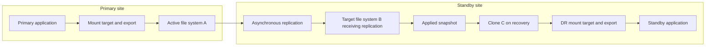
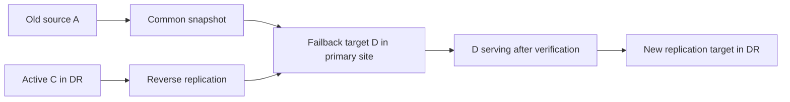

# Replication and disaster recovery file sharing design

In the **File Storage** chapter of the Oracle Cloud Infrastructure (OCI) module, replication helps maintain a copy of file data in another location. To turn that replica into a usable backup file-sharing service, the design must also include networking, mount targets, exports, user identities, applications, and cutover procedures.

This lesson uses an active–standby model within the same tenancy: the application writes in the primary region; another file system receives replication to support recovery. Learners will design RPO/RTO, create replication, observe progress, and build failover/failback procedures with authorization, verification, and cost control.

## Objectives and prerequisites

After this lesson, you will be able to:

- Distinguish replication, snapshots, clones, and standby NFS serving capabilities.
- Define RPO/RTO for file data and measure them with real evidence.
- Prepare a valid target file system and access infrastructure at the standby site.
- Create replication and distinguish resource lifecycle state from data freshness.
- Shift write authority to the standby site, then reverse-sync before returning.
- Drill using an isolated clone, record results, and clean up resources respecting dependency relationships.

You should know how to create file systems, mount targets, and exports; configure VCN/NSG; mount NFS on Linux; read POSIX permissions; and use the OCI CLI. The commands in this lesson are examples for practicing in your own environment, not commands already executed on your tenancy.

## Identifying what needs protection

A document management application might store attachments in File Storage and business metadata in Oracle Database. If the primary site fails, recovering application servers without attachments is not enough to serve users. Conversely, having files without matching metadata can also prevent the application from functioning properly.

Document requirements clearly before configuring:

| Question | Design decision |
| --- | --- |
| What failure scope must be tolerated? | Application host failure, AD failure, or full region loss |
| How much data loss is acceptable? | RPO in time and business impact |
| How long can service be unavailable? | RTO for the entire access path and application |
| Who is authorized to trigger DR? | Coordinator roles and action permissions |
| Which source is permitted to write? | Mechanism preventing two sites from processing data independently |
| Which data must recover together? | File systems, databases, queues, and application configurations |

In this lesson, the example assumes **30-minute RPO, 45-minute RTO** for an internal document system. This is an assumed requirement for evaluating design, not an OCI performance guarantee or SLA.

## Replication, snapshots, and clones do different jobs

OCI File Storage replication copies data **asynchronously** between file systems in the same or different ADs/regions. The target file system is updated by replication and remains read-only in that relationship. A write acknowledged by the application at the source does not prove that write has reached the target. See [File System Replication](https://docs.oracle.com/en-us/iaas/Content/File/Tasks/FSreplication.htm).

| Mechanism | Purpose | Role in DR design |
| --- | --- | --- |
| Replication | Transfers changes to a target file system | Maintains recovery points outside the source location |
| Snapshot | Preserves a point-in-time view of data | Selects a data timestamp for recovery or comparison |
| Clone | Creates a file system from a snapshot | Provides a recovery copy or isolated drill environment |
| Export and mount target | Exposes NFS access path for clients | Brings the recovered file system into service |
| DR runbook | Coordinates operational steps | Switches write authority, mounts, applications, and traffic |

Replication snapshots are managed by the service; they are not an infinite retention schedule for all versions. Other snapshots at the source can also be replicated to the target via the replication mechanism. See [Replication and Snapshots](https://docs.oracle.com/en-us/iaas/Content/File/Tasks/replication-managing-snapshots.htm).

Do not rely on the newest replica as your sole safeguard against accidental deletion or corrupted application writes. Unwanted changes can also propagate along the replication stream. Recovery plans need suitable historical data points and separately verified retention policies.

### Clones do not keep receiving changes like a replica

A clone created from a snapshot is a file system containing data at that point in time. After creation, changes on the clone and original file system evolve independently; the clone does not become an automatic subscriber to source replication.

Clones can share data references with their parent, so parent/clone relationships must be managed during cleanup. Resource attributes such as exports, keys, and tags must be configured per the cloning workflow. See [Cloning File Systems](https://docs.oracle.com/en-us/iaas/Content/File/Tasks/cloningFS.htm).

## Standby file sharing architecture



In normal operation, A serves the application and B is dedicated to replication. During clone-based recovery, C is the file system exported for the standby application to use.

Choose the target location based on the failure domain you want to survive:

- **Same AD:** supports certain data copying needs but shares the same physical location failure domain.
- **Different AD in a multi-AD region:** separates AD failure domains while remaining dependent on the same region.
- **Different region:** suits regional disaster recovery goals while increasing networking, operational, and cost requirements.

Location selection capabilities and target region prerequisites must be checked in [File System Replication](https://docs.oracle.com/en-us/iaas/Content/File/Tasks/FSreplication.htm). For cross-region in this lesson, the tenancy must be subscribed to the target region.

### A data replica is not yet a ready NFS service

At the standby site, you must prepare or have the capacity to create:

1. Recovery file systems and sufficient limits for clones.
2. Required mount targets, subnets, and IP addresses.
3. Export paths and export options suited for DR clients.
4. Routes, NSGs/security lists, and DNS.
5. Compute instances, NFS clients, mount configs, and application accounts.
6. Dependencies such as identities, secrets, and recovered databases.

Maintain a clear mapping table:

| Component | Primary site | Standby site |
| --- | --- | --- |
| Serving file system | A | C after failover |
| Replication target file system | Not applicable for active A | B |
| NFS endpoint | Primary mount target | DR mount target |
| Export path | E.g., `/documents` | Predefined DR path |
| Application account | Primary UID/GID and auth mechanism | Compatible values and mechanism |
| Data dependencies | Primary database/queues | Corresponding recovery points |

Do not assume file replication will automatically recreate this entire table.

## RPO: measuring the freshness of recoverable data

**RPO** is the maximum acceptable data loss, expressed in time. When selecting a recovery point, you must evaluate the snapshot fully replicated and **applied at the target**, not merely when the source started a cycle.

OCI provides the `ReplicationRecoveryPointAge` metric in the `oci_filestorage` namespace. This metric reflects the age of the source snapshot that has been fully replicated and applied at the target. See [File System Metrics](https://docs.oracle.com/en-us/iaas/Content/File/Reference/filemetrics.htm).

Observation model:

```text
Recovery point age at time T
  = T - data timestamp of the latest applied snapshot
```

Illustrative example:

| Timestamp | Event |
| --- | --- |
| 14:00 | Data at source is captured in a snapshot |
| 14:09 | That snapshot finishes applying at the target |
| 14:32 | Source encounters an incident; no newer snapshot has finished applying |

The usable data point remains 14:00. Recovery point age is about 32 minutes, exceeding the assumed 30-minute requirement. Do not treat 14:09 as the latest data point just because apply completed then.

### Interval is not a guaranteed RPO

According to replication creation documentation, the interval is entered in **minutes**, with a minimum allowed value of 15 minutes. The interval governs the replication schedule; capture, transfer, and apply times still affect the actual recovery point. See [Creating a Replication](https://docs.oracle.com/en-us/iaas/Content/File/Tasks/fsreplication-creating-a-replication.htm).

A requirement for only a few seconds of data loss must be evaluated with a solution suited to that workload; you cannot infer that capability from a minute-based replication setting.

## RTO: accounting for both access path and application

**RTO** is the maximum acceptable downtime. Creating a clone quickly does not prove the application will recover within the same timeframe.

Example RTO budget allocation, purely for design illustration:

| Task | Illustrative budget |
| --- | --- |
| Detection and DR decision | 7 minutes |
| Fence old source from further writes | 5 minutes |
| Select snapshot and prepare recovery file system | 6 minutes |
| Export, mount, and verify permissions | 8 minutes |
| Start application, verify, and switch traffic | 12 minutes |
| Total | 38 minutes |

Against a 45-minute target, this budget has 7 minutes of slack. During drills, replace assumed numbers with measured durations. If provisioning a mount target or handling hung mounts takes longer than expected, RTO must reflect that reality.

## Preparing valid sources and targets

Before creating replication, verify:

- Source file system, compartment, and target location are identified.
- Target region is ready and permitted by the service for that source.
- Operators or pipelines hold required permissions on resources on both sides.
- Target is dedicated to replication, not used as a test share.
- Service limits/quotas are sufficient for file systems, clones, and mount targets during DR.
- Initial data baseline and a way to verify base copy completion are defined.

A file system that **has ever been exported** does not become a valid target simply by deleting the export. Snapshot policies or snapshot change history on the target can also make it non-targetable or incompatible. When encountering this condition, select a new file system or valid clone per guidance rather than trying to alter a protected target directly. See [Creating a Replication Fails](https://docs.oracle.com/en-us/iaas/Content/File/Troubleshooting/troubleshooting-replication_create-fails.htm).

Therefore, never export B just to "peek at DR data" as a routine check. Use an isolated clone when read verification is needed.

### Estimating the initial copy

The base copy can take many hours depending on data volume. The replication estimator uses historical data; for new file systems, estimates may not match real workload behavior closely.

Bash example using the OCI CLI:

```bash
export PRIMARY_REGION='REPLACE_WITH_PRIMARY_REGION'
export SOURCE_FS_OCID='REPLACE_WITH_SOURCE_FILE_SYSTEM_OCID'

oci fs file-system estimate-replication \
  --region "$PRIMARY_REGION" \
  --file-system-id "$SOURCE_FS_OCID"
```

Review replication capability, allowed target regions, estimated base copy duration, and interval. A value of `-1` in some fields may indicate it cannot be estimated accurately or is unsupported; do not interpret it as negative time to ignore. See [Estimating Replication Time](https://docs.oracle.com/en-us/iaas/Content/File/Tasks/fsreplication-estimating-replication-time.htm).

Also factor in peak-hour change rates. A measurement taken with no active users does not represent periods when the application continuously modifies many files.

## Creating replication and recording identifiers

In the Console, open the source file system and select **Replications → Create replication**. Enter a name, interval, and select a valid target file system or create a new one per procedure. Mark configuration complete only after recording exact source/target identifiers and operational permissions.

CLI example when the target already exists:

```bash
export REPLICATION_COMPARTMENT_OCID='REPLACE_WITH_COMPARTMENT_OCID'
export TARGET_FS_OCID='REPLACE_WITH_TARGET_FILE_SYSTEM_OCID'

oci fs replication create \
  --region "$PRIMARY_REGION" \
  --compartment-id "$REPLICATION_COMPARTMENT_OCID" \
  --source-id "$SOURCE_FS_OCID" \
  --target-id "$TARGET_FS_OCID" \
  --display-name 'documents-primary-to-dr-r1' \
  --replication-interval 60
```

Here `60` is **60 minutes**, an illustrative value only. Choose the actual interval based on requirements, estimator results, and observation; do not treat this example as already meeting a 30-minute RPO. Parameters are documented in [OCI CLI: fs replication create](https://docs.oracle.com/en-us/iaas/tools/oci-cli/latest/oci_cli_docs/cmdref/fs/replication/create.html).

Distinguish four identifiers:

| Identifier | Object |
| --- | --- |
| Source file system OCID | File system A |
| Target file system OCID | File system B |
| Replication OCID | Control resource on the source side |
| Replication target OCID | Replication receiver resource on the target side |

Creating replication automatically creates the associated replication target resource. These two resources are distinct from the two file systems. See resource structure in [Managing Replications](https://docs.oracle.com/en-us/iaas/Content/File/Tasks/fsreplication-managing-replications.htm).

### Verifying activity after creation

Monitor cycles, recovery points, and errors. An existing or active resource does not yet prove the base copy has produced a usable DR recovery point.

Delta states such as **Capturing, Transferring, Applying, Idle** indicate processing stages. You must also inspect **Last Snapshot**, **Recovery Point Time**, and related errors. These fields are described in [Managing Replications](https://docs.oracle.com/en-us/iaas/Content/File/Tasks/fsreplication-managing-replications.htm).

Retrieve details from both sides:

```bash
export DR_REGION='REPLACE_WITH_DR_REGION'
export REPLICATION_OCID='REPLACE_WITH_REPLICATION_OCID'
export REPLICATION_TARGET_OCID='REPLACE_WITH_REPLICATION_TARGET_OCID'

oci fs replication get \
  --region "$PRIMARY_REGION" \
  --replication-id "$REPLICATION_OCID"

oci fs replication-target get \
  --region "$DR_REGION" \
  --replication-target-id "$REPLICATION_TARGET_OCID"
```

Use the corresponding region and OCID type for each resource. See [Getting a Replication's Details](https://docs.oracle.com/en-us/iaas/Content/File/Tasks/get-replication-details.htm) and [Getting a Replication Target's Details](https://docs.oracle.com/en-us/iaas/Content/File/Tasks/get-replication-target-details.htm).

In the lab, create an application marker at the source, record its timestamp, and wait for a data point containing the marker to apply. Check the marker on a DR clone and verify actual contents before declaring the system recoverable.

## Preparing access paths and identities at the standby site

Replication transfers file data and file permissions to the target, yet does not carry over all resource state. File locks, encryption keys, and file system tags are not copied like file data. Quota rules are copied, yet must be checked and enabled as required. See [File Storage replication scope](https://docs.oracle.com/en-us/iaas/Content/File/Tasks/FSreplication.htm).

This leads to dedicated DR preparation tasks:

| Component | Preparation task |
| --- | --- |
| IAM | Permissions to create clones, manage replication, exports, mount targets, and observe |
| Network | Subnets, routes, NSGs/security lists, and client paths to the DR endpoint |
| Export | DR client CIDRs, read/write permissions, and root access policy |
| Identity | Matching UIDs/GIDs or Kerberos/LDAP services |
| Encryption | Keys and key usage permissions at the target site per design |
| Application | Mount configuration, dependency endpoints, and data checks |

IAM governs OCI resource operations; read/write permissions inside the share belong to NFS and OS permission layers. Granting file system admin rights in the Console does not make a Linux account the owner of every directory. See [About File Storage Security](https://docs.oracle.com/en-us/iaas/Content/File/Concepts/securitylayers.htm).

### Network and exports must follow DR clients

A mount target is the network access point; the recovery file system must be exported via an appropriate mount target. Export options can restrict by IP/CIDR, read/write access, and root mapping. Verify rule ordering because exports apply the first matching option. See [Working with NFS Exports and Export Options](https://docs.oracle.com/en-us/iaas/Content/File/Tasks/exportoptions.htm).

Do not open a single NFS port and consider the network design finished. File Storage requires corresponding protocols/ports for NFS, rpcbind, mount, and locking; Kerberos/LDAP/DNS setups have additional requirements. Use actual DR client CIDRs and verify against [Configuring VCN Security Rules for File Storage](https://docs.oracle.com/en-us/iaas/Content/File/Tasks/securitylistsfilestorage.htm).

Separate two tests: whether replication updates data, and whether DR clients can mount/read/write. Passing one test does not replace the other.

## Controlling application consistency and write authority

File system snapshots provide data points at the storage layer. Do not assume a single replication cycle simultaneously creates a consistent recovery point across all file systems, databases, and application queues.

For a document system, decide how to handle these scenarios:

- The database committed metadata, yet the file has not appeared at the recovery point.
- The file reached DR, yet the corresponding database transaction was not recovered.
- A multi-file record was not finished publishing by the application.
- A worker was mid-processing and must retry after failover.

Application checkpoints, business logs, or idempotent retry mechanisms may be needed. For example, the system only publishes a record after writing all files and saving a completion manifest. During recovery, the team reconciles the manifest with the database rather than assuming all files sharing a modification timestamp form one transaction.

### Keeping only one site permitted to write

In this lesson's model, only one site is authorized to process business writes at a time. **Fencing** is the step of preventing the old environment from continuing to write when the new environment is activated.

Fencing may require stopping hosts/workers, blocking write paths, or revoking access per design. Updating DNS for a web UI does not necessarily stop cron jobs or old NFS clients.

Specifically, deleting a replication target only affects the replication relationship; it is not a command to stop the application at the source. Until safe transfer of write authority is verified, resolve that condition before opening business writes in DR.

## Failover when the source is unreachable

Using the established labels: **A** is the primary source, **B** is the replication target, and **C** is the recovery clone in DR.

### Selecting and recording the recovery point

Open the replication target at the target site and find the **Last Snapshot** successfully applied. Record the snapshot OCID, Provenance OCID, data timestamp, and recovery point age in the incident log.

Provenance helps identify snapshot lineage when comparing both sides; do not rely solely on names or a "Last Snapshot" link opened later. Identification details are described in [Replication and Snapshots](https://docs.oracle.com/en-us/iaas/Content/File/Tasks/replication-managing-snapshots.htm).

Compare the recovery point against RPO and decide business handling if the threshold was exceeded. Starting DR does not cause changes that never reached the target to magically appear.

### Creating the recovery file system and stopping the old relationship

From the chosen snapshot on B, create clone C at the standby site. Record the new OCID and resource configuration of C. See [Cloning a File System](https://docs.oracle.com/en-us/iaas/Content/File/Tasks/create-clone.htm).

Per OCI's DR procedure, after choosing the snapshot and creating the clone, handle the replication target on B so the old relationship does not keep cycling snapshots when the source returns. When the source is unavailable, deleting the replication target transitions the source-side replication to FAILED; this does not delete file system B. If the source is still available, act on the source-side replication resource. See [Deleting a Replication Target](https://docs.oracle.com/en-us/iaas/Content/File/Tasks/delete-replication-target.htm).

Preserve the initially selected snapshot details. In-flight cycles or source recovery can cause "latest snapshot" to differ from the snapshot used to create C.

### Exporting, mounting, and opening the DR application

1. Complete fencing and confirm who is accountable for enabling writes.
2. Create an export for C on the DR mount target with the right export options.
3. Mount C on DR clients using OS- and auth-appropriate commands.
4. Verify the data point, file permissions, and recovered dependencies.
5. Start the application in verification mode.
6. Switch traffic and enable writes only once recovery criteria pass.

Creating an export requires specifying the file system, export set, and path; verify against [Creating an Export](https://docs.oracle.com/en-us/iaas/Content/File/Tasks/create-export.htm).

Clone flows, snapshots, and replication teardown order during source loss are detailed in [File Storage Disaster Recovery](https://docs.oracle.com/en-us/iaas/Content/File/Tasks/replication-disaster-recovery.htm).

Evidence of service restoration should be a complete business operation: a user can read an existing document and create a new document with matching metadata. A successful directory listing command is insufficient.

## Planned switchover

When the source remains reachable, you can stop writes cleanly and complete a final cycle to minimize the data gap.

An operational sequence:

1. Block new write requests, stop workers, and drain in-flight data processing.
2. Write an application checkpoint or marker, ensuring data is flushed to storage.
3. Let replication finish applying the designated final data point.
4. Terminate replication using the appropriate delete mode; verify completion.
5. Select the exact final snapshot to create the serving clone, then export/mount and switch the application.
6. Keep the old site non-writable until switchover is finalized.

OCI provides three delete modes:

| Mode | Main behavior |
| --- | --- |
| Graceful delete | Completes the currently capturing/transferring/applying cycle then deletes; deletes immediately if idle |
| Replicate and delete | Completes the current cycle if any, then runs one additional cycle and deletes |
| Apply and delete | Completes the transferring/applying portion; deletes immediately if capturing/idle |

Corresponding API names are `finish_cycle_if_capturing_or_applying`, `one_more_cycle`, and `finish_cycle_if_applying`. See [Deleting a Replication](https://docs.oracle.com/en-us/iaas/Content/File/Tasks/delete-replication.htm).

Choosing a mode does not replace stopping writes. If the application keeps writing after the cutoff, running one more cycle does not produce a shared cutover point across the entire workload.

A similar workflow can be used for one-time data migration; OCI documents this separately in [Using Replication for Data Transfer](https://docs.oracle.com/en-us/iaas/Content/File/Tasks/replication-copy-data.htm).

## Failback: syncing new data before returning

After failover, C has received new writes. A still holds old data, so it cannot resume serving merely by switching endpoints back.

OCI failback flow:

1. Clean up the old replication on A once the source recovers.
2. Use the recorded Provenance to locate the common snapshot with C.
3. Create **D** in the primary site: a valid clone from the common snapshot, or a new file system if a full base copy is acceptable.
4. Create reverse replication **C → D** and wait for required data to apply.
5. Stop writes on C, complete the final sync, and terminate the reverse relationship appropriately.
6. Export/mount D, verify, and switch the application back.
7. Establish new replication from D to a valid target in DR.

See [Disaster Recovery: Prepare to Failback](https://docs.oracle.com/en-us/iaas/Content/File/Tasks/replication-disaster-recovery.htm).



D must satisfy target prerequisites before receiving reverse replication. Do not export D to test it as a serving share while it remains a protected target.

If using a new DR target after failback, recalculate base copy duration and the window without a fresh recovery point. Returning the application to the primary site does not mean DR capability is already re-established.

If both sides accepted independent writes, treat that as diverged data. The application team must reconcile and choose a business merge strategy; overwriting one side blindly can destroy valuable updates.

## NFS clients and file locks after switchover

C has its own file system identity and serving endpoint per DR configuration. Updating DNS records can assist configuration distribution, yet should not be treated as proof that all mounts and processes holding open files have switched cleanly.

Client procedures should include:

- Stopping workloads using the old mount.
- Performing unmount/remount or a tested client replacement strategy.
- Copying the Console's sample mount command for the right export and authentication method.
- Verifying mount source, export path, and application account permissions.
- Restarting tasks that need to re-acquire locks or rebuild sessions.

Obtain and verify mount commands per [Mounting File Systems](https://docs.oracle.com/en-us/iaas/Content/File/Tasks/mountingfilesystems.htm). OCI does not support combining `soft` mount with read/write because it can cause data corruption; do not use this change as a shortcut to reduce failover time.

Linux observation commands, assuming mount point `/srv/documents`:

```bash
findmnt --mountpoint /srv/documents
nfsstat -m
stat -c '%u:%g %a %n' /srv/documents
```

File locks are not replicated as live session state. Application design must re-initialize or recover locks appropriately rather than assuming post-DR workers seamlessly continue old workers' unfinished tasks.

With AUTH_SYS, client UIDs/GIDs must match the recovered data. If using Kerberos/LDAP, test identity services and DR configurations before an incident occurs. Do not test only with an admin account and conclude the application account also has access.

## Drilling on an isolated clone

Read/write drills on a separate clone verify data and access paths without turning B into a production share.

A lab scenario:

1. Wait for replication to produce a recovery point containing a known marker.
2. Create a test clone from the applied snapshot on B.
3. Export the clone into a test network and allow only test clients to access it.
4. Verify the marker, permissions, read/write, and application behavior with test dependencies.
5. Record step durations and results.
6. Stop test workloads, unmount, and clean up unneeded exports/clones.

In this isolated verification exercise, there is no need to break production replication just to test reading a clone. All test writes must target the clone and test dependencies, avoiding sending production jobs, emails, or database updates.

A full-flow failover drill is a different scope: it must also test fencing, stopping replication, shifting write authority, mounting, and failback. Label the drill type clearly so a data verification test is not mistaken for proving full RTO.

### Acceptance criteria

| Criterion | Evidence |
| --- | --- |
| RPO met | Applied snapshot and recovery point age |
| Data accurate | Marker, manifest, or sample records verified |
| Permissions accurate | Verified with the application account |
| Network accurate | Clients genuinely use the DR mount target/export |
| Application works | End-to-end business read and write flows |
| Write authority controlled | Old source stops processing writes when DR opens |
| RTO met | Duration measured from simulated incident to service restoration |
| Return path exists | Reverse replication results or tested failback evidence |

Do not mark a step as tested if it only exists in a runbook document.

## Monitoring and alerting conditions

Monitor at least recovery point age, cycle progress, errors, replication throughput, and NFS accessibility. At the application level, verify read/write through the serving endpoint.

Useful metrics include `ReplicationRecoveryPointAge`, `ReplicationThroughput`, and `ReplicationEgressThroughput` in `oci_filestorage`. The egress metric only applies to cross-region replication; check chart units and aggregations accurately before using them in calculations. See [File System Metrics](https://docs.oracle.com/en-us/iaas/Content/File/Reference/filemetrics.htm).

With an assumed 30-minute RPO, design early-warning alerts as recovery point age approaches the threshold. Thresholds and evaluation windows must account for observed variance so the team still has time to act before breaching the requirement.

Also detect missing monitoring data. The absence of new metric points does not mean replication is meeting RPO. On dashboards, clearly separate:

- Replication configuration exists.
- Cycles are progressing.
- A recent recovery point meets requirements.
- DR clients/applications were verified recently.

## Cost, limits, and resource lifecycle

Calculate cost for both source and target, snapshots/changed data on clones, cross-region data transfer, and DR application resources. File Storage metering relies on `meteredBytes`; figures reported by `du` do not always equal billable usage. See [File System Usage and Metering](https://docs.oracle.com/en-us/iaas/Content/File/Concepts/FSutilization.htm).

A cost plan should list:

| Item | Cost driver |
| --- | --- |
| Source and target file systems | Stored data, snapshots, and churn |
| Drill/recovery clones | Retained metadata and changed data |
| Cross-region transfer | Volume of data replicated out of the region |
| DR compute and network | Readiness level maintained prior to an incident |
| Leftover data post-failback | A/B/C and snapshots awaiting keep/delete decisions |

Clones also count toward file system limits. Reserve headroom for creating clones and mount targets during recovery; operating right up against limits in normal operations can cause the runbook to fail right when needed.

When cleaning up, verify parent/clone relationships, common snapshots used for failback, and retention obligations. Deleting a replication resource, a replication target, and a file system are distinct operations. Runbooks must specify the exact object, OCID, preconditions, and confirmation method.

## Symptom-based troubleshooting

| Symptom | Check first |
| --- | --- |
| Cannot create replication | Targetability, export history, snapshot policy, snapshot compatibility, and permissions |
| Recovery point age increases | Cycle progress, churn rate, errors, and service health |
| Replica exists yet clone creation fails | Resource limits, permissions, and selected snapshot |
| Clone has data yet mount fails | Export, endpoint, route, NSG/security list, and authentication |
| Mount succeeds yet app is denied | UID/GID, mode bits, export options, and actual account |
| Source returns yet replication is FAILED | Whether the old target relationship was terminated during failover |
| Failback needs unexpected base copy | Whether a valid common snapshot exists and the target was never exported |
| Both sides have differing files | Write history, fencing timestamp, and authoritative source decision |

Save timestamps, resource OCIDs, snapshot/provenance IDs, and error messages before making changes. Avoid creating extra exports or altering snapshots on a target for a "quick test", as doing so can change eligibility for subsequent replication.

## Comprehensive practice lab

Build a lab document share with versioned markers, a primary client group, and a DR client.

1. Define assumed RPO/RTO and application dependencies.
2. Create a source, valid target, and replication; record all four OCID types.
3. Wait for a recovery point containing the marker and observe data age.
4. Prepare networking, export options, and DR client accounts.
5. Create an isolated clone and verify the marker and access permissions.
6. Measure recovery duration; compare against the RTO budget.
7. If running a full-flow failover, test fencing and new writes in DR.
8. Test reverse synchronization before returning; re-establish replication protecting the new source.
9. Record resources that must remain for recovery and clean up unused lab artifacts.

Deliverables include an architecture diagram, resource mapping table, snapshot/provenance records, data and permission evidence, measured timings, and the failback procedure. The design meets its goal when the replica becomes a usable file-sharing service within the required timeframe, with a clearly defined data point and write-authorized site.
