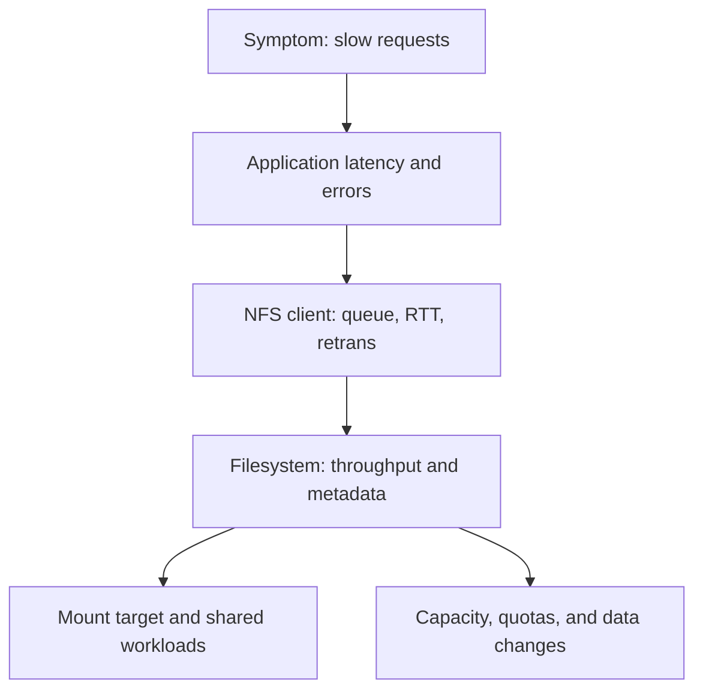

# Monitoring capacity, throughput, and optimizing NFS access

A Java API may access OCI File Storage successfully yet still be slow when downloading files, scanning directories, or handling high concurrency. There are also cases where directory data decreases yet the usage reported by the service does not drop accordingly. These situations must be analyzed with multi-layer metrics before changing configuration.

This lesson presents how to monitor capacity and performance for Oracle Cloud Infrastructure File Storage, combining OCI Monitoring with NFS client statistics and application metrics. The goal is to identify bottlenecks, choose evidence-based changes, and verify impacts on latency, correctness, and cost.

## 1. Separating three questions when observing the system

| Question | Key measurements | Example in a Java API |
| --- | --- | --- |
| How much data is being held? | Capacity, growth rate, quotas, and data storage points | Rapidly growing uploads or snapshots retaining data versions |
| How fast is data moving? | Throughput, operation count, and I/O size | Reading one large file differs from reading many tiny files |
| How long must users wait? | Latency, queues, error rate, and business completion time | Slow downloads due to NFS, CPU, database, or app processing flow |

High throughput does not prove the application meets target latency. Low throughput also does not prove the storage service is weak: the workload may not generate much data, may be concurrency-limited, or may primarily perform metadata operations.

Place metrics into the same time window and the same resource scope. If one mount target serves multiple filesystems, traffic for the whole mount target and traffic for an individual filesystem cannot be treated as the same measurement series.

## 2. Reading capacity usage accurately

OCI File Storage uses the `meteredBytes` attribute to report metered capacity for a filesystem, updated on an hourly cycle. Snapshots and clones are accounted for based on changed data, so total visible file size does not necessarily equal metered figures. `du` traverses the directory tree; `df` uses information returned by the service. When quotas are enabled, interpreting `df` numbers must consider quota limits and usage. [Oracle: File System Usage and Metering](https://docs.oracle.com/en-us/iaas/Content/File/Concepts/FSutilization.htm)

### 2.1. Checking on the client

The Linux commands below are for gathering evidence and have not been run on your resources. Replace the mount point and directory with actual paths:

```bash
findmnt --mountpoint /mnt/oci-share
df -hT /mnt/oci-share
du -sh --exclude=.snapshot /mnt/oci-share/order-api
```

`findmnt` confirms you are inspecting the right mount. Run `du` only on the scope needing analysis: traversing millions of files also generates metadata load. A capacity reporting command should not accidentally turn into a full-filesystem scan during peak hours.

Record at least four pieces of context when comparing metrics:

- Sampling timestamp and timezone.
- Filesystem, export, and mount point being observed.
- Which directories `du` scanned and whether snapshots were excluded.
- Which quotas, snapshots, or clones affect how the numbers are read.

If files were just deleted yet service usage has not dropped, check the update lag and data references still held by snapshots/clones. Do not take an instantaneous reading as proof that deletion failed. [Oracle: File System Usage and Metering](https://docs.oracle.com/en-us/iaas/Content/File/Concepts/FSutilization.htm)

### 2.2. Retrieving filesystem info via the OCI CLI

Example using Bash and an authenticated OCI CLI with the right region and read permissions:

```bash
export FILE_SYSTEM_OCID='ocid1.filesystem.oc1.REGION.REPLACE_ME'

oci fs file-system get \
  --file-system-id "$FILE_SYSTEM_OCID" \
  --query 'data."metered-bytes"' \
  --raw-output
```

Record the OCID alongside the value and read timestamp to track trends. The `get` command queries filesystem details; the JSON field name in the OCI CLI uses `metered-bytes`. [Oracle CLI: file-system get](https://docs.oracle.com/en-us/iaas/tools/oci-cli/latest/oci_cli_docs/cmdref/fs/file-system/get.html)

### 2.3. Distinguishing capacity growth from hitting a quota

File Storage supports quotas at the filesystem, UID, and GID levels. Soft quotas warn; hard quotas can reject writes when exceeded. When multiple quotas apply simultaneously, consider the effective limit for the writer. A live-data quota does not mean all metered capacity includes snapshots. [Oracle: File System Quotas](https://docs.oracle.com/en-us/iaas/Content/File/Tasks/file-system-quotas.htm)

Illustrative example: the filesystem still has headroom under its overall limit, yet the UID running Java hit its individual hard quota. Adding replicas or changing mount options will not resolve rejected writes. You must identify the exact UID/GID, enforced quota, and data needs before adjusting limits.

A capacity chart should be paired with growth rate. If the organization sets a 2 TiB operational threshold, current usage is 1.4 TiB, and growth is roughly 0.1 TiB/day, the linear runway is six days. This is an illustrative forecast for a chosen threshold, not a default service limit and not a substitute for checking sudden spikes.

## 3. Understanding throughput, operation count, and latency

### 3.1. Throughput is data over time

```text
Throughput = amount of data processed / time
1 MiB = 1,048,576 bytes
1 MB  = 1,000,000 bytes
```

For example, reading 600 MiB in 30 seconds gives an average throughput of 20 MiB/s. Specify whether the measurement belongs to the application, NFS client, or service. Reads served from cache can give the application high apparent throughput without generating corresponding NFS traffic.

Network units are usually bit/s; data units are usually byte/s. A 1 Gbit/s network link has a theoretical ceiling of 125 MB/s before overhead, not a guaranteed application throughput. For a specific instance, verify supported bandwidth and shared network utilization.

### 3.2. Equal operation counts do not mean equal data volumes

Two hypothetical workloads both perform 1,000 data operations per second:

| Size per operation | Theoretical calculated data volume |
| --- | --- |
| 4 KiB | About 3.91 MiB/s |
| 1 MiB | 1,000 MiB/s |

This calculation only illustrates the relationship between size and operation count, without accounting for overhead or system limits. One Java operation also does not necessarily map 1:1 to an NFS RPC or backend I/O; caching, buffering, and filesystem behavior can change that ratio.

### 3.3. Latency and concurrency

A single sequential thread where each I/O completes in 2 ms has a theoretical ceiling of about 500 I/O/s ignoring all other time. With 64 KiB per I/O, the corresponding data rate is about 31.25 MiB/s. Adding service-side capacity will not automatically make that single thread issue more requests.

Conversely, increasing concurrent tasks without bound can lengthen queues and raise p95/p99. Measure concurrency alongside throughput, latency, and error rate to choose an appropriate operating point.

Do not treat average service-side latency as HTTP request p95. Application requests also include thread wait time, Java processing, database queries, file operations, and response transmission.

## 4. Choosing OCI metrics and the right scope

The File Storage namespace is `oci_filestorage`. A useful set of metrics:

| Metric | Role in analysis |
| --- | --- |
| `FileSystemUsage` | Capacity trends |
| `FileSystemReadThroughput`, `FileSystemWriteThroughput` | Read/write data throughput, byte/s |
| `FileSystemReadRequestsbySize`, `FileSystemWriteRequestsbySize` | Request counts by size bucket |
| `FileSystemReadAverageLatencybySize`, `FileSystemWriteAverageLatencybySize` | Average latency by size bucket, seconds |
| `MetadataIOPS`, `MetadataRequestAverageLatency` | Metadata activity and latency |
| `MountTargetConnections`, `MountTargetHealth` | Mount target connections and health |

Filter by the exact `resourceId`; when needed, distinguish `mountTargetId`, `size`, or `operation`. Data is emitted on a minute interval; choose statistics and units according to each metric's definition. [Oracle: File System Metrics](https://docs.oracle.com/en-us/iaas/Content/File/Reference/filemetrics.htm)

A dashboard should place related series side by side instead of relying on a single aggregate number:



If throughput is already defined as byte/s, do not take another derivative of that series and still call the result byte/s. Similarly, summing capacity samples over time does not produce current capacity.

For latency metrics that are already averages, taking a percentile over averaged samples does not recover the percentile of individual underlying operations. To know the p95 of an API or an application operation, you need a suitable measurement source at that layer.

### 4.1. MQL queries

Example selecting a specific filesystem to get per-minute mean read throughput:

```text
FileSystemReadThroughput[1m]{resourceId = "ocid1.filesystem.oc1.REGION.REPLACE_ME"}.mean()
```

MQL combines metric name, interval, dimension filters, and statistic. Replace the OCID with the real resource; if multiple series exist by mount target, inspect returned dimensions before aggregating. [Oracle: Monitoring Query Language Reference](https://docs.oracle.com/en-us/iaas/Content/Monitoring/Reference/mql.htm)

Example reading the same query via CLI:

```bash
export COMPARTMENT_OCID='ocid1.compartment.oc1..REPLACE_ME'
export START_UTC='2026-11-20T01:00:00Z'
export END_UTC='2026-11-20T02:00:00Z'

MQL_QUERY="FileSystemReadThroughput[1m]{resourceId = \"${FILE_SYSTEM_OCID}\"}.mean()"

oci monitoring metric-data summarize-metrics-data \
  --compartment-id "$COMPARTMENT_OCID" \
  --namespace oci_filestorage \
  --query-text "$MQL_QUERY" \
  --start-time "$START_UTC" \
  --end-time "$END_UTC"
```

Timestamps in the example are UTC and must be adjusted for each investigation. Results represent aggregated data over the query scope; empty results should be checked for region, compartment, permissions, and metric series existence. [Oracle CLI: summarize-metrics-data](https://docs.oracle.com/en-us/iaas/tools/oci-cli/latest/oci_cli_docs/cmdref/monitoring/metric-data/summarize-metrics-data.html)

## 5. Collecting metrics from the NFS client

On Linux, use NFS tools instead of looking only at local block devices:

```bash
findmnt --mountpoint /mnt/oci-share
nfsstat -m
nfsiostat 1 10 /mnt/oci-share
```

`nfsiostat` reports metrics per mount. The first sample reflects time since mount; subsequent samples reflect each sampling interval. Fields to watch include op/s, data volume, average size, retransmissions, queues, `avg RTT`, and `avg exe`. `avg exe` covers a broader scope than RTT because it includes client-side request handling time. [Linux NFS utilities: nfsiostat](https://man7.org/linux/man-pages/man8/nfsiostat.8.html)

Interpret as hypotheses rather than treating a single field as a final diagnosis:

| Observation | Hypothesis to test next |
| --- | --- |
| Queue grows and `avg exe` rises sharply | Client or concurrency level is building a backlog |
| RTT rises across multiple clients at once | Network path, endpoint, or shared workload needs cross-checking |
| Retransmissions increase | Inspect network path and RPC responses; do not conclude root cause from this ratio alone |
| Throughput is low yet metadata increases | Workload may be scanning, creating, or statting many small files |
| One client is slow while others are normal | Compare shape, mount options, CPU, network, and client processes |

Combine with instance CPU, memory, and network metrics. If utilities are missing from the image, check OS NFS utilities packages. With Kubernetes managed nodes, gather evidence on the Pod's exact worker within authorized admin scope; node-side NFS mount metrics must be correlated with the workloads driving them.

## 6. Optimizing based on observed bottlenecks

### 6.1. Reducing unnecessary application operations

A Java API re-scanning an entire directory on every request can generate heavy metadata operations even when returning only a few kilobytes of data. Before increasing bandwidth, examine the processing path:

- Is it calling existence checks or reading attributes repeatedly for the same file?
- Is it listing a massive directory just to find a single document by ID?
- Is it repeatedly opening and closing files instead of streaming with proper buffering?
- Can batch jobs be split into independent tasks with bounded concurrency?
- Are multiple replicas scanning the same dataset without work partitioning?

For example, if the document ID and ID-to-path mapping rule are known, the application can access directly instead of scanning the entire directory. If changing directory organization, design both data migration and lookup of old files; higher throughput must not come at the cost of losing data retrievability.

Java buffers and NFS request sizes are two different layers. Increasing buffers can reduce application-level calls, yet actual gains must be confirmed via RPCs, throughput, and latency. For business flows requiring durable write confirmation, keep required flush/commit conditions intact during performance testing.

### 6.2. Checking mount options and client-side concurrency

Oracle recommends not hardcoding `rsize` and `wsize` unless the application has specific needs, allowing client and server to negotiate suitable sizes. `nconnect` can increase TCP connections serving NFS on supported clients, though effectiveness depends on the workload and other limits. [Oracle: File Storage Performance Characteristics](https://docs.oracle.com/en-us/iaas/Content/Resources/Assets/whitepapers/file-storage-performance-guide.pdf)

A test hypothesis could compare the current setup against `nconnect=4` on a test client with a compatible kernel. This is an experimental value, not a mandatory default. Prepare an appropriate mount in a test environment, then verify active options with `nfsstat -m`; some options and connections can be shared across mounts to the same server.

Options like `noac` or `actimeo=0` affect attribute caching and can increase RPC counts. Change them only after identifying consistency requirements alongside workload impact. Preserve data-safety semantics when choosing `hard`/`soft`: soft mounts risk data corruption in certain scenarios, so do not use them as a generic speedup. [Linux NFS client: mount options](https://man7.org/linux/man-pages/man5/nfs.5.html)

In Kubernetes, inspect PV mount options and the CSI version in use. Editing a manifest does not prove running Pods already use the new mount configuration. Plan workload replacement or lifecycle actions suited to the driver, then re-collect evidence on the node.

### 6.3. Reviewing Compute and network limits

If the NFS client has busy CPU, a network near saturation, or bandwidth shared with other jobs, scaling up the mount target may not help the application. Gather:

| Component | Evidence |
| --- | --- |
| Instance | Shape, supported network bandwidth, CPU, and memory |
| Access path | Client/mount target placement, routes, and intermediate components |
| Network | Traffic, drops, errors, and retransmission signs during the investigation window |
| Shared workloads | Backups, copy jobs, or other processes sharing resources |

Comparing clients with different configurations is meaningful only when data and workload conditions remain sufficiently comparable. A cached read run on a new machine does not prove the network or storage improved.

### 6.4. Evaluating mount target capacity and load distribution

OCI offers mount target options with different performance characteristics; you can consider changing types or distributing clients across multiple mount targets when evidence shows the endpoint is the bottleneck. Evaluate usage conditions, resource limits, and ongoing costs before choosing. Exporting through multiple mount targets can also alter metadata caching benefits. [Oracle: File Storage Performance Characteristics](https://docs.oracle.com/en-us/iaas/Content/Resources/Assets/whitepapers/file-storage-performance-guide.pdf)

A new mount target does not automatically rebalance clients already mounted at the old address. A change plan must specify which clients move, which exports they use, matching permissions and network paths, and how to roll back if results fall short.

If only a single Java thread generates sequential I/O, examine the bottleneck in that thread first. If multiple applications share an endpoint, look at the load from the other applications as well to avoid attributing all traffic to one API.

## 7. Designing actionable alerts

A useful alert requires a metric source, scope, sustained condition, and an owner. Choose thresholds from service objectives and measured baselines rather than applying one generic number to every filesystem.

| Alert group | Illustrative condition | First action |
| --- | --- | --- |
| Capacity | Usage or growth rate exceeds configured operational threshold | Identify growth source, quotas, and data retention points |
| Latency | Sustained high latency paired with application impact | Cross-check client, metadata, throughput, and recent change timestamps |
| Write failures | Application reports quota or permission errors | Check identity, limits, and exports before tuning performance |
| Endpoint health | Abnormal health metric | Review error series, reachability, and affected client scope |
| Monitoring data | Required metric absent over expected window | Distinguish idle activity from collection errors or wrong scope |

MQL supports threshold and missing-data checks; alarm definitions need appropriate intervals, pending durations, and notification channels. When using a metric that naturally emits no samples during idle periods, account for that behavior before creating an absence alarm. [Oracle: Monitoring Query Language Reference](https://docs.oracle.com/en-us/iaas/Content/Monitoring/Reference/mql.htm)

Zero throughput can be normal when there are no requests. However, throughput dropping to zero while the business queue grows is a different signal. Pair storage alerts with application workload volume to tell the difference.

An alert runbook should record:

1. Region, compartment, and relevant filesystem and mount target OCIDs.
2. Dashboards and time windows to inspect.
3. Workloads or client groups sharing the resource.
4. Evidence to capture before making changes.
5. Remediation steps, decision owner, and stop/rollback conditions.

## 8. Scenario: slow API despite low NFS throughput

Suppose a document API sees p95 rise from 90 ms to 320 ms after file counts surge. Application host CPU has headroom, read data throughput is only a few MiB/s, while metadata operation counts increase noticeably.

The numbers in this scenario are hypothetical for analysis, not measurements from a real tenancy. A sound investigation workflow:

1. Confirm p95 for the exact endpoint and the timeframe when the change occurred.
2. Check tracing or per-stage timings to see where requests are waiting.
3. Correlate metadata operations with the document lookup flow in application code.
4. Determine whether directory listings or repeated attribute checks occur.
5. Test reducing redundant operations in an environment with representative data.
6. Re-measure p95, error rate, metadata, throughput, and client resources.

The hypothetical results below guide the next step:

| Experiment | Observed result | Conclusion within test scope |
| --- | --- | --- |
| Increase thread count | Queues and p95 rise; completion rate barely changes | This concurrency level yields no benefit |
| Access by direct path instead of directory scan | Metadata drops, p95 drops, returned data accurate | Evidence supports further evaluating the application change |
| Re-run the same file repeatedly | Faster, yet NFS traffic drops | Cache is affecting results; separate warm and cold runs |
| Test large-file read workload | Higher throughput than small-file API load | The two workloads behave differently; results do not substitute for each other |

Another scenario is batch-reading large files with many concurrent clients and sustained high endpoint load. In that case, mount target capacity or load distribution may be the stronger hypothesis. Always rely on evidence from the specific situation.

## 9. Before-and-after comparison

To make results reproducible and re-evaluable, record run conditions:

| Aspect | Information to record |
| --- | --- |
| Data | File count, size distribution, directory structure, and representativeness |
| Cache | How warmed runs were; which datasets were re-read |
| Client | Shape, kernel, NFS options, placement, and background load |
| Concurrency | Client count, Pod count, thread count, and queue limits |
| Storage | Filesystem, export, mount target, and active quotas |
| Results | Throughput, completion time, latency, errors, and resource utilization |
| Correctness | Read/write contents, access permissions, and durability requirements |
| Operations | Associated cost, rollout method, and rollback plan |

Change one primary variable at a time and run long enough to observe steady state. Choose a bounded test scope on test resources or within an authorized maintenance window; benchmark data must never mix into business directories.

For write workloads, a measurement ending when data is only in application buffers is not equivalent to one ending after required write confirmations. Document the completion milestone clearly and keep it consistent across comparisons.

If testing additional replicas in OKE, record actual Pod placements. Two Pods on the same worker can share client resources differently than two Pods on separate workers. When scaling changes, monitor dependent services such as databases and queues as well.

## 10. Assumptions that easily lead to wrong optimizations

| Assumption | How to re-verify |
| --- | --- |
| `du` size is billable capacity | Cross-check directory tree scope, metering, quotas, and snapshots/clones |
| Deleting files must immediately reduce service usage | Check update timing and remaining data references |
| High byte/s means a fast API | Read alongside latency, errors, and completed business work |
| Low byte/s means storage is underpowered | Check I/O size, metadata, caching, and concurrency |
| All IOPS figures mean the same thing | Distinguish application calls, NFS RPCs, and backend I/O |
| Adding threads or Pods always improves speed | Measure queues, p95/p99, and shared limits |
| Setting large rsize/wsize solves everything | Inspect actual negotiation and workload instead of just config values |
| Good averages guarantee no slow requests | Measure latency distribution at the target application layer |
| A PVC capacity number suffices for all usage control | Check enforced quotas at the service and the writing identity |

## 11. Practice exercise

Select a test filesystem with an active NFS client. Capture a baseline window across three groups: capacity, NFS performance, and latency/completion rate for a representative workload. Use at least two access patterns, such as reading large files and reading many small files.

Complete the following parts:

1. Record the exact filesystem, mount target, mount source, and measurement interval.
2. Read `meteredBytes`, check `df`, and run `du` on a bounded directory; explain any differences.
3. Query filesystem-level throughput and cross-check with `nfsiostat` on the client.
4. Determine whether the workload is data-bound, metadata-bound, sequential-latency-bound, or concurrency-bound.
5. Form an improvement hypothesis and pick exactly one verifiable change.
6. Compare before/after using the same completion milestone, cache conditions, and correctness criteria.
7. Propose an alert with threshold, evaluation window, recipient, and first action.

The output is an analysis clearly stating **what is being measured, which evidence proves the bottleneck, which change improved results, and the limits of that conclusion**. Keep the same measurement methodology during wider rollout to detect when the workload or bottleneck shifts.
