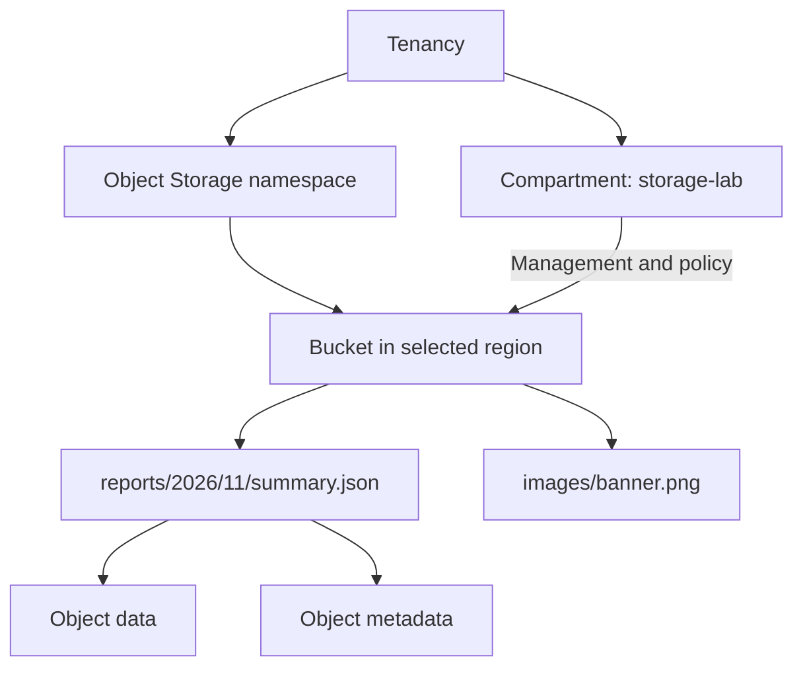

# Namespaces, buckets, objects, and object metadata

## 1. Objectives and context

In the **Object Storage and Archive Storage** chapter of the **CLOUD_PROVIDERS_ORACLE** module, this lesson builds the mental model for storing, identifying, and reading object data on Oracle Cloud Infrastructure. You will connect namespaces, buckets, and objects to tenancies, compartments, regions, IAM, and application configuration.

Suppose a Java service generates JSON reports, PDF documents, and data exports from Oracle Database. These outputs need to be stored durably, downloadable via API, access-controlled, and placed in an appropriate storage tier. OCI Object Storage provides the object storage model for that need; Archive is a tier option with different access characteristics.

After this lesson, you will be able to:

- Distinguish between namespace, compartment, bucket, object name, and object version.
- Determine the complete logical address of an object.
- Understand prefixes and "folders" in the Object Storage interface.
- Distinguish between service-managed properties, HTTP response headers, and custom metadata.
- Practice uploading, HEADing, listing, and downloading a small object using the OCI CLI.
- Read errors according to the proper layer: identity, authentication, authorization, or storage state.

The Bash commands are intended for a Linux test environment with the OCI CLI and appropriate permissions. These are learning examples, not commands meant to be run on the machine holding this document. Illustrative OCID, region, bucket, and object values must be replaced with information from an environment you are authorized to administer.

## 2. The Object Storage model

An object consists of **data content** along with attributes that describe and control how that content is accessed. The service works with objects through an API, CLI, or SDK. It does not require the application to view data as a disk attached to an operating system. [Oracle: Overview of Object Storage](https://docs.oracle.com/en-us/iaas/Content/Object/Concepts/objectstorageoverview.htm).

A report can be described as follows:

```text
Content: bytes of the JSON report
Object name: reports/2026/11/summary.json
Content-Type: application/json
Custom metadata: schema-version=1, producer=report-service
```

Content and metadata serve different roles. Setting `schema-version=1` does not automatically make the data valid JSON. Naming an object ending in `.pdf` also does not prove the content is a safe or well-formed PDF document.

Comparison of access models:

| Model | How applications work with data | Example operations |
| --- | --- | --- |
| Object Storage | Call APIs by bucket and object name | PUT, HEAD, GET, LIST |
| File Storage | Open files through a mounted filesystem | Read file paths, directory operations |
| Block Storage | Work with block devices via the OS or storage software | Create filesystems, manage volumes by design |

A tooling layer can emulate a filesystem over object storage, but applications must still check the semantics and limitations of that layer. Do not assume an object API has full POSIX behavior like a local filesystem.

## 3. Namespace, compartment, and region

### Namespace is tied to the tenancy

An Object Storage namespace is the top-level namespace for a tenancy's buckets and objects. OCI assigns a unique namespace name that cannot be changed arbitrarily; a tenancy's namespace string remains the same across regions. Do not guess the namespace by lowercasing the display name or taking the tenancy OCID. Read the value directly from OCI. [Oracle: Object Storage Namespaces](https://docs.oracle.com/en-us/iaas/Content/Object/Tasks/understandingnamespaces.htm).

Basic command:

```bash
oci os ns get
```

Illustrative output:

```json
{
  "data": "namespace-from-oci"
}
```

A namespace name is not a password and does not replace credentials. Knowing a tenancy's namespace does not mean you can read private objects in that tenancy.

### Compartments organize and authorize resources

A bucket belongs to a compartment. Compartments help separate responsibilities and apply IAM policies, for example separating lab report resources from production.

Namespace and compartment are not the same concept. Creating a new compartment does not automatically create a new Object Storage namespace. In object operations, the CLI typically needs the namespace, bucket, and object name; whereas listing buckets requires knowing the appropriate compartment.

### Region is still part of the deployment identity

Having the same namespace string does not mean every region has the same buckets and data. When configuring a client, you must select the correct region or resource endpoint. A "bucket not found" error can come from the wrong region, not necessarily because the bucket was deleted.

Conceptual model:



The diagram illustrates two perspectives: the namespace provides identification, while the compartment organizes administrative permissions. The region must be stored alongside deployment configuration, even though it is not represented as a directory in the object name.

## 4. A bucket is a container with its own configuration

A bucket contains objects and also holds settings such as public access, default storage tier, versioning, and lifecycle policies. A bucket has a resource OCID, but in many Object Storage operations, applications use the bucket name together with the namespace.

Buckets do not contain sub-buckets. You can split data into multiple buckets when there are significant differences in ownership, permissions, lifecycle, or operational requirements. There is no need to create a separate bucket for each day just to simulate directories.

### Bucket name uniqueness scope

Consider **bucket scope** instead of assuming one naming rule for all buckets:

| Bucket scope | Uniqueness scope for name | Key takeaway |
| --- | --- | --- |
| `NAMESPACE` | Within the tenancy/namespace and region | Fits the path-style model in this lab |
| `REGION` | Across the entire region, across tenancies | Supports additional virtual-hosted-style access under service conditions |

For example, with `NAMESPACE` scope, the same bucket name can appear in two different namespaces or two different regions. Changing compartments within the same namespace and region does not give the bucket name a separate naming scope. [Oracle: Creating an Object Storage Bucket](https://docs.oracle.com/en-us/iaas/Content/Object/Tasks/managingbuckets_topic-To_create_a_bucket.htm).

The lab explicitly chooses `NAMESPACE` and a distinct name for each run. When changing scope or using another compatible API, check the naming rules and endpoint construction of that interface.

### Choosing buckets by operational boundaries

For example, a dedicated bucket for lab report data helps inventory and clean up lab exercises. In real systems, you may need separate buckets that have different retention requirements or belong to different operational teams.

A prefix is convenient for grouping objects, but it does not automatically create a security boundary. To restrict access by bucket or object pattern, you must configure actual permissions; do not rely on the Console displaying a folder icon.

## 5. Object identification and the meaning of object name

In OCI, an object does not have its own OCID like a bucket does. The user or application chooses the object name upon upload. Object names are case-sensitive; each name identifies the current object in the bucket, and versioning can add additional versions. [Oracle: Object Storage Objects](https://docs.oracle.com/en-us/iaas/Content/Object/Tasks/managingobjects.htm).

To record a reference to an object, store all of the following:

```text
Region + namespace + bucket name + object name
If a fixed copy is needed: add the appropriate version ID
```

Example application configuration:

```json
{
  "region": "ap-singapore-1",
  "namespace": "namespace-from-oci",
  "bucket": "team-reports-lab",
  "objectName": "reports/2026/11/summary.json"
}
```

Storing only `summary.json` as an identifier can cause confusion across datasets, buckets, or environments. Conversely, you should not embed a URL carrying temporary access credentials directly into every business record.

### An object name is not a local file path

Consider three values:

| Value | Role |
| --- | --- |
| `/tmp/report.json` | Source file on the uploading machine |
| `reports/2026/11/summary.json` | Object name in the bucket |
| `/tmp/downloaded-report.json` | Target file when downloading |

They can be completely different. Uploading a file does not mean the source machine's directory structure is automatically preserved. If a specific object name is needed, specify it explicitly when calling the API or CLI.

In Java, an object name should be passed into the SDK request's object name field. Do not use operating system path normalization rules to arbitrarily rewrite `/` slashes, add Windows drive letters, or strip components of the key.

## 6. Prefix, delimiter, and simulated folders

Object Storage has a flat naming structure inside a bucket. The `/` character in names helps tools render a directory-tree-like view; you do not need to create a physical directory before uploading an object with a prefix.

Example object names:

```text
reports/2026/11/summary.json
reports/2026/11/details.csv
reports/2026/12/summary.json
reports-old/summary.json
```

`reports/2026/11/` is an appropriate prefix to select the first two objects. The prefix `reports` is broader and can also match `reports-old/summary.json`. Therefore, the trailing `/` in a prefix is a scoping decision, not a decorative detail.

When listing, **prefix** filters the beginning of the object name; a **delimiter** such as `/` groups names that share a common prefix. The returned prefix group does not prove that an object holding data exists at that exact "folder" name. [Oracle: Listing Objects in a Bucket](https://docs.oracle.com/en-us/iaas/Content/Object/Tasks/managingobjects_topic-To_list_objects_in_a_bucket.htm).

Design implications:

- Choose stable keys that are easy to filter according to business needs.
- Do not place secrets or unnecessary personal data in object names.
- Do not treat prefix listing as a database query with arbitrary predicates.
- Verify the full scope before performing bulk operations by prefix.

An application treating a prefix as a "customer's folder" does not automatically grant or revoke access for that customer. Business boundaries must be enforced with authorization policies and data ownership rules.

## 7. Three groups of object metadata

### Service-managed properties

These describe the object and its current stored state, such as size, modification time, ETag, storage tier, or version ID when applicable. Some values appear in the summary during LIST, while others are returned via HEAD or GET.

Not every field appears with the exact same name and format across all interfaces. The CLI may display JSON using hyphenated names, whereas SDKs use language-specific getters or property names.

### HTTP headers describing how to interpret content

Common headers include:

| Header | Role | What it does NOT do automatically |
| --- | --- | --- |
| `Content-Type` | Declares the content type, e.g., `application/json` | Parse or validate JSON schema |
| `Content-Disposition` | Suggests presentation or download filename | Rename the object in the bucket |
| `Cache-Control` | Instructs clients/caches how to handle the response | Replace IAM or make an object public/private |
| `Content-Encoding` | Describes applied encoding, e.g., gzip | Compress an uncompressed payload |

Declared values must reflect the actual content. If you send compressed data with the wrong encoding header, readers may fail to process it even though the upload succeeded. These options are headers for clients, not server-side content validation logic. [OCI CLI: object put](https://docs.oracle.com/en-us/iaas/tools/oci-cli/latest/oci_cli_docs/cmdref/os/object/put.html).

### Application-defined custom metadata

Custom metadata consists of string key/value pairs attached to an object. For example:

```json
{
  "schema-version": "1",
  "producer": "report-service",
  "dataset": "monthly-summary"
}
```

In OCI's HTTP interface, custom metadata names are returned with the `opc-meta-` prefix, such as `opc-meta-schema-version`. When using the CLI `--metadata` flag, supply key/value JSON as expected by the tool interface; do not add the prefix twice. [Oracle: Optional Response Headers and Metadata](https://docs.oracle.com/en-us/iaas/Content/Object/Tasks/managingobjects.htm#Optional).

Custom metadata should be concise, follow naming conventions, and serve descriptive or processing-routing purposes. Setting `classification=internal` does not automatically forbid downloads; setting `retention-days=90` does not automatically create a retention rule.

Do not place API keys, database passwords, or URLs granting temporary access in metadata. Anyone with HEAD permission can read metadata without needing to download the object body.

### Distinguishing from metadata and tags on other resources

| Concept | Example purpose | Automatically propagated as per-object metadata? |
| --- | --- | --- |
| Object metadata | Schema of a report | Attached directly to the written object |
| Bucket metadata | Bucket description | Not inherited down to objects by default |
| Bucket tags | Project group, environment, resource governance | Do not automatically become `opc-meta-*` headers |
| Namespace metadata | Namespace configuration for supported interfaces | Not a business label for each file |

If you need to update metadata by writing or copying an object, check the operation semantics and preserve all required values. Do not assume that sending a single new key always performs a partial update. During a copy, OCI provides options for handling destination metadata; it is a data operation requiring appropriate permissions and planning. [Oracle: Copying Objects](https://docs.oracle.com/en-us/iaas/Content/Object/Tasks/copyingobjects.htm).

## 8. HEAD, LIST, GET, and ETag

### Choosing the operation by question

| Question | Appropriate operation |
| --- | --- |
| Which names exist in a bucket or prefix? | LIST |
| What metadata does a specific object have? | HEAD |
| Need to read the object's content? | GET |
| Need to write new content? | PUT or an appropriate upload workflow |

HEAD lets you inspect an object without downloading its body. LIST is not a per-object HEAD; do not assume a LIST summary contains all custom metadata. If an application needs to search across many business fields at scale, design a proper index or catalog instead of issuing bulk HEAD calls per user request.

### ETag as a resource representation identifier

An ETag is a value used to identify resource state and conditional requests. Treat it as an opaque value: store and compare it according to the protocol rather than interpreting it as a specific hash algorithm.

OCI may return ETag and checksums in different fields. Do not assume `ETag = MD5`, and do not compare a base64-encoded MD5 string against a hex-encoded MD5 string and conclude data is corrupted. [Oracle: Getting an Object's ETag](https://docs.oracle.com/en-us/iaas/Content/Object/Tasks/managingobjects_topic-head_objects.htm).

For update operations with concurrent overwrite risk, conditions like `If-Match` can help detect whether the resource changed since it was read. It does not create an atomic transaction between Object Storage and an Oracle Database table.

The lab verifies content by re-downloading and byte-comparing a small file. This directly answers "does the payload match", independent of how ETag is formatted.

## 9. Access permissions and privacy

Permissions to read bucket info, view object metadata, download objects, and write/delete objects are separate capabilities. In OCI's IAM model, `inspect objects` covers LIST and HEAD; `read objects` adds the ability to GET content. [Oracle: Object Storage IAM policy reference](https://docs.oracle.com/en-us/iaas/Content/Identity/Reference/objectstoragepolicyreference.htm).

Example of a group that only reads objects from an existing lab bucket:

```text
Allow group ObjectStorageReaders to read objects in compartment storage-lab where target.bucket.name = 'team-reports-lab'
```

The group name, identity domain if applicable, bucket, and compartment must match your tenancy. This policy is not the full permission set needed to create the lab bucket; the creator needs the corresponding administrative permissions. Grant only the required operations rather than opening permissions across the entire tenancy to fix a single error.

Applications can use an appropriate workload identity, such as instance principals when running on configured Compute instances. Do not embed private signing keys or passwords into source code or metadata just for testing convenience.

### Private buckets and HTTP paths

A native API path has the conceptual form:

```text
<ObjectStorageEndpoint>/n/<namespace>/b/<bucket>/o/<urlEncodedObjectName>
```

The endpoint depends on the region and OCI environment. SDKs or the CLI handle request construction according to their interfaces; when building URLs manually, URL-encode the object name properly. Strings with spaces, Unicode characters, or special URL characters should not be concatenated blindly.

Knowing the canonical URL does not grant permission to download a private object. Public access and pre-authenticated requests (PAR) are separate mechanisms. A PAR allows whoever holds the URL to access data without separate credentials, so that URL must be treated as sensitive access-bearing data. This lab does not need to create a PAR. [Oracle: Pre-Authenticated Requests](https://docs.oracle.com/en-us/iaas/Content/Object/Tasks/usingpreauthenticatedrequests.htm).

## 10. Hands-on lab: a small object in a private bucket

### Prepare the context

Use the lab compartment, an account with permissions granted for the lab, and a Bash terminal with the OCI CLI configured. Choose the authorized region. The blocks below share a single shell session and preserve variables between steps.

```bash
REGION='ap-singapore-1'
COMPARTMENT_OCID='ocid1.compartment.oc1..EXAMPLE'

NAMESPACE="$(oci os ns get \
  --region "$REGION" \
  --query data \
  --raw-output)"

RUN_ID="$(date -u +%Y%m%dt%H%M%Sz)-$RANDOM"
BUCKET="oci-os-lab-$RUN_ID"
OBJECT_NAME="lab/$RUN_ID/reports/summary.json"
WORK_DIR="$(mktemp -d)"

printf 'Region: %s\nNamespace: %s\nBucket: %s\nObject: %s\n' \
  "$REGION" "$NAMESPACE" "$BUCKET" "$OBJECT_NAME"
```

Verify that each command succeeds and that the namespace value is non-empty before proceeding. A unique suffix reduces the chance of colliding with resources from another run; it does not replace verifying which resources you will operate on.

### Create a new bucket for the lab

```bash
oci os bucket create \
  --region "$REGION" \
  --namespace-name "$NAMESPACE" \
  --compartment-id "$COMPARTMENT_OCID" \
  --name "$BUCKET" \
  --bucket-scope NAMESPACE \
  --storage-tier Standard \
  --public-access-type NoPublicAccess
```

Review the output to confirm the name, compartment, namespace, scope, and public access setting. This example uses a new bucket without enabling versioning or retention rules to focus on the core model. Do not modify the configuration of an existing bucket holding data just for this exercise. [OCI CLI: bucket create](https://docs.oracle.com/en-us/iaas/tools/oci-cli/latest/oci_cli_docs/cmdref/os/bucket/create.html).

### Prepare the payload and upload with metadata

```bash
printf '%s\n' \
  '{"reportId":"lab-001","status":"ready","recordCount":3}' \
  > "$WORK_DIR/report.json"

oci os object put \
  --region "$REGION" \
  --namespace-name "$NAMESPACE" \
  --bucket-name "$BUCKET" \
  --name "$OBJECT_NAME" \
  --file "$WORK_DIR/report.json" \
  --no-multipart \
  --no-overwrite \
  --content-type 'application/json' \
  --metadata '{"schema-version":"1","producer":"oci-cli-lab","dataset":"lesson-001"}'
```

Since the payload is small, the example chooses a single-part upload. `--no-overwrite` tells the CLI not to overwrite an existing object; read the actual output to distinguish a new upload from a skipped overwrite. Do not treat a command exiting without a shell error as proof that an existing object was updated as intended.

The local filename is `report.json`, while the full object name is the value in `OBJECT_NAME`. The metadata keys here do not include the `opc-meta-` prefix because the CLI accepts key/value pairs through `--metadata`.

### HEAD to inspect properties and custom metadata

```bash
oci os object head \
  --region "$REGION" \
  --namespace-name "$NAMESPACE" \
  --bucket-name "$BUCKET" \
  --name "$OBJECT_NAME"
```

Check the returned content type, content length, ETag, and custom metadata headers. HEAD does not download the report body. [OCI CLI: object head](https://docs.oracle.com/en-us/iaas/tools/oci-cli/latest/oci_cli_docs/cmdref/os/object/head.html).

The output should reflect the business values you set, such as `opc-meta-schema-version` corresponding to `1`. Displayed field names may differ between the CLI and SDKs; compare against the interface being used rather than treating one illustrative JSON layout as universal across all tools.

### LIST by prefix and delimiter

```bash
oci os object list \
  --region "$REGION" \
  --namespace-name "$NAMESPACE" \
  --bucket-name "$BUCKET" \
  --prefix "lab/$RUN_ID/" \
  --all

oci os object list \
  --region "$REGION" \
  --namespace-name "$NAMESPACE" \
  --bucket-name "$BUCKET" \
  --prefix "lab/$RUN_ID/" \
  --delimiter '/' \
  --all
```

The first list uses a prefix to find the object for this run. When adding a delimiter, the result can group the `reports/` branch into a common prefix instead of returning all deeply nested objects at the same level.

`--all` tells the CLI to fetch all pages of the current query results. In real applications, you must handle pagination or choose a sufficiently narrow scope; do not infer the entire bucket contents from the first page alone. [OCI CLI: object list](https://docs.oracle.com/en-us/iaas/tools/oci-cli/latest/oci_cli_docs/cmdref/os/object/list.html).

### GET and verify content

```bash
oci os object get \
  --region "$REGION" \
  --namespace-name "$NAMESPACE" \
  --bucket-name "$BUCKET" \
  --name "$OBJECT_NAME" \
  --file "$WORK_DIR/report.downloaded.json"

cmp "$WORK_DIR/report.json" "$WORK_DIR/report.downloaded.json"
```

`cmp` produces no output and exits with status `0` when both files match byte-for-byte. Check the exit code in your practice workflow rather than merely observing that the destination file was created. [OCI CLI: object get](https://docs.oracle.com/en-us/iaas/tools/oci-cli/latest/oci_cli_docs/cmdref/os/object/get.html).

You verified three distinct things: LIST finds the exact name, HEAD returns the metadata, and GET returns a body matching the source file. None of those operations alone proves that a downstream business processing job succeeded.

## 11. Overwrites, versioning, and consistency

Uploading to the same object name can replace the current object's content. If versioning is enabled, you must account for prior versions and version IDs; without appropriate protection, overwriting can cause loss of content you intended to keep. [Oracle: Object Storage Versioning](https://docs.oracle.com/en-us/iaas/Content/Object/Tasks/usingversioning.htm).

A report-generating application can use a distinct object name per export and store the reference in a database, instead of having multiple workers write to a single `latest.json` key. If a "latest" key is still required, design an explicit update and conflict-handling mechanism.

OCI Object Storage provides strong consistency for successfully written data according to service behavior. That does not create multi-object transactions or shared transactions with a database. Application or browser caching can also cause readers to see different data from a fresh direct request. [Oracle: Object Storage Characteristics](https://docs.oracle.com/en-us/iaas/Content/Object/Concepts/objectstorageoverview.htm).

Illustrative reasoning: writing a report to storage successfully and then failing to update a status table leaves an object without a corresponding business record. Workflows need controlled retries, reconciliation, and handling for unreferenced objects. This is an application design responsibility, not something attaching `status=ready` metadata solves on its own.

## 12. Connection to Archive Storage

Storage tier is an attribute governing how an object is stored and accessed, not a prefix. Naming an object `archive/report.json` does not automatically move data to the Archive tier.

A bucket with a Standard default tier can contain objects in supported tiers, whereas a bucket with an Archive default tier has specific rules. An object in Archive must be restored before reading its content; restoration has a wait time and a status that must be tracked. [Oracle: Object Storage Storage Tiers](https://docs.oracle.com/en-us/iaas/Content/Object/Concepts/understandingstoragetiers.htm).

Still seeing an object's name and attributes does not prove its body is ready for GET. Applications need to inspect tier and archival state to choose the appropriate behavior. Because this lab tests immediate download, it uses Standard and does not create Archive objects just to test bucket names.

When choosing a tier for Oracle Database exports or long-term document storage, consider read frequency, acceptable recovery time, and current pricing terms. Metadata describing storage intent is useful for applications, but automatic tier transitions or deletions require actual lifecycle configurations.

## 13. Diagnosing common misconceptions

| Symptom | Check first |
| --- | --- |
| Bucket not found | Region, namespace, bucket name, and active permissions |
| Object not found even though Console shows a "folder" | Full object name, case sensitivity, prefix, and URL encoding |
| LIST shows the name but GET is denied | HEAD/LIST permissions differ from GET, policy conditions, and storage state |
| HEAD lacks expected custom metadata | Right object/version, whether upload truly succeeded, which interface received the metadata |
| Downloaded JSON fails to parse | Actual payload, encoding, and schema; not just Content-Type |
| ETag does not match local checksum | Whether the two values share the same meaning and format |
| Not seeing all objects | Prefix, delimiter, pagination, bucket/region, and permission scope |
| Archive GET fails | Whether it has been restored and is ready to read |

A not-found or unauthorized message should not be resolved by immediately enabling public access. Record the operation, region, namespace, bucket, object name, timestamp, and request ID if available, then check the appropriate layer.

Application logs should record enough information for reconciliation, but must not log private keys, tokens, or full PAR URLs. Metadata and object names should also be reviewed before sharing logs, as they can reveal data structures or business context.

## 14. Lab cleanup, cost control, and completion criteria

After saving evidence of the lab, delete only the object and lab bucket you created once you confirm the exact resources. The variables below must still point to your run:

```bash
oci os object delete \
  --region "$REGION" \
  --namespace-name "$NAMESPACE" \
  --bucket-name "$BUCKET" \
  --name "$OBJECT_NAME"

oci os bucket delete \
  --region "$REGION" \
  --namespace-name "$NAMESPACE" \
  --bucket-name "$BUCKET"
```

The CLI prompts for confirmation by default. This example avoids bulk deletes or emptying existing buckets. If the bucket cannot be deleted, check remaining objects, versioning, retention, or dependent resources rather than expanding cleanup scope. [CLI: object delete](https://docs.oracle.com/en-us/iaas/tools/oci-cli/latest/oci_cli_docs/cmdref/os/object/delete.html), [bucket delete](https://docs.oracle.com/en-us/iaas/tools/oci-cli/latest/oci_cli_docs/cmdref/os/bucket/delete.html).

Small payloads make the lab easy to verify, but that does not mean every request, stored byte, object version, or data transfer is free. In production systems, monitor capacity, request counts, data transfer, tiers, and retained versions. Do not treat removing an object from the current view as proof that all historical data has been cleared.

Completion criteria:

1. Explain how a namespace differs from a compartment and a region.
2. Identify scope along with bucket name, full object name, and version ID if applicable.
3. Distinguish a prefix from a real filesystem directory.
4. Locate the exact object using LIST and inspect the exact metadata using HEAD.
5. GET returns a body matching the source file, with appropriate Content-Type and custom metadata.
6. Understand that ETag differs from checksum and metadata does not grant permissions or retention.
7. Keep the bucket private and maintain a list of lab resources cleaned up or needing retention.

The key mental model to remember is: namespace provides tenancy-level identification; bucket organizes objects by configuration and permissions; object name identifies data within the bucket; metadata describes the data and how to interpret it. Region, API caller identity, and storage state must still be specified accurately whenever an application performs an operation.
