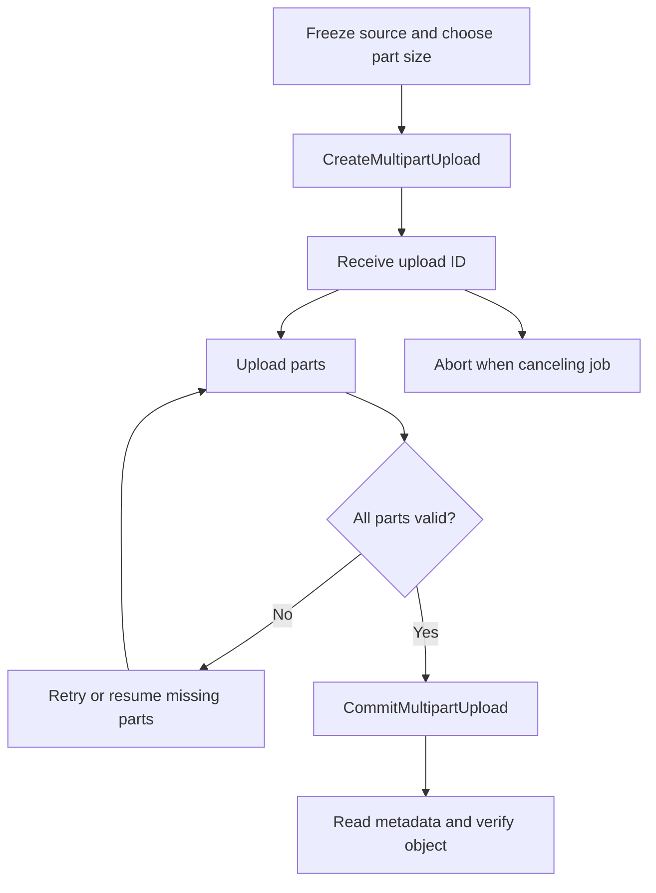

# Upload, download, and multipart upload

In the **Object Storage and Archive Storage** chapter of the Oracle Cloud Infrastructure (OCI) module, this lesson covers transferring data between a workstation and a bucket: uploading a small file, downloading to verify it, and using multipart upload for large files. The operational focus is on access permissions, integrity verification, resuming interrupted uploads, and cleaning up incomplete parts.

Hands-on scenario: an application team publishes a sample configuration file and a large artifact into a private bucket. Recipients must be able to download the exact published content. If the connection drops mid-transfer, the team wants to resume the remaining parts rather than restarting from scratch. If a job is canceled, temporary multipart data must also be cleaned up.

The primary lab uses objects in the **Standard tier** so they can be downloaded immediately. For the Archive tier, the lesson adds the restore and status-checking steps before download.

After this lesson, you will be able to:

- Identify the exact region, namespace, bucket, and object name.
- Perform uploads and downloads using the Console or the OCI CLI.
- Distinguish between transfer completion, commit completion, and verified content.
- Choose part size, concurrency level, and how to resume an upload.
- Clean up unused multipart uploads and account for temporary data costs.

## 1. Identify the exact target before transferring

Object Storage stores data as objects inside buckets. A file on a local machine and an object in OCI are two separate copies of data; they do not automatically synchronize when one side changes.

| Value | Role | Illustrative example |
|---|---|---|
| Region | Where the bucket and service endpoint reside | Region assigned for the lab |
| Namespace | Tenancy's Object Storage namespace | Value retrieved from the account |
| Bucket name | Container holding the objects | Existing lab bucket |
| Object name | Full name of the object | `lab/transfers/run-01/hello.txt` |
| Local source | File read during upload | `./source/hello.txt` |
| Local destination | File written during download | `./download/hello.txt` |

Object Storage is a regional service, independent of any specific Compute instance. From a private subnet, you can use an appropriate connectivity path such as a service gateway to reach Object Storage; environmental permission and network requirements still apply. [Source: OCI Object Storage overview](https://docs.oracle.com/en-us/iaas/Content/Object/Concepts/objectstorageoverview.htm).

In an object name, `/` characters commonly create a folder-like display using prefixes. When calling the API or CLI, you must pass the **full name**, including the prefix. Uploading to `lab/transfers/run-01/hello.txt` and then downloading with just `hello.txt` requests a different object name. [Source: uploading objects and prefixes](https://docs.oracle.com/en-us/iaas/Content/Object/Tasks/managingobjects_topic-To_upload_objects_to_a_bucket.htm).

In the lab, use a dedicated prefix per run to make ownership clear, avoid name collisions, and clean up the right data. A prefix is a naming convention; it does not create a permission boundary unless IAM policies restrict access accordingly.

## 2. Prepare permissions, network, and source data

### Lab prerequisites

Prepare a private bucket in your assigned compartment, a defined region, an authenticated OCI CLI setup, and a machine with enough capacity to read/write the test files. The commands in this lesson use **Bash** on Linux, WSL, or Cloud Shell; replace placeholders with real account values before running.

You do not need to make the bucket public to test downloads. OCI CLI credentials and API signing keys are managed in your authentication environment; do not upload those files as lab data.

Review permission groups by operation:

| Task | Permissions the policy must allow |
|---|---|
| View bucket/object | Corresponding metadata read or list operations |
| New upload | Create object |
| Multipart upload | Object create and overwrite operations required by the multipart flow |
| Download | Read object or specific version |
| Clean up incomplete uploads | Corresponding multipart management/abort operations |
| Restore Archive | Restore Archive object |

OCI requires both `OBJECT_CREATE` and `OBJECT_OVERWRITE` for multipart uploads. Therefore, a policy that only permits creating new objects may not suffice for a multipart flow, even if the final object name does not exist yet. [Source: multipart upload permissions](https://docs.oracle.com/en-us/iaas/Content/Object/Tasks/usingmultipartuploads.htm).

A user who can download a known object name does not necessarily have permission to list all objects in the bucket. Design permissions around actual needs rather than treating a failed list call as proof that all download operations are denied.

### Freeze the source file

Before an important transfer, lock down the source data version, size, and hash. For databases or actively written logs, create an appropriate application-level export or snapshot before transferring.

Especially for multipart uploads, keep the source content unchanged throughout upload and resume. A file with the same name that an application modified mid-transfer may no longer match the parts already sent.

## 3. Upload a small file

### Initialize lab variables

Replace the first two placeholders, then run in the same Bash session:

```bash
LAB_REGION='<ACTUAL_REGION>'
LAB_BUCKET='<LAB_BUCKET_NAME>'
LAB_NAMESPACE="$(oci os ns get --region "$LAB_REGION" --query data --raw-output)"
LAB_RUN_ID="$(date -u +%Y%m%dT%H%M%SZ)"
LAB_PREFIX="lab/transfers/${LAB_RUN_ID}"
LAB_DIR="./oci-object-lab-${LAB_RUN_ID}"

mkdir -p "$LAB_DIR/source" "$LAB_DIR/download"
printf 'OCI upload and download lab\n' > "$LAB_DIR/source/hello.txt"
sha256sum "$LAB_DIR/source/hello.txt"
```

Keep the run values in case you need to open a new session. If you are not permitted to fetch the namespace yourself, use the exact namespace provided by your administrator; do not guess it from the tenancy display name.

### Upload with the OCI CLI

```bash
oci os object put \
  --region "$LAB_REGION" \
  --namespace-name "$LAB_NAMESPACE" \
  --bucket-name "$LAB_BUCKET" \
  --name "$LAB_PREFIX/hello.txt" \
  --file "$LAB_DIR/source/hello.txt" \
  --content-type 'text/plain; charset=utf-8' \
  --no-overwrite \
  --verify-checksum
```

`--file` selects the source file, while `--name` selects the object name. `--no-overwrite` prevents replacing an existing object per CLI behavior; a unique prefix remains the primary way to isolate runs. `--verify-checksum` tells the CLI to verify the uploaded checksum against the local file. [Source: OCI CLI object put](https://docs.oracle.com/en-us/iaas/tools/oci-cli/latest/oci_cli_docs/cmdref/os/object/put.html).

Record the result and upload timestamp. The ETag in the response is an object state/identity token used for conditional access; do not assume it is the SHA-256 or MD5 of the entire file.

Read back the metadata:

```bash
oci os object head \
  --region "$LAB_REGION" \
  --namespace-name "$LAB_NAMESPACE" \
  --bucket-name "$LAB_BUCKET" \
  --name "$LAB_PREFIX/hello.txt"
```

Verify the size, content type, ETag, and relevant tier/metadata returned by the tool. Seeing metadata does not prove downloaded content matches; the next step tests that separately.

### Alternative using the Console

Open the target bucket, go to **Objects → Upload**, choose the file, prefix, and storage tier. Check any existing-name warnings before uploading. After completion, select the object to inspect its details.

In the Console, enter a prefix with a trailing `/` if you want a convention like `lab/transfers/run-01/`; a prefix without a separator is still simply prepended to the name. The Console may use multipart upload for large files based on its own threshold, so do not infer the transfer mechanism solely from using the UI. [Source: OCI upload object](https://docs.oracle.com/en-us/iaas/Content/Object/Tasks/managingobjects_topic-To_upload_objects_to_a_bucket.htm).

## 4. Download and prove content matches

Download to a separate target path rather than overwriting the source file path:

```bash
oci os object get \
  --region "$LAB_REGION" \
  --namespace-name "$LAB_NAMESPACE" \
  --bucket-name "$LAB_BUCKET" \
  --name "$LAB_PREFIX/hello.txt" \
  --file "$LAB_DIR/download/hello.txt"
```

`--file` in `get` specifies the destination path. In the Console, select the object and click **Download**; the save location depends on your browser. [Source: OCI download object](https://docs.oracle.com/en-us/iaas/Content/Object/Tasks/managingobjects_topic-To_download_an_object_from_a_bucket.htm).

Compare the two files:

```bash
sha256sum "$LAB_DIR/source/hello.txt" "$LAB_DIR/download/hello.txt"
cmp "$LAB_DIR/source/hello.txt" "$LAB_DIR/download/hello.txt"
```

Both SHA-256 hashes must match. `cmp` exits with status `0` when the bytes are identical and normally prints nothing. For critical data, store the initial hash in a trusted location and verify against the frozen source copy.

You can also compare byte counts:

```bash
wc -c "$LAB_DIR/source/hello.txt" "$LAB_DIR/download/hello.txt"
```

Matching size alone is not enough to prove matching content; hashes and byte-by-byte comparison provide that evidence.

### When an object might be updated while downloading

If you must read the exact state you previously inspected, use an ETag condition with `--if-match`, or `--version-id` when working with a specific version in a versioned bucket. The download must pass the exact recorded value rather than leaving a placeholder. [Source: OCI CLI object get](https://docs.oracle.com/en-us/iaas/tools/oci-cli/latest/oci_cli_docs/cmdref/os/object/get.html).

Example adding a condition for a standalone download:

```text
--if-match '<OBSERVED_ETAG>'
```

Do not overwrite a local file currently used by an application and only verify it afterward. A receiver workflow can download into a temporary file, verify it, and only then publish it to the application.

## 5. How does multipart upload work?

A large object is split into multiple parts for transfer. Multipart upload is not uploading separate independent objects and letting the recipient concatenate them by filename.

Service workflow:



At the API level, the client tracks the upload ID and part metadata. Parts can be uploaded in parallel and arrive at the service out of order. On commit, the service assembles them by part number; committing uses each part number together with its corresponding ETag. [Source: OCI multipart upload API](https://docs.oracle.com/en-us/iaas/Content/Object/Tasks/usingmultipartuploads_topic-Using_the_Multipart_Upload_API.htm).

Key distinctions:

- **Upload ID** identifies a multipart session, not the object name or version ID.
- **Part number** defines the relative position when assembling the object.
- **Part ETag** must match the part selected for commit.
- **Commit** finalizes the object from the specified parts.
- **Abort** cancels an uncommitted upload and releases that session's temporary data.

If you re-upload the same part number within the same session, track the final result accurately for commit. Never mix parts from a new source file into a session containing parts from an older source file.

Uploading all parts without committing does not create a finalized new object ready for normal downloads. Once committed, you cannot append to the object using the old upload ID; changing content requires a new upload. [Source: commit and multipart API lifecycle](https://docs.oracle.com/en-us/iaas/Content/Object/Tasks/usingmultipartuploads_topic-Using_the_Multipart_Upload_API.htm).

## 6. Choosing part size and concurrency

### Service limits and tool defaults

According to the OCI documentation referenced when authoring this lesson:

| Property | Value |
|---|---:|
| Maximum object size | 10 TiB |
| Maximum size for a single PutObject | 50 GiB |
| Maximum size of a single part | 50 GiB |
| Maximum number of parts | 10,000 |

These limits are distinct from account bucket/quota limits. [Source: OCI Object Storage resource limits](https://docs.oracle.com/en-us/iaas/Content/Object/Concepts/objectstorageoverview.htm).

The CLI `object put` command defaults to a 128 MiB part size for regular files; files larger than the part size can be uploaded via multipart. A user-specified `--part-size` must be greater than 10 MiB in the current CLI; the final part may be smaller. `--no-multipart` forces a single-part upload, but does not bypass the service's PutObject limit. [Source: CLI put](https://docs.oracle.com/en-us/iaas/tools/oci-cli/latest/oci_cli_docs/cmdref/os/object/put.html), [performing multipart upload with CLI](https://docs.oracle.com/en-us/iaas/Content/Object/Tasks/usingmultipartuploads_topic-To_perform_a_multipart_upload_using_the_CLI.htm).

The Console uses multipart when a file exceeds 64 MiB; this is a Console-specific threshold. Distinguish tool thresholds from service object limits when explaining a transfer. [Source: OCI multipart uploads](https://docs.oracle.com/en-us/iaas/Content/Object/Tasks/usingmultipartuploads.htm).

### Calculating the number of parts

Given source size `S` and part size `P` in the same unit:

```text
N = ceil(S / P)
```

Example of a 300 MiB file with a 128 MiB part size:

```text
Part 1: 128 MiB
Part 2: 128 MiB
Part 3:  44 MiB
Total:  300 MiB
```

Do not use the same small part size for very large objects. Theoretical example:

| Object | Part size | Part count | Evaluation against part limit |
|---|---:|---:|---|
| 2 TiB | 128 MiB | 16,384 | Exceeds 10,000 |
| 2 TiB | 256 MiB | 8,192 | Within limit |

Calculate ahead of time in bytes or consistent binary units. MiB is `2^20` bytes, GiB is `2^30` bytes, and TiB is `2^40` bytes. The examples above illustrate the math and do not require creating multi-TiB files to practice.

### Appropriate concurrency

Smaller parts reduce the amount of data retransmitted when one part fails, but increase request count and management overhead. Larger parts reduce the part count, but a retry may retransmit more data.

`--parallel-upload-count` lets you balance concurrent upload operations. Increasing concurrency can speed up transfers if network, CPU, and disk have headroom; it also increases resource consumption. [Source: multipart CLI controls](https://docs.oracle.com/en-us/iaas/Content/Object/Tasks/usingmultipartuploads_topic-To_perform_a_multipart_upload_using_the_CLI.htm).

Measure completion time, throughput, and actual utilization before raising concurrency. Never assume the highest thread count is always fastest on a given host or network path.

## 7. Practicing multipart with a moderately large file

In a lab environment with sufficient disk space and data-transfer budget, you can create a 300 MiB test-data file:

```bash
dd if=/dev/zero of="$LAB_DIR/source/large.bin" bs=1M count=300 status=progress
sha256sum "$LAB_DIR/source/large.bin"
```

You can substitute a pre-built test file of an appropriate size. Keep the file immutable during upload; a zero-filled file only serves this transfer exercise and is not a benchmark representative of real workloads.

Upload with a 128 MiB part size and up to three concurrent operations:

```bash
oci os object put \
  --region "$LAB_REGION" \
  --namespace-name "$LAB_NAMESPACE" \
  --bucket-name "$LAB_BUCKET" \
  --name "$LAB_PREFIX/large.bin" \
  --file "$LAB_DIR/source/large.bin" \
  --part-size 128 \
  --parallel-upload-count 3 \
  --no-overwrite \
  --verify-checksum
```

Record the upload ID if displayed by the tool, object name, part size, file hash, start time, and completion result. When the CLI finishes cleanly, inspect the object metadata and check the byte size instead of trusting the progress bar alone.

Download the large object into the destination directory:

```bash
oci os object get \
  --region "$LAB_REGION" \
  --namespace-name "$LAB_NAMESPACE" \
  --bucket-name "$LAB_BUCKET" \
  --name "$LAB_PREFIX/large.bin" \
  --file "$LAB_DIR/download/large.bin" \
  --multipart-download-threshold 128 \
  --part-size 128 \
  --parallel-download-count 3
```

The download options control how the client fetches ranges in parallel and assembles the local file. This is not downloading incomplete parts of an uncommitted upload. [Source: OCI CLI object get and multipart download](https://docs.oracle.com/en-us/iaas/tools/oci-cli/latest/oci_cli_docs/cmdref/os/object/get.html).

Verify:

```bash
wc -c "$LAB_DIR/source/large.bin" "$LAB_DIR/download/large.bin"
sha256sum "$LAB_DIR/source/large.bin" "$LAB_DIR/download/large.bin"
cmp "$LAB_DIR/source/large.bin" "$LAB_DIR/download/large.bin"
```

Declare success only when the exact object has been published and the downloaded content matches the frozen source.

## 8. Resuming an interrupted upload

To test an interruption scenario, use a new object name under the lab prefix, record the attempt's upload ID, and only interrupt your own upload process. With small files or fast connections, the upload may finish before you interrupt it; in that case, check the state rather than assuming the session is still incomplete.

List active multipart sessions:

```bash
oci os multipart list \
  --region "$LAB_REGION" \
  --namespace-name "$LAB_NAMESPACE" \
  --bucket-name "$LAB_BUCKET" \
  --all
```

This list shows in-progress multipart uploads, distinct from the list of finalized objects. `--all` fetches all pages the command can return. [Source: OCI multipart list](https://docs.oracle.com/en-us/iaas/tools/oci-cli/latest/oci_cli_docs/cmdref/os/multipart/list.html).

Match the upload ID, object name, and timestamp to pick the exact session. Never resume an upload solely because an object name resembles a file on your machine.

If the session is neither committed nor aborted and the source remains intact, resume with:

```bash
oci os object resume-put \
  --region "$LAB_REGION" \
  --namespace-name "$LAB_NAMESPACE" \
  --bucket-name "$LAB_BUCKET" \
  --name '<INTERRUPTED_SESSION_OBJECT_NAME>' \
  --file "$LAB_DIR/source/large.bin" \
  --upload-id '<VERIFIED_UPLOAD_ID>' \
  --part-size 128 \
  --parallel-upload-count 3
```

Keep the same part size as the initial upload and use the exact same source file. `resume-put` is an operation to continue an existing multipart put, not a flag on `put` that auto-detects arbitrary old sessions. [Source: OCI CLI resume-put](https://docs.oracle.com/en-us/iaas/tools/oci-cli/latest/oci_cli_docs/cmdref/os/object/resume-put.html).

After resume finishes, inspect metadata, download, and verify the hash as before. Do not treat the disappearance of the upload ID from the active list as the sole proof that the object contains the right content.

If the matching source file is gone or the state cannot be determined, preserve evidence and decide to abort the old session and start a fresh transfer. Never stitch together data based solely on filename.

## 9. Aborting and cleaning up uncommitted parts

Closing a terminal or killing a process does not guarantee that parts on the service side are reclaimed. Uncommitted multipart uploads can continue consuming storage and incurring charges; you can use a lifecycle policy to clean them up after a configured number of days. [Source: managing incomplete multipart uploads](https://docs.oracle.com/en-us/iaas/Content/Object/Tasks/usingmultipartuploads.htm).

When deciding not to continue, stop any active part-upload tasks for that session, verify ownership, and abort using the exact object name and upload ID:

```bash
oci os multipart abort \
  --region "$LAB_REGION" \
  --namespace-name "$LAB_NAMESPACE" \
  --bucket-name "$LAB_BUCKET" \
  --object-name '<OBJECT_NAME_TO_ABORT>' \
  --upload-id '<UPLOAD_ID_TO_ABORT>'
```

Note that `abort` uses `--object-name`, whereas `object put`/`resume-put` use `--name`. Abort applies to uncommitted uploads; it does not replace deleting a finalized object. [Source: OCI multipart abort](https://docs.oracle.com/en-us/iaas/tools/oci-cli/latest/oci_cli_docs/cmdref/os/multipart/abort.html).

List again afterward to verify the session was reclaimed. Never bulk-abort all uploads in a shared bucket just to clean up a lab exercise.

For lifecycle rules, set the cleanup age to accommodate legitimate uploads that may run long. A rule that cleans up too aggressively can break resume capability for tasks that still need to finish.

## 10. ETag, checksums, and completion evidence

Commonly encountered values serve different purposes:

| Evidence | What does it prove? | Limitation |
|---|---|---|
| Upload ID | Working with a specific multipart session | Does not prove the object is committed |
| Part number and part ETag | Identifies a part within a session | Not a whole-file hash |
| Object ETag | Used for state identification and conditional requests | Not assumed to be MD5/SHA-256 of content |
| Service content checksum | Verifies content per provided algorithm/semantics | Must compare matching type and encoding |
| Size | Expected byte count | Identical byte count does not prove identical data |
| Source and downloaded SHA-256 | Compares content of the two chosen copies | Depends on keeping the reference source/hash intact |

For multipart uploads, `opc-multipart-md5` is a verification value tied to the parts, not a direct whole-file MD5 matching a simple `md5sum file` run. Do not relabel an ETag or multipart checksum as "SHA-256" in reports. [Source: OCI multipart checksum verification](https://docs.oracle.com/en-us/iaas/Content/Object/Tasks/sync-object.htm).

In this lesson, comparing SHA-256 of the immutable source file and the downloaded file is a straightforward independent check. Simply storing a self-reported hash in user metadata and reading that metadata back does not replace verifying the actual content.

If a commit request times out after submission, the outcome may be ambiguous from the client's perspective. Check the object, metadata/version, and active upload list before deciding to retry or start a new transfer. Never declare an artifact complete just because the transfer progress reached 100% on screen.

For application pipelines, you can track states such as:

```text
PREPARED -> UPLOADING -> COMMITTED -> VERIFIED -> PUBLISHED
                  \-> ABORTED
```

This is a proposed application model. These states are managed by your pipeline, not a built-in default lifecycle state machine for every OCI object.

## 11. Downloading Archive-tier objects

Uploading to Archive still uses the corresponding object transfer workflow, but an archived object cannot be downloaded directly like Standard. You must request a restore and wait for the data to become available. [Source: Archive Storage overview](https://docs.oracle.com/en-us/iaas/Content/Archive/Concepts/archivestorageoverview.htm).

For an actual Archive object assigned for testing, request a restore:

```bash
oci os object restore \
  --region "$LAB_REGION" \
  --namespace-name "$LAB_NAMESPACE" \
  --bucket-name "$LAB_BUCKET" \
  --name '<ASSIGNED_ARCHIVE_OBJECT>' \
  --hours 24
```

Check status:

```bash
oci os object restore-status \
  --region "$LAB_REGION" \
  --namespace-name "$LAB_NAMESPACE" \
  --bucket-name "$LAB_BUCKET" \
  --name '<ASSIGNED_ARCHIVE_OBJECT>'
```

Per OCI documentation, restoration can take up to an hour; only download once the status is ready. The default download window is 24 hours and can be requested from 1 to 240 hours. `OBJECT_RESTORE` permission is required for the restore operation. [Source: restoring objects from Archive](https://docs.oracle.com/en-us/iaas/Content/Object/Tasks/managingobjects_topic-To_restore_objects_from_Archive_Storage.htm).

Once restored, run `object get` to a separate local file and verify its hash against the reference copy. Record the active download window so download jobs do not start too late.

Do not confuse restore with re-uploading the source data or moving the object to a new bucket. An object residing in a Standard bucket is also not enough to conclude its current tier is Standard, because a Standard bucket can contain objects in different tiers. [Source: object storage tier on upload](https://docs.oracle.com/en-us/iaas/Content/Object/Tasks/managingobjects_topic-To_upload_objects_to_a_bucket.htm).

A basic data-transfer lab does not need to move artifacts into Archive without a clear requirement, a reference hash, and a budget for the storage/restore cycle.

## 12. Operational tuning and troubleshooting

### Choose the right tool for the data volume

A single multipart upload handles **one object** across multiple parts. Uploading many files can use bulk operations or a pipeline managing multiple objects; that is concurrency at a different level.

If you increase both the number of concurrent objects and the number of parallel parts per object simultaneously, total request rate and resource load can spike rapidly. Measure disk, CPU, memory, and network on the transferring host, along with completion time and retry rate.

Track at minimum: source/hash, full destination, upload ID if applicable, part size, part count, start/end timestamps, attempt count, commit status, and verification status. Never write signing keys, tokens, or sensitive access URLs into result logs.

### Common errors

| Symptom | What to check |
|---|---|
| Bucket/object not found | Region, namespace, bucket name, full object name, and permissions |
| Small file upload works but multipart fails with permission error | Does the policy allow both `OBJECT_CREATE` and `OBJECT_OVERWRITE`? |
| Downloaded hash does not match | Exact object/version, whether source changed, partial local file write, whether transfer finished |
| Parts exist but no finalized new object appears | Did the session commit successfully? |
| Resume cannot find upload ID | Correct bucket/namespace; is session still active or already committed/aborted? |
| Resume finishes but result is wrong | Were the exact same source and initial part layout preserved? |
| Too many parts | Recalculate `ceil(S/P)` and choose a larger part size |
| Higher concurrency is slower | Network, disk, or CPU bottleneck, or increased retries? |
| Closed terminal yet storage is still consumed | Check uncommitted multipart uploads and cleanup lifecycle rules |
| Archive object cannot be downloaded | Restore state, availability window, and restore/read permissions |
| Request times out near completion | Inspect service state before creating a new upload |

When errors occur, retain the relevant response/request ID, timestamp, and resource scope for investigation. Separate authentication/authorization errors, wrong-target errors, and network errors before changing configuration.

## 13. Lab wrap-up and completion criteria

Stored data, request counts, data transfer, and related features can incur charges. Old object versions and uncommitted parts must also be managed; do not look solely at the current object list to conclude lab resources are clean. [Source: OCI Object Storage billing and resource overview](https://docs.oracle.com/en-us/iaas/Content/Object/Concepts/objectstorageoverview.htm).

After completing the lab:

1. Save evidence that both the small file and large file were transferred, re-downloaded, and verified.
2. Inspect multipart uploads from your run; resume or abort them as decided and recorded.
3. Delete only the objects under the lab prefix when no longer needed and authorized for removal.
4. If the bucket has versioning or retention enabled, check the effects before concluding data has been permanently removed.
5. Leave buckets, objects, and uploads belonging to other work untouched.

The lab meets its objectives when you can demonstrate:

- The full destination including region, namespace, bucket, and object name.
- A frozen source file with recorded size and reference hash.
- Successful small-file upload with a byte/hash-verified download.
- Multipart upload with a valid part size, completed commit, and verified final object.
- An interruption test, if performed, with a clear upload ID and resume/abort outcome.
- No unplanned incomplete multipart uploads left behind.
- For Archive, a clear distinction between restore request, ready state, and download window.

A reliable transfer requires evidence of **exact destination, exact content, confirmed completion state, and managed temporary data**. This forms the foundation for integrating Object Storage operations into artifact deployment, data exchange, or backup workflows on OCI.
