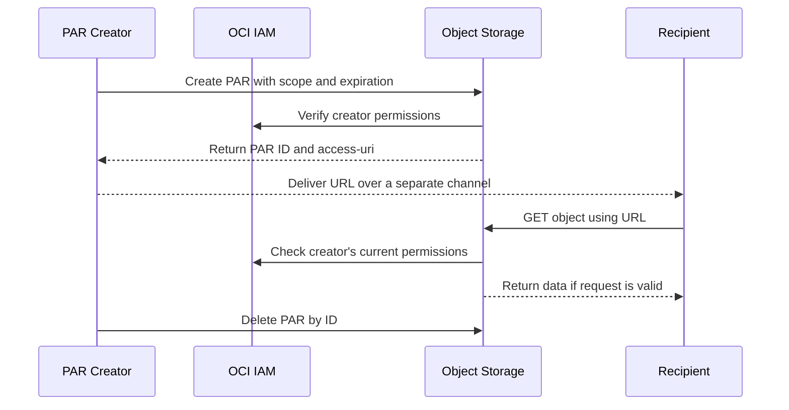

# Pre-Authenticated Requests and time-limited object sharing

## Objectives and use case

In Oracle Cloud Infrastructure (OCI), data-sharing needs often sit between two groups of tasks: an administrative team controlling the tenancy, compartments, and IAM, and a consumer who only needs to download or upload a file to Object Storage. This lesson belongs to the **Object Storage and Archive Storage** chapter and focuses on Pre-Authenticated Requests (PARs) to bridge those two needs with clear scope and expiration.

After this lesson, you will be able to choose a sharing scope, create a PAR for an object, use the URL over HTTP, and revoke access. You will also know how to plan monitoring and costs for data exchange workflows across applications, Compute, and external partners.

Suppose the operations team exports a test report to an object:

```text
Bucket: par-lab-private
Object: exports/partner-a/report-demo.txt
Recipient: Partner A
Requirement: download the report only within 15 minutes
```

A business requirement should be expressed as four questions: what data is shared, which operations are allowed, until what time, and who is responsible for revocation. These details must be settled before generating a link.

## 1. How does a PAR work?

A PAR generates a URL that lets anyone holding the URL access the designated resource without supplying their own OCI credentials. Therefore, treat the URL as an access-bearing secret: a recipient can forward it to someone else. [Oracle: Object Storage Pre-Authenticated Requests](https://docs.oracle.com/en-us/iaas/Content/Object/Tasks/usingpreauthenticatedrequests.htm).



When a PAR is used, the creator's permissions are still checked. A PAR stops working if it expires, is deleted, or the creator loses the required permissions. Rotating the creator's login credentials is not a way to revoke a PAR. To change a PAR's configuration, create a new one. [Oracle: PAR scopes and conditions](https://docs.oracle.com/en-us/iaas/Content/Object/Tasks/usingpreauthenticatedrequests.htm).

Design implication: never let a critical delivery workflow depend solely on a personal account that may soon have permissions revoked. Document the creator, owning operations team, and handover plan before staff or IAM policy changes.

An active PAR also does not verify that the content a recipient downloaded matches the intended release. For reports requiring reconciliation, publish a business version identifier or checksum over a separate trusted channel.

## 2. Choosing scope and operations

A PAR can target a single object, a prefix, or all objects in a bucket. A prefix is the leading substring of an object name; `/` simulates folder structure. For example, `partner-a` is broader than `partner-a/`. [Oracle: creating PARs and selecting targets](https://docs.oracle.com/en-us/iaas/Content/Object/Tasks/usingpreauthenticatedrequests_topic-To_create_a_preauthenticated_request_for_all_objects_in_a_bucket.htm).

CLI access types combine as follows:

| Scope | `--access-type` | `--object-name` |
| --- | --- | --- |
| Single object, read-only | `ObjectRead` | Full object name |
| Single object, write-only | `ObjectWrite` | Full object name |
| Single object, read and write | `ObjectReadWrite` | Full object name |
| Bucket, read-only | `AnyObjectRead` | Omit parameter |
| Bucket, write-only | `AnyObjectWrite` | Omit parameter |
| Bucket, read and write | `AnyObjectReadWrite` | Omit parameter |
| Prefix | Appropriate `AnyObject...` type | Prefix to restrict to |

`--bucket-listing-action` controls listing for `AnyObjectRead` and `AnyObjectReadWrite`: `Deny` or `ListObjects`. [Oracle CLI: preauth-request create](https://docs.oracle.com/en-us/iaas/tools/oci-cli/latest/oci_cli_docs/cmdref/os/preauth-request/create.html).

**Recommendation for the report scenario:** use `ObjectRead` for the exact object `exports/partner-a/report-demo.txt`. The partner has no need to browse directories, download multiple reports, or upload content to that location, so there is no business reason to grant a broader scope.

Useful selection rules:

- One delivery of one report: a dedicated PAR for that exact object.
- One batch receiving multiple files: a dedicated prefix per partner and batch ID.
- A dataset requiring filename lookup: enable listing only if the business flow needs it.
- Two independent partners: two separate PARs for easier revocation and reconciliation.

Splitting PARs per partner only aids management; it does not prove the HTTP caller is that specific partner. If individual user attribution is mandatory, build an application layer that authenticates users.

## 3. Preparing IAM for the creator

The permission to manage PARs is `PAR_MANAGE` on the bucket. To grant object read access, the creator needs `OBJECT_READ`; write flows require `OBJECT_CREATE` and `OBJECT_OVERWRITE`. If listing is enabled, also evaluate `OBJECT_INSPECT`. [Oracle: PAR permissions](https://docs.oracle.com/en-us/iaas/Content/Object/Tasks/usingpreauthenticatedrequests.htm), [Oracle: Object Storage permissions by API](https://docs.oracle.com/en-us/iaas/Content/Identity/Reference/objectstoragepolicyreference.htm).

Example policy for a team issuing read links in compartment `TrainingStorage`:

```text
Allow group ParPublishers to manage buckets in compartment TrainingStorage where all {target.bucket.name='par-lab-private', request.permission='PAR_MANAGE'}

Allow group ParPublishers to read objects in compartment TrainingStorage where target.bucket.name='par-lab-private'
```

The `request.permission` condition on the first line restricts bucket management solely to PAR management within `manage buckets`. The second line grants object read access without adding write access. Group naming syntax should match your tenancy's actual identity domain. Console browsing permissions, if needed, must be granted separately by an administrator per job role. [Oracle: IAM policy reference for buckets and objects](https://docs.oracle.com/en-us/iaas/Content/Identity/Reference/objectstoragepolicyreference.htm).

This is an example for the **read-link creator**, not a policy for the PAR recipient. Recipients use the URL; they do not need to be added to `ParPublishers`.

If designing an upload workflow, create a separate publishing group or role and determine the required write permissions upfront. Do not resolve permission errors by granting `manage object-family in tenancy` to the entire group.

## 4. Creating a PAR in the Console

Prepare a private bucket containing sample data, then:

1. Open Object Storage and select the region, compartment, and bucket.
2. Go to **Management → Pre-authenticated requests**.
3. Click **Create pre-authenticated request**.
4. Choose target **Object** and enter the full object name.
5. Choose read-only access and set the expiration.
6. Create the PAR and immediately copy the URL to a controlled secret store.

Expiration times in the Console are in UTC. The URL can only be retrieved at creation time; viewing metadata later does not recover the secret URL. [Oracle: creating a PAR via Console](https://docs.oracle.com/en-us/iaas/Content/Object/Tasks/usingpreauthenticatedrequests_topic-To_create_a_preauthenticated_request_for_all_objects_in_a_bucket.htm).

Conversion example to avoid timezone mistakes:

```text
09:00 in Vietnam (UTC+07:00)
= 02:00Z the same day

15-minute expiration later:
09:15 in Vietnam
= 02:15Z the same day
```

In operations, record both the UTC timestamp and the business meaning, such as "end of report delivery window", rather than storing a bare timestamp without context.

## 5. PowerShell lab: create a 15-minute read link

### Prepare the lab environment

The commands below guide learners running in their own OCI environment. Prerequisites:

- Authenticated OCI CLI configured with appropriate permissions.
- Private bucket `par-lab-private` in your chosen region.
- Object `exports/partner-a/report-demo.txt` containing sample data in the Standard tier.
- `curl.exe` to test HTTP access independently of OCI CLI credentials.

Create the bucket and upload the sample file using a lab admin account before starting. Never use real reports or personal data in the lab.

Hostname examples below assume OCI's public commercial realm. If your environment uses a different endpoint, use the endpoint/URL provided by that environment's Console.

### Declare parameters and expiration

Replace namespace and region with actual values:

```powershell
$region = 'ap-singapore-1'
$namespace = 'YOUR_OBJECT_STORAGE_NAMESPACE'
$bucketName = 'par-lab-private'
$objectName = 'exports/partner-a/report-demo.txt'
$expiresAt = [DateTimeOffset]::UtcNow.AddMinutes(15).ToString(
    "yyyy-MM-dd'T'HH:mm:ss'Z'"
)
$parName = 'partner-a-report-' + [DateTimeOffset]::UtcNow.ToString(
    'yyyyMMdd-HHmmss'
)
```

Calculating expiration at runtime keeps the lab independent of a fixed date. The operator's machine clock must still be synchronized so operators interpret remaining lifetime accurately.

### Call the OCI CLI and keep the result in memory

```powershell
$createArgs = @(
    'os', 'preauth-request', 'create',
    '--region', $region,
    '--namespace-name', $namespace,
    '--bucket-name', $bucketName,
    '--name', $parName,
    '--object-name', $objectName,
    '--access-type', 'ObjectRead',
    '--time-expires', $expiresAt,
    '--output', 'json'
)

$rawPar = & oci @createArgs
if ($LASTEXITCODE -ne 0) {
    throw 'Failed to create PAR; check permissions and parameters.'
}

$parResult = ($rawPar -join [Environment]::NewLine) | ConvertFrom-Json
$parId = $parResult.data.id
$accessUri = $parResult.data.'access-uri'

if ([string]::IsNullOrWhiteSpace($parId) -or
    [string]::IsNullOrWhiteSpace($accessUri)) {
    throw 'Response missing PAR ID or access-uri.'
}

$parUrl = 'https://objectstorage.' + $region +
          '.oraclecloud.com' + $accessUri
```

`--time-expires` accepts an RFC 3339 timestamp; `--object-name` selects the target object. `access-uri` from the creation response is combined with the regional hostname to form the URL. [Oracle CLI: create parameters](https://docs.oracle.com/en-us/iaas/tools/oci-cli/latest/oci_cli_docs/cmdref/os/preauth-request/create.html), [Oracle: PAR URL structure](https://docs.oracle.com/en-us/iaas/Content/Object/Tasks/usingpreauthenticatedrequests_topic-To_create_a_preauthenticated_request_for_all_objects_in_a_bucket.htm).

In this example, `$parId` is the management identifier; `$parUrl` is the data-access secret. Deliver the URL to the recipient only through an agreed channel. Avoid printing the entire `$parResult` into CI logs or pasting it into support tickets.

### Download the object using the URL

```powershell
$downloadPath = Join-Path (Get-Location).Path 'report-demo-download.txt'

& curl.exe --fail --silent --show-error `
    --output $downloadPath `
    $parUrl

if ($LASTEXITCODE -ne 0) {
    throw 'Failed to download object via PAR.'
}
```

HTTP GET reads an object via PAR. For a PAR targeting a single object, use the exact returned URL without appending the object name again. For a prefix PAR, the base URL may not include the prefix: when reading or writing an object, append the **full appropriate object name** after `/o/`. [Oracle: working with PAR URLs](https://docs.oracle.com/en-us/iaas/Content/Object/Tasks/usingpreauthenticatedrequests_topic-Working_with_PreAuthenticated_Requests.htm).

Using `curl.exe` avoids confusion with the PowerShell alias in some environments. Verify the downloaded copy's content or checksum with an independent tool before treating delivery as successful.

Do not enable transcripts or debug mode when testing secret URLs. Command history, remote support tools, and local process-collection agents must also be considered when choosing where to run commands.

### Inspect metadata without printing the URL

```powershell
& oci os preauth-request list `
    --region $region `
    --namespace-name $namespace `
    --bucket-name $bucketName `
    --all `
    --query 'data[].{id:id,name:name,expires:"time-expires"}' `
    --output table
```

The list command inventories PARs on a bucket. When managing or deleting one, use the ID created earlier or retrieved from the list. [Oracle: listing PARs](https://docs.oracle.com/en-us/iaas/Content/Object/Tasks/usingpreauthenticatedrequests_topic-To_list_preauthenticated_requests.htm), [Oracle: copying a PAR ID](https://docs.oracle.com/en-us/iaas/Content/Object/Tasks/usingpreauthenticatedrequests_topic-To_copy_a_preauthenticated_request_ID.htm).

If you lost the URL after creation, inventory the PARs to identify the one created, revoke the unused PAR, and create a replacement. Never screenshot or paste secret responses into shared tickets just for support convenience.

## 6. Revoke and confirm sharing termination

Delete the exact PAR by ID without deleting the object:

```powershell
& oci os preauth-request delete `
    --region $region `
    --namespace-name $namespace `
    --bucket-name $bucketName `
    --par-id $parId

if ($LASTEXITCODE -ne 0) {
    throw 'Failed to confirm PAR deletion.'
}
```

The CLI may prompt for confirmation. Before confirming, cross-check the bucket and ID against the delivery record. Deleting the PAR revokes that access path. [Oracle: deleting a PAR](https://docs.oracle.com/en-us/iaas/Content/Object/Tasks/usingpreauthenticatedrequests_topic-To_delete_a_preauthenticated_request.htm).

Next, issue a fresh HTTP GET to the old URL and print only the status code:

```powershell
& curl.exe --silent --show-error `
    --output NUL `
    --write-out "%{http_code}" `
    $parUrl
```

Expected behavior: a new HTTP GET directly to Object Storage using the deleted PAR can no longer download the object. If it still succeeds, first check whether you accidentally used a different PAR's URL or inspected a previously downloaded file. Do not base verification criteria on a single hardcoded error code alone.

Revoking the link must also be separated from handling existing data copies: anyone who already downloaded the file may still retain the contents. Delivery workflows need separate agreements on copy retention duration.

At the end of the lab, delete local test downloads if no longer needed; clean up objects/buckets with lab admin permissions after inventorying all related PARs. Record revocation as complete only after obtaining verification evidence.

## 7. File-ingestion variant: a dedicated prefix for an upload batch

Suppose Partner A sends diagnostic logs for batch `batch-001`. Proposed scope:

```text
inbox/partner-a/batch-001/
```

Create a PAR targeting **Object with prefix**, write-only, with an expiration matching the ingestion window. If using the CLI, pair `AnyObjectWrite` with `--object-name 'inbox/partner-a/batch-001/'`. [Oracle CLI: access type and object-name](https://docs.oracle.com/en-us/iaas/tools/oci-cli/latest/oci_cli_docs/cmdref/os/preauth-request/create.html).

Object naming design for the lab:

| Intended upload object name | Matches chosen prefix? |
| --- | --- |
| `inbox/partner-a/batch-001/node-01.log` | Yes |
| `inbox/partner-a/batch-001/node-02.log` | Yes |
| `inbox/partner-b/batch-001/node-01.log` | No |
| `inbox/partner-a/batch-001-other/node-01.log` | No |
| `node-01.log` | No |

How to upload a small file, where `$uploadUrl` is the full URL for the destination object:

```powershell
& curl.exe --fail --silent --show-error `
    --request PUT `
    --data-binary '@.\node-01.log' `
    $uploadUrl
```

PAR supports uploading data via HTTP PUT to the URL. Use simple names in the lab; names with special characters must be URL-encoded to match the actual object name. [Oracle: PUT object via PAR](https://docs.oracle.com/en-us/iaas/Content/Object/Tasks/usingpreauthenticatedrequests_topic-Working_with_PreAuthenticated_Requests.htm).

Additional decisions to finalize in the ingestion layer:

- Give each batch its own prefix to avoid overwriting already reconciled data.
- Have the processing service validate size, format, and checksum before ingesting data.
- Record ingestion status by batch ID and filename.
- Revoke the PAR once the ingestion batch finishes, even if it has not expired yet.
- Define handling when the same filename is re-uploaded.

Write access must be evaluated for overwrite risk as well; a PAR cannot delete objects or buckets. [Oracle: PAR operation limits](https://docs.oracle.com/en-us/iaas/Content/Object/Tasks/usingpreauthenticatedrequests.htm).

If requirements permit only a single upload, a maximum file size, or a specific content type, implement those checks in your ingestion service logic rather than inferring them from the phrase "time-limited link".

## 8. Expiration, data versions, and Archive Storage

"Expires in 15 minutes" is a time constraint on access. The business workflow still needs to define re-sending, re-downloading, connection drops, and copy handling. For example, if a recipient loses connectivity in the final minute, should they be issued a new access window or open a support ticket? State that decision clearly in delivery guidelines.

For recurring reports, use object names with business versions:

```text
exports/partner-a/report-2026-11-v1.txt
exports/partner-a/report-2026-11-v2.txt
```

Do not reuse `latest.txt` for a delivery requiring reconciliation without assessing the impact of content changes. Versioned naming lets both publishers and recipients identify the exact report version handed over.

If the data resides in Archive Storage, it must be fully restored before downloading; the restore operation requires `OBJECT_RESTORE`. [Oracle: restoring objects from Archive Storage](https://docs.oracle.com/en-us/iaas/Content/Object/Tasks/managingobjects_topic-To_restore_objects_from_Archive_Storage.htm).

Therefore, for long-term archived data, follow this order:

1. Operations confirms the exact data copy and initiates restore with appropriate permissions.
2. Monitor until the object is ready to download.
3. Agree on the delivery window and create a short-lived read PAR.
4. Perform a test download with the same kind of client tool the recipient will use.
5. Track completion, revoke the link, and archive delivery evidence.

This workflow prevents restore wait time from consuming the sharing window. A PAR solves only one part of data delivery; readiness planning must include object preparation.

## 9. Observability, automation, and cost

OCI distinguishes Audit from Object Storage service logs. For object access via PAR, use service logs; do not assume PAR creation records in Audit represent a complete data-download history. [Oracle: Securing Object Storage](https://docs.oracle.com/en-us/iaas/Content/Security/Reference/objectstorage_security.htm).

Recommended management record for each sharing batch:

| Field | Purpose |
| --- | --- |
| Delivery ID | Links to the business request |
| PAR ID, bucket, and region | Locates the exact resource during revocation |
| Object or prefix | Reconciles scope |
| Read/write/listing access | Audits granted permissions |
| Creator and owning team | Handles IAM changes cleanly |
| Created/expires timestamps (UTC) | Tracks the access window |
| Revoked timestamp and re-test result | Proves sharing ended |
| Secret storage location | Enables lookup through access-controlled systems |

Do not put full URLs or tokens into general inventory tables. When discussing incidents, reference the PAR ID and delivery ID. Application logs should mask the secret portion of paths before shipping logs to centralized collectors.

An automation workflow can start from an approved scope request, invoke the OCI CLI or SDK to create a PAR, store the URL in a secrets vault, and record metadata in a management system. Upon receiving a "delivery complete" signal, a revocation job deletes the PAR and re-verifies. If a step fails, leave the state as "unconfirmed" for an operator to handle; never assume revocation succeeded simply because a job timed out.

For cost, estimate from access behavior rather than the number of URLs. Hypothetical example of a 200 MiB file downloaded 50 times:

```text
Approximate total downloaded data:
200 MiB × 50 = 10,000 MiB ≈ 9.77 GiB
```

This is an illustrative volume calculation, not an OCI price quote. For real budgeting, implementation teams must account for read/write counts, capacity, network paths, and restore operations specific to their environment.

For the lab, use small files, set short expirations, and revoke immediately after testing. In production systems, set alerts on access volume and spend thresholds approved by operations.

## 10. Troubleshooting along the workflow

The table below is a recommended investigation order, not a one-to-one mapping between HTTP codes and root causes:

| Symptom | Next check |
| --- | --- |
| Cannot create PAR | Verify profile, region, namespace, bucket, and PAR management permissions |
| Created successfully but GET fails | Check creator's current read permissions, target object, and UTC expiration |
| Prefix URL exists but cannot read file | Check full object name, prefix, and URL encoding |
| Can read files but listing fails | Confirm whether the flow needs listing and which option the PAR was created with |
| Upload is rejected | Check access type, prefix, and creator's write permissions |
| Read PAR has not expired yet Archive data fails to download | Check object restore status |
| Lost the secret URL | Use metadata/ID to revoke the old PAR and reissue via workflow |
| Content still accessible after revocation | Perform a fresh HTTP GET; distinguish a different URL from a previously downloaded local copy |

When logging incidents, preserve the UTC timestamp, operation, response code, and reconciliation context. Before attaching CLI output or screenshots, redact the PAR URL.

A sharing workflow can be considered operationally ready when the owning team proves three things: recipients can download the exact data within the allowed window, the granted scope matches requirements, and the link can be verifiably revoked. Together, these three pieces of evidence connect IAM authorization, Object Storage availability, and cost accountability in OCI deployments.
