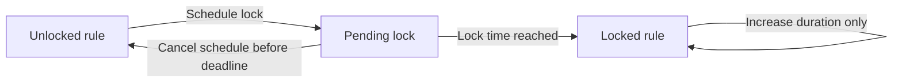

# Retention rules and immutable data protection

In the **Object Storage and Archive Storage** chapter of the Oracle Cloud Infrastructure (OCI) module, retention rules help protect stored objects from modification or deletion during their required holding period. This is one component of an authorized, auditable OCI infrastructure design: data may include receipts, exported logs, application backup packages, or Oracle Database data exports stored as objects.

This lesson focuses on **OCI Object Storage** retention. Object holding periods must be coordinated with application backup and recovery processes; bucket-level settings do not automatically configure the backup policy of a database service.

After this lesson, you will be able to:

- Choose time-bound or indefinite rules based on retention requirements.
- Calculate when an object's protection ends and explain the impact of locking a rule.
- Separate permissions for writing data, managing retention, and auditing configuration.
- Practice creating an unlocked rule, testing behavior, and cleaning up test resources.
- Integrate retention into lifecycle design, monitoring, recovery, and capacity forecasting.

## From accidental deletion risk to WORM

Suppose a payment application exports receipts daily to Object Storage. A faulty cleanup command could delete receipts that must still be preserved. Restricting delete permissions reduces risk, yet protection at the storage service layer itself is still needed.

**WORM — Write Once, Read Many** describes the requirement to write data once and retain it for repeated reads without modification or deletion during the protection window. When retention is active, OCI blocks updates, overwrites, object deletions, and metadata changes on protected objects. [Oracle: Securing Object Storage](https://docs.oracle.com/en-us/iaas/Content/Security/Reference/objectstorage_security.htm).

Illustrative design for this lesson:

```text
Application generates receipt
        |
        v
Verify content and hash
        |
        v
Receipts bucket under retention policy
        |
        +--> Authorized readers retrieve receipts
        |
        +--> Modifications/deletions checked by retention
```

Hashes verify content, while retention places constraints on storage operations. Therefore, validate receipts before placing them into a retained area: if an application exports wrong content, immutability preserves that wrong content as well.

## Bucket scope and each object's clock

Rules are configured at the **bucket** level and apply to objects in that bucket. For time-bound rules, each object's protection duration is calculated from `Last-Modified`, not from the rule creation date. [Oracle: Object Storage Data Retention Rules](https://docs.oracle.com/en-us/iaas/Content/Object/Tasks/usingretentionrules.htm).

For a rule with duration `D`, think of it as:

```text
Object protection end time = object's Last-Modified + D
```

Self-calculated example using UTC and a 30-day duration:

| Object | Last-Modified | Rule end timestamp |
| --- | --- | --- |
| `receipts/a.json` | 2026-01-01T00:00:00Z | 2026-01-31T00:00:00Z |
| `receipts/b.json` | 2026-01-20T00:00:00Z | 2026-02-19T00:00:00Z |

If the rule is created on 2026-01-25, object A has roughly 6 days remaining, while object B has roughly 25 days remaining. An object already older than the duration may no longer be protected by this rule as soon as the rule is created.

Design implication: a date inside the name `receipts/2026-01/a.json` does not replace `Last-Modified`. If business requirements count from settlement date or case closure date, reconcile the business timestamp against the storage timestamp before choosing the retention duration.

Because scope is bucket-wide, this example separates long-retention receipts and temporary data into two buckets. Prefixes can organize object names, but they are not per-rule filters for retention rules.

## Choosing the retention type

OCI provides **time-bound** rules with durations in days or years and **indefinite** rules with no expiration date. An indefinite rule protects data until the rule is deleted; it has no fixed duration to lock. [Oracle: Creating a Data Retention Rule](https://docs.oracle.com/en-us/iaas/Content/Object/Tasks/usingretentionrules_topic-To_create_a_retention_rule.htm).

| Example requirement | Choice | Operational decision needed |
| --- | --- | --- |
| Keep reports for a defined period | Time-bound | Who sets the duration and verifies the unit? |
| Preserve records for a case with unknown end date | Indefinite | Who authorizes removing the hold and based on what record? |
| Experiment in a sandbox | Unlocked time-bound | When to delete the rule and test data? |

Durations in this lesson are illustrative figures. Actual retention periods must come from data classification and requirements established by your organization.

A bucket can have multiple rules. Indefinite rules take precedence over time-bound rules; one rule expiring is not enough to conclude an object can be deleted. Evaluate every active rule. [Oracle: Scope and Constraints](https://docs.oracle.com/en-us/iaas/Content/Object/Tasks/usingretentionrules.htm).

Illustrative reasoning: a record covered by both a 30-day rule and an indefinite hold must still be retained past day 30. Removing the indefinite hold also does not bypass remaining duration on another rule.

## Active rule vs. locked rule are two different things

As soon as a rule is created and active, it protects data according to its conditions. **Lock** protects the rule configuration itself from being removed or having its duration shortened. OCI requires a minimum **14-day** waiting period before a lock takes effect. Locking is irreversible; after locking, duration can only be increased, and neither tenancy administrators nor Oracle Support can directly delete a locked rule. [Oracle: Creating a Data Retention Rule — Locking](https://docs.oracle.com/en-us/iaas/Content/Object/Tasks/usingretentionrules_topic-To_create_a_retention_rule.htm).



During the waiting period, data is already protected even though rule configuration can still be modified. Therefore, do not treat the 14-day lock delay as a grace period where data can be freely overwritten.

The `time-rule-locked` field represents the lock timestamp. A future timestamp is a scheduled lock, not proof that the rule is already locked. The CLI allows clearing the schedule with an empty value before that deadline passes; this property cannot be edited once the rule is locked. [Oracle CLI: retention-rule update](https://docs.oracle.com/en-us/iaas/tools/oci-cli/latest/oci_cli_docs/cmdref/os/retention-rule/update.html).

In production deployments, record configuration evidence and lock approval in a separate change ticket. Confirm bucket, compartment, region, data type, duration, recoverability, and capacity forecast.

**An object's retention expiring does not mean the rule disappears.** New objects remain subject to existing rules. A locked rule can only be removed by deleting the bucket, which must be empty first; this is not a shortcut for deleting protected objects. [Oracle: Troubleshooting Retention Rules](https://docs.oracle.com/en-us/iaas/Content/Object/Troubleshooting/usingretentionrules_topic-Troubleshooting_Retention_Rules.htm).

## Separating permissions by responsibility

A suggested design for compartment `Records`:

| Role | Task | Permissions to separate |
| --- | --- | --- |
| Receipt-exporting app | Write objects with new names | Removing retention, locking rules, deleting data |
| Storage admin team | Manage buckets and retention settings | Long-term lock decisions |
| Retention owner | Confirm durations, coordinate locks | Daily application runtime permissions |
| Auditor | Read configuration, inspect evidence | Modifying retention |

Per OCI documentation, creating or managing retention requires `BUCKET_UPDATE` and `RETENTION_RULE_MANAGE`; locking also requires `RETENTION_RULE_LOCK`. Missing lock permission can cause lock operations to fail even if creating an unlocked rule succeeds. [Oracle: Troubleshooting Retention Rules](https://docs.oracle.com/en-us/iaas/Content/Object/Troubleshooting/usingretentionrules_topic-Troubleshooting_Retention_Rules.htm).

The following policy example serves only the role of **reading bucket configuration** in the specified compartment:

```text
Allow group RecordsReaders to read buckets in compartment Records
```

Group names and compartments must match your environment, including identity domain qualification if applicable. This policy does not automatically grant permission to download object contents.

The `GetRetentionRule` and `ListRetentionRules` APIs use bucket read permissions. `manage buckets` includes retention management permissions, so inspect its scope carefully instead of granting it broadly just to view configuration. [Oracle: Details for Object Storage and Archive Storage](https://docs.oracle.com/en-us/iaas/Content/Identity/Reference/objectstoragepolicyreference.htm).

For applications writing data, object names should carry unique identifiers. When amending a receipt, the application can write the revised receipt under a new name and link it to the previous receipt rather than relying on overwriting a fixed key like `latest.json`.

## Combining with other storage features

### Versioning

You cannot add a retention rule while versioning is enabled, nor can you enable versioning while an active retention rule exists. OCI allows adding retention when versioning is suspended, but does not allow resuming versioning while retention remains active. Suspended versioning can still leave old versions behind, so transitions require inventorying existing data. [Oracle: Object Storage Versioning](https://docs.oracle.com/en-us/iaas/Content/Object/Tasks/usingversioning.htm).

To learn retention, this lab uses a new bucket with versioning never enabled. This avoids altering the data model of a bucket already serving an application.

### Lifecycle

Lifecycle executes actions such as tier transitions and conditional cleanup; it is not the mechanism that defines mandatory data holds. Lifecycle actions occur asynchronously, so reaching an eligibility threshold does not mean processing has already finished. [Oracle: Object Lifecycle Management](https://docs.oracle.com/en-us/iaas/Content/Object/Tasks/usinglifecyclepolicies.htm).

Lifecycle can transition the tier of a retention-protected object, but it cannot delete an object still under retention. Uncommitted multipart uploads are not protected by retention and may be cleaned up separately. [Oracle: Interaction Between Retention and Other Features](https://docs.oracle.com/en-us/iaas/Content/Object/Tasks/usingretentionrules.htm).

Design example: retain receipts for 365 days, consider transitioning to Archive after 90 days, and allow lifecycle deletion only after all retention constraints have expired. If an indefinite hold appears, planned deletion must yield to that hold.

### Replication and recoverability

You cannot create a retention rule on a bucket that is currently a replication destination. Retention documentation also restricts using a bucket with retention rules as a replication target. [Oracle: Retention and Replication](https://docs.oracle.com/en-us/iaas/Content/Object/Tasks/usingretentionrules.htm).

Object Storage replication works asynchronously. Deletions at the source after configuring replication are also replicated to the destination; objects created before the replication policy existed are not automatically replicated. [Oracle: Object Storage Replication](https://docs.oracle.com/en-us/iaas/Content/Object/Tasks/usingreplication.htm).

Architectural implication: test replication paths, pre-existing data, permissions, and recovery paths separately. If the design requires an immutable replica elsewhere, prove that the mechanism delivering data there meets the requirement rather than assuming replication alone suffices.

### Archive and encryption

Storage tier determines retrieval characteristics and cost. Archive requires restoring objects before reading and enforces minimum storage duration billing rules. These attributes must be evaluated alongside retention periods, but they do not replace retention rules. [Oracle: Object Storage Storage Tiers](https://docs.oracle.com/en-us/iaas/Content/Object/Concepts/understandingstoragetiers.htm).

A surviving copy must also remain readable for recovery. With customer-managed encryption keys, separate key-administration permissions, protect keys from deletion, and test decryption/recovery workflows. Oracle recommends tightly restricting permissions to create, rotate, and delete keys. [Oracle: Securing Object Storage](https://docs.oracle.com/en-us/iaas/Content/Security/Reference/objectstorage_security.htm).

## Hands-on lab: unlocked retention on a dedicated bucket

The goal is to observe data protection and management of an unlocked rule. The commands below guide learners running in **OCI Cloud Shell or Bash with a configured OCI CLI**. Do not schedule a lock in this lab.

### Preparation

Create a new private bucket beforehand in a sandbox compartment, Standard storage tier, with versioning disabled and not a replication destination. Use a bucket containing only sample data for this lesson. The lab account needs permissions to create/manage retention and to read, create, overwrite, and delete test objects so IAM errors are not confused with retention outcomes.

Set the exact region, namespace, and bucket name:

```bash
export OCI_REGION='ap-singapore-1'
export OCI_NAMESPACE='<tenancy-namespace>'
export LAB_BUCKET='<private-sandbox-bucket-name>'

# Select a region enabled for the tenancy; replace values before running.
oci os bucket get \
  --region "$OCI_REGION" \
  --namespace-name "$OCI_NAMESPACE" \
  --bucket-name "$LAB_BUCKET"
```

Inspect the output to confirm the right bucket and versioning state. If an error occurs, stop at preparation and resolve the region, namespace, or permissions; do not switch to testing on a production bucket.

### Step 1: write the original object

```bash
LAB_WORKDIR=$(mktemp -d)
LAB_OBJECT="retention-demo/$(date -u +%Y%m%dT%H%M%SZ)-$$.txt"

printf '%s\n' 'receipt-demo-v1' > "$LAB_WORKDIR/original.txt"
printf '%s\n' 'receipt-demo-v2' > "$LAB_WORKDIR/replacement.txt"

oci os object put \
  --region "$OCI_REGION" \
  --namespace-name "$OCI_NAMESPACE" \
  --bucket-name "$LAB_BUCKET" \
  --name "$LAB_OBJECT" \
  --file "$LAB_WORKDIR/original.txt" \
  --no-multipart
```

Use a small file and `--no-multipart` to keep the test focused on a complete object. `object put` can create a new object or overwrite an existing object of the same name; a later step intentionally tests the overwrite case. [Oracle CLI: object put](https://docs.oracle.com/en-us/iaas/tools/oci-cli/latest/oci_cli_docs/cmdref/os/object/put.html).

### Step 2: create a one-day, unlocked rule

```bash
RULE_ID=$(oci os retention-rule create \
  --region "$OCI_REGION" \
  --namespace-name "$OCI_NAMESPACE" \
  --bucket-name "$LAB_BUCKET" \
  --display-name 'lab-retain-one-day' \
  --time-amount 1 \
  --time-unit DAYS \
  --query 'data.id' \
  --raw-output)

printf 'RULE_ID=%s\n' "$RULE_ID"
```

Stop if the CLI returns an error or `RULE_ID` has no valid value. Save the ID to read the exact rule and clean up the exact resource.

Do not omit `--time-amount`: without a duration, the create command can create an indefinite retention rule. A new rule typically takes around 30 seconds to take effect; if checked too early, inspect its status and retry after propagation. [Oracle CLI: retention-rule create](https://docs.oracle.com/en-us/iaas/tools/oci-cli/latest/oci_cli_docs/cmdref/os/retention-rule/create.html).

### Step 3: read back the configuration

```bash
oci os retention-rule get \
  --region "$OCI_REGION" \
  --namespace-name "$OCI_NAMESPACE" \
  --bucket-name "$LAB_BUCKET" \
  --retention-rule-id "$RULE_ID"
```

Verify `duration.time-amount` is `1`, `duration.time-unit` is `DAYS`, and `time-rule-locked` is `null`. The `get` command uses bucket and rule ID; the output also includes creation/modification timestamps and ETag for reconciliation. [Oracle: Getting a Retention Rule's Details](https://docs.oracle.com/en-us/iaas/Content/Object/Tasks/usingretentionrules_topic-Get_retention_rule.htm).

`time-rule-locked: null` in this test means no lock is scheduled. It does not mean the object is allowed to be deleted during its protection day.

### Step 4: test read, overwrite, and delete

First download the object to a new file in the temporary directory:

```bash
oci os object get \
  --region "$OCI_REGION" \
  --namespace-name "$OCI_NAMESPACE" \
  --bucket-name "$LAB_BUCKET" \
  --name "$LAB_OBJECT" \
  --file "$LAB_WORKDIR/downloaded.txt"

cmp "$LAB_WORKDIR/original.txt" "$LAB_WORKDIR/downloaded.txt"
```

Expected: data downloads if read permission exists, and `cmp` finds no differences. Next attempt an overwrite:

```bash
oci os object put \
  --region "$OCI_REGION" \
  --namespace-name "$OCI_NAMESPACE" \
  --bucket-name "$LAB_BUCKET" \
  --name "$LAB_OBJECT" \
  --file "$LAB_WORKDIR/replacement.txt" \
  --no-multipart \
  --force
```

Expected: the service rejects the request because the object is still within retention. `--force` only skips the CLI confirmation prompt; it does not elevate permissions or bypass service constraints.

Attempt to delete the exact sample object created earlier:

```bash
oci os object delete \
  --region "$OCI_REGION" \
  --namespace-name "$OCI_NAMESPACE" \
  --bucket-name "$LAB_BUCKET" \
  --object-name "$LAB_OBJECT" \
  --force
```

Expected: the service continues to reject it. `object delete` syntax targets the object by name in the bucket; `--force` does not turn a retention-blocked operation into an allowed one. [Oracle CLI: object delete](https://docs.oracle.com/en-us/iaas/tools/oci-cli/latest/oci_cli_docs/cmdref/os/object/delete.html).

Record the test timestamp, error code, message, and request ID if present. A permission error also causes the command to fail, so evidence must point to a retention-related reason. If overwrite or delete succeeds, do not treat the test as passed; re-check the bucket, rule, and effective window.

### Step 5: delete the unlocked rule and clean up the sample object

This step is specifically for the lesson's sandbox bucket. An unlocked rule can be removed by someone with sufficient permissions, illustrating why unlocked configurations still require IAM and change-management protection.

```bash
oci os retention-rule delete \
  --region "$OCI_REGION" \
  --namespace-name "$OCI_NAMESPACE" \
  --bucket-name "$LAB_BUCKET" \
  --retention-rule-id "$RULE_ID"
```

Read the confirmation prompt and confirm the exact test rule. The delete rule API/CLI uses bucket and rule ID; re-check the rule list after completion. [Oracle: Deleting a Data Retention Rule](https://docs.oracle.com/en-us/iaas/Content/Object/Tasks/usingretentionrules_topic-To_delete_a_retention_rule.htm).

Once you confirm the rule is removed and the change has taken effect, delete the sample object:

```bash
oci os object delete \
  --region "$OCI_REGION" \
  --namespace-name "$OCI_NAMESPACE" \
  --bucket-name "$LAB_BUCKET" \
  --object-name "$LAB_OBJECT" \
  --force

oci os retention-rule list \
  --region "$OCI_REGION" \
  --namespace-name "$OCI_NAMESPACE" \
  --bucket-name "$LAB_BUCKET" \
  --all
```

Listing rules detects any other rules remaining on the bucket. In automation, read all result pages rather than relying on the first page alone. [Oracle: Listing Data Retention Rules](https://docs.oracle.com/en-us/iaas/Content/Object/Tasks/usingretentionrules_topic-To_list_retention_rules.htm).

Downloaded files remain under `$LAB_WORKDIR`. Learners can inspect and remove that temporary directory and delete the sandbox bucket after confirming no data remains. Do not use bulk-delete operations on shared buckets to clean up a lab.

## Scheduling a lock in real deployments

This is a separate operational pattern for a **verified time-bound rule**, not part of the sandbox sequence above:

```bash
# Use only after replacing exact rule details and confirming the lock decision.
# LOCK_AT_UTC must be RFC 3339, at least 14 days from now.
LOCK_AT_UTC='<YYYY-MM-DDTHH:MM:SSZ>'

oci os retention-rule update \
  --region "$OCI_REGION" \
  --namespace-name "$OCI_NAMESPACE" \
  --bucket-name '<actual-retention-bucket>' \
  --retention-rule-id '<verified-rule-id>' \
  --time-rule-locked "$LOCK_AT_UTC"
```

Do not implicitly compute the lock timestamp from a workstation timezone. Record the UTC timestamp in the change ticket, read the rule back, and compare against current time. If multiple people or pipelines manage configuration, use ETag with `--if-match` to prevent overwriting recent updates. [Oracle CLI: retention-rule update](https://docs.oracle.com/en-us/iaas/tools/oci-cli/latest/oci_cli_docs/cmdref/os/retention-rule/update.html).

A recommended rollout workflow:

1. Finalize data classification and required business holding periods.
2. Create a dedicated bucket and unlocked rule; test representative data.
3. Test write, read, recovery, and lifecycle workflows in an appropriate environment.
4. Review application permissions, rule-change permissions, encryption keys, and costs.
5. Schedule the lock and assign an owner to monitor until it takes effect.
6. After the lock deadline passes, read back the configuration and store operational evidence.

When using infrastructure as code, treat retention configuration as a resource with its own lifecycle. Avoid pipeline designs that tear down and recreate buckets for each application release by default.

## Monitoring and operational evidence

OCI Audit records supported API calls. For Object Storage, Audit supports bucket-level events and does not log object-level operation events; therefore, you cannot rely on Audit alone to prove every read/delete on individual objects. [Oracle: Overview of Audit](https://docs.oracle.com/en-us/iaas/Content/Audit/Concepts/auditoverview.htm).

A recommended operational evidence set includes:

| Evidence | Purpose |
| --- | --- |
| Namespace, region, compartment, and bucket name | Identify the exact resource |
| Rule ID, duration, lock schedule, and inspection time | Verify retention configuration |
| Bucket/rule change events available in Audit | Identify principal and administrative actions |
| Responses from overwrite/delete test attempts | Distinguish retention blocks from IAM blocks |
| Download results, hashes, and recovery drill records | Verify data remains usable |
| Periodic capacity and write-rate changes | Forecast storage demand |

In automated checks, distinguish these states: unscheduled rule, pending lock, locked rule, and failed configuration read. A failed API call must never be interpreted as "no retention present".

## Capacity forecasting and troubleshooting

With steady write rates and a fixed duration, use an initial estimate:

```text
Approximate steady-state capacity = new data per day × retention days
```

Self-calculated example: 20 GiB/day over 180 retention days produces a baseline around **3,600 GiB**. Increasing to 365 days brings the baseline to roughly **7,300 GiB**, excluding holds, replicas, backlogs, and growth. This is a capacity estimate, not an OCI price quote.

When transitioning to Archive, factor in restore costs and restore times as well as tier billing conditions. A long-term locked rule can commit budgets across multiple cycles, so forecasting must accompany retention decisions.

| Symptom | How to check |
| --- | --- |
| Cannot create rule | Check permissions, target bucket, and versioning state |
| Created rule yet cannot lock it | Check lock permission, rule type, and UTC timestamp |
| Older object can be deleted after adding rule | Calculate age from Last-Modified; check which rules still protect it |
| Object still cannot be deleted after expected date | List all rules, look for holds, and check IAM |
| Lifecycle has not cleaned up data | Check active retention, service permissions, and asynchronous execution |
| Cannot read backup even though object exists | Check read permissions, tier, restore status, and encryption keys |
| Pipeline cannot delete bucket | Inventory objects and retention configuration before changing deployment flow |

For a rule locked by mistake, do not plan around assuming a higher-privileged account can remove it. Stop ingesting unsuitable data into the bucket, scope the impact, and manage operations for the remaining active duration.

## Self-check for comprehension

- **Why doesn't creating a 30-day rule today extend all old objects for 30 more days?** Because each object's clock starts from its Last-Modified timestamp.
- **Does an unlocked rule protect data?** Yes, while active; what remains changeable is the rule configuration itself by someone with sufficient permissions.
- **Why aren't the lock delay and data retention duration interchangeable?** They govern two different things: mutability of the rule vs. protection window of objects.
- **Is an object deleted immediately when its retention expires?** An authorized delete action or cleanup mechanism is still required; other active rules must also be evaluated.
- **Is immutability alone sufficient for recovery?** You also need valid data, read permissions, usable encryption keys, and a tested recovery workflow.

The expected outcome of this lab is a clear record: the exact test bucket, a one-day unlocked rule, successful read, overwrite/delete blocked by retention, and subsequent cleanup of the rule and sample object. In production systems, locking decisions must align with data lifecycle, recoverability, and organizational operational accountability.