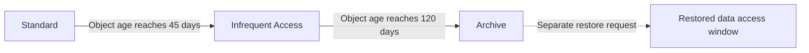

# Lifecycle policies and automated storage tier transitions

In the **Object Storage and Archive Storage** chapter of the **CLOUD_PROVIDERS_ORACLE** module, this lesson covers designing data lifecycles on Oracle Cloud Infrastructure (OCI). The focus is turning access timing, retention, and cost requirements into rules with clear scope, proper permissions, and observable results.

After this lesson, you will be able to:

- Choose when to transition data between Standard, Infrequent Access, and Archive based on usage needs.
- Write lifecycle policies with the right actions, targets, age thresholds, and object name filters.
- Distinguish permissions of the policy author from permissions of the executing service.
- Test on a lab bucket, read back the configuration, and observe real changes.
- Explain costs, recovery limits, and interactions with versioning and retention rules.

## The problem: long-lived data that is not accessed frequently

An application running on OCI Compute exports order-processing logs to Object Storage. Operations uses recent logs to troubleshoot errors; older logs only serve reconciliation. The database team also exports backup files into storage, yet files needed for recent recovery must remain immediately readable.

Keeping everything in Standard indefinitely increases spend as data accumulates. Moving everything to Archive too early can force an investigation or recovery request to wait for data restoration.

A sound design begins with questions for each dataset:

| Question | Example answer | Design consequence |
| --- | --- | --- |
| How long is frequent access needed? | Logs from the most recent 45 days | Keep in Standard initially |
| When rarely used, are immediate reads needed? | Still must be read immediately for reconciliation | Consider Infrequent Access |
| When is waiting for restore acceptable? | Around day 120 onward | Consider Archive |
| When is deletion permitted? | Per retention schedule agreed with the data owner | Separate deletion decisions from tier transitions |
| Which data needs exceptions? | Files belonging to an active investigation | Separate buckets or design appropriate filters and protection |

This is an illustrative scenario, not a universal schedule for all workloads. For Oracle Database backup data, factor recovery time objectives into tier selection; a cheap backup that misses recovery time requirements is unsuitable.

## Storage tiers and lifecycle boundaries

| Tier | Primary need | Access | Factor to include in plan |
| --- | --- | --- | --- |
| Standard | Frequently accessed data | Immediate read | Higher storage price than colder tiers |
| Infrequent Access | Infrequently used yet needs immediate reads | Immediate read | Retrieval fees; 31-day minimum billable storage |
| Archive | Rarely used, long-term retention | Restore before reading | 90-day minimum billable storage |

A bucket whose default tier is Standard can hold objects in all three tiers. Transitioning an object's tier does not move it to another bucket and does not change the bucket's default tier. See [OCI Storage Tiers](https://docs.oracle.com/en-us/iaas/Content/Object/Concepts/understandingstoragetiers.htm).

Archive requires a separate restore workflow; lifecycle policies do not have an action to automatically restore objects back to Standard. See [Archive Storage overview](https://docs.oracle.com/en-us/iaas/Content/Archive/Concepts/archivestorageoverview.htm).

Therefore, a tier-transition policy does not replace an off-site backup copy. When designing availability, separately define replica location, network paths, access permissions, and recovery procedures.

## Structure of a lifecycle rule

A lifecycle policy is a collection of rules attached to a bucket. Each rule must answer: which resources it affects, what action it performs, at what age threshold, and whether it is enabled.

| JSON field | Meaning | Example |
| --- | --- | --- |
| `name` | Name for operations and tracking | `logs-to-archive-120d` |
| `target` | Resource type | `objects` |
| `action` | Action | `ARCHIVE` |
| `timeAmount` | Age value | `120` |
| `timeUnit` | Age unit | `DAYS` |
| `isEnabled` | Enabled state | `false` |
| `objectNameFilter` | Object name scope | Prefix `logs/orders/` |

Action and target combinations:

| Target | Valid actions |
| --- | --- |
| `objects` | `INFREQUENT_ACCESS`, `ARCHIVE`, `DELETE` |
| `previous-object-versions` | `INFREQUENT_ACCESS`, `ARCHIVE`, `DELETE` |
| `multipart-uploads` | `ABORT` |

`INFREQUENT_ACCESS` moves Standard objects to Infrequent Access; `ARCHIVE` moves Standard or Infrequent Access objects to Archive. `ABORT` cancels incomplete multipart uploads and deletes their parts. Action names must use exact API values. See [ObjectLifecycleRule model](https://docs.oracle.com/en-us/iaas/tools/python/latest/api/object_storage/models/oci.object_storage.models.ObjectLifecycleRule.html).

In a versioned bucket, `objects` refers to the latest version; rules for older versions must use a separate target. When reading a policy, check `target` before interpreting what `action` does.

## Age thresholds: rule durations do not stack

For regular objects, age is measured from the object's last modification timestamp, not the policy creation date. Days are evaluated in UTC. See [time_amount and time_unit specification](https://docs.oracle.com/en-us/iaas/tools/terraform-provider-oci/latest/docs/r/objectstorage_object_lifecycle_policy.html).

Suppose two rules are designed for the same prefix:

- Move to Infrequent Access when object age reaches 45 days.
- Move to Archive when object age reaches 120 days.

The Archive threshold is 120 days of object age, not 120 days after moving to Infrequent Access. Under the planned schedule, the object spends roughly 75 days in Infrequent Access if both transitions execute near their target ages.



The diagram shows the intended schedule. Each rule is evaluated independently against its own condition; there is no chaining where one rule triggers the next like a job pipeline. An object already old enough for Archive does not need to spend 75 days in Infrequent Access first.

Situations to anticipate ahead of time:

- **Objects already old when the policy is enabled:** the policy can act on existing eligible data, not only data uploaded afterward.
- **Application continuously overwrites the same key:** evaluation age can reset on each overwrite; use distinct per-export names if each batch needs an independent lifecycle.
- **Frequently read objects:** age-based lifecycle does not interpret read history into "not accessed for N days".
- **Local timezones:** do not compare a workstation's local date to conclude a rule is delayed without converting to UTC.

For archive or delete rules targeting previous versions, days are counted from when that version transitioned from latest to previous. For example, v1 created on day 1 but replaced by v2 on day 20: the previous-version clock starts on day 20. See [guide to creating a lifecycle rule](https://docs.oracle.com/en-us/iaas/Content/Object/Tasks/usinglifecyclepolicies_topic-To_create_a_lifecycle_policy_rule.htm).

## Name filters: narrow scope before enabling rules

A prefix is the leading portion of an object name. Glob patterns describe name groups; exclusion patterns take precedence when a name matches both inclusion and exclusion. An empty inclusion array can mean include everything, so never use an empty array to represent "select no objects". See [ObjectNameFilter](https://docs.oracle.com/en-us/iaas/tools/python/latest/api/object_storage/models/oci.object_storage.models.ObjectNameFilter.html).

Example rule managing only order logs while skipping an exception area:

```json
{
  "inclusionPrefixes": ["logs/orders/"],
  "exclusionPatterns": ["logs/orders/hold/*"]
}
```

Before deploying, build a scope prediction table:

| Object name | Within name scope? | Reason |
| --- | --- | --- |
| `logs/orders/2026-01-01.json.gz` | Yes | Starts with selected prefix |
| `logs/orders/hold/investigation.json.gz` | No | Matches exclusion |
| `logs/payments/2026-01-01.json.gz` | No | Different prefix |
| `logs/orders-old/export.json.gz` | No | Lacks prefix `logs/orders/` |
| `backups/orders/full.bak` | No | Belongs to different backup area |

This table checks only the name filter. An in-scope object must still meet the age threshold and related conditions to be acted upon.

Start with a simple prefix with a clear delimiter. If requirements differ sharply across logs, backups, and protected records, separating buckets usually makes scope easier for operators to verify.

The `hold/` prefix in the example is just a naming convention excluded by the current rule. It does not create a legal hold mechanism, does not stop manual deletions, and does not block another rule with a broader scope.

## Designing transition schedules and estimating cost

Illustrative schedule for `logs/orders/`:

| Object age | Purpose | Design action |
| --- | --- | --- |
| Under 45 days | Recent error investigation | Keep in Standard |
| 45 to under 120 days | Occasional reconciliation, still needs immediate read | Transition to Infrequent Access |
| 120 days and older | Historical lookup, restore wait acceptable | Transition to Archive |
| Retention end reached | Per data owner decision | Evaluate separate delete rule |

You can use the following estimation model, taking unit rates and units from the price schedule applicable to your actual region and contract:

```text
Expected cost
  = storage per tier and time spent in that tier
  + retrieval from Infrequent Access
  + billable requests and data transfer
  + remaining minimum storage duration adjustments
  + costs related to restores and using restored data
```

For instance, moving an object to Archive at age 120 days and scheduling deletion at age 150 days yields an expected stay of only 30 days in Archive. That is shorter than the 90-day minimum billable duration. Likewise, do not schedule moving into Infrequent Access and deleting a few days later while ignoring the 31-day minimum. This is a budgeting consequence of [tier minimum storage rules](https://docs.oracle.com/en-us/iaas/Content/Object/Concepts/understandingstoragetiers.htm).

Also account for reading data out of Infrequent Access when transitioning to Archive; lifecycle tier transitions can still incur Infrequent Access retrieval charges. See [cost notes on tier transitions](https://docs.oracle.com/en-us/iaas/Content/Object/Tasks/usinglifecyclepolicies.htm).

Do not decide solely on per-GiB-month storage price. Compare at least two options:

- Keep in Standard longer, then transition straight to Archive.
- Include an Infrequent Access phase before Archive.

The better option depends on data volume, read frequency, remaining retention duration, and required recovery time. The 45- and 120-day thresholds here are for learning, not a claim that they are always the cheapest choice.

## IAM: the configurator and the executing service

Two principals need permissions: the user or pipeline editing configuration, and the Object Storage service executing the actions. Having permission to save a policy is not enough to conclude the service can transition tiers.

Oracle's documentation example places a service policy at the root compartment:

```text
Allow service objectstorage-ap-singapore-1 to manage object-family in compartment StorageLab
```

Replace the region identifier and compartment with actual values. You can narrow the service policy using permissions such as `BUCKET_INSPECT`, `BUCKET_READ`, `OBJECT_INSPECT`, and `OBJECT_UPDATE_TIER`; add corresponding delete permissions when deletion rules are needed. See [Required IAM Policies for lifecycle](https://docs.oracle.com/en-us/iaas/Content/Object/Tasks/usinglifecyclepolicies.htm).

In the lab, use a dedicated lab compartment. IAM administrators should choose a scope matching the deployed rule set. Avoid using a tenancy-wide administrator identity for developers, pipelines, and applications alike.

An application that only writes logs does not inherently need permission to alter data lifecycles. Separating data-write permissions from lifecycle administration clarifies accountability when retention schedules change.

## Hands-on with the OCI CLI on a lab bucket

The snippets below use Bash. They guide learners running in a lab environment; bucket names, namespace, and profile must be replaced with your own values.

Prerequisites:

- Authenticated OCI CLI configured.
- A lab bucket with default tier Standard.
- Auto-Tiering disabled so you can practice Infrequent Access transition rules.
- Sample bucket initially has versioning disabled and no retention rules; those interactions are covered later.
- Contains test data only and has required IAM permissions.

### Target the exact bucket and read current configuration

```bash
export OCI_CLI_PROFILE="LAB"
export OCI_CLI_REGION="ap-singapore-1"
export OCI_NAMESPACE="<your-namespace>"
export OCI_BUCKET="orders-lifecycle-lab"

oci os bucket get --namespace-name "$OCI_NAMESPACE" --bucket-name "$OCI_BUCKET"
oci os object-lifecycle-policy get --namespace-name "$OCI_NAMESPACE" --bucket-name "$OCI_BUCKET"
```

Use the bucket output to confirm the right region, compartment, and target name. The lifecycle `get` command returns the policy configuration and rule set. See [how to get a bucket's lifecycle policy](https://docs.oracle.com/en-us/iaas/Content/Object/Tasks/usinglifecyclepolicies_topic-To_get_a_buckets_lifecycle_policy.htm).

If no policy exists yet, reading the policy can return a resource-not-found error. Distinguish that case from a wrong namespace, wrong region, or missing permissions; never interpret every error as "bucket has no policy yet".

### Prepare the complete rule list

Create `lifecycle-rules.json` in your lab directory with the following contents:

```json
[
  {
    "name": "orders-to-ia-45d",
    "target": "objects",
    "action": "INFREQUENT_ACCESS",
    "timeAmount": 45,
    "timeUnit": "DAYS",
    "isEnabled": false,
    "objectNameFilter": {
      "inclusionPrefixes": ["logs/orders/"],
      "exclusionPatterns": ["logs/orders/hold/*"]
    }
  },
  {
    "name": "orders-to-archive-120d",
    "target": "objects",
    "action": "ARCHIVE",
    "timeAmount": 120,
    "timeUnit": "DAYS",
    "isEnabled": false,
    "objectNameFilter": {
      "inclusionPrefixes": ["logs/orders/"],
      "exclusionPatterns": ["logs/orders/hold/*"]
    }
  }
]
```

Both rules are created disabled so you can inspect the configuration before enabling them. This is not a dry-run mode: disabled status does not output a list of objects expected to be affected.

When using `--items`, the file content is the array of rules. Do not include the `data` or `items` wrapper from `get` output in this file. The CLI accepts complex input via `file://...`; you can view a sample with `--generate-param-json-input items`. See [put command reference](https://docs.oracle.com/en-us/iaas/tools/oci-cli/latest/oci_cli_docs/cmdref/os/object-lifecycle-policy/put.html).

### Apply the policy and read it back

```bash
oci os object-lifecycle-policy put --namespace-name "$OCI_NAMESPACE" --bucket-name "$OCI_BUCKET" --items file://lifecycle-rules.json
oci os object-lifecycle-policy get --namespace-name "$OCI_NAMESPACE" --bucket-name "$OCI_BUCKET"
```

**The put command replaces the entire current policy.** When a bucket already has other rules you need to keep, include them in the same submitted list. Do not submit a single new rule assuming it appends. See [how lifecycle policy updates work](https://docs.oracle.com/en-us/iaas/Content/Object/Tasks/usinglifecyclepolicies_topic-To_edit_a_lifecycle_policy_rule.htm).

Read back and verify each rule's name, target, action, age threshold, filter, and enabled state. Keep a single source of configuration management per bucket so Console, CLI, and IaC tools do not overwrite each other's rule lists.

### Enable rules and observe data

After verifying the lab data scope, change `isEnabled` to `true` for the rule you want to run in the JSON file, then resubmit the **entire** list with the `put` command above.

List objects and the fields to observe:

```bash
oci os object list --namespace-name "$OCI_NAMESPACE" --bucket-name "$OCI_BUCKET" --prefix "logs/orders/" --fields "name,size,timeModified,storageTier,archivalState" --all
```

`timeModified`, `storageTier`, and `archivalState` let you verify object age and storage state. Use `--all` when retrieving all result pages. See [object list reference](https://docs.oracle.com/en-us/iaas/tools/oci-cli/latest/oci_cli_docs/cmdref/os/object/list.html).

Inspect a specific object further:

```bash
oci os object head --namespace-name "$OCI_NAMESPACE" --bucket-name "$OCI_BUCKET" --name "logs/orders/sample.json.gz"
```

Check `last-modified`, `storage-tier`, and `archival-state` when present. Reading metadata does not prove object content is ready to download; Archive data requires an appropriate restore state. See [object head reference](https://docs.oracle.com/en-us/iaas/tools/oci-cli/latest/oci_cli_docs/cmdref/os/object/head.html).

Lifecycle runs asynchronously on a best-effort basis; reaching the age threshold does not guarantee the tier transition finishes immediately. Until processed, the object continues to be billed at its current tier. See [execution timing notes](https://docs.oracle.com/en-us/iaas/Content/Object/Tasks/usinglifecyclepolicies.htm).

If you want to observe results sooner, use a small threshold on disposable Standard test data with an anticipated lab budget. You cannot backdate the service's modification timestamp by changing a date in the filename. Never shorten thresholds on production policies just to get faster test results.

## Versioning, multipart uploads, and retention

### Latest version and previous versions

In a versioned bucket, deleting the current version via lifecycle creates a delete marker and turns the data into a previous version. Deleting a previous version via lifecycle deletes it permanently. Every retained version can continue incurring charges. See [Object Storage Versioning](https://docs.oracle.com/en-us/iaas/Content/Object/Tasks/usingversioning.htm).

Consequently, a `DELETE` rule targeting `objects` is not enough to conclude all bucket capacity has been freed. When versioning is enabled, inventory previous versions and define a separate policy for them.

Example rule for **design discussion**, not included in the lab policy above:

```json
{
  "name": "orders-old-versions-expire-240d",
  "target": "previous-object-versions",
  "action": "DELETE",
  "timeAmount": 240,
  "timeUnit": "DAYS",
  "isEnabled": false,
  "objectNameFilter": {
    "inclusionPrefixes": ["logs/orders/"],
    "exclusionPatterns": ["logs/orders/hold/*"]
  }
}
```

The 240-day threshold must be agreed upon with the data owner; it does not automatically inherit the current version's schedule. If previous versions are also moved to Archive, account for each version's actual time in that tier before deletion.

### Incomplete multipart uploads

A multipart upload can stall before commit. You can design an `ABORT` rule targeting `multipart-uploads` to clean up stale uploads. The cleanup threshold must exceed the longest legitimate resume window the application and network might need.

For example, if a large backup might be resumed over two days, do not pick a one-day abort schedule just to reclaim space quickly. Coordinate with application operations before enabling the rule bucket-wide.

### Retention rules protecting data

Lifecycle can transition the tier of an object protected by a retention rule, but it cannot delete the object while protection remains active. A bucket with versioning enabled cannot simultaneously have retention rules added; inspect the exact state before combining features. See [interactions of retention with lifecycle and versioning](https://docs.oracle.com/en-us/iaas/Content/Object/Tasks/usingretentionrules.htm).

Distinguish three concepts:

| Concept | Question it answers |
| --- | --- |
| Lifecycle threshold | When does an action become eligible to execute? |
| Minimum billable duration | What is the minimum period billed for the storage tier? |
| Retention rule | When is data protected from modification or deletion? |

An object can already be old enough for a delete rule yet still be protected by retention. Conversely, paying the 90-day minimum for Archive does not itself protect an object from early deletion.

## Age-based lifecycle vs. access-based Auto-Tiering

Lifecycle works well when data schedules are predictable: for example, logs leave frequent access after 45 days. Auto-Tiering fits better when access patterns fluctuate and are hard to forecast.

OCI Auto-Tiering manages transitions between Standard and Infrequent Access based on access patterns; it does not automatically move objects to Archive. You cannot enable Auto-Tiering when a lifecycle rule already transitions objects or versions to Infrequent Access. See [Auto-Tiering section](https://docs.oracle.com/en-us/iaas/Content/Object/Concepts/understandingstoragetiers.htm#auto-tiering).

For each bucket, pick one clear mechanism to manage Standard and Infrequent Access. If age-based Archive is needed, define the Archive schedule and its accessibility impact separately.

Do not interpret "automatic" as the system knowing business requirements on its own. Designers must still decide which data is allowed to cool down, acceptable recovery times, and where immediately readable data stays.

## Monitoring, handling discrepancies, and stopping a policy

Separate two kinds of evidence:

- **Saved configuration:** the `get` command reflects all expected rules and states.
- **Actual effect:** metadata and object inventory show data actually in the right tier and scope.

Record operational context alongside change tickets: bucket, region, compartment, owner, rule list, activation date, and expected object count or capacity of the dataset.

| Symptom | What to check first |
| --- | --- |
| Policy save rejected | Caller identity and permissions on the target compartment |
| Policy saved yet tiers have not changed | Service permissions, rule enabled state, object age, filters, processing delay |
| Data older than expected still in Standard | Whether app overwrote objects; correct prefix and target |
| Capacity did not drop after delete rule | Remaining previous versions, delete markers, retention, or multipart uploads |
| Costs rose despite tier transitions | Retrievals, minimum storage duration, restores, and actual data volume |
| Application cannot download historical logs | Whether objects are in Archive and require restore first |

The rows above are diagnostic starting points, not enough to prove root cause from one symptom alone. For large buckets, inventory by prefix and record sampling timestamps so observations remain comparable.

When a rule must be stopped, disable it in the Console or update the rule list with `isEnabled: false`. See [guide to disabling a lifecycle rule](https://docs.oracle.com/en-us/iaas/Content/Object/Tasks/usinglifecyclepolicies_topic-To_enable_disable_or_delete_a_lifecycle_policy_rule.htm).

Disabling a rule does not undo changes that already occurred. For archived data, a restore workflow is required; for permanently deleted data, recovery requires an existing copy from another source.

In the lab, keep delete rules disabled until retention requirements have been evaluated separately. At wrap-up, inventory transitioned data and any remaining associated charges before cleaning up the bucket.

## Self-evaluating lab outcomes

A complete lab outcome should show:

- You can explain why the chosen log dataset uses 45- and 120-day thresholds.
- The JSON uses the right action, target, and name scope; read-back output matches what was submitted.
- You distinguish saved configuration from completed actions.
- You have sample observations of in-scope objects, excluded objects, and objects not yet old enough.
- You can explain the impact of versioning or retention if those features are also enabled.
- Estimates account for retrieval fees, minimum billable durations, and restore needs.
- An owner is assigned to manage the policy and knows how to disable rules if an unintended scope is discovered.

The goal of lifecycle management is placing each dataset in the right storage tier throughout its lifetime. Achieving that connects actual usage schedules with IAM permissions, automation settings, operational evidence, and system recovery requirements.
