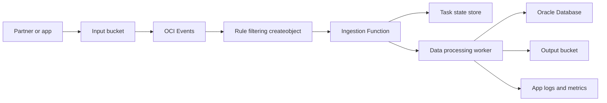

# Object events and data-processing integration

In the **Object Storage and Archive Storage** chapter of the Oracle Cloud Infrastructure (OCI) module, object events trigger workflows when data in a bucket changes. For example, when a partner uploads a CSV file to a bucket, the system ingests the file, validates its structure, loads data into Oracle Database, and records processing results without polling the entire bucket continuously.

A production-ready pipeline coordinates Object Storage, Events, IAM, processors, and monitoring. This lesson builds that flow from enabling event emission through idempotent processing, recovery, and cost control. Illustrative architectures and figures are design proposals for learners to adapt to real requirements.

After this lesson, you will be able to:

- Distinguish bucket events from object events and enable the right configuration.
- Read object-location fields in event payloads and construct accurate Events filters.
- Choose Notifications, Functions, or Streaming as event targets.
- Separate rule-administration permissions from processor read/write data permissions.
- Practice observing events and designing a pipeline safe against duplicate deliveries.

## Role of Events in a data flow

OCI Events receives messages describing resource state changes. A rule consists of filter conditions and actions; when an event matches, the service forwards it to configured targets. One case cited by Oracle is converting file formats when files arrive in Object Storage. [Oracle: Overview of Events](https://docs.oracle.com/en-us/iaas/Content/Events/Concepts/eventsoverview.htm).

Illustrative architecture:



The event-delivery path and the file-download path are two separate parts. The worker receives information about the object and then uses the Object Storage API to read its content; permission to receive messages does not automatically grant permission to read the bucket.

In this design, the ingestion function can process small files inline or record durable tasks for another worker. For large files, keep ingestion time short and let a properly sized worker process the payload.

## Enabling events on the right bucket

Objects do not emit events by default. Enable **Emit object events** when creating a bucket or updating an existing bucket. This setting controls object state-change events; seeing bucket-creation events does not prove object-event emission is enabled inside that bucket. [Oracle: Managing Emitting Events for Object State Changes](https://docs.oracle.com/en-us/iaas/Content/Object/Tasks/managingbuckets_topic-To_enable_or_disable_emitting_events_for_object_state_changes.htm).

Core object event types published by OCI:

| Change | Event type |
| --- | --- |
| Create object | `com.oraclecloud.objectstorage.createobject` |
| Update object | `com.oraclecloud.objectstorage.updateobject` |
| Delete object | `com.oraclecloud.objectstorage.deleteobject` |

The bucket name sits in `data.additionalDetails.bucketName`; the object name sits in `data.resourceName`. Oracle's sample object event has an empty `resourceId`, so do not rely solely on that field to locate data. [Oracle: Services that Produce Events — Object Storage](https://docs.oracle.com/en-us/iaas/Content/Events/Reference/eventsproducers.htm).

For file-ingestion pipelines, start with **createobject** and unique object names per upload. If the application permits overwrites, test the corresponding behavior and explicitly define which data version a task must process.

Enabling events configures the path for subsequent activity. In deployment design, pre-existing data requires a separate backfill plan; do not rely on flipping the switch to assume old files already triggered processing tasks.

## Reading an object event message

The example below uses placeholder values to illustrate the structure:

```json
{
  "cloudEventsVersion": "0.1",
  "eventID": "11111111-2222-4333-8444-555555555555",
  "eventType": "com.oraclecloud.objectstorage.createobject",
  "eventTypeVersion": "2.0",
  "source": "objectstorage",
  "eventTime": "2026-11-20T01:15:00Z",
  "contentType": "application/json",
  "extensions": {
    "compartmentId": "<compartment-ocid>"
  },
  "data": {
    "compartmentId": "<compartment-ocid>",
    "resourceName": "incoming/batch-20261120-001.csv",
    "resourceId": "",
    "additionalDetails": {
      "namespace": "<namespace>",
      "bucketName": "learning-input",
      "bucketId": "<bucket-ocid>",
      "eTag": "example-etag-v1",
      "archivalState": null
    }
  }
}
```

The envelope holds the identifier and event type; `data` is the payload provided by the source service. OCI documentation describes a CloudEvents `0.1` envelope with field names like `eventID`, `eventType`, and `eventTime`; parsers must follow this exact contract rather than substituting field names from another CloudEvents version. `eventTypeVersion` is the event type schema version. [Oracle: Contents of an Event Message](https://docs.oracle.com/en-us/iaas/Content/Events/Reference/eventenvelopereference.htm).

The receiver in our example extracts:

```text
Delivery ID:         eventID
Change type:         eventType
Object to read:      namespace + bucketName + resourceName
Verification value:  eTag when provided in payload
Latency timestamp:   eventTime
```

This message describes a change; it does not carry the full CSV file. If the object is overwritten or deleted before the worker reads it, receiving the event does not guarantee the worker can still retrieve the original content.

## Filtering the right type, bucket, and object name

A rule interested only in new files under `incoming/` can use the following condition:

```json
{
  "eventType": [
    "com.oraclecloud.objectstorage.createobject"
  ],
  "data": {
    "resourceName": "incoming/*",
    "additionalDetails": {
      "namespace": "<namespace>",
      "bucketName": "learning-input"
    }
  }
}
```

Conditions must preserve the exact nested structure of the event. Fields omitted from the filter are ignored; `*` acts as a wildcard inside values. A rule evaluates events from the compartment holding the rule and its child compartments. [Oracle: Matching Events with Filters](https://docs.oracle.com/en-us/iaas/Content/Events/Concepts/filterevents.htm).

In this example, an event must simultaneously match the type, namespace, bucket, and prefix. `incoming/*` filters only by name; it does not prove the file holds valid CSV content. After receipt, the processor still needs to validate data type, size, column schema, and business rules.

Pre-deployment filter test table:

| Test event | Expected |
| --- | --- |
| Create `incoming/a.csv` in exact bucket | Matches |
| Create `processed/a.json` in exact bucket | Does not match |
| Create `incoming/a.csv` in another bucket | Does not match |
| Delete `incoming/a.csv` | Does not match a createobject-only rule |

The Console lets you validate a rule using a sample event. Validation tells you whether the sample payload matches the condition; a real upload test is still needed to verify end-to-end delivery to targets. [Oracle: Validating an Events Rule](https://docs.oracle.com/en-us/iaas/Content/Events/Task/managingrules_topic-To_validate_a_rule.htm).

**Avoid self-triggering loops:** if a worker writes outputs to a location that also matches the input rule, outputs can recursively spawn more work. This lesson's design uses a separate output bucket; an alternative is ensuring the output prefix is excluded from the ingestion path.

## Choosing an event target

Events supports actions targeting **Notifications**, **Streaming**, and **Functions**. Target resources must already exist to be selected when configuring a rule; a single rule can have multiple actions. [Oracle: Managing Rules for Events](https://docs.oracle.com/en-us/iaas/Content/Events/Task/managingrules.htm).

| Target | Best-fit need | Additional design considerations |
| --- | --- | --- |
| Notifications topic | Observe changes, alert subscribers | Subscription confirmation, notification volume limits |
| Function | Validate inputs, short processing, or enqueue jobs | Object read permissions, execution timeout, task state |
| Stream | Decouple event intake from multiple processing consumers | Partitions, offset commits, replayability, deduplication |

Streaming retains messages for a configurable retention period and supports replay. Ordering is guaranteed within each partition in the order written to the stream; this does not automatically create a global order across all source changes. [Oracle: Overview of Streaming](https://docs.oracle.com/en-us/iaas/Content/Streaming/Concepts/streamingoverview.htm).

If you want to use Queue or invoke another processing service, add a forwarding component, such as a function writing tasks to the chosen system. Do not assume every OCI service is a direct Events action target.

When a rule has multiple actions, design each branch independently. Successfully sending a notification is not proof that database ingestion finished.

## Separating IAM permission layers

There are three layers to verify:

1. **Configurator user or pipeline:** updates buckets, manages rules, and selects action targets.
2. **Event-delivery flow:** actions must be scoped properly and satisfy integration permissions.
3. **Runtime processor:** reads the source bucket, writes outputs, and updates the state store or database.

Example policy for a rule-administration group in a sandbox compartment:

```text
Allow group EventLabAdmins to manage cloudevents-rules in compartment DataLab
Allow group EventLabAdmins to use ons-topic in compartment DataLab
```

This covers rule management and Notifications actions, not all permissions required to provision lab resources. The team also needs appropriate permissions to view compartments, manage buckets, and configure topics/subscriptions if handling those tasks. [Oracle: Events and IAM Policies](https://docs.oracle.com/en-us/iaas/Content/Events/Concepts/eventspolicy.htm).

When a function needs to call Object Storage, place the function in a dynamic group and grant permissions to that group. The OCI SDK's resource principal provider lets functions authenticate with their resource identity at runtime. [Oracle: Accessing OCI Resources from Running Functions](https://docs.oracle.com/en-us/iaas/Content/Functions/Tasks/functionsaccessingociresources.htm).

Example matching rule for a specific function:

```text
resource.id = '<function-ocid>'
```

Example permission to read the source bucket:

```text
Allow dynamic-group ObjectProcessors to read objects in compartment DataLab where target.bucket.name = 'learning-input'
```

Group names must be qualified by identity domain if applicable. For outputs and state stores, grant only task-specific permissions; never grant delete permissions on source data merely because the processor needs to read files.

At the network layer, workers on Compute or Functions need connectivity to the Object Storage endpoint and target systems. In private subnets, verify routes, service gateways or appropriate connectivity, DNS, and network rules. Valid IAM without network reachability still causes tasks to fail.

## Designing safe duplicate handling

An asynchronous pipeline should expect to receive the same message more than once. Notifications and Streaming consumer groups have delivery semantics that can lead to duplicate processing; applications must manage the business impact of retries. [Oracle: Notifications Overview](https://docs.oracle.com/en-us/iaas/Content/Notification/Concepts/notificationoverview.htm), [Oracle: Using Consumer Groups](https://docs.oracle.com/en-us/iaas/Content/Streaming/Tasks/using_consumer_groups.htm).

**Idempotent** means reprocessing the same input produces no extra side effects beyond the defined outcome. For CSV ingestion, receiving an event twice must not double-credit balances or insert two identical sets of transactions.

The recommended design uses two identifiers:

| Identifier | Purpose |
| --- | --- |
| `eventID` | Track redeliveries of the same event |
| Data-derived `jobKey` | Identify the same data batch across multiple submissions or backfills |

For example, compute `jobKey` from a structured tuple containing namespace, bucket, object name, appropriate version identifier or ETag, and processor version. When hashing, use unambiguous serialization; avoid joining strings with a delimiter that object names themselves can contain.

With per-batch unique object names, you can use a system-issued batch ID as part of the business key. ETag helps verify object state, yet should not be treated by default as a business-meaningful content hash.

### State store must handle incomplete work

```text
PENDING --> PROCESSING --> SUCCEEDED
                |
                +--> RETRY_WAIT --> PROCESSING
                |
                +--> FAILED_FINAL
```

Give each task record a unique `jobKey`, status, attempt count, created timestamp, updated timestamp, worker lease, and latest error.

- If already `SUCCEEDED`, redelivery returns the existing outcome.
- If `PROCESSING` with a valid lease, another worker does not duplicate work.
- If the lease expired, the task needs a reclaim or recovery path.
- If a permanent data error occurs, move to a terminal state for operator handling.

Do not use a blanket "if record exists, skip" rule across all states. A worker could have inserted the record and crashed before producing outputs; skipping unconditionally leaves data stranded permanently.

### Narrowing the gap between output and state

Risk example:

```text
Worker wrote 500 transactions to database
        |
        +--> Process crashes before marking SUCCEEDED
        |
        +--> Retry receives the same data batch
```

If outputs and task state live in the same Oracle Database, design transactions, unique constraints, and upserts to guard the write boundary. If the worker also writes output objects or calls external systems, use patterns like outbox, deterministic output names, and state checks before issuing further side effects.

These choices belong to application design; an Events rule does not automatically provide cross-service transactions.

## Reading the right object and data state

A common pitfall is uploading `incoming/daily.csv` twice in quick succession. The first upload's event arrives late, while `GET daily.csv` reads the second upload's content. The worker must know which data copy it is ingesting.

Three design options:

- Use unique object names per batch and restrict overwrites.
- When an application workflow tracks a verified version identifier, read that exact version.
- When using an ETag from the event, perform a conditional read to reject if the current object no longer matches.

The OCI Java SDK provides `versionId` and `ifMatch` on `GetObjectRequest`. `ifMatch` applies the ETag check inside the read request itself, avoiding a race window between inspecting the object and downloading its content. [Oracle Java SDK: GetObjectRequest.Builder](https://docs.oracle.com/en-us/iaas/tools/java/latest/com/oracle/bmc/objectstorage/requests/GetObjectRequest.Builder.html).

The snippet below illustrates the read portion inside a Java processor that already has the OCI SDK, client, validated input, and CSV parser. It is not a full deployable function:

```java
import java.io.InputStream;
import com.oracle.bmc.objectstorage.requests.GetObjectRequest;

// client is configured with appropriate authentication and region.
// namespace, bucket, objectName, and eventEtag are taken from the validated event.
var request = GetObjectRequest.builder()
        .namespaceName(namespace)
        .bucketName(bucket)
        .objectName(objectName)
        .ifMatch(eventEtag)
        .build();

var response = client.getObject(request);
try (InputStream body = response.getInputStream()) {
    // Application-implemented function: stream-read and enforce data limits.
    processCsv(body);
}
```

If an ETag required by the processing contract is missing, make an explicit handling decision rather than silently dropping the condition. The sample payload carries no version ID, so do not assume that field is always present. When an object has changed, transition the task appropriately or fetch the exact version; never silently ingest a newer copy under the guise of an older one.

`HeadObject` can provide size, ETag, tier, and archival state for pre-processing checks. However, pre-checking with HEAD does not replace enforcing the condition on GET if the source can still change. [Oracle: Getting an Object's Details](https://docs.oracle.com/en-us/iaas/Content/Object/Tasks/managingobjects_topic-To_get_object_details.htm).

## Hands-on: observing object events via Notifications

This lab uses a sandbox bucket, a dedicated rule, and a Notifications topic with a subscription you manage. Commands target **OCI Cloud Shell or Bash with OCI CLI and jq configured**; they create or modify resources when learners run them.

### Prepare resources

Prepare within the same region:

- A private Standard bucket containing only sample data, e.g., `learning-input`.
- A Notifications topic dedicated to the lab.
- A confirmed email subscription belonging to you, or a test endpoint you control.
- A sandbox compartment and required permissions for buckets, rules, and topics.

An email subscription in pending state will not receive notifications until confirmed via the link sent to the registered address. [Oracle: Creating an Email Subscription](https://docs.oracle.com/en-us/iaas/Content/Notification/Tasks/create-subscription-email.htm).

Set environment values:

```bash
export OCI_REGION='ap-singapore-1'
export OCI_NAMESPACE='<tenancy-namespace>'
export LAB_BUCKET='<sandbox-bucket>'
export LAB_COMPARTMENT_OCID='<compartment-ocid>'
export LAB_TOPIC_OCID='<topic-ocid>'

LAB_WORKDIR=$(mktemp -d)
```

Replace the example region if your resources reside elsewhere. Record initial settings if reusing an existing sandbox resource.

### Step 1: enable object events and read back

```bash
oci os bucket update \
  --region "$OCI_REGION" \
  --namespace-name "$OCI_NAMESPACE" \
  --bucket-name "$LAB_BUCKET" \
  --object-events-enabled true

oci os bucket get \
  --region "$OCI_REGION" \
  --namespace-name "$OCI_NAMESPACE" \
  --bucket-name "$LAB_BUCKET"
```

Verify `object-events-enabled` is `true` in the output, and confirm the compartment and bucket. The CLI toggles this via `--object-events-enabled`. [Oracle CLI: bucket update](https://docs.oracle.com/en-us/iaas/tools/oci-cli/latest/oci_cli_docs/cmdref/os/bucket/update.html).

### Step 2: prepare condition and action

Use `jq` to inject environment values into JSON without manual quote escaping:

```bash
jq -n \
  --arg ns "$OCI_NAMESPACE" \
  --arg bucket "$LAB_BUCKET" \
  '{eventType:["com.oraclecloud.objectstorage.createobject"],
    data:{resourceName:"incoming/*",
          additionalDetails:{namespace:$ns,bucketName:$bucket}}}' \
  > "$LAB_WORKDIR/condition.json"

jq -n --arg topic "$LAB_TOPIC_OCID" \
  '{actions:[{actionType:"ONS",isEnabled:true,topicId:$topic}]}' \
  > "$LAB_WORKDIR/actions.json"
```

`ONS` is the Notifications action type; `topicId` points to the receiving topic. This action template follows OCI's CLI guide structure. [Oracle: Getting Started with Events — Action File](https://docs.oracle.com/en-us/iaas/Content/Events/Concepts/eventsgetstarted.htm).

Inspect both JSON files in the temporary directory and confirm resources before creating the rule.

### Step 3: create the rule and capture its ID

```bash
RULE_ID=$(oci events rule create \
  --region "$OCI_REGION" \
  --compartment-id "$LAB_COMPARTMENT_OCID" \
  --display-name 'lab-object-create-incoming' \
  --is-enabled true \
  --condition "$(cat "$LAB_WORKDIR/condition.json")" \
  --actions "file://$LAB_WORKDIR/actions.json" \
  --query 'data.id' \
  --raw-output)

printf 'RULE_ID=%s\n' "$RULE_ID"
```

Stop if the CLI returns an error or no valid rule ID. `--condition` accepts the condition string, `--actions` accepts the JSON structure, and `--is-enabled` controls whether the rule is evaluated. [Oracle CLI: events rule create](https://docs.oracle.com/en-us/iaas/tools/oci-cli/latest/oci_cli_docs/cmdref/events/rule/create.html).

Read back the rule:

```bash
oci events rule get \
  --region "$OCI_REGION" \
  --rule-id "$RULE_ID"
```

Verify the rule is enabled, the condition matches the bucket/prefix, and the action targets the right topic. `get` locates the rule by OCID. [Oracle CLI: events rule get](https://docs.oracle.com/en-us/iaas/tools/oci-cli/latest/oci_cli_docs/cmdref/events/rule/get.html).

### Step 4: upload a sample file with a unique name

```bash
LAB_OBJECT="incoming/batch-$(date -u +%Y%m%dT%H%M%SZ)-$$.csv"
printf 'id,amount\n1,125000\n' > "$LAB_WORKDIR/input.csv"

oci os object put \
  --region "$OCI_REGION" \
  --namespace-name "$OCI_NAMESPACE" \
  --bucket-name "$LAB_BUCKET" \
  --name "$LAB_OBJECT" \
  --file "$LAB_WORKDIR/input.csv" \
  --no-multipart
```

Wait to observe the notification at your confirmed subscription while watching rule metrics. Cross-check object name, bucket, event type, and event ID. Do not expect the notification to arrive instantaneously during the CLI call itself.

You can read back the file along a separate data path:

```bash
oci os object get \
  --region "$OCI_REGION" \
  --namespace-name "$OCI_NAMESPACE" \
  --bucket-name "$LAB_BUCKET" \
  --name "$LAB_OBJECT" \
  --file "$LAB_WORKDIR/downloaded.csv"
```

`object get` downloads the object body to the specified file. Downloading verifies data permissions and path; receiving the notification verifies the event path. [Oracle CLI: object get](https://docs.oracle.com/en-us/iaas/tools/oci-cli/latest/oci_cli_docs/cmdref/os/object/get.html).

### Step 5: test a non-matching path

Upload the same content under `ignored/...csv` in the same sandbox bucket. Expected: the rule filtering `incoming/*` does not trigger a match for that object. Change only one variable per test to make troubleshooting straightforward.

If you need to prove processor deduplication, use your application's test harness to replay the same sample event or rerun the same job. Observing two emails or uploading two different files is not enough to prove the same job produces only one business outcome.

### Step 6: clean up test resources

1. Disable the lab rule in the Console to stop receiving further triggers.
2. Confirm no tasks still need retention, then delete the sample objects created.
3. Delete the exact rule by recorded ID, then delete the subscription/topic if created solely for this lab.
4. Restore the bucket configuration to its original state if keeping the sandbox bucket.
5. Inspect and remove the temporary directory in `$LAB_WORKDIR`.

For a dedicated lab bucket where events were initially off, you can disable them again with:

```bash
oci os bucket update \
  --region "$OCI_REGION" \
  --namespace-name "$OCI_NAMESPACE" \
  --bucket-name "$LAB_BUCKET" \
  --object-events-enabled false
```

Never disable events on a shared bucket just to clean up your own rule. Other rules may still depend on that event source.

## Scaling from notifications to data processing

Once the event path is proven, replace or add a Functions action on the test rule. In the Console, choose an existing compartment, application, and function. [Oracle: Creating an Events Rule](https://docs.oracle.com/en-us/iaas/Content/Events/Task/create-events-rule.htm).

Recommended ingestion flow:

```text
Receive event
  -> Parse envelope and validate required fields
  -> Verify event type, namespace, and bucket fall within allowed scope
  -> Compute jobKey from input identity
  -> Atomically create or claim task processing rights
  -> Read the exact object with size limits and appropriate conditions
  -> Validate CSV and ingest data within designed transaction boundaries
  -> Record output, status, and reconciliation details
```

When separating receiver and worker, the receiver acknowledges intake only after durably persisting the task. If the receiver returns success first and crashes before persisting the task, delivery appears successful while actual work is lost.

Classify failures:

| Error category | Example | Recommended action |
| --- | --- | --- |
| Transient | Database overloaded, endpoint temporarily unreachable | Retry with backoff and max attempts |
| Configuration | Wrong bucket read permissions, wrong region | Alert operations and fix configuration |
| Data | Bad CSV header, invalid values | Record reason, quarantine job, and request data fix |
| Input changed | ETag no longer matches, object deleted | Reconcile per versioning policy |

Do not assume Events automatically provides a dead-letter queue for every branch of your application. If failed jobs must be preserved for replay, design a failure store, retention period, and owner for remediation.

## Observability from source to outcome

The Events metrics namespace is `oci_cloudevents`. Metrics include `PublishedEvents`, `MatchedEvents`, `DeliverySucceedEvents`, and `DeliveryFailedEvents`, allowing you to track emission, rule matching, and target delivery. [Oracle: Events Metrics](https://docs.oracle.com/en-us/iaas/Content/Events/Reference/eventsmetrics.htm).

For incident analysis, emit structured logs:

```json
{
  "eventId": "example-event-id",
  "jobKey": "example-job-key",
  "bucket": "learning-input",
  "objectName": "incoming/example.csv",
  "stage": "database_import",
  "attempt": 2,
  "status": "RETRY_WAIT",
  "durationMs": 850
}
```

This is a proposed application log schema, not an OCI event envelope. Logs should enable traceability without leaking file contents, tokens, or unnecessary sensitive data.

One successful delivery only indicates crossing a handoff boundary. To confirm data ingestion finished, require `SUCCEEDED` status, record counts, business checks, and corresponding outputs.

For Notifications branches, `PublishedMessagesCount`, `DeliveredMessagesCount`, and `FailedMessagesCount` track delivery onward to subscribers. [Oracle: Notifications Metrics Reference](https://docs.oracle.com/en-us/iaas/Content/Notification/Reference/notificationmetrics-reference.htm).

Recommended isolation guide:

| Symptom | Check next |
| --- | --- |
| Upload succeeded yet no event appears | Emit object events setting, region, actual bucket receiving file |
| Event exists yet no match | Rule compartment, event type, nesting, prefix, and filter values |
| Match exists yet action failed | Action enabled state, target resource, permissions, and service state |
| Delivery succeeded yet no target data | Receiver logs, job store, leases, retries, and worker transactions |
| Email never arrived | Active subscription, right topic, Notifications metrics |
| Task count spikes abnormally | Overlapping rule scopes, output loop, or missing job deduplication |

## Recovery, Archive, and cost control

For critical datasets, run **periodic reconciliation** between input objects and the task state store. Reconciliation uses the same `jobKey` derivation as the event path so backfills do not create duplicate data.

Example reconciliation workflow:

1. List all object pages within the input scope and inspection window.
2. Derive batch identity, object state, and corresponding job status.
3. Enqueue tasks for inputs lacking results; distinguish legitimately running jobs from stalled jobs.
4. Tag the trigger source as reconciliation so operations distinguishes it from live events.

For multi-file batches, use an application-defined manifest or completion marker. One file-creation event does not prove every file in a multi-file batch has arrived.

Objects in Archive must be restored before reading. Therefore, real-time processing pipelines should maintain suitable tier policies; if inputs might already be archived, add a wait-for-restore state rather than retrying GET endlessly. [Oracle: Object Storage Storage Tiers](https://docs.oracle.com/en-us/iaas/Content/Object/Concepts/understandingstoragetiers.htm).

A preliminary cost breakdown separates:

```text
Actual processing runs
  = new work + retries + backfills + undeduplicated duplicates

Pipeline cost
  = storage + read/write requests + processing compute
    + delivery targets + task state + logs/metrics + applicable data transfer
```

Self-calculated example: 10,000 files/day at 5 MiB each equals roughly 48.8 GiB of input data read in a single pass. If the app re-downloads the entire file three times per job, read volume nearly triples before factoring in other charges. This is a volume calculation, not an OCI price quote.

To keep pipelines stable, cap concurrency to database capacity, bound input sizes, prevent infinite retries, and set retention limits on logs and dead-letter stores. Even low-volume flows need periodic canary objects or reconciliation checks to detect a pipeline silently broken by misconfiguration.

## Self-check for comprehension

- **Is enabling Emit object events enough to build a pipeline?** You still need rules, actions, permissions, target resources, and a processor.
- **Where does the object name sit in an event?** In `data.resourceName`; the bucket sits in `data.additionalDetails.bucketName`.
- **Why use unique per-batch filenames?** So each task has a clear input identity and avoids reading overwritten content by mistake.
- **Why isn't checking for an existing job record enough to skip redelivery?** The job may still be incomplete or the worker may have crashed; inspect status and lease.
- **Why reconcile outside the event path?** To catch inputs without outcomes and run controlled backfills.

Lab outcomes must trace the full path from upload to event, rule match, and Notifications target. When integrating data processing, completion criteria must go beyond delivery: each batch needs a deterministic business outcome, safe replayability, and operational evidence for recovery on failure.