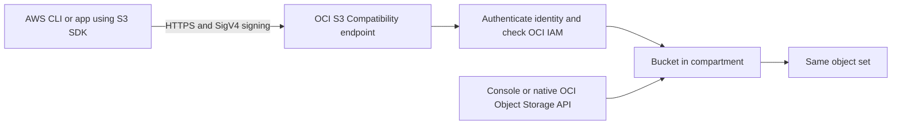

# Using the S3 Compatibility API on OCI

In the **Object Storage and Archive Storage** chapter of the **CLOUD_PROVIDERS_ORACLE** module, this lesson shows how to connect tools and applications using the S3 protocol to OCI Object Storage. You will configure the endpoint, credentials, and permissions, practice with the AWS CLI, and then apply the same configuration in a Java application.

Lesson objectives:

- Identify the exact OCI namespace, region, bucket, and S3 endpoint.
- Distinguish a Customer Secret Key from other OCI credential types.
- Grant permissions to the integration identity in the appropriate compartment.
- Perform a full cycle of upload, read-back, and content verification.
- Evaluate compatibility scope before migrating an S3-based tool to OCI.
- Monitor errors, manage keys, and control costs in operations.

## When is the S3 Compatibility API needed?

Suppose a Java application already has a storage layer built with the AWS SDK for Java. The application exports order reports, stores output files, and downloads them when users request them. When moving the application to OCI Compute, the development team wants to keep using its existing S3 integration layer.

The S3 Compatibility API provides a compatible interface for OCI Object Storage. Objects written through this interface can be read via the native Object Storage API and vice versa; there is no need to maintain a duplicate copy of data just to switch access methods. See [OCI S3 Compatibility API overview](https://docs.oracle.com/en-us/iaas/Content/Object/Tasks/s3compatibleapi.htm).



This lets you reuse your data-access interface. Responsibilities such as choosing compartments, designing IAM, managing lifecycles, monitoring, and planning recovery still belong to your OCI architecture.

Before integrating, list the operations the application actually uses. An app that only uploads and downloads differs significantly from a system that also creates buckets, configures lifecycles, modifies ACLs, issues pre-signed URLs, and handles multipart uploads.

## Components to configure

| Component | Role | Example in this lesson |
| --- | --- | --- |
| Namespace | Identifies the tenancy's Object Storage namespace | Value retrieved from your tenancy |
| Region | Where the bucket lives and part of request signing | `ap-singapore-1` |
| Bucket | Target object container | `s3-interop-lab` |
| Object key | Full object name inside the bucket | `interop/run-001/message.txt` |
| Endpoint | OCI's S3-compatible API address | Path-style endpoint with namespace |
| Access Key and Secret Key | Key pair used to sign requests | Customer Secret Key of an OCI user |
| IAM policy | Governs allowed operations | Read and write on the lab bucket |

Do not use the tenancy OCID, compartment OCID, or tenancy display name in place of the namespace. Namespace and bucket name are also not interchangeable.

### Endpoint and addressing style

This lab uses the path-style format documented by OCI:

```text
Endpoint:
https://<namespace>.compat.objectstorage.<region>.oci.customer-oci.com

Path-style object address:
https://<namespace>.compat.objectstorage.<region>.oci.customer-oci.com/<bucket>/<object-key>
```

OCI also documents the virtual-hosted-style format:

```text
https://<bucket>.vhcompat.objectstorage.<region>.oci.customer-oci.com/<object-key>
```

Select the endpoint matching your actual region and OCI environment. When passing the endpoint to a client, pass the base URL; bucket and key are passed via separate parameters. These formats are described in the [application configuration guide](https://docs.oracle.com/en-us/iaas/Content/Object/Tasks/s3compatibleapi.htm).

With path style, client configuration keeps the bucket name in the URL path. If a client automatically switches to virtual-hosted style while still configured with a path-style endpoint containing the namespace, the resulting hostname may no longer match the intended endpoint.

In this lesson, the signing region must match the bucket's region. Do not leave an old AWS region in config just because you changed the endpoint. For older tools that cannot specify an OCI region, review OCI's home-region limitations before selecting the tool.

## Customer Secret Keys and OCI IAM permissions

### Choose the right credential type

The S3 Compatibility API uses the **Access Key/Secret Key** pair of a **Customer Secret Key** attached to an OCI user. The user holding the key must still be authorized by IAM to access Object Storage. Each user can have up to two Customer Secret Keys; these keys do not expire automatically. See [Working with Customer Secret Keys](https://docs.oracle.com/en-us/iaas/Content/Identity/access/working-with-customer-secret-keys.htm).

Distinguish these credential types:

| Credential type | Purpose in this lesson's context |
| --- | --- |
| Customer Secret Key | Supplied to the S3 client as Access Key and Secret Key |
| OCI API signing key | Used for OCI's native API signing mechanism |
| Console sign-in password | Interactive UI login |
| Auth token for other protocols or services | Not the Secret Key for this S3 example |

Never paste a PEM private key, fingerprint, or Console password into the AWS CLI Secret Access Key prompt.

Create a Customer Secret Key under the OCI user's settings. The secret is shown only at creation time; save it into a secrets manager immediately upon creation rather than expecting to view it again later. See [S3 access setup guide](https://docs.oracle.com/en-us/iaas/Content/Object/Tasks/s3compatibleapi.htm).

Use a dedicated identity per application or integration team. This makes it clear which key to revoke and limits blast radius when misconfigured.

### IAM example for the lab bucket

Suppose an administrator created bucket `s3-interop-lab` in compartment `StorageLab`. The user who created the Customer Secret Key belongs to group `S3InteropLab` in identity domain `Default`.

Example policy to inspect bucket details and manipulate objects in the lab bucket:

```text
Allow group Default/S3InteropLab to read buckets in compartment StorageLab where target.bucket.name='s3-interop-lab'
Allow group Default/S3InteropLab to manage objects in compartment StorageLab where target.bucket.name='s3-interop-lab'
```

Replace the identity domain, group, compartment, and bucket to match your environment. `manage objects` in this example includes deletion; grant it only if your lab or application scope requires it. For read-only workloads, write a read-only policy.

OCI supports the `target.bucket.name` condition; creating a new object and overwriting an existing object require distinct permissions. Therefore, a successful upload of a new key does not prove the application has overwrite permission. See [Object Storage policy reference](https://docs.oracle.com/en-us/iaas/Content/Identity/Reference/objectstoragepolicyreference.htm).

Do not test connectivity by granting tenancy-wide admin permissions first. Start with the exact target bucket and required operations. Also do not make listing all buckets a prerequisite for an application that only accesses a single known bucket.

### Which compartment holds buckets created via S3?

The S3 API has no concept of an OCI compartment. Buckets created through the compatibility API are placed in the root compartment by default, unless the tenancy has designated a different compartment for that API. Changing the designated compartment affects only newly created buckets; it does not move existing buckets. See [designated compartments for S3 and Swift](https://docs.oracle.com/en-us/iaas/Content/Object/Tasks/designatingcompartments.htm).

Therefore, this lab creates the bucket beforehand via the Console or OCI tools inside the lab compartment. That ensures you know exactly where the resource lives before testing the S3 client.

An authorized user can read the default designation using the OCI CLI:

```bash
oci os ns get-metadata --namespace "<your-namespace>"
```

Check `default-s3-compartment-id` in the output. This is a namespace-level setting; do not change it solely to work around a single lab error. See [how to get designated compartments](https://docs.oracle.com/en-us/iaas/Content/Object/Tasks/designatingcompartments_topic-To_get_your_tenancys_Amazon_S3_Compatibility_API_and_Swift_API_compartment_designations.htm).

## Hands-on with the AWS CLI

The commands below use Bash and AWS CLI v2. The OCI CLI is used only in the native API cross-check step and requires separate OCI authentication setup.

Prerequisites:

- A private Standard lab bucket created in the lab compartment.
- Versioning and retention disabled on the bucket for this simple deletion test.
- A Customer Secret Key pair for an authorized identity.
- A host with HTTPS connectivity to the endpoint and synchronized system clock.
- AWS CLI v2 and `sha256sum` if running the hash comparison step as shown.

### Create a dedicated profile

```bash
aws configure --profile oci-s3-lab
```

Enter values according to this mapping:

| AWS CLI prompt | Value to enter |
| --- | --- |
| AWS Access Key ID | Access Key of the OCI Customer Secret Key |
| AWS Secret Access Key | Matching Secret Key from the pair |
| Default region name | OCI region of the bucket, e.g., `ap-singapore-1` |
| Default output format | `json` |

Do not use an AWS account's Access Key against an OCI endpoint. This profile must hold the authorized OCI user's keys.

Configure path style for the profile:

```bash
aws configure set s3.addressing_style path --profile oci-s3-lab
```

The AWS CLI supports setting addressing style per profile; `path` places the bucket in the path. See [AWS CLI S3 Configuration](https://docs.aws.amazon.com/cli/latest/topic/s3-config.html).

Profiles use local configuration files; this is convenient for a lab, not a production secrets vault. Never commit credentials files, screenshot secrets, or enable shell tracing while entering or using secrets.

### Declare target and test data

```bash
export OCI_NAMESPACE="<your-namespace>"
export OCI_REGION="ap-singapore-1"
export OCI_BUCKET="s3-interop-lab"
export OCI_S3_ENDPOINT="https://${OCI_NAMESPACE}.compat.objectstorage.${OCI_REGION}.oci.customer-oci.com"
export OCI_OBJECT_KEY="interop/run-001/message.txt"

LAB_WORKDIR="$(mktemp -d)"
printf '%s\n' 'Hello from OCI S3 Compatibility API' > "$LAB_WORKDIR/source.txt"
```

Replace the namespace before running. Use a distinct key per practice run if you need to avoid overwriting prior results.

The key here contains `/` characters, yet it is still the object name within the bucket. Do not prepend `s3://` in `--key`, and do not prepend the bucket name to the key again.

### Upload a small object

```bash
aws --profile oci-s3-lab --region "$OCI_REGION" --endpoint-url "$OCI_S3_ENDPOINT" s3api put-object --bucket "$OCI_BUCKET" --key "$OCI_OBJECT_KEY" --body "$LAB_WORKDIR/source.txt" --content-type "text/plain; charset=utf-8"
```

This command writes the file to the selected bucket and key. Check the exit code and returned output before moving on. Syntax for `--body`, `--bucket`, and `--key` is documented in the [put-object reference](https://docs.aws.amazon.com/cli/latest/reference/s3api/put-object.html).

The example keeps `--profile`, `--region`, and `--endpoint-url` explicit on every service call. In automation, you can centralize configuration in a shared client wrapper while still ensuring every operation targets the right destination.

### List and inspect metadata

```bash
aws --profile oci-s3-lab --region "$OCI_REGION" --endpoint-url "$OCI_S3_ENDPOINT" s3api list-objects-v2 --bucket "$OCI_BUCKET" --prefix "interop/run-001/"
aws --profile oci-s3-lab --region "$OCI_REGION" --endpoint-url "$OCI_S3_ENDPOINT" s3api head-object --bucket "$OCI_BUCKET" --key "$OCI_OBJECT_KEY"
```

Listing confirms the key appears under the expected prefix; HEAD retrieves size and metadata without downloading the full content. See syntax references for [list-objects-v2](https://docs.aws.amazon.com/cli/latest/reference/s3api/list-objects-v2.html) and [head-object](https://docs.aws.amazon.com/cli/latest/reference/s3api/head-object.html).

In custom applications, handle pagination when listing large datasets. Never treat a single page of results as the entire bucket.

### Download and compare content

```bash
aws --profile oci-s3-lab --region "$OCI_REGION" --endpoint-url "$OCI_S3_ENDPOINT" s3api get-object --bucket "$OCI_BUCKET" --key "$OCI_OBJECT_KEY" "$LAB_WORKDIR/from-s3.txt"
sha256sum "$LAB_WORKDIR/source.txt" "$LAB_WORKDIR/from-s3.txt"
```

The trailing path argument to `get-object` is where the downloaded file is saved. See [get-object reference](https://docs.aws.amazon.com/cli/latest/reference/s3api/get-object.html).

Matching SHA-256 values prove both compared files contain identical bytes in this test run. Do not substitute seeing the object in a listing for verifying actual content. Also do not assume ETag is SHA-256 or always the whole-file MD5.

### Cross-check with the native Object Storage API

If the OCI CLI is configured with appropriate OCI credentials:

```bash
oci --profile LAB --region "$OCI_REGION" os object get --namespace-name "$OCI_NAMESPACE" --bucket-name "$OCI_BUCKET" --name "$OCI_OBJECT_KEY" --file "$LAB_WORKDIR/from-native.txt"
sha256sum "$LAB_WORKDIR/source.txt" "$LAB_WORKDIR/from-native.txt"
```

A matching hash confirms the object uploaded via S3 is the exact same data read by OCI natively. The AWS CLI `oci-s3-lab` profile and OCI CLI `LAB` profile belong to separate tools and do not share the same key format.

If the OCI CLI is not configured yet, inspect the object in the Console and run the native API cross-check in another lab session. Never place a Customer Secret Key into the OCI CLI's API signing key config.

## Integrating into Java with AWS SDK 2.x

The example below uses the Maven module `software.amazon.awssdk:s3`. Pin a specific SDK 2.x version, align modules via the project BOM or dependency management, and retain the tested version.

Key configuration points:

- `endpointOverride`: base URL of OCI's S3 Compatibility API.
- `Region.of(...)`: region used by the client and for request signing.
- `forcePathStyle(true)`: enforces path style consistent with the selected endpoint.
- `ProfileCredentialsProvider`: reads the key pair from the lab profile instead of hardcoding in code.

AWS requires specifying a region even with `endpointOverride` because the region participates in request signing. See [endpoint configuration in SDK for Java 2.x](https://docs.aws.amazon.com/sdk-for-java/latest/developer-guide/endpoint-config.html). Forcing path style is described in [Work with Amazon S3](https://docs.aws.amazon.com/sdk-for-java/latest/developer-guide/examples-s3.html); using profiles is covered in [shared configuration profiles](https://docs.aws.amazon.com/sdk-for-java/latest/developer-guide/credentials-profiles.html).

```java
import java.net.URI;
import java.nio.file.Files;
import java.nio.file.Path;
import java.security.MessageDigest;
import java.util.HexFormat;

import software.amazon.awssdk.auth.credentials.ProfileCredentialsProvider;
import software.amazon.awssdk.core.sync.RequestBody;
import software.amazon.awssdk.core.sync.ResponseTransformer;
import software.amazon.awssdk.regions.Region;
import software.amazon.awssdk.services.s3.S3Client;
import software.amazon.awssdk.services.s3.model.GetObjectRequest;
import software.amazon.awssdk.services.s3.model.PutObjectRequest;

public final class OciS3RoundTrip {
    public static void main(String[] args) throws Exception {
        if (args.length != 1) {
            throw new IllegalArgumentException(
                "Usage: OciS3RoundTrip <small-input-file>");
        }

        Path source = Path.of(args[0]);
        String endpoint = requiredEnv("OCI_S3_ENDPOINT");
        String region = requiredEnv("OCI_REGION");
        String bucket = requiredEnv("OCI_BUCKET");
        String key = requiredEnv("OCI_OBJECT_KEY");

        URI endpointUri = URI.create(endpoint);
        if (!"https".equalsIgnoreCase(endpointUri.getScheme())) {
            throw new IllegalArgumentException("HTTPS endpoint required");
        }

        Path downloadDir = Files.createTempDirectory("oci-s3-roundtrip-");
        Path downloaded = downloadDir.resolve("downloaded.bin");

        try (ProfileCredentialsProvider credentials =
                 ProfileCredentialsProvider.create("oci-s3-lab");
             S3Client s3 = S3Client.builder()
                 .endpointOverride(endpointUri)
                 .region(Region.of(region))
                 .forcePathStyle(true)
                 .credentialsProvider(credentials)
                 .build()) {

            var putResponse = s3.putObject(
                PutObjectRequest.builder()
                    .bucket(bucket)
                    .key(key)
                    .contentType("application/octet-stream")
                    .build(),
                RequestBody.fromFile(source));

            s3.getObject(
                GetObjectRequest.builder()
                    .bucket(bucket)
                    .key(key)
                    .build(),
                ResponseTransformer.toFile(downloaded));

            String sourceHash = sha256(source);
            String downloadedHash = sha256(downloaded);
            if (!sourceHash.equals(downloadedHash)) {
                throw new IllegalStateException("SHA-256 mismatch");
            }

            System.out.println("Upload/download verified");
            System.out.println("Request ID: " + putResponse.responseMetadata().requestId());
            System.out.println("Downloaded file: " + downloaded);
        }
    }

    private static String requiredEnv(String name) {
        String value = System.getenv(name);
        if (value == null || value.isBlank()) {
            throw new IllegalArgumentException("Missing environment variable: " + name);
        }
        return value;
    }

    private static String sha256(Path path) throws Exception {
        byte[] digest = MessageDigest.getInstance("SHA-256")
            .digest(Files.readAllBytes(path));
        return HexFormat.of().formatHex(digest);
    }
}
```

This snippet requires Java 17 or newer due to `HexFormat`. Pass a small input file path and the environment variables from the CLI section when running in a project with the dependencies configured.

The downloaded file is written into a new temporary directory; the example does not overwrite an existing download. The hash helper reads the entire file into memory, which fits small lab files. For large files, hash via streaming and design uploads/downloads around actual data sizes.

The Java example uploads to the same specified key. Change `OCI_OBJECT_KEY` if you want a separate object instead of replacing the CLI test object. The code does not delete the object after verification so you can still inspect it in the Console.

In long-running services, reuse the client instead of instantiating a new client per request. Configure timeouts, retry policies, concurrent transfer limits, and secret injection according to your deployment environment; benchmark with realistic workloads before tuning values.

## Assessing compatibility scope before migrating an application

OCI documents support for bucket, object, and multipart API groups, including common operations like PutObject, GetObject, HeadObject, DeleteObject, and multipart upload handling. SigV2 is not supported; clients must use SigV4. See [supported S3 Compatibility APIs](https://docs.oracle.com/en-us/iaas/Content/Object/Tasks/s3compatibleapi_topic-Amazon_S3_Compatibility_API_Support.htm).

Survey checklist to build for your application:

| Capability used by app | What to verify before migrating |
| --- | --- |
| Upload/download objects | Run a read/write round trip and compare content |
| Prefix listing | Test pagination, key naming, and special characters |
| Overwriting the same key | Check overwrite permissions and versioning impact |
| Multipart upload | Test create, part upload, completion, and abort |
| Bucket or lifecycle config | Check supported APIs; identify admin actions needing OCI tools |
| AWS-style ACLs or bucket policies | Design equivalent authorization with OCI IAM |
| Encryption and optional headers | Verify exact headers and key permissions on OCI |
| Newly upgraded SDK or client | Inspect requests, checksums, and features the client actually sends |

OCI uses IAM to manage object access rather than applying Amazon S3 object ACLs in an equivalent way. See [differences between native API and S3 interface](https://docs.oracle.com/en-us/iaas/Content/Object/Tasks/s3compatibleapi.htm).

Therefore, never fix permission errors by adding `--acl public-read` to uploads. Verify identity, IAM policies, and target bucket instead. For advanced options in third-party tools, inspect which APIs the tool actually calls rather than trusting an "S3 compatible" label alone.

OCI documentation also describes support for `aws-chunked`, streaming signatures, and specific checksum trailers. When uploads fail after an SDK upgrade, compare what the client actually sends against the documentation instead of assuming all streaming uploads are unsupported. See [aws-chunked and checksum support](https://docs.oracle.com/en-us/iaas/Content/Object/Tasks/s3compatibleapi_topic-Amazon_S3_Compatibility_API_Support.htm#ContentEncodingHeaderSupportforawschunked).

## Multipart, Archive, and operational decisions

### Large files and incomplete uploads

For large files, design dedicated tests for multipart uploads. A round-trip test of a few dozen bytes does not validate mid-transfer failure handling, single-part retries, or upload completion.

If a client crashes, define who is responsible for locating and aborting incomplete uploads. Track uncommitted data volume, cap concurrent uploads, and watch the impact of retries on request counts and bandwidth.

Do not scale concurrency based solely on client CPU capacity while ignoring network links, application limits, and service behavior. Test with realistic file sizes and record duration, errors, and retry counts.

### Reading Archive data

Using an S3 client does not change storage-tier characteristics. Archive objects must be restored before they can be read; lifecycle policies do not automatically restore objects to immediately readable state. See [Archive Storage overview](https://docs.oracle.com/en-us/iaas/Content/Archive/Concepts/archivestorageoverview.htm).

For applications serving historical reports, distinguish:

- Object not found or wrong key.
- Missing read permission.
- Object exists yet is unreadable because it is in Archive.
- Restore has been requested but has not completed yet.

Design UI states and business workflows to reflect these states. Do not retry GET in a tight loop for hours as your only strategy for waiting on data.

For Oracle Database backups, include object restore time as part of total system recovery time. Keep a readily readable copy somewhere if recovery objectives require faster turnaround than cold retrieval allows.

### Cost and availability

Switching SDKs does not eliminate OCI storage, request, retrieval, or data transfer charges. Measure upload/download volume, listing call counts, and retry amplification per application.

Endpoints target a specific region. Having an S3 interface does not automatically create cross-region replicas or disaster-recovery failover. If higher availability is required, separately define your replication strategy, client failover configuration, and readability checks at the recovery site.

## Troubleshooting by layer

Check in order: network and TLS, endpoint, credential source, signature, IAM, then object state or API feature support.

| Symptom | What to verify |
| --- | --- |
| Cannot resolve hostname | Namespace, region, endpoint suffix, and addressing style |
| TLS error or timeout | Certificates, proxy, DNS, network route, and client timeouts |
| `InvalidAccessKeyId` or similar auth error | Which Customer Secret Key is used; right profile; whether key still exists |
| `SignatureDoesNotMatch` | Matching Secret Key, signing region, endpoint, clock sync, and proxy tampering |
| `AccessDenied` | User's groups, compartment, bucket, and operation permissions |
| Bucket/object not found | Right region, namespace, bucket name, full key, and resource visibility |
| New key upload works, overwrite fails | Overwrite permissions and data protection policies |
| Small requests work, large files fail | Multipart, streaming, checksums, network, and retry behavior |
| An option returns `NotImplemented` | Whether that API or header falls within OCI's supported scope |

These symptoms are diagnostic pointers, not one-to-one mappings to single root causes. In particular, permission errors and missing-resource errors can look similar if you look only at an HTTP status code.

Record client version, operation, region, timestamp, HTTP status, error code, and request ID returned by the service. This helps correlate with observability tools or support requests.

Never log Secret Keys. If you must inspect requests to debug signatures, redact sensitive fields before sharing, including authorization headers, tokens, and access-bearing URLs.

Do not run `aws sts get-caller-identity` to test OCI identity: that is an AWS STS operation. The test in this lesson is an Object Storage operation against the target bucket using the exact OCI endpoint.

## Key rotation and lab wrap-up

Because Customer Secret Keys do not expire automatically, maintain a proactive rotation and revocation schedule. A practical procedure:

1. Create a new key pair within the user's two-key limit.
2. Update the secret store and deploy the new configuration to clients.
3. Run upload/download verification with the new key.
4. Confirm all relevant instances or jobs have switched to the new key.
5. Revoke the old key and monitor for authentication failures.

Having two keys active simultaneously supports zero-downtime transitions. If a user already has two keys, inventory active usage before picking one to revoke. Never delete a key solely because you forgot which application owns it.

For the lab bucket without versioning or retention as prepared earlier, you can delete the exact test object:

```bash
aws --profile oci-s3-lab --region "$OCI_REGION" --endpoint-url "$OCI_S3_ENDPOINT" s3api delete-object --bucket "$OCI_BUCKET" --key "$OCI_OBJECT_KEY"
```

Verify the key is gone in the Console or via listing. If a real environment has versioning enabled, a standard delete does not remove all historical versions; follow your bucket's version-management procedure.

Keep or delete local source and downloaded files as needed for study. Revoke the lab key when no longer used; do not put deleting the entire bucket into the same script just for convenience when cleaning up a single object.

## Signs you have completed the lab

You should have evidence covering:

- Stated the namespace, region, bucket, and endpoint style in use.
- Explained the origin of the Access Key/Secret Key and associated OCI identity.
- Identified the IAM policy permitting the test operations.
- Successfully uploaded an object, inspected metadata, and downloaded via an S3 client.
- Verified downloaded data hash matches source data.
- Cross-checked the object via the Console or OCI's native API.
- Documented API limitations to verify for production applications.
- Established a plan for key management, test data cleanup, and cost control.

The S3 Compatibility API is valuable when keeping existing S3 tooling or integration code in an OCI architecture. A working configuration must simultaneously get endpoint, signature, identity, IAM, and data characteristics right; a read/write round trip is the first step to confirming those pieces fit together properly.