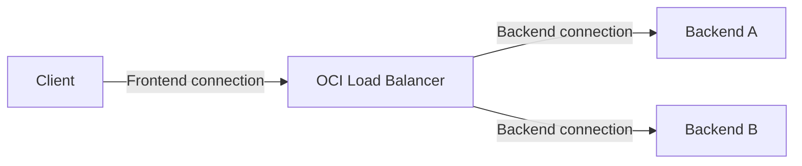
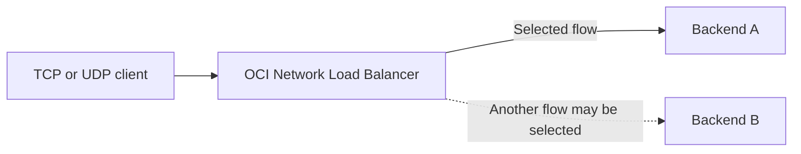
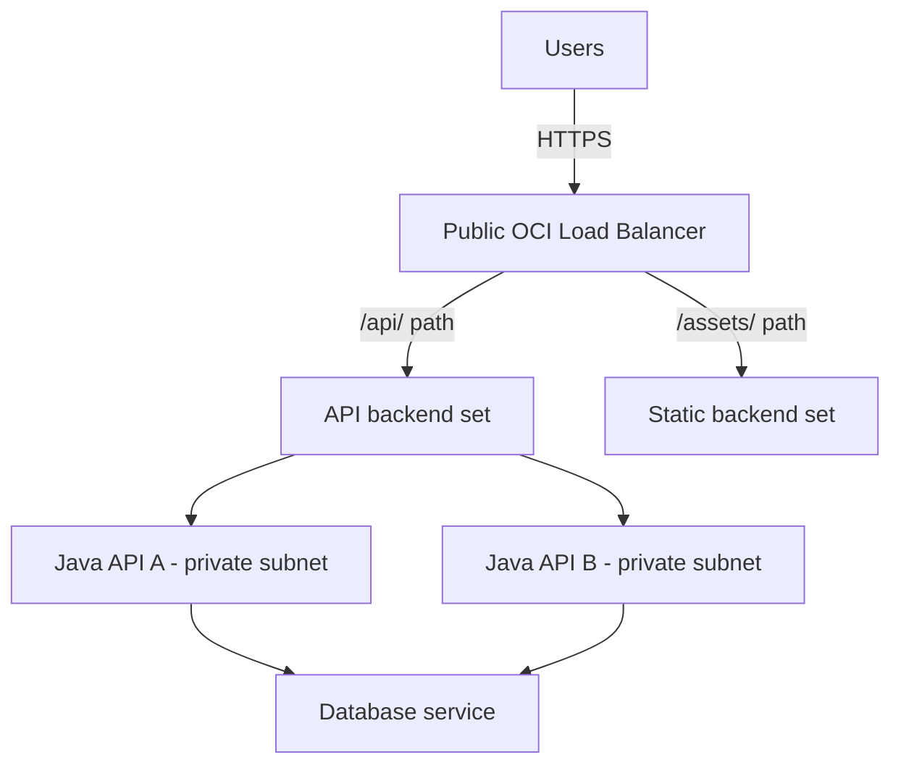

# Distinguishing Between Load Balancer and Network Load Balancer

Oracle Cloud Infrastructure (OCI) provides two load balancing services commonly considered when exposing applications to the network: **Load Balancer (LB)** and **Network Load Balancer (NLB)**. Both provide an entry point for multiple backends, but they process traffic differently. Load Balancer operates as a reverse proxy capable of handling HTTP and TLS; Network Load Balancer distributes traffic based on network and transport information, making it suitable when TCP/UDP forwarding or specialized network flows are required.

This lesson is part of the **Application Load Balancing** chapter of the **CLOUD_PROVIDERS_ORACLE** module. Along the path from tenancy, compartments, and IAM to VCN, Compute, storage, and Oracle database services, choosing a load balancer must align with authorization, networking, monitoring, automation, cost, and availability design.

After this lesson, you will be able to:

- Explain the difference between a reverse proxy and flow-based distribution.
- Choose a service based on protocol, HTTP routing, TLS termination point, and source IP requirements.
- Distinguish the LB/NLB choice from the public/private choice.
- Recognize what load balancing does not solve on its own: session state, business health, data synchronization, and application recovery.

## Common Components

Before comparing the two services, we need to align on several terms:

| Component | Meaning |
| --- | --- |
| Frontend IP or VIP | The address clients use as the entry point |
| Listener | Configuration that accepts traffic on a specific protocol and port |
| Backend | Server or endpoint that receives application traffic |
| Backend set | Group of backends sharing a distribution policy and health check |
| Health check | Mechanism for evaluating a backend's ability to serve traffic |
| Load balancing policy | Rule for selecting a backend |
| TLS termination | Where the client's TLS connection is decrypted and terminated |

For example, a client accesses `https://shop.example.com`, and DNS points to the frontend IP. The listener accepts the connection on port 443 and forwards traffic to an application backend.

Both LB and NLB have listeners, backend sets, and health checks. Seeing these components in the Console does not prove that both services have the same protocol-processing capabilities. Refer to [Load Balancer concepts](https://docs.oracle.com/en-us/iaas/Content/Balance/Concepts/balanceoverview_topic-Load_Balancing_Concepts.htm) and [Network Load Balancer introduction](https://docs.oracle.com/en-us/iaas/Content/NetworkLoadBalancer/introduction.htm).

## Load Balancer: Reverse Proxy for Applications

OCI Load Balancer supports load balancing at the application layer with HTTP/HTTPS and also supports TCP. Therefore, do not assume "Load Balancer is only for HTTP".

In the proxy model, you can picture two connection legs:



If the listener handles HTTPS and terminates TLS at the LB, the service can use the decrypted HTTP information to perform functions such as routing by URL or header. Backend selection becomes a decision tied to the application request.

An illustrative configuration:

| Request condition | Target backend set |
| --- | --- |
| URL starts with `/api/` | `api-backends` |
| URL starts with `/assets/` | `static-backends` |
| Remaining requests | `web-backends` |

These conditions describe the design idea, not an API configuration to copy verbatim into OCI. Actual routing policies must be created, ordered, and attached to the appropriate listener. See [create a routing policy](https://docs.oracle.com/en-us/iaas/Content/Balance/Tasks/create_routing-policy.htm).

LB is suitable when the application team wants to manage HTTP behavior at the entry point, centralize TLS certificates, or integrate OCI Web Application Firewall (WAF). Those capabilities depend on the listener and configured features; creating an LB does not automatically enable all protection features.

### Algorithms and Sessions

OCI LB offers distribution policies such as Round Robin, Least Connections, and IP Hash. For HTTP without session persistence, decisions can be made per request; for TCP, a backend is selected for the connection, and subsequent packets in that connection go to the same endpoint.

Therefore, "refreshing the page must alternate A, B, A, B" is not a test criterion that applies to every configuration. Cookie persistence, IP Hash, weights, and listener type all affect the outcome. See [LB distribution policies](https://docs.oracle.com/en-us/iaas/Content/Balance/Reference/lbpolicies.htm).

## Network Load Balancer: Flow-Based Distribution

OCI Network Load Balancer processes traffic based on Layer 3/Layer 4 information. For a TCP service, NLB selects a backend for the flow without needing to inspect the application's URL or cookies.



NLB is suited for scenarios such as UDP, long-lived TCP connections, or network appliances. The service is designed for high throughput and low latency; actual results still depend on the backend, network path, and workload. See [Flexible Network Load Balancer overview](https://docs.oracle.com/en-us/iaas/Content/NetworkLoadBalancer/overview.htm).

### Flows Are Different from HTTP Requests

A single TCP connection can carry multiple application requests. If NLB maps that connection to backend A, sending the next request on the same connection does not mean the request will be redistributed to backend B.

For example, a client maintains a long-lived connection to send thousands of messages. Even if the backend set has three servers, that flow still does not become three equal shares of load. To evaluate distribution, you must observe multiple flows in light of the hash policy and client behavior.

NLB provides tuple-based hash policies:

| Policy | Fields used in hash |
| --- | --- |
| 5-Tuple | Source IP, source port, destination IP, destination port, protocol |
| 3-Tuple | Source IP, destination IP, protocol |
| 2-Tuple | Source IP, destination IP |

5-Tuple helps maintain affinity within a flow. Hashing fewer fields can maintain broader affinity across flows, but it can also concentrate load when many clients appear under the same IP behind NAT. Constraints also depend on listener type; for example, L3 IP does not use 5-Tuple. See [NLB policies and session affinity](https://docs.oracle.com/en-us/iaas/Content/NetworkLoadBalancer/introduction.htm).

## Comparison Table for Decision-Making

| Criterion | Load Balancer | Network Load Balancer |
| --- | --- | --- |
| Primary processing model | Reverse proxy | Forwards network traffic, does not act as an HTTP reverse proxy |
| Processing layer | Layer 7 and TCP at Layer 4 | Layer 3/Layer 4 |
| Common traffic | HTTP, HTTPS, TCP | TCP, UDP, and specialized network modes |
| Routing by HTTP URL/header | Supported with appropriate HTTP configuration | Does not inspect HTTP for routing |
| TLS termination at the service | Configurable | Does not provide TLS termination |
| Passing HTTPS through | Can terminate TLS or forward depending on configuration | Can forward TLS over TCP to backends |
| HTTP cookie persistence | Supported | Does not process application cookies |
| Packet source IP preservation | Backends typically see proxy connections; HTTP client info via headers | Has source preservation modes |
| WAF at OCI LB entry point | Can be integrated | Does not have the same direct Layer 7 WAF integration |
| Public/private | Both available | Both available |
| Bandwidth adjustment | Flexible LB has configurable bandwidth | Auto-scales without configuring bandwidth tiers like LB |
| Selection goal | Control application behavior at the frontend | Distribute flows and meet network requirements |

This table is an interpretive guide for architectural decisions. Specific features and service limits must be checked against [Oracle's official comparison table](https://docs.oracle.com/en-us/iaas/Content/Balance/Reference/lb-vs-nlb.htm).

**Common pitfall:** NLB does not have a TLS-terminating HTTPS listener, but it can still pass HTTPS traffic through a TCP listener to backends that handle TLS themselves. "Does not process HTTP at Layer 7" is different from "cannot transport traffic for an HTTP application".

### Do Not Overgeneralize ICMP for Every NLB

ICMP support is conditional: OCI documentation specifies ICMP for private NLBs with source/destination header preservation. Do not choose a public NLB simply because you saw "TCP/UDP/ICMP" in a high-level overview and assume every mode supports it.

Connectivity testing must match the listener. Do not use a `ping` result as the sole proof of whether a TCP/HTTPS frontend is working. See [NLB listeners](https://docs.oracle.com/en-us/iaas/Content/NetworkLoadBalancer/Listeners/listener-management.htm).

## TLS: Determine the Decryption Point Before Choosing a Service

The key question is: **which component must terminate the client's TLS?**

### TLS Termination at the Load Balancer

```text
Client -- TLS --> LB -- HTTP --> Backend
```

The frontend certificate is managed at the LB. The LB decrypts the traffic and forwards HTTP to the backend.

This design simplifies certificate centralization, but the LB–backend leg in the diagram is not encrypted with TLS. You must decide explicitly whether that aligns with data protection requirements.

### TLS Termination Then Re-encryption to the Backend

```text
Client -- TLS session 1 --> LB -- TLS session 2 --> Backend
```

Both legs are encrypted, but these are two separate TLS sessions. The LB is still where client traffic is decrypted, so it can perform HTTP processing.

Certificates and backend verification must be configured according to requirements. Using HTTPS on the frontend does not automatically establish TLS to the backend. These models are described in the [Load Balancer SSL/TLS guide](https://docs.oracle.com/en-us/iaas/Content/Balance/Tasks/managingcertificates.htm).

### Forwarding TLS to the Backend

```text
Client -- TLS forwarded over TCP --> Backend terminates TLS
```

NLB is suitable when you want the backend to handle TLS directly. LB with a TCP listener can also be used to forward TLS depending on configuration; therefore, "TLS passthrough" alone is not enough to automatically conclude you must choose NLB.

In this forwarding model, do not expect the load balancing service to read `/api/` inside the TLS payload to select a backend. If another reverse proxy behind it does that, the HTTP routing functionality lives in that proxy.

See [SSL termination and TCP listener concepts](https://docs.oracle.com/en-us/iaas/Content/Balance/Concepts/balanceoverview_topic-Load_Balancing_Concepts.htm).

## Source IP: Distinguishing HTTP Headers from Network Packets

### With Load Balancer

Backends receive connections through a reverse proxy, so the network peer address is typically the LB. For HTTP, headers such as `X-Forwarded-For`, `X-Real-IP`, and `X-Forwarded-Proto` provide the context of the original request.

For example, an illustrative log might look like:

```text
network_peer=10.0.10.8
x_forwarded_for=198.51.100.24
x_forwarded_proto=https
```

The first two fields do not contradict each other: one is the peer of the backend connection, while the other describes the client through the proxy.

The application must have appropriate proxy trust rules. Do not arbitrarily take the first element of `X-Forwarded-For` as a security basis when a client could send that header itself. OCI describes how the LB appends peer addresses to headers in the [HTTP headers reference](https://docs.oracle.com/en-us/iaas/Content/Balance/Reference/httpheaders.htm).

### With Network Load Balancer

Do not assume "NLB always preserves the entire packet unchanged" is a default property for every configuration. OCI has different modes:

| Mode | Primary behavior |
| --- | --- |
| Full NAT | Changes source and destination addresses when forwarding to the backend |
| Source preservation | Preserves source IP/port; changes destination to reach the backend |
| Source/destination preservation | Preserves source and destination headers, serving transparent network models |

Source preservation is configured on the backend set. Source/destination preservation is a different mode that applies to private NLBs and is typically paired with network appliances, route tables, and specialized forwarding models. See [NLB modes](https://docs.oracle.com/en-us/iaas/Content/NetworkLoadBalancer/introduction.htm), [source preservation on the backend set](https://docs.oracle.com/en-us/iaas/Content/NetworkLoadBalancer/BackendSets/preserve-backend-set-source-id.htm), and [source/destination preservation](https://docs.oracle.com/en-us/iaas/Content/NetworkLoadBalancer/NetworkLoadBalancers/preserve-source-id.htm).

Design consequences:

- If the backend sees the real client IP, network rules that only allow traffic from the LB subnet may not match data traffic.
- Health checks have their own flow; allowing health checks does not prove client traffic is allowed.
- For stateful firewalls or appliances, you must inspect both ingress and return paths, not just frontend ingress.

Verify the actual address seen at the backend using logs or packet inspection in an authorized environment. An option name in the Console does not replace verifying the network flow.

## Public/Private Is an Independent Selection Axis

Both LB and NLB have public or private options. Therefore, you must answer two separate questions:

1. Which mechanism is needed to process traffic?
2. Should the entry point be reachable from the Internet or only from a private network?

| Need | Deployment type to consider |
| --- | --- |
| HTTPS website on the Internet, URL-based routing | Public LB |
| Internal API needing TLS termination and HTTP routing | Private LB |
| UDP service for Internet clients | Public NLB |
| Internal TCP service needing flow distribution | Private NLB |

A private frontend does not automatically secure an application against all access. You still need proper routes from authorized networks, NSGs/security lists, OS-level firewalls, and application authentication. Likewise, a public frontend does not force every backend to have a public IP; a common design is a public frontend with backends in a private subnet.

In regions with multiple availability domains, regional subnet selection and backend placement must align with fault-tolerance goals. The number of subnets, required addresses, and HA behavior of each resource type must be verified per service. Do not copy the entire LB subnet model over to NLB just because both are "load balancers". See [LB types](https://docs.oracle.com/en-us/iaas/Content/Balance/Concepts/load_balancer_types.htm) and [NLB types](https://docs.oracle.com/en-us/iaas/Content/NetworkLoadBalancer/introduction.htm).

## Health Checks and Availability

A health check is a probe chosen by the designer. It only confirms what the probe actually tests.

| Probe type | Can confirm | Does not prove |
| --- | --- | --- |
| TCP connect | Something accepts a TCP connection on the target port | Business APIs work properly |
| HTTP readiness | The check endpoint returns the expected result | All business flows and dependencies are healthy |
| Business transaction probe | The tested flow completed | The entire system handles all load scenarios |

NLB can also use application-level health checks, such as HTTP. That does not turn an NLB listener into an HTTP reverse proxy. You must separate the protocol used to **check the backend** from the protocol and handling of **user traffic**.

For a Java application on Compute, you can design a `/health/ready` endpoint that returns readiness to accept requests. Do not default to using the home page returning `200 OK` if that page still returns success when business logic is broken.

A health check design should define:

- Protocol, port, and path if applicable.
- What result counts as healthy.
- Interval, timeout, and evaluation thresholds.
- Which dependencies must be present for the backend to serve traffic.
- Network rules for the check traffic.
- Behavior when one backend fails and when the entire backend set fails.

An overly sensitive configuration can cause backends to flap in and out of rotation. An overly slow configuration prolongs failure detection. Database or storage dependency failures can also surface as backend timeouts. See [LB health check troubleshooting](https://docs.oracle.com/en-us/iaas/Content/Balance/Reference/troubleshooting_health.htm).

### Do Not Assume Every Scenario Only Routes to Healthy Backends

OCI NLB has a **Fail open** option: if enabled, the service may continue forwarding traffic when all backends in the set are unhealthy. Failover options for existing flows must also be considered together. Therefore, record the actual configuration before concluding a health check is broken simply because you still see traffic at the backend. See [options when creating an NLB](https://docs.oracle.com/en-us/iaas/Content/NetworkLoadBalancer/NetworkLoadBalancers/create-network-load-balancer.htm).

Even when the service has flow-failover mechanisms, it does not replicate process memory, open transactions, or application sessions to another server. A dead backend can cause an in-flight TCP session or operation to fail; clients need proper reconnect and retry handling.

### Load Balancer HA Is Not Enough for Application HA

A highly available frontend still cannot fix these situations:

- Only one backend is actually serving traffic.
- Backends share a dependency on a single failing component.
- Data or sessions are stored on only one machine.
- Backends are in multiple locations, but all paths are blocked by a single network configuration.
- The application does not handle reconnects or safe request retries.

For example, a login session stored only in the RAM of backend A will be affected when A dies. Cookie stickiness can keep a user returning to A while A is alive, but it does not automatically replicate the session onto B.

For Oracle databases, do not put nodes with different roles into the same backend set and assume they are interchangeable. TCP load balancing does not distinguish primary/standby, synchronize data, or complete an in-flight transaction. Database connection endpoints must be designed together with the database platform's service and HA mechanisms.

## Selection Scenarios

### E-Commerce Portal and Java API

Requirements:

- Access over HTTPS.
- `/api/` goes to the API group, `/assets/` goes to the static asset group.
- Certificate management at the entry point.
- Ability to apply WAF for HTTP.

**Suitable choice in this scenario: LB.** The primary requirements involve understanding and processing application-level information.

An illustrative model:



In a real design, you also need to decide whether the LB–backend leg uses HTTP or TLS, where sessions are stored, and how network access to the database is restricted. A properly routed `/admin/` rule does not replace authentication and authorization for administrative functions.

### UDP Message Ingestion

Requirements:

- Clients send messages over UDP.
- No URLs, HTTP headers, or cookies.
- Need to distribute across multiple receivers.

**Suitable choice to consider: NLB**, because the UDP protocol is a mandatory requirement of the data flow.

The application still has to handle lost, duplicate, or out-of-order messages according to the characteristics of the protocol and business logic. Do not treat the success of a TCP test as proof that the UDP service is working.

### Long-Lived TCP Service Where Backends Handle TLS

Requirements:

- Long-lived connections.
- Backends terminate TLS directly.
- Need to evaluate real source IPs and concurrent flow counts.

**NLB is a suitable candidate** if its flow distribution mechanism and address preservation modes meet the requirements. Because LB also supports TCP, the final selection should be based on network features, observability, and actual connection flows.

Important tests include creating multiple independent connections, holding connections open long enough, and verifying behavior when a backend fails. Counting requests over a single connection does not evaluate how NLB distributes multiple flows.

### Firewall or Network Appliance Cluster

Requirements:

- Appliances need to see source/destination IP information.
- Flows are steered through a network inspection component.
- Both directions of the flow must traverse the appropriate processing path.

**Private NLB with the appropriate network mode** is a candidate to evaluate. This is a routing and appliance problem that requires examining route tables, preservation mode, traffic symmetry, and firewall state.

Do not apply a web frontend model directly to this case. See [source/destination preservation for network appliances](https://docs.oracle.com/en-us/iaas/Content/NetworkLoadBalancer/NetworkLoadBalancers/preserve-source-id.htm).

## Bandwidth, Scalability, and Cost

Flexible LB allows configuring minimum and maximum bandwidth; NLB scales automatically with traffic without configuring the same kind of bandwidth tiers. These two models lead to different planning approaches. Refer to [LB overview](https://docs.oracle.com/en-us/iaas/Content/Balance/Concepts/balanceoverview.htm) and [NLB overview](https://docs.oracle.com/en-us/iaas/Content/NetworkLoadBalancer/overview.htm).

With LB, you need to understand baseline load and peak load to choose an appropriate shape. With NLB, not configuring bandwidth tiers does not mean you can skip capacity planning.

Limits to examine across the entire system:

| Component | Questions to answer |
| --- | --- |
| Frontend | Will it hit bandwidth, connection, or service limits? |
| Backend Compute | Are CPU, memory, VNIC, and connection handling sufficient? |
| Java application | Can thread pools, queues, and GC handle the load? |
| Database | Will connection pools and queries become a bottleneck? |
| Network and logging | What egress traffic, log collection, and log storage costs arise? |

Increasing the number of backends does not automatically increase database capacity. Nor should you treat the maximum throughput listed in a service description as a guaranteed benchmark result for your application.

According to the [OCI price list](https://www.oracle.com/cloud/price-list/), Flexible Network Load Balancer is listed with no service charge. That does not make the entire architecture free: you still need to account for Compute, storage, data transfer, and observability services based on usage. When deploying, verify the pricing table and account terms at the time of implementation.

Cost decisions should also include operational effort. If you choose NLB and then build your own proxy cluster just to get the HTTP features you needed in the first place, you must include that proxy cluster in the cost and failure domain of the design.

## IAM, Networking, and Automation Are Three Separate Concerns

Someone with permission to create load balancing resources does not necessarily have clients that can reach the listener. Conversely, a client successfully sending an application request does not mean that user has permission to modify load balancing configuration.

| Area | Mechanism to design |
| --- | --- |
| Create, edit, view cloud resources | IAM and compartment scope |
| Allow packets to reach listener/backend | Routes, NSGs/security lists, OS firewall |
| Allow users to perform business actions | Authentication and authorization in the application |

With an LB reverse proxy, backend rules are typically based on connections originating from the LB. With NLB source preservation, you must build rules around the addresses actually present in the packet and separately allow health checks. Do not copy an "allow only from LB subnet" rule blindly into every NLB configuration.

If combining NSGs and security lists, you must evaluate the full set of effective rules rather than looking at a single NSG. See [OCI security rule principles](https://docs.oracle.com/en-us/iaas/Content/Network/Concepts/securityrules.htm).

When using Infrastructure as Code, explicitly describe the service type, public/private visibility, listeners, backend sets, health checks, certificates, network rules, and observability configuration. Do not treat replacing an LB with an NLB as just renaming a resource type: the TLS model, source addresses, and operations can change.

This lesson does not require creating both services in a production environment. You can practice in an isolated environment with synthetic data and permissions scoped to a learning compartment.

## Validating Your Choice with a Small Lab

Suppose you already have two application backends in a test environment. Each backend provides a `/api/whoami` endpoint returning a distinct identifier:

```json
{
  "backend": "app-a",
  "service": "demo-api"
}
```

The other backend returns `"backend": "app-b"`. These addresses and payloads are illustrative data only.

Prepare two designs to compare if you have a suitable environment:

| Design | Frontend | Backend handling |
| --- | --- | --- |
| LB | HTTPS listener | HTTP or HTTPS depending on chosen configuration |
| NLB | TCP listener | TLS terminated by backend if application uses HTTPS |

Do not configure an NLB TCP listener forwarding to a plaintext HTTP port and expect HTTPS clients to work. In a passthrough design, the backend must expect the exact protocol the client is sending.

### Testing HTTP/TLS Through LB

PowerShell example, with `curl.exe` available:

```powershell
$LbIp = 'REPLACE_WITH_LB_IP'
$HostName = 'REPLACE_WITH_REAL_HOSTNAME'
$ResolveEntry = $HostName + ':443:' + $LbIp
$Url = 'https://' + $HostName + '/api/whoami'

curl.exe --resolve $ResolveEntry --silent --show-error --include $Url
```

Replace the hostname with one matching the certificate and actual configuration. `--resolve` lets you specify the test IP while still using the hostname in the URL. Do not bypass certificate verification errors and claim the TLS configuration is correct.

Repeat the request an appropriate number of times and inspect the backend access logs. If session persistence is enabled or an affinity policy is used, do not expect strict alternating round-robin results per request.

### Testing a TCP Port Through NLB

```powershell
$NlbAddress = 'REPLACE_WITH_NLB_ADDRESS'

Test-NetConnection -ComputerName $NlbAddress -Port 7443
```

`TcpTestSucceeded = True` only confirms that the TCP check succeeded. It does not confirm:

- The TLS handshake succeeds.
- The certificate matches the hostname.
- The application protocol completes.
- UDP on another listener works.
- Both backends can serve traffic.

Afterward, you must use a real client for the application protocol. If it is HTTPS over TCP 7443, test HTTPS with the corresponding hostname and port; if it is a custom protocol, use a client for that protocol.

### Meaningful Tests

| Test | What to observe |
| --- | --- |
| Send requests with two different URLs through LB | Routing policy selects the right backend set |
| Open multiple connections through NLB | Distribution matches flow and selected policy |
| Observe IP at the backend | Matches proxy or preservation model |
| Stop one backend in a test environment | Health status, new traffic, and client errors |
| Backend becomes unready while TCP port stays open | Whether health check detects the required business failure |
| Recover the backend | Time and conditions for returning to service |
| A long-lived connection loses its backend | Reconnect, retry, and application state |

Backend-stop tests must only be performed on authorized test resources. Results should be recorded alongside the listener, health check, and failover configuration so others can understand why the system behaved that way.

## Monitoring and Troubleshooting

For an LB handling HTTP, you typically track request outcomes, status codes, latency, backend health, and TLS errors. For an NLB, pay attention to flows, connections, packets/bytes, health status, and backend logs. Do not expect NLB to automatically generate URL analytics or HTTP status codes like an HTTP proxy.

When errors occur, inspect along the path:

1. Does DNS point to the right frontend?
2. Is the frontend properly public/private and is there a route from the client?
3. Does the listener have the right protocol/port?
4. Do network rules allow both client traffic and health checks?
5. Is the backend listening on the right address, port, and protocol?
6. Is TLS terminating at the right place with the right certificate?
7. Does the health check measure the right readiness condition?
8. Are the application and its dependencies processing requests successfully?

For example, a client TLS error could result from sending HTTPS to an HTTP backend through NLB; a healthy health check in that situation does not prove frontend TLS is configured properly.

When describing an incident, stating "TCP connects, but TLS handshake fails" is far more useful than "the load balancer isn't working". That distinction helps pinpoint the right layer and responsible component.

## Common Misconceptions

| Claim | More accurate understanding |
| --- | --- |
| LB is Layer 7, so it cannot be used for TCP | OCI LB supports TCP |
| NLB does not terminate TLS, so it cannot be used with HTTPS | It can forward HTTPS over TCP to backends |
| Using NLB means every address is always seen unchanged | Depends on preservation/NAT mode and network path |
| An HTTP health check means NLB has HTTP routing | Health checks and listeners are separate functions |
| Private NLB equals a more secure LB | Private/public defines reachability; security requires multiple layers |
| Multiple backends automatically replicate sessions | Application state requires its own design |
| A highly available frontend means in-flight requests never fail | Clients and applications still need error handling, reconnects, and retries |
| Free NLB pricing means the whole system is free | Backends, data transfer, and related services still incur costs |

## How to Finalize an Architectural Decision

A selection decision should be documented in a few verifiable sentences. For example:

> Use a public Load Balancer for the API gateway because HTTPS termination, URL-based routing, and WAF integration are required. Backends run in a private subnet; the LB–backend leg uses TLS. The application team owns session handling and retries, while the infrastructure team monitors health checks and capacity.

Or:

> Use a private Network Load Balancer for the TCP service because backends must handle TLS directly and packet source addresses must be evaluated. The backend set is configured with preservation per the network design; testing covers long-lived flows, backend failures, and client reconnect behavior.

If you have not yet determined the protocol, TLS termination point, public/private scope, and source IP requirements, you do not have enough information to finalize the service choice. Once those are clear, choosing LB or NLB becomes a reasoned decision with a matching configuration and tests to verify it.
