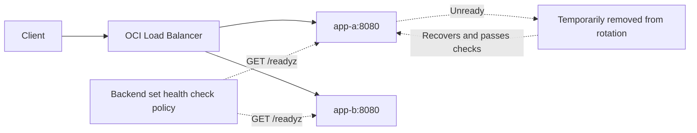

# Health Checks and Removing Unready Backends

## Objectives and Scope

In application architectures on Oracle Cloud Infrastructure (OCI), a Load Balancer must know which backends can actually serve traffic before distributing requests. A Compute instance may still be running and its TCP port may still be open while the application is starting up, has lost its database connection, or no longer has enough processing capacity.

This lesson is part of the **Application Load Balancing** chapter, focusing on **OCI Load Balancer** health checks using `oci lb` commands. Learners combine IAM, VCN, Compute, and monitoring to configure health checks, observe a backend being temporarily removed from rotation, and confirm the backend is returned after recovery.

The running scenario uses two backends `app-a` and `app-b` serving HTTP on port `8080`. When `app-a` becomes unready, new requests must be routed to `app-b` after the health checker detects the failure. Goals include bounding the errors observed during state transitions and ensuring the remaining backend has sufficient capacity.

## 1. How Do Health Checks Participate in Distribution Decisions?

A health check is a periodic probe using a connection or request to a backend. The policy belongs to the backend set; a backend that fails checks is taken out of rotation, then admitted back once it passes checks after recovery. TCP checks connectivity; HTTP checks a URI along with response status or body. [Oracle: Health Check Policies for Load Balancers](https://docs.oracle.com/en-us/iaas/Content/Balance/Tasks/load_balancer_health_management.htm).



"Removing a backend" here means changing whether it is eligible to be selected for traffic, not deleting the backend from configuration or stopping the Compute instance. A health check also does not repair the application, launch extra instances, or migrate in-memory session state to another server.

There is a window between when the application starts failing and when the Load Balancer has enough check results to change its decision. Requests arriving during that window can still fail. Therefore, availability also requires a strategy for handling failed requests, shared state storage, and standby capacity.

### TCP Success Is Not Enough for HTTP Applications

If a reverse proxy still accepts TCP connections while the application behind it returns errors, a TCP check may report healthy. Oracle recommends choosing a health check protocol suited to the service; for HTTP, an HTTP check detects response-layer failures that a TCP handshake misses. [Oracle: Load Balancer Health Check Best Practices](https://docs.oracle.com/en-us/iaas/Content/Balance/Tasks/health_check_best_practices.htm).

Examples of how to interpret signals:

| Observation | What can be concluded |
| --- | --- |
| TCP `8080` open | Connections can be established to the port |
| `GET /livez` returns `200` | The process meets the defined liveness condition |
| `GET /readyz` returns `200` | The instance meets the defined readiness condition to receive load |
| Sample transaction succeeds | The tested business path worked at that moment |

No single probe represents the entire application by itself. Signal quality depends on the endpoint contract agreed upon by development and operations teams.

## 2. Designing Readiness Endpoints

It is recommended to separate two questions:

- **Liveness:** is the process still alive and able to keep running?
- **Readiness:** should the instance accept new business requests right now?

A simple contract for an HTTP backend:

```http
GET /readyz

HTTP/1.1 200 OK
Content-Type: text/plain
Cache-Control: no-store

READY
```

When not ready:

```http
GET /readyz

HTTP/1.1 503 Service Unavailable
Content-Type: text/plain
Cache-Control: no-store

NOT_READY
```

This is an illustrative endpoint design for this lesson. Choosing `200` and body `READY` lets the health policy check a clear signal without depending on a homepage or login page UI.

Implementation principles to follow:

1. Keep the endpoint lightweight, time-bounded, and side-effect free.
2. Do not redirect to a login page or require interactive cookies.
3. Return minimal status only; do not expose connection strings or secrets.
4. Report ready only after the application completes required initialization.
5. On graceful shutdown signals, switch readiness to unready before stopping the process.
6. If checking dependencies, use dedicated timeouts and avoid expensive queries on every probe.

### How Deeply Should Dependencies Be Checked?

Suppose the application uses Oracle Database for core transactions and an external service for sending notifications. If it cannot reach the database, the instance may be unable to process core requests; if the notification system is temporarily slow but queued, the application can still serve traffic.

Choose readiness conditions based on the ability to complete core work. Including every optional dependency in readiness can cause all backends to be removed simultaneously due to a secondary service. Conversely, always returning `200` from a static file can mask local application failures.

In a shared database outage, removing both backends does not create a healthy replacement backend. Operations teams need a database recovery plan or a pre-designed graceful degradation mechanism. Health checks only supply signals for routing decisions.

## 3. Health Policy Parameters

Example starting configuration for the lab:

| Parameter | Lab value | Meaning |
| --- | --- | --- |
| Protocol | `HTTP` | Checks application responses |
| Port | `8080` | Backend port to check |
| URL path | `/readyz` | Readiness endpoint |
| Return code | `200` | Expected response code |
| Response body regex | `^READY$` | Valid body per the lab contract |
| Interval | `10000` ms | Time between checks |
| Timeout | `3000` ms | Wait limit for one response |
| Retries | `3` | Threshold parameter for state transitions |

Oracle's documented defaults for interval, timeout, and retries are `10000` ms, `3000` ms, and `3` respectively; retries also apply when recovering to healthy status. Port `0` can be used to inherit each backend's traffic port. [Oracle: Editing a Load Balancer's Health Check Policies](https://docs.oracle.com/en-us/iaas/Content/Balance/Tasks/editinghealthcheck_topic-Editing_Health_Check_Policies.htm).

Values in the table are a starting point for practice, not an optimal configuration for every application. The endpoint must return the exact body; the Java sample below intentionally omits a trailing newline on `READY` to match the regex.

### Tuning to Service Objectives

A shorter interval gives more opportunities to observe changes but increases probe volume. A timeout that is too short can falsely evict backends during transient latency spikes. A timeout that is too long delays failure detection. The retries threshold must balance reaction speed against state flapping.

Do not treat `interval × retries` as an exact failover SLA. When the failure occurs relative to the probe cycle, individual check wait times, and configuration propagation all affect the outcome. Measure actual failure detection time in the lab and compare it against application targets.

Each parameter change should correspond to a specific hypothesis, such as "the current timeout is lower than readiness latency under load". Increasing timeout just to turn a dashboard green can hide a root cause that needs fixing.

### HTTP, TLS, and Check Ports

For backend sets using SSL, HTTP health checks can run over HTTPS; the force plaintext option changes how probes are sent. Client-facing TLS and backend-facing TLS are two configuration legs that must be verified separately. [Oracle: health checks and SSL](https://docs.oracle.com/en-us/iaas/Content/Balance/Tasks/load_balancer_health_management.htm).

This lab uses plain HTTP inside the VCN and a backend set without SSL to focus on readiness. For HTTPS deployments, also verify certificates, trust, and backend ports; do not apply the plain-HTTP lab configuration unchanged to a TLS-only endpoint.

## 4. Preparing IAM and Network Paths

Run the lab only on lab resources you manage, with two backends containing synthetic data. Prepare:

- An OCI Load Balancer and HTTP listener on port `80` pointing to backend set `bs-app`.
- Two Linux Compute instances in the VCN with JDK 17 or newer, example private IPs `10.0.2.10` and `10.0.2.11`.
- Two backends `10.0.2.10:8080` and `10.0.2.11:8080`, equal weights.
- Distribution policy Round Robin, no session persistence; drain, offline, and backup flags disabled for the lab.
- An admin machine with OCI CLI, PowerShell, and `curl.exe`.
- Authorized administrative access to Compute to run the sample application.

Addresses in this lesson are illustrative; replace them with your environment's actual addresses.

Permission to update the health checker belongs to `LOAD_BALANCER_UPDATE`, included in verb `use load-balancers`. If managing via the Console, permissions on related network resources are also needed. [Oracle: Details for Load Balancing](https://docs.oracle.com/en-us/iaas/Content/Identity/Reference/lbpolicyreference.htm).

Example policy in the lab compartment (adjust group name and identity domain):

```text
Allow group LbLabOperators to use load-balancers in compartment TrainingApp
```

This policy supports operating an existing Load Balancer; it does not replace permissions to create Compute, configure VCNs, or view all monitoring data. Scope those tasks by team role.

### Paths That Must Be Open

| Path | Lab port | What to control |
| --- | --- | --- |
| Test machine → Load Balancer listener | TCP `80` | Ingress for allowed test sources |
| Load Balancer → backends | TCP `8080` | LB egress and backend ingress |
| Health checker → backend `/readyz` | TCP `8080` | Network rules and OS firewall |
| Admin machine → Compute | Chosen admin channel | Access permissions for the lab |

For resources in the same VCN, you can use the Load Balancer's NSG as the source in ingress rules on the backend NSG. Also check security lists, routes, and local firewalls when probes cannot reach the instance. A successful `curl localhost` only confirms the local loopback path.

Probe traffic originates from Load Balancer-managed infrastructure, not from the learner's personal machine IP. OCI provides source information in health check details to aid investigation. [Oracle: Understanding Load Balancer Health Issues](https://docs.oracle.com/en-us/iaas/Content/Balance/Tasks/understanding_health_issues.htm).

Do not open backend HTTP ports to the entire Internet just to fix a health check error. Identify the exact source, destination, port, and direction of the path that needs to be allowed.

## 5. Sample Application That Can Toggle Readiness

The Java snippet below uses the JDK's `HttpServer` to expose three endpoints. This is a lab simulation, not a production application or a real database test. The `HttpServer` API supports registering contexts, handlers, and an executor for an HTTP server. [Oracle JDK 17: HttpServer](https://docs.oracle.com/en/java/javase/17/docs/api/jdk.httpserver/com/sun/net/httpserver/HttpServer.html).

Save as `LbHealthDemo.java` on **each Linux backend**:

```java
import com.sun.net.httpserver.HttpServer;
import java.net.InetSocketAddress;
import java.nio.charset.StandardCharsets;
import java.nio.file.Files;
import java.nio.file.Path;
import java.util.concurrent.Executors;

public class LbHealthDemo {
    private static final Path NOT_READY =
        Path.of("/tmp/oci-lb-not-ready");

    public static void main(String[] args) throws Exception {
        String node = args.length > 0 ? args[0] : "unknown";
        HttpServer server =
            HttpServer.create(new InetSocketAddress(8080), 128);

        server.createContext("/", exchange -> {
            boolean ready = !Files.exists(NOT_READY);
            String path = exchange.getRequestURI().getPath();
            int status;
            String text;

            switch (path) {
                case "/livez" -> {
                    status = 200;
                    text = "ALIVE";
                }
                case "/readyz" -> {
                    status = ready ? 200 : 503;
                    text = ready ? "READY" : "NOT_READY";
                }
                case "/whoami" -> {
                    status = ready ? 200 : 503;
                    text = ready ? node : "NOT_READY:" + node;
                }
                default -> {
                    status = 404;
                    text = "NOT_FOUND";
                }
            }

            byte[] body = text.getBytes(StandardCharsets.UTF_8);
            exchange.getResponseHeaders().set(
                "Content-Type", "text/plain; charset=utf-8");
            exchange.getResponseHeaders().set("Cache-Control", "no-store");
            exchange.sendResponseHeaders(status, body.length);
            try (var output = exchange.getResponseBody()) {
                output.write(body);
            }
        });

        server.setExecutor(Executors.newFixedThreadPool(4));
        server.start();
        System.out.println("Listening on 8080: " + node);
    }
}
```

Compile on each machine:

```bash
javac --add-modules jdk.httpserver LbHealthDemo.java
```

Run in a terminal session kept open. On machine A:

```bash
java --add-modules jdk.httpserver LbHealthDemo app-a
```

On machine B:

```bash
java --add-modules jdk.httpserver LbHealthDemo app-b
```

From another terminal on each machine, verify:

```bash
curl -i http://127.0.0.1:8080/readyz
curl -i http://127.0.0.1:8080/whoami
```

Both endpoints must return `200` when the marker file does not exist. If a previous lab left `/tmp/oci-lb-not-ready` behind, confirm it is the lab file and delete only that file before taking baseline measurements.

When you create the marker file, the Java process keeps running and `/livez` stays healthy; readiness and the simulated business endpoint switch to `503`. This difference lets you observe the scenario "the machine is alive, yet it should not receive traffic".

## 6. Configuring the Health Checker and Baseline Verification

### Inspect and Record Current Configuration

Run the following PowerShell commands on the lab admin machine. Replace region and OCIDs with real resources:

```powershell
$region = 'ap-singapore-1'
$lbId = 'ocid1.loadbalancer.oc1.REGION.REPLACE_ME'
$backendSetName = 'bs-app'
$backendA = '10.0.2.10:8080'
$backendB = '10.0.2.11:8080'
$lbBaseUrl = 'http://REPLACE_WITH_LB_ADDRESS'

& oci lb health-checker get `
    --region $region `
    --load-balancer-id $lbId `
    --backend-set-name $backendSetName `
    --output json

if ($LASTEXITCODE -ne 0) {
    throw 'Could not read health policy; stopping before making changes.'
}
```

OCI provides the `health-checker get` command to read a backend set's policy. [Oracle: Getting a Load Balancer's Health Check Policy Details](https://docs.oracle.com/en-us/iaas/Content/Balance/Tasks/get_health-checker.htm).

Keep the previous configuration in lab records so you can restore it. Verify you selected the right backend set used by the listener, avoiding edits to a backend set that receives no test traffic.

### Update the Policy for the Sample Endpoint

```powershell
& oci lb health-checker update `
    --region $region `
    --load-balancer-id $lbId `
    --backend-set-name $backendSetName `
    --protocol HTTP `
    --port 8080 `
    --url-path '/readyz' `
    --return-code 200 `
    --response-body-regex '^READY$' `
    --interval-in-millis 10000 `
    --timeout-in-millis 3000 `
    --retries 3 `
    --is-force-plain-text false `
    --wait-for-state SUCCEEDED `
    --max-wait-seconds 300

if ($LASTEXITCODE -ne 0) {
    throw 'Failed to confirm successful health policy update.'
}
```

`health-checker update` updates the policy per backend set and tracks it via a work request. `SUCCEEDED` here confirms the configuration operation; observe individual backend check results separately. `is-force-plain-text false` does not automatically enable SSL for the lab's plain-HTTP backend set. [Oracle CLI: lb health-checker update](https://docs.oracle.com/en-us/iaas/tools/oci-cli/latest/oci_cli_docs/cmdref/lb/health-checker/update.html).

If using the Console, open Load Balancer → Backend sets → `bs-app` → **Update health check**, and enter the matching values from the configuration table. Before proceeding, re-read the policy to catch seconds/milliseconds unit mistakes or path typos.

### View Backend Set and Individual Backend Health

```powershell
& oci lb backend-set-health get `
    --region $region `
    --load-balancer-id $lbId `
    --backend-set-name $backendSetName `
    --output json

& oci lb backend-health get `
    --region $region `
    --load-balancer-id $lbId `
    --backend-set-name $backendSetName `
    --backend-name $backendA `
    --output json

& oci lb backend-health get `
    --region $region `
    --load-balancer-id $lbId `
    --backend-set-name $backendSetName `
    --backend-name $backendB `
    --output json
```

`backend-name` uses the `IP:port` format. Read the full output to compare overall status with specific check results. [Oracle CLI: backend-set-health get](https://docs.oracle.com/en-us/iaas/tools/oci-cli/latest/oci_cli_docs/cmdref/lb/backend-set-health/get.html), [Oracle CLI: backend-health get](https://docs.oracle.com/en-us/iaas/tools/oci-cli/latest/oci_cli_docs/cmdref/lb/backend-health/get.html).

Only start fault injection once both A and B are serving properly. If one backend is already failing at the start, fix it first so you do not lose the last healthy backend during the test.

## 7. Observing Backend Removal and Return After Recovery

### Collect Baseline Traffic Samples

On the admin machine, send a sequence of independent requests to the listener:

```powershell
1..30 | ForEach-Object {
    $observedAt = [DateTimeOffset]::UtcNow.ToString('o')
    $sample = & curl.exe --silent --show-error `
        --http1.1 `
        --header 'Connection: close' `
        --connect-timeout 2 `
        --max-time 5 `
        --write-out ' HTTP=%{http_code}' `
        "$lbBaseUrl/whoami"

    "$observedAt $sample"
    Start-Sleep -Seconds 1
}
```

Each line records the UTC timestamp, backend name or error body, and HTTP code. With two equal-weight backends and the lab config above, both `app-a` and `app-b` should be observed across sufficient samples. Do not require a fixed A-B order on every pair of requests; many distribution and Load Balancer behaviors can affect observed order.

If `curl.exe` reports a connection error or returns code `000`, record that as an error for that attempt rather than counting it as an HTTP `200` response. When full telemetry is needed, also log the exit code and tool response time.

### Make A Unready

In an admin terminal **on app-a**, create the exact marker file:

```bash
touch /tmp/oci-lb-not-ready
curl -i http://127.0.0.1:8080/livez
curl -i http://127.0.0.1:8080/readyz
```

Expected directly on A:

- `/livez` still returns `200` with `ALIVE`.
- `/readyz` returns `503` with `NOT_READY`.
- Port `8080` remains open by the Java process.

Re-run the request loop through the listener and inspect A's detailed health. During the window before the health checker reflects the failure, you may still receive `503` from A. Once A is removed from rotation and status stabilizes, new samples must be handled successfully by B.

This is stronger evidence than merely checking that A's process is still running: the system must properly detect that the application is unready and stop sending new requests to it.

### Recover A

On A, remove only the lab marker file:

```bash
rm -f -- /tmp/oci-lb-not-ready
curl -i http://127.0.0.1:8080/readyz
```

Wait long enough for recovery checks, then sample through the listener again. Expect A to return to rotation and both A and B to serve traffic. You do not need to delete and recreate the backend just to complete automatic recovery.

Suggested recording table:

| Milestone | Evidence to retain |
| --- | --- |
| Before fault test | Both A/B readiness `200`, traffic hitting both |
| Fault injected on A | Timestamp marker created, A readiness `503` |
| Transition window | UTC-stamped HTTP success/failure samples |
| A removed | A's health status and new traffic samples served only by B |
| A recovered | Timestamp marker deleted, A readiness back to `200` |
| A readmitted | Traffic samples include A again, errors stop increasing |

From these milestones, calculate the observed user error window and experimental recovery time. Retain the configuration, load level, and network conditions alongside measurements so results remain comparable on future runs.

### Display Status Has Its Own Latency

Oracle notes that reported health status updates on a three-minute cycle. Do not equate that reporting cycle with the `10`-second probe interval in the lab. [Oracle: Understanding Load Balancer Health Issues](https://docs.oracle.com/en-us/iaas/Content/Balance/Tasks/understanding_health_issues.htm).

Therefore, if the marker just changed and the Console has not changed color yet, that is not enough to conclude the policy is broken. Correlate new requests, detailed health outputs, and timestamped logs. Nor does a green dashboard page replace evidence that the listener path is serving successfully.

## 8. Health Checks, Drain, Offline, and Deleting Backends

These mechanisms serve different operational purposes:

| Mechanism | Use case |
| --- | --- |
| Health check | Automatically detect backends not meeting policy |
| Drain | Take a backend out of new distribution for planned maintenance |
| Offline | Administrator stops forwarding ingress traffic to the backend |
| Delete backend | Remove the backend from the backend set configuration |

With drain, OCI stops forwarding **new TCP connections and new non-sticky HTTP requests** to the backend. Sticky sessions must be handled separately; do not treat drain as a guarantee that all traffic stops immediately. Offline prevents forwarding ingress traffic to the backend. [Oracle: Editing a Load Balancer's Backend Server](https://docs.oracle.com/en-us/iaas/Content/Balance/Tasks/update_backend_server.htm).

Recommended maintenance sequence:

1. Confirm another backend is healthy and has sufficient capacity.
2. Read the backend configuration before maintenance, including drain/offline/backup/weight and relevant session persistence.
3. Enable drain on the target backend while preserving other settings per plan.
4. Observe in-flight connections and application timeout policies.
5. Once safe stop conditions are met, perform maintenance per procedure.
6. Restart, check readiness and business paths.
7. Clear drain/offline to the desired state, then confirm the backend resumes taking load.

Do not use an intentionally broken regex to force a backend out during maintenance. Misconfiguration can easily affect the entire backend set and confuse on-call responders during incidents.

Similarly, good health does not guarantee a backend receives traffic if it is still drained/offline, the listener points to a different backend set, or session persistence affects distribution. When investigating, check both application state and traffic-control settings.

## 9. Layer-by-Layer Troubleshooting

If all backends report failures immediately after a policy change, inspect the shared change first before restarting all Compute instances.

| Symptom | First investigation direction |
| --- | --- |
| Connection failed | Is process listening on right address/port; check NSGs, security lists, routes, firewalls |
| Timeout | Slow endpoint response, overloaded app, or slow dependency |
| Wrong HTTP status code | Wrong path, redirect, login requirement, or genuine unreadiness |
| Regex mismatch | Response body, whitespace, newlines, and configured pattern |
| Local OK but LB reports error | LB-to-backend path, TLS, and probe source |
| Health flapping continuously | Latency, CPU, GC, resource pools, and check thresholds |
| Health OK but users still see errors | Listener, backend set, business path, and connection limits |
| Both backends fail readiness together | Shared policy, shared network, or shared dependency |

Oracle lists wrong port/path/status/regex and network rules as common causes; you can test from a system on a comparable network path to separate probe issues from local issues. [Oracle: Common Side Effects of Load Balancer Health Check Misconfigurations](https://docs.oracle.com/en-us/iaas/Content/Balance/Tasks/common_side_effects_health_misconfiguration.htm).

Troubleshooting on the backend can begin with:

```bash
ss -lntp
curl -i --max-time 3 http://127.0.0.1:8080/readyz
```

Then test the private IP from an authorized admin machine in the VCN:

```bash
curl -i --max-time 3 http://10.0.2.10:8080/readyz
```

The admin machine connecting successfully still does not prove the probe source is allowed. Check the specific health checker source and the network rules applying to it.

When no eligible healthy backend remains, Load Balancer can return `502 Bad Gateway`; Oracle also documents other causes of `502`. Do not conclude "the backend is dead" from that status code alone. [Oracle: Common Load Balancer Errors](https://docs.oracle.com/en-us/iaas/Content/Balance/Troubleshooting/common_load_balancer_errors.htm).

Inspect access/error logs to tell whether an error was generated by the LB or returned by a backend, then correlate with application logs. Avoid changing the expected code to `503` just to force an unready endpoint to pass checks.

## 10. Monitoring Remaining Capacity and Controlling Cost

In OCI Monitoring, Load Balancer metrics belong to the `oci_lbaas` namespace. You can monitor `unhealthyBackendServers`, `backendTimeouts`, HTTP errors, and connections; metrics are emitted on a `60`-second interval. [Oracle: Load Balancer Metrics](https://docs.oracle.com/en-us/iaas/Content/Balance/Reference/loadbalancermetrics.htm).

Observation across three groups is recommended:

- **Load eligibility:** which backends have healthy readiness, which are drained/offline, and how many instances actually remain in service.
- **Service quality:** error rate, latency, timeouts, and synthetic transaction results.
- **Capacity and root causes:** CPU, memory, GC, connection pools, and core dependencies.

The number of backends in configuration does not automatically reflect how many backends are eligible for traffic. When creating alarms, clearly scope the backend set and interpretation to avoid mixing different Load Balancer components.

### Standby Capacity Must Handle the Load

As a hypothetical example, suppose each backend reliably handles `100 requests/second`. The system has two backends and is receiving `170 requests/second`:

```text
When both are active:
170 / 2 = 85 requests/second per backend

When one backend is removed:
170 / 1 = 170 requests/second on the remaining backend
```

Under that assumption, the remaining backend exceeds its capacity even though bad-backend removal worked properly. The system may continue timing out and flapping health status. You must add capacity, shed/limit load, or optimize the application according to a tested plan.

This is an illustrative capacity calculation, not a benchmark for a specific OCI shape. When sizing Compute counts, measure the real application and balance redundancy against cost.

### Probes Also Generate Load

With `N` backends, interval `I` seconds, and `P` independent probe streams, you can roughly estimate:

```text
Approximate probes/second = N × P / I
```

`P` must be determined from environment observation; this formula does not assert OCI's internal checker count. It helps explain why readiness endpoints should not run heavy queries or chain multiple service calls on every probe.

Automation should store the health policy in change-controlled infrastructure configuration, track work requests, and re-read configuration after updates. Deployment pipelines should continue rolling out only after new backends pass readiness and test requests succeed through the listener. When policy changes are needed, test first in a lab environment or separate backend set.

At the end of the lab, ensure both A and B have recovered or been returned to the desired lab state; restore the original policy if you only tested temporarily. Stop the sample application and clean up resources created exclusively for the lab per plan to avoid unexpected ongoing charges.

A health check configuration is valuable when it accurately reflects readiness to serve, demonstrably removes unready backends, and supports controlled recovery. Evidence must tie to real traffic, sufficient standby capacity, and team operational ownership.
