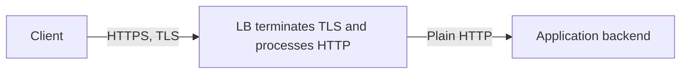
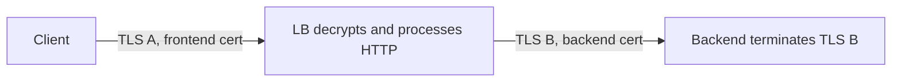
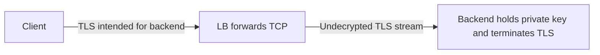

# TLS Termination, TLS Passthrough, and Backend Encryption

In the **Application Load Balancing** chapter of the **CLOUD_PROVIDERS_ORACLE** module, this lesson guides choosing where to terminate TLS and configuring traffic protection through OCI Load Balancer to application servers. This decision affects certificates, permissions, HTTP processing capabilities, health checks, monitoring, and how configuration changes are performed while serving users.

After this lesson, you will be able to:

- Diagram the exact connection flows for termination, passthrough, and backend re-encryption.
- Identify where private keys reside and which party verifies certificates on each leg.
- Configure listeners, backend sets, and health checks consistently on OCI.
- Use curl and OpenSSL to test each leg while still enforcing certificate verification.
- Explain the limitations of mTLS, TCP health checks, and client-side HTTPS evidence.
- Plan certificate rotation, error monitoring, and configuration rollback.

## The Problem: Client-Side HTTPS Does Not Describe the Entire Path

A Java application runs on two OCI Compute instances in a private subnet. Users access `https://app.example.com` through a load balancer. The operations team needs to distribute requests, rotate certificates periodically, and protect order data in transit.

Merely knowing that the browser displays HTTPS is not enough to answer:

- Does TLS terminate at the load balancer or at the application?
- Is the leg from the load balancer to Compute encrypted?
- Does the load balancer verify the backend's certificate?
- When the backend rotates its certificate, which component must update trust?
- Who can read the HTTP payload in the chosen architecture?

You must diagram the path along with TLS boundaries before configuring resources. A private subnet controls network reachability; it does not automatically encrypt an HTTP connection.

In the OCI Console and API, many fields still use the name **SSL**, such as **Use SSL** and `ssl_configuration`. In this lesson, connections are configured with TLS; keep the product's exact field names when operating.

## Three TLS Processing Models

OCI describes three approaches: SSL termination, point-to-point SSL, and SSL tunneling. Point-to-point terminates TLS from the client and then establishes a new TLS connection to the backend; a TCP listener can forward TLS straight to the application. See [Load Balancer Concepts](https://docs.oracle.com/en-us/iaas/Content/Balance/Concepts/balanceoverview_topic-Load_Balancing_Concepts.htm).

| Model | Client-to-LB leg | LB-to-backend leg | Where client TLS terminates |
| --- | --- | --- | --- |
| Termination, HTTP backend | TLS | Plain HTTP | Load balancer |
| Re-encryption, point-to-point | TLS session A | TLS session B | Load balancer |
| Passthrough, tunneling | Forwarded TLS | Same client TLS session to backend | Backend |

### Termination at the Load Balancer, HTTP Backend



The load balancer presents the frontend certificate and uses its corresponding private key. After decrypting, it can process HTTP content and send plaintext requests to the backend.

This model centralizes user-facing certificate management at the LB. However, data on the backend leg is not protected by TLS. When evaluating the architecture, consider data classification and organizational encryption requirements, along with related network controls and administrative permissions.

The application behind the proxy also needs to know the external scheme to build redirects and cookies accurately. If using proxy headers like `X-Forwarded-Proto`, configure the application to trust that information only from controlled proxies; never trust a header sent arbitrarily by a client.

### Termination Then Re-encryption to the Backend



On leg A, the LB acts as a TLS server. On leg B, the LB acts as a TLS client and the backend is the TLS server.

These are two independent sessions. Their TLS versions, ciphers, certificates, and handshake errors can differ. HTTP content still exists in decrypted form while the LB processes it, even though both network legs are encrypted.

Therefore, when someone asks for "end-to-end TLS", clarify the intended meaning:

- Both legs use TLS, while the LB is permitted to decrypt.
- The TLS session must run from client to application without the LB terminating that session.

These two requirements lead to two different architectures.

### Passthrough to the Backend



The backend presents its certificate to the client. The LB forwards connection bytes without decrypting HTTP content, so at that point it cannot perform operations that require reading HTTP paths, headers, or cookies.

In passthrough, the listener uses TCP and has no TLS termination configuration attached. The backend set also does not enable an LB-initiated TLS layer. Traffic is already TLS from the client; enabling backend SSL on top does not make it "more secure"—it creates a different model than the intended path.

Passthrough does not mean the application skips certificates. Clients still have to verify the certificate sent by the backend, and the backend must have a proper TLS configuration.

## Choosing OCI Load Balancer or Network Load Balancer?

OCI Load Balancer is a reverse proxy supporting HTTP/HTTPS and TCP processing. OCI Network Load Balancer focuses on traffic forwarding, with source information preservation capabilities depending on configuration. Do not pick a service solely because its name contains the word "network". See [comparing LB and NLB](https://docs.oracle.com/en-us/iaas/Content/Balance/Reference/lb-vs-nlb.htm).

NLB does not provide TLS termination on the NLB itself; backend applications must handle encryption for traffic passing through. If you need TLS termination at the load balancing service, use Load Balancer. See [Network Load Balancer Encryption](https://docs.oracle.com/en-us/iaas/Content/NetworkLoadBalancer/introduction.htm#Encryption).

The lab uses **OCI Load Balancer**, including the TCP passthrough example. When switching to NLB, you must re-evaluate traffic sources, return paths, network rules, and health checks for that service; do not copy reverse-proxy network assumptions unchanged.

| Need | Direction to evaluate |
| --- | --- |
| Route by HTTP path at the LB | Termination at LB |
| Need HTTP processing and backend-leg encryption | Termination and backend TLS |
| Application must directly terminate client TLS | TCP passthrough |
| Need NLB forwarding characteristics and source preservation | Evaluate NLB and design networking accordingly |

## Where Do Certificates, Private Keys, and Trust Live?

| Model | Certificate client sees | Where does the server private key live? | Trust to prepare |
| --- | --- | --- | --- |
| Termination, HTTP backend | LB frontend | LB or the certificate resource used by LB | Client trusts frontend CA |
| Re-encryption | LB frontend | Frontend at LB; backend on backend server | Client trusts frontend; LB trusts backend CA |
| Passthrough | Certificate sent by backend | Backend | Client trusts backend CA |

You do not give the backend's private key to the LB just so the LB can verify the backend server certificate. The verification trust bundle contains the appropriate CA certificates; a private key serves a different role.

For the frontend, the hostname users access must match the identity in the certificate, typically expressed in Subject Alternative Name (SAN). A certificate valid for `api.example.com` is not automatically valid for `app.example.com`.

On the backend leg, verify all of these together:

- The service is listening for TLS on the right IP and port.
- The certificate is valid and the server sends all required intermediates.
- The LB is configured with proper trust and peer verification enabled.
- Verification depth matches the actual certificate chain.
- Hostname/SNI behavior of the active configuration satisfies the backend's requirements.

Do not assume selecting the right CA alone verifies every identity requirement. If the backend uses SNI-dependent virtual hosts, test the behavior over the real LB path rather than only running an OpenSSL command with SNI from an admin machine.

OCI provides **Verify peer certificate**, **Verify depth**, and CA or CA bundle resources for backend sets. See [creating a backend set with SSL](https://docs.oracle.com/en-us/iaas/Content/Balance/Tasks/managingbackendsets_topic-Creating_Backend_Sets.htm). For uploaded certificate chains, preserve the right order and validate the key/certificate pair. See [LB certificate management](https://docs.oracle.com/en-us/iaas/Content/Balance/Tasks/managingcertificates.htm).

### Do Not Confuse Backend Verification with mTLS

With standard TLS on the backend leg, the LB verifies the backend server. That does not automatically require the backend to verify a client certificate presented by the LB.

OCI documentation states that mTLS is supported between users and the LB, but mTLS is not supported between the LB and backend servers via this backend SSL mechanism. See [listener SSL options](https://docs.oracle.com/en-us/iaas/Content/Balance/Tasks/managinglisteners_topic-Creating_Listeners.htm).

If the application must directly authenticate client certificates inside the user's TLS session, passthrough is an option to evaluate. In that model, the backend performs mTLS and the LB does not terminate TLS.

## IAM Permissions and Network Connectivity

There are two independent permission layers:

- IAM allows people or pipelines to modify listeners, backend sets, certificates, and related resources.
- Network rules allow traffic to reach listeners, backends, and health checks.

Having permission to create a listener does not mean backends can receive connections. Conversely, opening a port does not grant permission to modify OCI resources.

Updating listeners and backend sets falls under corresponding Load Balancer management permissions; when using the Console, permissions for related network resources are also needed. See [IAM reference for Load Balancing](https://docs.oracle.com/en-us/iaas/Content/Identity/policyreference/lbpolicyreference.htm).

For the lab using OCI Load Balancer, tabulate the flows to open:

| Source | Destination | Illustrative port | Purpose |
| --- | --- | --- | --- |
| Allowed client machine | LB listener | 443 | HTTPS for termination and re-encryption |
| Allowed client machine | Lab TCP listener | 9443 | Testing passthrough |
| LB | Private backend | 8080 | HTTP in termination model |
| LB | Private backend | 8443 | TLS in re-encryption or passthrough model |
| LB | Selected health check port | Per config | Determine backend eligibility to serve |
| Allowed lab admin machine | Backend | 8443 | Direct testing of the TLS leg |

Restrict sources to backends according to the real network model; do not open 8080 or 8443 to the entire Internet just to troubleshoot connectivity errors. OCI allows using NSGs or security lists to control access to LBs and backends. See [network security and Load Balancers](https://docs.oracle.com/en-us/iaas/Content/Security/Reference/networking_security.htm).

Also inspect routes, OS firewalls, and the address the application binds to. An application bound only to `127.0.0.1` will not receive traffic from the LB over its private IP even if NSGs are opened correctly.

## Health Checks Must Match the Data Flow

TCP health checks confirm TCP connection establishment; HTTP health checks test a request at a URI along with response conditions. When a backend set has SSL enabled, HTTP health checks use HTTPS unless forced to plaintext. See [Health Check Policies](https://docs.oracle.com/en-us/iaas/Content/Balance/Tasks/load_balancer_health_management.htm).

| Lab model | Business flow to backend | Appropriate health check to start with |
| --- | --- | --- |
| Termination, HTTP backend | HTTP port 8080 | HTTP `/health` on 8080 |
| Re-encryption | HTTPS port 8443 | HTTP health checker over SSL on 8443, do not force plaintext |
| TCP passthrough | TLS port 8443 | TCP on 8443, plus TLS check from client |

With passthrough, the backend set does not proactively enable SSL. Do not send plaintext HTTP health checks to a TLS-only port and expect valid HTTP responses.

If you choose TCP for ease of setup, understand its limit: a port can be open while the certificate is expired or the application cannot process business requests. Add an external HTTPS test to cover hostname, trust, and response content.

Health endpoints should be lightweight, stable, and meaningful for readiness. Avoid using an endpoint that always returns 200 even when the application cannot handle any critical function.

## Lab: Observing Three Models in One Lab Environment

The names and ports below are examples; replace them with your environment's values:

| Component | Illustrative value |
| --- | --- |
| Client-side hostname | `app.lab.example` |
| LB | A dedicated OCI Load Balancer for the lab |
| Backend | Compute in private subnet, e.g., `10.0.2.10` |
| Backend HTTP endpoint | `http://10.0.2.10:8080/health` |
| Backend TLS endpoint | Port 8443 |
| Termination listener | Port 443 |
| Passthrough listener | Port 9443 |

Prepare two small application endpoints, both returning a backend identifier for easy observation. The 8443 endpoint must actually serve TLS, not merely open a port.

Prepare certificates for two roles:

- **Frontend:** SAN containing `app.lab.example`, matching private key, chain, and CA trusted by the client.
- **Backend:** SAN containing `app.lab.example` for the passthrough test, private key placed on the backend, chain, and CA trusted by the LB/lab client.

You can use a lab-internal PKI; the client must be given the required CA. The test commands below use `frontend-ca.pem` and `backend-ca.pem` as trust files on the machine running commands. They are not private keys.

The lab backend should have a default TLS virtual host serving the test endpoint; this avoids depending on unconfigured SNI when testing the leg from the LB. If a real application depends on SNI, add dedicated tests.

### Configuration A: Terminate TLS at LB, HTTP Backend

1. Create backend set `bs-http` without enabling **Use SSL**.
2. Register the backend at private IP, port 8080.
3. Configure HTTP health check `/health`, port 8080, expected return code 200.
4. Create an HTTP listener with **Use SSL** on port 443 and attach the frontend certificate.
5. Point the listener to `bs-http`; wait for backends to become healthy and test a request.

The listener uses a certificate resource to terminate TLS; the OCI interface lets you choose certificates from the Certificates service or LB-managed certificates. See [creating a listener](https://docs.oracle.com/en-us/iaas/Content/Balance/Tasks/managinglisteners_topic-Creating_Listeners.htm).

How to interpret the result: the client used HTTPS, while the backend configuration remains HTTP 8080. Do not record this result as "the entire path is encrypted".

### Configuration B: Also Encrypt the Backend Leg

1. Test the TLS 8443 endpoint directly from an authorized admin machine.
2. Create backend set `bs-tls` with **Use SSL** enabled.
3. Configure the trusted CA or CA bundle for the backend certificate, enable peer verification, and choose an appropriate verify depth.
4. Register backend port 8443; configure HTTP health check `/health` using SSL without forcing plaintext.
5. After backends are healthy, switch listener 443's backend set to `bs-tls`.
6. Retest from the client and inspect backend-leg logs.

The certificate the client sees is still the LB's frontend certificate. Changing backend trust or backend certificates does not necessarily change the frontend certificate.

To isolate errors, keep `bs-http` during the lab and record configurations before switching. If you need to fall back to A, understand that doing so restores a plaintext HTTP leg; only do so if data protection requirements allow.

### Configuration C: TCP Passthrough

1. Create a separate backend set `bs-passthrough` without enabling **Use SSL**.
2. Register backend TLS port 8443 and choose a TCP health check.
3. Create a TCP listener on port 9443 without attaching TLS termination settings.
4. Point the listener to `bs-passthrough`.
5. Call HTTPS to `app.lab.example:9443`, trusting the backend CA.

The client will receive the backend certificate. If the backend certificate only contains a different internal name, a client accessing `app.lab.example` will fail hostname verification. Do not fix this by disabling verification on the client; provision the right certificate for the identity the client uses.

## Testing with curl and OpenSSL

The following commands use Bash, curl, and OpenSSL. Replace `203.0.113.10` with the real LB IP; this is an illustrative address.

### Testing Hostname, Trust, and HTTP on the Client Side

```bash
export LAB_HOST="app.lab.example"
export LAB_LB_IP="203.0.113.10"

curl --fail --show-error --verbose --cacert frontend-ca.pem --resolve "${LAB_HOST}:443:${LAB_LB_IP}" "https://${LAB_HOST}/health"
```

`--resolve` directs the connection to the specified IP while the URL keeps the hostname under test. `--cacert` supplies the lab's trusted CA. Do not add `-k` to a test meant to validate trust and hostname. See [curl documentation](https://curl.se/docs/manpage.html).

A successful command confirms the client path to the tested endpoint; it does not by itself prove the backend leg of model B is using TLS.

Inspect the handshake and certificate chain:

```bash
openssl s_client -connect "${LAB_LB_IP}:443" -servername "$LAB_HOST" -CAfile frontend-ca.pem -verify_hostname "$LAB_HOST" -verify_return_error -showcerts < /dev/null
```

Check verification status, exit code, server certificate, and negotiated protocol. `-servername` sends SNI; `-verify_hostname` checks identity; `-verify_return_error` makes verification errors fail the handshake instead of merely printing a warning. See [OpenSSL s_client](https://docs.openssl.org/3.5/man1/openssl-s_client/).

### Testing Backend TLS Directly

From a machine authorized to reach the backend's private IP:

```bash
openssl s_client -connect "10.0.2.10:8443" -servername "$LAB_HOST" -CAfile backend-ca.pem -verify_hostname "$LAB_HOST" -verify_return_error -showcerts < /dev/null
curl --fail --show-error --cacert backend-ca.pem --resolve "${LAB_HOST}:8443:10.0.2.10" "https://${LAB_HOST}:8443/health"
```

The output confirms the backend can serve TLS with these test parameters. It does not replace testing through the LB, because the LB has its own trust, TLS configuration, network source, and SNI behavior.

With multiple backends, test each machine. One machine with a different certificate or chain can cause intermittent failures as the LB distributes requests.

### Testing Passthrough

```bash
curl --fail --show-error --verbose --cacert backend-ca.pem --resolve "${LAB_HOST}:9443:${LAB_LB_IP}" "https://${LAB_HOST}:9443/health"
openssl s_client -connect "${LAB_LB_IP}:9443" -servername "$LAB_HOST" -CAfile backend-ca.pem -verify_hostname "$LAB_HOST" -verify_return_error -showcerts < /dev/null
```

Compare the returned certificate against the lab backend certificate. If frontend and backend use the same certificate, inspecting the certificate alone makes it hard to tell them apart; read the listener/backend set configuration to confirm where TLS terminates.

## Illustrating Backend TLS Configuration with Terraform

This HCL snippet illustrates model B. It assumes the LB, backend, frontend certificate in OCI Certificates, and backend CA bundle already exist; the `var.*` variables must be declared and supplied in your Terraform module.

```hcl
resource "oci_load_balancer_backend_set" "tls" {
  load_balancer_id = var.lb_id
  name             = "bs-tls"
  policy           = "ROUND_ROBIN"

  health_checker {
    protocol           = "HTTP"
    port               = 8443
    url_path           = "/health"
    return_code        = 200
    is_force_plain_text = false
  }

  ssl_configuration {
    trusted_certificate_authority_ids = [var.backend_ca_bundle_id]
    verify_peer_certificate           = true
    verify_depth                      = var.backend_verify_depth
    protocols                         = ["TLSv1.2"]
  }
}

resource "oci_load_balancer_backend" "app" {
  load_balancer_id = var.lb_id
  backendset_name  = oci_load_balancer_backend_set.tls.name
  ip_address      = var.backend_private_ip
  port            = 8443
  weight          = 1
}

resource "oci_load_balancer_listener" "https" {
  load_balancer_id          = var.lb_id
  name                      = "https-app"
  default_backend_set_name  = oci_load_balancer_backend_set.tls.name
  port                      = 443
  protocol                  = "HTTP"

  ssl_configuration {
    certificate_ids         = [var.frontend_certificate_id]
    verify_peer_certificate = false
    verify_depth            = 1
    protocols               = ["TLSv1.2"]
  }
}
```

`verify_peer_certificate = false` on the **listener** means the example does not require clients to present a certificate for mTLS. It does not disable server certificate verification performed by browsers, and it does not override the `true` verification flag on the **backend set**.

The example restricts both sides to TLS 1.2 to present a consistent lab configuration. When choosing TLS 1.3 or another cipher suite, verify support across client, LB, backend, and certificates. Protocols and ciphers must be compatible. See [SSLConfiguration](https://docs.oracle.com/en-us/iaas/tools/python/latest/api/load_balancer/models/oci.load_balancer.models.SSLConfiguration.html).

Verify schemas at [backend set resource](https://docs.oracle.com/en-us/iaas/tools/terraform-provider-oci/latest/docs/r/load_balancer_backend_set.html) and [listener resource](https://docs.oracle.com/en-us/iaas/tools/terraform-provider-oci/latest/docs/r/load_balancer_listener.html). Before applying to existing resources, manage import/state and review the plan to avoid creating a duplicate-port listener or losing active settings.

The HCL code references certificate resource IDs instead of embedding private keys directly in the example. You still must grant permissions to use the corresponding certificate resources and protect pipeline state, configs, and logs.

## Re-reading Configuration and Proving Each Leg

You can read configuration and health using the OCI CLI:

```bash
export LAB_LB_OCID="<ocid-load-balancer>"
export LAB_BACKEND_SET="bs-tls"

oci lb backend-set get --load-balancer-id "$LAB_LB_OCID" --backend-set-name "$LAB_BACKEND_SET"
oci lb backend-set-health get --load-balancer-id "$LAB_LB_OCID" --backend-set-name "$LAB_BACKEND_SET"
```

Verify SSL configuration, trust sources, peer verification flags, health checker, and backend IP/port. See [get backend set](https://docs.oracle.com/en-us/iaas/Content/Balance/Tasks/get_backend_set.htm) and [get backend set health](https://docs.oracle.com/en-us/iaas/Content/Balance/Tasks/get_backend-set-health.htm).

Evidence should have three parts:

| Evidence | Question answered |
| --- | --- |
| Re-read listener and backend set configuration | How is the service instructed to handle TLS? |
| Handshake, request, and backend logs | Does the actual connection path work? |
| Negative test on isolated lab resources | When certificate or trust mismatches, does the system reject it? |

With model B, you can test a lab backend whose certificate is signed by a CA not trusted by the backend set. Expect that path not to be accepted as a valid TLS backend; record health, error logs, and responses rather than rigidly assuming every failure returns the same HTTP code.

Only make changes in isolated lab or canary resources. Restore valid certificates and trust after the test. Never toggle peer verification on production traffic to generate test evidence.

## Monitoring and Troubleshooting Errors

Separate frontend errors from backend errors:

- **Frontend:** client fails to complete handshake with LB; check hostname, chain, client trust, protocol, and client certificate requirements.
- **Backend:** client can establish TLS to LB, but LB cannot establish TLS to the application; check port, trust, chain, and protocol on the internal leg.
- **Application:** both handshakes succeed, yet requests still fail; check HTTP, timeouts, and processing logic.

OCI provides metrics for SSL handshakes, connections, HTTP responses, and unhealthy backend count. Select the right load balancer, listener, or backend set dimension when reading metrics. See [Load Balancer Metrics](https://docs.oracle.com/en-us/iaas/Content/Balance/Reference/loadbalancermetrics.htm).

| Symptom | Check first |
| --- | --- |
| Client reports hostname mismatch | URL, SAN, SNI, and listener certificate or backend cert in passthrough |
| Client reports untrusted CA | Client-side CA and intermediates sent by server |
| HTTP 502 after enabling backend SSL | Is backend accepting TLS on right port; do CA, chain, and protocol align |
| Backend unhealthy while manual access works | Whether health check uses TLS or plaintext; URI, port, host, and network source |
| TCP health green while HTTPS fails | Certificates, handshake, and application not covered by TCP health |
| Errors appear only on some requests | Check each backend and each machine's certificate version |
| Passthrough loses LB URL routing | LB does not decrypt HTTP in that model |
| Errors during certificate rotation | New chain, new trust, key/certificate pair, and rollout status |

A single 502 code is not enough to conclude it is a certificate error. OCI lists many handshake and backend causes; correlate error logs with configuration and change timestamps. See [Troubleshooting SSL](https://docs.oracle.com/en-us/iaas/Content/Balance/Reference/troubleshooting_ssl.htm).

Never use disabling certificate verification as a long-term fix. Find the mismatched CA, chain, hostname, or protocol and restore the designed trust model.

## Certificate Rotation, Availability, and Cost

Frontend rotation and backend rotation are two different procedures:

1. Inventory hostnames, where certificates are attached, expiration dates, and owners.
2. Prepare the new certificate, chain, and verify the key pair.
3. If changing the backend CA, add required trust to the LB before migrating backends to the new chain.
4. Rotate backends one by one, wait for health to stabilize, and test a real request path.
5. Update the frontend according to the certificate resource mechanism in use.
6. Monitor TLS errors, HTTP errors, and latency; remove old trust after no dependencies remain.

Certificates sourced from OCI Certificates have a mechanism for the LB to detect and adopt changes to the linked certificate resource. That does not remove the responsibility to verify the update rollout and application availability. See [certificate integration in backend sets](https://docs.oracle.com/en-us/iaas/Content/Balance/Tasks/managingbackendsets_topic-Creating_Backend_Sets.htm).

Keep sufficient backends healthy to serve load during certificate rotation. You can drain new connections on one backend, wait for appropriate connections to finish, update it, and return it to service. With passthrough and long-lived connections, also account for the time it takes existing sessions to close.

On resource usage, termination offloads part of TLS work to the LB; re-encryption still requires backends to process TLS. Do not estimate cost solely by client handshake counts: measure throughput, new connections, connection reuse, backend CPU, and latency.

In the lab, use small scale, place resources in a clear compartment, and clean up test listeners, backend sets, or LBs when no longer needed. Do not increase LB capacity to solve a CA or protocol error.

When writing a rollback plan, specify the old configuration, valid certificates, and protection level of the fallback path. Switching from backend TLS to HTTP changes security properties; it must be evaluated as an architectural change.

## Self-Assessment Checklist

A complete lab outcome should demonstrate:

- You can diagram where TLS terminates and where plaintext HTTP exists across all three models.
- You can point out the private key, server certificate, and CA trust on each side.
- Listeners and backend sets are re-read, showing matching protocol, port, and SSL configuration.
- Health checks match backend configuration; TCP health limitations are explicitly noted.
- Clients verify hostname and trust without skipping certificate errors.
- For re-encryption, there is dedicated evidence for the LB-to-backend leg.
- For passthrough, backends handle TLS directly and clients receive the backend certificate.
- Plans exist for certificate rotation, error monitoring, rollback, and cost control.

Choosing the right TLS model starts with who is permitted to decrypt and which identities must be verified. Only then do you map those requirements onto listeners, backend sets, certificates, trust, and network controls on OCI.
