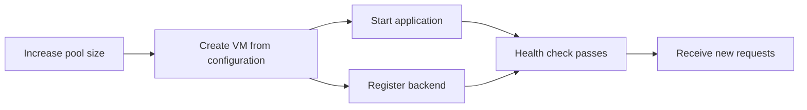
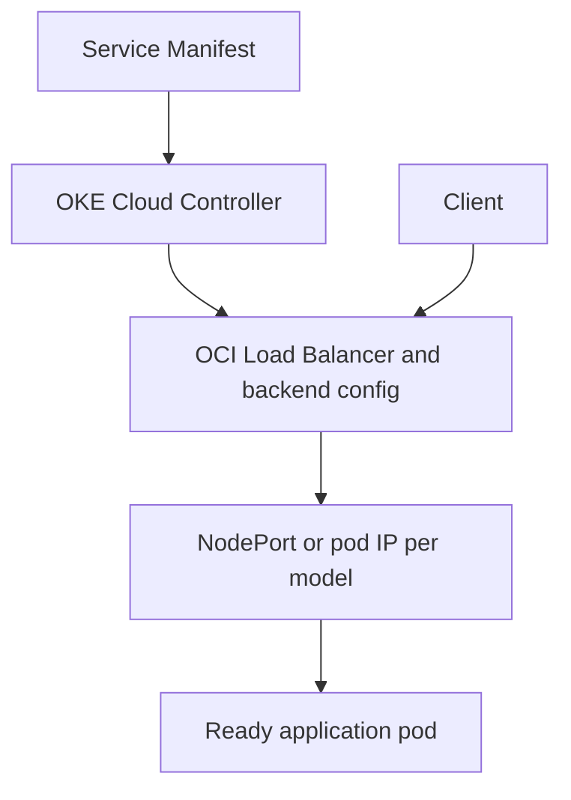

# Integrating Load Balancing with Instance Pools and OKE

In the **Application Load Balancing** chapter of the Oracle Cloud Infrastructure (OCI) module, a load balancer provides a stable traffic entry point while the components running the application can be added, replaced, or removed. This lesson connects that entry point to two deployment models: applications on a Compute instance pool and containerized applications on Oracle Kubernetes Engine (OKE).

The goal is not merely creating a reachable address. A well-operated integration admits new backends only when ready, removes backends at the right time, maintains fault tolerance, and controls resources during scaling. The examples use a simple HTTP service; for Java applications connecting to Oracle Database, you must also consider startup time, connection pools, and application shutdown.

After this lesson, you will be able to:

- Attach an instance pool to an OCI Load Balancer backend set.
- Explain instance scale-out/scale-in and when a backend starts receiving load.
- Create an internal `LoadBalancer` Service on OKE and verify the request path.
- Distinguish pod readiness, load balancer health checks, and node/pod scaling.
- Identify which component manages backends, IAM boundaries, and monitoring points.

## Identifying Who Manages the Backends

A load balancer has listeners accepting connections and backend sets containing the distribution policy, backends, and health checks. The backend set must be attached to a listener to receive traffic. [Oracle: Backend Sets for Load Balancers](https://docs.oracle.com/en-us/iaas/Content/Balance/Tasks/managingbackendsets.htm).

When integrating automatically, identify the source of desired configuration:

| Model | Where desired state is declared | Component managing changes |
| --- | --- | --- |
| Compute instance pool | Pool, instance configuration, and load balancer attachment | Instance pool mechanism and deployment automation |
| OKE `LoadBalancer` Service | Kubernetes Service and annotations | OKE cloud controller |
| OKE with OCI native ingress controller | IngressClass, Ingress, and related Services | OCI native ingress controller |

The design principle in this lesson is that each configuration set has one owning party. If a controller creates backends, manual edits in the Console may not survive the next reconciliation pass. For persistent changes, modify the source configuration managed by that component.

Do not manually attach a set of OKE nodes to the same backend set managed by a Service as a substitute for Kubernetes integration. Doing so creates two competing control planes and makes upgrades, scaling, or node replacement unpredictable.

## Application Contract and Network Paths

For applications running on VMs, for example:

```text
Client -> listener :80 -> backend set -> VM private IP :8080
                                              |
                                              +-> HTTP GET /readyz
```

For a Service using nodes as backends on OKE:

```text
Client -> OCI Load Balancer -> node IP:NodePort
                                  |
                                  +-> forwarded to Service pod endpoint
```

Before configuring, lock down the following details:

| Detail | Example or question to answer |
| --- | --- |
| Listener | HTTP `:80` or HTTPS `:443`? |
| Backend | VM `:8080`, NodePort, or pod IP? |
| Readiness | Which endpoint indicates the application can accept requests? |
| Access scope | Internal VCN, over VPN/FastConnect, or from the Internet? |
| Graceful completion | How long does the application need to finish in-flight requests? |
| Config owner | Pool, Service, or ingress controller? |

Separate the network paths as recommended:

- Allowed client sources to the load balancer listener.
- Load balancer to the actual application port or NodePort.
- Health checker to the exact health check port.
- VM/pod to Oracle Database and required dependencies.

Check NSGs/security lists, routes, and any OS firewall on the VM. Opening a port on the OS is not enough if VCN rules are blocking; reaching the listener also does not prove the path to backends is open.

## Compute Branch: Instance Pool and Load Balancer Attachment

An instance pool creates instances from an instance configuration. When the pool is attached to a load balancer or network load balancer and backend set, instances added to the pool are added to the backend set; once healthy per checks, they can receive traffic. [Oracle: Creating Instance Pools](https://docs.oracle.com/en-us/iaas/Content/Compute/Tasks/creatinginstancepool.htm).

In this lesson, use **OCI Load Balancer** and a dedicated backend set for the application. The instance configuration must ensure every new VM shares the same serving contract:

- Same application version or deterministic bootstrap process for the version.
- Same backend port, such as `8080`.
- Same readiness endpoint, such as `/readyz`.
- Configuration for fetching secrets and connecting to the database matching VM identity.
- Sufficient logs and metrics to troubleshoot startup failures.

Example workflow for bringing a new VM into service:



Backend registration and application readiness can occur at different times. Let the health check gate when traffic starts arriving rather than assuming Compute state `RUNNING` means the application has finished starting.

### Selecting the Right VNIC and Backend Port

The attachment specifies the load balancer, backend set, port, and VNIC used to obtain the private IP address. The port and VNIC selection values apply to instances in that attachment. [Oracle: Attaching a Load Balancer to an Instance Pool](https://docs.oracle.com/en-us/iaas/Content/Compute/Tasks/updatinginstancepool_topic-To_attach_a_load_balancer_to_an_instance_pool.htm).

If the application listens on `8080`, the attachment's port parameter is `8080`, even if the client-facing listener uses `80` or `443`. On multi-VNIC VMs, select the VNIC with the appropriate network path to the load balancer and standardize naming in configuration.

### Lab: Attaching an Existing Pool

The commands below are instructions for Bash/OCI Cloud Shell with OCI CLI configured. Prepare sandbox resources first:

1. Instance configuration running an HTTP app on `8080` with `/readyz` returning the expected code when ready.
2. Dedicated instance pool with two VMs, holding no machine-local data that would be lost on scale-in.
3. Load balancer in the same region, a dedicated backend set for the pool, and a listener pointing to that backend set.
4. HTTP health check using `/readyz`, matching backend port, and network paths opened to the right scope.
5. Permissions to manage the pool and required permissions on the load balancer, subnet, VNICs, and related resources.

Set real sandbox values:

```bash
export OCI_REGION='ap-singapore-1'
export LAB_COMPARTMENT_OCID='<compartment-ocid>'
export LAB_POOL_OCID='<instance-pool-ocid>'
export LAB_LB_OCID='<load-balancer-ocid>'
export LAB_BACKEND_SET='app-pool-backends'

oci compute-management instance-pool attach-lb \
  --region "$OCI_REGION" \
  --instance-pool-id "$LAB_POOL_OCID" \
  --load-balancer-id "$LAB_LB_OCID" \
  --backend-set-name "$LAB_BACKEND_SET" \
  --port 8080 \
  --vnic-selection PrimaryVnic
```

`PrimaryVnic` selects the primary VNIC in this example. Verify parameters and confirm attachment completes before proceeding; this command links to the prepared backend set and does not replace creating listeners, networking, and health checks. [Oracle CLI: instance-pool attach-lb](https://docs.oracle.com/en-us/iaas/tools/oci-cli/latest/oci_cli_docs/cmdref/compute-management/instance-pool/attach-lb.html).

List actual instances:

```bash
oci compute-management instance-pool list-instances \
  --region "$OCI_REGION" \
  --compartment-id "$LAB_COMPARTMENT_OCID" \
  --instance-pool-id "$LAB_POOL_OCID" \
  --all
```

`--all` ensures all pages are read for large pools. Cross-check the instance list against registered backends rather than looking only at desired pool size. [Oracle CLI: instance-pool list-instances](https://docs.oracle.com/en-us/iaas/tools/oci-cli/latest/oci_cli_docs/cmdref/compute-management/instance-pool/list-instances.html).

Read backend set health:

```bash
oci lb backend-set-health get \
  --region "$OCI_REGION" \
  --load-balancer-id "$LAB_LB_OCID" \
  --backend-set-name "$LAB_BACKEND_SET"
```

This command fetches the health status of the specified backend set. Combine it with the backend list and application logs to pinpoint which instance is not ready. [Oracle CLI: backend-set-health get](https://docs.oracle.com/en-us/iaas/tools/oci-cli/latest/oci_cli_docs/cmdref/lb/backend-set-health/get.html).

### Scaling Up and Verifying Service

With two VMs initially in the sandbox pool, scale up to three:

```bash
oci compute-management instance-pool update \
  --region "$OCI_REGION" \
  --instance-pool-id "$LAB_POOL_OCID" \
  --size 3
```

`--size` sets the desired instance count; provisioning and bringing the application into service take additional time. [Oracle CLI: instance-pool update](https://docs.oracle.com/en-us/iaas/tools/oci-cli/latest/oci_cli_docs/cmdref/compute-management/instance-pool/update.html).

Observe in sequence: the new VM is created, bootstrap completes, the backend appears, health passes, and requests are actually processed. You can have the lab application return an instance identifier to correlate with access logs. Looking only at VM count or a single HTTP 200 response does not prove every backend is participating.

If a new VM stays unhealthy, inspect bootstrap logs, listening ports, health paths, and dependency connectivity first. Do not keep increasing pool size to compensate for a broken image or shared misconfiguration.

## Autoscaling and Backend Removal Workflow

OCI autoscaling can adjust the number of instances in a pool based on metrics or schedules. Metric-based autoscaling requires properly collected metrics; cooldown periods help stabilize the system after changes. Pool scale-in can terminate instances, so local data and in-flight work must be handled beforehand. [Oracle: Autoscaling](https://docs.oracle.com/en-us/iaas/Content/Compute/Tasks/autoscalinginstancepools.htm).

Recommended sequence to remove a backend for an application with long-running requests:

```text
Select instance to remove
  -> Stop sending new requests to that instance
  -> Wait for in-flight requests within defined timeout
  -> Close application, connection pools, and flush final logs
  -> Proceed with instance termination
```

OCI supports pre-termination lifecycle actions for instance pools: an instance can enter `TerminationAwait`, automation performs pre-termination tasks and signals continuation, or a timeout triggers configured handling. This is where drain and cleanup can be integrated. [Oracle: Managing Instance Pools Lifecycle](https://docs.oracle.com/en-us/iaas/Content/Compute/Tasks/instance-pools-lifecycle.htm).

Test the configured mechanism with realistic request types. Removing a backend from the list does not automatically prove all HTTP keep-alive connections, WebSockets, or running transactions completed safely.

For Java applications, the termination timeout should account for both request completion time and resource shutdown. Keep critical session state outside a single VM's memory so instance replacement does not lose user state.

## Updating the Application Version on an Instance Pool

Updating the instance configuration used by a pool only affects subsequent instance creations; it does not automatically switch, reboot, or replace existing instances. [Oracle: Updating the Instance Configuration for an Instance Pool](https://docs.oracle.com/en-us/iaas/Content/Compute/Tasks/updatinginstancepool-updating-instance-configuration.htm).

Therefore, updating the template and seeing the pool still has three VMs does not mean the pool is running the new version. A recommended rollout plan includes:

1. Create a configuration for the new version and verify it in a sandbox.
2. Provision extra capacity to keep the old version running while starting the new version.
3. Replace instances gradually or deploy a new pool with a separate backend set.
4. Shift or drain traffic only after the new version is ready and passes business checks.
5. Keep a rollback path to the old version for a defined period.

If using two pools for versioned deployment, name backend sets clearly and plan how routing/listeners switch. Do not let two automations arbitrarily add/remove each other's backends.

## OKE Branch: Service Controlling Load Balancer Resources

In Kubernetes, a Service selects pods by label and provides a stable access point. With `type: LoadBalancer` and cloud integration, the controller orchestrates provisioning an external load balancer outside the cluster. [Kubernetes: Service](https://kubernetes.io/docs/concepts/services-networking/service/).

On OKE, you can explicitly specify OCI Load Balancer via annotation:

```yaml
oci.oraclecloud.com/load-balancer-type: "lb"
```

Shape annotations can specify minimum/maximum flexible bandwidth in Mbps. Setting explicit values keeps the example independent of cluster-version defaults. [Oracle: Provisioning OCI Load Balancers for Kubernetes Services](https://docs.oracle.com/en-us/iaas/Content/ContEng/Tasks/contengcreatingloadbalancers-subtopic.htm).

Control flow must be understood separately from request flow:



Do not pre-create a load balancer and guess the controller will adopt it merely because the name matches. Resource reuse, if chosen, must follow specific integration settings; this lab lets the Service create its own resource.

### Backends Can Be Nodes or Pods

Check the actual configuration before counting backends. The node-as-backend model goes through NodePort. OKE also supports pods directly as backends for Services on clusters meeting prerequisites, including Kubernetes `1.30+`, OCI VCN-Native Pod Networking, and disabling NodePort allocation via `allocateLoadBalancerNodePorts: false`; corresponding health checks and security rules are also required. [Oracle: Configuring Load Balancers — Using Pods as Backends](https://docs.oracle.com/en-us/iaas/Content/ContEng/Tasks/contengconfiguringloadbalancersnetworkloadbalancers-subtopic.htm).

Example reasoning: a Service with three pods running across two nodes may not create three node backends. Increasing pod replicas can raise processing capacity while the backend node count stays unchanged. Conversely, the direct-pod model requires tracking pod IP updates and per-endpoint health.

The lab below uses **managed worker nodes and NodePort**, setting `allocateLoadBalancerNodePorts: true` to make the chosen path explicit. Do not use this manifest as instructions for migrating a live Service to the direct-pod model.

## OKE Lab: Internal Service on Managed Nodes

### Prerequisites

Prepare a sandbox OKE cluster with `kubectl` pointing to the right context and at least two ready managed worker nodes. Nodes must be able to pull the lab image. Verify Kubernetes RBAC to create Namespaces, Deployments, and Services; Kubernetes permissions do not replace OCI IAM permissions needed when the controller provisions resources.

OKE requires appropriate IAM policies for cluster operations and related resources; if using a subnet, NSG, or resource in another compartment, verify the corresponding permission scope. [Oracle: Policy Configuration for Cluster Creation and Deployment](https://docs.oracle.com/en-us/iaas/Content/ContEng/Concepts/contengpolicyconfig.htm).

The example uses a private load balancer. Prepare:

- An appropriate subnet for the load balancer in the lab VCN.
- A frontend NSG with rules allowing test clients to port `80`.
- Rules for the path from the load balancer to worker NodePort `30080` and the actual health check port.
- A test machine with network reachability to the private IP, such as a VM in the VCN or a machine over an appropriate internal link.

The manifest sets security rule management mode to `None`, so the lab administrator is responsible for network rules. Replace the two subnet and NSG placeholders before applying. The NSG annotation adds the load balancer to an existing NSG; it does not define that NSG's rules. [Oracle: Configuring Load Balancers — Network Security Groups](https://docs.oracle.com/en-us/iaas/Content/ContEng/Tasks/contengconfiguringloadbalancersnetworkloadbalancers-subtopic.htm).

### Illustrative Manifest

Save the following as `oke-lb-lab.yaml` in the lab environment:

```yaml
apiVersion: v1
kind: Namespace
metadata:
  name: lb-lab
---
apiVersion: apps/v1
kind: Deployment
metadata:
  name: web-demo
  namespace: lb-lab
spec:
  replicas: 3
  selector:
    matchLabels:
      app: web-demo
  strategy:
    type: RollingUpdate
    rollingUpdate:
      maxUnavailable: 0
      maxSurge: 1
  template:
    metadata:
      labels:
        app: web-demo
    spec:
      terminationGracePeriodSeconds: 30
      topologySpreadConstraints:
        - maxSkew: 1
          topologyKey: kubernetes.io/hostname
          whenUnsatisfiable: ScheduleAnyway
          labelSelector:
            matchLabels:
              app: web-demo
      containers:
        - name: web
          image: nginx:stable
          ports:
            - name: http
              containerPort: 80
          resources:
            requests:
              cpu: 100m
              memory: 64Mi
            limits:
              cpu: 500m
              memory: 128Mi
          readinessProbe:
            httpGet:
              path: /
              port: http
            periodSeconds: 5
            timeoutSeconds: 2
            failureThreshold: 3
---
apiVersion: v1
kind: Service
metadata:
  name: web-demo
  namespace: lb-lab
  annotations:
    oci.oraclecloud.com/load-balancer-type: "lb"
    service.beta.kubernetes.io/oci-load-balancer-internal: "true"
    service.beta.kubernetes.io/oci-load-balancer-subnet1: "<lb-subnet-ocid>"
    oci.oraclecloud.com/oci-network-security-groups: "<frontend-nsg-ocid>"
    oci.oraclecloud.com/security-rule-management-mode: "None"
    service.beta.kubernetes.io/oci-load-balancer-shape: "flexible"
    service.beta.kubernetes.io/oci-load-balancer-shape-flex-min: "10"
    service.beta.kubernetes.io/oci-load-balancer-shape-flex-max: "100"
spec:
  type: LoadBalancer
  externalTrafficPolicy: Cluster
  allocateLoadBalancerNodePorts: true
  selector:
    app: web-demo
  ports:
    - name: http
      port: 80
      targetPort: http
      nodePort: 30080
```

`nginx:stable` is an illustrative HTTP image for the lab; application deployments should manage image versions according to project standards. The lab's pod port and NodePort differ from backend port `8080` in the earlier VM branch because these are two independent lab applications.

The annotation `oci-load-balancer-internal: "true"` requests a private IP; `oci-load-balancer-subnet1` selects a subnet overriding the cluster's default subnet configuration. [Oracle: Configuring Load Balancers — Creating Internal Load Balancers](https://docs.oracle.com/en-us/iaas/Content/ContEng/Tasks/contengconfiguringloadbalancersnetworkloadbalancers-subtopic.htm).

Three replicas and hostname spread express intent to distribute pods; `ScheduleAnyway` is a soft preference. Inspect actual pod placement rather than treating replica count as proof of even distribution across nodes or availability domains.

### Applying and Inspecting Status

Run these commands in the lab environment with `kubectl` configured:

```bash
kubectl config current-context
kubectl get nodes
kubectl apply -f oke-lb-lab.yaml

kubectl -n lb-lab rollout status deployment/web-demo
kubectl -n lb-lab get pods -o wide
kubectl -n lb-lab get service web-demo -o wide
kubectl -n lb-lab describe service web-demo
kubectl -n lb-lab get endpointslices \
  -l kubernetes.io/service-name=web-demo
```

Observe each layer separately:

1. Deployment has the desired count of ready replicas.
2. Service selector matches the right pods and EndpointSlice contains corresponding endpoints.
3. Service Events report no OCI provisioning errors.
4. Load balancer appears with the right subnet, private IP, and backend configuration.
5. Backend health passes and an internal client actually receives responses.

The `EXTERNAL-IP` column in `kubectl get service` can display the private address of the load balancer. That column name does not prove the resource is reachable from the Internet.

From a machine with reachability to the VCN:

```bash
curl --connect-timeout 5 --max-time 10 \
  http://<private-lb-ip>/
```

If run from Cloud Shell or an external machine without proper private connectivity, a timeout error is not enough to conclude pods are broken. Verify the test machine's location before changing manifests.

### Scaling Pods and Testing Rollouts

Increase replicas in the lab Deployment:

```bash
kubectl -n lb-lab scale deployment/web-demo --replicas=4
kubectl -n lb-lab get pods -o wide
kubectl -n lb-lab get endpointslices \
  -l kubernetes.io/service-name=web-demo
```

Once the new replica is ready, retest requests through the private load balancer. With the node-backend model, do not expect the OCI backend count to increase from three to four along with pod replicas.

To observe pod replacement while keeping the image configuration unchanged:

```bash
kubectl -n lb-lab rollout restart deployment/web-demo
kubectl -n lb-lab rollout status deployment/web-demo
```

`maxUnavailable: 0` and `maxSurge: 1` guide the rollout to retain old pods while adding new pods, though sufficient cluster capacity is still needed to schedule the extra pod. Readiness, application errors, and network propagation time still affect client experience. [Kubernetes: Deployments](https://kubernetes.io/docs/concepts/workloads/controllers/deployment/).

After testing, update the manifest back to the desired replica count so a future `apply` does not accidentally revert changes. If HPA is added later, clarify who controls replicas and avoid manual edits competing with the autoscaler.

## Health Checks, Readiness, and Graceful Shutdown

Three concepts must be checked separately:

| Mechanism | Question it answers |
| --- | --- |
| VM/node status | Is infrastructure running and joined to the system? |
| Kubernetes readiness | Is the pod ready to serve as an endpoint? |
| OCI health check | Does the backend on the load balancer path pass checks? |

A readiness probe can remove a pod from ready endpoints; liveness governs container restarts, while startup probes cover startup time. They serve distinct goals and must be tuned to the application. [Kubernetes: Liveness, Readiness, and Startup Probes](https://kubernetes.io/docs/concepts/workloads/pods/probes/).

The `/` probe on Nginx in the lab only performs a simple HTTP check. For Java applications, expose an endpoint reflecting request readiness per the business contract. Avoid turning a lightweight probe into a heavy database query on every check.

When a pod terminates, let the application handle shutdown signals and finish work within the designed grace period. Endpoint updates and pod termination involve multiple asynchronous steps, so do not rely on a fixed `sleep` to promise zero dropped requests. [Kubernetes: Pod Lifecycle](https://kubernetes.io/docs/concepts/workloads/pods/pod-lifecycle/).

`externalTrafficPolicy: Cluster` permits routing across cluster endpoints. If choosing `Local`, understand how the traffic policy affects nodes with local endpoints, health, and load distribution; test against the real topology and load balancer type before switching. Never make this change merely to mask an unexplained timeout.

A PodDisruptionBudget can help bound voluntary disruptions during evictions. It does not replace health checks, node redundancy, or Deployment rolling update strategies, and it does not prevent infrastructure outages. [Kubernetes: Specifying a Disruption Budget](https://kubernetes.io/docs/tasks/run-application/configure-pdb/).

## When Ingress Is Needed for Multiple Applications

A `LoadBalancer` Service fits publishing a single service entry point. If multiple hosts/paths should share an HTTP routing layer, an ingress controller is needed to implement Ingress rules. Creating an Ingress resource without a matching controller does not create a traffic entry path. [Kubernetes: Ingress](https://kubernetes.io/docs/concepts/services-networking/ingress/).

The OCI native ingress controller provisions an OCI flexible load balancer per IngressClass and configures backend sets per Service/port. With VCN-Native Pod Networking, the controller uses pods as backends; with flannel, it uses nodes and requires `NodePort` backend Services. [Oracle: Setting Up the OCI Native Ingress Controller](https://docs.oracle.com/en-us/iaas/Content/ContEng/Tasks/contengsettingupnativeingresscontroller.htm).

Recommended design sequence:

1. Choose a controller and verify cluster/CNI prerequisites.
2. Configure the IAM identity and permissions needed to manage OCI resources.
3. Create the IngressClass and configure the load balancer per the controller's mechanism.
4. Create Services for applications and host/path rules in Ingress.
5. Verify DNS, certificates, backend health, and requests to each route.

Do not blindly change every Service from `type: LoadBalancer` to `ClusterIP` assuming every controller supports it. The Service type behind Ingress must match the CNI model and the deployed controller's capabilities.

TLS must also be defined per leg. With the OCI native ingress controller, default HTTPS settings may include TLS to backends; if the application listens only on HTTP, configure accordingly. Do not copy Service annotations onto Ingress without checking supported scope. [Oracle: Configuring the OCI Native Ingress Controller](https://docs.oracle.com/en-us/iaas/Content/ContEng/Tasks/contengsettingupnativeingresscontroller-configuring.htm).

## Three Scaling Loops That Must Coordinate

| Resource | Typical mechanism | Capacity adjusted |
| --- | --- | --- |
| VMs in instance pool | OCI autoscaling or changing pool size | Number of VMs running the app |
| Pods in OKE | HPA or replica count | Number of application replicas |
| Managed nodes in OKE | Cluster Autoscaler | Compute capacity to schedule pods |
| OCI flexible load balancer | Min/max bandwidth config | Throughput capacity of the traffic entry point |

Cluster Autoscaler manages node pool capacity, while HPA manages pod replicas. When using Cluster Autoscaler for a node pool, let it manage size per its configured rules and avoid multiple tools competing to add/remove nodes. [Oracle: Using the Kubernetes Cluster Autoscaler](https://docs.oracle.com/en-us/iaas/Content/ContEng/Tasks/contengusingclusterautoscaler.htm).

Example reasoning:

```text
Traffic increases
  -> HPA wants to add pods
  -> Insufficient resources leave pods Pending
  -> Appropriate node capacity is needed
  -> New pods start and become ready
  -> Service/backend paths update
  -> Effective serving capacity increases
```

Increasing a load balancer's max bandwidth does not create more nodes or pods. Adding pods also does not automatically solve Oracle Database connection pool limits. For every scaling action, examine the entire dependency chain to locate the real bottleneck.

## Monitoring, Troubleshooting, and Cost

Monitor a set of evidence from outside in:

- Success rate and latency from the client perspective.
- Listener, backend set, and health of each OCI backend.
- Desired, ready, and starting instance or pod counts.
- VM bootstrap logs or pod and controller events/logs.
- Connection counts, database wait times, and downstream dependency capacity.

Health failures can stem from check port, protocol, path, return code, or timeout. Oracle recommends checking these settings alongside backend state when troubleshooting load balancer errors. [Oracle: Common Load Balancer Errors](https://docs.oracle.com/en-us/iaas/Content/Balance/Troubleshooting/common_load_balancer_errors.htm).

| Symptom | Isolation direction |
| --- | --- |
| New VM runs yet backend is unhealthy | Bootstrap, app listen address, VNIC, NSG/firewall, health path |
| Pool grows yet serving capacity does not | Whether new backends receive traffic, whether database is the bottleneck |
| Service stays pending | Events, OCI permissions, subnet, available IPs, quotas, and provisioning errors |
| Pods Ready yet LB calls timeout | Whether test machine has route to private IP, listener, and backend health |
| Empty EndpointSlice | Selector, pod labels, readiness, and namespace |
| Backends are nodes so count differs from pods | Check chosen backend model before assuming an error |
| Errors during rollout or scale-in | Graceful shutdown, endpoint convergence, standby capacity, long requests |
| Console edits revert automatically | Identify which controller or automation manages the resource |

On cost, budget Compute/nodes, pod resource requests, load balancers, bandwidth, and any resources left behind after the lab. Sharing one entry point via Ingress can reduce the number of load balancers to maintain, while increasing shared blast radius; choose based on isolation needs and operational capability.

Self-calculation example for serving demand: if one replica sustainably handles 120 requests/second under test conditions and the target is 300 requests/second, three replicas are only a baseline capacity estimate. When required to survive losing one replica, the two remaining replicas only reach about 240 requests/second under that assumption. You must budget standby headroom and test against real dependencies rather than simply dividing load and rounding.

### Cleaning Up Lab Resources

For the VM branch, return the sandbox pool to its starting size only after confirming drain and termination impact. Inventory attachments, backends, load balancers, and lab-only resources before deleting; never operate on a live serving pool.

For the OKE branch, delete the lab Service and wait for the controller to clean up the corresponding OCI resources before finishing namespace cleanup:

```bash
kubectl -n lb-lab delete service web-demo
```

Observe Service status and load balancer resources in OCI. If deletion gets stuck, check the controller and permissions before touching finalizers. After confirming cloud resources have been cleaned up properly:

```bash
kubectl delete namespace lb-lab
```

The pre-created frontend NSG and subnet were not created by the manifest; inventory them separately according to sandbox ownership. Do not assume all OCI resources vanished merely because the pod list is empty.

## Self-Check Questions

- **Why is a `RUNNING` VM not enough to receive traffic?** The application and dependencies still need to start; health checks must reflect readiness to serve.
- **Does updating an instance configuration upgrade existing VMs?** No; the new configuration applies to future creations, so a process to replace existing instances is needed.
- **Do four pods always equal four OCI backends?** No; check whether the node model or direct-pod model is in use.
- **Does HPA automatically scale nodes?** HPA scales pods; node capacity requires its own manager such as Cluster Autoscaler.
- **Where should backends managed by a Service be modified?** In the Kubernetes configuration source and corresponding integration settings so the controller maintains the desired state.

The required outcome is proving that a new backend receives traffic only when ready, access continues during controlled changes, and resources are cleaned up by the right owner. For both instance pools and OKE, health, networking, permissions, and application lifecycle must be designed together with the load balancer.
