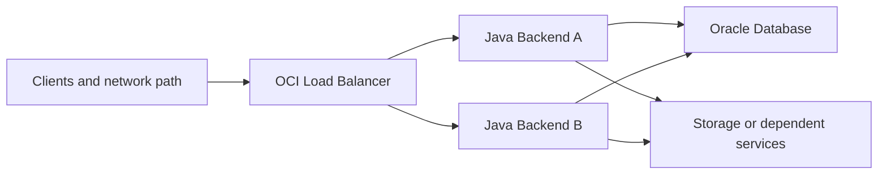

# Selecting Bandwidth and Scaling Load Balancing Capacity

Choosing bandwidth for a load balancer is a decision about the **serving capacity of the entire request path**. A Load Balancer with high bandwidth can still serve slowly if a Java application runs out of threads, the connection pool to Oracle Database is exhausted, or newly scaled backends are not yet ready.

This lesson is part of the **Application Load Balancing** chapter of the **CLOUD_PROVIDERS_ORACLE** module. We connect tenancy, compartment, IAM, and VCN knowledge with Compute, storage, and Oracle databases to build a plan backed by metrics, monitoring, automation, and cost control.

After this lesson, you will be able to:

- Estimate Mbps requirements from request rate and payload sizes.
- Choose minimum/maximum bandwidth for OCI Flexible Load Balancer.
- Distinguish scaling frontend bandwidth, scaling backends, and resolving dependency bottlenecks.
- Read metrics with the right units and scope, and plan verified changes.
- Budget capacity for traffic spikes, backend failures, and scheduled application scaling.

## Load Balancing Capacity Has Multiple Dimensions

A system receives requests along an illustrative path:



For each component, measure the right kind of capacity:

| Capacity dimension | Question to answer |
| --- | --- |
| Bandwidth | How many bits per second must be transported? |
| Request rate | How many requests per second does the application handle? |
| Connection rate | How many new connections arrive per second? |
| Concurrent connections | How many connections are held open simultaneously? |
| TLS | How many handshakes and encrypted connections occur? |
| Backend capacity | How much load does each backend serve within latency/error limits? |
| Dependency capacity | How much headroom remains on database, storage, and dependent APIs? |

There is no fixed conversion from Mbps to requests/second across all applications. Two APIs both running at 1,000 requests/second can differ dramatically in bandwidth if one returns a few hundred bytes while the other returns a multi-megabyte file.

Nor is there a relationship where "adding one backend doubles LB bandwidth". Backends and frontend are separate resources that must be planned independently.

## Understanding Flexible LB Minimum and Maximum Bandwidth

OCI Flexible Load Balancer uses two parameters:

| Parameter | Meaning for capacity planning |
| --- | --- |
| Minimum bandwidth | Pre-provisioned bandwidth immediately ready for the workload |
| Maximum bandwidth | Upper ceiling the LB can reach within its configured range |

OCI documentation currently describes a configuration range from **10 Mbps to 8,000 Mbps**, with minimum no greater than maximum. Actual usable limits also depend on tenancy, region, quotas, and account type. See [creating a Flexible Load Balancer](https://docs.oracle.com/en-us/iaas/Content/Balance/Tasks/managingloadbalancer_topic-Creating_Load_Balancers.htm).

A crucial distinction: maximum is not bandwidth guaranteed to be pre-allocated at all times. The `ShapeDetails` reference specifies that minimum is the pre-allocated capacity, while maximum is the upper limit it can reach. See [shape parameter definition](https://docs.oracle.com/en-us/iaas/tools/typescript/latest/modules/_loadbalancer_lib_model_shape_details_.shapedetails.html).

Illustrative examples:

| Minimum | Maximum | Interpretation |
| --- | --- | --- |
| 100 Mbps | 100 Mbps | Configured with equal lower and upper bounds |
| 100 Mbps | 500 Mbps | 100 Mbps pre-provisioned, allowed to scale up to a 500 Mbps ceiling |
| 500 Mbps | 800 Mbps | Higher pre-provisioned capacity for periods requiring immediate readiness |

These numbers are study examples, not default recommendations for any specific application.

### Choosing Lower and Upper Bounds via Two Different Questions

- **Minimum:** how much capacity is needed immediately, even if load spikes faster than the system adapts?
- **Maximum:** how high do you want to allow scaling within architectural, account, and budget limits?

For a campaign with a known start time, setting a very low minimum and expecting the maximum to handle every sudden surge automatically is an assumption that must be tested. If a load level must be ready from the start of the event, plan appropriate pre-provisioning and finish changes before the start time.

If you want a fixed configured bandwidth level, you can set minimum equal to maximum. Do not confuse that with guaranteeing the application will achieve that throughput: backends and network paths can still be bottlenecks.

Legacy dynamic shapes are not OCI's recommended starting point for new deployments. When encountering legacy resources, inspect current configuration before applying flexible-shape procedures.

## Units and Measurement Scope

### Mbps Differs from MB/s

```text
1 byte = 8 bits
1 Mbps = 1,000,000 bits/second
1 MiB = 1,048,576 bytes
```

A 100 Mbps link corresponds theoretically to 12.5 MB/s before accounting for overhead and other constraints. That is not a guarantee that a client downloading a file will always achieve 12.5 MB/s.

Be explicit about whether sizes use bytes, KB, or KiB. In PowerShell, `1KB` is 1,024 bytes; in Mbps formulas, the denominator remains 1,000,000.

### Shape Bandwidth Is Combined Ingress and Egress

OCI documentation defines shape bandwidth as total **ingress plus egress** across aggregated connections. Do not assume "500 Mbps" means 500 Mbps independently per direction or dedicated per client. See [LB shape concepts](https://docs.oracle.com/en-us/iaas/Content/Balance/Concepts/balanceoverview_topic-Load_Balancing_Concepts.htm).

In a proxy design, there are also the client–LB and LB–backend legs. Therefore, when reconciling numbers:

1. Specify whether the metric is taken at the frontend, listener, backend set, or VNIC.
2. Confirm whether the metric measures bytes, bits/second, or event counts over an interval.
3. Do not arbitrarily sum metrics reflecting the same traffic at different points.
4. Use service metrics and load tests to calibrate payload-based estimates.

The payload formula in the next section is a planning starting point, not a definition of how OCI meters or bills every byte in every configuration.

## Estimating Demand from Workload

For a relatively uniform group of requests:

```text
B_payload_Mbps =
  RPS × (request_bytes + response_bytes) × 8 / 1,000,000
```

For multiple request groups:

```text
B_payload_Mbps =
  sum across groups [
    RPS_group × (request_bytes_group + response_bytes_group)
  ] × 8 / 1,000,000
```

Use payload sizes matching what actually crosses the wire. If compression is enabled, do not take uncompressed JSON size and assume that is the byte count transported. If there are large uploads or streaming responses, model them separately instead of blending them into an unrepresentative "average request".

### Initial Calculation Example

Suppose an API has:

- 1,000 requests/second at peak.
- Each request sends 2 KiB.
- Each response returns 30 KiB.
- Initial calibration factor of 1.25 to reserve for overhead and unmeasured variance.
- Target utilization of 70% of selected capacity.

Calculation:

```text
Payload per exchange = (2 + 30) × 1,024
                     = 32,768 bytes

B_payload = 1,000 × 32,768 × 8 / 1,000,000
          ≈ 262.14 Mbps

B_reserved = 262.14 × 1.25
           ≈ 327.68 Mbps

Target_capacity = 327.68 / 0.70
                ≈ 468.11 Mbps
```

A level around 500 Mbps becomes a **candidate to test**. The 1.25 factor and 70% target are example assumptions, not OCI-prescribed constants.

The calibration factor must be replaced with observed data once a representative environment is available. If service metrics show the same workload consumes more bandwidth than modeled, revise the model and recalculate. Do not treat a 25% reserve as guaranteeing coverage for all overhead, both proxy legs, and every protocol pattern.

### Recalculating with PowerShell

The snippet below runs locally only and does not call OCI:

```powershell
$RequestsPerSecond = 1000.0
$RequestBytes = 2 * 1024
$ResponseBytes = 30 * 1024
$CalibrationFactor = 1.25
$TargetUtilization = 0.70

if ($TargetUtilization -le 0 -or $TargetUtilization -gt 1) {
    throw 'TargetUtilization must be in (0, 1].'
}

$PayloadMbps = $RequestsPerSecond *
    ($RequestBytes + $ResponseBytes) * 8 / 1000000

$EstimatedMbps = $PayloadMbps * $CalibrationFactor
$CandidateCapacityMbps = $EstimatedMbps / $TargetUtilization

[PSCustomObject]@{
    PayloadMbps = [math]::Round($PayloadMbps, 2)
    EstimatedMbps = [math]::Round($EstimatedMbps, 2)
    CandidateCapacityMbps = [math]::Round($CandidateCapacityMbps, 2)
}
```

Expected output for those exact assumptions:

```text
PayloadMbps  EstimatedMbps  CandidateCapacityMbps
262.14       327.68         468.11
```

Do not apply growth multipliers and headroom factors repeatedly without explanation. For instance, if input peak load already includes projected growth, multiplying by the same growth rate again double-counts the estimate.

## Adding Dimensions That Mbps Does Not Capture

### Requests/Second and Connections/Second

Clients using keep-alive can send many requests over one connection. Clients that constantly reconnect can generate high handshake rates even when total payload is small.

Test both patterns if they exist in your workload. A benchmark that holds a few connections open and fires continuous requests does not represent a wave of new users opening TLS connections simultaneously.

### In-Flight Concurrent Requests

In a relatively steady state, you can use the approximate relationship:

```text
Concurrent requests ≈ requests/second × average processing time
```

For example, 1,000 requests/second with an average processing time of 0.2 seconds corresponds to about 200 concurrent requests. If average processing time rises to 1 second, that figure can rise to around 1,000.

This estimates request concurrency, not TCP connection count. HTTP keep-alive, multiplexing, how long clients hold connections idle, and request streaming make those two quantities different.

When backends slow down, queued work can surge even when bandwidth is nowhere near the upper bound. Increasing bandwidth in that situation may not improve latency.

### Capacity Under Failure

Suppose one backend is measured at 350 requests/second within service quality limits, and the application must serve 1,000 requests/second:

```text
Without fault tolerance:
  ceil(1,000 / 350) = 3 backends

To survive losing 1 backend:
  (N - 1) × 350 >= 1,000
  => N >= 4 backends
```

This is a simplified model assuming equal-capacity backends, balanced distribution, and sufficient dependency capacity. In practice, retest with one backend removed to verify the remaining backends maintain latency and error targets.

Fault-tolerance standby capacity and spike headroom must be documented separately to avoid double-counting or omitting one just because both are casually called "headroom".

## Reading Metrics Properly Before Scaling Configuration

### With OCI Load Balancer

The LB metrics namespace is `oci_lbaas`. Commonly useful metrics include:

| Metric | Used to inspect |
| --- | --- |
| `peakBandwidth` | Peak bandwidth per second during the observation interval |
| `bytesReceived`, `bytesSent` | Data volume by component scope |
| `acceptedConnections` | Number of accepted connections |
| `activeConnections` | Active connections on the selected component |
| `acceptedSSLHandshake`, `FailedSslHandshake` | Handshake activity and failures |
| `backendTimeouts`, `unhealthyBackendServers` | Backend serving health |

`activeConnections` at the `loadBalancer` component describes client–LB connections; the same metric name at the backend set component has a different scope. Do not sum two charts merely because they share a metric name.

OCI publishes LB metrics at a 60-second frequency. To understand the exact unit, dimensions, and valid components for each metric, see [LB metrics reference](https://docs.oracle.com/en-us/iaas/Content/Balance/Reference/loadbalancermetrics.htm).

### Separating Data Volume from Rate

If a value truly represents 600,000,000 bytes over a 60-second window:

```text
Average rate =
  600,000,000 × 8 / 60 / 1,000,000
  = 80 Mbps
```

However, an 80 Mbps average can hide a brief burst. Compare peak, latency, and errors at an appropriate time window.

Conversely, `peakBandwidth` already represents the peak per-second rate within the interval. Do not divide that value by 60 again simply because the chart uses a one-minute interval.

Do not invent a metric named "bandwidth utilization" and assume the service always exposes it out of the box. You can compute an observational ratio such as `peakBandwidth / maximumBandwidth` after aligning units, but that ratio does not imply the maximum is always pre-allocated.

### How to Build Verifiable Charts

From the resource's Metrics page, select the appropriate time range, component, and statistic; use Open Query in Metrics Explorer to verify the actual filter. Keep separate:

- Frontend bandwidth and connection charts.
- Per-backend-set error/latency and health charts.
- Compute CPU, memory, network, and queues.
- Database connection pools, query latency, and database limits.
- Client-measured latency and errors.

Do not use a daily average to conclude there is enough capacity for a ten-minute campaign. Nor should you sum host or component series without knowing whether their scopes overlap or reflect HA components.

See [viewing and querying LB metrics](https://docs.oracle.com/en-us/iaas/Content/Balance/Reference/loadbalancermetrics_topic-Using_the_Console.htm).

## Choosing Action Based on the Bottleneck

| Simultaneous observation | Hypothesis to test | Justified action to consider |
| --- | --- | --- |
| Bandwidth near configured bound, backends have spare headroom, client load underserved | Frontend may lack bandwidth | Verify measurements, then test increasing LB capacity |
| Low bandwidth, high backend CPU and growing queues | Backends lack processing capacity | Optimize application or add backends |
| Low bandwidth, slow database, and waiting connection pools | Dependency is the bottleneck | Fix database/pool/queries first |
| Small payloads yet reconnects and handshakes surge | Connections/TLS creating pressure | Check connection reuse and run connection-heavy load tests |
| One backend receives most of the load | Affinity, sessions, or skewed distribution | Check policy and client behavior |
| New backend created yet receives no load | Not registered, not ready, or wrong network rules | Check lifecycle and health checks |
| Packets dropped by security rules | Network path blocked | Fix rules for the right flow; do not raise bandwidth to fix network blocks |

These are diagnostic hypotheses, not automatic conclusions. A single symptom can have multiple causes; change one controlled set of factors and compare before/after.

Agree on an application-level goal, such as "handle peak load with latency and error rate within chosen limits". A higher bandwidth chart after a change does not by itself prove users are served better.

## Scaling Along Three Directions

### Increasing LB Capacity

Adjust minimum/maximum when there is evidence the frontend needs more capacity or higher pre-allocated readiness.

Distinguish:

- **Elastic scaling within the configured range:** behavior of the flexible service.
- **Changing shape or min/max via management action:** a separate configuration change.

Do not build a script that calls `UpdateLoadBalancerShape` every few seconds just because a chart fluctuates. Configuration edits must account for operation duration, sessions, observability, and cost.

### Increasing Backend Count

Adding backends spreads processing load if the application and dependencies allow it.

A new backend must pass through these steps:

```text
Compute capacity available
  -> create instance
  -> boot OS and start application
  -> load config, initialize pools/caches
  -> register in backend set
  -> pass health checks
  -> actually serve requests
```

Steps may overlap depending on deployment tooling, but do not treat them as complete the moment the instance-creation API returns success.

OCI supports attaching an LB or NLB to an instance pool to automatically register instances added to the pool into the backend set; traffic is forwarded once the instance becomes healthy. See [instance pools and backend integration](https://docs.oracle.com/en-us/iaas/Content/Compute/Tasks/creatinginstancepool.htm).

Health check design must align with when the application is truly ready. For Java, an open TCP port does not necessarily mean caches are warmed or mandatory dependencies are connected.

### Changing Distribution and Offloading Traffic

When a single LB or backend group no longer fits, consider:

- Offloading large files or static assets to an appropriate delivery path, such as Object Storage/CDN when access requirements allow.
- Reducing unnecessary responses via pagination, caching, or compression after measuring impact.
- Splitting frontends by service or workload groups with distinct profiles.
- Using multiple LBs with an upstream distribution layer if architecture requires it and matching operational design exists.

Multiple LBs do not automatically sum into one entry point with linear capacity. You must handle DNS or the distribution layer, health, DNS caching, certificates, WAF, observability, and client behavior. If a client still connects to only one frontend, the combined paper capacity of other frontends does not solve the limit that client hits.

Do not move an HTTP workload to NLB solely to avoid configuring min/max. If the application needs HTTP routing, TLS termination, or application-layer LB features, you must explicitly preserve or replace those functions.

## Coordinating Backend Autoscaling and Frontend Capacity

OCI Compute offers metric-based autoscaling and schedule-based autoscaling for instance pools. These mechanisms manage instance count or lifecycle; they are not the same setting as LB min/max bandwidth. See [autoscaling for instance pools](https://docs.oracle.com/en-us/iaas/Content/Compute/Tasks/autoscalinginstancepools.htm).

A metric-driven response plan must answer:

1. Which metric truly represents backend load?
2. How long after crossing the threshold is a decision triggered?
3. How long does it take for a new backend to become genuinely ready?
4. How does the system absorb increasing load during that wait?
5. Are Compute quotas and capacity sufficient for the maximum instance count?
6. Can the database handle additional connection pools from new instances?

For example, scaling from four to eight backends, each with a max pool of 50 connections, can raise the theoretical max demand on the database from 200 to 400 connections. Calculate aggregate limits rather than checking only per-instance config.

### Scaling Before a Known Event

Suppose measurements show:

- Baseline load of an application is roughly 30–45 Mbps on the chosen metric.
- Modeling and peak load testing show roughly 330 Mbps.
- You want a candidate capacity around 500 Mbps after reserve.

A plan to test could look like:

| Phase | LB Minimum | LB Maximum | Backends |
| --- | --- | --- | --- |
| Normal days | 100 Mbps | 800 Mbps | Instance count sufficient for baseline load and fault redundancy |
| Before event | 500 Mbps | 800 Mbps | Scale out early based on benchmark results |
| After event | Lower after observing stability | Review upper bound | Scale in with drain and verification |

These numbers are completely hypothetical. Verify permissions, limits/quotas, capacity, and real-resource test results before selecting values.

Changing minimum from 100 to 500 is a planned administrative operation, not something to run right as users start flooding in. If max 800 exceeds the tenancy's available limit, the plan must resolve limits beforehand rather than discovering it when trying to scale.

### Scale-In Must Account for In-Flight Requests

Before removing a backend, follow a procedure to stop assigning new work, wait/drain in-flight work per design, and complete shutdown.

Scaling in too fast can drop sessions, interrupt uploads, or trigger client retries that push load right back up. For instance pools, OCI provides pre-termination lifecycle actions to run tasks before an instance is terminated; configure and test this if used. See [managing instance pool lifecycle](https://docs.oracle.com/en-us/iaas/Content/Compute/Tasks/instance-pools-lifecycle.htm).

Do not treat session persistence as state replication. When a backend is removed, sessions held only in that backend's memory still require an application-level solution.

## If Using Network Load Balancer

NLB does not have the same min/max bandwidth configuration model as Flexible LB; the service adapts automatically to traffic. That changes frontend planning, but it does not eliminate limits on flows, backends, networking, or accounts. See [NLB overview](https://docs.oracle.com/en-us/iaas/Content/NetworkLoadBalancer/overview.htm).

Dimensions to monitor include:

- Flow count and new connections.
- Packets and bytes processed.
- Load distribution across backends.
- Health status and dropped packets.
- Network resources and connection-handling capacity on backends.

The NLB namespace is `oci_nlb`. Example metrics include `ProcessedBytes`, `ProcessedPackets`, `NewConnectionsTCP`, `NewConnectionsUDP`, `HealthyBackendsPerNlb`, and security-rule drop metrics. `ProcessedBytes` includes TCP/IP headers per service definition. See [NLB metrics](https://docs.oracle.com/en-us/iaas/Content/NetworkLoadBalancer/Metrics/metrics.htm).

Do not copy LB formulas or metric names directly to NLB. For instance, do not infer active connection counts solely from new connections in one minute. Connections can stay open for many minutes or hours.

You also need to generate multiple representative flows when load-testing NLB. A single connection does not validate distribution across multiple backends.

## Cost: Choosing Minimum and Maximum Intentionally

Per OCI's LB creation guide, cost consists of a base instance component and a bandwidth component; usage is metered per minute. If usage does not exceed minimum, the bandwidth portion is billed at minimum; when usage exceeds minimum, actual usage applies per service billing rules. See [flexible bandwidth billing mechanism](https://docs.oracle.com/en-us/iaas/Content/Balance/Tasks/managingloadbalancer_topic-Creating_Load_Balancers.htm).

You can roughly model it as:

```text
LB cost ≈
  time-based base component
  + sum of billed bandwidth across intervals
```

For estimation purposes, a simple approach is tracking the greater of minimum and metered usage in each interval. However, never use peak values read from a chart directly in place of metering data to assert exact billing.

Distinguish these quantities:

| Quantity | Meaning |
| --- | --- |
| Minimum bandwidth | Pre-provisioned capacity and floor impact on cost |
| Maximum bandwidth | Configured upper limit, not a guaranteed full charge |
| Data transfer | A separate network cost component per applicable policy |
| Backend cost | Compute, boot/block volumes, and related resources |
| Observability cost | Collecting, storing, and querying logs/metrics per used services |

A very high minimum kept all month can be expensive if needed only for a short event. Conversely, too low a minimum may fail immediate-readiness requirements.

Check applicable units and pricing at deployment time in the [OCI price list](https://www.oracle.com/cloud/price-list/). This estimation avoids a fixed unit price because account types and commercial terms vary.

Setting a maximum also does not replace budgeting for the whole application. Request retries, added backends, data transfer, and logging can still drive total cost up even if LB configuration stays unchanged.

## Checking Limits, Quotas, and Capacity Before Changes

Three factors are easily conflated:

| Factor | What to verify |
| --- | --- |
| Service capabilities | Parameter range, backend/listener counts, and technical constraints |
| Account limits/quotas | How much the tenancy/compartment is currently permitted to use |
| Available capacity | Whether newly requested resources can be provisioned in the chosen location |

A parameter range up to 8,000 Mbps does not mean every tenancy automatically has limits allowing up to that level. Check account Limits, Quotas and Usage and [service limits](https://docs.oracle.com/en-us/iaas/Content/General/service-limits/default.htm).

For backends, an existing autoscaling policy does not prove enough instances can be provisioned when needed. OCI can report insufficient capacity for an instance pool; have a plan for placement, shapes, or fallback options. See [managing instance pools](https://docs.oracle.com/en-us/iaas/Content/Compute/Concepts/instance-pools.htm).

IAM must also grant the right identity permission to view metrics and apply changes within its assigned scope. Do not grant broad tenancy-admin rights just so a pipeline can update one application's bandwidth.

## A Verifiable Bandwidth Change Procedure

**Specific operational note:** OCI documentation on changing bandwidth shapes states that resizing requires resetting existing sessions. Therefore, do not describe this operation as always non-disruptive. See [changing LB bandwidth shape](https://docs.oracle.com/en-us/iaas/Content/Balance/Tasks/managingloadbalancer_topic-Changing_the_Load_Balancer_Bandwidth.htm).

A sound procedure includes:

1. Confirm the LB OCID, region, compartment, and affected applications.
2. Re-read current shape, minimum/maximum, and current state.
3. Record pre-change metrics: bandwidth, connections, latency, errors, and health.
4. Confirm limits/quotas and IAM permissions.
5. Prepare for client reconnects/retries and pick the change window.
6. Execute one clearly defined change.
7. Track the work request to completion.
8. Re-read configuration to verify actual min/max values.
9. Verify clients, sessions, health, and post-change metrics.
10. Proceed with ramping load only when results look good; if issues arise, execute the prepared rollback plan.

Rolling back to the old configuration is also a change that must be observed. Do not promise rollback will have zero impact on sessions.

### OCI CLI Example

The commands below are for **Bash**, illustrating operations on an authorized resource. Replace OCID/region and choose real values before running.

Read configuration:

```bash
LB_OCID='REPLACE_WITH_LOAD_BALANCER_OCID'
REGION='ap-singapore-1'

oci lb load-balancer get --region "$REGION" --load-balancer-id "$LB_OCID"
```

Example updating flexible shape to minimum 500, maximum 800 Mbps:

```bash
oci lb load-balancer update-load-balancer-shape --region "$REGION" --load-balancer-id "$LB_OCID" --shape-name flexible --shape-details '{"minimumBandwidthInMbps":500,"maximumBandwidthInMbps":800}' --wait-for-state SUCCEEDED
```

Re-read after the work request completes:

```bash
oci lb load-balancer get --region "$REGION" --load-balancer-id "$LB_OCID"
```

The update command is an asynchronous operation backed by a work request. The CLI supports `--wait-for-state`; distinguish request acceptance from operation success. If the CLI times out, check work request status before deciding to resubmit the change.

Refer to [CLI update-load-balancer-shape](https://docs.oracle.com/en-us/iaas/tools/oci-cli/latest/oci_cli_docs/cmdref/lb/load-balancer/update-load-balancer-shape.html) and [CLI get LB configuration](https://docs.oracle.com/en-us/iaas/tools/oci-cli/latest/oci_cli_docs/cmdref/lb/load-balancer/get.html).

This is lesson example content; capacity calculation does not require executing cloud modifications without an appropriate lab environment.

## Designing Representative Load Tests

The goal of load testing is to find application limits under defined conditions while calibrating the bandwidth model. Choose an authorized test environment and workload with appropriate synthetic data.

| Test phase | What you need to learn |
| --- | --- |
| Baseline | Normal load, baseline utilization, and initial overhead |
| Ramp-up | How the system behaves as load increases step by step |
| Spike | Whether rapid load jumps exceed immediately available capacity |
| Sustained load | Whether resource leaks, queue buildup, or degradation over time occur |
| Connection-heavy | Impact of new clients/reconnects/TLS handshakes |
| Loss of one backend | Whether remaining backends maintain service quality |
| Scale-out and scale-in | Time to ready, drain behavior, and client reaction |
| Load drop | Whether the system stabilizes back down and costs drop as expected |

Test data should reflect:

- Endpoint mix and payload sizes.
- Read/write and upload/download ratios.
- Compression, TLS, and keep-alive behavior.
- Sessions or affinity.
- Actual database queries and dependencies invoked.
- Client count and connection/flow distribution.

Do not treat the load generated by the test tool as load the application successfully served. Log intended send rate, actual sent count, successful completions, errors, and latency separately.

Also inspect the load generator itself: its CPU, network, connection count, and placement can become a bottleneck. A client that cannot generate enough load makes results look like the LB has not hit capacity without revealing why.

### Recording Results to Drive Decisions

| Record item | Example data types |
| --- | --- |
| Configuration | Shape, min/max, backend count, and Compute shape |
| Workload | RPS, payload, connection pattern, duration |
| Service quality | p50/p95/p99 latency, error rate per definition |
| Frontend | Peak bandwidth, connections, handshakes |
| Backend | Health, CPU, memory, queues, pools |
| Dependencies | Database/storage latency and utilization |
| Events | Shape changes, backend ready, scale-in, errors |
| Conclusion | Pass/fail and next changes needed |

Do not compute system-wide p99 by averaging the p99s of individual backends. Use raw data or aggregations suited to the scope you are evaluating.

If increasing bandwidth does not improve latency and successful throughput, revisit your hypothesis. Do not keep turning up configuration merely because it is the easiest knob to adjust.

## Alerting and Ongoing Operations

A useful alert suite pairs capacity utilization with service quality:

- Bandwidth approaching the upper bound for a meaningful duration.
- Latency or error rate exceeding targets.
- Unhealthy backends or rising timeouts.
- Connection/handshake patterns diverging from baseline.
- Backends or database approaching measured limits.
- Autoscaling or work requests failing to complete as expected.

Thresholds must come from benchmarks and application SLOs. Do not default to "80% CPU" or "70% bandwidth" for every service. Explicitly state the statistic, time window, and action to take when an alert fires.

For scheduled load, plan both pre-event scale-up and post-event scale-down. For unexpected spikes, know how much reaction time the system has before service quality degrades.

Any change to endpoints, payloads, compression, TLS, or connection patterns can invalidate an old capacity model. Track trends and re-measure whenever workloads change significantly.

## What Should a Complete Sizing Decision Record?

A verifiable decision should include:

1. Baseline and peak workloads, plus growth assumptions.
2. Measured or estimated bandwidth, connection, and backend requirements.
3. Chosen minimum/maximum, rationale, and verified limits/quotas.
4. Capacity when losing a backend or during dependency degradation.
5. Autoscaling or pre-event scaling plan.
6. Metrics, latency/error targets, and acceptance tests.
7. Projected cost and how to execute changes/rollback.

Choosing bandwidth is only one part of sizing. Only when the load model, frontend capacity, backend capacity, and dependency headroom are tested together does the load balancer support the application's performance, availability, and cost goals.
