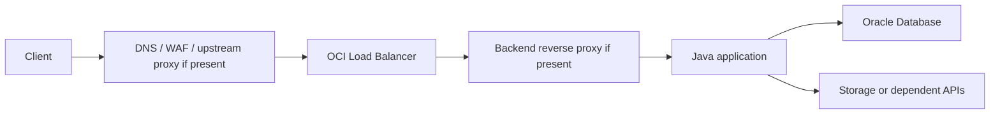

# Analyzing 502, 503, Timeouts, and Backend Connection Errors

When users receive a 502 or 503 error through a load balancer address, you cannot immediately conclude the load balancer itself is broken. The status code might be generated by OCI Load Balancer, returned by a backend reverse proxy, or actively rejected by the application itself. With timeouts, the client may even close the connection before receiving any HTTP response.

This lesson is part of the **Application Load Balancing** chapter of the **CLOUD_PROVIDERS_ORACLE** module. We connect tenancy, compartment, IAM, VCN, and Compute knowledge with applications, Oracle Database, and storage to diagnose from evidence, recover cleanly, and avoid changes that increase load or cost without addressing the real root cause.

After this lesson, you will be able to:

- Distinguish the meanings of 502, 503, 504, and client-side timeouts.
- Identify which component originated an error using access logs, error logs, and application logs.
- Inspect each leg: DNS, TCP, TLS, HTTP, health checks, and dependencies.
- Distinguish connection timeouts, idle timeouts, keep-alive, and processing deadlines.
- Choose remediation, retry, and verification steps suited to the root cause.

## Diagram the Request Path Before Reading Error Codes

An application can sit behind multiple intermediary layers:



If OCI LB's backend is another reverse proxy, "backend" in LB logs refers to that proxy component, not necessarily the final Java process.

Before attempting fixes, record:

| Detail | Purpose |
| --- | --- |
| Hostname, protocol, and port | Identify the exact entry point |
| Region, compartment, and LB OCID | Avoid investigating the wrong resource |
| Listener, routing rules, and backend set | Determine where requests can be forwarded |
| `IP:port` of each backend | Check the exact endpoint |
| Timestamp and time zone | Correlate logs across multiple systems |
| Method, path, and request/trace ID | Follow a single request across layers |
| Most recent change | Form hypotheses around config, deployment, or load |

Separate **data plane** errors from **control plane** errors. An HTTP 503 when a client calls a business API via the application hostname differs from a 503 when an admin tool calls the OCI API to update the LB. Those two requests have different endpoints, logs, and investigation steps.

## Understand Error Types Without Guessing Root Cause from a Single Code

| Observed result | Initial meaning | Insufficient to conclude |
| --- | --- | --- |
| `502 Bad Gateway` | A gateway/proxy did not receive a valid upstream response | That the backend is definitely shut down |
| `503 Service Unavailable` | The responding component cannot currently serve, often due to overload or maintenance | That no healthy backends remain |
| `504 Gateway Timeout` | Gateway/proxy did not receive an upstream response in time | That simply raising a timeout will fix it |
| Client reports timeout | A timer on the client or library expired | That the LB returned 504 |
| Connection refused/reset | Connection was refused or closed/reset | A single specific network cause |
| TLS handshake failure | TLS negotiation/verification could not complete | That TCP could not connect |

Standard definitions of HTTP status codes are described in [RFC 9110: 502, 503, and 504](https://www.rfc-editor.org/rfc/rfc9110.html#section-15.6.3).

Specifically for OCI LB, having no eligible backend to serve traffic can surface as **502**. Do not mechanically apply rules of thumb like "no backend must mean 503" carried over from another product. See [common OCI LB errors](https://docs.oracle.com/en-us/iaas/Content/Balance/Troubleshooting/common_load_balancer_errors.htm).

A 503 response can also be generated by a Java application or backend proxy during maintenance, load shedding, or dependency failure. The first job is finding **who emitted that code**.

## Collect a Reproducible Error Sample

Choose a safe read request representative of the issue. Record separately:

- Whether an HTTP status was received.
- Which IP the client actually connected to.
- TCP connect time, TLS time, time to first byte, and total request time.
- Response headers related to request ID or retry.
- Frequency and scope: all requests, one URL, one backend, or peak hours only.

If the issue occurs on a POST with side effects, do not resend it blindly just to gather samples. Use test data or the application's reconciliation/idempotency mechanisms.

### Windows PowerShell Example

Assuming `curl.exe` is available and the hostname is an environment you are authorized to test:

```powershell
$Url = 'https://REPLACE_WITH_REAL_HOSTNAME/api/health'
$Format = 'http_code=%{http_code} remote_ip=%{remote_ip} connect=%{time_connect} tls=%{time_appconnect} ttfb=%{time_starttransfer} total=%{time_total}\n'

curl.exe --silent --show-error --include --connect-timeout 3 --max-time 15 --write-out $Format $Url
Write-Output "curl_exit=$LASTEXITCODE"
```

Timings reported by curl are in seconds. They are cumulative milestones from the start of the transfer, not independent segments to add together.

The command above omits `--fail`: curl can exit with code 0 even when the HTTP response is 502 or 503. Always read `http_code` too. If no HTTP response was received, `http_code` may be `000`; that is not an HTTP status returned by a server.

`--max-time 15` is the total cap for this probe. If the application needs more than 15 seconds, the probe itself actively aborts before receiving a result. That is an observation about the client deadline, not proof that the gateway timed out.

See the [official curl documentation](https://curl.se/docs/manpage.html) for `--connect-timeout`, `--max-time`, and `--write-out` variables.

### Testing Frontend IP Directly While Preserving Hostname

When separating a DNS hypothesis from a specific frontend:

```powershell
$HostName = 'REPLACE_WITH_REAL_HOSTNAME'
$LbIp = 'REPLACE_WITH_LB_IP'
$ResolveEntry = $HostName + ':443:' + $LbIp
$Url = 'https://' + $HostName + '/api/health'

curl.exe --silent --show-error --include --connect-timeout 3 --max-time 15 --resolve $ResolveEntry $Url
```

The hostname in the URL must still match the certificate and application configuration. This bypasses any other proxies/WAFs that DNS normally points to; explicitly note that the path changed.

Do not call `https://<IP>` and treat a certificate hostname mismatch as proof that frontend TLS is broken. Nor should you treat skipping certificate verification as a configuration fix.

## Using Access Logs to Locate the Error Source

OCI LB provides access logs and error logs via OCI Logging. Logging is optional; verify it is enabled and that you have permissions to view the right logs. Enabling logs after an incident does not retroactively capture earlier requests. See [logging for Load Balancer](https://docs.oracle.com/en-us/iaas/Content/Balance/Tasks/managingloadbalancer_topic-Logging.htm).

Useful fields in access logs:

| Field | Used to inspect |
| --- | --- |
| `lbStatusCode` | Response code sent from LB to client |
| `backendStatusCode` | Response code received from backend |
| `backendAddr` | Backend `IP:port` that handled the request |
| `listenerName` | Listener that accepted the request |
| `request` | Request method/path/protocol |
| `backendConnectTime` | Time to establish backend connection |
| `backendProcessingTime` | Window receiving backend response per log definition |
| `requestProcessingTime` | Total processing time at LB |

The documentation defines access log timing fields in seconds. Verify the actual log record schema instead of assuming every field sits at the exact JSON path seen in online examples. See [LB logs reference](https://docs.oracle.com/en-us/iaas/Content/Logging/Reference/details_for_load_balancer_logs.htm).

### Reading LB/Backend Status Pairs

| Illustrative observation | Investigation direction |
| --- | --- |
| LB `502`, backend has no code | May not have received an HTTP response; check eligibility, TCP, TLS, and error logs |
| LB `502`, backend `502` | Backend returned `502`; follow that backend/proxy's logs to the next upstream |
| LB `503`, backend `503` | Evidence shows backend generated `503`; check maintenance, overload, or dependencies |
| LB `504`, backend has no code | Check connection/idle timeouts and backend failing to respond in time |
| Backend `504` | Backend may be a proxy waiting on another upstream |
| No access record found | Check time window, filters, logging enabled, ingestion delay, and request path before concluding |

Status pairs guide investigation; they are not exhaustive rules for every setup. An empty field means no value was recorded in that entry; never fill it in with a guessed code.

### Abbreviated Record Example

```json
{
  "lbStatusCode": "502",
  "backendStatusCode": "",
  "backendAddr": "10.0.20.12:8443",
  "listenerName": "https-orders",
  "request": "GET /api/orders/health HTTP/1.1"
}
```

These are extracted and simplified fields for illustration, not the complete OCI Logging JSON envelope.

A reasonable hypothesis is that the LB did not receive a valid HTTP status from that backend. Error logs are needed to distinguish TLS errors, reset connections, or having no serving backends. Do not look at port `8443` alone and assume the process is definitely speaking HTTPS.

## Using Error Logs to Choose the Next Test

Message groups that help classify issues:

| Error log information | Next check |
| --- | --- |
| No available backends | Backend list, health, drain/offline flags, and connection limits |
| Connect timeout | Routes, security rules, firewalls, backend listening state, and return path |
| Connection refused | `IP:port`, listening process, and whether something actively rejects |
| Connection reset or abrupt close | App/proxy closing connections, restarts, keep-alive, or protocol mismatch |
| SSL handshake/certificate | Backend TLS config, CA, certificate chain, and required hostname |
| Health response mismatch | Path, method, code, body/regex, and virtual host |
| Backend fails to respond in time | Queues, threads, pools, database, and dependent APIs/storage |

OCI notes that "no available backend" situations occur not only when the list is empty or health checks fail, but also when backends reach connection limits. A healthy backend is not guaranteed to still have capacity for new requests. See [OCI LB connection and backend errors](https://docs.oracle.com/en-us/iaas/Content/Balance/Troubleshooting/common_load_balancer_errors.htm).

Do not widen searches across every log in the tenancy from the start. Filter by resource, time window, and relevant backend to correlate events cleanly.

## Checking Configuration and Health with Read Operations

In the Console or CLI, re-read:

- The listener actually receiving requests and the selected backend set.
- Backend IP, port, weight, and drain/offline flags if any.
- Health check protocol, port, path, and expected code/body.
- TLS on the listener and TLS on the backend set.
- Session persistence and fallback settings.
- Relevant connection limits and timeouts.

Bash example without modifying resources:

```bash
LB_OCID='REPLACE_WITH_LOAD_BALANCER_OCID'
BACKEND_SET='REPLACE_WITH_BACKEND_SET_NAME'
REGION='ap-singapore-1'

oci lb load-balancer get --region "$REGION" --load-balancer-id "$LB_OCID"
oci lb backend-set get --region "$REGION" --load-balancer-id "$LB_OCID" --backend-set-name "$BACKEND_SET"
oci lb backend-set-health get --region "$REGION" --load-balancer-id "$LB_OCID" --backend-set-name "$BACKEND_SET"
```

These commands require an authenticated OCI CLI with read permissions on the resources. See [get backend set](https://docs.oracle.com/en-us/iaas/tools/oci-cli/latest/oci_cli_docs/cmdref/lb/backend-set/get.html) and [get backend set health](https://docs.oracle.com/en-us/iaas/tools/oci-cli/latest/oci_cli_docs/cmdref/lb/backend-set-health/get.html).

Current status does not substitute for data from the time of the error. A backend healthy at 15:10 does not prove it was healthy during an incident at 15:00; correlate health history, logs, and deployments.

## Testing Backend Connectivity Layer by Layer

The test vantage point must be chosen intentionally. A laptop outside the VCN failing to reach a private backend may be completely expected by design.

Prefer a diagnostic host with appropriate routes and network scope. Even a host in the same subnet is not completely identical to the LB's path: NSGs, source IPs, routing, and firewalls still must be compared.

### Is the Process Actually Listening?

Example on a Linux backend:

```bash
ss -lntp '( sport = :8080 )'
curl --silent --show-error --include --connect-timeout 2 --max-time 5 http://127.0.0.1:8080/health/ready
```

Check:

- Whether it is the right process and port.
- Whether the process binds only `127.0.0.1` or listens on the address the LB reaches.
- Whether the local endpoint returns the expected response.
- Whether any proxy/container port mapping differs from the application port.

A successful local request proves part of the application works from that host itself; it does not prove the LB can connect across the VCN.

### Can a Host in the VCN Establish TCP?

Linux example:

```bash
nc -vz -w 3 10.0.20.12 8080
```

Or from Windows with reachability to the backend:

```powershell
Test-NetConnection -ComputerName 10.0.20.12 -Port 8080
```

A successful TCP connection does not confirm HTTP/TLS or business logic. A failed ping also does not prove TCP is blocked, because ICMP and TCP have separate rules.

| Result | Careful interpretation |
| --- | --- |
| Connection refused | Possibly no listening process or something actively rejecting |
| Timeout | Possibly dropped, wrong route, missing return path, or unresponsive target |
| TCP succeeds, HTTP fails | Move to inspecting protocol, request, and application |
| Local succeeds, remote fails | Check bind address, firewall, and network path |

Refer to [OCI backend TCP/HTTP checks](https://docs.oracle.com/en-us/iaas/Content/Balance/Reference/troubleshooting_backend.htm).

### Verify Routes, NSGs, Security Lists, and Firewalls

Tabulate the flows that must be allowed:

| Flow | What to verify |
| --- | --- |
| Client → frontend listener | Right public/private visibility, protocol, port, and allowed sources |
| LB → application backend | Right destination, port, and rules on both sides |
| Health checker → backend | Right check protocol/port; do not confuse with data traffic |
| Backend → dependencies | Database, storage, or APIs reachable and responsive |
| Return flow | Matching routes, security rules, and stateful handling |

OCI NSGs/security lists and OS firewalls are separate layers. One layer allowing traffic does not prove the other layer allows it.

If using stateless rules, carefully check both forward and return directions. If combining NSGs with security lists, evaluate the full effective rule set. See [OCI security rules](https://docs.oracle.com/en-us/iaas/Content/Network/Concepts/securityrules.htm).

You do not need to open every port or expose backends to the Internet just to test one application port. Fix the exact identified flow scope and retest.

When packet observation on a backend is needed, an illustrative command limiting packet count:

```bash
sudo tcpdump -nn -i any -c 50 'host 10.0.10.8 and tcp port 8080'
```

Replace the address with the real peer and run on a host authorized for diagnostics. This command does not require printing payloads with `-A` or `-X`.

Signals to distinguish:

- Inbound SYN seen with no SYN-ACK returned: check local listener, firewall, and host responsiveness.
- No matching packets seen at backend: check observation point, filters, and upstream hops.
- Handshake completes followed by RST: check which party sent RST and corresponding logs.
- Request arrives, backend stays silent for a long time: inspect queues, processes, and dependencies.
- Backend sends response yet client still errors: inspect the return path and upstream proxies.

A capture on one machine reflects only that vantage point; do not use it to assert the entire network path is healthy.

## Testing HTTP Exactly Like Real Requests

When the backend uses HTTP, test from a host with an appropriate network path:

```bash
curl --silent --show-error --include --connect-timeout 3 --max-time 10 -H 'Host: orders.internal.example' http://10.0.20.12:8080/health/ready
```

Hostname and IP in the command are examples. Substitute your application's settings.

Compare these elements:

| Request element | Why it can cause differences |
| --- | --- |
| Method | `HEAD` and `GET` may be handled differently |
| Host | Backend may select a different virtual host |
| Path | Health check might hit a nonexistent path |
| Headers | Middleware or proxies may require/transform headers |
| Authentication | Endpoint might redirect to login |
| Protocol | Plaintext HTTP and HTTPS are not freely interchangeable |

Do not run `curl -I` and assume the `HEAD` result guarantees the `GET` health check passes. Nor should you test one trivial endpoint and conclude heavy business endpoints work.

An HTTP 401/403 from a test proves an HTTP component responded, not necessarily that the underlying business application accepted and processed the request.

## Checking TLS Between LB and Backends

Frontend TLS and backend TLS are two separate legs when the LB terminates client TLS and opens a new connection to the backend.

```text
Client -- frontend TLS --> LB -- backend TLS --> App/proxy
```

A valid frontend certificate does not prove the backend certificate chain or backend TLS configuration is right.

Groups to inspect:

- Whether the backend port actually speaks TLS rather than plaintext HTTP.
- Whether TLS versions/ciphers are compatible.
- Whether the certificate is valid and the CA chain is complete.
- Whether the trust store/CA configured on the LB matches.
- Whether hostname/SNI and verification settings match the configuration.
- If using mTLS, whether the caller supplies the required client certificate.

OCI documents backend handshakes and certificate errors as potential causes of 502. See [LB SSL/TLS troubleshooting](https://docs.oracle.com/en-us/iaas/Content/Balance/Reference/troubleshooting_ssl.htm).

### Using curl with the Right Hostname and CA

Bash example:

```bash
curl --silent --show-error --include --connect-timeout 3 --max-time 10 --resolve 'orders.internal.example:8443:10.0.20.12' --cacert /path/to/internal-ca.pem https://orders.internal.example:8443/health/ready
```

This tests a specific backend while preserving the hostname for TLS and HTTP. The CA path is a placeholder to replace.

Success with a CA on the diagnostic host does not prove the LB has the same CA, same SNI, or same verification policy. Compare configurations on both sides.

### Using OpenSSL When Inspecting the Handshake

```bash
openssl s_client -connect 10.0.20.12:8443 -servername orders.internal.example -verify_hostname orders.internal.example -CAfile /path/to/internal-ca.pem -verify_return_error -showcerts < /dev/null
```

Inspect negotiation output, certificate chain, and verification result. `-verify_hostname` and `-verify_return_error` ensure the test does not merely print certificates while ignoring verification failures.

See [openssl s_client documentation](https://docs.openssl.org/3.5/man1/openssl-s_client/).

SNI in this test sends whatever name the diagnostic host specifies. Do not treat it as proof the LB actually sends the same name; verify the behavior of the active configuration.

Never disable certificate verification as a long-term fix for chain or hostname errors. Fix the identified certificate, trust, or target configuration.

## Health Checks: Healthy Is Not Enough, Unhealthy Needs Explanation

Health checks and user requests can differ in protocol, port, path, `Host`, authentication, or checked dependencies.

| Observation | Possibility to consider |
| --- | --- |
| TCP health healthy, business HTTP fails | Port is open yet app/proxy is not serving properly |
| Health returns 301/302 | Redirecting, likely differing from expected code |
| Health returns 401/403 | Affected by auth/authz layer or access rules |
| Health returns 404 | Wrong path or virtual host |
| Code matches yet health still fails | Body/regex, timeout, or another condition mismatches |
| Health flaps continuously | Slow app, restarts, high load, or poorly tuned thresholds |
| Healthy yet receives no new requests | Capacity, drain/offline, routing, or persistence to check |

Do not change the expected code to whatever status happens to come back just to turn the chart green. For example, accepting 503 as healthy hides the fact that the application is unready.

A readiness endpoint should return status meaningful for request readiness. Design a dedicated endpoint that exposes no internal secrets and has architecturally scoped access, rather than requiring the health checker to log in like a user.

If all backends go unhealthy together, check shared faults: same deployment, same expired CA, same edited network rule, or same failed dependency. Do not just reboot instances one by one when the root cause lies in a shared component.

See [LB health check troubleshooting](https://docs.oracle.com/en-us/iaas/Content/Balance/Reference/troubleshooting_health.htm).

## Investigating 503 by Originating Component

When `backendStatusCode` shows the backend returned 503, follow the request inside the backend:

1. Is this a reverse proxy or the final application?
2. Was there a deployment, maintenance mode, or readiness change?
3. Is there load-shedding when queues/threads/connection pools fill up?
4. Is a dependency failing or a circuit breaker open?
5. Is only one instance returning 503 or the whole group?
6. Does error rate rise alongside RPS, connections, or latency?

For instance, an application may reject extra work when its pool is full. Increasing LB bandwidth does not directly increase worker threads or valid database connections.

If 503 appears on the client with no corresponding LB log entry, check layers ahead of the LB: a reverse proxy, WAF, or gateway may have terminated the request. Absence of logs is only a clue requiring verification of collection settings, timestamps, and filters.

If the response includes `Retry-After`, that hint can help clients pick when to retry. It does not guarantee the next attempt will succeed. The meaning of 503 and this header are described in [RFC 9110](https://www.rfc-editor.org/rfc/rfc9110.html#section-15.6.4).

Do not apply an OCI control-plane API policy directly to business 503 errors. For example, retrying an admin command after a service error is very different from resending an order-creation request the application may already have processed.

## Analyzing Timeouts with a Time Budget

"Timeout" must always carry two facts: **who is counting** and **which interval is being counted**.

| Timeout type | Interval to understand |
| --- | --- |
| Client connect timeout | Connection setup duration per client config |
| Client total deadline | Total time client accepts for the request |
| LB/backend connection timeout | Time to establish connection to backend |
| Listener idle timeout | Duration without matching I/O during processing phase |
| Backend keep-alive idle | How long an idle connection is kept for reuse |
| Application deadline | Processing budget for one business request |
| Database/API timeout | Limit on a single dependency call |
| Health check timeout | Allowed wait for a health probe |

A client timeout is not an HTTP response. For example, the client stops waiting after 5 seconds while the application finishes after 8 seconds: the client saw an error, yet server-side processing may have succeeded.

This is especially important for write operations. Before retrying, determine whether the prior attempt may already have committed.

### Idle Timeout Differs from Total Deadline

OCI describes listener idle timeout as the interval between consecutive send/receive operations during the HTTP request-response phase. It is not a single clock capping total processing duration across all request patterns.

With HTTP/WebSocket, sending data does not automatically reset the timer for the receive direction and vice versa. Therefore, "the app is still sending heartbeats" is not enough to conclude every timer is being reset.

Current documentation states default listener timeouts are 60 seconds for HTTP and 300 seconds for TCP; inspect the actual listener value before assuming "it fails at exactly 60 seconds". See [OCI LB timeouts and connection reuse](https://docs.oracle.com/en-us/iaas/Content/Balance/Reference/connectionreuse.htm).

### Keep-Alive Can Cause Intermittent Errors

The LB reuses backend connections. If a backend server closes an idle connection sooner than the LB expects to reuse it, some requests can encounter close/reset errors.

OCI documentation states the LB closes idle backend connections after more than 300 seconds and recommends backends not close idle connections earlier than 310 seconds to avoid related 502s. This is guidance for the documented keep-alive mechanism, not a directive to set every application timeout to 310 seconds. See [keep-alive settings](https://docs.oracle.com/en-us/iaas/Content/Balance/Reference/connectionreuse.htm).

Separate keep-alive from application deadlines, health check timeouts, and database timeouts. They govern different wait intervals.

### Example Budget for a Synchronous API

Suppose the business chooses these targets:

| Layer | Illustrative value |
| --- | --- |
| Database call | Max 2 seconds per operation, capped call count |
| Application deadline | 8 seconds for the full request |
| Client total deadline | 12 seconds |
| LB idle timeout | 10 seconds in a non-streaming response design |

These are lesson assumptions, not a universal default set to copy.

The application must account for pool wait time, execution, sequential dependencies, retries, and sending the response. Five queries, each capped at "max 2 seconds", can already exceed an 8-second deadline before counting anything else.

A 10-second LB idle timeout and a 12-second client total deadline are two different types of timers; do not create a generic rule merely by ordering numbers from smallest to largest. For streaming or uploads, design and test separately.

### When Should You Increase a Timeout?

There is justification to consider it when:

- Legitimate work genuinely requires longer than the current limit.
- Backends have capacity and are not merely building queues.
- Clients and upstream proxies have matching budgets.
- The impact of holding connections/resources longer has been evaluated.
- Tests confirm both latency and success rate.

If most time goes to slow queries or pool contention, increasing timeouts may simply grow queues and surface failures later. For long work like generating large reports, consider an asynchronous job design instead of keeping HTTP requests open for a very long time.

OCI documents that 504 can occur when a backend connection cannot be established in time or the backend fails to respond before the idle timeout; inspect both networking and application behavior. See [diagnosing backend timeouts](https://docs.oracle.com/en-us/iaas/Content/Balance/Reference/troubleshooting_backend.htm).

## Connected Yet Slow: Looking Inside Java and Dependencies

Gather data from the same failure window:

- CPU, memory, GC pauses, and restart timestamps.
- Request-handling threads: running, blocked, or waiting.
- Queues and concurrency limits.
- Connection pools: active, idle, pending, and wait times.
- Database query latency, locks/waits, and connection errors.
- Storage latency, dependency DNS, or external API delays.
- Whether timeouts/cancellations actually propagate down to dependencies.

Low CPU does not rule out a stalled backend: many threads may be blocked waiting on database or I/O. Healthy TCP checks also do not reflect business queues.

Adding backends can increase total connections to the database. If the database is the bottleneck, uncontrolled application autoscaling can make things worse.

A useful hypothesis should be specific:

> During the error window, backends still accept requests but wait on the database pool. Pending pool requests rise alongside backend processing time; errors drop when pressure on the dependency decreases.

This statement is far easier to test than "weak backend" or "slow network".

## Intermittent Errors Require Grouping

When 90% of requests succeed and 10% fail, do not look only at overall LB health.

| Comparison group | What it can reveal |
| --- | --- |
| By `backendAddr` | One misconfigured or mismatched-version backend |
| By listener/backend set | A specific TLS/routing path failing |
| By path/method | Heavy endpoint, auth, or specific protocol |
| By time after idle | Potential connection reuse issue |
| By deploy/restart | Warm-up, drain, or readiness gap |
| By load/connections | Queue, `maxConnections`, or dependency limit |
| By client/affinity | Persistence pinning clients to a failing backend |

Do not conclude error share must equal exact backend weight ratios. Keep-alive, affinity, retries, and uneven load can make ratios diverge from naive equal-split intuition.

Keep one successful sample and one failing sample under conditions as similar as possible. Compare backends, paths, and timestamps before changing multiple configurations at once.

## If Network Load Balancer Sits in Front of the Application

NLB does not process HTTP like a Layer 7 reverse proxy. If a client goes through NLB and receives 502/503, look at HTTP components behind it or another proxy in the path; do not assume NLB generated that code.

TCP, TLS, application, and dependency checks remain useful, while the network portion must check:

- Actual NAT/source preservation mode.
- Source IP seen by the backend.
- Separate rules for client traffic and health checks.
- Flow idle timeouts and reconnect behavior.
- Appropriate return path, especially in appliance models.

With source preservation, backend rules allowing only the NLB subnet may fail to match packets carrying real client IPs. See [NLB source preservation](https://docs.oracle.com/en-us/iaas/Content/NetworkLoadBalancer/BackendSets/preserve-backend-set-source-id.htm).

Do not use LB metric names or HTTP access log schemas assuming NLB provides the same data. OCI notes NLB network activity can be observed through VCN flow logs; pick telemetry appropriate to the service. See [NLB introduction](https://docs.oracle.com/en-us/iaas/Content/NetworkLoadBalancer/introduction.htm).

## Three Illustrative Investigation Chains

The scenarios below are synthetic examples of reasoning, not real incident records.

### 502 After Rotating Backend Certificate

**Observation:** errors start after deploy, TCP health stays healthy, access logs show LB 502 with no backend HTTP status.

**Next evidence:** error logs show backend handshake failure; direct TLS check shows the new certificate chain does not match the CA configured on the LB.

**Action:** fix chain/trust per design, check each backend, and confirm consistent TLS configuration.

**Verification:** requests through the LB succeed with certificate verification, handshake errors stop rising, and every backend is tested.

TCP health missed this failure because it only checks TCP establishment.

### 503 Appearing Only Under Load

**Observation:** both LB and backend record 503; backend access logs contain the corresponding requests.

**Next evidence:** the application actively rejects requests because its queue is full; most workers are waiting on the database pool while LB bandwidth has plenty of headroom.

**Action:** mitigate immediate impact using application load-shedding controls, and address the root-cause queries/pool or dependency. Only scale backends after confirming the database can handle total connections.

**Verification:** measure successful completions, latency, queues, and pools under representative load. Do not check only the HTTP status of one lightweight request.

### Client Timeout Without a Matching 504

**Observation:** client reports timeout after 5 seconds; backend logs completion after about 8 seconds.

**Next evidence:** client total deadline is 5 seconds; server keeps processing after the client closes the connection.

**Action:** establish valid business time budgets, propagate cancellation where appropriate, and design reconciliation for write operations. If legitimate work needs longer, revise deadlines or adopt an asynchronous model.

**Verification:** clients receive results within the new budget or receive job status; write operations are not duplicated by retries.

The conclusion here is not "5-second LB timeout", but that the client stopped waiting before the server finished.

## Controlled Recovery and Verification

A remediation change must tie to an evidence-backed hypothesis:

1. Record error scope and baseline metrics before changing anything.
2. Pick the smallest verifiable change.
3. If taking a failing backend out of service, confirm remaining backends have sufficient capacity and handle sessions properly.
4. Fix the right protocol, certificate, network rule, health check, or application issue.
5. Re-read applied configuration and operation status if applicable.
6. Test over the real user path, not just local on the backend.
7. Monitor error rate/latency under appropriate load long enough to catch intermittent errors.
8. Roll back to the prior configuration if the change misses its goal and rollback remains safe.

Do not restart all backends simultaneously to test a hypothesis affecting only one instance. Nor should you bypass health checks or widen network rules broadly to mask an ununderstood failure.

### Retries Must Account for Unknown Outcomes

Bounded retries with backoff and jitter help avoid slamming an overloaded system with synchronized traffic. If `Retry-After` is present, factor that hint into client deadlines and retry budgets.

For requests with side effects, a timeout does not prove the previous attempt was not executed. Require idempotency keys, status lookups, or application-provided reconciliation before resending. If multiple layers retry, control total attempts rather than looking at each layer in isolation.

One successful retry does not replace fixing why the first request failed.

## Recording Evidence-Based Incident Conclusions

A short report should answer:

| Item | Required content |
| --- | --- |
| Scope | Endpoint, clients, listener/backend set, and time window |
| Symptom | 502/503/504 or timeout/reset/TLS, frequency, and impact |
| Error source | Component that emitted the response or closed the connection |
| Evidence | Status code pairs, `backendAddr`, timings, error logs, and app logs |
| Root cause | Identified failing configuration or condition |
| Remediation | Specific change and rationale |
| Verification | Results across frontend, health, load, and sessions |
| Prevention | Alerts, deployment checks, certificate management, or capacity |

When handing off to application, network, or OCI support teams, include request IDs, resources, timestamps, and filtered log samples so they can continue the same investigation thread.

Effective troubleshooting moves from **failing request → originating component → connection leg → evidence → change → verification**. A 502, 503, or the word "timeout" is the starting point of that process, not the root cause.
