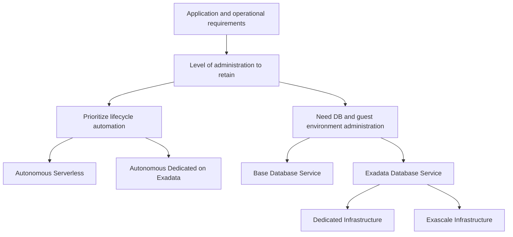

# Choosing Base Database, Autonomous Database, and Exadata

## Objectives and Context

In the **Oracle Database on OCI** chapter, choosing a database service determines more than CPU count or storage capacity. It defines who is responsible for patching, the level of administrative access, how connections are established from the VCN, the recovery strategy, and which components drive long-term costs.

This lesson places three selection tracks within Oracle Cloud Infrastructure (OCI): **Base Database Service**, **Autonomous Database**, and **Exadata Database Service**. Learners will build a requirements profile, screen options, validate through testing, and record an actionable decision that works alongside IAM, networking, Compute, monitoring, and automation.

Oracle documentation currently uses the name **Autonomous AI Database** for the Autonomous Database line. This lesson uses "Autonomous" when referring to that service model; the selection still starts from the application's data and operational requirements. The catalog of Oracle Database services on OCI can be referenced at [Oracle: Database Services](https://docs.oracle.com/en-us/iaas/Content/Database/home.htm).

Service names and variant details in this lesson were verified on **November 20, 2026**. When planning a new deployment, verify the regions, versions, editions, shapes, and commercial terms actually available to your tenancy.

## 1. Distinguishing Operational and Infrastructure Models

The three names in the topic do not sit entirely on the same comparison axis:

- **Base Database Service:** provides a DB system on VMs to run Oracle Database with relatively broad administrative control.
- **Autonomous Database:** focuses on database lifecycle automation and reducing platform administration work.
- **Exadata Database Service:** provides Oracle Database on Exadata infrastructure with different deployment variants.

Autonomous can run on Exadata. Therefore, "Autonomous or Exadata" should be clarified as "what level of automation, on what infrastructure model." Autonomous Serverless and Autonomous Dedicated are two infrastructure options of the Autonomous service. [Oracle: Autonomous Database FAQs](https://www.oracle.com/database/technologies/datawarehouse-bigdata/adb-faqs.html).



The diagram is a way to organize selection questions, not a rigid exclusion rule. A workload must also be evaluated for compatibility, recoverability, resources, and cost before finalizing a service.

### A Common Point of Confusion

The development team says: "We need a dedicated database, so we have to buy dedicated Exadata."

The word "dedicated" can mean many things: a dedicated schema, a dedicated database, dedicated compute resources, a dedicated VM cluster, or dedicated hardware. Before selecting a service, explicitly state the isolation layer and the control evidence required by the organization. Each interpretation leads to a different option and cost level.

Similarly, "need full control" must be translated into concrete operations: which initialization parameters need changing, what OS access is needed for, which software must be installed, or whether creating users and managing schemas is all that is required. An unclear requirement easily leads a project team to pick a more complex model than necessary.

## 2. Base Database Service: Retaining Operational Control

Base Database Service provides a DB system on VMs along with management tools via the Console, API, CLI, and database tools. Customers are still responsible for applying operating system and database updates according to service guidelines. [Oracle: About Oracle Base Database Service](https://docs.oracle.com/en/cloud/paas/base-database/guide/about.html).

This is the candidate to evaluate when an existing application depends on DBA procedures, configurations, or administrative components that the project team wants to continue controlling. For example, a business system with standardized maintenance scripts, on-call operations staff, and an update schedule coordinated across multiple applications.

Using Base Database does not mean the project team has to manually build every component as if installing Oracle Database on a standard Compute VM. Take advantage of service-supported automation while clearly assigning who prepares changes, who executes them, and who verifies that the application works afterward.

### Questions to Answer

| Question | Why it affects the choice |
| --- | --- |
| Which database versions/editions is the application certified for? | Avoids choosing a configuration unsupported by the application vendor |
| Are guest OS administration or agent installations required? | Identifies control needs outside the schema |
| Is the DBA team responsible for patching and recovery? | Checks actual operational capability |
| How are backup/restore procedures verified? | Incorporates recovery requirements into the initial design |
| Is additional HA configuration needed? | Do not assume HA solely from the service name |

### Notes for New Provisioning in 2026

Oracle announced the retirement of `VM.Standard.x86`, the `Enterprise Edition - Extreme Performance` edition, and OCPU-based SKUs for Base Database, effective **July 31, 2026**. Existing deployments continue running, but new provisioning and renewals are affected; documentation points toward `VM.BaseDB.x86` using ECPU or ExaDB-XS depending on the workload. [Oracle: notice in the Base Database guide](https://docs.oracle.com/en/cloud/paas/base-database/guide/about.html).

The documentation also describes single-node and multi-node RAC DB systems. However, do not rely on a shape/edition table from an older guide as proof of new RAC provisioning capability. For RAC requirements, verify the service, edition, and SKU combinations currently offered at design time.

Separate two tasks: **inventorying running systems** and **choosing configurations permitted for new creation**. An option already existing in a tenancy is not necessarily repeatable for a new project.

## 3. Autonomous Database: Prioritizing Lifecycle Automation

Autonomous automates tasks such as provisioning, backup, patching, and database resource management. With Serverless, users do not have to build or manage the underlying server infrastructure. [Oracle: What is Oracle Autonomous AI Database?](https://docs.oracle.com/en-us/iaas/autonomous-database-serverless/doc/autonomous-intro-adb.html).

This path is worth shortlisting for testing when the application team wants to focus on schemas, SQL, data, and feature development while accepting the service's administrative boundaries.

### Serverless and Dedicated

| Autonomous Variant | Suitable Use Case to Evaluate |
| --- | --- |
| Serverless | Starting at the database level, minimizing dedicated infrastructure planning |
| Dedicated Exadata Infrastructure | Needing infrastructure isolation and broader operational policy control |

Serverless uses Exadata infrastructure resources managed by Oracle under a shared model. Dedicated provides infrastructure isolated to a tenant and adds control over policies, maintenance schedules, and workload organization. Dedicated is still the Autonomous model. [Oracle: differences between Autonomous Serverless and Dedicated](https://www.oracle.com/database/technologies/datawarehouse-bigdata/adb-faqs.html).

"Serverless" does not mean there are no servers, no limits, or no bill. Designers must still determine resource levels, storage, scaling policies, and how to track consumption appropriate for the workload.

### Automation Does Not Eliminate Application Responsibility

In the Autonomous responsibility model, Oracle performs the platform tasks managed by the service; the customer remains responsible for application security, data access permissions, and application query performance. [Oracle: Autonomous Database Responsibility Model](https://docs.oracle.com/en/cloud/paas/autonomous-database/shared-responsibility-model.html).

Tasks the project team must still handle include:

- Designing appropriate schemas, indexes, and transactions.
- Managing application accounts, secrets, and least-privilege permissions.
- Designing connection pools, timeouts, and handling interrupted connections.
- Monitoring business response times and slow queries.
- Defining recovery needs, data retention, and testing restores.
- Assessing the impact of application changes after each release.

An inefficient SQL statement or a transaction holding locks for too long does not automatically become good design just because the service has extensive automation.

### Compatibility Must Be Verified

Autonomous supports most common SQL/PLSQL but restricts certain statements and administrative operations; for example, `ALTER SYSTEM` is only allowed in documented cases. [Oracle: SQL Commands on Autonomous Database](https://docs.oracle.com/en-us/iaas/autonomous-database-serverless/doc/autonomous-sql-commands.html).

Therefore, do not use "it is the same Oracle Database so it can migrate as-is" as proof of compatibility. Inventory high-privilege scripts, OS file access, integrations, database links, and scheduled jobs, then test critical flows on the target variant.

Dedicated does not automatically remove every Autonomous administrative restriction. If the core requirement is deep guest OS access or keeping DBA procedures unsupported by Autonomous, consider another service model or revise the application design.

## 4. Exadata Database Service: Choosing the Infrastructure Variant Too

Exadata is a platform engineered for Oracle Database. When evaluating Exadata Database Service, specify the deployment model rather than using the single name "Exadata" for every configuration.

### Dedicated Infrastructure

In the Exadata Database Service on Dedicated Infrastructure model, Oracle manages the physical infrastructure and underlying layers; the customer is responsible for maintaining the guest VM OS, Grid Infrastructure, and database software, with cloud automation support. [Oracle: Exadata Dedicated roles and responsibilities](https://docs.oracle.com/en/engineered-systems/exadata-cloud-service/ecscm/exa-service-desc.html).

This is an evaluation candidate for database portfolios needing administrative control, consolidation, and Exadata capabilities, while having an operations organization capable of managing the layers remaining under customer responsibility.

If hardware isolation is required, verify the appropriate dedicated resource layer in the design. If you only need database separation or operations team separation, dedicated hardware should not be assumed mandatory by default.

### Exascale Infrastructure — ExaDB-XS

ExaDB-XS provides a VM cluster experience on Exadata infrastructure managed by Oracle in a multi-tenant shared model. Users can start with smaller VM/storage configurations and scale out; this model differs from dedicating an entire Dedicated infrastructure. [Oracle: Exadata Database Service on Exascale Infrastructure](https://docs.oracle.com/en/engineered-systems/exadata-database-exascale/index.html).

Exascale is therefore an option to include in comparisons when you want Exadata without sufficient justification to dedicate a large infrastructure. It does not automatically turn a workload into the Autonomous model; the project team must still define all administrative responsibilities per the service.

Check database versions, editions, capacity, scalability, and HA features on the exact variant. Do not copy an entire resource diagram from Exadata Dedicated onto Exascale.

### Cloud@Customer

Oracle's portfolio also includes Exadata Database Service on Cloud@Customer and Autonomous on Exadata Cloud@Customer. These services place the infrastructure inside the customer's data center with the corresponding cloud service model. [Oracle: Database Services catalog](https://docs.oracle.com/en-us/iaas/Content/Database/home.htm), [Oracle: Autonomous infrastructure options](https://www.oracle.com/database/technologies/datawarehouse-bigdata/adb-faqs.html).

If the requirement is to keep hardware on the organization's premises, open a Cloud@Customer evaluation track along with facility, connectivity, and operational requirements. That differs from placing a database in a private subnet of an OCI public region.

## 5. Requirements Screening Matrix

The table below suggests priority questions for each evaluation track. It is not a performance or price ranking table:

| Evaluation Track | Question to Prove First |
| --- | --- |
| Base Database Service | Can compatibility and administrative control requirements be met on currently supported new-provisioning configurations? |
| Autonomous Serverless | Is the application compatible and does the project team accept the service's administrative model? |
| Autonomous Dedicated | Beyond automation, is there justification for dedicated infrastructure isolation and custom operational policies? |
| Exadata Dedicated | Do workload and consolidation needs justify the value of dedicated infrastructure? |
| Exadata Exascale | Do the shared resource model and variant limits satisfy the requirements? |

Screen in this order:

1. **Mandatory conditions:** data residency, application certification, required features, and access requirements.
2. **Service objectives:** latency, throughput, growth, RPO, and RTO.
3. **Operational model:** DBA responsibilities, maintenance, incident response, and automation.
4. **Testing evidence:** compatibility, load, recovery, and connectivity.
5. **Total cost:** across options providing the same level of protection and service.

An option that fails mandatory conditions must be eliminated or paired with an approved requirement change plan. Do not use a low cost score to offset a feature the application cannot live without.

If multiple options meet all mandatory conditions, you can score soft criteria such as operational effort, scalability, and standardization. Weights should reflect the organization's priorities, not the presenter's priorities.

## 6. Designing IAM, Networking, and Connectivity During Selection

The right database service can still fail to deploy if the project team has not defined the connection path from the application and how permissions are granted to each role.

Distinguish three layers:

| Control Layer | Question to Answer |
| --- | --- |
| OCI IAM | Who can create, modify, view, or delete cloud resources in the compartment? |
| Networking | Which machines or services have a network path to the database endpoint? |
| Database | Which application accounts can log in and act on which objects? |

OCI resource management permissions do not automatically replace data permissions inside the database. Conversely, an account allowed to read a schema does not implicitly have permission to modify cloud infrastructure.

Recommended role separation includes an infrastructure management team, a DBA or data administration team, and an application operations team. Use compartments, policies, and database accounts to enforce those boundaries; avoid using one shared administrative account for all tasks.

### Connection Path Must Be Explicitly Mapped

```text
Application on Compute or application runtime platform
    → Permitted DNS and network route
    → Database endpoint
    → Encrypted and authenticated connection
    → Application database service / schema
```

With Autonomous, a private endpoint can be configured in a VCN. NSG, DNS, and TLS/mTLS choices must match how the application connects; read the exact connection string provided by the service. [Oracle: Configure Network Access with Private Endpoints](https://docs.oracle.com/en-us/iaas/autonomous-database-serverless/doc/private-endpoints-autonomous.html).

Do not assume every private endpoint configuration is incapable of having a public route: the service has specific networking options that must be reviewed at deployment time. Architecture documentation should explicitly state **private-only** or controlled public access along with permitted sources.

For Base Database or Exadata, confirm the subnet, NSG, DNS, service name, and connection address provided by the actual configuration. For RAC or failover mechanisms, do not replace the recommended connection string with a single node's IP just for quick connectivity testing.

Checks before finalizing an option:

- Which VCN is the application in, and which network is the database in?
- Does on-premises need access, and over which connection?
- Does DNS resolve from the exact location where the application runs?
- Are the driver and authentication method supported by the application environment?
- How will secrets, certificates, or wallets be stored and rotated?
- Does the connection pool recover properly after database maintenance or role transitions?

A single successful login using an admin tool only proves one connection path. Test from the application runtime environment using the exact account and driver intended for production.

## 7. Choosing HA/DR Based on RPO and RTO

Two objectives must be recorded as requirements:

- **RPO — Recovery Point Objective:** acceptable limit of data loss, typically expressed as a data time window.
- **RTO — Recovery Time Objective:** target time window to restore service availability after an interruption.

For example, "RPO no more than 5 minutes, RTO no more than 30 minutes" is a hypothetical application requirement. It does not confirm that any service configuration automatically meets those two numbers.

### Distinguishing Protection Layers

| Protection Layer | Goal to Evaluate |
| --- | --- |
| Local fault tolerance | Continue serving when a single component fails |
| Standby / switchover & failover | Restore serving role when the primary is no longer usable |
| Backup and point-in-time recovery | Recover data prior to a bad operation or incident |
| Cross-region option | Reduce dependency on a single deployment region |
| Application connection recovery | Return users to the business workflow |

RAC, standby, and backups address different scopes. Even with multiple instances serving a single database, you still need a plan for data corruption and cluster-wide failures. A continuously updated replica also does not replace every need to recover data from before an erroneous change.

Base Database supports Data Guard configurations per service terms: primary and standby maintain data via redo transport and apply mechanisms. Edition and topology choices must meet documented requirements. [Oracle: About Oracle Data Guard on Base Database](https://docs.oracle.com/en/cloud/paas/base-database/guide/dg-about.html).

Autonomous Serverless provides recovery options, including Autonomous Data Guard with local or cross-region standby depending on configuration. Select an option matching RPO/RTO rather than assuming all instances have the same protection level. [Oracle: About Standby Databases](https://docs.oracle.com/en-us/iaas/autonomous-database-serverless/doc/autonomous-data-guard-about.html).

With Exadata, include the failure domains of the infrastructure, VM cluster, and database in the concrete HA/DR design. The Exadata name does not automatically confirm a cross-region standby exists or that data recovery has been tested.

### Recovery Evidence Must Include the Application

A drill should measure at least:

1. Time when the outage starts or the failover/switchover command is issued.
2. Time when the target database is ready for connections.
3. Time when the application resumes successful transactions.
4. Committed transactions reconciled at the target.
5. In-flight requests requiring retries or manual intervention.
6. Total elapsed time and additional resource costs.

If the database recovers in a few minutes but the application keeps using broken connections for an extended period, the system has not met the user-required RTO. The database team and application team should jointly confirm success criteria.

## 8. Comparing Total Cost for the Same Service Level

A primary-only option cannot be fairly compared against an option with standby, cross-region replicas, and a recovery testing schedule by looking solely at the CPU unit price line.

Recommended estimation framework:

```text
Total cost of the option
    = compute / database resources
    + dedicated infrastructure or corresponding underlying resources
    + data storage and recovery area
    + backups and retention
    + standby / remote replicas
    + networking and supporting services
    + operational, drill, and change-handling effort
```

Actual SKU catalogs differ across services. Oracle publishes billing lines for Base Database, Autonomous, Exadata Dedicated, and Exascale; build a table matching the exact variant, metric, and licensing model. [Oracle: Base Database Pricing](https://www.oracle.com/database/base-database-service/pricing/), [Oracle: Autonomous Database Pricing](https://www.oracle.com/autonomous-database/pricing/), [Oracle: Cloud Price List](https://www.oracle.com/cloud/price-list/).

This lesson does not prescribe a unit price or a "cheapest" ranking table. Estimates must record the region, currency, lookup date, contract terms, and accompanying workload assumptions.

### ECPU, OCPU, and Resources Are Not Benchmarks

When encountering documentation using ECPU or OCPU, confirm the exact metric of the selected SKU. Do not treat the same CPU number between two models as proof that performance, connection limits, or costs will be equivalent.

Example of calculating consumed resource quantity, with completely hypothetical numbers:

```text
In one day:
8 compute units × 6 hours = 48 unit-hours
2 compute units × 18 hours = 36 unit-hours
Total = 84 unit-hours
```

This calculation does not yet include storage, backups, standby, or underlying infrastructure. When a model supports scaling, estimates should include baseline load, peak load, and sustained scale-up periods triggered by a query or application bug.

### License Included and BYOL

If a service offers License Included and Bring Your Own License (BYOL) options, verify usage rights, editions, options, conversion metrics, and support contracts with the license management team. An option name appearing in the Console does not prove the organization holds the corresponding BYOL entitlement.

For Base Database, Oracle specifies support requirements for licenses brought to the service. For ExaDB-XS, documentation describes both License Included and using existing licenses per service terms. [Oracle: Base Database support requirements](https://docs.oracle.com/en/cloud/paas/base-database/guide/about.html), [Oracle: ExaDB-XS licensing considerations](https://docs.oracle.com/en-us/iaas/exadb-xs/doc/overview-exadb-xs-service.html).

### Cost of Short-Lived Tests

Do not assume "creating for just a few minutes" means paying for only a few minutes across all components. For example, ExaDB-XS documentation states a minimum infrastructure billing duration of **48 hours** per provisioned VM. [Oracle: ExaDB-XS metering and billing](https://docs.oracle.com/en/engineered-systems/exadata-database-exascale/exdxs/overview-exadb-xs-service.html).

Therefore, start with a requirements profile and an estimate. Only provision resources for a PoC once scope, budget, owner, and end schedule are defined. After testing, reconcile both remaining resources and components that continue accruing charges under the chosen model.

## 9. Applying to Three Selection Scenarios

The scenarios below are hypothetical to illustrate reasoning, not benchmark results or recommendations for an unassessed system.

### New Application, Small Team, No Guest OS Needed

A team is building a transactional application with standard SQL/PLSQL, does not need to install agents on the database host, and wants to minimize platform patching work.

**First PoC candidate:** Autonomous Serverless, provided compatibility and service quality are verified.

Required evidence includes the application connection path, schema permissions, latency at expected concurrency, data import/export capabilities, and recovery plan. If integrations require operations unsupported by the service, the team must compare the cost of modifying the application against another service choice.

Do not choose Autonomous simply because "we have no DBA." Someone or a team must still own data modeling, SQL, authorization, and recovery verification.

### Existing System Dependent on DBA Procedures

A legacy application has maintenance scripts, guest OS administration procedures, and specific vendor version certification requirements.

**Evaluation candidate:** Base Database on a currently supported configuration; add Exadata if feature, RAC, capacity, or consolidation requirements point in that direction.

Autonomous stays on the shortlist only if the project team has evidence that dependencies can be converted or replaced. "Schema import succeeded" is not sufficient proof that nightly operational jobs work properly.

Documentation should list genuinely mandatory administrative operations, avoiding a "full control" requirement simply because that is how the legacy system happened to be built.

### Multi-Database Portfolio with Isolation Requirements

An organization wants to consolidate multiple databases, has a DBA team, requires standardized operations, and needs to control isolation levels between workload groups.

**Evaluation candidate:** Exadata Dedicated or Exascale depending on infrastructure isolation needs, resource provisioning capacity, and load metrics. If the organization wants the Autonomous model on dedicated infrastructure, evaluate Autonomous Dedicated.

Measure resource contention when multiple databases run concurrently, recoverability, maintenance impact, and cost allocation per group. Large total storage capacity is one data point; it does not by itself prove Dedicated is the only option.

## 10. Practice: Inventorying and Building a Selection Dossier

### Gathering Information Without Creating New Resources

If you have read permissions in a lab tenancy, you can use PowerShell and OCI CLI to inventory two resource groups:

```powershell
$region = 'ap-singapore-1'
$compartmentId = 'ocid1.compartment.oc1..REPLACE_ME'

& oci db system list `
    --region $region `
    --compartment-id $compartmentId `
    --all `
    --output json

& oci db autonomous-database list `
    --region $region `
    --compartment-id $compartmentId `
    --all `
    --output json
```

These are list commands and do not create databases. Parameters and result scopes are described in [Oracle CLI: db system list](https://docs.oracle.com/en-us/iaas/tools/oci-cli/latest/oci_cli_docs/cmdref/db/system/list.html) and [Oracle CLI: autonomous-database list](https://docs.oracle.com/en-us/iaas/tools/oci-cli/latest/oci_cli_docs/cmdref/db/autonomous-database/list.html).

These two commands are not a complete inventory tool for all Exadata infrastructure. For Exadata, also check the corresponding Infrastructure, VM Cluster, or Exascale Storage Vault resource types in the Console. Do not conclude "a service is unsupported" just because a query in one compartment/region returns an empty list.

Record the service type, region, configuration, licensing model, and related resources. Do not include secrets, passwords, or wallets in the shared selection dossier.

### Building a Pre-PoC Requirements Table

| Category | Information to Collect |
| --- | --- |
| Business | Critical transactions, peak hours, acceptable outage windows |
| Data | Volume, growth, retention period, and sensitivity level |
| Compatibility | Version, edition, options, SQL/PLSQL, and integrations |
| Administration | Guest OS, scripts, agents, high privileges, and update procedures |
| Service quality | Throughput, p95/p99 latency, concurrency, and error rate |
| Recovery | RPO, RTO, failure scope, and cross-region requirements |
| Networking & security | VCN, connection sources, DNS, TLS, IAM, and data permissions |
| Operations & cost | Staffing, tooling, budget, licensing, and growth forecast |

Classify each row as **mandatory**, **preferred**, or **unknown**. Items marked "unknown" need an assigned owner and a plan to gather evidence; never silently convert them into favorable assumptions.

### Testing Compatibility on a Migrated Schema

After importing sample data into an authorized test environment, inspect objects in the schema itself:

```sql
SELECT object_type, status, COUNT(*) AS object_count
FROM user_objects
GROUP BY object_type, status
ORDER BY object_type, status;

SELECT name, type, line, position, text
FROM user_errors
ORDER BY name, sequence;
```

These queries help detect invalid objects and compilation errors within the schema; they do not prove full application compatibility. Proceed to run critical transactions, batches, scheduled jobs, and integrations using the test environment's actual application account.

Do not grant broad administrative privileges just to make a permission error disappear. Identify the operation's requirement and how the target service supports granting that permission.

### Measuring PoC with the Same Workload Profile

Standardize the dataset, query distribution, concurrency level, and success criteria. Separate cache warm-up phases from steady-state measurement phases, while recording actual resource configurations and scaling events.

The minimum evidence package should include:

1. Critical business flows execute accurately with data reconciliation.
2. Throughput, latency, and errors under both baseline and peak load.
3. Connection pool recovers after an authorized maintenance or interruption event.
4. Restore/failover capabilities measured against the defined RPO/RTO.
5. Operational tasks remaining with the project team have assigned owners.
6. Cost estimates updated from actual consumption and additional protection resources.

One candidate being faster on a small SELECT statement is not enough to beat another option. The goal is to select the configuration that meets the entire requirements profile with acceptable cost and operability.

## 11. Recording the Decision and Reassessment Conditions

You can use the following Architecture Decision Record template in the design dossier. The content is an example for the new application in the scenario above:

```text
Decision: Put Autonomous Serverless into the first PoC

Context:
- New application, no guest OS required.
- Operations team wants to reduce platform patching work.
- Network requirement: private connectivity from the application environment.

Conditions for deployment acceptance:
- Mandatory SQL/PLSQL flows and integrations pass testing.
- Load and recovery meet agreed targets.
- Data permissions and connectivity plan are confirmed.
- Cost estimate includes backup/DR and scaling scenarios.

Fallback options:
- Evaluate Base Database if a mandatory administrative requirement is discovered
  that cannot be met or replaced on Autonomous.
- Evaluate Exadata if feature, isolation, or capacity requirements
  are proven by the workload profile.

Reassessment triggers:
- Change in application certification requirements.
- Emergence of a guest OS dependency or unsupported feature.
- Growth altering performance, HA/DR, or budget needs.
- Service/SKU changes in the deployment region.
```

The service name is only part of the decision. A complete record must specify the variant, management model, network configuration, data protection method, owners, and testing evidence.

When explaining the choice, link each characteristic to a specific requirement: which permissions are needed, what was measured, which team operates it, and which costs were included. That reasoning turns choosing Base Database, Autonomous, or Exadata into an actionable, verifiable architectural decision.
