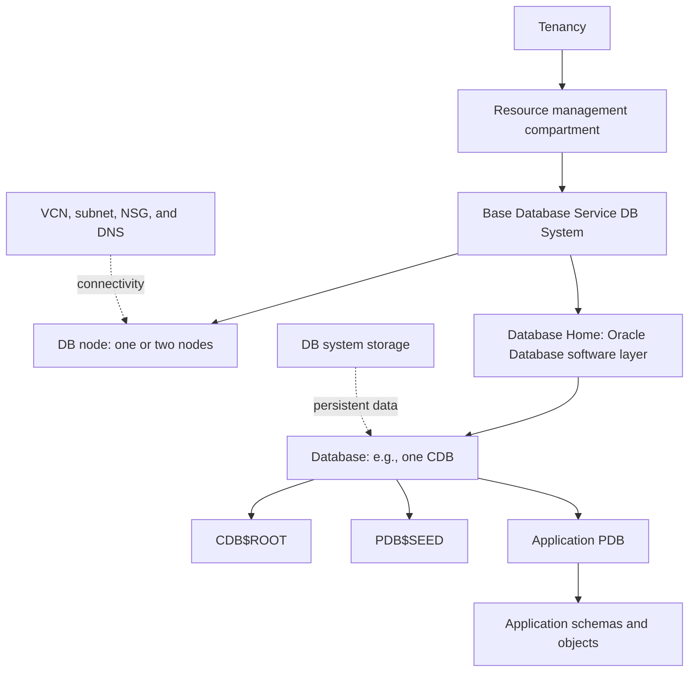
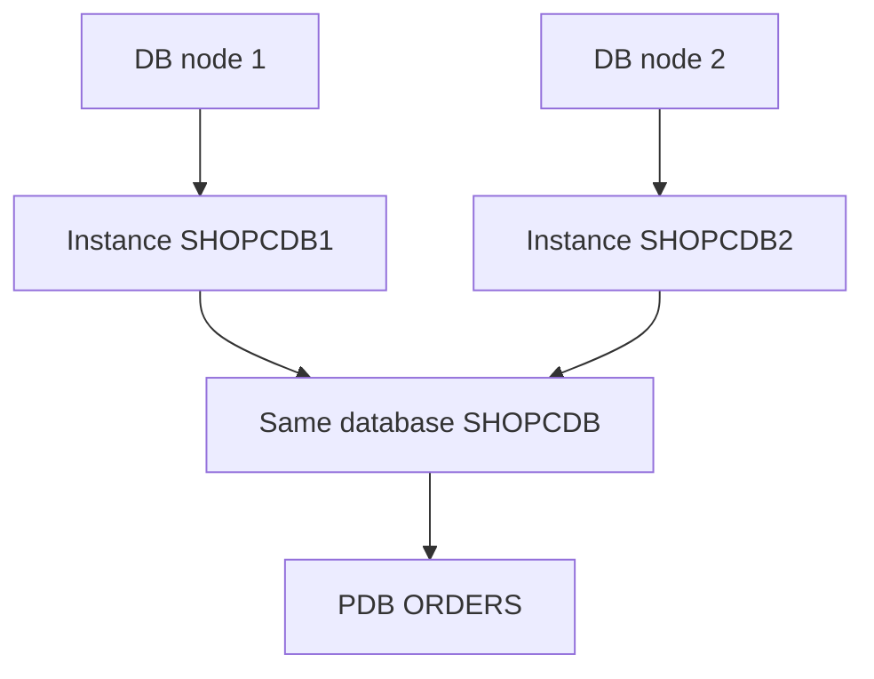

# DB System, Database Home, and Database Architecture

In the **Oracle Database on OCI** chapter, three resource names frequently appear together: **DB System**, **Database Home**, and **Database**. Understanding the relationship among them helps you choose the right place to configure resources, determine software update scope, and locate the exact database an application needs to connect to.

This lesson uses **Oracle Base Database Service on virtual machines** as the primary model. These resources exist within an OCI infrastructure context consisting of a tenancy, compartments, IAM, VCN, and storage. When moving to Exadata, read the resource model of the corresponding service; do not apply the Base Database diagram wholesale to every product named Oracle Database.

After this lesson, you will be able to:

- Explain the responsibilities of DB System, Database Home, and Database.
- Distinguish between DB node, database instance, CDB, PDB, schema, and connection service.
- Trace relationships across resources via the OCI Console or CLI.
- Reconcile OCI metadata with live state through read-only SQL queries.
- Identify the impact of infrastructure changes, software updates, backups, and access permissions.

## Base Database Service Resource Diagram

Base Database Service supports single-node DB systems and two-node RAC DB systems. Per Oracle's documented model, one DB system has **one Database Home**, containing **one database**; that database can contain multiple PDBs depending on version, edition, and applicable terms. [Oracle: About DB Systems](https://docs.oracle.com/en/cloud/paas/base-database/guide/dbs-about.html).

The following diagram illustrates the layers to inventory, not an operating system directory tree:



Example architecture for an orders application:

```text
Compartment:         DataDev
DB System:           shop-dev-db-system
Database Home:       software layer for SHOPCDB
Database/CDB:        SHOPCDB
Application PDB:     ORDERS
Application schema:  APP_ORDERS
Application service: orders_app.<db-domain>
```

The names above are illustrative values. Do not infer PDB names, service names, or installation paths solely from the DB System display name.

## DB System: The Infrastructure Scope Running the Database

A DB System is the OCI resource encapsulating the database runtime environment in Base Database Service. When inspecting this layer, focus on deployment location, nodes, compute resources, storage, and network connectivity.

| Information Group | Questions to Answer |
| --- | --- |
| Identity | Which DB System OCID, compartment, and region? |
| Compute | What shape and amount of resources are allocated? |
| Node | Is the system single-node or a two-node RAC configuration? |
| Network | Which subnet is attached, which NSG is used, and how does DNS resolve? |
| Storage | What capacity is provisioned and what is the growth requirement? |
| Operations | What is the current state, operation history, and infrastructure update status? |

A DB System is not just another name for a data table or a schema. For example, increasing compute capacity is an infrastructure-layer decision; adding an `ORDERS` table is an operation inside the database.

When creating a DB system, OCI provisions the environment supporting Oracle Database and creates the database per the supplied configuration. Default creation workflow options may include creating a CDB and a new Database Home. [Oracle: Overview of Creating a DB System](https://docs.oracle.com/en/cloud/paas/base-database/guide/dbs-create.html).

Practical implication: one creation action in the Console can provision multiple related components. Creating them in the same workflow does not erase the identity and responsibility boundaries of each layer.

### DB Node Is Where Processes Run

A DB node represents a node of the database system. It hosts the operating system, network addresses, and required Oracle processes. OCI provides a dedicated API/CLI to list nodes by DB System; for other services, the locating parameter may be a VM cluster. [Oracle CLI: db node list](https://docs.oracle.com/en-us/iaas/tools/oci-cli/latest/oci_cli_docs/cmdref/db/node/list.html).

Do not treat a DB node like an arbitrary Compute instance and modify its shape, volumes, or networking using procedures meant for application VMs. Database system changes must follow service-supported operations to stay consistent with management automation.

## Database Home: The Oracle Database Software Layer

Database Home is where the Oracle Database software is installed. At the OCI layer, DB Home is a resource with its own identifier and metadata; at the OS layer, Oracle home corresponds to the software installation directory. [Oracle CLI: db db-home list](https://docs.oracle.com/en-us/iaas/tools/oci-cli/latest/oci_cli_docs/cmdref/db/db-home/list.html).

Information typically reconciled at this layer includes:

- DB Home OCID and associated DB System.
- Oracle Database version and software patch level.
- Operational state of the DB Home.
- Recorded installation location, if surfaced by the tool in use.

Illustrative path example:

```text
/u01/app/oracle/product/<release>/dbhome_1
```

That path is not an OCID. Identical path strings on two different hosts are also insufficient to prove they represent the same cloud resource.

Distinguish further:

| Name | Administrative Meaning |
| --- | --- |
| DB Home OCID | Identifier of the Database Home resource in OCI |
| Oracle home / `ORACLE_HOME` | Software location or selected software environment on the host |
| Database version | Software version to reconcile against the running database |
| Grid Infrastructure home | Oracle infrastructure software layer with its own update cycle when used |

Database Home does not mean "all business data" just because its name contains the word database. Copying the software directory is not a complete database backup.

For automation, retrieve home information from the appropriate resource or management tooling. Do not hard-code a home path across deployment scripts and assume that path always remains valid after updates or environment changes.

## Database: Database Resource and Persistent Data

In OCI, Database is the resource used to inspect database metadata, its associated DB Home, and operational configurations. In Oracle architecture, a database also refers to the set of persistent data structures, including data files, control files, and online redo logs. Each file group plays a distinct role in storing data and recovery. [Oracle: Physical Storage Structures](https://docs.oracle.com/en/database/oracle/oracle-database/19/cncpt/physical-storage-structures.html).

| Component | General Role |
| --- | --- |
| Data files | Store database data |
| Control files | Describe structure and state information needed for operations/recovery |
| Online redo logs | Record changes supporting recovery mechanisms |

Example inference: an application can report errors because a PDB is not open even though the software in DB Home still exists. Conversely, database software issues do not mean all data files have vanished. During incident response, identify which layer is failing before choosing a recovery method.

Do not determine data file locations by appending the database name to the `ORACLE_HOME` path. Storage layout depends on service configuration and storage management mechanisms; data may be managed via ASM or other supported storage options.

## Database Instance: What Runs in Memory

A **database instance** comprises the memory structures and Oracle processes used to access a database. A single-instance setup has one instance attached to the database; RAC has multiple instances accessing the same database. One instance attaches to one database at a time. [Oracle: Oracle Database Instance](https://docs.oracle.com/en/database/oracle/oracle-database/19/cncpt/oracle-database-instance.html).

Runtime diagram illustrating RAC:



This diagram does not imply each node holds an independent copy of the database. In RAC, distinguish having multiple instances from having multiple database copies for disaster recovery.

Three distinct questions:

```text
How many nodes?       -> infrastructure inventory
How many instances?   -> Oracle runtime inventory
How many databases?   -> database resource/data inventory
```

For example, a two-node system does not automatically imply two CDBs or two independent copies of business data. Runtime queries also depend on which nodes and instances are active at the time of inspection.

This is why "the instance stopped" needs more context. It may refer to a database instance, whereas "a node stopped" refers to a broader infrastructure scope.

## Where Do CDB, PDB, and Schema Reside?

In the multitenant architecture, a CDB has a root named `CDB$ROOT`, a seed `PDB$SEED`, and application PDBs. A PDB is a collection of schemas, objects, and related structures presented to applications as a logically separate database. [Oracle: Overview of the Multitenant Architecture](https://docs.oracle.com/en/database/oracle/oracle-database/19/multi/overview-of-the-multitenant-architecture.html).

Logical example:

```text
CDB SHOPCDB
├── CDB$ROOT
├── PDB$SEED
├── PDB ORDERS
│   ├── Schema APP_ORDERS
│   │   ├── Table ORDERS
│   │   └── Table ORDER_ITEMS
│   └── Schema REPORT_READER
└── PDB INVENTORY
    └── Schema APP_STOCK
```

This is a conceptual diagram and does not claim every edition or configuration allows the exact PDB count shown. Supported counts and features must be verified against the environment's version, edition, and terms.

`PDB$SEED` is an Oracle-supplied template for creating PDBs. Application data belongs in an appropriate PDB rather than placed in the root simply because an admin account can connect there. [Oracle: Creating and Configuring a CDB](https://docs.oracle.com/en/database/oracle/oracle-database/19/multi/creating-and-configuring-a-cdb.html).

A schema is the namespace of objects owned by a user within the corresponding database/container. Creating an application schema does not create another VM, DB System, or Database Home. Likewise, adding a PDB does not automatically provision a dedicated server for that PDB.

Because the PDBs in the example share a foundation, they can be mutually impacted when system resources are exhausted or CDB-wide operations occur. When evaluating environment isolation, consider both data boundaries and infrastructure boundaries.

## Identifiers Commonly Confused

| Identifier | Scope | What Is It Used For? |
| --- | --- | --- |
| DB System OCID | OCI | Calling APIs to operate on the DB System |
| DB Home OCID | OCI | Inspecting the exact database software layer |
| Database OCID | OCI | Locating the Database resource |
| DB node OCID | OCI | Locating a node of the system |
| `DB_NAME` | Oracle Database | Database name in Oracle configuration |
| `DB_UNIQUE_NAME` | Oracle Database | Unique name used in related administrative contexts |
| `DBID` | Oracle Database | Internal Oracle database identifier |
| Instance name / SID | Oracle runtime | Instance identifier in the relevant context |
| PDB name | CDB | PDB/container identifier |
| Database service name | Oracle Net | Selecting the service a client connects to |
| Schema/user name | Inside container | Object owner and database identity |

A numeric `DBID` value cannot substitute for OCI CLI's `--database-id`, because that parameter requires an OCID. Nor is a service name a Database Home path.

Operational records should explicitly specify the type of each ID. For example, "database ID" without context easily leads readers to confuse the Oracle engine ID with the cloud OCID.

## Connection Services Route Applications to the PDB

A database service defines the client connection context and can support operational goals such as workload classification. The CDB's default administrative service is not a substitute for an application service; Oracle recommends PDB-level application services in the multitenant model. [Oracle: Overview of Connecting to a DB System](https://docs.oracle.com/en/cloud/paas/base-database/guide/connect.html).

Illustrative connection flow:

```text
Java application
  -> hostname or SCAN and listener port
  -> application service orders_app.<db-domain>
  -> PDB ORDERS
  -> user APP_ORDERS
  -> application tables
```

Illustrative JDBC URL by service name:

```text
jdbc:oracle:thin:@//<db-host-or-scan>:1521/<application-service-name>
```

In this pattern, the part after `/` is the service name, not an OCID or Database Home name. Use the actual connect descriptor and security configuration of the environment; manage passwords separately from the URL. [Oracle JDBC: Data Sources and URLs](https://docs.oracle.com/en/database/oracle/oracle-database/19/jjdbc/data-sources-and-URLs.html).

Example design mistake: an application opens a connection successfully but lands in `CDB$ROOT`, then cannot see tables in `ORDERS`. The first step is to check the service and connected container, rather than recreating the tables in root.

With RAC, use the connection details provided for the appropriate model and verify DNS from where the client runs. Do not replace the hostname with a single node address just for a quick connection and treat that as a high-availability application setup.

## Authorization Across Three Access Layers

Three permission layers must be verified independently:

| Layer | Resources or Activities |
| --- | --- |
| OCI IAM | List/get resources, modify cloud configuration, and invoke service operations |
| Host | SSH, OS users, and permission to run tools on the DB node |
| Database | User authentication, SQL privileges, roles, and object access rights |

Example policy to support inventorying core resources in a lab compartment:

```text
Allow group DbInventoryReaders to inspect db-systems in compartment DataLab
Allow group DbInventoryReaders to inspect db-nodes in compartment DataLab
Allow group DbInventoryReaders to inspect db-homes in compartment DataLab
Allow group DbInventoryReaders to inspect databases in compartment DataLab
```

Resource types and list/get APIs are documented in Oracle's policy reference. This covers inventory permissions, not every activity in this lesson; viewing PDBs requires the corresponding permission granted additionally by an administrator. [Oracle: Policy Details for Base Database Service](https://docs.oracle.com/en/cloud/paas/base-database/guide/policy-details.html).

Adjust group naming per your environment's identity domain if applicable. The policies above do not automatically grant SSH keys or SQL accounts to read business tables.

For applications, use a database user scoped to business needs. Having Console permissions to view metadata does not mean that person's application needs the `SYS` account to connect.

## Practice: Tracing from DB System to Database

This exercise uses an **existing Base Database Service DB System in a sandbox** and read-only operations. You do not need to create a new DB System just to learn how to distinguish resources.

### Preparation

You need OCI CLI configured in Bash or OCI Cloud Shell, appropriate list/get permissions, and the OCID of the lab DB System. The SQL section later additionally requires a database connection with separately granted privileges.

```bash
export OCI_REGION='ap-singapore-1'
export LAB_COMPARTMENT_OCID='<compartment-ocid>'
export LAB_DB_SYSTEM_OCID='<db-system-ocid>'
```

Replace the region with where the resource actually resides. All commands below are instructions for learners to run; placeholders are not directly usable values.

### Step 1: Read the DB System Layer

```bash
oci db system get \
  --region "$OCI_REGION" \
  --db-system-id "$LAB_DB_SYSTEM_OCID"
```

Record the OCID, compartment, display name, shape, node count, subnet, and lifecycle state from the output. The `get` command locates a single DB System by OCID. [Oracle CLI: db system get](https://docs.oracle.com/en-us/iaas/tools/oci-cli/latest/oci_cli_docs/cmdref/db/system/get.html).

If the resource is in a different compartment than initially assumed, re-verify scope and permissions before using the result to search child resources. Do not pick another resource simply because it shares a similar name.

### Step 2: List Nodes

```bash
oci db node list \
  --region "$OCI_REGION" \
  --compartment-id "$LAB_COMPARTMENT_OCID" \
  --db-system-id "$LAB_DB_SYSTEM_OCID" \
  --all
```

Reconcile the node count, identifiers, and state of each node against the expected configuration. `--all` fetches all pages on commands supporting this option.

This result checks the infrastructure layer; it does not replace querying how many database instances are currently active.

### Step 3: Locate and Read Database Home

```bash
oci db db-home list \
  --region "$OCI_REGION" \
  --compartment-id "$LAB_COMPARTMENT_OCID" \
  --db-system-id "$LAB_DB_SYSTEM_OCID" \
  --all
```

Select the DB System's home from the output, then use that home's ID:

```bash
export LAB_DB_HOME_OCID='<db-home-ocid-from-output>'

oci db db-home get \
  --region "$OCI_REGION" \
  --db-home-id "$LAB_DB_HOME_OCID"
```

Inspect the software version and relationship to the DB System. The `get` API/CLI uses the DB Home OCID, not the Oracle home path. [Oracle CLI: db db-home get](https://docs.oracle.com/en-us/iaas/tools/oci-cli/latest/oci_cli_docs/cmdref/db/db-home/get.html).

Do not arbitrarily grab the first element of a compartment list and assume it is the target home. Automation should check relationship IDs and handle empty or unexpected results.

### Step 4: Locate Database and Reconcile DB Home

```bash
oci db database list \
  --region "$OCI_REGION" \
  --compartment-id "$LAB_COMPARTMENT_OCID" \
  --db-system-id "$LAB_DB_SYSTEM_OCID"
```

This command lists databases by DB System and compartment. Do not assume filter flags from `db-home list` apply to another command; check which parameters the CLI actually supports. [Oracle CLI: db database list](https://docs.oracle.com/en-us/iaas/tools/oci-cli/latest/oci_cli_docs/cmdref/db/database/list.html).

Retrieve the Database OCID from the output:

```bash
export LAB_DATABASE_OCID='<database-ocid-from-output>'

oci db database get \
  --region "$OCI_REGION" \
  --database-id "$LAB_DATABASE_OCID"
```

Match `db-home-id` against the home from the previous step, then note the database name, unique name, and lifecycle state. `--database-id` requires the Database OCID. [Oracle CLI: db database get](https://docs.oracle.com/en-us/iaas/tools/oci-cli/latest/oci_cli_docs/cmdref/db/database/get.html).

If copying output into lab notes, keep only the fields needed for inventory. Connection strings and environment metadata should only be shared within the appropriate working scope.

### Step 5: View Service-Managed PDBs

```bash
oci db pluggable-database list \
  --region "$OCI_REGION" \
  --database-id "$LAB_DATABASE_OCID" \
  --all
```

This command supports filtering by database or compartment; this lesson uses the Database OCID to narrow the scope. [Oracle CLI: db pluggable-database list](https://docs.oracle.com/en-us/iaas/tools/oci-cli/latest/oci_cli_docs/cmdref/db/pluggable-database/list.html).

Distinguish the list of PDB resources managed by the service from the Oracle engine's container list. `PDB$SEED` is a system component; do not expect every row in a SQL container query to correspond to an application resource in the OCI list.

### Inventory Output to Capture

| Layer | Evidence |
| --- | --- |
| DB System | OCID, region, compartment, node configuration |
| Node | List of nodes belonging to the system |
| DB Home | OCID, associated DB System, version |
| Database | OCID, associated DB Home, DB name/unique name |
| PDB | Which database owns each application PDB |
| Connectivity | Which application service routes to the target PDB |

You do not need to modify configurations to complete this inventory exercise. When permissions are missing, explicitly note the unverified layer instead of inferring the entire system from a single screen.

## Reconciling via Read-Only SQL

This section applies to database sessions granted appropriate privileges. Querying dynamic performance views requires corresponding catalog read privileges; do not take a restricted application account and elevate its privileges just to run this lesson.

### Identifying Session Context

The following query shows which container and user the session is in:

```sql
SELECT
    SYS_CONTEXT('USERENV', 'CON_NAME') AS container_name,
    SYS_CONTEXT('USERENV', 'SESSION_USER') AS session_user_name,
    SYS_CONTEXT('USERENV', 'SERVICE_NAME') AS connected_service
FROM dual;
```

`CON_NAME` returns the current container name in the CDB. These values help verify whether the client landed in the intended PDB and service per design. [Oracle SQL Reference: SYS_CONTEXT](https://docs.oracle.com/en/database/oracle/oracle-database/19/sqlrf/SYS_CONTEXT.html).

Expected example for the orders application: container is `ORDERS`, user is the provisioned application account, and service matches the connection configuration. This is a target to verify in practice, not a fixed output for every system.

### Viewing Database and Current Role

In an administrative session with appropriate privileges:

```sql
SELECT
    name,
    db_unique_name,
    dbid,
    cdb,
    open_mode,
    database_role
FROM v$database;
```

`V$DATABASE` provides database information, including identifiers and relevant state. The `CDB` column indicates whether the database is a CDB. [Oracle Database Reference: V$DATABASE](https://docs.oracle.com/en/database/oracle/oracle-database/19/refrn/V-DATABASE.html).

Reconcile the name and unique name against OCI metadata. Do not compare the numeric `DBID` to an OCID and treat the mismatch as an error. Open mode must also consider database role: a standby or read-serving environment can validly have a different mode than a read-write primary system.

### Viewing Active Instances

```sql
SELECT
    instance_name,
    host_name,
    status,
    version
FROM v$instance;
```

`V$INSTANCE` describes the instance of the observed session, including instance name, hostname, and status. [Oracle Database Reference: V$INSTANCE](https://docs.oracle.com/en/database/oracle/oracle-database/19/refrn/V-INSTANCE.html).

If you need to inspect multiple instances in RAC and have the required privileges:

```sql
SELECT
    inst_id,
    instance_name,
    host_name,
    status
FROM gv$instance
ORDER BY inst_id;
```

`GV$` views gather information from eligible instances and include `INST_ID` to identify the data source. [Oracle RAC: Monitoring Performance](https://docs.oracle.com/en/database/oracle/oracle-database/19/racad/monitoring-performance.html).

The row count from a runtime check must be interpreted as of the inspection timestamp; a node undergoing maintenance or a stopped instance can make results differ from the expected topology.

### Viewing PDBs and Open Modes

In an appropriate administrative context at the root:

```sql
SELECT
    con_id,
    name,
    open_mode,
    restricted
FROM v$pdbs
ORDER BY con_id;
```

`V$PDBS` reports the name, open mode, and restricted status of PDBs. Open modes can include `MOUNTED`, `READ WRITE`, `READ ONLY`, and `MIGRATE`. [Oracle Database Reference: V$PDBS](https://docs.oracle.com/en/database/oracle/oracle-database/19/refrn/V-PDBS.html).

Do not open or close PDBs on your own during this inventory exercise. If the state differs from expectations, record the container, observed instance, and timestamp so the owner can determine the cause.

## Change Boundaries and Blast Radius

| Requirement | Layer to Inspect First | Example Impact to Evaluate |
| --- | --- | --- |
| Insufficient CPU or memory | DB System and runtime workload | Application capacity, operation duration, cost |
| Updating OS or Grid Infrastructure | Node/DB System per service procedure | Availability during maintenance |
| Updating Oracle Database software | Database Home and associated databases | Compatibility, downtime, and post-update checks |
| Adding an application PDB | Database/CDB | Shared resources and environment limits |
| Adding application tables or users | Appropriate PDB/schema | Privileges, naming, and data changes |
| Changing application URL | DNS, listener, service, and PDB | Endpoint routing, authentication, and connectivity |

Oracle provides separate update workflows for DB Systems and Database Homes, and recommends taking backups and testing updates in a non-production environment before applying them. [Oracle: Update a DB System](https://docs.oracle.com/en/cloud/paas/base-database/guide/dbs-update.html).

Updating a database also requires verifying DB System prerequisites and connectivity to required service endpoints. Oracle does not recommend arbitrarily modifying files inside Database Home. [Oracle: Update a Database](https://docs.oracle.com/en/cloud/paas/base-database/guide/db-update.html).

Design implication: swapping binary versions and verifying that the database completed its update steps must be coordinated. Do not simply change an `ORACLE_HOME` variable and consider the entire system upgraded.

An OCI `AVAILABLE` state also does not replace business verification: an application user can still lack privileges, a service may be misrouted, or a query may be slow due to shared resources.

## Backups and Recoverability Across the Architecture

Because Database Home is the software layer, data recovery must rely on an appropriate database backup/recovery strategy. Base Database Service provides procedures to recover to the latest state, a timestamp, or an SCN under supported conditions. [Oracle: Back Up and Recovery in Base Database Service](https://docs.oracle.com/en/cloud/paas/base-database/guide/br-about.html).

A recovery dossier should specify:

- The database to protect and its associated PDBs/workloads.
- Scope of data, configuration, and connection details to restore.
- Encryption keys and permissions needed to use data after recovery.
- Target infrastructure, networking, and services for the application to reconnect.
- RPO, RTO, and drill evidence aligned with system requirements.

RAC primarily addresses high availability scenarios at the runtime/cluster layer; it is not a reason to skip backups. For example, accidentally dropping a table is a logical change on the shared database, so having two instances does not bring the table back to its prior state.

During recovery, creating the VM or reinstalling the right home only completes part of the job. You must verify that the database opens in the right role, PDBs reach the expected state, and the application accesses the right data.

## Applying This Knowledge When Moving to Exadata

Exadata Database Service on Dedicated Infrastructure uses a model with Exadata infrastructure and VM clusters; additional Database Homes and databases can be created within supported limits. Thus, the one-DB-Home/one-database constraint of the Base model in this lesson is not a universal rule across all Oracle services. [Oracle: Creating an Exadata Cloud Infrastructure Instance](https://docs.oracle.com/en-us/iaas/exadatacloud/doc/ecs-create-instance.html).

Conceptual diagram highlighting the difference:

```text
Exadata infrastructure
  -> Cloud VM cluster
     -> Database Home A
        -> Databases matching home A
     -> Database Home B
        -> Databases matching home B
```

When managing Exadata, locate homes by VM cluster and databases by their actual home. Software sharing levels and update scope must be evaluated per the service's model, not inferred solely from display names.

Exadata Database Home administration documentation also specifies distinct operations and constraints, such as not deleting a home that still contains databases. [Oracle: Managing Oracle Database Homes on Exadata](https://docs.oracle.com/en-us/iaas/exadatacloud/doc/ecs-manage-dbhomes.html).

For Autonomous Database, continue using that service's resources and management workflows. This lesson does not ask Autonomous users to manage the OS or Oracle home the way Base Database Service does.

## Isolating Incidents at the Right Layer

| Symptom | First Check | Conclusion to Avoid |
| --- | --- | --- |
| DB System not visible in Console | Region, compartment, OCID, and IAM | The resource was definitely deleted |
| DB System looks healthy but app times out | DNS, route, NSG, listener, and service | Data is lost |
| Connects successfully but tables are missing | PDB, user, schema, and object privileges | Need to recreate tables in root |
| Software update fails | Exact update layer, prerequisites, and work history | Manually changing home path will fix it |
| Two nodes but only one instance observed | View context, runtime, and maintenance window | The system has two separate databases |
| Application PDB not serving | Open mode, service, and state on relevant instance | Entire DB System must be recreated |
| Insufficient storage for workload | Data capacity and related storage areas | Delete random files under Oracle home |

When escalating evidence to owners, prioritize OCID, region, timestamp, and affected layer. Separate OCI API errors, SSH errors, and Oracle SQL error codes so triage ownership is clear.

## Architectural and Cost Decisions from the Resource Model

Sharing a PDB or CDB across multiple workloads requires examining resources, maintenance, and blast radius. For instance, splitting two applications into two PDBs does not automatically split CPU, memory, infrastructure, and patch windows into two independent environments.

Self-check design example for two applications:

| Requirement | Architectural Question |
| --- | --- |
| Orders needs different maintenance than reporting | Does sharing a CDB satisfy both maintenance schedules? |
| Reporting runs heavy query batches | Are resource controls and impact testing on orders in place? |
| Dev must be independent from production | Are infrastructure and permission boundaries sufficiently isolated? |
| Want to reduce costs | At which layer can sharing occur while still meeting availability and recovery? |

DB Home is not a separate CPU unit for sizing capacity. Cost estimation must start from DB System resources, storage, backups, networking, and chosen operational services, then be validated with real workloads.

A solid inventory lets you answer three questions before any change: **which resource is being touched, which databases/workloads depend on it, and what evidence exists to recover if needed**.

## Self-Check Questions

- **Do DB System and database mean the same thing?** DB System is the operational environment scope in the service; Database is the database layer with its own identifier and configuration.
- **Is Database Home where all application data lives?** It is the software installation layer; database backups require a dedicated strategy.
- **Do two RAC nodes mean two independent databases?** Multiple instances can access the same single database.
- **Does adding a schema create another DB System?** No; a schema is an object namespace inside the appropriate container.
- **If you know the Database OCID, can you already run SQL connections?** You still need a network path, service, and appropriate database identity.
- **What should an application verify after connecting?** Container, service, user, and data access privileges per design.

The output of this exercise is a cross-referenced diagram and inventory table: which DB System provides infrastructure, which DB Home provides software, which Database holds the PDBs, and which service routes the application to the right data context.
