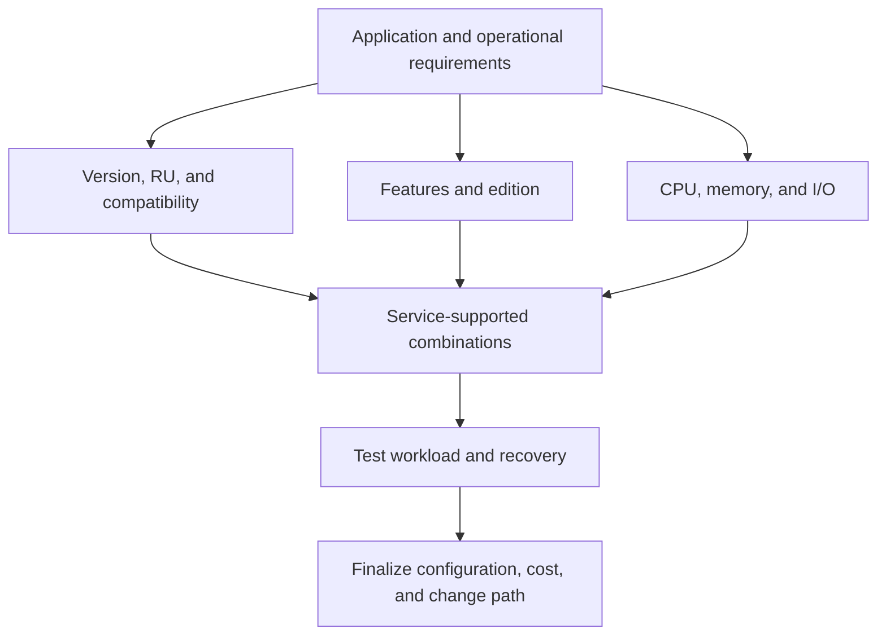

# Choosing Database Version, Edition, and Compute Shape

In the **Oracle Database on OCI** chapter of the **CLOUD_PROVIDERS_ORACLE** module, this lesson guides you in selecting a database configuration suite tailored to your application, features, performance, recoverability, and cost. The hands-on focus is **Oracle Base Database Service**, where implementers choose the database version, software edition, and DB system shape.

These three choices are interdependent. A version compatible with the application may be unavailable on the selected shape; an edition may lack required features; a configuration with enough CPU may fall short on memory or I/O bandwidth.

After this lesson, you will be able to:

- Distinguish between version, Release Update (RU), edition, license model, and shape.
- Check compatibility among the database, Java application, JDBC, and JDK.
- Choose an edition based on required features and actual usage scope.
- Read the service's shape/version catalog in the target region.
- Size compute from CPU, memory, I/O, and growth forecasts.
- Record a decision backed by evidence, a test plan, and a future change path.

## Define Service Scope Before Choosing Configuration

Oracle offers multiple database deployment models. Do not take an OCI Compute shape table and apply it verbatim across every database service.

| Scope | What to Determine First |
| --- | --- |
| Base Database Service | Supported combinations of DB system, edition, version, compute, and storage |
| Exadata Database Service | Corresponding infrastructure model, clusters, and database resources |
| Autonomous Database | Autonomous management and resource provisioning model |
| Self-installed on OCI Compute | Organization's installation, patching, operations, and licensing responsibilities |

In this lesson, shape names must come from the **Database Service** catalog. A VM name existing in the Compute catalog does not by itself prove it is a shape supported by Base Database.

The running example is a Java order-processing application. It handles transactional data, periodic hourly reports, and a scheduled backup plan. The deployment team must choose an initial configuration while retaining the ability to adjust as order volume grows.

## Start from Requirements, Not from Dropdowns

Before opening the DB system creation screen, gather at least:

| Category | Information Needed |
| --- | --- |
| Compatibility | Database versions certified by the application or vendor; JDK, JDBC, ORM |
| Functionality | Mandatory database features, data types, options, and admin tools |
| Load | Transactions per second, critical queries, active sessions, batches |
| Data | Current volume, growth rate, redo, temp, recovery area capacity |
| Performance | p95/p99 latency, batch duration, peak windows |
| Availability | Acceptable downtime, RTO/RPO targets |
| Operations | Patch windows, backup/restore, DBA skills, access permissions |
| Cost | Budget, license model, compute, storage, backups, and secondary environments |

A requirement like "around 300 users" is insufficient for choosing CPU. Users logged in while idle between inputs generate a different load than 300 concurrent sessions executing heavy queries.

Describe load using business metrics and measured telemetry: orders per minute, queries per order, report runtimes, truly active sessions, and target latency.



## Choosing Version: Release Number Alone Is Not Enough

### Distinguish Version Layers

| Information Layer | Meaning | What to Record |
| --- | --- | --- |
| Release family | E.g., Oracle Database 19c or Oracle AI Database 26ai | Feature scope and application certification |
| Release Update | Patch level of the release family | Exact version string of the selected image |
| Database Home | Software bundle serving the database | Home/image and patch schedule |
| Grid Infrastructure, OS | Underlying DB system components per configuration | Prerequisites for new creation, upgrades, or shape changes |
| Compatibility parameter | Such as `COMPATIBLE` | DBA-verified state, not just the Console label |

Do not record merely "19c" in documentation. Two environments on the 19c line with different RUs, one-off patches, or settings can behave differently.

Base Database documentation lists 19c, 21c, and 26ai; actual availability also depends on configuration. Always verify version and shape in the target environment rather than assuming every documented version can be provisioned on every shape. See [Base Database Service overview](https://docs.oracle.com/en/cloud/paas/base-database/guide/about.html).

### Choose by Certification and Operational Path

For existing applications, start from the certification matrix of the application and related components. If an application is certified only on a specific release line, resolve certification before picking a newer release just for additional features.

For new applications, evaluate a supported release line matching project lifespan, needed features, and the operations team's patching capability. A "higher version number" does not automatically prove faster workloads or lower migration risk.

For each candidate version, answer:

- Is it available in Base Database, the target region, and the planned shape?
- Is it a production release or a preview release?
- What support coverage remains under current Oracle policies?
- Have the application and driver been tested on the planned RU?
- Is there a schedule for applying subsequent updates?
- When upgrading, what are the OS, GI, backup, and downtime prerequisites?

OCI supports RU selection per service policy, with the latest approved release as the default choice and restrictions on older RUs. Do not pick a minimum RU from a compatibility table and treat it as the patch level to deploy today. See [Available Database Versions](https://docs.oracle.com/en/cloud/paas/base-database/guide/dbs-about.html).

### Compatibility with Java Applications

Check at least four distinct versions:

```text
JDK running the application
    + Oracle JDBC driver version
    + database version and RU
    + framework/ORM/connection pool version
```

Oracle publishes compatibility matrices for JDBC, database, and JDK. Do not force the JDBC major number to match the database release name; choose a supported combination. JDBC Thin does not require installing a native Oracle client like the JDBC OCI driver does. See [JDBC version compatibility](https://docs.oracle.com/en/database/oracle/oracle-database/26/jjdbc/JDBC-getting-started.html).

In test records, log the exact driver artifact and version. Writing only `ojdbc11` is insufficient because it is not the full library version number.

Verification does not stop at opening a connection. Test transactions, rollbacks, date/time types, Unicode, batching, stored procedures, timeouts, and critical queries. When changing database versions, you may need to compare execution plans and latency even if SQL still runs.

## Choosing Edition: From Features and Usage Scope

Edition is not a CPU speed dial. It determines the feature set, software usage rights under the service, and associated limits.

| Option | How to Evaluate |
| --- | --- |
| Standard Edition | Match requirements against the service package's Standard Edition 2 scope |
| Enterprise Edition | Check required Enterprise features and related options |
| Enterprise Edition High Performance | Reconcile features/options/packs included in the package |
| Enterprise Edition Extreme Performance | Check current availability status and roadmap for active workloads |
| Enterprise Edition Developer | Evaluate strictly for permitted development scope and specific limits |

Licensing documentation distinguishes BaseDB SE, BaseDB EE, BaseDB EE-HP, and BaseDB EE-EP, along with their respective options and management packs. Being present in the installation binaries does not mean a feature is licensed for use in every edition. See [Oracle Database Licensing Information](https://docs.oracle.com/en/database/oracle/oracle-database/26/dblic/Licensing-Information.html).

Build a feature table before choosing:

| Feature or Requirement | Actually Needed? | Evidence to Verify |
| --- | --- | --- |
| Run existing SQL/PLSQL workload | Yes | Compatibility and edition limits |
| Partitioning | Per data design | Availability and service package entitlement |
| Compression or advanced diagnostics | Per requirement | Applicable options/packs and license model |
| HA or standby | Per RTO/RPO | Service, edition, shape, and topology support |
| New features of a release line | Per application | Minimum version and availability by edition |

Do not choose EE-HP just because its name contains "High Performance" and expect the same workload and resources to automatically run faster. Identify the specific feature delivering value, then measure its effectiveness if used.

Likewise, an application needing one Enterprise feature does not necessarily require every higher tier. Select from the mandatory feature set and current service availability.

### Read SKU Change Notices Alongside Edition Tables

Base Database documentation includes a retirement notice for `VM.Standard.x86`, EE-EP, and OCPU-based SKUs effective **July 31, 2026**; existing deployments continue running, while new provisioning and contract renewals are affected. Documentation points toward `VM.BaseDB.x86` using ECPU or Exadata Exascale for appropriate workloads. See [notice in the service overview](https://docs.oracle.com/en/cloud/paas/base-database/guide/about.html).

Therefore, a table listing EE-EP or an OCPU shape in documentation is not enough to conclude new provisioning is allowed under the same terms. Distinguish:

- An existing DB system currently running.
- A configuration appearing in documentation or tooling.
- A configuration permitted for new provisioning under your environment and contract.

When RAC or a feature previously tied to a changed package is required, re-evaluate the service selection itself. Do not default to Base Database and pick an edition no longer available for new creation.

### Developer Edition Is Not a Low-Cost Production Environment

Base Database Service for Developers includes software licensing for development purposes, but infrastructure is still billed. It only supports A1 within published scope, imposes limits on PDBs, and does not provide RAC/Data Guard for this configuration. See [Base Database for Developers guide](https://docs.oracle.com/en/learn/base-db-for-developers/).

You can use it to learn SQL, test integrations, or develop within its limits. Do not extrapolate benchmark results from a constrained Developer PDB directly to production capacity, and do not treat it as a configuration you can promote to production with a simple label change.

## License Model Is a Separate Choice from Edition

| Option | Meaning to Verify |
| --- | --- |
| License Included | Service fee includes Oracle Database licensing for the chosen package |
| BYOL | Uses the organization's existing license rights under applicable terms |

These two concepts do not replace choosing an edition. A configuration still requires specifying version, edition, license model, and compute unit.

OCI describes License Included and BYOL at the DB system creation step. See [License type in DB system creation guide](https://docs.oracle.com/en/cloud/paas/base-database/guide/dbs-create-new.html).

For BYOL, you must have usage-rights records, feature scope, and calculation rules for the corresponding service. Do not select BYOL merely because the price estimator shows a lower figure and then attempt to reconcile licenses after deployment.

For monitoring tools, also verify which features or packs the tool uses. Being able to generate a technical report does not prove it falls under existing usage rights.

## Choosing Compute Shape: CPU, Memory, and Architecture

### Read the Exact Unit

Families may use OCPU or ECPU. Do not directly compare "8 OCPU" to "8 ECPU," or to vCPU counts from another service, and assume they are equivalent in performance or price.

A compute decision line should look like:

```text
Service + shape/family + compute model + unit count
+ allocated memory + node count + storage management
```

DB system documentation describes `VM.BaseDB.x86` using ECPU, while OCPU and Ampere A1 families also exist with different constraints. Version, storage, and topology combinations must be checked per family. See [About DB Systems](https://docs.oracle.com/en/cloud/paas/base-database/guide/dbs-about.html).

### DB Shape Memory Differs from Generic Flexible VMs

Do not assume RAM can be scaled independently of CPU at any arbitrary ratio. In Base Database, many families allocate memory proportionally to compute count.

For example, DB system creation documentation notes Base DB x86 allocates 8 GB per 4 ECPUs; AMD E4/E5 families allocate 16 GB per OCPU within published support ranges. These are characteristics of the service family, not a universal rule to convert OCPU to ECPU. See [Configure ECPU/OCPU](https://docs.oracle.com/en/cloud/paas/base-database/guide/dbs-create-new.html).

Implication: a memory-constrained workload may need to scale compute up just to receive more RAM. Costs change across the whole resource bundle, not solely for the CPU portion queries consume.

Memory budget should account for:

```text
Planned memory needed
  = SGA
  + PGA at target concurrency
  + operating system and agents
  + operational headroom
```

Do not assign all provisioned RAM to SGA. PGA can grow with session counts and sort/hash operations; concurrent reporting workloads have different characteristics than simple OLTP.

### x86 and Arm Require Checking Both Data Paths and Tooling

A Java application connecting over the network via JDBC Thin does not require the app host and database host to share the same CPU architecture. However, agents, native libraries, backup tools, and host-side migration steps still must be verified.

In particular, A1 DB systems have restrictions on changing to Intel/AMD and restoring backups across architectures. Do not assume you can choose A1 today and later use a standard shape-change workflow to switch to x86. See [Ampere A1 restrictions](https://docs.oracle.com/en/cloud/paas/base-database/guide/dbs-about.html).

Architecture selection should be paired with a data migration or recovery test along the supported path, rather than comparing compute prices alone.

## Sizing from Workload Measurements

### CPU: Capture Peaks and Latency Targets

Evaluate CPU utilization, concurrency, throughput, and p95/p99 together. A low daily average CPU can mask end-of-hour spikes when batches and transactions overlap.

An initial calculation for **the same family and same compute unit** can be:

```text
Projected compute
  ≈ measured compute
    × peak CPU utilization
    ÷ target CPU utilization
    × growth factor
```

Illustrative example:

```text
Measured: 8 units, peak CPU 75%
Target: 60%, expected growth 25%

Estimated compute = 8 × 0.75 / 0.60 × 1.25 = 12.5 units
```

Pick the next valid step in the catalog and re-test. This is a linear estimation model to shortlist candidates; it does not guarantee linear performance scaling, nor should it convert measurements between OCPU/ECPU or across different architectures.

If queries are waiting on locks, adding CPU may not resolve the root cause. Distinguish resource starvation from suboptimal query design, indexing, transactions, or concurrency patterns.

### I/O and Capacity: Do Not Look Only at CPU

Check IOPS, throughput, read/write latency, redo, temp, batches, and backups. Having 500 GB of data does not mean I/O demand matches every other 500 GB database.

Performance may be constrained by storage, network, or shape limits. Theoretical IOPS numbers on a screen are not a throughput guarantee for application queries. Measure using realistic access patterns and data sizes.

A test comparison table should include:

| Metric | Config A | Config B | Measurement Conditions |
| --- | --- | --- | --- |
| Transactions/sec | Measured value | Measured value | Same scenario and dataset |
| p95/p99 | Measured value | Measured value | Same active session count |
| Peak CPU | Measured value | Measured value | Same load window |
| Memory and temp | Measured value | Measured value | Concurrent batch active |
| I/O latency and throughput | Measured value | Measured value | Same storage configuration |
| Estimated cost | Calculated value | Calculated value | Same runtime and scope |

Hold other variables constant when testing one change. If you change version, shape, storage, and schema simultaneously, results rarely show which factor caused the difference.

### Headroom for Operations and Recovery

Measurements must include patching windows, backups, and major operational tasks. If standbys or multiple nodes exist, account for load when one component is out of service.

Backups do not automatically replace a standby, and more CPUs do not automatically create HA. Reconcile RTO/RPO against supported topologies before locking in a single-node setup purely for lower cost.

Generation-agnostic x86 shapes in the documentation carry single-node/LVM constraints. Hence, you cannot pick such a shape and arbitrarily add RAC nodes later. See [Generation-Agnostic X86 Shape](https://docs.oracle.com/en/cloud/paas/base-database/guide/dbs-about.html).

## Practice: Reading the Catalog with OCI CLI

This exercise produces a configuration shortlist table from the catalog. The commands below are read-only and do not provision a DB system.

Prepare an authenticated OCI CLI, appropriate read permissions in the compartment, and an Availability Domain name from your tenancy. Using Bash:

```bash
export LAB_COMPARTMENT_OCID="<compartment-ocid>"
export LAB_REGION="ap-singapore-1"
export LAB_AD="<availability-domain-name-in-tenancy>"

oci --profile LAB --region "$LAB_REGION" db system-shape list --compartment-id "$LAB_COMPARTMENT_OCID" --availability-domain "$LAB_AD" --all
```

This command returns the shape list for DB systems; filtering by AD scopes the survey to the exact target environment. See [system-shape list](https://docs.oracle.com/en-us/iaas/tools/oci-cli/latest/oci_cli_docs/cmdref/db/system-shape/list.html).

Keep the returned shape name verbatim; do not translate names from Compute. Next, pick a candidate from the output:

```bash
export LAB_DB_SHAPE="<shape-from-output>"

oci --profile LAB --region "$LAB_REGION" db version list --compartment-id "$LAB_COMPARTMENT_OCID" --db-system-shape "$LAB_DB_SHAPE" --all
```

You can add `--storage-management ASM` or `LVM` according to the configuration being evaluated. When assessing an existing DB system, `--db-system-id` filters versions applicable to that DB system. See [version list](https://docs.oracle.com/en-us/iaas/tools/oci-cli/latest/oci_cli_docs/cmdref/db/version/list.html).

Do not pass inconsistent flags simultaneously just to get broader results. A returned version list does not replace checking edition, licensing, RU, and provisioning eligibility in the Console.

You can also inspect compute performance metrics published by the API:

```bash
oci --profile LAB --region "$LAB_REGION" db system list-db-system-compute-performances --compartment-id "$LAB_COMPARTMENT_OCID" --db-system-shape "$LAB_DB_SHAPE" --all
```

These are expected specifications by configuration, not benchmark results from your database. See [list-db-system-compute-performances](https://docs.oracle.com/en-us/iaas/tools/oci-cli/latest/oci_cli_docs/cmdref/db/system/list-db-system-compute-performances.html).

For each candidate, record:

| Item | Value to Record |
| --- | --- |
| Survey timestamp | Date/time and data source |
| Region/AD/compartment | Specific environment |
| Shape and compute model | Exact name, OCPU or ECPU |
| Version/RU | Actual string selectable in the service |
| Edition/license | Available options and basis |
| Memory/node/storage | Specs and limits |
| Backup/HA | Suitable option and prerequisites |
| Status | Provisionable, missing permission, missing quota, or needs further check |

If the desired configuration does not appear, check region, AD, permissions, filters, offering status, and service notices. Do not assume a shape name from another region is usable.

Catalog entries also differ from immediately allocatable capacity: quotas, service limits, and physical capacity can still affect creation attempts. Note unverified items clearly in the selection dossier.

## Inspecting an Existing Database

Use an account authorized to read the required views in the exact container. Do not grant full database admin rights to an application account merely to run inspection queries.

Read the version banner:

```sql
SELECT banner_full
FROM v$version;
```

`BANNER_FULL` displays the database name and version number. See [V$VERSION](https://docs.oracle.com/en/database/oracle/oracle-database/19/refrn/V-VERSION.html).

Read SQL patch history:

```sql
SELECT patch_id,
       patch_type,
       action,
       status,
       action_time,
       description
FROM dba_registry_sqlpatch
ORDER BY action_time DESC;
```

This view records SQL patch apply or rollback events, including the status of each operation. Do not inspect only the latest row and assume all prior patches succeeded. See [DBA_REGISTRY_SQLPATCH](https://docs.oracle.com/en/database/oracle/oracle-database/19/refrn/DBA_REGISTRY_SQLPATCH.html).

Reconcile SQL output against DB Home, update history, and DB system configuration in OCI. An Enterprise Edition banner alone does not fully distinguish commercial packages like EE, EE-HP, license model, or resource compute SKU.

Similarly, a feature usage flag inside the database is not sole proof of usage rights. Service records and license entitlements must be verified separately.

## Decision Examples for Three Scenarios

The options below illustrate reasoning, not fixed configurations for every system.

### Existing Java Application Already Certified on 19c

Start from the 19c line and application-approved RU, then find a suitable new-provisioning shape in the service. Verify driver/JDK, SQL, and dependencies before changing the database release line.

If higher-tier package features are unnecessary, select the edition only after checking the mandatory feature list. Measure CPU, PGA, I/O, and batch peaks to choose initial compute.

An upgrade path should be documented upfront: target version, baseline prerequisites, test clone, and rollback or recovery criteria.

### New Application Requiring Features from a Newer Release

Select candidate versions providing the features, then confirm those features belong to the planned edition/package. Test drivers, data types, and queries using the new features in the exact target environment.

Do not assume choosing 26ai grants access to every option, AI feature, or HA configuration. Version, edition, and topology remain separate choices that must intersect validly.

### Learning or Small Development Environment

Developer edition can be considered if it fits usage goals and constraints. Document PDB limits, infrastructure charges, and potential differences from production.

If you need to test high availability or run production-like benchmarks, use a configuration capable of simulating those requirements. A small lab suited for learning SQL is rarely suitable for validating a production system's recovery plan.

## Post-Deployment Modifiability

Distinguish three types of changes:

| Change | What to Evaluate |
| --- | --- |
| RU update or version upgrade | Compatibility, prechecks, OS/GI, downtime, and recovery |
| Compute count or shape change | Supported change path, disruption, memory, networking, and price |
| Edition change | Service support, data migration, and feature impact |

Do not assume edition is a dropdown you can freely change after creation. For example, create-from-backup documentation notes that edition cannot be changed later; if a different option is needed, design an appropriate deployment and migration path. See [creating a DB system from backup](https://docs.oracle.com/en/cloud/paas/base-database/guide/dbs-create-from-backup.html).

Shape changes also carry constraints by family and underlying release. Check supported paths beforehand at [Change the Shape of a DB System](https://docs.oracle.com/en/cloud/paas/base-database/guide/dbs-shape.html).

Upgrading a database may require updating OS or Grid Infrastructure, involves downtime, and requires prechecks. Oracle recommends backing up and testing the new version on a test system before upgrading. See [Upgrade a Database](https://docs.oracle.com/en/cloud/paas/base-database/guide/db-upgrade.html).

A recovery plan must state which copy is usable, where it restores to, how data generated after the cutover is handled, and expected duration. Never write "downgrade version if it fails" without verifying the rollback path.

## Calculating Total Cost for an Option

Use the same time window and same service level when comparing:

```text
Option cost
  = compute by edition, compute model, and license model
  + data storage, recovery area, and storage performance
  + backup/recovery and retention
  + standby or HA components
  + required test/recovery environments
  + monitoring, data transfer, and related billable items
```

Pull current unit prices and billing scopes for your region/contract, recording the estimate timestamp. Do not compare one OCPU unit price from one package against one ECPU unit price from another while ignoring resources, edition, and benchmarks.

An undersized compute configuration can prolong batches, miss latency targets, or force frequent manual operations intervention. An oversized configuration waiting on locks is also wasteful. Sound decisions require both price and workload results.

For lab environments, define usage schedules, owners, and residual resources when tests are idle. Check ongoing storage/backup charges per service mechanics; do not assume stopping compute stops every fee.

## An Auditable Selection Dossier

A concise dossier should cover:

- Service, region, and environment purpose.
- Version/RU and compatibility rationale.
- Edition, required features, and license model.
- Shape, architecture, OCPU/ECPU, compute count, RAM, and node count.
- Storage management, capacity, performance, and growth headroom.
- Backups, RTO/RPO, and recovery topology.
- Workload, measurements, and acceptance criteria.
- Cost, unit-price source, and calculation timestamp.
- Future path for patching, shape changes, or migration.
- Items still needing confirmation before provisioning.

This exercise is complete when you have at least two valid candidates, can explain why each candidate was accepted or rejected, and know which test will confirm the selection. A version, edition, and shape listed side by side only form a valid configuration when they simultaneously satisfy service capabilities, application requirements, and operational needs.
