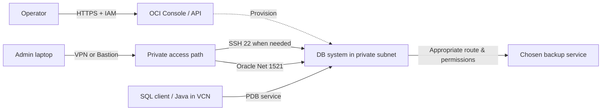

# Provisioning Base Database Service and Initial Connection

## Lesson Objectives

In the **Oracle Database on OCI** chapter of the **CLOUD_PROVIDERS_ORACLE** module, this lesson takes learners from a deployment plan to their first Oracle Database connection. IAM decides who can create infrastructure; the VCN decides the network path to the database; accounts and services inside Oracle Database decide where SQL sessions open and what they can do.

After this lesson, learners will be able to:

- Prepare the compartment, IAM permissions, networking, SSH keys, and database configuration before provisioning.
- Create a single-node Base Database DB system and identify the CDB, PDB, and connection service.
- Verify local administration and network connectivity using SQL*Plus, SQL Developer, or JDBC.
- Create a lab account in the right PDB, test reads/writes, and triage initial errors.
- Document backups, monitoring, costs, and availability limitations of the provisioned setup.

This lesson uses a lab with a private subnet and sample data. Names, IP addresses, and outputs below are examples; substitute actual values from your authorized environment. This is a hands-on guide, not evidence that a DB system has already been deployed.

## 1. Understanding What Will Be Provisioned

Base Database Service provides Oracle Database on a virtual-machine DB system. Single-node and multi-node RAC configurations exist. This lesson chooses **single-node** to focus on provisioning and connectivity rather than cluster setup. Available shapes and editions must be checked by region and tenancy; do not assume a shape list from an older screenshot still applies. [Oracle: About DB Systems](https://docs.oracle.com/en/cloud/paas/base-database/guide/dbs-about.html).

| Component | Meaning in Practice |
| --- | --- |
| DB system | OCI resource containing nodes, networking, compute, and storage settings |
| DB node | Host running database software; OS accessible via SSH when permitted |
| Database home | Oracle Database software installation environment and corresponding patches |
| CDB | Container database holding shared admin structures and PDBs |
| PDB | Target pluggable database for the lab schema |
| Database service | Service name requested by clients when opening a session |
| Database user/schema | Identity and object namespace inside the database |

The DB system display name in the Console is not the service name. Similarly, `DB_NAME`, `DB_UNIQUE_NAME`, `ORACLE_SID`, and the PDB name cannot be swapped interchangeably.

```text
DB system display name : basedb-lab-01
Database name          : LABDB
Database unique name   : retrieve actual value after provisioning
PDB                    : APPPDB
Application user       : APP_LAB
Connection service     : retrieve from Console or inspect in database
```

Do not infer the service name solely from `LABDB` or the hostname. The service may include a domain and must be recognized by the database and listener.

## 2. Three Independent Permission Layers

| Layer | Typical Identity | Permissions to Verify |
| --- | --- | --- |
| OCI control plane | Operator in an IAM group | Create DB system, use subnet, view work requests |
| Operating system | `opc`, switching to `oracle` when authorized | SSH to node and run administrative tools |
| Oracle Database | `SYS`, PDB admin account, `APP_LAB` | Log in and run SQL in the right container |

Having Console permission to manage a DB system does not automatically create a SQL user to run JDBC. Successful SSH access also does not prove the listener is running. An application account connecting to a PDB does not need OCI permissions to create or delete DB systems.

This lesson uses SQL username/password authentication for the lab account. Integrating IAM authentication into the database is a separate configuration, not implicitly set up just because the DB system creator logged into OCI.

### Granting Permissions for Provisioners

Assume `DbLab` and `NetLab` are two compartments directly under root, and networking is already prepared by the network team. Sample policy for the lab operations group:

```text
Allow group 'Default'/'DBLabOperators' to manage database-family in compartment DbLab
Allow group 'Default'/'DBLabOperators' to use virtual-network-family in compartment NetLab
```

Replace domain, group, and compartment with actual identifiers. Place the policy at a scope covering the referenced compartments. This is administrative permission for the lab; `manage database-family` is broader than an application that only queries data. Compartment-scoped database permission patterns are described in [Oracle: Common Policies](https://docs.oracle.com/en-us/iaas/Content/Identity/Concepts/commonpolicies.htm).

`LaunchDBSystem` also depends on permissions for DB homes, databases, VNICs, and subnets. Backups, customer-managed keys, or defined tags may require additional permissions. If a shared VCN is not visible, check permissions in the network compartment rather than granting tenancy-wide admin rights. [Oracle: Policy Details for Base Database Service](https://docs.oracle.com/en/cloud/paas/base-database/guide/policy-details.html).

## 3. Designing Networking and the Management Path

Proposed lab plan:

| Component | Example Value |
| --- | --- |
| VCN | `10.40.0.0/16` |
| Client/application subnet | `10.40.10.0/24` |
| Private database subnet | `10.40.20.0/24` |
| DB private IP after provisioning | E.g., `10.40.20.15`; retrieve actual IP from Console |
| Listener | TCP `1521` if keeping default settings |
| Admin access from laptop | VPN or OCI Bastion per network design |
| SQL client in VCN | Host with route, DNS, and rules to DB subnet |

Addresses above are an illustrative design. Check for conflicts with other VCNs and on-premises networks before choosing CIDRs.



The arrows represent flows with distinct purposes. A Console resource creation success does not prove a laptop has a route to the database private IP.

### Networking Must Be Ready Before Provisioning

A DB system requires a VCN, subnets, routes, security rules, and appropriate access to the Oracle Services Network. With a private subnet, verify the service gateway and routes to required Oracle services. [Oracle: VCN and Subnets](https://docs.oracle.com/en/cloud/paas/base-database/guide/vcn-subnets.html).

Draft an application/admin flow table before adding rules:

| Actual Source | Destination | Target Port | Purpose |
| --- | --- | --- | --- |
| Application NSG, if design uses NSGs | DB system NSG | TCP 1521 | SQL sessions from application |
| Bastion private endpoint IP | DB private IP | TCP 1521 | Port forwarding to listener |
| Permitted admin source | DB private IP | TCP 22 | SSH into operating system |

This is the lab flow table, **not the full baseline rule set of the service**. Retain DB system operational, ICMP, and egress rules per Oracle documentation; also verify client rules and host firewalls where applicable. [Oracle: Security Rules for the DB System](https://docs.oracle.com/en/cloud/paas/base-database/guide/security-rules.html).

A restrictive NSG does not disable a broader allow rule in a subnet security list. Review all effective rules before concluding only one source can connect.

### DNS Is Part of Connectivity

If using private hostnames, client machines must be able to resolve those names. Laptops outside the VCN typically need proper DNS forwarding when traversing a VPN. SQL clients running inside the VCN should check the resolver before editing the connect string. [Oracle: DNS for the DB System](https://docs.oracle.com/en/cloud/paas/base-database/guide/dns.html).

Do not add an Internet Gateway and expect a DB node with only a private IP to become directly reachable from the Internet. Public IPs, routes, and security rules are separate configurations; this lab keeps the database on a private network.

## 4. Preparing Keys, Credentials, and Configuration

### SSH Key

Prepare an SSH key pair in a format supported by the service. If generating a new key with OpenSSH on Windows, for example:

```powershell
ssh-keygen -t rsa -b 3072 -f "$env:USERPROFILE\.ssh\oci_basedb_lab"
```

Run this command on your own machine; pick a fresh name so existing keys are not overwritten. Set a passphrase as appropriate for your key management process.

- The `.pub` file is the public key supplied during provisioning.
- The file without `.pub` is the private key, kept on the admin machine or in a protected key store.
- A Bastion session key can be a separate pair from the key used for the DB node's `opc` account.

Do not upload the private key into the field requesting the public key. Oracle specifies the SSH public key and networking as provisioning inputs. [Oracle: Overview of Creating a DB System](https://docs.oracle.com/en/cloud/paas/base-database/guide/dbs-create.html).

### Separate Each Secret's Purpose

| Secret | Used For |
| --- | --- |
| OCI credentials | Console/API per chosen IAM mechanism |
| SSH private key | SSH authentication |
| Database admin password | Permitted DBA tasks |
| `APP_LAB` password | SQL sessions for the lab schema |
| TDE credential/key | Protecting stored data per encryption configuration |

The TDE wallet password is not a TLS wallet file to distribute to every SQL client. Changing the admin password requires considering other credentials per service procedures, rather than assuming all passwords changed together. [Oracle: Manage Administrator and TDE Wallet Passwords](https://docs.oracle.com/en/cloud/paas/base-database/guide/passwords.html).

### Configuration Checklist Before Clicking Create

Record planned selections; do not write password values or private key contents:

| Decision | Lab Choice and Rationale |
| --- | --- |
| Region and availability domain | Where quota/capacity exists and close to lab clients |
| Node count | Single node to practice provisioning and connectivity |
| Shape and CPU | Currently offered shape, small enough for lab load |
| Edition, database image/RU | Application-compatible release supported by the service |
| Storage | Capacity, performance tier, and management type matching shape |
| Network | Prepared VCN/subnet, no public IP assigned to database |
| License | License Included if suitable; BYOL once usage eligibility is confirmed |
| Encryption key | Oracle-managed or customer-managed per design |
| Backup | Destination, retention, network path, and first backup timing |
| Management tags | E.g., `environment=lab`, `owner=db-learning` |

Distinguish **ASM/Grid Infrastructure** from **LVM** when choosing storage management. Service management tools depend on this selection. Check supported combinations and cost estimates for the current setup; do not copy default CPU or storage values from an older lab.

If you see a developer-focused edition, still verify workload limits and infrastructure costs. An option without database license fees does not mean the entire DB system is free. [Oracle: Configure Base Database Service for Developers](https://docs.oracle.com/en/learn/base-db-for-developers/index.html).

## 5. Provisioning via the OCI Console

The menu group may appear as **Oracle Database** or **Oracle AI Database** depending on the UI. Locate **Oracle Base Database Service**, open **DB Systems**, choose the right region/compartment, and click **Create DB system**.

Fill in the form from your prepared checklist:

1. **System information:** set `basedb-lab-01`, compartment `DbLab`, and the chosen availability domain.
2. **Compute and storage:** check shape, CPU, single node, storage management type, and capacity.
3. **Access and networking:** supply the public key; select the VCN, private client subnet, and database NSG.
4. **Database:** enter `LABDB`, PDB `APPPDB`, and pick the appropriate image/RU. Verify names accepted by the form.
5. **Administration:** enter a strong password passing the active validator; select encryption settings per design.
6. **Operations:** select backup, diagnostics, tags, and lab-appropriate options.
7. **Review and create:** double-check compartment, networking, edition, storage, and cost estimate; submit the creation request once.

Fields and supported combinations vary by shape/edition. Use the live form alongside [Oracle: Create a DB System](https://docs.oracle.com/en/cloud/paas/base-database/guide/dbs-create-new.html) to verify details.

### Backups in the Provisioning Plan

Select a backup destination permitted by the Console for your tenancy, region, and current release. Recovery Service and Object Storage are not always available together as simultaneous options. Verify the protection policy/retention and the first backup result; enabling automatic backups does not yet prove a usable backup exists. [Oracle: Back Up a Database Using the Console](https://docs.oracle.com/en/cloud/paas/base-database/guide/br-backup.html).

For labs spanning multiple sessions, put a data protection plan in place. For short labs with reproducible data, backup choices should pair with a lab teardown plan and documented data-loss risk. Never treat cost-saving lab settings as production defaults.

### Monitoring Provisioning

Creating a DB system is asynchronous. Watch the status on the details page; if it fails, inspect the work request/error before submitting another request that could create duplicate resources. Oracle uses lifecycle states such as provisioning, available, and failed. [Oracle: Check the Status of a DB System](https://docs.oracle.com/en/cloud/paas/base-database/guide/dbs-status.html).

Once the resource is ready, record:

```text
Region, compartment
DB system OCID and node OCID
Database OCID, DB_NAME, DB_UNIQUE_NAME
PDB name and PDB OCID if applicable
Private IP, hostname, listener port
PDB service name and chosen access path
Backup configuration and latest status
```

Do not set a fixed provisioning duration as a success criterion. Next, verify the DB/PDB, networking, and a SQL session into the right container.

## 6. Retrieving the Exact Endpoint and Service Name

In database details, inspect **Connections** to retrieve the database administration service connect string. To obtain the PDB string, go to **Pluggable Databases**, select `APPPDB`, and open **PDB connection** per the current UI. This string serves PDB administration connections; Oracle recommends applications use dedicated application services. [Oracle: Get Connection Strings for a Pluggable Database](https://docs.oracle.com/en/cloud/paas/base-database/guide/pdb-strings.html).

Easy Connect for this lesson follows the structure:

```text
//<DB_HOST>:<LISTENER_PORT>/<PDB_SERVICE_NAME>
```

Illustrative example:

```text
//10.40.20.15:1521/<ACTUAL_PDB_SERVICE_NAME>
```

Replace the placeholder with the **entire** retrieved service name, including any domain suffix. Update the IP if the DB node received a different address.

| Value | Do Not Confuse With |
| --- | --- |
| Host/IP | DB system display name |
| Listener port | Local port chosen by the learner for an SSH tunnel |
| Service name | SID or an unverified bare PDB name |
| Username | OCI IAM username |
| Client role | Provisioner's IAM permissions |

A CDB-level connect string is not meant for applications using a PDB. For RAC, SCAN, redirects, and failover require dedicated design; the single-IP example in this lesson is for a single-node lab. [Oracle: Overview of Connecting to a DB System](https://docs.oracle.com/en/cloud/paas/base-database/guide/connect.html).

## 7. Verifying Local Administration on the DB Node

This step is for someone with DBA/SSH permissions in the lab. It can be skipped if another DBA has already verified the DB/PDB and provided the application account; not every developer needs SSH access.

From a machine with a route to the DB private IP:

```powershell
ssh -i "$env:USERPROFILE\.ssh\oci_basedb_lab" opc@10.40.20.15
```

Once inside the DB node, the commands below run in the **Linux shell on the node**, not in your laptop's PowerShell:

```bash
sudo su - oracle
. oraenv
```

Enter the actual `ORACLE_SID` of the target instance when `oraenv` prompts. DBAs can check instance configuration and `/etc/oratab`; do not assume the SID equals the DB system display name or DB unique name.

```bash
sqlplus / as sysdba
```

This is a local OS-authenticated connection that can bypass the network listener. It verifies the database but **does not verify application connectivity over TCP**. [Oracle: Connect Using SSH and the Bequeath Protocol](https://docs.oracle.com/en/cloud/paas/base-database/connect-bequeath/index.html).

In SQL*Plus:

```sql
show con_name
select name, open_mode, database_role from v$database;
show pdbs

select name, network_name, pdb
from v$services
order by pdb, name;
```

Confirm the CDB has the right name and primary lab role, and that PDB `APPPDB` is open for writes. `V$SERVICES` maps services to PDBs and network names, avoiding guesswork on domain suffixes. [Oracle: V$SERVICES](https://docs.oracle.com/en/database/oracle/oracle-database/12.2/refrn/V-SERVICES.html).

If the PDB is not open or the service is not running, identify the cause and use management actions consistent with the service setup. Do not edit multiple network files at once or restart the entire DB system hoping for luck.

## 8. Creating a Lab User in the Right PDB

Continuing in an authorized DBA session, switch into the PDB and verify the container before creating the user:

```sql
alter session set container = APPPDB;
show con_name

select tablespace_name, contents, status
from dba_tablespaces
where tablespace_name in ('USERS', 'TEMP');
```

Use the next example only if `USERS` and `TEMP` exist and are suitable. If using different tablespaces, a DBA substitutes those names; never grant quota on `SYSTEM` to work around a missing tablespace error.

In SQL*Plus, enter the password via a hidden prompt. The example assumes `APP_LAB` does not yet exist:

```sql
set echo off
set verify off
accept app_password char prompt 'New password for APP_LAB: ' hide

create user APP_LAB identified by "&app_password"
  default tablespace USERS
  temporary tablespace TEMP
  quota 10M on USERS;

undefine app_password

grant create session, create table to APP_LAB;
```

Choose a random password complying with the database password policy. For this substitution example, stick to letters, digits, and `_`, `#`, `-`; avoid quotes and substitution characters that alter the SQL statement. Do not record the entered password in lab notes.

`ACCEPT ... HIDE` together with `SET VERIFY OFF` keeps the password out of prompts and substitution echo. Never pass passwords on the command line or enable session spooling containing secrets. [Oracle: Database Security Guide](https://docs.oracle.com/en/database/oracle/oracle-database/26/dbseg/database-security-guide.pdf).

`CREATE SESSION` allows login; `CREATE TABLE` plus quota supports test tables. This is a table-owning schema for the lab, not a runtime user design for a multi-schema system. You do not need `DBA` or `UNLIMITED TABLESPACE` to test connectivity. [Oracle: CREATE USER](https://docs.oracle.com/en/database/oracle/oracle-database/19/sqlrf/CREATE-USER.html).

If you hit a common-user error when creating `APP_LAB`, check `show con_name`. Do not add a `C##` prefix to work around accidentally being in root; the goal is a local user inside `APPPDB`.

## 9. Connecting from a SQL Client

### Test the TCP Path First

On a Windows machine with a route to the VCN:

```powershell
Test-NetConnection -ComputerName 10.40.20.15 -Port 1521
```

If using a hostname, test DNS on the client machine itself with `Resolve-DnsName <DB_HOST>` first. `TcpTestSucceeded=True` only proves TCP can reach the port; it does not prove the service name, account, or SQL privileges are right.

If using Bastion, testing the private IP directly from your laptop may fail by design; in that case, check the tunnel's local port in section 10.

### SQL*Plus over Oracle Net

Substitute host and service, letting SQL*Plus prompt for the password:

```text
sqlplus -L APP_LAB@//10.40.20.15:1521/<ACTUAL_PDB_SERVICE_NAME>
```

Oracle Net connections require a working network path, listener, and active service; connecting to a PDB also requires the PDB to be open. [Oracle: Connect to a Database by Using SQLNet](https://docs.oracle.com/en/cloud/paas/base-database/guide/connect-sqlnet.html).

After connecting:

```sql
select
  sys_context('USERENV', 'SESSION_USER') as session_user,
  sys_context('USERENV', 'CON_NAME') as container_name,
  sys_context('USERENV', 'SERVICE_NAME') as service_name
from dual;
```

Expect `SESSION_USER` to be `APP_LAB`, container `APPPDB`, and the target service. If the container is wrong, stop write operations and fix the connect string first.

### SQL Developer

Create a connection with these fields:

| Field | Value |
| --- | --- |
| Connection type | Basic for this Easy Connect example |
| Username | `APP_LAB` |
| Password | Dedicated password of the lab user |
| Role | Default |
| Hostname | Host/IP reachable from where SQL Developer runs |
| Port | Listener port; or local port if through a tunnel |
| Service name | Actual service of `APPPDB` |

Choose **Service name**, not SID with a PDB name typed in. Test the connection and run the session identification query. If a DBA session is needed, use a separate connection with appropriate privileges; never configure application JDBC with `SYS AS SYSDBA`.

## 10. Using OCI Bastion for a Private-IP Database

If your laptop is not on a VPN to the VCN, you can use an OCI Bastion **SSH port forwarding session**:

1. Prepare a Bastion in the VCN, restricting the client CIDR allowlist to actual admin source addresses.
2. Create a port forwarding session targeting the DB private IP on port `1521` with a session public key.
3. Allow the Bastion private endpoint to reach the target port via appropriate security rules.
4. Once the session is active, copy the SSH command from the Console; substitute your private-key path and local port, such as `11521`.

Port forwarding does not require Oracle Cloud Agent or an SSH server on the target resource to forward traffic to the listener. [Oracle: Creating a Port Forwarding Session](https://docs.oracle.com/en-us/iaas/Content/Bastion/Tasks/create-session-port-forwarding.htm).

The template below explains the components; prefer the exact command generated by your live session:

```text
ssh -i <SESSION_PRIVATE_KEY> -N -L 127.0.0.1:11521:<DB_PRIVATE_IP>:1521 -p 22 <SESSION_OCID>@<BASTION_HOST>
```

Keep the SSH process running. In another terminal or SQL Developer, use `127.0.0.1`, port `11521`, and **keep the PDB service name unchanged**:

```text
sqlplus -L APP_LAB@//127.0.0.1:11521/<ACTUAL_PDB_SERVICE_NAME>
```

Local port `11521` is not a port to open on the DB node. The database still receives connections on `1521`. Sessions have a time limit; closing the tunnel or session expiration interrupts connections depending on it. [Oracle: Connecting to a Port Forwarding Session](https://docs.oracle.com/en-us/iaas/Content/Bastion/Tasks/connect-port-forwarding.htm).

Tunnels serve temporary lab/admin tasks. Long-lived applications need a stable private network path and proper connection pooling; a terminal on a laptop is not application network infrastructure.

## 11. Testing Read/Write and Reconnecting

In the `APP_LAB` session confirmed to be in the right PDB, create a test table:

```sql
create table connection_probe (
  id number primary key,
  message varchar2(100) not null,
  created_at timestamp default systimestamp not null
);

insert into connection_probe (id, message)
values (1, 'OCI Base Database connection OK');

commit;

select id, message, created_at from connection_probe;
```

The output should return one row with `id=1`. Exit, reopen a connection with the same user/service, and query again. Reading after reconnecting catches missing commits or checks accidentally run against the wrong session/target.

| Evidence | What It Confirms |
| --- | --- |
| Console reports resource available | Provisioning completed per control plane |
| SSH into node succeeds | SSH path and OS credentials work |
| TCP to listener succeeds | Network path reaches the tested port |
| `SYS_CONTEXT` is right | Logged into the right user/container/service |
| Table created and read after reconnect | Lab privileges, quota, and commits work for test actions |

Do not interpret one row of data as proof of backup, failover, or production performance. Those require dedicated tests with explicit measurement criteria.

## 12. Testing Java Connectivity with JDBC Thin

Test JDBC from **the exact location where the application will run**. SQL Developer succeeding on a laptop does not prove a JVM in another subnet has equivalent routes, DNS, and rules.

URL structure by service name:

```text
jdbc:oracle:thin:@//<DB_HOST>:<PORT>/<PDB_SERVICE_NAME>
```

If the JVM on a laptop runs over a tunnel, use `127.0.0.1:11521`; if inside the VCN, use the appropriate private endpoint. JDBC Thin uses the driver and URL, without turning an OCI API key into a database password. [Oracle: Data Sources and URLs](https://docs.oracle.com/en/database/oracle/oracle-database/19/jjdbc/data-sources-and-URLs.html).

Prepare a JDK and Oracle JDBC driver compatible with your environment. The example uses only the `java.sql` API; the Oracle driver must be on the runtime classpath. Save the code in your practice environment as `DbPing.java`:

```java
import java.io.Console;
import java.sql.Connection;
import java.sql.DriverManager;
import java.sql.ResultSet;
import java.sql.Statement;
import java.util.Arrays;

public class DbPing {
    public static void main(String[] args) throws Exception {
        String url = System.getenv("JDBC_URL");
        if (url == null || url.isBlank()) {
            throw new IllegalArgumentException("JDBC_URL must be configured");
        }

        Console console = System.console();
        if (console == null) {
            throw new IllegalStateException("Run the program from a terminal");
        }

        char[] password = console.readPassword("APP_LAB password: ");
        if (password == null) {
            throw new IllegalStateException("No password entered");
        }

        String sql = "select "
                + "sys_context('USERENV','SESSION_USER'), "
                + "sys_context('USERENV','CON_NAME'), "
                + "sys_context('USERENV','SERVICE_NAME') from dual";

        try (Connection connection = DriverManager.getConnection(
                    url, "APP_LAB", new String(password));
             Statement statement = connection.createStatement()) {
            statement.setQueryTimeout(10);
            try (ResultSet result = statement.executeQuery(sql)) {
                if (result.next()) {
                    System.out.printf("user=%s container=%s service=%s%n",
                            result.getString(1), result.getString(2),
                            result.getString(3));
                }
            }
        } finally {
            Arrays.fill(password, '\0');
        }
    }
}
```

Example run on Windows after substituting the service and driver path:

```powershell
$env:JDBC_URL = 'jdbc:oracle:thin:@//127.0.0.1:11521/<ACTUAL_PDB_SERVICE_NAME>'
javac DbPing.java
java -cp ".;C:\tools\oracle\ojdbc11.jar" DbPing
```

Use an actually compatible JAR/version; the JAR name here is not a universal requirement across all JDKs. If the project uses Maven/Gradle, declare the dependency with the chosen version instead of mixing multiple Oracle JARs of different versions.

Output should identify `APP_LAB`, `APPPDB`, and the right service. `setQueryTimeout(10)` bounds query execution per driver capability, and does not replace connect or network timeouts. This program is a connectivity probe, not a production setup with connection pooling, retries, or secret management.

## 13. Encryption and Application Services

### TDE, Native Encryption, and TLS

TDE protects data at rest; data-in-transit configuration is a separate layer. Base Database includes Oracle Net encryption/integrity settings in service configuration. If encryption negotiation fails, inspect the client, driver, and actual settings before altering server policy. [Oracle: Security Guide for Base Database Service](https://docs.oracle.com/en/cloud/paas/base-database/guide/security-guide.html).

A connect string using `TCP` is not enough to conclude SQL session traffic is unencrypted: Oracle Native Network Encryption may be negotiated over that stream. If `TCPS` is required, you need the corresponding listener, certificates/trust, and client setup. Changing letters in a URL or downloading an arbitrary wallet does not create a complete TLS configuration.

Do not distribute the server's TDE wallet to developers to fix JDBC errors. Maintain the chosen encryption mechanism and verify live sessions via database procedures.

### From PDB Service to Application Service

The PDB administrative connect string serves initial testing in this lesson. Before running production applications, DBAs should create application services tailored to workloads, roles, and availability needs.

For DB systems using Grid Infrastructure, `srvctl` can be used per the running release documentation. For LVM or configurations without GI, use the service mechanism supported by that setup; do not assume every node has the same stack.

Once the application service is created and started, swap the connect string, re-check `SERVICE_NAME`/`CON_NAME`, and test behavior after a restart. Renaming a service does not add failover capability to a single-node DB system.

## 14. Layer-by-Layer Error Diagnosis

Determine whether the failure occurs at the OCI API, SSH, client TCP, or Oracle Database layer. Do not widen permissions or open all ports before knowing which layer is failing.

| Symptom | Check First | Action Direction |
| --- | --- | --- |
| Console reports unauthorized | Group, policy, compartment, and network usage rights | Add the exact missing permission for the action |
| Provisioning failed | Work request, capacity/quota, networking, and inputs | Fix the root cause before retrying |
| SSH `Permission denied (publickey)` | User `opc`, DB node key, or Bastion session key | Distinguish keys per hop; never use DB password for SSH |
| Hostname does not resolve | DNS from the client machine itself | Fix resolver/forwarding or use verified IP for single-node lab |
| TCP timeout | Routes, rules, host firewall, tunnel | Verify exact traffic path and port |
| `ORA-12541` | Actual host/port and listener | Confirm client reaches the running listener |
| `ORA-12514` | Full service name, PDB/service, and listener registration | Check services on server; fix connect string |
| `ORA-12154` | Alias, connect identifier, and client naming | Check syntax and name resolution |
| `ORA-01017` | User/password and target PDB | Verify credentials against right container; avoid lockouts from retries |
| `ORA-28000` | Account status and lock policy | DBA verifies cause before unlocking |
| `ORA-01045` | Local user login privilege | Check `CREATE SESSION` in the right PDB |
| `ORA-01950` on write/create | Tablespace and schema quota | Grant bounded quota on appropriate tablespace |
| JDBC `No suitable driver` | Runtime classpath and URL | Fix dependency/classpath before changing IAM |

`ORA-12514` means the listener does not recognize the requested service; this error differs from a wrong password. [Oracle: ORA-12500 to ORA-12699](https://docs.oracle.com/en/database/oracle/oracle-database/19/errmg/ORA-12500.html).

When checking the DB node, the DBA uses listener tools from the right Oracle/Grid home, such as `lsnrctl services`, in the identified environment. Correlate logs by timestamp; do not edit `listener.ora` and restart when unsure how OCI manages the configuration.

For network infrastructure errors, reconcile routes and security configurations against [Oracle: Troubleshoot Network Connectivity Failures](https://docs.oracle.com/en/cloud/paas/base-database/guide/troubleshoot-network.html).

## 15. Operations and Wrapping Up the Lab

### Evidence to Retain

Compile a record containing no secrets:

| Item | Recorded Information |
| --- | --- |
| Infrastructure | Region, compartment, DB system/database OCID |
| Configuration | Shape/CPU, edition/image, storage, storage management type |
| Access path | Inside VCN, VPN, or Bastion; actual network source |
| SQL target | Host, port, service, PDB, and lab user |
| Result | Timestamp, session identification, and data re-read |
| Backup | Configuration, timestamp, and latest status |
| Cost | Lab owner, usage deadline, retained resources |

Oracle provides metrics and monitoring tools for Base Database. Pick signals for compute, storage capacity, connections, and errors; confirm metrics emit data before setting alarms. [Oracle: Monitor Base Database Service](https://docs.oracle.com/en/cloud/paas/base-database/guide/monitor.html).

A single node suffices for a lab but does not provide continued service if that node stops. Backups serve data recovery; HA/DR requires explicit RPO/RTO targets, configuration, and testing.

### Cleaning Up Resources

If keeping the DB system for a later session, you can drop the test table using the lab schema itself when data is no longer needed:

```sql
drop table connection_probe purge;
```

This command deletes the test table and data; run it only in `APP_LAB` of the right lab. When concluding completely, inventory the DB system, backups, Bastion sessions, and lab-dedicated networking/compute before deleting per plan.

**Stopping does not stop all charges.** Stopping a node affects CPU billing depending on resource type, while certain infrastructure/storage charges continue. Check the shape and retained resources; never treat a stopped state as zero cost. [Oracle: Stop a DB System](https://docs.oracle.com/en/cloud/paas/base-database/stop-dbs/index.html).

Do not delete shared VCNs, subnets, policies, or shared backups. Retaining backups after termination should be decided based on recovery needs and actual retention rules.

## 16. Practice Completion Criteria

- Single-node DB system resides in the intended compartment and private subnet.
- Actual CDB, PDB, endpoint, and service name are identified.
- SQL client over the chosen network path logs in as `APP_LAB` into `APPPDB`.
- Test table is created, committed, and read again after reconnecting.
- JVM at the tested location returns the right user/container/service if performing the JDBC section.
- Backups, availability limits, cost owner, and lab cleanup plan are documented.

The desired outcome is an explainable, reproducible connection path: right identity, right network, right service, right PDB, and right permissions for the task. From here, learners can continue to lessons on application services, connection pooling, backup/restore, and Oracle Database availability on OCI.
