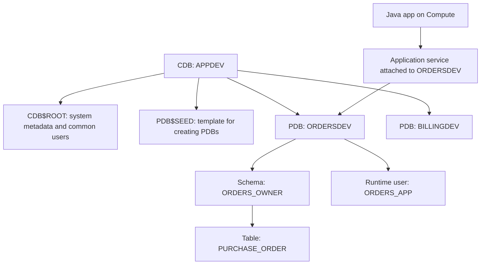
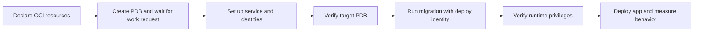

# CDB, PDB, and Organizing Application Databases

In the **Oracle Database on OCI** chapter of the `CLOUD_PROVIDERS_ORACLE` module, this lesson explains how to organize application data using CDBs, PDBs, schemas, and database services. Deciding where to place data must go hand in hand with authorization, VCN connectivity, lifecycle management, monitoring, and recoverability.

The running example is a Java order-management service running on OCI Compute, connecting over a private network to Oracle Base Database Service. The goal is to determine exactly where tables belong, which account is allowed to alter structures, which account only processes data, and which applications share the blast radius when database infrastructure experiences an incident.

The illustrative SQL sections use Oracle Database 19c concepts and syntax. When applying this to another release or a service like Autonomous Database, use the administrative privileges, tooling, and connection model provided by that service; do not assume CDB root administration rights by default.

## 1. Expected Outcomes

After this lesson, learners will be able to:

- Diagram the relationships among OCI resources, CDBs, PDBs, schemas, and application accounts.
- Explain the roles of `CDB$ROOT`, `PDB$SEED`, and PDBs holding business data.
- Distinguish between database instance, PDB, service name, and schema.
- Choose how to organize data by application, environment, and customer.
- Connect to the right PDB, create local users, and grant permissions matching application needs.
- Recognize the limits of PDB isolation with respect to resources, maintenance, backups, and availability.

## 2. Placing CDB and PDB in the Right Architecture Layer

### 2.1. Similar-Sounding Terms Solving Different Problems

| Concept | Role in the Example | Question to Answer |
| --- | --- | --- |
| OCI tenancy | Organization's cloud account scope | Who owns and governs cloud resources? |
| Compartment | Resource grouping for management and IAM | Which group can operate on which resources? |
| VCN, subnet, NSG | Network path and access rules | Which Compute hosts can reach the database endpoint? |
| DB system | Base Database Service infrastructure resource | On what infrastructure configuration does the database run? |
| CDB | Oracle database organized in multitenant architecture | Which containers belong together in one database? |
| PDB | Scope holding schemas and data for a set of needs | In which container is application data stored? |
| Schema | Set of objects owned by a database user | Who owns tables, views, indexes, and procedures? |
| Database service | Logical entry point requested by clients | To which PDB and workload are connections routed? |

On the OCI side, learners inspect resources and operational rights via the Console/API. On the SQL side, learners work with containers, users, and object privileges. Do not infer permission to `SELECT` from a table simply because someone can view a DB system in the Console. Cloud resource authorization documentation lists IAM-controlled resource types and operations separately: [Policy Details for Base Database Service](https://docs.oracle.com/en/cloud/paas/base-database/guide/policy-details.html).

### 2.2. Two Meanings of the Word Tenant

**OCI tenancy** is a cloud account management concept. A **SaaS application tenant** is a customer or organization using the software. A SaaS customer can be organized using a dedicated PDB, a dedicated schema, or rows tagged with `tenant_id` in shared tables.

This is an application design choice. There is no mandatory rule that one SaaS customer corresponds to one OCI tenancy or one PDB. In this lesson's example, the organization has one OCI tenancy yet can serve multiple customers on the same order system.

## 3. What Components Make Up a CDB?

### 3.1. Root, Seed, and Business PDBs

The multitenant architecture allows a CDB to contain PDBs. A PDB is a collection of schemas, objects, and related structures perceived by applications as a separate database over an Oracle Net connection. When creating a CDB, Oracle creates the root and seed. [Introduction to the Multitenant Architecture](https://docs.oracle.com/en/database/oracle/oracle-database/19/multi/introduction-to-the-multitenant-architecture.html).



Three components to identify:

- **`CDB$ROOT`** stores Oracle-supplied metadata and CDB-wide common users. Regular business tables belong in user PDBs.
- **`PDB$SEED`** is the Oracle-supplied template PDB for creating new PDBs. Do not use the seed to store order data.
- **User PDBs**, such as `ORDERSDEV`, hold application schemas. A CDB can hold multiple user PDBs depending on environment limits and usage rights.

A CDB is the entire database under this architecture; `CDB$ROOT` is just one container inside it. Do not equate the CDB with root. [Overview of Configuring and Managing a Multitenant Environment](https://docs.oracle.com/en/database/oracle/oracle-database/19/multi/overview-of-managing-a-multitenant-environment.html).

### 3.2. A PDB Does Not Have Its Own Separate Instance

A database instance consists of memory structures and processes serving a database. In a single-instance setup, a CDB's PDBs share that instance. With Oracle RAC, multiple instances can jointly serve one database; the number of PDBs does not dictate the number of instances. PDBs can contend for memory and I/O resources. [Overview of the Multitenant Architecture](https://docs.oracle.com/en/database/oracle/oracle-database/19/multi/overview-of-the-multitenant-architecture.html).

Design implication: adding `BILLINGDEV` to the current CDB does not create another VM, operating system, or independent set of CPUs. Evaluate total load and resource management capabilities before consolidating additional workloads.

### 3.3. Separate Data and Shared Infrastructure

A PDB has its own datafiles for its data, including system tablespaces inside the PDB. Structures such as control files and online redo logs are managed at the CDB level. Undo has local or shared modes, so do not memorize a rule that every PDB always has completely independent storage components across the board. [Overview of the Multitenant Architecture](https://docs.oracle.com/en/database/oracle/oracle-database/19/multi/overview-of-the-multitenant-architecture.html).

Tablespaces are logical storage organization; datafiles are structures on storage. A schema groups objects by owner, not as a datafile directory. One schema can own objects across multiple tablespaces, and one tablespace can store objects from multiple schemas. [Physical Storage Structures](https://docs.oracle.com/en/database/oracle/oracle-database/19/cncpt/physical-storage-structures.html).

## 4. Schemas, Users, and Privileges Inside a PDB

### 4.1. Data Owner and Application Runtime Account

Example inside PDB `ORDERSDEV`:

```text
ORDERSDEV
  ORDERS_OWNER
    PURCHASE_ORDER
    ORDER_ITEM
    ORDER_HISTORY
  ORDERS_APP
    Connection privileges and granted operation rights on selected tables
  ORDERS_READONLY
    Read privileges on permitted objects
```

A database user has a schema bearing the same name. Thus `ORDERS_APP` also has its own schema, though it may own zero tables. An application connecting as `ORDERS_APP` can still access `ORDERS_OWNER.PURCHASE_ORDER` when granted appropriate privileges.

Recommended separation for the example:

| Identity | Responsibility | Necessary Privileges in Example |
| --- | --- | --- |
| PDB DBA | Create users, grant roles, manage operations | Delegated admin privileges inside the PDB |
| `ORDERS_OWNER` | Deploy schema changes | Create tables and own application objects |
| `ORDERS_APP` | Process business requests | Connect, read, insert, and update needed data |
| Reporting account | Read authorized data | Privileges on views/tables for reporting |

Separating identities gives permission reviews a concrete question: does a web request ever need to create users or alter table structures? In this example, the answer is no; those operations belong to deployment or administrative workflows.

### 4.2. Local Users and Common Users

A **local user** belongs to one PDB. Two PDBs can each have a local user named `ORDERS_APP`, yet they remain two independent identities. A **CDB common user** shares the same identity across root and PDBs in the CDB; privilege scope still depends on how grants are issued. Do not assume a common user automatically has full privileges in every PDB. [Administering User Accounts and Security](https://docs.oracle.com/en/database/oracle/oracle-database/19/admqs/administering-user-accounts-and-security.html).

In the default configuration, user-created CDB common user names typically carry a `C##` prefix. Business accounts in this lesson are local users and are created while the session is in `ORDERSDEV`. If you create a business user in root and hit a common-user naming error, adding `C##` just to bypass the error will skew your intended permission model. [CREATE USER](https://docs.oracle.com/en/database/oracle/oracle-database/19/sqlrf/CREATE-USER.html).

### 4.3. OCI IAM and SQL Privileges Are Related but Distinct Decisions

For the Java service to access data successfully, three layers must all be resolved:

1. The network path lets the client reach the endpoint and listener.
2. The database accepts the identity used to log in.
3. That identity holds privileges to act on the required objects.

Base Database Service supports OCI IAM integration for database access, but it requires enabling support and mapping identities/privileges inside the database. Cloud resource management rights do not automatically turn into permission to read all tables. This lesson's lab uses local database users to focus on containers and object privileges. [Use IAM Authentication with Base Database Service](https://docs.oracle.com/en/cloud/paas/base-database/guide/iam.html).

## 5. Service Names Route Applications to the Right PDB

### 5.1. Host, Instance, PDB, and Service Name

A connection configuration must make explicit:

```text
Host or endpoint: path to listener
Port/protocol: how listener is reached
Service name: database service requested by client
Username: login identity in target scope
Schema: where business objects reside
```

A service has an attribute associating it with a PDB. When a client connects to that service, the PDB becomes the session's current container. One PDB can expose multiple services for different workloads. Oracle recommends using administrator-configured application services rather than the default PDB service. [Administering PDBs — Managing Services](https://docs.oracle.com/en/database/oracle/oracle-database/19/multi/administering-pdbs-with-sql-plus.html).

Illustrative example, assuming the DBA configured and started application service `ordersdev_app.example.com` attached to `ORDERSDEV`:

```text
jdbc:oracle:thin:@//dbhost.example.com:1521/ordersdev_app.example.com
```

This is the JDBC Thin URL format using a service name. PDB name, SID, and service name are not arbitrarily interchangeable values. Actual connection strings must come from the active database/service setup. This TCP example is for a lab network; endpoints requiring TCPS, TLS, or wallets need corresponding descriptors and client settings.

The Base Database Service Console can display a connect string for the PDB's administrative service. When configuring an application, use the connect string of the application service prepared by the DBA. [Get Connection Strings for a Pluggable Database](https://docs.oracle.com/en/cloud/paas/base-database/guide/pdb-strings.html).

### 5.2. Inspect the Session Instead of Guessing from Config Names

The following query works with an application account to observe the session:

```sql
SELECT
    SYS_CONTEXT('USERENV', 'CON_NAME')       AS container_name,
    SYS_CONTEXT('USERENV', 'SERVICE_NAME')   AS service_name,
    SYS_CONTEXT('USERENV', 'SESSION_USER')   AS session_user,
    SYS_CONTEXT('USERENV', 'CURRENT_SCHEMA') AS current_schema
FROM dual;
```

In a valid setup, `container_name` must be `ORDERSDEV`; when logging in with the runtime account, `session_user` is `ORDERS_APP`. `current_schema` initially matches the login account. These attributes describe the container, service, and identity of the session executing the query. [SYS_CONTEXT](https://docs.oracle.com/en/database/oracle/oracle-database/19/sqlrf/SYS_CONTEXT.html).

Changing `CURRENT_SCHEMA` only adjusts the default schema used when resolving object names. It does not switch to another PDB, log you in as the owner, or grant extra privileges. For example, switching current schema to `ORDERS_OWNER` lets you omit table prefixes, but the account still needs grants on those tables. In this lab, use the qualified name `ORDERS_OWNER.PURCHASE_ORDER` to keep ownership clear.

With connection pools, configure datasources per PDB/service and chosen credentials. If session state is modified, ensure the pool resets state before handing the connection to the next request; otherwise, a request may inherit leftover state from prior usage.

## 6. Choosing the Unit of Application Data Organization

### 6.1. Options to Weigh

The table below is a design decision framework, not a mandatory upgrade ladder:

| Option | Appropriate to Consider When | Trade-Offs to Address |
| --- | --- | --- |
| Multiple features in one schema | Same application, same owner, and same lifecycle | Permissions and structural changes are tightly coupled |
| Multiple schemas in one PDB | Need to split object owners while keeping many shared transactions | Cross-schema grants, dependencies, and deployment flow |
| One PDB per application or app group | Want user, schema, and lifecycle separation at the PDB level | CDB resources and failure domain remain shared |
| One PDB per customer | Need per-customer data operations and recovery | PDB count, bulk migrations, and operational load grow |
| Dedicated CDB/infrastructure per workload group | Need clearer maintenance boundaries, admin rights, or dedicated capacity | Increases resource footprint and management overhead |

Even with separate CDBs, check whether they still share hosts, storage, Oracle homes, or maintenance processes. To increase independence, specify which shared components were actually separated.

### 6.2. Development and Production Environments

Illustrative organization for the lab:

```text
Development compartment
  Development DB system
    CDB APPDEV
      PDB ORDERSDEV
      PDB BILLINGDEV

Production compartment
  Production DB system
    CDB APPPROD
      PDB ORDERSPROD
```

This layout lets the development team rehearse changes before applying them to production. It is a design pattern, not a structure OCI creates automatically. Simply naming two PDBs `DEV` and `PROD` inside the same CDB does not isolate them from restarts, storage exhaustion, or shared maintenance.

### 6.3. Splitting Customers by PDB, Schema, or Data Rows

For SaaS systems, start from the hardest operation required for a single customer:

- If customers require isolated data export or restore, determine whether operations can run at the PDB level or must filter individual objects/rows.
- If splitting schemas per customer, prepare how to roll out identical migrations across all schemas and track each schema's version.
- If using shared tables with `tenant_id`, design constraints, queries, caches, reports, and access checks so customer data never leaks across tenants.
- If splitting PDBs per customer, prepare inventory, credentials, services, connection pools, and rollout strategies for the expected PDB count.

Isolation by naming never replaces permission testing. Prove that customer A's account cannot read customer B's data across both regular queries and integration paths.

### 6.4. Application Container Is a Specialized Concept

In Oracle Multitenant, an **application container** has an application root and application PDBs, supporting management of application common objects. A regular PDB storing data for a standard Java application does not automatically become an application container. This lab uses regular PDBs; only consider application containers when you specifically need to share/manage objects under that model. [Administering Application Containers](https://docs.oracle.com/en/database/oracle/oracle-database/19/multi/administering-application-containers-with-sql-plus.html).

## 7. Practice: Organizing Order Data Inside a PDB

### 7.1. Prerequisites and Expected Results

Prepare an Oracle Base Database Service lab environment with an active CDB, an OCI account authorized to manage lab resources, and private network connectivity from your workstation or Compute host to the database. SQL*Plus or an equivalent SQL tool must be able to use the connection provided by the DBA.

Expected outcome:

```text
PDB ORDERSDEV is open in read-write mode
Application service attached to ORDERSDEV is active
ORDERS_OWNER owns table PURCHASE_ORDER
ORDERS_APP holds only runtime privileges needed for the lab
Sessions for both accounts land in ORDERSDEV
```

The user-creation section requires a DBA with privileges to create users, create roles, and grant the privileges listed below inside the PDB. Do not assume every service-provided PDB admin holds the exact same privilege set. If privileges are missing, the DBA executes the corresponding steps per environment policy.

User/table creation statements are one-time operations on unused names. The lab does not provide automated user or PDB deletion scripts; if a name already exists, check its owner and data before picking another lab name.

### 7.2. Creating or Selecting the PDB with OCI Tooling

In Base Database Service, open the right DB system, select the database/CDB, go to **Pluggable Databases**, and create a PDB named `ORDERSDEV` if the lab environment lacks one. Fill in admin and TDE wallet fields per required configuration; track the work request until completion. Console documentation describes creation fields and immediate backup options: [Create a Pluggable Database](https://docs.oracle.com/en/cloud/paas/base-database/guide/pdb-create.html).

If a lab PDB was already assigned, use that PDB and substitute its name consistently across examples. Have the DBA configure an application service tied to that PDB; the service name in illustrative URLs is not created automatically merely by copying the URL.

With managed services, prefer the Console/API and supported tools for lifecycle operations. A PDB created directly via SQL may not appear immediately in the OCI control plane; SQL state and Console state must be reconciled. [About Pluggable Databases](https://docs.oracle.com/en/cloud/paas/base-database/guide/pdb-about.html).

### 7.3. Inspecting the CDB and PDB List with an Admin Account

This step is for a DBA authorized to read the corresponding views. Run from the lab CDB root:

```sql
SELECT name, cdb
FROM v$database;

SELECT con_id, name, open_mode, restricted
FROM v$pdbs
ORDER BY con_id;
```

In a CDB, the first query returns `CDB = YES`. The second query inspects PDB names, open modes, and restricted status on the current instance. `PDB$SEED` typically appears in `READ ONLY` mode; the lab PDB handling writes must be in an appropriate state. On RAC, inspect the instances where the service can run rather than only one instance. [V$PDBS](https://docs.oracle.com/en/database/oracle/oracle-database/19/refrn/V-PDBS.html).

Application accounts do not need broad catalog read privileges to perform the data operations in this lesson.

### 7.4. Connecting as DBA to the PDB and Guarding Against Wrong-Container Operations

Open an admin connection to the lab PDB using the supplied connect descriptor. Before object creation statements, check the current container as in section 5.2. When running scripts in SQL*Plus, you can use this guard block:

```sql
WHENEVER SQLERROR EXIT SQL.SQLCODE ROLLBACK

BEGIN
    IF SYS_CONTEXT('USERENV', 'CON_NAME') <> 'ORDERSDEV' THEN
        RAISE_APPLICATION_ERROR(-20001, 'Must connect to PDB ORDERSDEV');
    END IF;
END;
/
```

The check enforces the exact lab PDB name and halts the script if connected to the wrong container. With tools executing statements one by one, ensure the tool genuinely halts on error before running subsequent commands.

Do not treat `ROLLBACK` as a full undo mechanism for DDL scripts. User creation, table creation, and grant steps must be tracked per statement outcome; they do not form a single application transaction that can roll back completely.

### 7.5. Creating Owner, Runtime User, and Role

Assume `ORDERSDEV` already has tablespace `USERS` and temporary tablespace `TEMP`. The DBA verifies before use; if the environment uses different tablespaces, update both the default tablespace name and the quota clause.

`<OWNER_PASSWORD>` and `<APP_PASSWORD>` are placeholders, not ready-to-use passwords. Supply dedicated passwords compliant with database policy via your environment's secret management mechanism; never commit scripts populated with passwords into source control.

Run with a DBA account inside the PDB:

```sql
CREATE USER orders_owner
    IDENTIFIED BY "<OWNER_PASSWORD>"
    DEFAULT TABLESPACE users
    TEMPORARY TABLESPACE temp
    QUOTA 100M ON users;

GRANT CREATE SESSION, CREATE TABLE TO orders_owner;

CREATE USER orders_app
    IDENTIFIED BY "<APP_PASSWORD>";

GRANT CREATE SESSION TO orders_app;

CREATE ROLE orders_runtime_role;
GRANT orders_runtime_role TO orders_app;
```

`CREATE SESSION` permits login. The `100M` quota limits space the owner may consume in tablespace `USERS`, not RAM or CPU limits for the PDB. The runtime user has not been granted table creation rights or privileges on business tables. Granting quota and these privileges are distinct decisions. [Creating User Accounts](https://docs.oracle.com/en/database/oracle/oracle-database/19/dbseg/creating-user-accounts.html).

Accounts created inside the current PDB are local users. Do not add `CONTAINER=ALL` to these lab statements.

### 7.6. Using Owner to Create Objects and Grant Data Privileges

Open a new connection as `ORDERS_OWNER` to the same application service; the client will prompt for the password:

```bash
sqlplus orders_owner@//dbhost.example.com:1521/ordersdev_app.example.com
```

Re-run the container check query and guard block from section 7.4, then create the table:

```sql
CREATE TABLE purchase_order (
    order_id     NUMBER(19)     NOT NULL,
    status       VARCHAR2(20)   NOT NULL,
    total_amount NUMBER(12,2)   NOT NULL,
    created_at   TIMESTAMP DEFAULT SYSTIMESTAMP NOT NULL,
    CONSTRAINT pk_purchase_order PRIMARY KEY (order_id),
    CONSTRAINT ck_order_status
        CHECK (status IN ('NEW', 'PAID', 'CANCELLED')),
    CONSTRAINT ck_order_amount CHECK (total_amount >= 0)
);

GRANT SELECT, INSERT, UPDATE
    ON purchase_order
    TO orders_runtime_role;
```

The owner grants privileges on objects it owns to the role created by the DBA. Within lab scope, the application handles order cancellation via status `CANCELLED`, so the role does not need `DELETE`. Privilege sets must follow actual behavior rather than a broad role copied from another system.

When deploying new tables later, include corresponding grant steps in the migration. Grants on existing tables do not automatically apply to future tables. If using PL/SQL with definer's rights, evaluate direct grants appropriately rather than assuming role-based privileges always suffice for compiling/executing stored code.

### 7.7. Using Runtime User to Verify Behavior

Open a new connection with the runtime account:

```bash
sqlplus orders_app@//dbhost.example.com:1521/ordersdev_app.example.com
```

After confirming the session is in `ORDERSDEV`, run:

```sql
INSERT INTO orders_owner.purchase_order (
    order_id, status, total_amount
) VALUES (
    1001, 'NEW', 125000
);

COMMIT;

SELECT order_id, status, total_amount
FROM orders_owner.purchase_order
WHERE order_id = 1001;

UPDATE orders_owner.purchase_order
SET status = 'PAID'
WHERE order_id = 1001;

COMMIT;
```

The expected result is reading order `1001` and updating its status. The table belongs to `ORDERS_OWNER`, even though the session is logged in as `ORDERS_APP`.

To verify restricted privileges, at the end of the lab run the following statement separately as `ORDERS_APP`:

```sql
CREATE TABLE runtime_ddl_probe (id NUMBER);
```

With only the granted privileges above and no extra privileges added, the statement must fail because the runtime user lacks table creation rights. If it succeeds, inspect existing system privileges/roles; do not treat that as a passing lab result. You do not need to query admin catalogs with the runtime user to prove this restriction.

If re-running the insert block, existing `order_id = 1001` can raise a primary key error. Pick a new test ID or check existing rows before repeating.

### 7.8. Configuring the Java Application

Example datasource configuration sourced from the deployment environment:

```properties
spring.datasource.url=${ORDERS_DB_URL}
spring.datasource.username=${ORDERS_DB_USER}
spring.datasource.password=${ORDERS_DB_PASSWORD}
```

Here the URL uses the application service, the user is `ORDERS_APP`, and the password is injected via secret management. Migrations use a separate deployment identity. The application needs a compatible JDBC driver and a network path to the database; these properties lines do not create the user, service, or PDB.

When testing connectivity during deployment, run the query from section 5.2 and verify the expected PDB/service. Do not use a check that merely opens a socket as proof that the application reached the right PDB and can read tables.

For stricter operations, the owner can be designed as a schema-only account paired with a controlled deployment pipeline. Oracle supports `NO AUTHENTICATION` for such accounts; unlike the lab owner, they cannot log in directly with a password. [Schema-Only Accounts](https://docs.oracle.com/en/database/oracle/oracle-database/19/dbseg/schema-only-accounts.html).

## 8. PDB States and Impact on Connections

Common states observed for PDBs:

| State | Meaning for Regular Applications |
| --- | --- |
| `MOUNTED` | PDB is not open for normal application data queries |
| `READ ONLY` | Can serve reads under permitted conditions; DML writes fail |
| `READ WRITE` | Read/write capable if session and privileges allow |
| Restricted | Login access is further constrained by restricted mode |

Open mode, login privileges, and service status must all be checked together. Seeing a PDB name in a list does not mean applications can already use it. State column meanings are documented at [V$PDBS](https://docs.oracle.com/en/database/oracle/oracle-database/19/refrn/V-PDBS.html).

DBAs may need to preserve open state across CDB restarts. For a single-instance CDB, the following example is for a DBA at root once the PDB is in the desired open state:

```sql
ALTER PLUGGABLE DATABASE ORDERSDEV SAVE STATE;
```

This command saves the open state for when the CDB restarts; it does not save a data backup. For RAC or cluster-managed services, verify state per instance and the system's service management mechanism. [Administering PDBs — Preserving Open Mode](https://docs.oracle.com/en/database/oracle/oracle-database/19/multi/administering-pdbs-with-sql-plus.html).

Do not restart a CDB just to test this command in an environment shared with other applications. This exercise requires deliberate observation and configuration within your assigned lab scope.

## 9. Cloning, Backup, and Recovery Are Different Operations

### 9.1. Choosing Operations by Goal

| Goal | Approach to Consider | What Must Be Verified |
| --- | --- | --- |
| Create a test environment from existing data | Clone PDB | Sensitive data, storage size, post-clone connectivity |
| Move data to another CDB | Relocate or supported migration path | Version compatibility, target config, connection services |
| Recover from erroneous operations | Restore/recovery procedure | Recovery point, required backups, and redo logs |
| Protect against CDB/infrastructure loss | Backups and HA/DR plan | Incident scope, RPO, RTO, and switchover path |

In Base Database Service, clone/relocate/restore variants carry tool- and configuration-specific prerequisites. Having PDB actions in the Console does not mean every action shares the same network or version requirements. [About Pluggable Databases](https://docs.oracle.com/en/cloud/paas/base-database/guide/pdb-about.html).

### 9.2. Distinguishing Backup Unit from Restore Unit

Per Base Database Service documentation, backups run at the CDB level and include its PDBs; do not assume each PDB has an independent backup schedule merely because each has a details page. A clone running inside the same CDB also does not replace a backup needed to recover from losing the CDB. [About Pluggable Databases — Backup](https://docs.oracle.com/en/cloud/paas/base-database/guide/pdb-about.html).

The service provides PDB restore procedures, including in-place restore and restoring into a new CDB under supported conditions. Thus, CDB-level backups do not mean every restore forces overwriting the entire source CDB. Select the procedure matching your objective and verify impact on related data. [Restore a Pluggable Database](https://docs.oracle.com/en/cloud/paas/base-database/guide/pdb-restore.html).

Business reasoning example: if orders live in PDB A while payment entries live in PDB B, rolling A alone back to a pre-transaction timestamp can leave the two systems inconsistent. Recovery plans must include reconciliation or compensating actions; a database opening cleanly does not by itself prove the business state recovered accurately.

### 9.3. Shared Failure Domains

A separate PDB helps segment data administration, but it does not automatically create redundancy for the underlying CDB or storage. When choosing configurations, specify:

- Which component failing impacts all PDBs simultaneously?
- How long of a shared maintenance outage can applications tolerate?
- How will connections and pools recover after endpoints/services move to a new serving location?
- What are the maximum acceptable data loss and time to resume service?

The answers dictate whether RAC, Data Guard, or a DR plan matching the service and edition is needed. Do not use PDB count as a measure of availability.

## 10. Shared Resources and Cost Control

### 10.1. Preventing One Workload from Starving Another

Oracle Database Resource Manager supports assigning priorities and resource limits to PDBs via a CDB resource plan; workloads inside a PDB can also be managed further. Shares are allocation weights inside resource management, not physical CPUs bought separately for each PDB. [Using Oracle Resource Manager for PDBs](https://docs.oracle.com/en/database/oracle/oracle-database/19/multi/using-oracle-resource-manager-for-pdbs-with-sql-plus.html).

Design example: a CDB handles online orders and end-of-day reporting. If reporting spikes push order latency past target, measure SQL, I/O, sessions, and contention before scaling up the whole system. You may need to cap reporting parallelism, adjust schedules, or apply an appropriate resource plan. Resource weights cannot fix a broken SQL query or a saturated I/O path.

The tablespace quota for `ORDERS_OWNER` only controls space usable inside that tablespace. Controlling whole-PDB resources requires corresponding tools and settings; do not use the lab's `100M` quota to infer total storage limits for the PDB or the whole DB system.

### 10.2. Consolidating Databases Can Reduce Shared Overhead, Yet Raises Operational Effort

Evaluate costs using this model:

```text
Costs to track
  = database infrastructure compute and storage
  + backups, retention, and recovery replicas
  + standby capacity for HA/DR
  + tooling and usage rights per offering
  + operational effort across multiple PDBs/schemas/services
```

This is a planning framework, not an OCI billing formula. Adding a PDB might not add another DB system, yet data, redo, backups, connections, and load still grow. Stopping one PDB also does not stop billing for allocated infrastructure resources.

Supported PDB counts and feature availability depend on version, edition, offering, and applicable terms. Check Consolidation and related features in documentation for the exact version and service configuration; do not treat a technical limit as proof of license entitlement. [Oracle Database Licensing Information](https://docs.oracle.com/en/database/oracle/oracle-database/19/dblic/Licensing-Information.html).

## 11. Monitoring and Automation at the Right Level

### 11.1. Observing from Application Experience Down to the Database

A recommended observability stack for the orders system:

| Observation Level | Signals to Watch | Decision Supported |
| --- | --- | --- |
| Java application | p95/p99 latency, SQL errors, active/pending pool | Are requests waiting on connections or failing auth/connectivity? |
| Service/PDB | Service status, sessions, SQL activity, waits | Which workload is experiencing trouble? |
| CDB/instance | CPU, memory pressure, redo, total load | Are PDBs contending with one another? |
| Storage/backup | Capacity, growth, backup/restore results | Is space running low or are recovery targets at risk? |

OCI metrics are scoped by resource type and emitted dimensions. Do not assume every DB system chart breaks down by PDB, or that low aggregate CPU means no PDB is bottlenecked. Inspect available metrics and dimensions before building alarms. [Available Metrics for Base Database Service Resources](https://docs.oracle.com/en/cloud/paas/base-database/guide/available-metrics.html).

Every connection and operational event should trace back to an application, environment, PDB, and service. Avoid logging sensitive data or passwords in connection logs. With many PDBs, missing inventory often makes troubleshooting harder than the SQL itself.

### 11.2. Separating Infrastructure Automation from Schema Deployment

Recommended deployment flow:



Whichever IaC manages a resource needs a single source of truth for that resource's state. Migrations manage schema versions. Once the API accepts a request, continue waiting for operation completion and verify connectivity before running SQL. Work requests are the service-provided mechanism to track PDB operations. [About Pluggable Databases](https://docs.oracle.com/en/cloud/paas/base-database/guide/pdb-about.html).

For each PDB, maintain at minimum its cloud name/ID if applicable, hosting CDB and environment, application owner, service, schema version, and recovery method. When renaming or relocating a PDB, update application configs, pools, runbooks, and paths used by background jobs.

## 12. Diagnosing Common Confusions

| Symptom | Possibilities to Check | First Action |
| --- | --- | --- |
| User creation hits `ORA-65096` | Connected to root or name invalid for user type | Check `CON_NAME`, confirm local vs. common user |
| Login fails even though account exists | Wrong password, wrong PDB/service, or account status | Reconcile descriptor against where account was created |
| Listener reports `ORA-12514` | Requested service unknown to listener | Verify service name, service registration, and PDB state |
| Query hits `ORA-00942` | Wrong schema/object or missing visibility grant | Use owner-qualified name, verify object grants |
| Creating table or inserting hits quota error | Owner lacks quota or underlying storage issue | DBA checks quota, tablespace, and actual free space |
| CDB is up but app cannot write | PDB read-only, service not ready, or missing DML grant | Verify target state and runtime privileges |
| Changing `CURRENT_SCHEMA` still denies access | Name resolution changed, permissions did not | Check session identity and object grants |
| After restart, one app fails to reconnect | PDB/service/pool not back in serving state | DBA checks open state and service configuration |

This table is a troubleshooting guide, not a single-cause mapping from error codes. Collect full error messages, session context, and recent change timestamps before modifying privileges or infrastructure. For user creation errors, common/local user syntax and rules are documented in [CREATE USER](https://docs.oracle.com/en/database/oracle/oracle-database/19/sqlrf/CREATE-USER.html).

## 13. Practice Completion Criteria

Learners complete the exercise when they can provide the following evidence:

1. Diagram showing the lab's OCI resources, CDB, root, seed, PDB, owner, and runtime user.
2. Session context outputs proving both owner and runtime user connect to the intended PDB and service.
3. `PURCHASE_ORDER` table owned by `ORDERS_OWNER`; `ORDERS_APP` processes data per the chosen privilege set.
4. An operation outside runtime privileges is rejected, with an explanation of which privilege is missing and why it should stay ungranted.
5. Plan for adding a new application or customer, identifying remaining shared components and resource impacts.
6. Description of where backups reside, how recovery meets targets, and how consistency with related systems is verified.

Evidence should focus on behavior and blast radius: the application lands in the right container, accounts hold the right privileges, resources are monitored, and data has a verified recovery path.
