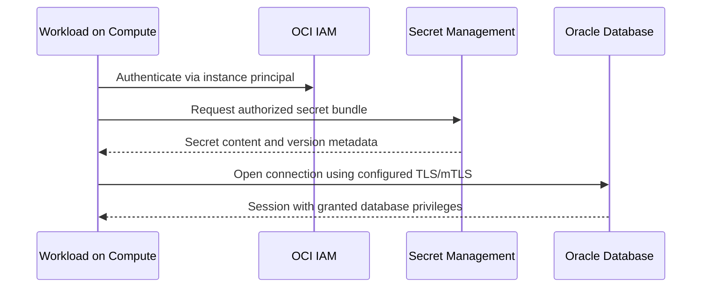

# SQL Connectivity, JDBC, Wallets, and Credential Management

An application able to access the OCI Console cannot necessarily log into Oracle Database. A host that can reach the database port will not necessarily pass certificate verification. Conversely, a valid username and password still fail to connect if DNS, routing, or the service name is wrong.

In the **Oracle Database on OCI** chapter of the **CLOUD_PROVIDERS_ORACLE** module, this lesson traces the path from connection details to a working SQL session. The material combines VCN networking, TLS/mTLS, JDBC for Java, Oracle Wallets, and secret management with IAM so learners can deploy, monitor, and rotate credentials in a controlled way.

Wallet examples in this lesson primarily target **Autonomous Database Serverless**. For Base Database Service, Exadata Database Service, or Autonomous on Dedicated Exadata Infrastructure, follow the configuration and documentation of that exact service; do not apply Serverless port numbers, TLS modes, or wallet download steps wholesale to every database on OCI.

After this lesson, learners will be able to:

- Read host, port, service name, TNS aliases, and JDBC URLs.
- Distinguish OCI administrative permissions from database login and SQL execution privileges.
- Choose TLS or mTLS based on actual configuration and prepare matching client credentials.
- Connect from SQL tools and Java without placing passwords directly in source code.
- Establish procedures for rotating passwords, wallets, and connection pools, complete with evidence testing new connections.
- Isolate errors by layer and gather logs free of secrets.

## 1. What Does a Successful Connection Require?

SQL is the language for working with data. SQL*Plus, SQLcl, and SQL Developer are client tools. JDBC is the interface enabling Java applications to interact with a database via a driver. These tools may rely on different name-resolution mechanisms, libraries, and configuration locations.

A SQL connection typically passes through four layers:

| Layer | Question to Answer | Examples |
| --- | --- | --- |
| Network reachability | Can the client reach the right endpoint? | DNS, routes, NSGs, ACLs |
| Transport protection | Have both sides established the required channel? | TLS, mTLS, certificate verification |
| Database authentication | Which identity does the session represent? | Database user/password, IAM database token when configured |
| SQL authorization | What is that identity allowed to do? | Login, read tables, execute packages |

```mermaid
flowchart LR
    A["Application / SQL client"] --> B["DNS and network path"]
    B --> C["Endpoint / listener"]
    C --> D["TLS or mTLS per configuration"]
    D --> E["Database authentication"]
    E --> F["Session and SQL privileges"]
    V["OCI Secret Management"] -->|"Provides secret to authorized workload"| A
    I["OCI IAM"] -->|"Permits reading secrets / managing resources"| V
```



The diagram shows a conceptual flow; it does not claim every Oracle Database listener uses TLS by default. On systems managed by operations teams, transport encryption must be configured and verified separately.

### IAM Permissions and SQL Privileges Are Two Separate Scopes

A user may have permission to view Autonomous Database details in the Console without having a database user to log in. A service account allowed to read a table does not automatically gain permission to download wallets or read OCI secrets.

Clarify three roles:

- **OCI operator:** allowed to provision resources, alter networking, or supply connection configuration.
- **Database administrator:** creates users, grants privileges, and manages login policies.
- **Application:** retrieves only required details and operates within granted SQL privileges.

When integrating IAM authentication, the database must also have the corresponding feature enabled and proper identity/schema mapping configured. A valid token does not replace the mapping step. [Oracle: IAM authentication and authorization for databases](https://docs.oracle.com/en/database/oracle/oracle-database/26/dbseg/authenticating-and-authorizing-iam-users-oracle-dbaas-databases.html).

## 2. Gathering a Connection Profile Before Configuring Clients

Compile a password-free profile for both the application and database teams to cross-check:

| Information | Meaning |
| --- | --- |
| Database service and environment | Autonomous Serverless, Base Database, or another service; dev/test/prod |
| Region and network access | Public or private endpoint; where clients run from |
| Host or SCAN | Name the client must resolve and connect to |
| Port and protocol | Taken from the connection string; distinguish TCP from TCPS |
| Service name | Database/PDB service the application needs |
| TNS alias if any | Local name mapped to a connect descriptor |
| Authentication method | Database user/password or another supported mechanism |
| Wallet/trust material | Whether required, provisioning source, and deployment path |
| Runtime/client | JDK, JDBC driver, SQL client, and versions |
| Operational owners | Who rotates secrets, updates wallets, and handles incidents |

**A service name is not a username.** Nor does it default to the SID, VM name, or resource display name in the Console. In a multitenant environment, applications generally need the service of the appropriate PDB. Logging into the wrong container can cause invalid-user or missing-object errors even when the password is correct.

For Base Database, Oracle guides users to connect inside the VCN, resolve the hostname/SCAN properly, and ensure the PDB or application service is active. [Oracle Base Database: connect using SQLNet](https://docs.oracle.com/en/cloud/paas/base-database/guide/connect-sqlnet.html).

### Connection Strings Are Managed Configuration Data

Never place passwords inside JDBC URLs. Hosts, services, and aliases are typically not passwords, yet infrastructure details should still be kept out of public exposure. Release records should log the config version, connection string source, and target environment to avoid pointing at a production database by mistake.

For Autonomous, retrieve connection strings from the **Database connection** page or client credentials provided by an authorized owner. Avoid assembling service names manually from display names.

## 3. Choose the Network Path First, Then TLS/mTLS per Configuration

Public/private endpoints describe **network reachability**. TLS/mTLS describes **how the transport channel is protected and verified**. Both choices must be evaluated together, though they are not synonymous.

### 3.1. Connecting to a Private Endpoint

The client must have a network path to the private network: for example, an application inside an eligible VCN or a host outside OCI traversing an enterprise network link. Check DNS, routes, NSGs/security lists, and any additional active controls.

A private endpoint neither grants SQL privileges nor eliminates TLS verification requirements. A laptop reaching the Console over the Internet cannot reach a private endpoint by virtue of that alone. [Oracle: network access with private endpoints](https://docs.oracle.com/en-us/iaas/autonomous-database-serverless/doc/private-endpoints-autonomous.html).

### 3.2. Connecting to a Public Endpoint

Verify the database ACL against the source address the service actually observes. Clients behind NAT may present a different public address than their local machine IP.

Allow only necessary sources. For labs, specify exact test sources and record added rules for cleanup upon completion. Never widen access ranges as a workaround instead of diagnosing routing, DNS, or authentication failures. [Oracle: Autonomous ACL and network access](https://docs.oracle.com/en/cloud/paas/autonomous-database/serverless/adbsb/autonomous-network-access.html).

### 3.3. TLS and mTLS in Autonomous Serverless

| Mode | What the Client Must Verify | Client-Side Material |
| --- | --- | --- |
| TLS with server authentication | Server presents a valid certificate matching the expected identity | Trust anchors appropriate for the client |
| mTLS | Adds client authentication via certificate | Wallet or keystore containing appropriate client material |

In this lesson's username/password flow, mTLS adds protection at the transport layer; the application still supplies the database user and password.

JDBC Thin can connect to Autonomous Serverless using TLS **without downloading a wallet** when service configuration permits and the JDK/driver meet requirements. The TLS channel still requires server certificate verification. [Oracle: JDBC Thin without a wallet](https://docs.oracle.com/en-us/iaas/autonomous-database-serverless/doc/connect-jdbc-thin-tls.html).

Use the exact connection string for the matching mode. On Serverless, mTLS typically uses port 1522; TLS can use 1521 or 1522 depending on published settings. Port numbers alone therefore cannot tell you whether a connection is encrypted. [Oracle: Autonomous connection types introduction](https://docs.oracle.com/en-us/iaas/autonomous-database-serverless/doc/connect-introduction.html).

### 3.4. Base Database and Exadata Require Their Own Profiles

Do not assume a JDBC URL using TCP already has TLS merely because it runs inside a VCN. Confirm with the database team which transport encryption mechanism is active, listener settings, certificates if using TCPS, and client support prerequisites.

With RAC, use the services and connection addresses designed for the cluster. Replacing SCAN with a single node's address can sacrifice load balancing or connection failover built into the original design.

## 4. Understanding TNS Aliases, Connect Descriptors, and JDBC URLs

### 4.1. A TNS Alias Is a Client-Side Config Name

An entry in `tnsnames.ora` might look like:

```text
learningdb_low =
  (DESCRIPTION =
    (ADDRESS =
      (PROTOCOL = TCPS)
      (HOST = adb.example.oraclecloud.com)
      (PORT = 1522)
    )
    (CONNECT_DATA =
      (SERVICE_NAME = example_learningdb_low.adb.oraclecloud.com)
    )
    (SECURITY =
      (SSL_SERVER_DN_MATCH = YES)
    )
  )
```

This is an **illustrative descriptor**, not a live endpoint to run against. In practice, substitute the entry supplied for your database.

- `learningdb_low` is the alias the client looks up in its config file.
- `HOST` is the hostname DNS must resolve.
- `SERVICE_NAME` routes to the database service.
- `TCPS` indicates Oracle Net over TLS.
- `SSL_SERVER_DN_MATCH` enables server identity verification per the client mechanism.

A TNS alias does not need to be a DNS record. Name resolution checks must test `HOST`, not the alias name by default.

### 4.2. JDBC Thin Using an Alias or Descriptor

Example using an alias with a JDBC driver supporting `TNS_ADMIN` in the URL:

```text
jdbc:oracle:thin:@learningdb_low?TNS_ADMIN=/opt/app/secrets/adb-wallet
```

Another option keeps the URL short and sets the path via a connection property:

```text
URL: jdbc:oracle:thin:@learningdb_low
Property: oracle.net.tns_admin=/opt/app/secrets/adb-wallet
```

Oracle supports passing the configuration location via URL, system property, or connection property; exact usage depends on the driver version. For modern clients, `TNS_ADMIN` lets the driver locate aliases and accompanying wallet files. [Oracle: JDBC Thin with wallet](https://docs.oracle.com/en/cloud/paas/autonomous-database/serverless/adbsb/connect-jdbc-thin-wallet.html).

Example URL syntax using a descriptor directly:

```text
jdbc:oracle:thin:@(DESCRIPTION=(ADDRESS=(PROTOCOL=TCPS)(HOST=adb.example.oraclecloud.com)(PORT=1521))(CONNECT_DATA=(SERVICE_NAME=example_learningdb_low.adb.oraclecloud.com))(SECURITY=(SSL_SERVER_DN_MATCH=YES)))
```

This remains a syntax example. For walletless TLS, copy the actual TLS descriptor from the service rather than just editing the port of an mTLS descriptor.

### 4.3. Services Can Affect Workload Processing

Autonomous services such as `TP`, `LOW`, `MEDIUM`, and `HIGH` carry different priority, parallelism, and concurrency characteristics. The name `HIGH` does not mean every API call becomes faster. Pick services according to workload behavior and options actually present in the database. [Oracle: Database Service Names](https://docs.oracle.com/en/cloud/paas/autonomous-database/serverless/adbsb/predefined-database-services-names.html).

## 5. What Does an Oracle Wallet Contain and How Should It Be Protected?

An Oracle Wallet is a store for security material. Know which purpose a wallet serves: client certificates, trust material, a password store, or database-side data encryption.

In an Autonomous client credentials bundle, files commonly encountered include:

| File | Brief Role |
| --- | --- |
| `cwallet.sso` | Auto-login wallet |
| `ewallet.p12` | PKCS#12 wallet |
| `keystore.jks` | Java keystore |
| `truststore.jks` | Java truststore |
| `tnsnames.ora` | Aliases and descriptors |
| `sqlnet.ora` | SQL*Net client configuration |
| `ojdbc.properties` | JDBC configuration |
| `README` | Notes, including wallet expiration |

The password set when downloading a wallet protects the corresponding components in the bundle. Oracle recommends issuing instance wallets for application use rather than regional wallets when possible. [Oracle: download database connection information](https://docs.oracle.com/en-us/iaas/autonomous-database-serverless/doc/connect-download-wallet.html).

### 5.1. Distinguishing Three Types of Credentials

| Credential | Function in This Lesson's Example |
| --- | --- |
| Database password | Authenticates the user opening a SQL session |
| Wallet password | Protects/opens wallet or keystore material per client type |
| Client private key and certificate | Participates in mTLS authentication |

The wallet password is not `APP_RUNTIME`'s password. Changing a user's password does not rotate mTLS certificates; rotating certificates does not automatically update the user's password.

An auto-login wallet must still be treated as a sensitive secret. Do not rely on "the ZIP download had a password" to leave extracted files readable by any process.

### 5.2. Deploying the Wallet to an Application

One layout for a Linux application:

```text
/opt/app/
  service.jar
  config/
  secrets/
    adb-wallet/
      cwallet.sso
      ewallet.p12
      tnsnames.ora
      sqlnet.ora
      ojdbc.properties
      ...
```

The application only needs to read its own material. Set ownership and permissions matching the execution account; on Linux, use restricted directories and owner-only read files. In containers, mount secrets to a dedicated path instead of baking them into images. On Windows, apply ACLs scoped to the service account.

Never commit the ZIP bundle or extracted files to Git, store them in build logs, or share them via public sync folders. `.gitignore` only prevents adding new files; it does not scrub secrets already in history.

### 5.3. A Connection Wallet Is Not a TDE Keystore

TDE protects stored data on the database side. A client wallet for connections is a separate scope. Never copy a database's TDE keystore onto an application server to troubleshoot connection errors.

### 5.4. Secure External Password Store Is a Separate Configuration

Oracle provides **Secure External Password Store (SEPS)** so clients can retrieve username/password from a configured wallet. In that setup, syntax like `CONNECT /@alias` can work once prerequisites are satisfied.

Do not assume every wallet downloaded from Autonomous automatically contains application user passwords. SEPS must be configured explicitly for the client and matching connection string. [Oracle: Secure External Password Store](https://docs.oracle.com/en/database/oracle/oracle-database/26/dbseg/managing-secure-external-password-store-password-credentials.html).

## 6. Test Connections with a SQL Client First

The first test should stay simple: same network path as the application, same service, same user, and same protection mode. Success from a laptop does not substitute for testing from the application's subnet or runtime.

### 6.1. SQL*Plus with Alias and Wallet

Prepare an appropriate Oracle Client/Instant Client with SQL*Plus, extract the wallet into a protected directory, and configure the client per your version's documentation.

Example setting `TNS_ADMIN` on Linux:

```bash
export TNS_ADMIN=/opt/app/secrets/adb-wallet
sqlplus /nolog
```

Equivalent example in PowerShell:

```powershell
$env:TNS_ADMIN = 'C:/app/secrets/adb-wallet'
sqlplus /nolog
```

For SQL*Plus using a wallet, confirm `sqlnet.ora` points to the right wallet directory. If the downloaded file has an unsuitable sample path, adjust it for your Oracle Client. Example Linux path config:

```text
WALLET_LOCATION =
  (SOURCE =
    (METHOD = FILE)
    (METHOD_DATA =
      (DIRECTORY = /opt/app/secrets/adb-wallet)
    )
  )

SSL_SERVER_DN_MATCH = YES
```

This snippet illustrates wallet location and does not replace all service-supplied client settings. JDBC Thin and SQL*Plus do not necessarily read or prioritize the same files.

In SQL*Plus:

```sql
CONNECT APP_RUNTIME@learningdb_low
```

Enter the database password at the prompt. Never place passwords on the shell command line, such as `user/password@...`, as values can appear in shell history or process listings.

### 6.2. Verify Session via Read-Only Queries

```sql
SELECT
    SYS_CONTEXT('USERENV', 'SESSION_USER') AS session_user,
    SYS_CONTEXT('USERENV', 'CURRENT_SCHEMA') AS current_schema,
    SYS_CONTEXT('USERENV', 'SERVICE_NAME') AS service_name
FROM dual;

SELECT SYSTIMESTAMP AS server_time
FROM dual;
```

These queries verify the session's user, current schema, and service. They do not prove the account holds sufficient business privileges or that the application can handle production load.

If testing business tables, use authorized objects and permitted test data. Never test with DDL or real data writes merely to verify connectivity.

### 6.3. SQL Developer

For Autonomous connections with a wallet, choose the wallet connection type supported by your SQL Developer version and select the exact client credentials bundle, service, and database user. For walletless TLS, Oracle instructs using a Custom JDBC URL copied from the TLS connection string. [Oracle: SQL Developer without a wallet](https://docs.oracle.com/en-us/iaas/autonomous-database-serverless/doc/connect-sqldev-tls.html).

Save passwords in the tool only when permitted by the machine's policy. Personal machines, shared hosts, and build agents carry different control levels.

## 7. Granting Database Privileges to the Application Account

Use a dedicated runtime account rather than `ADMIN`, `SYSTEM`, or `SYS` for daily application traffic. Separate schema owner, migration runner, and runtime user when design requires it.

The example below assumes the DBA created `APP_RUNTIME` in the right database/PDB and `APP_OWNER.ORDERS` exists:

```sql
GRANT CREATE SESSION TO app_runtime;

GRANT SELECT, INSERT, UPDATE
ON app_owner.orders
TO app_runtime;
```

This is a privilege grant example executed by an authorized administrator. Actual privileges should align tightly with application operations; never grant `DBA` just to bypass permission errors.

Changing `CURRENT_SCHEMA` lets unqualified object names resolve in the new schema, yet it grants zero extra access rights. With stored procedures, roles, and direct grants, evaluate the specific database program's execution rights model.

Read-only accounts, data-writing accounts, and migration accounts should each have clear purposes. That keeps logs and revocation plans aligned with each component's responsibilities.

## 8. Connecting via JDBC Thin in Java

JDBC Thin runs inside the JVM and does not require installing native Oracle Client for standard JDBC Thin flows. Still, security settings and wallet-supporting libraries must match the chosen driver.

Choose a JDK, JDBC driver, and database combination inside the support matrix. The name `ojdbc11` denotes the Java-targeted artifact line; it does not mean it only works with Oracle Database 11g. [Oracle: JDBC downloads and driver selection](https://www.oracle.com/database/technologies/appdev/jdbc-downloads.html).

### 8.1. Preparing Dependencies

The Maven dependency example below uses a version published in Oracle documentation; projects should pin a version verified by their team:

```xml
<dependency>
    <groupId>com.oracle.database.jdbc</groupId>
    <artifactId>ojdbc11</artifactId>
    <version>23.26.4.0.0</version>
</dependency>
```

Version reference source: [Oracle: configure Java applications](https://docs.oracle.com/en/database/oracle/oracle-database/26/ddscg/configure-java-applications.html).

For Oracle Wallets, also prepare the companion JARs required by your driver version's documentation, typically `oraclepki.jar`, `osdt_core.jar`, and `osdt_cert.jar`. Use a compatible library set; do not mix a newer driver arbitrarily with older companion JARs copied from another application.

If using Java keystores/truststores instead of an Oracle Wallet, configure the exact paths, passwords, and store types per the corresponding guide. Do not enable conflicting wallet/JKS settings simultaneously hoping one works.

### 8.2. Connection Verification Program

The example below targets a modern JDK confirmed compatible with the driver. It reads URL and username from environment variables; the password comes from `DB_PASSWORD` or console input if unset. Printed output contains no URLs, passwords, or wallet contents.

Save this code as `DbConnectivityCheck.java` in your practice environment:

```java
import java.io.Console;
import java.sql.Connection;
import java.sql.DriverManager;
import java.sql.PreparedStatement;
import java.sql.ResultSet;
import java.sql.SQLException;
import java.util.Arrays;
import java.util.Properties;

public final class DbConnectivityCheck {

    private static String requiredEnv(String name) {
        String value = System.getenv(name);
        if (value == null || value.isEmpty()) {
            throw new IllegalStateException("Missing environment variable: " + name);
        }
        return value;
    }

    private static String databasePassword() {
        String injected = System.getenv("DB_PASSWORD");
        if (injected != null && !injected.isEmpty()) {
            return injected;
        }

        Console console = System.console();
        if (console == null) {
            throw new IllegalStateException(
                "No console: supply DB_PASSWORD through the runtime secret mechanism"
            );
        }

        char[] entered = console.readPassword("Database password: ");
        if (entered == null || entered.length == 0) {
            throw new IllegalStateException("Database password was not supplied");
        }

        try {
            return new String(entered);
        } finally {
            Arrays.fill(entered, (char) 0);
        }
    }

    private static void checkConnection() throws SQLException {
        String url = requiredEnv("DB_JDBC_URL");

        Properties properties = new Properties();
        properties.setProperty("user", requiredEnv("DB_USERNAME"));
        properties.setProperty("password", databasePassword());
        properties.setProperty("oracle.net.ssl_server_dn_match", "true");
        properties.setProperty("oracle.net.CONNECT_TIMEOUT", "10000");
        properties.setProperty("oracle.jdbc.ReadTimeout", "30000");

        String tnsAdmin = System.getenv("DB_TNS_ADMIN");
        if (tnsAdmin != null && !tnsAdmin.isBlank()) {
            properties.setProperty("oracle.net.tns_admin", tnsAdmin);
        }

        String sql =
            "SELECT SYS_CONTEXT('USERENV', 'SESSION_USER'), " +
            "SYS_CONTEXT('USERENV', 'SERVICE_NAME') FROM dual";

        try (Connection connection = DriverManager.getConnection(url, properties);
             PreparedStatement statement = connection.prepareStatement(sql)) {

            statement.setQueryTimeout(10);

            try (ResultSet result = statement.executeQuery()) {
                if (!result.next()) {
                    throw new IllegalStateException("Session query returned no rows");
                }

                System.out.printf(
                    "Connected: user=%s, service=%s%n",
                    result.getString(1),
                    result.getString(2)
                );
            }
        }
    }

    public static void main(String[] args) {
        try {
            checkConnection();
        } catch (SQLException exception) {
            System.err.printf(
                "Database check failed: SQLState=%s, vendorCode=%d%n",
                exception.getSQLState(),
                exception.getErrorCode()
            );
            System.exit(1);
        } catch (IllegalStateException exception) {
            System.err.println(exception.getMessage());
            System.exit(2);
        }
    }
}
```

`try-with-resources` closes the result set, statement, and connection. In this standalone program, the connection was opened directly so closing terminates it. When using a pool, closing typically returns the logical connection to the pool while the physical connection may remain open.

Zeroing the character array only shortens the lifetime of one password copy. JDBC and `Properties` still use strings; do not treat this snippet as guaranteed memory erasure of secrets from the JVM.

### 8.3. Running with a Wallet

Commands below assume the `lib` directory already holds the driver and required JARs for the connection mode, and the wallet was prepared as shown earlier.

On Linux:

```bash
export DB_JDBC_URL='jdbc:oracle:thin:@learningdb_low'
export DB_USERNAME='APP_RUNTIME'
export DB_TNS_ADMIN='/opt/app/secrets/adb-wallet'

javac -d out DbConnectivityCheck.java
java -cp 'out:lib/*' DbConnectivityCheck
```

On PowerShell:

```powershell
$env:DB_JDBC_URL = 'jdbc:oracle:thin:@learningdb_low'
$env:DB_USERNAME = 'APP_RUNTIME'
$env:DB_TNS_ADMIN = 'C:/app/secrets/adb-wallet'

javac -d out DbConnectivityCheck.java
java -cp 'out;lib/*' DbConnectivityCheck
```

Without `DB_PASSWORD` set, run from a terminal with a console to enter the password hidden. In IDEs or runners lacking a console, supply the password via the runtime's secret mechanism.

`DB_TNS_ADMIN` is an environment variable convention chosen by this sample program and mapped to the Oracle property. Do not assume other JDBC applications automatically recognize that variable name.

### 8.4. Running with Walletless TLS

Set `DB_JDBC_URL` to `jdbc:oracle:thin:@` concatenated with the **actual TLS descriptor** copied from Autonomous. When using a full descriptor, unset `DB_TNS_ADMIN` if TNS files are not needed.

Check system properties and startup flags to ensure no leftover wallet/JKS references remain from prior runs. If the server certificate is untrusted, fix the runtime trust configuration using a valid certificate chain; never disable identity verification just to make a test pass.

Expected success is the program printing the right user and service and exiting with code 0. This result is a connectivity probe, not full application testing.

## 9. Timeouts and Connection Pools

Do not open a brand-new physical connection for every request in a busy API. Authentication, TLS handshakes, and session creation all carry overhead. Use an appropriate pool such as Oracle UCP or a framework-supported pool with verified versions and settings.

### 9.1. Timeouts Have Distinct Scopes

| Timeout | Scope to Understand |
| --- | --- |
| Pool borrow wait | Request waiting for an available connection |
| Socket connect | Establishing the TCP socket connection |
| Session negotiation | Establishing the Oracle Net session |
| Query timeout | Bounding statement execution via driver mechanism |
| Socket read timeout | Waiting for data read from the socket |
| Business deadline | Overall limit for the request or job |

In the Java example, `oracle.net.CONNECT_TIMEOUT` uses 10,000 milliseconds and `oracle.jdbc.ReadTimeout` uses 30,000 milliseconds. `Statement.setQueryTimeout(10)` takes seconds. These are lab values and must be tuned for your workload. [Oracle JDBC: connection properties](https://docs.oracle.com/en/database/oracle/oracle-database/26/jajdb/oracle/jdbc/OracleConnection.html), [Oracle JDBC: troubleshooting and read timeout](https://docs.oracle.com/en/database/oracle/oracle-database/26/jjdbc/JDBC-troubleshooting.html).

Do not assume the entire connect operation guarantees termination after 10 seconds: descriptors with multiple addresses, retries, and setup stages can extend total elapsed time. Similarly, `CONNECT_TIMEOUT` inside a TNS descriptor has its own unit rules; never copy numbers across locations while ignoring units. [Oracle Net: timeouts in tnsnames.ora](https://docs.oracle.com/en/database/oracle/oracle-database/26/netrf/local-naming-parameters-in-tns-ora-file.html).

### 9.2. Sizing the Pool to Whole-System Capacity

Hypothetical design calculation:

```text
6 application instances × max 12 connections = 72 connections

Also reserve capacity for:
- Background jobs and batches
- Migrations and operational tools
- Extra application replicas during rolling deployments
- Other applications sharing the same database
```

A larger pool does not automatically raise throughput. If the database is constrained on CPU, I/O, or concurrency, growing the pool can increase queueing and latency.

Monitor active/idle counts, borrow times, physical connection creation rates, and authentication failures. Avoid health checks that open fresh sessions at high frequency on every replica.

### 9.3. Do Not Retry Every Error Identically

Wrong passwords or missing aliases require fixing configuration. Transient network errors may warrant bounded retries with backoff and jitter. For write transactions, losing a connection right after sending `COMMIT` can leave the client unsure of the final outcome.

Do not blindly replay every write operation simply because an exception was thrown. Design business keys, idempotency, or outcome verification mechanisms accordingly. The pool recovering later does not prove the failed transaction was rolled back by the database.

## 10. Managing Secrets with OCI IAM and Secret Management

### 10.1. Classifying Configuration and Secrets

| Value | Recommended Management |
| --- | --- |
| JDBC URL, service, region | Environment configuration under change control |
| Database password | Versioned secret with an assigned owner |
| Wallet/private key | Sensitive material distributed under access control |
| Wallet/keystore password | Separate secret when required by client |
| Secret OCID | Config reference; read access governed by IAM |
| IAM token | Short-lived credential with managed lifecycle |

Environment variables are useful for demonstrating how to separate secrets from source code, yet they are not a full secret vault. Users or processes with runtime administrative privileges can inspect them. Avoid dumping entire environments or config objects while debugging.

### 10.2. Flow for Retrieving Passwords from OCI Secret Management

Applications on OCI Compute can use instance principals to call APIs rather than embedding long-lived API signing keys in source code. Configure dynamic groups and policies accurately for the resources. [Oracle: calling services from an instance](https://docs.oracle.com/en-us/iaas/Content/Identity/Tasks/callingservicesfrominstances.htm).

Design sequence:



The diagram simplifies SDK and IAM mechanics. Reading a secret merely supplies the application with material to perform database authentication; the database still validates user credentials and privileges.

Example policy restricting a dynamic group to read one specific secret:

```text
Allow dynamic-group app-runtime-dg to read secret-bundles in compartment app-secrets where target.secret.id = '<database-password-secret-ocid>'
```

Substitute dynamic group, compartment, and OCID per your environment. Never grant management permissions over an entire vault just so an application can read a password. Check which identities actually match the dynamic group; adding an unintended VM can widen secret access. [Oracle: Vault and Secret Management permissions](https://docs.oracle.com/en-us/iaas/Content/Identity/Reference/keypolicyreference.htm).

### 10.3. Retrieving Content with the Right API and Version

Use the Secrets endpoint with `GetSecretBundle` or the corresponding API to retrieve content; secret metadata is not the password value. Base64-encoded content must be decoded before passing it to JDBC. [Oracle: retrieving secret contents](https://docs.oracle.com/en-us/iaas/Content/secret-management/Tasks/get-secrets-contents.htm).

Pseudocode flow:

```text
identity = build provider for workload
bundle = fetch secret bundle by OCID and chosen version/stage
password = decode content per bundle encoding
pool = initialize or update connection source with password
log: loaded secret version, outcome, and timestamp
never log: bundle content or password
```

Base64 is representation encoding, not security encryption. Base64 strings of passwords must also be protected.

Do not call the secret API for every SQL query. Design caching, refresh intervals, behavior when the secret endpoint fails, and how the pool updates. Storing a new value in the secret store **does not automatically change the database user's password** unless an integrated rotation mechanism is configured for that target.

If storing an entire wallet as a secret or secure artifact, check size limits, distribution method, read permissions, and extraction mechanics. Do not assume every wallet bundle fits every secret store's limits.

### 10.4. IAM Database Authentication Is a Separate Option

Certain services and versions allow applications to use IAM database tokens through a supported mechanism. That requires enabling database integration, configuring mappings, policies, and compatible clients, along with token renewal logic.

Instance principals used to read a password from Secret Management and instance principals used in an IAM database token flow are two distinct designs. You cannot swap a password in code for an arbitrary IAM token and expect the driver to handle it automatically. [Oracle: IAM authentication with Autonomous Dedicated](https://docs.oracle.com/en/cloud/paas/autonomous-database/dedicated/adbaa/use-identity-and-access-management-iam-authentication-with.html).

Choose the design based on the deployed service and ability to operate tokens. This lesson's lab uses database user/password so checks remain clear and verifiable with SQL clients.

## 11. Rotating Passwords, Wallets, and Connection Details

Each type of change has distinct targets and blast radius:

| Change | What Must Be Updated or Checked |
| --- | --- |
| Database password | Database user, secret version, new connection sources |
| Wallet/client certificate | Rotation materials, distributed files, processes using wallet |
| Trust configuration | CA/certificate chain, clients, and verification rules |
| Endpoint/service | DNS, routes, descriptors, and each application's configuration |
| IAM mapping/policy | Permission to fetch secrets or database token flow rights |

### 11.1. Database Password Rotation Procedure

A practical plan should include:

1. List all clients, jobs, and pools using that user.
2. Select the transition approach and schedule changes in a test environment first.
3. Prepare the new secret value alongside the database update mechanism.
4. Execute changes in a verified order; if overlapping grace periods are unsupported, plan for downtime.
5. Update the secret consumed by the application.
6. Refresh the credential source and open **new physical connections**.
7. Test queries, business flows, and scheduled jobs.
8. Revoke old state once complete.

An already-authenticated session may remain active after a password changes, depending on active mechanisms and policies. Hence, "API still returns 200" right after rotation does not prove the application loaded the new password. Observe fresh connections opening from every critical client group.

If using database password rollover features, verify support, profiles, and grace windows for your exact deployment. Do not assume all user types or services behave identically.

### 11.2. Wallet Rotation Procedure

Re-downloading a wallet and rotating client certification keys are two distinct actions. Rotation can invalidate older material depending on the selected scope.

Autonomous Serverless supports immediate rotation and rotation with a grace period where supported. Instance vs. regional scope has different blast radii; sessions already open with the old wallet may persist. [Oracle: Rotate Wallets](https://docs.oracle.com/en-us/iaas/autonomous-database-serverless/doc/wallet-rotate.html).

Application-side rollout steps:

1. Check wallet type, database, scope, and rotation behavior for that environment.
2. Prepare a new versioned directory; avoid overwriting individual files inside a directory currently being read.
3. Grant read permissions strictly to the runtime account.
4. Roll out the new configuration to one replica or canary group.
5. Open new physical connections and verify sessions, business flows, and metrics.
6. Roll out progressively to remaining replicas and jobs; drain pools as supported by the library.
7. Conclude the grace window per plan, revoking old versions and unnecessary copies.

Do not assume a running driver automatically reloads every file merely because a volume mount changed. Without a verified reload mechanism, re-initialize the pool or restart processes gracefully.

When responding to a compromised wallet, the plan must evaluate existing active sessions and other potentially exposed credentials. Never reuse compromised credentials as a rollback option.

### 11.3. Availability Depends on Clients Too

Maintain environment-specific configurations with clear owners for every client. A monthly batch job might be the last component still relying on an old wallet.

After a restore, endpoint switch, or network change, retrieve updated connection details and test from the target runtime. Database HA mechanisms must be paired with properly configured drivers, services, and pools; simply updating a hostname does not guarantee in-flight transactions keep succeeding.

## 12. Isolating Errors by Layer

Read the first error alongside nested causes; a generic JDBC message often wraps DNS, TLS, or Oracle Net errors.

| Symptom | Initial Investigation Direction |
| --- | --- |
| Cannot resolve host | Runtime DNS, hostname in descriptor, private DNS |
| Connect timeout | Routes, endpoint, port, NSGs/security lists, ACLs, NAT source IP |
| `ORA-12154` | Alias, config location, `tnsnames.ora` syntax |
| `ORA-12514` | Service name, service registration, PDB/service status |
| `ORA-28759` | Wallet file path and read permissions, client config |
| `ORA-29024` or certificate validation error | Certificate chain, expiration, system clock, trust configuration |
| TLS handshake failure | TLS/mTLS mode, client certificate, protocol and client versions |
| `ORA-01017` | Credentials, user, target database/PDB, and login method |
| `ORA-28000`, `ORA-28001` | Account locked or password expired |
| `ORA-01031`, `ORA-00942` | Privileges, schema, object, and object name |
| `No suitable driver` | JAR on runtime classpath and JDBC URL syntax |
| PKI class loading failure | Companion JAR bundle and version compatibility |
| Works on laptop, fails in container | Secret mount, user/permissions, DNS, truststore, environment |
| Worked before rotation, new connections fail | Cached credentials, stale pool, un-updated wallet/config |

This table guides investigation and is not a one-to-one root-cause map. For instance, `ORA-00942` can occur when an object exists but the user lacks permission to see/access it.

### 12.1. Network Checks Do Not Equal SQL Checks

PowerShell example:

```powershell
Resolve-DnsName '<database-host>'
Test-NetConnection -ComputerName '<database-host>' -Port 1522
```

Substitute host and port from the real connection string. TCP success confirms only part of the connection path; it does not confirm TLS, database users, or SQL privileges.

Useful verification sequence:

1. Confirm which environment's config the runtime is actually loading.
2. Resolve the host from that exact runtime.
3. Verify network routing and endpoint reachability.
4. Check TLS/mTLS mode and security material.
5. Verify service name and credentials.
6. Run the session query, then check business privileges.

Avoid repeatedly guessing passwords as it can trigger account lockouts. When suspecting wrong credentials, coordinate with the administrator and check the secret version.

### 12.2. Gathering Sufficient Evidence

Record:

- Timestamp, environment, application version, and driver version.
- Masked alias or configuration name where appropriate.
- SQLState, vendor error code, and failure stage.
- Deployed secret/wallet version, excluding secret contents.
- Connection acquisition time, timeouts, and retry counts.

Enable deep tracing only for the needed scope and duration, storing outputs in a controlled location. Before sharing, scrub sensitive data from traces; never paste raw connection properties or full environment dumps into tickets.

## 13. Monitoring and Cost Control

Monitor the application, pool, and database simultaneously to understand where "slow connections" originate.

| Signal Group | Operational Value |
| --- | --- |
| Connection errors by layer | Separates network, TLS, authentication, and SQL authorization |
| New session creation time | Spots slowdowns in connect or authentication phases |
| Active/idle/waiting in pool | Spots pool exhaustion or leaked/held connections |
| Database sessions and workload | Reconciles real load against resource limits |
| Wallet expiration and version | Prepares rotations well before expiry |
| Secret access | Detects anomalous callers or permissions |
| Error rate post-rollout | Compares cohorts on old vs. new configuration |

A widespread credential error can trigger a connection storm: many replicas reconnecting, reading secrets, and retrying in unison. Set rate limits, backoff, and early alerts.

Costs to track include database resources, client compute instances, log storage and retention, network traffic, and security services consumed. Do not treat everything as "JDBC driver cost," nor assume a small test is completely free.

In labs, track provisioned resources, bound load-test durations, and clean up unused assets. Never delete wallets or secrets still used by another application.

## 14. Practice Exercise from Configuration to Handover

**Scenario:** A Java service running on OCI Compute needs to access Autonomous Database Serverless using a dedicated user. Operators choose appropriate network access and supply client credentials per environment policy.

### 14.1. Preparation

- Lab database, service details, and runtime user supplied by the administrator.
- Network path from the practice host to the endpoint.
- Compatible JDK, JDBC driver, and SQL client.
- Decision between walletless TLS or mTLS; if mTLS, an authorized wallet bundle.
- Method to supply the password outside source code.
- Assigned owners for ACL/NSG, database privileges, and secrets.

No need to create a new database if an authorized environment is already available. Shape, capacity, and billing mode choices belong to the lab's infrastructure plan.

### 14.2. Execution

1. Document host, port, service, protocol, runtime, and configuration owner.
2. Check DNS and network path from the application host.
3. Prepare wallet/TLS configuration matching the chosen mode.
4. Connect with a SQL client and run the read-only session query.
5. Compile and run `DbConnectivityCheck` with the same service and user.
6. Verify user, service, and exit code; test permitted business operations.
7. Integrate into the application pool with clear limits and timeouts.
8. If using Secret Management, grant scoped policy, fetch the right secret version, and verify refresh logic.
9. Practice credential rotation in the lab per plan; open new connections to prove success.
10. Record outcomes, remove temporary rules, and clean up practice-scoped resources.

You may test a nonexistent alias in a private lab config to observe name-resolution errors. Never change production passwords, rotate regional wallets, or alter shared system network access to simulate failures.

### 14.3. Completion Evidence

| Requirement | Appropriate Evidence |
| --- | --- |
| Right endpoint and database service | Config profile paired with service query output |
| Right user | `SESSION_USER` matches provisioned user |
| Right protection mode | Descriptor and client/service TLS/mTLS configuration |
| Secrets protected | Source code and logs contain no passwords/wallets |
| Appropriate SQL privileges | Permitted actions succeed; unnecessary privileges ungranted |
| Functional pool | Configured bounds, timeouts, and metrics |
| Verified rotation | New physical connections succeed under updated config |
| Complete handover | Assigned owner, refresh schedule, and error runbook |

Session queries prove part of the picture. Evidence for TLS must additionally draw from configuration and environment-supported observability; do not infer encryption purely from SQL succeeding or from a port number.

## 15. Principles for Production Applications

Connecting to Oracle Database on OCI requires a consistent configuration chain: right endpoint, right network path, right transport protection, right database identity, and least-privilege SQL permissions.

Separate connection configuration from secrets, choose wallets per exact purpose, and keep IAM, mTLS, and database authentication distinct. For Java, pin a verified runtime/driver combination, monitor the pool, and always test fresh connections after rotating credentials.

Operational readiness shows in knowing who issues credentials, which version the application loads, how rotation executes, and which evidence confirms the system switched over cleanly.
