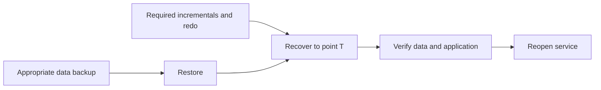

# Backup, Point-in-Time Recovery, and Retention Policies

A Java order-management application can stay connected to Oracle Database right after an erroneous statement deletes data. If the operations team checks only that the database shows Available, they may miss the incident until users reconcile data. Conversely, having the latest backup alone does not tell you which timestamps are recoverable or how long it takes to restore correct application behavior.

This lesson belongs to the **Oracle Database on OCI** topic and focuses on designing backups, choosing recovery targets, and managing retention. It links database recovery with compartments, IAM, VCN connectivity, monitoring, and cost. Oracle Base Database Service serves as the primary hands-on flow; key differences for Recovery Service, Exadata, and Autonomous Database are noted separately.

After this lesson, learners should be able to:

- Translate business needs into RPO, RTO, PITR windows, and long-term retention periods.
- Explain the roles of data copies, incremental backups, and redo in recovery.
- Configure policies aligned with the exact service and validate actual recoverability.
- Execute a PITR drill with evidence of data before and after the target timestamp.
- Evaluate impacts on applications, integrated systems, authorization, and cost.

Day-count limits and service behaviors in this lesson were verified against Oracle documentation on **November 20, 2026**. When deploying, verify the exact service type, release, compute model, and options actually available in your tenancy.

## 1. Four Requirements to Keep Separate

| Requirement | Question to Answer | Hypothetical Example |
| --- | --- | --- |
| RPO — Recovery Point Objective | What is the maximum acceptable data loss measured in time? | At most 5 minutes of recent transactions upon database loss |
| RTO — Recovery Time Objective | How long can the service tolerate disruption? | Restore the order-placement flow within 60 minutes |
| PITR window | Which points in the recent past must be reachable? | Able to select a valid point within the last 35 days |
| Long-term retention | Which historical copies must be kept, and until when? | One end-of-month copy retained for 7 years per internal policy |

RPO and retention period solve two different problems. Keeping backups for 35 days does not mean losing at most 35 days of data; nor does it prove recent data is protected within 5 minutes.

RTO must be measured until business functionality resumes. A useful breakdown during drills is:

```text
Outage duration =
    detection and isolation
  + deciding the plan and selecting the target point
  + preparing resources and access permissions
  + restoring data and applying changes
  + business verification
  + switching connections and reopening processing
```

This is a planning model, not an OCI SLA formula. A database restored in 25 minutes can still leave the application down for two hours if wallets, endpoints, credentials, or reconciliation steps are missing.

For logical errors, operations may **deliberately** pick an older point to discard bad transactions. Valid transactions excluded by that decision should be tracked separately; do not confuse that with protection lag for recent data.

## 2. What Do Backup, Restore, and Recovery Do?

### 2.1. Data Copies and Change Streams

A physical recovery strategy typically combines:

- **Data backups**: provide baseline data to reconstruct datafiles.
- **Incremental backups**: provide blocks changed relative to a suitable baseline.
- **Required redo**: advances the restored state forward to the target point.
- **Metadata and encryption material**: identify the database, read backups, and complete recovery.

In RMAN, restore retrieves required files from backups; recovery applies changes from redo and incremental backups to bring data to the desired state. DBPITR recovers to a past point in time and discards changes after that point. [Oracle: RMAN Quick Start](https://docs.oracle.com/en/database/oracle/oracle-database/19/bradv/getting-started-rman.html), [Oracle: Database Point-in-Time Recovery](https://docs.oracle.com/en/database/oracle/oracle-database/19/bradv/rman-performing-flashback-dbpitr.html).



Having a backup file dated today does not prove recoverability to every timestamp today. Check the baseline backup, continuity of recovery data, and the earliest and latest points actually available.

### 2.2. Do Not Confuse Data Backup Schedules with RPO

For automatic backups to **Object Storage in Base Database Service**, Oracle documents weekly level 0 backups, daily level 1 backups, and periodic archived redo log backups at a minimum frequency of every 60 minutes. Log backups do not have separate OCIDs like level 0/1 backups. Counting backup rows in the Console is therefore insufficient to infer RPO. [Oracle: Automatic Incremental and Archived Redo Log Backups](https://docs.oracle.com/en/cloud/paas/base-database/guide/br-about.html).

Level 0 serves as the baseline for an incremental chain. Both full backups and level 0 backups contain full baseline data, but you should not swap one for the other in an incremental chain configuration without checking RMAN semantics.

Recovery Service offers a **real-time data protection** option that continuously ships redo toward near-zero RPO; this is an extra-cost option with release-specific support conditions. Enabling the option does not replace monitoring actual protection lag. [Oracle: Enable Real-time Data Protection](https://docs.oracle.com/en/cloud/paas/recovery-service/dbrsu/enable-real-time-protection.html), [Oracle: Real-time Data Protection in Base Database Service](https://docs.oracle.com/en/cloud/paas/base-database/guide/br-about.html).

If a hypothetical requirement calls for a 5-minute RPO, a daily data backup schedule alone does not prove compliance. Inspect redo transport mechanisms, observed metrics, and drill results simulating source loss.

### 2.3. Supplementary Mechanisms Have Different Scopes

- A standby helps handle certain availability outages, yet designs must still account for which replicas received logical errors.
- Logical exports are useful for moving schemas or recovering selective data; they do not provide a full-database physical recovery chain.
- Flashback can fit certain logical errors when prerequisites are met and the log window remains sufficient. Flashback windows depend on required logs and are not identical to backup retention. [Oracle: Flashback Database and Restore Points](https://docs.oracle.com/en/database/oracle/oracle-database/19/bradv/using-flasback-database-restore-points.html).

Choose mechanisms based on corruption scope and consistency requirements. If only a subset of records needs correction, assess the scope first; rolling the entire database back in time can discard many valid transactions.

## 3. Choosing Policies per Exact OCI Service

### 3.1. Base Database Service with Recovery Service

Recovery Service manages **protected database** resources and binds each protected database to a protection policy. Oracle-defined policies include:

| Policy | Retention Period |
| --- | ---: |
| Bronze | 14 days |
| Silver | 35 days |
| Gold | 65 days |
| Platinum | 95 days |
| Custom | 14 to 95 days |

Predefined policies cannot be modified; custom policies are used when another period within the supported range is needed. [Oracle: About Protection Policies](https://docs.oracle.com/en-us/iaas/recovery-service/doc/overview-protection-policy.html).

The configured window is a retention goal for recoverability and must be reconciled against actual data. Choosing 35 days today does not conjure 35 days of prior backup history. Raising retention also cannot bring back backups already purged earlier.

### 3.2. Base Database Service with Object Storage

Automatic backup retention choices to Object Storage are **7, 15, 30, 45, or 60 days**. Available backup destinations depend on tenancy, region, version, limits, and service availability; in some cases the Console only offers Recovery Service. Do not assume every tenancy can pick both. [Oracle: Configure Automatic Backups](https://docs.oracle.com/en/cloud/paas/base-database/guide/br-backup.html).

Distinguish OCI-managed automatic backups from self-managed RMAN workflows targeting custom buckets. Do not apply a self-managed bucket lifecycle policy to a service-managed backup stream as though they shared the same orchestration.

### 3.3. Exadata Database Service

For Exadata, identify the exact infrastructure variant and managed backup flow in use. For example, **Exadata Database Service on Exascale Infrastructure** documentation describes managed backups to Recovery Service or Object Storage. Never take a Base Database runbook and assume every action across VM clusters, CDBs, or PDBs behaves identically. [Oracle: Backup and Recovery on Exascale Infrastructure](https://docs.oracle.com/en-us/iaas/exadb-xs/doc/ecs-managing-db-backup-and-recovery.html).

When using Recovery Service, inspect the protection policy of that exact protected database. When using another mechanism, inspect the corresponding service policy rather than inferring from the Oracle Database name.

### 3.4. Autonomous Database Serverless

Per current Autonomous Database Serverless documentation:

- The OCPU compute model has a 60-day automatic backup retention period.
- The ECPU compute model defaults to 60 days and allows selecting 1 to 60 days.

These figures apply to the documented targets and features, not every Autonomous variant or practice package. [Oracle: Automatic Backups on Autonomous Database](https://docs.oracle.com/en-us/iaas/autonomous-database-serverless/doc/backup-intro.html).

Autonomous manages backups at the service layer. Users select among provided options, monitor status, and drill recovery; do not configure RMAN cron jobs on a host like a self-managed database.

## 4. Configuring Backups so Recovery Actually Works

### 4.1. Build a Recovery Dossier for Each Database

Before configuring, record the following in operational documentation:

| Group | Information Needed |
| --- | --- |
| Identification | Tenancy, region, compartment, database OCID, DB system or VM cluster |
| Scope | Full CDB, single PDB, or selective data; dependent applications |
| Objectives | RPO, RTO, PITR window, long-term backup schedule |
| Configuration | Backup destination, policy, retention lock, initial backup status |
| Dependencies | VCN, routes, NSGs, DNS, Vault/keys or wallets, credentials |
| Operations | Alerting team, target-point decision maker, runbook location |

Database OCID and protected database OCID are two distinct resources. Use the right identifier when querying configuration or filtering metrics.

### 4.2. IAM, Networking, and Encryption Are Part of the Recovery Path

Design permissions by role: teams viewing backups, teams executing recovery, and teams managing retention policies may hold different scopes. Permissions must cover source compartments, recovery targets, and dependent resources.

If drilling by creating a new database, pre-check quotas, resource creation rights, and target network usability. An account able to view backups cannot necessarily provision a DB system.

Base Database needs access to the backup destination during recovery. Oracle recommends a service gateway for reaching Object Storage and documents private network paths for Recovery Service inside the database VCN. Both paths must be verified per configuration. [Oracle: Recovery Prerequisites](https://docs.oracle.com/en/cloud/paas/base-database/guide/br-recover.html).

For encrypted data, the dossier must specify key mechanisms and how access is restored. Track key, wallet, secret, and service-account lifecycles alongside backup lifecycles. Never treat "backup still exists" as sufficient proof that the recovery target can read the data.

### 4.3. Configuration Flow in the Console

On a test database in Base Database Service:

1. Confirm the region, compartment, and database to protect.
2. Open automatic backup settings from the database details page.
3. Choose an available destination; set the corresponding retention or protection policy.
4. Choose a schedule and initial backup option.
5. Check the setting for retaining backups after database termination.
6. Save and monitor until the initial backup completes.

Changing the backup destination can trigger an immediate full backup; delaying the initial backup leaves a window lacking sufficient recovery footing. [Oracle: Back Up a Database Using the Console](https://docs.oracle.com/en/cloud/paas/base-database/guide/br-backup.html).

With Recovery Service, do not run self-managed operational backup scripts to another destination in parallel without a supported plan. Oracle requires disabling such scripts/procedures before enabling automatic backups to Recovery Service. [Oracle: Backing Up to Recovery Service](https://docs.oracle.com/en-us/iaas/recovery-service/doc/about-automatic-backup-recovery-service.html).

### 4.4. Inventorying with the CLI

The example below uses **Bash**, assuming OCI CLI is authenticated with read permissions in the right compartment. These illustrative commands only read metadata:

```bash
DATABASE_OCID='REPLACE_WITH_DATABASE_OCID'
OCI_REGION='REPLACE_WITH_REGION_IDENTIFIER'

oci db database get \
  --database-id "$DATABASE_OCID" \
  --region "$OCI_REGION" \
  --output json

oci db backup list \
  --database-id "$DATABASE_OCID" \
  --region "$OCI_REGION" \
  --all \
  --output json
```

Syntax references: [Oracle CLI: database get](https://docs.oracle.com/en-us/iaas/tools/oci-cli/latest/oci_cli_docs/cmdref/db/database/get.html), [Oracle CLI: backup list](https://docs.oracle.com/en-us/iaas/tools/oci-cli/latest/oci_cli_docs/cmdref/db/backup/list.html).

Reconcile backup configuration, status, and timestamps across records. The backup list alone does not show all redo or prove every PITR timestamp works. With Recovery Service, also open the protected database resource to inspect its policy and protection state.

## 5. Choosing the Right PITR Timestamp

### 5.1. Target Points Must Be Grounded in Committed Transactions

Suppose an accidental order deletion committed at:

```text
Error time:            2026-11-20T14:32:00+07:00
Expected safe target:  2026-11-20T14:31:30+07:00
Same point in UTC:     2026-11-20T07:31:30Z
```

A safe target must be verified via logs, transaction trails, or data evidence. Picking "30 seconds earlier" in the example is purely illustrative, not a universal rule. If the error began earlier, that timestamp could still contain bad data.

When submitting a recovery request, specify the timezone and timestamp precision explicitly. Never append `Z` to Vietnam local time: `Z` denotes UTC.

You can inspect time sources in SQL:

```sql
SELECT SYSTIMESTAMP,
       CURRENT_TIMESTAMP,
       DBTIMEZONE,
       SESSIONTIMEZONE
FROM dual;
```

`DBTIMEZONE` does not prove every application-written timestamp uses that timezone. Check column data types, session timezones, and how the application converts timestamps.

### 5.2. Timestamp and SCN

SCN is Oracle Database's internal change sequence identifier, not a Unix timestamp. If a valid SCN is already recorded in operational logs or transaction data, it can pinpoint recovery more accurately than wall-clock estimates.

Never take the current SCN after discovering an error and treat it as a pre-error target. Converting between timestamps and SCNs must also be verified within the database context and available metadata.

Base Database supports recovery options to latest, a valid timestamp, or an SCN. The "latest" option targets the newest recoverable state; when a logical error is already committed, "latest" will preserve the error. [Oracle: Restore Options](https://docs.oracle.com/en/cloud/paas/base-database/guide/br-recover.html).

### 5.3. Confirm Scope Before Submitting the Request

Restoring an entire CDB has a different blast radius than restoring one PDB. Base Database offers in-place and out-of-place PDB flows, each with specific prerequisites. Do not assume every restore button shares the same SCN options or disruption level. [Oracle: Restore a Pluggable Database](https://docs.oracle.com/en/cloud/paas/base-database/restore-pdb/).

For multi-service incidents, picking a timestamp for one database must also consider the state of other databases, queues, objects, and external transactions. Single-database PITR does not create an atomic recovery transaction across the whole system.

## 6. Decision-Driven Recovery Runbook

### Step 1 — Isolate and Prevent Changes from Spreading the Fault

Determine whether the fault stems from infrastructure, data corruption, or business actions. Decide whether writes, consumers, or batches should be paused to avoid creating harder-to-reconcile state.

Preserve evidence of detection time, affected data, and critical transactions. If possible, retain the current state for reconciliation per designed procedures.

### Step 2 — Choose Scope, Target Point, and Target Strategy

Document explicitly:

- Which database or PDB is being recovered.
- Target point in UTC, evidence source, and selection rationale.
- Whether that point falls inside the actual recoverable range.
- Whether to restore in place or create another environment if supported by the service flow.
- Valid transactions after the target point that must be replayed or reconciled.

In-place recovery rolls the current environment backward. Restoring to another target aids verification and data extraction, but requires additional resources, cost, and connection cutover steps.

### Step 3 — Verify Execution Prerequisites

Confirm suitable backups and recovery data, access permissions, networking, keys/wallets, target version, capacity, and quotas. Check for other running operations to avoid conflicts.

For region-wide loss scenarios, the recovery design requires usable resources and data in the target region. Having backups inside the source region alone does not prove recoverability when the entire region is unreachable.

### Step 4 — Submit the Request via the Appropriate Service Flow

For Base Database, use the database page and service-provided Restore flow, choosing the agreed restore type and target point. Log the work request ID, status, and start time.

For Autonomous, the Restore action accepts a timestamp or backup selection. The database is unavailable during recovery; once complete, connect and verify the data. [Oracle: Restore and Recover Autonomous Database](https://docs.oracle.com/en-us/iaas/autonomous-database-serverless/doc/backup-recover.html).

### Step 5 — Technical and Business Verification

A verification checklist can include:

| Layer | Evidence to Collect |
| --- | --- |
| Database | Open state, connection to right service/PDB, accurate marker data |
| Schema | Migration version compatible with running application |
| Business | Orders, balances, inventory, and relationships are accurate |
| Integration | Outboxes, consumers, batches, and payment states reconciled |
| Security | Permissions, accounts, secrets, wallets, and encryption intact |
| Operations | Backups and monitoring active on the continuing environment |

If a new database was created from backup, re-check the target database's backup configuration. Never assume it automatically inherits the source policy.

### Step 6 — Reopen Service and Resume Protection

Cut over connections per plan, inspect the Java connection pool, and re-enable consumers or schedulers only after addressing potential duplicate transactions. Monitor errors, latency, and incoming data.

Record total elapsed time until business flows resumed, any data-loss window, incremental costs, and runbook updates needed. Without completing application verification, there is insufficient evidence to claim RTO was met.

## 7. PITR Drill with a Marker Table

Use a **dedicated practice database**, test schema, and an already active backup pipeline. For in-place drills, all data within the recovery scope rolls back to the target point, so the practice scope must be isolated upfront.

### 7.1. Create Baseline Data

Run before taking the baseline backup for the drill:

```sql
CREATE TABLE recovery_probe (
    probe_id   NUMBER PRIMARY KEY,
    marker     VARCHAR2(40) NOT NULL,
    created_at TIMESTAMP WITH TIME ZONE DEFAULT SYSTIMESTAMP NOT NULL
);

INSERT INTO recovery_probe (probe_id, marker)
VALUES (1, 'BASELINE');

COMMIT;
```

Wait for an appropriate baseline backup to complete and confirm data protection is active. Record the timestamp and resource identifiers.

### 7.2. Insert a Pre-Target Record

```sql
INSERT INTO recovery_probe (probe_id, marker)
VALUES (2, 'BEFORE_TARGET');

COMMIT;

SELECT TO_CHAR(
           SYSTIMESTAMP AT TIME ZONE 'UTC',
           'YYYY-MM-DD"T"HH24:MI:SS.FF3"Z"'
       ) AS target_utc
FROM dual;
```

Save the returned value as target point **T**, captured after record 2 committed. Record T in drill notes outside the database being restored.

### 7.3. Create Post-T Changes and Simulate an Error

Run only after the clock has clearly passed T; leave enough margin to avoid UI timestamp precision ambiguity:

```sql
INSERT INTO recovery_probe (probe_id, marker)
VALUES (3, 'AFTER_TARGET');

COMMIT;

-- Simulate an accidental delete in the practice table.
DELETE FROM recovery_probe
WHERE probe_id = 2;

COMMIT;

SELECT probe_id, marker
FROM recovery_probe
ORDER BY probe_id;
```

Before recovery, expected output contains records 1 and 3; record 2 is deleted. Confirm backup/redo protection covers at least T and that T is accepted by the service.

### 7.4. Recover and Verify

Execute PITR to **T** using the corresponding runbook. Once complete, connect to the recovered database/PDB and run:

```sql
SELECT probe_id, marker
FROM recovery_probe
ORDER BY probe_id;
```

| probe_id | Expected marker after PITR to T |
| ---: | --- |
| 1 | BASELINE |
| 2 | BEFORE_TARGET |

Record 2 must reappear; record 3 did not exist at T so it must be absent. These two checks catch recoveries targeting a point too late or too early.

If results differ from expectations, check commits, timezones, timestamp precision, recovery scope, and the endpoint connected to. Never rely solely on an "operation succeeded" banner.

The drill report must include T, source/target, data evidence, per-step timings, total business downtime, and post-recovery protection status. Commands in this lesson are practice instructions; they are not evidence of a completed drill on a specific OCI resource.

## 8. Operational Retention, Long-Term Retention, and Locks

### 8.1. A PITR Window Is Not a List of Monthly Snapshots

An end-of-month backup kept for seven years satisfies access to a historical point, yet does not allow rolling back to every second across seven years.

With Recovery Service, LTR backups are independent of automatic backups, support **90–3650 days**, and are used to create new databases within their validity period. LTR does not use the same in-place PITR flow as automatic backups. [Oracle: Long-Term Retention Backups](https://docs.oracle.com/en-us/iaas/recovery-service/doc/longtermbackup-LTR-recoveryservice.html), [Oracle: LTR in Base Database Service](https://docs.oracle.com/en/cloud/paas/base-database/guide/br-about.html).

Autonomous Database supports long-term backups from **3 months to 10 years**, creatable on demand or on a schedule. The usage flow clones to a new database; long-term backups are not used to restore in place over the source database. [Oracle: Create Long-Term Backups](https://docs.oracle.com/en-us/iaas/autonomous-database-serverless/doc/backup-long-term.html), [Oracle: Long-Term Backup Recovery Scope](https://docs.oracle.com/en-us/iaas/autonomous-database-serverless/doc/backup-intro.html).

Do not convert "3 months" into a fixed day count and apply it uniformly across every API. Use the exact units and limits of each service.

### 8.2. Designing Policies Around Error-Detection Windows

Hypothetical example for the orders system:

| Internal Need | Illustrative Design | Required Evidence |
| --- | --- | --- |
| Detect business errors within weeks | 35-day PITR window | Valid target points and recent drill |
| Minimize recent transaction loss | Protection meeting 5-minute RPO | Measured lag, alerts, and drill |
| Retain end-of-month reconciliation data | Monthly LTR kept for 7 years | Creation schedule, expiry, and test create from LTR |
| Prevent unauthorized retention edits | Appropriate permissions and locks | Lock settings, audit trail, and tested recovery path |

Numbers are design assumptions, not legal mandates. Organizations must determine the retention rules applicable to their own data.

When shortening retention, check which history will be purged. When lengthening retention, track how long it takes data to accumulate to the new window; changing a policy does not resurrect already-expired history.

### 8.3. Locking Retention Differs from Setting Day Counts

In Recovery Service protection policies, retention lock has a minimum **14-day** waiting period before taking effect. Once locked, the period is fixed and can only be increased within supported limits; backups are protected against modification/deletion during retention. [Oracle: Retention Lock](https://docs.oracle.com/en-us/iaas/recovery-service/doc/protection-policy-locking.html).

This mechanism should not be conflated with Autonomous's backup retention lock option: Autonomous documentation notes that once enabled, users cannot disable or alter the automatic backup retention period via standard flows. [Oracle: Autonomous Backup Retention Lock](https://docs.oracle.com/en-us/iaas/autonomous-database-serverless/doc/backup-intro.html).

Before enabling a lock, finalize durations and billing ownership, as subsequent design changes may be restricted. Retention locks also do not verify whether applications can read recovered data.

### 8.4. Check Post-Termination Policies

For Recovery Service LTR, Oracle describes options to delete after 72 hours or retain per policy upon database termination. Therefore, do not assume all long-term backups automatically survive to their original expiry across every database deletion action. [Oracle: LTR Retention after Termination](https://docs.oracle.com/en-us/iaas/recovery-service/doc/longtermbackup-LTR-recoveryservice.html).

Record the chosen option explicitly before decommissioning an environment. Also check interactions between lock status, allowed operations, and source lifecycle per the exact service.

## 9. Monitoring Recoverability

### 9.1. Tracking Protection Freshness and Backup Health

Recovery Service emits the `oci_recovery_service` namespace, including:

| Metric | Primary Meaning |
| --- | --- |
| `DataLossExposure` | Time window of data at risk of loss, in seconds |
| `ProtectedDatabaseHealth` | 0: Protected; 1: Warning; 2: Alert |
| `SpaceUsedForRecoveryWindow` | Space used for recovery window, in GB |
| `ProtectedDatabaseSize` | Protected database size, in GB |

The `resourceId` dimension is the OCID of the **protected database**; `dBUniqueName` identifies the database inside Recovery Service. [Oracle: Recovery Service Metrics](https://docs.oracle.com/en-us/iaas/recovery-service/doc/available-recovery-service-metrics.html).

Design alerts tied to targets, such as potential data loss exceeding a 300-second RPO over a suitable evaluation window. This is an illustrative threshold for a hypothetical system, not an Oracle default or SLA.

Check emission frequency and evaluation intervals before creating alarms. Long averaging windows can mask brief breaches; missing samples also do not mean no incident occurred.

### 9.2. Alerts Must Drive Action

| Signal | First Action |
| --- | --- |
| Backup failed or repeatedly incomplete | Check database state, error logs, and conflicting jobs |
| Protection lag increasing | Check network path, redo shipping, and protected database status |
| Missing monitoring data | Check resource, query scope, and telemetry pipeline |
| Abnormal capacity growth | Reconcile churned data, retention, and new LTR copies |
| Policy change detected | Verify actor, change ticket, and affected history |
| Internal drill overdue | Schedule a re-test with representative data and scale |

An actionable alert identifies the resource, timestamp, recipient, and runbook. Verify notification delivery and confirm on-call staff hold inspection permissions, rather than only checking that an alarm exists.

## 10. Database Recovery and Java Application Consistency

### 10.1. External Transactions Do Not Automatically Roll Back

Suppose at 14:35 the system successfully charged a payment gateway, yet the database is rolled back to 14:31. The database may no longer record that payment, while the provider still holds the charge.

If a consumer replays messages without idempotency, duplicate charges or wrong inventory counts can occur. Runbooks must define reconciliation sources and handling for each type of side effect.

With an outbox pattern, "sent" flags can also roll back with the database. Review emitted messages, consumer receipts, and deduplication safeguards. PITR never reverses an email, a payment, or a message already processed by another system.

### 10.2. Application Version and Schema Must Match

A post-PITR database may sit prior to a migration while the Java app runs the newer release. Before opening traffic, compare schema state, migration metadata, and compatible application versions.

Specifically check startup behavior if migration tools run automatically on app boot. Auto-applying migrations during verification can overwrite state you intended to inspect.

When cutting over to a new database, verify JDBC service name, DNS, secrets, wallets, and required TLS settings. Reset connection pools to purge stale connections per application procedures, then run a controlled read/write business check.

### 10.3. External Data Needs Its Own Protection

For instance, an order references a PDF invoice in Object Storage. Rolling the database back does not guarantee the object version matches that reference.

For Autonomous, Oracle explicitly states that external Object Store files for external tables are excluded from database backups; users are responsible for protecting and recovering those files. [Oracle: Autonomous Restore Notes](https://docs.oracle.com/en-us/iaas/autonomous-database-serverless/doc/backup-recover.html).

Inventory all critical dependencies, attach reconcilable versions or identifiers, and test recovering them together. The goal is a consistent business state, not just a connectable database.

## 11. Cost Control and Availability

Costs must be evaluated for both steady-state operations and drills:

- Backup storage driven by data size and change rate.
- Operational backup retention duration and active LTR copies.
- Extra-cost protection options.
- Compute, storage, and licensing per the model applied to recovered databases.
- Lifetime of temporary recovery environments, network traffic, and cross-region replication if used.

Never estimate storage simply as "database size times retention days." Incrementals, compression, data sharing, and metering vary by service. Forecast from real telemetry and reconcile against actual billing or cost reports for the exact model.

A sound way to control costs is matching the PITR window to error-detection timelines while using LTR for long-lived historical milestones. Ensure cost optimization does not trim away the exact window business units rely on.

Lower RTO may require warm target capacity and faster application cutover flows. Compare options across three axes together: measured recovery time, data-loss exposure, and total operational cost.

After drills, tear down temporary resources per documented approvals while retaining required evidence. Environment cleanup must stay separate from source backup retention decisions; check deletion flags carefully to avoid purging backups still required for protection.

## 12. Common Misconceptions

| Misconception | Accurate Assessment |
| --- | --- |
| Having a successful backup means RTO is met | Measure prep, restore/recover, verification, and app reopening |
| 35-day retention means 35-day RPO | RPO measures freshness of protected data; retention measures history kept |
| Daily data backups limit loss to at most 24 hours | Also depends on redo, shipping mechanism, and actual recoverable data |
| Seven-year LTR enables PITR to any second across seven years | Check backup points and restore/clone scope of the service |
| Latest is always the best choice | Logical errors may already be committed in the latest state |
| Increasing retention recovers previously purged history | Only retains existing and newly created data going forward |
| Data Guard or Flashback replaces all backup needs | Check incident types, data scope, and mechanism limits |
| Database Available means the business recovered | Verify schemas, data, integrations, and endpoints |
| If backups exist, deleting keys or sources won't hurt | Check encryption, access permissions, and lifecycle rules |
| Backups in one region suffice for full region loss | Verify architecture and usable data in the target region |

## 13. Applied Exercise

Given a Java order-processing system on OCI with hypothetical requirements: 5-minute RPO, 60-minute RTO, data error detection lag up to 30 days, and monthly copies kept for 7 years.

Complete the following:

1. Select the database service and describe which backup mechanisms support each requirement.
2. Document resource identifiers, IAM permissions, network paths, and encryption mechanisms.
3. Explain why the chosen data backup schedule does or does not provide sufficient evidence for meeting RPO.
4. Execute the marker-table drill, record T in UTC, and verify both sides of the target point.
5. Measure elapsed time until a test business flow operates correctly.
6. Describe how to reconcile if a payment completed after T but disappeared from the database.
7. Design alerts for protection lag, backup failures, and missing monitoring data.
8. Verify retention, locks if applicable, and backup lifecycle after source termination.
9. Estimate cost components and document how drill resources are managed.

Deliverables should include policy decisions, data recovery evidence, and operational measurements. For any unverified requirement, explicitly state which test or prerequisite is still missing before claiming compliance.
