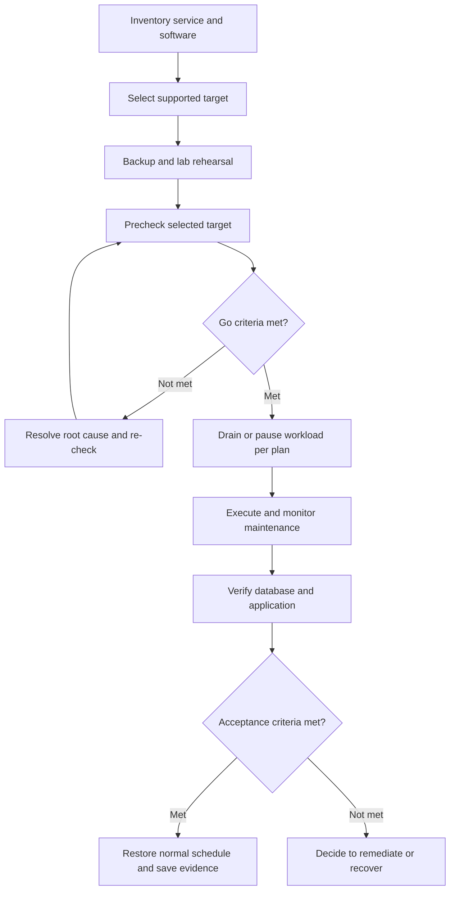

# Patching and Upgrading Oracle Database on OCI

## 1. Objectives and Operational Scenario

In the **Oracle Database on OCI** chapter of the **CLOUD_PROVIDERS_ORACLE** module, this lesson guides you through planning database updates and upgrades in relation to tenancies, compartments, IAM, VCNs, monitoring, automation, cost, and availability. The goal is to bring the system to the desired software state with verification evidence and a viable recovery path.

Suppose a Java order-management application uses Oracle Database on OCI. The operations team needs to apply security patches, while the development team plans to move to a new release. Both alter software, yet they carry different testing scopes, data impacts, and rollback constraints. Distinguish them right from planning.

After this lesson, you will be able to:

- Distinguish between Release Updates, interim patches, major release upgrades, and OS/Grid Infrastructure maintenance.
- Identify what Oracle manages versus what the customer must proactively handle per service.
- Prepare prechecks, backups, recovery drills, and application testing.
- Evaluate rolling maintenance, RAC, and Data Guard within their exact support limits.
- Execute a lab update procedure with tracking and post-change verification.
- Design automation that avoids concurrent launches and manages temporary resource costs.

Commands in this lesson are examples for learners to practice in an authorized administrative environment. The lesson does not ask you to run maintenance commands on the machine holding your documentation. Resource names, durations, and performance thresholds are illustrative learning assumptions.

## 2. Distinguishing Patching, Upgrades, and Software Layers

### 2.1. One Word "Update" Can Refer to Many Tasks

| Change | Nature | Scope to Evaluate |
| --- | --- | --- |
| Release Update (RU) | Periodic bug-fix bundle within an Oracle Database release | Binaries, SQL patch portion, compatibility, and regressions |
| Interim / one-off patch | Fixes one specific issue | Conflicts with existing patches, superseded patches, or merge patches |
| Major release upgrade | Moves to a newer database release | Upgrade path, dictionary, features, and application behavior |
| OS update / upgrade | Alters the node or VM operating system | Reboots, agents, packages, and OS customizations |
| Grid Infrastructure (GI) update / upgrade | Alters Clusterware/ASM layer where used | Database compatibility and cluster/storage operation |
| Infrastructure maintenance | Maintenance of the service's underlying infrastructure | Hosts, storage, and Oracle-managed components |

RUs include security and functional fixes; one-off patches address a specific issue. Inventory one-off patches before picking an RU because conflicts or replacement patches may arise. [Oracle Database Patch Maintenance](https://docs.oracle.com/en/database/oracle/oracle-database/19/dbptc/index.html).

Notation like `19.x` to `19.y`, with `y > x`, represents changing RUs within the 19c line; it is not an API version string. RUs are cumulative, yet direct update eligibility must still satisfy service rules and the target image. [Oracle: About Oracle Database Release Numbers](https://docs.oracle.com/en/database/oracle/oracle-database/19/upgrd/oracle-database-release-numbers.html).

### 2.2. A Database Home Differs from a Database

A Database Home holds the Oracle Database software binaries. The Database uses those binaries to open and process data. Any operation on a Home must be evaluated alongside the list of databases using that Home and how service automation executes the change.

Therefore, maintenance dossiers should separate:

```text
Infrastructure resource / DB system / VM cluster
  -> Nodes and OS layer
  -> GI, if used by the configuration
  -> Database Home and software patch level
  -> Database / CDB
  -> PDBs and application services
  -> JDBC connection pools, batch jobs, and external integrations
```

This is an inventory model, not an identical resource tree across every service. Changing the OS does not prove Database Home was patched; a database opening cleanly does not prove the Java application processes transactions accurately.

## 3. Maintenance Responsibilities by Service

| Service | Operational Approach |
| --- | --- |
| Base Database Service | Customer proactively schedules, picks supported OS/GI/database actions, and monitors outcomes |
| Exadata Database Service on Dedicated Infrastructure | Separates Oracle-managed infrastructure schedules from customer maintenance of guest VMs, GI, and Database Homes |
| Autonomous Database Serverless | Oracle patches automatically per service mechanisms; customer manages app testing and supported maintenance options |
| Autonomous Database on Dedicated Exadata Infrastructure | Oracle executes maintenance; customer coordinates schedule and method options at supported resource levels |

On Exadata, Oracle maintains infrastructure components under Oracle management; that schedule does not replace the database team's own plan. [Oracle: Configure Oracle-Managed Infrastructure Maintenance](https://docs.oracle.com/en-us/iaas/exadatacloud/doc/exa-conf-oracle-man-infra.html).

Guest OS, GI, and database software on Exadata follow separate update workflows. Oracle recommends patching databases by moving them to a Database Home at the target patch level. [Oracle: Patch and Update an Exadata Cloud Infrastructure System](https://docs.oracle.com/en-us/iaas/exadatacloud/doc/ecs-patch-update.html).

In Autonomous Dedicated, maintenance can involve infrastructure, Autonomous VM Clusters, and Autonomous Container Databases. Rolling and non-rolling methods carry different impacts; certain activities such as time-zone file updates may require downtime. [Oracle: Service Maintenance of Autonomous AI Database on Dedicated Exadata Infrastructure](https://docs.oracle.com/en/cloud/paas/autonomous-database/dedicated/adbaa/service-maintenance-of-autonomous-ai-database-on-dedicated.html).

Practical consequence: state the exact service type at the top of every runbook. Never copy `dbcli`, `dbaascli`, `OPatch`, or SSH commands verbatim from another service onto Autonomous.

## 4. Documenting the Change Before Picking a Patch

### 4.1. Identity and Blast Radius

For the orders application scenario, the team can build the following dossier:

| Item | Information to Record |
| --- | --- |
| Deployment target | Tenancy, region, compartment, and resource OCIDs |
| Service and topology | Base/Exadata/Autonomous; single instance, RAC, standby if any |
| Current state | OS, GI if any, Database Home, release/RU, one-off patches |
| Target state | Image/version/patch identifier from the supported list |
| Affected units | CDB, PDBs, services, applications, reports, and batch jobs |
| Data protection | Backups, recovery point, and encryption key access prerequisites |
| Maintenance window | Start time, timezone, and rollback decision cutoff |
| Accountable owners | Operator, application validator, and incident decision maker |

Record both UTC and local time (e.g., Vietnam time) when coordinating multiple teams. For instance, `18:00 UTC` corresponds to `01:00` the next day in Vietnam. Confusing dates across timezones can make a sound plan run at the wrong time.

### 4.2. IAM, OS Accounts, and Database Privileges Are Three Separate Layers

IAM governs API calls against OCI resources. Node SSH access and database catalog read privileges do not materialize simply because a user can open a resource page in the Console.

Match planned operations against corresponding permissions and resource types. Read-only access does not equal update permission. Grant permissions in the right compartments and verify which identity automation runs under before executing. [Oracle: Policy Details for Base Database Service](https://docs.oracle.com/en/cloud/paas/base-database/guide/policy-details.html).

In lab records, note the profile name or principal type; never copy private keys, SYS passwords, tokens, or wallet contents into logs. Business validators should use the application account so tests reflect the real runtime access path.

## 5. Prechecks and Go/No-Go Criteria

A precheck verifies technical prerequisites for an operation against a specific target. It does not prove full business compatibility, nor does it replace a recovery drill.

### 5.1. Condition Groups to Verify

| Check Group | Expected Evidence | Example Stop Condition |
| --- | --- | --- |
| Update / upgrade path | Source release, target, and topology are supported | Target unavailable or baseline prerequisites missing |
| Resources | Nodes/cluster healthy, sufficient capacity per workflow | Node down or insufficient filesystem space |
| Network | DNS, routes, and required service endpoints reachable | Patch/image download fails due to connectivity |
| Software | Inventory and one-off patches reconciled | Unresolved patch conflict |
| Data protection | Backup completed, restore path proven | Only a schedule exists with no successful backup |
| Application | Rehearsal results and test plan ready | Driver or critical transaction fails |
| Coordination | Time budgeted for testing and recovery | Window barely fits estimated install duration |

For Base Database DB system updates, Oracle specifies prerequisites such as active nodes, Clusterware running where used, and sufficient `/u01` space. OS updates on a single-node DB system incur downtime. [Oracle: Update a DB System](https://docs.oracle.com/en/cloud/paas/base-database/guide/dbs-update.html).

For database updates, verify paths to Identity and Object Storage. Inside a private subnet, a service gateway rule scoped only to Object Storage may be insufficient for this workflow; verify all required endpoints. [Oracle: Update a Database](https://docs.oracle.com/en/cloud/paas/base-database/guide/db-update.html).

Do not fix connectivity failures by opening all ingress indiscriminately. Investigate where the request goes, which route it takes, whether NSGs/security lists allow it, and whether DNS returns the right target.

### 5.2. Run Early and Re-Run When Conditions Change

Run prechecks during preparation so time remains to fix issues. If you subsequently alter the image, patch inventory, topology, or related configs, re-evaluate whether prior results remain valid. Log the target identifier, timestamp, and job ID alongside the report.



This diagram is a recommended operational workflow, not an exact depiction of every internal OCI automation step.

## 6. Backups, RPO, RTO, and Recovery Drills

A backup reported as successful is an input to recovery; you must still prove the team can use it to open the database and reconnect applications.

- **RPO**: maximum acceptable data loss, typically expressed in time.
- **RTO**: maximum acceptable duration to restore service.
- **Patch rollback**: removing or reversing software changes via a supported workflow.
- **Flashback/restore/recovery**: bringing data back to an appropriate state via the corresponding recovery mechanism.

These concepts do not substitute for one another. Reverting to an older Database Home does not automatically prove the data dictionary and data files match the older binaries.

### 6.1. Drilling with a Separate Recovery Database

Base Database Service provides a workflow to create a DB system from a backup. Recovery must account for version, network configuration, and required encryption details. [Oracle: Create a DB System from a Backup](https://docs.oracle.com/en/cloud/paas/base-database/guide/dbs-create-from-backup.html).

A drill for the orders application should capture:

1. Time to provision recovery resources and actual data restore duration.
2. Confirmation that the database/PDB opens in the right mode and services are reachable.
3. Confirmation that required encryption keys or wallets work.
4. Order query results and test transactions executed through the application.
5. Checklist of connection-switch steps and data reconciliation.

Suppose a rehearsal measures 12 minutes for resource creation, 28 minutes for recovery, and 15 minutes for testing/cutover. The plan must budget at least that total plus buffer, rather than counting only 28 minutes. These are hypothetical numbers, not an OCI commitment.

```text
Expected service recovery duration
  = detection and decision
  + recovery target preparation
  + data recovery
  + verification
  + connection cutover and reconciliation
```

### 6.2. Restore Points and Backups Have Specific Limits

Guaranteed Restore Points serve certain recovery paths yet depend on Flashback prerequisites and storage capacity. Do not assume having a restore point allows reversing any version change, any timestamp, or on any service.

In particular, raising `COMPATIBLE` affects the ability to return to an older release. For 19c, Oracle warns that advancing this parameter can eliminate downgrade options and flashback to earlier restore points. [Oracle: Database Compatibility, 19c](https://docs.oracle.com/en/database/oracle/oracle-database/19/upgrd/what-is-oracle-database-compatibility.html).

Runbooks must state exactly which backup is used for recovery, which data timestamp is acceptable, where drill evidence lives, and who decides to halt writes if rollback becomes necessary.

## 7. Choosing Deployment Strategy and Disruption Level

### 7.1. In-Place and Out-of-Place

| Strategy | Meaning | Trade-Offs to Evaluate |
| --- | --- | --- |
| In-place | Updates software inside the existing Home | Fewer temporary Homes, but the active Home is modified directly |
| Out-of-place | Prepares a target Home and moves the database per supported flow | Cleanly separates source/target binaries; needs extra space and Home management |
| Provision new target and cut over app | Prepares a separate target database/system | Requires data sync, cutover, and preventing split-brain writes |

Keeping the old Home is useful preparation, yet insufficient by itself to guarantee all changes are reversible. Rollback feasibility also depends on SQL patch changes, dictionary upgrades, and operations executed afterward.

### 7.2. Rolling Does Not Guarantee Every Request Succeeds

Rolling maintenance updates parts of a system sequentially. Verify whether the patch supports rolling mode, whether remaining nodes can carry the load, and whether applications redirect connections properly.

For example, a two-node system handling load smoothly with both nodes active may still overload when one node pauses. Before the maintenance window, test load against remaining capacity and measure connection acquisition times, timeouts, and transaction latency.

Oracle publishes guidance on managing planned maintenance via services in RAC. Coordinate service placement and clients; merely seeing multiple instances does not predict application behavior. [Oracle: Managing Planned Maintenance](https://docs.oracle.com/en/database/oracle/oracle-database/26/racad/ensuring-application-continuity/managing-planned-maintenance.html).

### 7.3. Data Guard: Distinguish Patching from Release Upgrades

Standby-First Patch Apply for physical standbys applies only to certified patches as stated in the patch README. Major release upgrades do not automatically fall under that mechanism. [Oracle: Patching Oracle Database with Standby First Patching](https://docs.oracle.com/en/database/oracle/oracle-database/21/sbydb/data-guard-concepts-and-administration.pdf).

A Data Guard plan must document primary, standby, sync status, execution order, and verification after each step. Follow the exact service's procedure rather than assuming "having a standby means zero downtime."

Separate three questions:

- Does the patch permit both sides to temporarily run at different software levels?
- What order does the active OCI service automation require?
- Upon role transition, does the application reach the right service and handle in-flight transactions?

Exact upgrade ordering for Base Database and Exadata must come from their respective guides; never transfer an ordering rule from one service to another. For configurations lacking an automated path, design a separate supported plan.

## 8. Testing the Java Application During the Maintenance Window

A successfully opened JDBC connection is only a connectivity check. Acceptance testing must exercise the operations real users perform.

| Scenario | What to Observe |
| --- | --- |
| Opening a new connection | DNS/service, auth, TLS if used, connection acquisition time |
| Connections already in the pool | Detection of stale connections and proper recreation |
| In-flight transactions | Commit outcome, rollback, and ambiguous client states |
| Critical SQL / PLSQL | Accurate results, new errors, and runtime variance |
| Long-running batches | Ability to pause, resume, or safely rerun |
| External integrations | Message/payment states reconciled against database transactions |

Oracle recommends draining requests and using mechanisms such as FAN-aware pools and Application Continuity where properly configured. UCP and Application Continuity must be tested per driver, service, and request behavior; simply using UCP does not prove replay works. [Oracle: Application Continuity for Planned Maintenance](https://docs.oracle.com/en/database/oracle/oracle-database/26/racad/ensuring-application-continuity/administering-application-continuity-operation-and-usage.html).

With Spring/Hibernate or other pools, verify the driver/JDK/database compatibility matrix and real reconnect behavior of your deployed stack. Do not add infinite retries to mask maintenance errors.

### Example of a Transaction at Risk of Duplication

The application submits an order-creation request. The database commits, but the connection drops before the client receives the response. If the client retries as a brand-new order, duplicate records can be created.

Suggested design for this scenario:

```text
Receive request with a stable requestId
  -> Create or look up outcome by requestId
  -> Enforce uniqueness constraint in the database
  -> On connection loss, query status over a fresh connection
  -> Retry only according to defined business rules
```

This illustrates application design reasoning. Uniqueness constraints and idempotency must also cover external side effects like payments; a `SELECT 1 FROM dual` check does not test any of those behaviors.

## 9. Practice: Applying an RU Update on Base Database Service

### 9.1. Lab Scope and Preparation

Use a dedicated Base Database lab DB system with synthetic data and an approved budget. To keep observations simple, single-node is suitable if the configuration is supported and downtime is acceptable. RAC/Data Guard labs require additional topology and criteria.

Prepare before acting:

1. Confirm region, compartment, DB system, and database OCIDs.
2. Record the current release/RU along with test PDBs/services.
3. Take a backup via the service workflow and record completion.
4. Select the target RU/image from available resource options.
5. Capture application baselines and confirm the maintenance window.

### 9.2. Retrieving Information with OCI CLI

Bash example using a configured profile and lab database OCID:

```bash
REGION="ap-singapore-1"
PROFILE="LAB"
DATABASE_OCID="<lab-database-ocid>"

oci db database get \
  --region "$REGION" \
  --profile "$PROFILE" \
  --database-id "$DATABASE_OCID"
```

This command retrieves database details and applies no patches. Verify the OCID and linked DB Home in the output. Replace illustrative values before running. [OCI CLI: db database get](https://docs.oracle.com/en-us/iaas/tools/oci-cli/latest/oci_cli_docs/cmdref/db/database/get.html).

```bash
oci db patch list by-database \
  --region "$REGION" \
  --profile "$PROFILE" \
  --database-id "$DATABASE_OCID" \
  --all
```

`--all` fetches all pages. Not seeing an expected patch is a reason to check support/eligibility and parameters, not to manually enter a patch ID copied from another system. [OCI CLI: db patch list by-database](https://docs.oracle.com/en-us/iaas/tools/oci-cli/latest/oci_cli_docs/cmdref/db/patch/list/by-database.html).

### 9.3. Running Precheck and Applying via the Console

On the verified lab DB system and database, open the exact update section for OS, GI, or database. For the database, open **Updates**, inspect target RU/image details, run **Precheck**, review the report, and only then click **Apply update** when eligible. Monitor **Update History** on the relevant resource. [Oracle: Update a Database](https://docs.oracle.com/en/cloud/paas/base-database/guide/db-update.html).

The lab runbook should log milestones recorded by the learner:

```text
T0: confirm backup and baseline
T1: precheck complete, target identifier reconciled
T2: drain/pause workload per plan
T3: start update, record job/request identifier
T4: automation finishes
T5: database and application pass verification
T6: reopen workload and monitor
```

Never re-submit Apply merely because the Console page loads slowly. Check existing job progress before deciding next actions. When a lab requires multi-layer updates, follow service-defined dependencies and order instead of launching everything simultaneously.

## 10. Post-Update Verification: Reconciling Multiple Evidence Layers

### 10.1. Running Software

On a 19c lab database or release with corresponding columns, use an account with catalog read privileges:

```sql
SELECT instance_name, version_full, status
FROM v$instance;
```

`VERSION_FULL` reports the version of the queried instance. For RAC, verify all relevant instances rather than inferring cluster-wide uniformity from a single connection. [Oracle Reference: V$INSTANCE](https://docs.oracle.com/en/database/oracle/oracle-database/19/refrn/V-INSTANCE.html).

### 10.2. SQL Portion of the Patch

```sql
SELECT patch_id,
       action,
       status,
       action_time,
       description
FROM dba_registry_sqlpatch
ORDER BY action_time DESC;
```

This view logs SQL patch apply/rollback runs updated by `datapatch`. Each row is an execution event; verify the target patch against its latest relevant action rather than counting rows or expecting every historical row to say `APPLY`. [Oracle Reference: DBA_REGISTRY_SQLPATCH](https://docs.oracle.com/en/database/oracle/oracle-database/19/refrn/DBA_REGISTRY_SQLPATCH.html).

In multitenant environments, verify CDB/PDB scope per release and service procedures. A root result alone does not prove every PDB completed its SQL patch step. If automation reports an error in the SQL patch phase, read logs and supported remediation guidance before manually re-running tools.

### 10.3. PDB State and Application Connectivity

For a CDB database, query from CDB root with an appropriate account:

```sql
SELECT name, open_mode, restricted
FROM v$pdbs
ORDER BY name;
```

`V$PDBS` reflects PDBs attached to the current instance. Reconcile open modes against each PDB's role and purpose; seed or standby PDBs can validly have different modes than read-write application PDBs. [Oracle Reference: V$PDBS](https://docs.oracle.com/en/database/oracle/oracle-database/19/refrn/V-PDBS.html).

Next, use the application service and account to test reads, writes, and commits. Succeeding with an admin account on the node does not represent a JDBC connection from the application subnet.

### 10.4. Acceptance by Behavior and Baseline

Example criteria defined by the lab team:

| Layer | Evidence |
| --- | --- |
| OCI automation | Operation completed cleanly on the right resource and target |
| Database | Version, SQL patch, PDBs, and services match expectations |
| Business | Order creation, reads, and status updates behave properly |
| Performance | Latency, timeouts, and throughput compared to same-load baseline |
| Data protection | Backup schedule and standby sync, if any, re-verified |

For instance, order-creation p95 rising from 120 ms to 170 ms must be evaluated against application targets, load equivalence, and post-restart warm-up time. These two numbers only illustrate how to ask questions, not universal Oracle Database pass/fail thresholds.

## 11. Major Release Upgrades Need a Dedicated Plan

### 11.1. Verify the Upgrade Path for the Actual Resource

On Base Database, upgrade paths depend on source/target release, OS, and GI. The workflow requires conditions such as ARCHIVELOG and Flashback; upgrades incur downtime. They must not overlap with automatic backups; schedule backups beforehand and verify re-enabling afterward. With a Data Guard association, Base Database guidance requires upgrading standby before primary. [Oracle: Upgrade a Database on Base Database Service](https://docs.oracle.com/en/cloud/paas/base-database/guide/db-upgrade.html).

From those constraints, a lab upgrade runbook must specify:

1. Select a supported source → target path for the exact configuration.
2. Prepare an equivalent rehearsal environment and representative test data.
3. Run prechecks, resolve each blocker, and save evidence.
4. Document the write-freeze plan, recovery point, and decision cutoff.
5. Coordinate backups so operations do not overlap with the upgrade.
6. Execute the service's upgrade workflow and monitor to terminal state.
7. Verify database, application, data protection, and background workloads.
8. Clean up old resources only after the required retention period concludes.

This is a recommended operational framework. Never use this list to skip mandatory steps of a specific upgrade path.

### 11.2. Application Compatibility and COMPATIBLE

During rehearsal, test driver/JDK, SQL/PLSQL, data types and time zones, batch integrations, authentication, and all database features the application uses. Simply opening the database on the new release is insufficient for sign-off.

Read the parameter with appropriate privileges:

```sql
SELECT name, value
FROM v$parameter
WHERE name = 'compatible';
```

Distinguish binary version from the `COMPATIBLE` level. Oracle recommends testing before advancing compatibility; rules and values depend on the release. In Oracle AI Database, certain RU features also carry specific compatibility requirements, so do not adopt a rigid rule that RUs never involve this parameter. [Oracle: Database Compatibility, 26ai](https://docs.oracle.com/en/database/oracle/oracle-database/26/upgrd/what-is-oracle-database-compatibility.html).

Runbooks must identify which step alters compatibility—including via automation or PDB relocation—and what recovery options remain afterward. Never add a command raising the parameter just to make version numbers "look uniform."

### 11.3. Failed Rollback, Downgrade, and Restore

Fallback paths carry distinct conditions:

| Mechanism | Question to Answer First |
| --- | --- |
| Rollback a failed upgrade | Do the service, edition, lifecycle state, and topology support it? |
| Database downgrade | Do the release pair, compatibility state, and active features allow it? |
| Flashback to pre-change point | Are restore points and recovery prerequisites still valid? |
| Restore/recover to suitable resource | Do backups, redo, encryption keys, and recovery time meet needs? |

Base Database provides rollback paths for certain failed upgrades; it is not a universal undo button after every completed upgrade. Check conditions directly in the upgrade path documentation. [Oracle: Upgrade a Database on Base Database Service](https://docs.oracle.com/en/cloud/paas/base-database/guide/db-upgrade.html).

Downgrade is only supported in specific scenarios; changing `COMPATIBLE` can remove that option. You cannot simply start upgraded data files using an older Home. [Oracle: Downgrading Oracle Database to an Earlier Release](https://docs.oracle.com/en/database/oracle/oracle-database/19/upgrd/downgrading-oracle-db-after-upgrade.html).

If the application already accepted new orders after upgrading, rolling back to a pre-upgrade point raises the question of preserving or reconciling new orders. Data decisions must be made jointly with business stakeholders rather than treating fallback as purely swapping back older binaries.

## 12. Autonomous: Managing Schedules and Testing Instead of Host Patching

On Autonomous Serverless, Oracle patches automatically within maintenance windows. The Console provides patch level and maintenance schedule controls; Early/Regular options depend on supported criteria such as compute model, region, and Data Guard setup. Customers must still test workloads and monitor connection impacts. [Oracle: Manage Patch Levels and Maintenance Window](https://docs.oracle.com/en/cloud/paas/autonomous-database/serverless/adbsb/maintenance-windows-patching.html).

An application runbook for Autonomous can include: recording schedules in UTC, sending internal notices per team process, pausing long batches when needed, monitoring pools, and validating business flows post-maintenance. Do not apply Base Database host-patching commands to this service.

Release upgrades must be treated separately. For instance, the Scheduled Upgrade path from 19c to 26ai includes a phase impacting write access; restoring from a pre-upgrade backup does not automatically downgrade the database version. The Console/API does not provide a standard downgrade action for this path. Review current support terms and test workloads before scheduling. [Oracle: Scheduled Upgrade to Oracle AI Database 26ai](https://docs.oracle.com/en/cloud/paas/autonomous-database/serverless/adbsb/upgrade-to-oracle-database-23ai-with-scheduled-upgrade.html).

Never assume that because an RU maintenance event has low impact, every release upgrade, schedule change, or infrastructure change has the same disruption level.

## 13. Diagnosing and Deciding When Errors Occur

| Symptom | Initial Investigation Direction |
| --- | --- |
| Precheck fails | Specific report details, exact selected target, source state, and prerequisites |
| Cannot download patch/image | Endpoints, DNS, routes, service gateway, and egress |
| Operation fails on host | Filesystem space, node/cluster health, and service agent |
| Binaries updated but SQL patch incomplete | SQL patch phase logs and container scope |
| Database Available but app fails | PDBs, services, pools, privileges, drivers, and real transactions |
| Standby lagging behind | Transport/apply status and active step in runbook |
| Task exceeds expected duration | Actual progress, logs, recovery cutoff, and required support |

With Base Database, an authorized account can inspect jobs on the node per service guidance:

```bash
sudo /opt/oracle/dcs/bin/dbcli list-jobs
sudo /opt/oracle/dcs/bin/dbcli describe-job -i '<job-id>' -j
```

Obtain the Job ID from the live list. This is `dbcli` on the DB system, distinct from the `oci` CLI on an admin workstation. On RAC, collect evidence from relevant nodes. [Oracle: Troubleshoot Update Failures](https://docs.oracle.com/en/cloud/paas/base-database/guide/troubleshoot-update.html).

Record the timestamp, resource OCID, target version, job/request ID, and root error. Never kill processes or re-trigger Apply simply because UI progress looks stalled. Before retrying, confirm the prior task terminated and resource state allows the next action.

Upon reaching the decision cutoff in the runbook, the owner must choose between continuing remediation, recovering, or engaging Oracle Support based on evidence. The objective is restoring service and preserving data per the prepared plan.

## 14. Automation, Monitoring, and Cost

### 14.1. Stateful Automation

Across a fleet of databases, roll out in small cohorts, verify outcomes, and then expand. The example below is design pseudocode, not directly runnable API calls:

```text
for each resource in approvedScope:
    acquireChangeLock(resource)
    inspectActualState(resource)
    if alreadyAtTargetAndVerified:
        recordNoChange()
    else if anotherOperationIsActive:
        recordPendingAndStopForThisResource()
    else:
        assertPrecheckAndRecoveryEvidence()
        operation = startSupportedMaintenance(resource, target)
        observeUntilTerminalState(operation)
        verifyDatabaseAndApplication()
        recordEvidenceOrEscalate()
    releaseChangeLockWhenOwnershipIsResolved()
```

This design recommendation prevents two pipelines from modifying the same resource concurrently. Pipeline locks do not replace OCI's internal prerequisites and coordination mechanisms. Client-side timeouts also do not prove the service-side operation stopped.

Do not assume `terraform apply` is a patching tool for every software layer. Automate only through service/provider-supported operations with status tracking and failure handling.

### 14.2. Monitor Both Database and Application

A recommended maintenance dashboard should display operation status, database health, CPU/I/O, sessions, errors, and application latency. If standbys exist, include sync health and protection status. Record baselines and the maintenance window for comparison.

You can annotate maintenance windows in observability tools, yet still need alerting for faults exceeding expected scope. API request completion is only one milestone; declaring the change complete requires service verification results.

### 14.3. Costs Arising from Extra Retained Resources

The maintenance cost record should itemize rehearsal/cloned databases, temporary compute and storage, Homes/images, extra retained backups/redo, and parallel runtime. Assign an owner and review deadline for cleanup; retain required evidence per team policy.

For Autonomous, certain scheduling options and companion resources carry distinct billing rules. Check compute model terms and option usage during planning. [Oracle: Autonomous AI Database Serverless Features Billing](https://docs.oracle.com/en/cloud/paas/autonomous-database/serverless/adbsb/autonomous-features-billing.html).

Never delete Homes, backups, or recovery resources just to cut costs while they remain part of the active fallback plan. Once the retention window expires, clean up explicitly identified lab resources and log the results.

## 15. Extended Practice and Completion Criteria

### 15.1. Dossier to Submit

For the Base Database lab, learners prepare a dossier containing:

1. Service diagram, IAM scope, and relevant OCID list.
2. Before/after software table, including release/RU and target patch/image.
3. Precheck results and how each unmet condition was resolved.
4. Backup evidence paired with a description of one recovery drill.
5. Operation timestamps, measured outage duration, and job/request ID.
6. SQL verification outputs alongside transactions run through the Java application.
7. Post-change comparison of performance and backup/standby status.
8. List of retained resources, items to clean up, and costs to track.

If your environment lacks an eligible target, document the missing prerequisite and complete the inspection/planning sections. Never fabricate evidence claiming a patch or upgrade succeeded.

### 15.2. Self-Assessment Scenarios

Suppose patching completes, yet order-creation transactions time out while admin queries succeed. Identify the application service, PDB, connection pool, JDBC error, and commit status before deciding whether to retry or recover.

Suppose a recovery rehearsal took 70 minutes, yet only 20 minutes remain in the maintenance window when a failure is detected. Explain why the plan lacked decision lead time, and adjust the stop-work cutoff so RTO remains achievable.

Suppose you want to apply the same upgrade runbook to Base Database and Exadata with Data Guard. Point out which steps must be re-verified: ordering across both sides, target Home, automation limits, application disruption, and final sync verification.

### 15.3. Passing Criteria

You complete this lesson when you can explain and demonstrate:

- Which layer is changing, on which service, and who is accountable.
- The target change is supported for the actual resource.
- Prechecks pass and the recovery plan has proven feasibility.
- Rolling/Data Guard methods are applied under valid conditions alongside client testing.
- Binaries, SQL patch portion, PDBs/services, and business flows are all reconciled.
- RPO/RTO, compatibility, and post-change data are factored into rollback decisions.
- Backup schedules, system observability, and temporary resources are handled post-maintenance.

Patching and upgrading Oracle Database on OCI is a controlled change process: define exact scope, prepare recoverability, execute via supported mechanisms, and accept based on the behavior of systems consuming the database.
