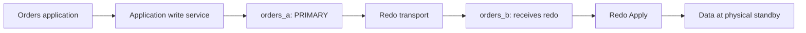

# Data Guard for Base Database and Role Transitions

In the **Oracle Database on OCI** chapter of the **CLOUD_PROVIDERS_ORACLE** module, this lesson guides you through building and operating an Oracle Data Guard configuration for **Oracle Base Database Service**. The focus is protecting data with a standby database, transitioning roles during maintenance or incidents, and verifying that applications operate on the new primary.

The running example is an order system with two DB systems: `orders_a` currently holds the primary role and `orders_b` holds the physical standby role. The operations team needs to maintain site A, practice a switchover to B, and prepare a failover procedure in case A genuinely loses service capability. Names A and B denote fixed sites; primary/standby roles can change.

After this lesson, learners will be able to:

- Explain redo transport, redo apply, transport lag, and apply lag.
- Select standby placement and protection mode according to RPO/RTO targets.
- Prepare IAM permissions, VCN connectivity, and identifiers before operating.
- Distinguish between switchover, failover, reinstate, and switching back to the original site.
- Execute a switchover lab with evidence covering roles, data, and application connectivity.
- Design monitoring, controlled automation, and a cost plan across both sites.

Illustrative SQL commands use Oracle Database 19c views; verify against your deployed release. Console instructions use the **Data Guard Group** resource per current Base Database documentation. Older setups may still use **Data Guard Association**. This lesson performs no operations against a live tenancy.

## 1. What Does Data Guard Protect?

Data Guard maintains a standby by shipping **redo** from the primary and applying redo on the standby. Redo describes database changes, unlike periodically copying open data files. A physical standby reconstructs data at the physical block level via Redo Apply. [Source: Introduction to Oracle Data Guard](https://docs.oracle.com/en/database/oracle/oracle-database/19/sbydb/introduction-to-oracle-data-guard-concepts.html).

Simplified flow:



In operations, separate three questions:

1. **Is the primary still accepting transactions?**
2. **How far has redo reached the standby?**
3. **How far has the standby applied redo, and is it ready to serve?**

A DB system showing normal resource status does not answer all three questions. Similarly, an application reaching the listener port does not prove the write service points to the database in the right role.

Data Guard, RAC, and backups address different scopes. RAC allows multiple instances to serve a single database; Data Guard provides a database copy on another DB system for role transitions. Backups preserve point-in-time recovery and retention policies. These technologies complement each other. [Source: Data Guard and Complementary Technologies](https://docs.oracle.com/en/database/oracle/oracle-database/19/sbydb/introduction-to-oracle-data-guard-concepts.html).

Operational example: if a valid SQL statement accidentally deletes orders and commits, that change can propagate to the standby. Therefore, an order-protection plan still needs backups, point-in-time recovery, and business error-handling procedures. Never trigger a failover hoping an accidental delete hasn't propagated yet.

## 2. Three Role-Transition Operations and Expected Outcomes

| Operation | When Used | Target State of A/B Pair | What Must Be Proven |
|---|---|---|---|
| Switchover | Planned maintenance or drill, both sides eligible | A becomes standby, B becomes primary | Role swap complete, zero data loss, redo flows in new direction |
| Failover | Primary fails or cannot recover within requirements | B becomes primary; A must be handled post-incident | Only the new primary accepts writes, data loss assessed |
| Reinstate | Return old primary to config after failover, when eligible | A returns as B's standby | A syncs with B and redundancy is restored |

A properly completed switchover guarantees zero database data loss. That does not mean applications suffer zero disconnection: service transition time, connection pool re-establishment, and handling in-flight transactions must still be measured. [Source: Perform Database Switchover](https://docs.oracle.com/en/cloud/paas/base-database/guide/dg-switchover.html).

Failover under Maximum Performance can lose data. The Console may display the old primary as **Disabled standby** after the standby is promoted to primary. Reinstate returns that member as a standby once the fault cause is resolved. [Source: Perform Database Failover](https://docs.oracle.com/en/cloud/paas/base-database/guide/dg-failover.html), [Reinstate a Database](https://docs.oracle.com/en/cloud/paas/base-database/guide/dg-reinstate.html).

**Switching back to A** is a separate decision. After failover and reinstate, B can remain primary. If A is needed as primary again, wait for A to synchronize, verify eligibility, and orchestrate a new switchover.

Never rely on hostname, DB system name, or "original primary" site labels to infer current role.

## 3. Set RPO and RTO Before Choosing Configuration

**RPO — Recovery Point Objective** is the maximum business-acceptable data loss, usually expressed as a time interval. **RTO — Recovery Time Objective** is the target duration to restore service.

In the orders problem, illustrative targets might be:

| Scenario | Hypothetical Business Target |
|---|---|
| Planned maintenance | Zero loss of committed orders; restore write flow within maintenance window |
| Loss of site A | RPO no more than 60 seconds; RTO no more than 15 minutes |
| Post-recovery | Active standby restored, data verification plan executed |

These figures are exercise assumptions, not OCI SLAs or commitments.

To measure RTO from the user's perspective, break down elapsed time:

```text
Service recovery duration =
  incident detection
+ verification and decision
+ database role transition
+ connectivity and service restoration
+ transaction testing
+ reopening traffic
```

A database failover completing in two minutes does not prove the application met a two-minute RTO. DNS, routing, secrets, connection pools, PDB services, and background jobs at the new site can all extend downtime.

Likewise, never translate "30-second transport lag" directly into "exactly 30 seconds of lost orders." Assessing data loss requires knowing whether the metric is fresh, which redo actually arrived at the target, and which transactions the system acknowledged. The monitoring section below explains how to interpret lag.

## 4. Preparing Topology, Permissions, and Networking

### 4.1. Base Database Support Scope

Before creating a standby, verify edition, version, shape, license model, and region availability against current service documentation. A feature present in Oracle Database generally is not necessarily exposed identically by Base Database cloud automation.

Constraints to check:

- Standard Edition does not support Data Guard; Active Data Guard on Base Database requires Enterprise Edition Extreme Performance and appropriate licensing.
- Each member has its own `DB_UNIQUE_NAME`.
- Same region: primary and standby share the same VCN; cross-region: requires VCN peering and the same realm.
- Oracle recommends different availability domains; if in the same availability domain, choose different fault domains where applicable.

[Source: About Oracle Data Guard — DB System Requirements and Placement](https://docs.oracle.com/en/cloud/paas/base-database/guide/dg-about.html).

A same-region standby is a practical starting point for labs. To survive region-wide outages, evaluate a cross-region standby and the ability to shift the application there. Moving only the database to region B does not produce a working service if remaining components still depend completely on region A.

Active Data Guard adds capabilities such as querying the standby during apply. Using a standby for reporting must comply with the selected edition/license; do not assume every physical standby can simultaneously open for reads and apply redo. [Source: Edit Oracle Data Guard](https://docs.oracle.com/en/cloud/paas/base-database/guide/dg-edit.html).

### 4.2. Separating Permission Layers

| Layer | Who or What Uses It? | Purpose in This Lesson |
|---|---|---|
| OCI IAM | Operators, automation principals | Read resources, create standby, invoke Data Guard actions |
| Database admin privileges | DBAs connecting to the database | Query diagnostic views, verify configs and roles |
| OS privileges | Authorized host administrators | Inspect tools and logs on the DB system |
| Application account | Backend or lab account in PDB | Test business data reads/writes |
| Network permissions | Traffic flows between components | Permit clients and DB systems to communicate |

OCI IAM policies govern Base Database resource APIs; they do not automatically turn an application account into a DBA. The `database-family` resource covers many resource types, so granting `manage database-family` is broader than read-only observation needs. [Source: Policy Details for Base Database Service](https://docs.oracle.com/en/cloud/paas/base-database/guide/policy-details.html).

Recommended lab organization: observers get read access in the lab compartment; operators get permissions needed for assigned tasks. Test accounts only use dedicated schemas. Administrative secrets are entered through the environment's secure mechanism and never placed into Markdown, source code, or screenshots.

### 4.3. Preparing Bidirectional Connectivity

Design network paths for both when A is primary and when B is primary. Per Oracle guidance, open the required TCP flows between the two DB systems' subnets; TCP 1521 is the documented minimum requirement, using stateful rules. [Source: Data Guard networking configuration](https://docs.oracle.com/en/cloud/paas/base-database/guide/dg-about.html).

Verify routes, DNS, security lists/NSGs, and active controls. If you only verify A → B, the B → A flow after switchover may still be broken.

The application client path is a separate check: application hosts must reach the endpoint and service at site B. Never open database ports to the entire Internet as a quick lab routing workaround.

For setups using OCI Vault or cross-region replication, also review constraints and **Known Issues** before real changes. [Source: About Oracle Data Guard — Vault and Known Issues](https://docs.oracle.com/en/cloud/paas/base-database/guide/dg-about.html).

## 5. Protection Modes and Redo Transport

Protection mode expresses the data protection policy; transport type describes how redo is shipped and acknowledged. Inspect both configuration and live synchronization state.

| Choice | Key Meaning to Remember | Design Consequence |
|---|---|---|
| Maximum Performance, typically paired with ASYNC | Commits on primary do not wait for standby redo acknowledgment | Reduces commit dependency on network latency; risks losing unshipped redo |
| Maximum Availability with SYNC | While standby is synced and responsive, commits coordinate with standby redo ack | Can impact latency; unsynced state must be monitored |
| Maximum Protection | Exists in general Oracle Database concepts | Do not assume it is an option exposed by the Base Database Console |

Maximum Availability prioritizes keeping the primary serving if no synchronized standby responds; therefore, never interpret the mode name as an unconditional zero-RPO guarantee across every failure sequence. Under SYNC, `AFFIRM` and `NOAFFIRM` further differ on acknowledging durable writes to standby redo logs. [Source: Oracle Data Guard Protection Modes](https://docs.oracle.com/en/database/oracle/oracle-database/19/sbydb/oracle-data-guard-protection-modes.html).

Base Database Console currently lets you switch between Maximum Performance and Maximum Availability. The current standby creation flow defaults to Maximum Performance/Async and allows editing after provisioning; do not write runbooks assuming every value can be picked during initial creation. [Source: Enable Oracle Data Guard](https://docs.oracle.com/en/cloud/paas/base-database/guide/dg-enable.html), [Edit Oracle Data Guard](https://docs.oracle.com/en/cloud/paas/base-database/guide/dg-edit.html).

Order team trade-off examples:

- With two nearby sites, measure SYNC impact on commit latency before selecting it.
- Over cross-region distances, measure RTT and throughput; if choosing ASYNC, record the accepted data-loss risk explicitly.
- After changing mode, verify the live setting and redo transport/apply; log the change in operational records.

Never switch protection modes just to silence an alert and treat the root cause as resolved.

## 6. Creating the Standby and Recording Initial State

### 6.1. Choosing the Right Resource Model

Data Guard Group supports multiple standbys via cloud automation; Association is the legacy model. Choose the resource type matching current automation. [Source: Enable Oracle Data Guard — resource type](https://docs.oracle.com/en/cloud/paas/base-database/guide/dg-enable.html).

This lab needs only one standby. Keeping the count small helps learners clearly trace role swaps, redo paths, and each member's status. Do not provision extra DB systems just to inspect UI options.

### 6.2. Console Steps

1. Select database A's region and compartment; open **DB Systems** and the matching DB system.
2. Open database A. Locate **Data Guard Associations** or the active Data Guard management section, then click **Add standby**.
3. For this lab's modern setup, choose **Data Guard Group**.
4. Fill in peer DB system details, placement, networking, shape, Data Guard settings, and admin credentials per your assigned environment.
5. Double-check target, licensing, and estimated cost; create the standby.
6. Monitor progress; once complete, record A as primary and B as standby inside the Group.

This is a condensed workflow from Oracle's creation flow. Label names may vary with UI updates and resource models. [Source: Configure Multiple Standby Databases Using Data Guard](https://docs.oracle.com/en/learn/basedb-configure-multiple-standby/index.html).

Never equate "creation request submitted" with "standby ready." If creation fails, save error details and provisioned resources for cleanup; avoid repeatedly creating peer DB systems while the first failure's cause remains unclear.

### 6.3. Minimum Dossier for the Database Pair

Use this table for each drill:

| Field | Illustrative Example or Content to Fill |
|---|---|
| Compartment, region, placement | Actual lab environment values |
| DB system OCID and database OCID | Recorded separately for A and B |
| Resource model | Group or Association |
| `DB_UNIQUE_NAME` | `orders_a`, `orders_b`; substitute actual names |
| Pre-change roles | A: primary; B: standby |
| Edition, version, shape | Deployed values |
| Protection mode, transport type | Active values |
| Application PDB service | Actual service name; do not confuse with SID |
| RPO/RTO targets | Agreed values for the lab |
| Observation timestamp | Include timezone, prefer UTC |
| Evidence source | Console, SQL, broker, application probe |

If a configuration was created manually outside automation, determine management boundaries and cloud automation recognition before proceeding. Never mix Console actions and host-side manual tools arbitrarily. [Source: migrating configurations and cloud automation scope](https://docs.oracle.com/en/learn/basedb-configure-multiple-standby/index.html).

## 7. Reading Database State and Lag Accurately

The queries below are for observation. DBAs run them in the appropriate database/container with privileges to read management views. Application accounts should not be granted broad privileges merely to run these queries.

### 7.1. Confirming Identity, Role, and Open Mode

Run on both A and B, clearly noting which side you are connected to:

```sql
SELECT db_unique_name,
       database_role,
       open_mode,
       protection_mode,
       protection_level,
       switchover_status,
       flashback_on
FROM v$database;
```

`DATABASE_ROLE` shows the database role; `OPEN_MODE` shows the open state. Primary typically needs `READ WRITE` to serve writes. Physical standby can be `MOUNTED`, or `READ ONLY WITH APPLY` in setups authorized for real-time query. `PROTECTION_MODE` and `PROTECTION_LEVEL` reconcile configured mode against observed protection level. [Source: V$DATABASE](https://docs.oracle.com/en/database/oracle/oracle-database/19/refrn/V-DATABASE.html).

Do not treat an isolated `SWITCHOVER_STATUS` value as final verdict. Its meaning depends on role and transition stage; for instance, `NOT ALLOWED` on a standby may indicate no switchover request has been received yet. Combine with broker checks and service status. [Source: SWITCHOVER_STATUS in V$DATABASE](https://docs.oracle.com/en/database/oracle/oracle-database/19/refrn/V-DATABASE.html).

Expected pre-action lab state:

| Site | Role | Further Checks Needed |
|---|---|---|
| A | PRIMARY | Application service accepts writes; redo transport error-free |
| B | PHYSICAL STANDBY | Redo Apply active; lag and observation data are fresh |

### 7.2. Transport Lag Differs from Apply Lag

On the standby running apply:

```sql
SELECT name,
       value,
       unit,
       time_computed,
       datum_time
FROM v$dataguard_stats
WHERE name IN ('transport lag', 'apply lag', 'apply finish time');
```

- **Transport lag**: delay of redo not yet arrived at target relative to source.
- **Apply lag**: how far target data trails source due to both transport and apply.
- **Apply finish time**: estimated time to apply redo already received but not yet applied.

This view returns no rows when queried on the primary. An unchanged `DATUM_TIME` across multiple checks can indicate fresh data is no longer arriving from the source. [Source: V$DATAGUARD_STATS](https://docs.oracle.com/en/database/oracle/oracle-database/19/refrn/V-DATAGUARD_STATS.html).

Lab interpretation examples:

| Observation | Action Before Deciding |
|---|---|
| Small transport lag, growing apply lag | Investigate apply speed and standby processing capacity |
| Growing transport lag | Check transport stream, network connectivity, and missing redo |
| Lag is 0 but datum time is stale | Verify metric freshness; do not conclude synced yet |
| No rows or unclear values | Confirm right role, right instance, and observation tool |

Apply lag can already include time from unarrived redo; do not mechanically add transport lag and apply lag together to forecast recovery time.

For example, if B has received plenty of redo yet applies slowly: data may already reside on B, though promoting B to serve still needs apply time. Conversely, redo not yet reaching B is an issue when evaluating data-loss risk. These are two distinct investigation tracks.

### 7.3. Using Data Guard Broker for Additional Checks

In environments where DBAs are authorized to use DGMGRL, after authenticating per organizational policy:

```text
DGMGRL> SHOW CONFIGURATION;
DGMGRL> SHOW DATABASE VERBOSE 'orders_a';
DGMGRL> SHOW DATABASE VERBOSE 'orders_b';
DGMGRL> VALIDATE DATABASE VERBOSE 'orders_b';
```

Replace names with actual `DB_UNIQUE_NAME` values. These commands inspect and validate; they do not perform a role transition.

Read warnings and readiness details in `VALIDATE DATABASE` output; do not just check exit codes or search for `SUCCESS`. Oracle recommends validating both before and after role transitions. `SHOW DATABASE` also surfaces transport/apply lag and calculation timestamps. [Source: Monitor an Oracle Data Guard Configuration](https://docs.oracle.com/en/database/oracle/oracle-database/19/haovw/monitor-oracle-data-guard-configuration.html).

This lab uses the Console as the change channel. If the configuration is broker-managed, never run manual SQL role-transition procedures in parallel while the broker or OCI is processing. Oracle documentation sharply distinguishes these management methods. [Source: Role Transitions — broker notes](https://docs.oracle.com/en/database/oracle/oracle-database/19/sbydb/managing-oracle-data-guard-role-transitions.html).

## 8. Preparing Applications to Follow the New Primary

Database role transitions and application connection recovery must be designed together.

For write service `orders_rw`, the DBA must configure the service to run in the primary role on whichever database assumes that role. The broker can coordinate with Clusterware/Oracle Restart to manage role-based services when properly configured. [Source: Database Service Configuration Requirements](https://docs.oracle.com/en/database/oracle/oracle-database/19/dgbkr/using-data-guard-broker-to-manage-switchovers-failovers.html).

The lab should verify:

1. The connection endpoint can locate the new site via the chosen strategy.
2. Routes and network rules permit the application to reach both A and B.
3. The application service exists and registers properly on the new primary.
4. The connection pool purges broken connections and opens new ones.
5. Background jobs and external integrations use the same primary-discovery mechanism.
6. Read/write tests execute from where the application actually runs.

For Java applications, do not merely open a SQL session from a database host and declare the backend recovered. Observe the backend's actual connection pool/JDBC behavior after transition. Features like FAN, Fast Connection Failover, or Application Continuity depend on drivers, pools, services, and supported configurations; enabling Data Guard does not automatically wire up those components.

In particular, if an application sends `COMMIT` and loses its connection before receiving the response, it may not know whether the transaction committed. For the orders system, use a unique request ID, query status after reconnecting, and enforce duplicate-order protection. Never blindly replay every write operation simply because a connection error occurred.

In cross-region topologies, also check paths to payment gateways, message queues, and secret vaults. A working database at B still results in failed orders if business dependencies are unavailable.

## 9. Planned Switchover Lab

Practice in a dedicated assigned environment with test data and an agreed change window. This lab does not require intentionally breaking the primary.

### 9.1. Starting Prerequisites

| Check Group | Lab Condition |
|---|---|
| Identity | Confirmed A is primary and B is target standby |
| Sync | No unresolved transport/apply errors; lag metrics fresh |
| Readiness | Service/broker check allows transition; warnings evaluated |
| B capacity | Sufficient resources to carry application load as primary |
| Connectivity | Services and network paths to B prepared |
| Application | Plan to pause new writes, handle in-flight work, and test post-swap |
| Recovery | Know how to check status if stalled; backups managed per policy |
| Coordination | Single owner or orchestrator authorized to execute the change |

A standby may be ready at the database level yet lack real-world workload capacity. Before the lab, know any differences in CPU, memory, I/O, and instance counts between the two sides.

### 9.2. Creating Marker Data Before Transition

Use the lab schema inside the **application PDB on primary A**; never create business tables in CDB root or `SYS`:

```sql
CREATE TABLE dg_role_probe (
    probe_id   VARCHAR2(80) PRIMARY KEY,
    stage      VARCHAR2(30) NOT NULL,
    created_at TIMESTAMP WITH TIME ZONE DEFAULT SYSTIMESTAMP NOT NULL
);

INSERT INTO dg_role_probe (probe_id, stage)
VALUES ('RUN01_PRE', 'BEFORE_SWITCHOVER');

COMMIT;

SELECT probe_id, stage, created_at
FROM dg_role_probe
WHERE probe_id = 'RUN01_PRE';
```

Create the table only once. For subsequent drills, use a new run ID to avoid primary-key violations or confusing old results.

Record evidence that the transaction committed over the active connection path. If the lab includes an orders application, create a test order with a unique request ID and save the response. A marker table verifies one specific transaction; it does not replace validating all production data.

Do not open the physical standby just to query the table before switchover. Check apply status using admin tooling; read the marker after B becomes primary.

### 9.3. Minimizing App Disruption and Executing in the Console

1. Pause incoming write requests via the application's mechanism; drain or handle in-flight transactions per plan.
2. Record the outage start time from the application perspective.
3. Re-confirm target standby B and sync status immediately prior to action.
4. On the database details page, open **Data Guard Group**.
5. On standby member B, select **Actions → Switchover**.
6. Enter the admin password as prompted by the Console and submit.
7. Monitor status until completion; save the request/work ID if provided.

The selected standby receives the primary role. Upon success, B is primary and A is standby. [Source: Console procedure for switchover](https://docs.oracle.com/en/cloud/paas/base-database/guide/dg-switchover.html).

Reducing new writes upfront is a lab coordination choice to cleanly measure downtime and transaction outcomes. Do not assume every application drains sessions in the same way.

### 9.4. Post-Transition Verification

Verify from the outside in:

- Console reflects the accurate roles of both members.
- `V$DATABASE` queries on each side confirm B is primary and A is physical standby.
- Redo flows B → A, and apply on A remains active.
- Clients using the write service connect to the new primary.
- The pre-switchover marker is readable through the application service.
- A new transaction commits and reads back cleanly.
- The application exhibits no spiraling connection errors or duplicate data.

Reconnect via the application service into the right schema/PDB, then run:

```sql
SELECT SYS_CONTEXT('USERENV', 'SERVICE_NAME') AS service_name,
       SYS_CONTEXT('USERENV', 'CON_NAME') AS con_name
FROM dual;

SELECT probe_id, stage, created_at
FROM dg_role_probe
WHERE probe_id = 'RUN01_PRE';

INSERT INTO dg_role_probe (probe_id, stage)
VALUES ('RUN01_POST', 'AFTER_SWITCHOVER');

COMMIT;

SELECT probe_id, stage, created_at
FROM dg_role_probe
WHERE probe_id IN ('RUN01_PRE', 'RUN01_POST')
ORDER BY probe_id;
```

Service and container names confirm the test's connection path; DBAs must still verify roles and database identity via admin queries. Do not use the shared `DB_NAME` to distinguish the two sites.

For a real application, also run create/read order flows via the active API or UI. Only reopen full traffic once lab criteria pass. Log the timestamp of the first successful transaction to calculate outage duration.

### 9.5. If Switchover Times Out or Errors

A client-side timeout is not enough to conclude the transition was canceled. Before submitting another operation:

1. Check service-provided task status and logs.
2. Verify actual roles on both sides if reachable.
3. Confirm which service is currently accepting writes.
4. Hold write traffic per coordination plan until state is clear.
5. Remediate via active admin channels; engage DBAs/Oracle Support when needed.

If a matching work request exists, the DB system's **Work requests** page surfaces job status, details, errors, and logs. Never assume a timeout on a user's machine means the database reverted to its original state. [Source: View Work Requests for the DB System](https://docs.oracle.com/en/cloud/paas/base-database/guide/dbs-requests.html).

Never trigger failover immediately just because switchover ran longer than expected. Issuing a second transition while current roles are unclear complicates incident recovery.

## 10. Failover When the Primary Cannot Serve

Failover is an incident-recovery decision tied to potential data loss and controlling the old primary. This section outlines the runbook; the switchover lab above does not ask learners to break production.

### 10.1. Verify Before Deciding

When A stops responding, distinguish a stopped database from the observer merely losing network reachability to A. A network partition can cause different observers to report conflicting states.

Decision records should capture:

| Question | Required Evidence |
|---|---|
| Is A still accepting writes from anywhere? | Checks from observation points and traffic controls |
| Can recovering A meet RTO? | Assessment from database/infrastructure teams |
| How much redo has B received? | Freshest metrics, available redo, and recovery state |
| Can additional redo be salvaged? | Source reachability and supported DBA procedures |
| What is the potential data loss? | Acknowledged transactions, target data point, and uncertain window |
| Who authorizes the new primary? | Coordinator and documented decision |

If remaining redo can be salvaged safely, DBAs assess minimizing data loss within RTO bounds. Do not wait indefinitely by default; nor should you discard salvageable data simply because the standby appears in the Console.

### 10.2. Fence Writes to Prevent Two Primaries Serving Simultaneously

Before letting B accept writes, the runbook must prevent A from continuing or resuming uncontrolled write traffic. Depending on architecture, this may involve isolating application access, stopping writers, or system-managed fencing.

This is an operational design requirement of this lesson: only one site is permitted as the business primary at a time. Never treat a DNS update as sufficient proof that A stopped receiving writes, as clients may hold open connections or use direct endpoints.

If A cannot yet be verified or fenced, document the risk explicitly and follow agreed incident protocols. Never allow two separate teams to independently promote two different standbys.

### 10.3. Console Action and Outcome Verification

Once the accountable lead selects B as target:

1. Open the Data Guard section of the configuration containing standby B.
2. On B, choose **Actions → Failover**.
3. Supply the admin password as requested and monitor the operation.
4. Confirm B becomes primary; monitor the old primary's state.
5. Test services, connectivity, and transactions as in the switchover section.
6. Reopen write traffic at B per the recovery plan.

Base Database documentation describes the failover action on the standby and the resulting **Disabled standby** state of the old primary upon success. Under Maximum Performance, account for possible data loss. [Source: Perform Database Failover](https://docs.oracle.com/en/cloud/paas/base-database/guide/dg-failover.html).

If multiple standbys exist, select the target based on data currency, recovery health, capacity, and application connectivity. A low-lag target lacking capacity to run production must still be weighed carefully.

Once B accepts writes, never point the application back to A just because A came back online. Both sides' data must first be reconciled into a valid primary/standby relationship.

### 10.4. Reconciling Transactions After Failover

Suppose the application returned "order placed" for request `REQ-914` right before the outage. Once B is live, look up that exact ID on B and reconcile against application logs or independent confirmation systems.

If the order is missing, business teams handle it per defined policy. Never declare "zero data loss" solely from total row counts or the last lag chart.

This exercise recommends retaining three separate evidence lists:

- Transactions confirmed present after failover.
- Transactions confirmed lost or absent at target.
- Transactions with unclear outcome needing further investigation.

Preserve the old primary and related logs per the investigation plan; do not immediately delete resources just to tidy up the dashboard.

## 11. Reinstate and Restoring Redundancy

After failover, service may run on B without the redundancy you had before. Restoring resilience against a subsequent failure is part of incident recovery.

### 11.1. Reinstate Does Not Merge Two Data Sources

Reinstate returns the failed database as a standby of the current primary. It does not merge divergent transactions generated across two primaries, nor does it switch A back to primary. [Source: Reinstate a Database](https://docs.oracle.com/en/cloud/paas/base-database/guide/dg-reinstate.html).

If A held committed transactions never shipped to B before failover, operations must preserve evidence and evaluate them separately. Do not expect reinstate to automatically import those transactions into the new primary.

### 11.2. Prepare Reinstatement Capability Before Incidents

Flashback Database is essential for the broker to rewind the old primary to a compatible point. Verify beforehand that it is enabled, check actual retained flashback window, and verify recovery area capacity; a configured retention target alone does not guarantee sufficient history remains. Base Database guidance recommends enabling Flashback on both sides. [Source: Use Oracle Data Guard with the Database CLI — Flashback](https://docs.oracle.com/en/cloud/paas/base-database/guide/dg-dbcli.html).

If Flashback was disabled or required logs are gone, enabling it post-incident may still fail to allow reinstate. When reinstate is impossible, you may have to rebuild the database from the current primary via an appropriate workflow. [Source: ORA-16827 — Flashback Database is disabled](https://docs.oracle.com/en/error-help/db/ora-16827/).

Therefore, test real recoverability before drills rather than only screenshotting the **Reinstate** button.

### 11.3. Steps to Bring A Back

1. Resolve A's root failure and ensure no application routes writes to A.
2. Verify connectivity, secrets, key access, and release-specific database prerequisites.
3. From the current primary's Data Guard config, select disabled member A and run **Reinstate**.
4. Monitor progress; confirm A returns as standby.
5. Confirm B → A redo transport and apply work normally, with fresh metrics and acceptable lag.
6. Re-verify backups, alarms, and inventory records.

Core Console reinstate steps are documented from the current primary's database page. [Source: Console reinstate workflow](https://docs.oracle.com/en/cloud/paas/base-database/guide/dg-reinstate.html).

If rebuilding instead of reinstating, plan for copy duration, network bandwidth, storage costs, and the window running with a single primary. Never mark DR restored merely because A was recreated; verify redo/apply and data currency.

### 11.4. Switching Back to Site A

Schedule a B → A switchover only after A is synced and meets load-readiness criteria. Repeat data, service, and application tests, and re-measure downtime.

Switching back is not an "undo" of failover. Since B became primary, new valid transactions occurred on B; A must receive all of them before being chosen as primary.

## 12. Monitoring and Automation

### 12.1. Monitoring by Current Role

| Signal Group | Operational Question |
|---|---|
| Role and config state | Which is primary? Are any members disabled? |
| Transport lag and metric freshness | How far behind is redo arrival? Is telemetry still updating? |
| Apply lag and apply rate | Is the standby keeping up with incoming load? |
| CPU, I/O, recovery space | Is slow apply or redo/flashback space exhaustion looming? |
| Jobs and operational errors | Which tasks are running, finished, or need intervention? |
| Application probes | Do client-side reads/writes succeed? |
| Recoverability | Do backups and standbys meet stated targets? |

After role transitions, alarms or dashboards hard-coded to "A is always primary" must adapt. When monitoring cross-region, check which regions and resource types the tool actually displays, avoiding false confidence from a screen missing remote data.

Set thresholds from business targets and sampling intervals. With a hypothetical 60-second RPO, a metric sampled less frequently provides insufficient evidence for rapid decisions. Know where each signal comes from, when it is captured, and how long notification takes.

Recommended alert condition examples:

```text
Lag alert:
  transport lag exceeds environment threshold
  OR apply lag rises persistently
  OR monitoring telemetry stops updating

Post-transition check:
  exactly one primary accepted for writes
  AND application transactions succeed
  AND expected standby is receiving/applying redo
```

"No fresh data" must be handled separately from "lag equals 0." A quiet dashboard caused by a disconnected collector does not mean the system is error-free.

### 12.2. Events and Operational Evidence

Base Database emits operational events; Events and Notifications can be combined for alerting. Event documentation notes telemetry prerequisites. When writing rules, match exact event types for your active resources and actions. [Source: Event Types for Base Database Service](https://docs.oracle.com/en/cloud/paas/base-database/guide/event-types.html).

Operation start/end events help build timelines but do not replace application probes. Record together: timestamp, target database, operator/orchestrator, related request/work request ID, before/after roles, and data verification outcomes.

Never place admin passwords, signing keys, or secret-bearing connection strings in operational logs.

### 12.3. Automation with Clear State and Guards

Data Guard Group exposes Console, API/SDK, and Terraform interfaces. [Source: Data Guard Group and cloud automation](https://docs.oracle.com/en/learn/basedb-configure-multiple-standby/index.html).

Pseudocode for a **planned switchover**:

```text
receive request: config G, target standby B, window W
acquire exclusive orchestration lock for G
read live roles and active tasks
verify readiness, sync state, and application path
drain write traffic per plan
submit one switchover request via supported interface
monitor outcome with bounded timeout
if timeout: re-check live status, do not send opposing action yet
verify roles, reverse-direction redo, and application transactions
reopen traffic once criteria pass
save evidence and release orchestration lock
```

Distinguish idempotent reads from state-changing commands whose outcome is ambiguous. After a timeout, inspect existing state first before deciding whether to resubmit a change command.

Never use a cron job that pings once, fails, and triggers failover. Automated failover requires dedicated failure detection, old-primary fencing, target selection, and data-integrity checks.

Fast-Start Failover is a broker capability using an observer and specific configuration criteria. It must be deployed and verified independently—never assume it is enabled merely because a standby exists or a **Failover** button appears in the Console. [Source: Fast-Start Failover in Data Guard Broker](https://docs.oracle.com/en/database/oracle/oracle-database/19/dgbkr/using-data-guard-broker-to-manage-switchovers-failovers.html).

## 13. Cost, Capacity, and Common Pitfalls

### 13.1. Estimating for Maintained Topology

Cost calculations must include both sites:

```text
Costs to estimate =
  primary resources
+ standby resources
+ storage, backups, and recovery/flashback area
+ connectivity and data transfer applicable to topology
+ selected features, licenses, and monitoring services
```

This is an estimation framework, not an OCI pricing formula. Look up actual rates and terms by region, configuration, and contract before provisioning resources. Never assume a standby is free just because it is not serving application writes.

Evaluate options alongside RPO/RTO:

| Option | Expected Benefit | What to Measure or Record |
|---|---|---|
| Standby sized for full load | Less reliance on scale-up during incidents | Ongoing steady-state cost |
| Standby smaller than primary | Can lower baseline resource footprint | Apply speed, scale-up duration, post-promote capacity |
| Cross-region standby | Reduces single-region dependency | Networking, latency, app stack in target region |
| Using standby for reporting | Leverages standby capacity | Edition/license, I/O contention with apply |
| Stopping or dropping standby off-hours | Saves partial resources per policy | Window lacking intended protection level |

Never downsize or stop a standby just to hit a budget while leaving RPO/RTO claims unchanged. Whenever reducing capacity, update internal recovery commitments and re-validate.

Tag lab resources with ownership and expiration deadlines. After the exercise, clean up per the lab plan; before deleting a peer DB system, confirm current roles, Data Guard relationships, and data retention needs.

### 13.2. Symptom-Based Diagnosis

| Symptom | Initial Investigation Direction |
|---|---|
| No option to create Data Guard | Edition, version, shape, resource model, and permissions |
| Standby creation hangs or fails | Active jobs, quota/capacity, routes, DNS, network rules, and returned errors |
| Transport lag rises | Redo shipping path, connectivity, bandwidth, and missing redo |
| Apply lag rises despite low transport lag | Apply throughput, standby resources, recovery errors, and competing load |
| Lag is 0 but stops updating | Metric computation timestamp and source-to-target connectivity |
| Switchover not ready | Config errors, apply state, member status, and validate output |
| B is primary but application errors | Service, PDB, endpoint, routes, and connection pool |
| Marker unreadable | Exact PDB/schema/run ID, prior commit, and active connection path |
| Reinstate fails | Root fault, database state, Flashback status, and version prerequisites |
| A came back up yet stays disabled | Reinstate incomplete or rebuild required into new configuration |
| Post-transition alarm watches wrong target | Current role mapping, dimensions, and region scope |
| Both sites show signs of writes | Halt further traffic, fence write paths, escalate as data incident |

In incident reports, always include A/B identifiers, live roles, timezone-qualified timestamps, and the last action taken. Saying "primary failed" without naming which database causes confusion immediately after a role swap.

## 14. Practice Completion Criteria

This lab meets its objective when learners can supply the following evidence:

1. Identified configuration, both DB systems, and current roles.
2. Rationale for choosing standby placement and protection mode for the stated targets.
3. Verified transport/apply state and metric freshness.
4. Created a committed pre-switchover marker in the lab schema.
5. Executed switchover through the chosen management channel and verified swapped roles.
6. Re-read the marker, committed a new transaction, and verified the app through the write service.
7. Confirmed redo flows in the new direction and the standby continues syncing.
8. Recorded application-side outage duration along with any unmet criteria.
9. Articulated failover decision criteria, old-primary fencing, and data reconciliation.
10. Explained when reinstate works, when rebuild is required, and how to switch back via switchover.
11. Documented monitoring, backup, and cost plans for retained resources.

If only switchover was executed, report strictly that scope; never claim failover was tested or reinstate was proven without running them. Exercise tests prove observed conditions, not a blanket guarantee that every outage type resolves with identical RPO/RTO.

### Oracle Documentation Used in Practice

- [Base Database — About Oracle Data Guard](https://docs.oracle.com/en/cloud/paas/base-database/guide/dg-about.html)
- [Base Database — Enable Oracle Data Guard](https://docs.oracle.com/en/cloud/paas/base-database/guide/dg-enable.html)
- [Base Database — Perform Database Switchover](https://docs.oracle.com/en/cloud/paas/base-database/guide/dg-switchover.html)
- [Base Database — Perform Database Failover](https://docs.oracle.com/en/cloud/paas/base-database/guide/dg-failover.html)
- [Base Database — Reinstate a Database](https://docs.oracle.com/en/cloud/paas/base-database/guide/dg-reinstate.html)
- [Oracle Database 19c — Monitor an Oracle Data Guard Configuration](https://docs.oracle.com/en/database/oracle/oracle-database/19/haovw/monitor-oracle-data-guard-configuration.html)
- [Oracle Database 19c — Data Guard Broker: Switchover and Failover Operations](https://docs.oracle.com/en/database/oracle/oracle-database/19/dgbkr/using-data-guard-broker-to-manage-switchovers-failovers.html)
