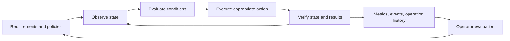
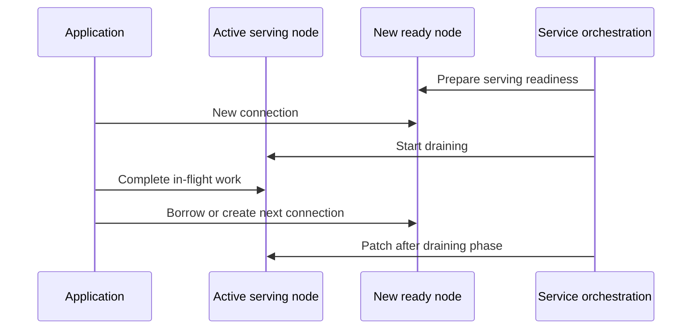

# Autonomous Operations Mechanisms of Autonomous Database

Autonomous Database automates many tasks typically performed by a database administration team: resource provisioning, software maintenance, backups, partial performance management, and infrastructure operations. The value of the service lies in its ability to perform those tasks according to selected configurations and policies while providing information so users can verify the results.

For a Java application on Oracle Cloud Infrastructure, using Autonomous Database still requires decisions regarding tenancy, compartment, IAM, network connectivity, application accounts, resource limits, and data recovery. This lesson explains how these automated components work together and how to evaluate them in real-world operations.

Oracle documentation currently uses the name **Oracle Autonomous AI Database**. In this lesson, "Autonomous Database" is used as a shorthand. The examples for auto scaling, maintenance, and monitoring focus on **Autonomous Database Serverless**; when using Dedicated or another service tier, check the corresponding documentation. The current naming is announced by Oracle in [the service rename release notes](https://docs.oracle.com/en-us/iaas/releasenotes/autonomous-database-serverless/2025-10-oracle-autonomous-ai-database.htm).

After this lesson, learners will be able to:

- Explain the observe, decide, and act loop of an automated database service.
- Distinguish between tasks performed by Oracle and policies that customers must select.
- Recognize the conditions for automatic indexing, auto scaling, and maintenance.
- Relate database availability to application connection pools, transactions, and recovery.
- Gather evidence to evaluate performance, data safety, and cost.

Service behaviors are referenced against Oracle documentation as of **November 20, 2026**. Actual options also depend on deployment, workload, version, resource model, and service tier.

## 1. At What Layer Does "Autonomous Operations" Operate?

### 1.1. From Host Administration to Declarative Requirements

In a self-managed model, operations teams typically provision servers, install the OS and database, configure storage, set up backup schedules, and organize patching. Autonomous Database provides these operations through a managed service. Customers submit configuration requests; Oracle executes the corresponding provisioning and operations. [Oracle: What is Autonomous AI Database?](https://docs.oracle.com/en-us/iaas/autonomous-database-serverless/doc/autonomous-intro-adb.html).

The key shift is the object the user manages:

| At the self-managed infrastructure layer | Working with Autonomous Database |
| --- | --- |
| Choose hosts and install software | Choose deployment type, version, and service-supported resources |
| Write scripts for background tasks | Configure provided automation capabilities and observe results |
| Monitor health of individual components | Monitor database resources, service events, and application health |
| Orchestrate every recovery step manually | Choose recovery method, target point, and verify service recovery flow |

This reflects a shift in responsibility and management interface. Do not take a host-tuning runbook from a self-managed database and apply it verbatim to Autonomous Database.

### 1.2. Control Loop Learning Model

An automated task can be visualized through the following loop:



This diagram is an explanatory model for learning and operations. For example:

1. The customer enables compute auto scaling and selects base resources.
2. The workload generates higher resource demand.
3. The service allocates additional resources within the supported range.
4. The operator compares resource usage against latency, errors, and cost.
5. If targets are not met, the application team reviews SQL, connection services, or base configuration.

Do not assume that every task uses the same "AI" algorithm. Backup schedules, rolling patching, resource allocation, and index selection are distinct mechanisms with different conditions and verification methods.

### 1.3. Serverless and Dedicated Have Different Control Scopes

Serverless focuses on using a database without managing a separate Exadata infrastructure. Dedicated allocates infrastructure to a single customer and provides operational policies at the fleet, container database, and database levels according to the service model. Therefore, workload placement and maintenance management can differ. [Oracle: Dedicated Deployment Overview](https://docs.oracle.com/en/cloud/paas/autonomous-database/dedicated/catalog/oracle-autonomous-ai-database-dedicated-exadata-infrastructure.pdf).

Do not use a Serverless default to draw conclusions about a Dedicated configuration. Before reading metrics or making changes, always confirm the exact deployment in use.

## 2. What Does Oracle Perform vs. What Is the Customer Responsible For?

Oracle's responsibility model separates operating the service from managing the application and data. Oracle performs service tasks; customers initiate certain requests, choose policies, and monitor application outcomes. [Oracle: Responsibility Model](https://docs.oracle.com/en/cloud/paas/autonomous-database/shared-responsibility-model.html).

| Task group | Service responsibility | Customer must decide or verify |
| --- | --- | --- |
| Provisioning | Deploy resources on request | Region, compartment, workload, initial configuration |
| Maintenance | Execute patching via service mechanism | Appropriate schedule and application compatibility testing |
| Resources | Provision and allocate within configured scope | Base resources, auto scaling options, budget |
| Performance | Supported management and optimization mechanisms | SQL, schema, parallelism, service, and latency targets |
| Backup | Execute automatic backup mechanism | Retention policy, recovery target point, and drills |
| Access security | Platform protection mechanisms | IAM permissions, data privileges, network, and credential management |
| Observability | Emit metrics and events | Alarms, recipients, response actions, and application SLOs |

One way to test this boundary is to ask: **"What did the service automatically do, based on which decision, and where is the evidence of the result?"**

For example, "backups are performed automatically" does not answer which point in time the database should roll back to after an accidental data deletion. That decision depends on business logic and must be determined by the operator.

Similarly, an account with permission to create a database in a compartment does not automatically become an account that can read data inside the database. OCI IAM, database accounts, and schema privileges must be designed separately.

## 3. Automatic Provisioning and Resource Allocation

### 3.1. Provisioning by Declarative Configuration

When creating a resource, users select properties supported by the service, such as workload type, compute, storage, and network access method. The service executes the provisioning steps behind the scenes and publishes the resource state.

Operationally, distinguish between:

- The request has been accepted by the API.
- The provisioning operation has completed.
- The database is ready to accept connections.
- The application connects to the right service and executes business operations.

These four states require different evidence. A Console page showing Available does not prove that the application's secret is correct or that the network path from Compute/OKE to the database is working.

### 3.2. Base Resources Are an Operational Decision

Base resources set the starting point for the provisioning mechanism. Choosing too low may cause the workload to frequently need extra resources or hit limits; choosing too high may result in paying for underutilized capacity.

To choose a configuration, you need to know at least:

| Workload characteristic | Implication for configuration |
| --- | --- |
| Short transactions, many concurrent requests | Check latency and active connection count |
| Long analytical queries | Check CPU, I/O, parallelism, and queuing |
| Batch data loading | Check load throughput, completion time, and storage capacity |
| Event-driven traffic spikes | Check peak amplitude, peak duration, and scaling capability |
| Continuously growing data | Check used, allocated, and limit storage |

Selection should be based on a representative workload. A `SELECT 1 FROM dual` query proves part of the connection path, but it does not represent business load.

## 4. Compute Auto Scaling and Storage Auto Scaling

### 4.1. Two Options Must Be Checked Separately

In Serverless, Oracle documentation states that compute auto scaling is enabled by default and storage auto scaling is disabled by default when creating an instance via the documented flow. When enabled, compute can scale up to three times the base resources; storage can expand up to three times the base capacity, within supported limits. [Oracle: Use Auto Scaling](https://docs.oracle.com/en-us/iaas/autonomous-database-serverless/doc/autonomous-auto-scale.html).

This is a starting point for reading configuration, not a way to determine the state of an existing database. A database may have been cloned, modified, or placed on a tier with different limits.

As a hypothetical example, a database has 4 base ECPUs. The 3x boundary corresponds to 12 ECPUs if applicable conditions and limits allow. "Up to 12 allowed" does not mean the database is always granted 12 or that throughput increases exactly 3x.

| Question | Compute auto scaling | Storage auto scaling |
| --- | --- | --- |
| Primary need | Processing resources when workload needs more | Storage space when data grows |
| Config to check | Base compute and option state | Base storage and option state |
| Effectiveness evidence | Latency, throughput, resource waits | Available space and growth rate |
| Risks to manage | Cost and other processing limits | Cost, capacity limits, and space reclamation |

### 4.2. Auto Scaling Does Not Solve Every Type of Wait

Suppose an API is slow because two transactions are holding and waiting on the same data row. Adding CPU may not eliminate the lock wait.

Situations that must be separated:

- CPU or I/O wait due to processing demand.
- Lock wait due to transaction design.
- Connection pool wait at the Java tier.
- Wait due to service concurrency limits.
- Wait on an external service while still holding a transaction or connection.

Only after identifying the wait type is there a basis to evaluate auto scaling. A low CPU chart paired with a slow API is a signal to investigate further, not sufficient proof of excess resources.

### 4.3. Used, Allocated, and Base Storage Differ

Three metrics usually must be read together:

- **Base storage**: the base capacity configured by the user.
- **Allocated storage**: space allocated to tablespaces.
- **Used storage**: space currently used by database objects and data components.

Deleting data can reduce used space without immediately returning allocated space. Oracle provides shrink operations with their own conditions and limits. Do not treat dropping a table as proof that the storage bill will drop immediately. [Oracle: Shrink Storage and Storage Allocation](https://docs.oracle.com/en-us/iaas/autonomous-database-serverless/doc/autonomous-auto-scale.html).

In a capacity control plan, record before/after states, metric update timestamps, and the impact of space reclamation operations on the workload.

## 5. Automatic Performance Management

### 5.1. The Optimizer Needs Appropriate Statistics

The optimizer uses statistics to estimate row counts and the cost of execution plans. If data distribution changes significantly, a previously suitable execution plan may no longer be optimal.

Serverless documentation distinguishes workloads: Transaction Processing/JSON has automatic statistics collection; for Lakehouse, collection depends on the data loading path and configuration, where some direct-path loads via SQL automatically gather statistics. Do not assume every loading path and every workload shares the same defaults. [Oracle: Manage Optimizer Statistics](https://docs.oracle.com/en/cloud/paas/autonomous-database/serverless/adbsb/manage-optimizer-stats.html).

Learners should understand the impact chain:

```text
Data changes
    → data distribution may change
    → optimizer estimates may change
    → execution plan and execution cost may change
    → must verify actual latency and resource usage
```

Automatic statistics collection does not replace schema design, proper filter predicates, bind variables, or transaction sizing.

### 5.2. Automatic Indexing Is a Conditional Capability

Automatic indexing observes the workload and manages indexes to support performance. However, current Serverless documentation states that **automatic indexing is disabled by default** and requires enabling **Real Application Testing (RAT)** before enabling this feature. [Oracle: Manage Automatic Indexing](https://docs.oracle.com/en-us/iaas/autonomous-database-serverless/doc/autonomous-auto-index.html).

Therefore, do not infer from the name "Autonomous" that all indexes are automatically optimized by the system. You need to know the current configuration, supported workload scope, and how to evaluate results.

An explanatory model for index evaluation is:

1. Observe representative queries.
2. Identify opportunities to improve access paths.
3. Evaluate the benefit and cost of the index.
4. Apply according to the configured mode.
5. Re-monitor when data or workload changes.

When evaluating, inspect both read queries and write operations. Indexes can speed up data retrieval but must be maintained during INSERT, UPDATE, or DELETE.

### 5.3. Check Configuration Instead of Enabling Features Blindly

With an admin account that has read access to the corresponding view, the following query only inspects configuration:

```sql
SELECT parameter_name,
       parameter_value
FROM dba_auto_index_config
WHERE parameter_name = 'AUTO_INDEX_MODE';
```

The `DBA_AUTO_INDEX_CONFIG` view provides the automatic indexing configuration. [Oracle: DBA_AUTO_INDEX_CONFIG](https://docs.oracle.com/en/database/oracle/oracle-database/26/refrn/DBA_AUTO_INDEX_CONFIG.html).

If the query is rejected due to privileges or the view is unavailable in the current environment, record the observation limitation. Do not treat a missing privilege error as proof that the feature is disabled.

A performance evaluation should include representative SQL/workload, completion time, latency distribution, resource consumption, and write impact. An enabled configuration only proves the configuration state.

## 6. Workload Distribution via Database Services

Autonomous Database provides services mapped to consumer groups, such as `TP`, `TPURGENT`, `HIGH`, `MEDIUM`, and `LOW`. These services have different priority, parallelism, and concurrency limit characteristics. [Oracle: Database Service Names](https://docs.oracle.com/en-us/iaas/autonomous-database-serverless/doc/predefined-database-services-names.html).

| Service | General role in documentation |
| --- | --- |
| TP | Standard application transactions |
| TPURGENT | High-priority transactions |
| HIGH | High-priority reporting/batch, with parallelism and queuing mechanisms |
| MEDIUM | Reporting/batch, with parallelism and queuing mechanisms |
| LOW | Low-priority reporting/batch, does not run in parallel automatically per default characteristics described |

Always verify the actual services provided and the rules of the database in use. The name "HIGH" does not prove that every transactional API will run faster when switched to it.

For example, an application has:

- An order lookup API.
- An end-of-day revenue aggregation batch job.
- A data ingestion task from another system.

If all three share one service and one connection pool, analyzing slowdowns becomes harder. Separating connection paths by purpose and setting appropriate limits makes it clear which workload is consuming resources.

To confirm which service the current session is connected through:

```sql
SELECT SYS_CONTEXT('USERENV', 'SESSION_USER') AS session_user,
       SYS_CONTEXT('USERENV', 'SERVICE_NAME') AS service_name
FROM dual;
```

The result must be cross-checked against the application's actual JDBC configuration. Do not use the intended service name from design documents in place of evidence from a running session.

## 7. Automatic Patching and Maintenance

### 7.1. How Rolling Maintenance Preserves Service Availability

Oracle describes applying rolling patches by bringing the database online on new nodes before patching old nodes. New connections are routed to the new nodes to maintain service. [Oracle: Rolling Maintenance](https://docs.oracle.com/en-us/iaas/releasenotes/autonomous-database-serverless/2025-07-best-practices-for-app-availability-during-maintenance.htm).

You can visualize the sequence:



This diagram illustrates the concept of maintaining service during maintenance, not a guarantee that every long-held session will be preserved.

### 7.2. Existing Connections Still Need Proper Handling

Serverless maintenance documentation describes a draining phase typically lasting **5 minutes**; connections still held on old nodes after this phase may be terminated. Durations and exceptions must be checked per service. Oracle recommends using a connection pool with appropriate supported configuration. [Oracle: Maintenance and Application Availability](https://docs.oracle.com/en-us/iaas/autonomous-database-serverless/doc/maintenance-windows-patching.html).

For Java applications, structure connection usage around a short unit of work:

```java
try (Connection connection = dataSource.getConnection()) {
    // Execute a well-scoped database unit of work.
}
// With a pooled DataSource, close returns the connection to the pool.
```

This snippet only illustrates the connection lifecycle. Draining behavior also depends on the driver, pool, version, and Oracle-supported configuration.

Holding a connection for the entire application lifecycle, or holding a connection while waiting on an external HTTP call, increases the risk of work extending past the draining phase.

### 7.3. Retries Must Be Tied to Transaction Outcomes

When a connection drops after sending COMMIT, the application may not know whether the transaction committed. Blindly retrying a "create order" operation can create duplicate records.

Design must consider:

- Idempotency keys or unique business identifiers.
- How to verify whether a transaction already exists.
- Retry boundaries for a unit of business work.
- Supported replay/continuity mechanisms if opted into.

Platform mechanisms are only part of the problem. The application team must verify behavior under connection-loss scenarios relevant to the JDBC path in use.

### 7.4. Automatic Patching Still Requires Observation

Operators need to know the maintenance schedule, timezone, recent history, and application changes occurring at the same time. Verify notification channels and recipients so critical events do not appear only in the Console without reaching the on-call team.

Periodic patch updates and major version upgrades must be evaluated according to the corresponding service flow. Do not use one successful patch to conclude that all version changes are compatible with the application.

## 8. Automatic Backups, Recovery, and Availability

### 8.1. The Service Creates Backups; Users Define Recovery Objectives

Autonomous Database performs automatic backups and provides recovery within the supported retention period. Users still must select policies, target recovery points, and verify data after recovery. [Oracle: Backup and Recovery](https://docs.oracle.com/en-us/iaas/autonomous-database-serverless/doc/backup-intro.html).

Three things to distinguish:

| Task | Evidence required |
| --- | --- |
| Backups are active | Backup status and scope of protected data |
| Can recover to the required point | Target timestamp is valid and recovery flow is appropriate |
| Application recovers properly | Data, schema, privileges, and integrations have been verified |

RPO is the acceptable data loss; RTO is the acceptable downtime. Both objectives must be evaluated through drills, not merely by counting backups in a list.

A committed accidental deletion can be preserved by the backup mechanism just like any other change. To restore the pre-error state, you must pick the right timestamp and reconcile valid transactions that occurred after that point.

### 8.2. HA, Backup, and DR Serve Different Purposes

Maintaining service during maintenance, recovering historical data, and recovering from a large-scale outage are different requirements.

Autonomous Data Guard provides standby options with local or cross-region choices within supported limits. Peer type, policy, and switchover/failover procedures must be configured and tested separately. [Oracle: About Standby Databases](https://docs.oracle.com/en-us/iaas/autonomous-database-serverless/doc/autonomous-data-guard-about.html).

Do not assume an instance automatically has cross-region DR architecture simply because it is called Autonomous. Verify the peer, location, replication lag, and application cutover flow.

### 8.3. Consistency Extends Beyond the Database

Suppose an order was paid at an external payment gateway, but the database is rolled back to a timestamp before payment. The database and the payment gateway may then hold two different states.

Runbooks must cover outbox tables, consumers, referenced objects, and external side effects. Restoring a database does not automatically undo a sent email or a transaction in another system.

Therefore, evaluating autonomous operations must include how the application and operations team can complete business-level recovery.

## 9. Automated Security and Access Boundaries

### 9.1. Service Encryption and Security Updates

Autonomous Database provides a standardized security configuration, automatically applies security updates, and encrypts data both at rest and in transit. [Oracle: Security Features Overview](https://docs.oracle.com/en-us/iaas/autonomous-database-serverless/doc/sercurity-features-overview.html).

These mechanisms protect their respective layers. They do not replace data authorization: an account granted read access on a table can still read data according to that privilege.

### 9.2. TLS, mTLS, and Wallets Must Match Configuration

In Serverless, Oracle documentation states mTLS is supported by default and instances can be configured to allow both mTLS and TLS. Some clients support TLS connections without downloading a wallet when the instance permits it and uses the appropriate connection string. [Oracle: Encryption and Client Connections](https://docs.oracle.com/en-us/iaas/autonomous-database-serverless/doc/gs-security-and-authentation-autonomous-database.html).

Therefore, check simultaneously:

- Actual TLS/mTLS configuration of the database.
- Client and driver type in use.
- Corresponding connection string.
- Wallet or trust configuration if required by the connection path.
- Database account and data privileges.

A valid wallet does not automatically grant permission to read every table. Similarly, changing connection authentication does not replace SQL privilege design.

### 9.3. Networking and IAM Remain Part of System Design

Operators choose a public endpoint with ACLs or a private endpoint with an appropriate VCN configuration. Clients still require network routing and DNS to reach the endpoint. Network access control layers and database privileges are documented separately by Oracle. [Oracle: Access Control Layers](https://docs.oracle.com/en-us/iaas/autonomous-database-serverless/doc/gs-security-and-authentication-autonomous-database.html).

In a Java system, define separately:

| Identity or configuration | Purpose |
| --- | --- |
| IAM users/groups | Manage OCI resources within permitted scope |
| Database admin account | Perform service-supported data administration |
| Application account | Perform only required business operations |
| Wallet/secret/trust material | Support the corresponding authentication and connection path |
| ACL, NSG, route, DNS | Allow clients to reach the endpoint by design |

Do not use a shared admin account for all application components. Incorporate secret management and configuration updates into operational procedures, even when database patching is automated.

## 10. Observing Automation Effectiveness

### 10.1. Resource Metrics and Business Metrics

Serverless emits metrics in the `oci_autonomous_database` namespace. Useful metrics include:

| Metric | Observation question |
| --- | --- |
| `CpuUtilization` | How much CPU is being used relative to permitted capacity? |
| `QueuedStatements` | Are SQL statements being queued? |
| `SessionUtilization` | Is session usage approaching the limit? |
| `StorageUsed`, `StorageAllocated`, `StorageMax` | How are data and allocated space changing? |
| `DatabaseAvailability` | Was the service available for connections during the observation window? |

The `RESOURCEID` dimension filters to the specific database. Documentation specifies valid alarm intervals of 5 minutes or more; metric emission frequencies vary, with many storage metrics emitted hourly. [Oracle: Autonomous Database Metrics](https://docs.oracle.com/en-us/iaas/autonomous-database-serverless/doc/autonomous-monitor-metrics-list.html).

Place these figures alongside application metrics: p95/p99 latency, error rate, throughput, connection pool wait time, and business completion success rate.

If resource configuration changes, percentage utilization may change interpretation. When comparing before/after, record both the configuration and time window rather than merely capturing a percentage chart.

### 10.2. Events Help Explain Changes

Autonomous Database emits events about service changes and activities, including groups for observing maintenance or resource changes. OCI Events and appropriate notification channels can route events to where operations monitors them. [Oracle: Autonomous Database Events](https://docs.oracle.com/en-us/iaas/autonomous-database-serverless/doc/autonomous-database-events.html).

A useful timeline might include:

```text
09:00  Deploy new application version
09:10  Request volume increases
09:15  Resource utilization changes
09:20  SQL statements begin queuing
09:25  Adjust workload or configuration
09:40  Verify latency, errors, and cost after change
```

This is a sample logbook timeline, not measurements from a real resource. The goal is to link cause, action, and outcome so teams do not conclude "the service auto-tunes itself, so no further look is needed."

### 10.3. Every Alert Must Lead to an Action

| Situation | Initial investigation direction |
| --- | --- |
| Slow API, CPU rising, SQL queuing | Check workload, service, scaling capacity, and resource-heavy SQL |
| Slow API, low CPU | Check locks, pool, network, and external services |
| High session count | Check replica count, pool size, and long-held connections |
| Allocated storage rising | Cross-check data loads, indexes, data retention, and space reclamation |
| Connection errors near maintenance | Check schedule, connection hold time, and pool/driver configuration |
| Missing metrics | Check observation window, query scope, and view permissions |

Define recipients, thresholds, evaluation intervals, and first response steps. An alarm created without testing the notification path is not sufficient to consider monitoring operational.

## 11. Practice: Verifying Autonomous Mechanisms

This lab uses an accessible test Autonomous Database Serverless instance. The goal is to gather evidence; the commands below do not enable features, generate load, or modify configuration.

### 11.1. Inventory Configuration with CLI

Example for Bash, assuming OCI CLI has credentials and read permissions for the resource:

```bash
ADB_OCID='REPLACE_WITH_AUTONOMOUS_DATABASE_OCID'
OCI_REGION='REPLACE_WITH_REGION_IDENTIFIER'

oci db autonomous-database get \
  --autonomous-database-id "$ADB_OCID" \
  --region "$OCI_REGION" \
  --output json
```

The command to retrieve Autonomous Database details is documented in [Oracle CLI: autonomous-database get](https://docs.oracle.com/en-us/iaas/tools/oci-cli/latest/oci_cli_docs/cmdref/db/autonomous-database/get.html).

Cross-check the output and Console to record:

- OCID, region, compartment, and deployment.
- Workload, version, and compute model.
- Base resources and status of both auto scaling types.
- Connection configuration and maintenance schedule.
- Backup status and available recovery mechanisms.

Do not substitute observed values with defaults read in the lesson.

### 11.2. Observe Service and Schema Statistics

Run the service verification query from the earlier section. For tables in the practice schema, you can query:

```sql
SELECT table_name,
       num_rows,
       last_analyzed,
       stale_stats
FROM user_tab_statistics
WHERE partition_name IS NULL
  AND subpartition_name IS NULL
ORDER BY table_name;
```

`NUM_ROWS` in statistics is not a real-time row count. When validating against actual data, choose an appropriately scoped check; do not scan entire large datasets just to build a baseline.

If you have admin privileges, read the automatic indexing configuration using the query shown earlier. Record clearly whether the feature is enabled or disabled and the evidence source.

### 11.3. Design a Targeted Test

If proceeding with a load test in a lab environment, set time limits, concurrency limits, and budget upfront. Keep the same dataset, connection service, and completion criteria when comparing.

| Test phase | Evidence to collect |
| --- | --- |
| Baseline | Configuration, workload, latency, errors, and resources |
| Controlled load increase | Resource demand, queuing, and completed work |
| After load decreases | Resource state, latency, and related cost |
| Connection pool check | Connection hold duration, failed connections, and recovery behavior |
| Data recovery drill | Recovery target timestamp, resulting data, and time to restore business ops |

You do not need a massive workload to prove understanding of the mechanism. If conditions are insufficient to observe auto scaling or maintenance, document the limitation of your conclusion instead of generating unrepresentative load.

### 11.4. Evaluate Results

A well-founded conclusion must answer:

1. Which mechanisms are actually enabled?
2. Which automated actions were observed?
3. Which targets did those actions improve?
4. Which bottlenecks or risks remain?
5. How did cost change?
6. What evidence is still missing?

For example, "auto scaling is enabled" is only a conclusion about configuration. "The workload kept p95 below threshold during a specific traffic spike" is a conclusion with a clearer verification scope.

## 12. Cost Control in Autonomous Systems

Compute and storage can incur costs based on configured resources and features used. Serverless billing documentation notes that additional resources consumed via auto scaling can be billed; backup storage must also be evaluated according to the applicable model. [Oracle: Autonomous Database Billing Summary](https://docs.oracle.com/en-us/iaas/autonomous-database-serverless/doc/autonomous-database-billing-overview.html).

To manage costs, link each component to an owner and a workload:

| Component | Management approach |
| --- | --- |
| Base compute | Compare against steady-state demand |
| Burst/auto-scaled compute | Track peak times and root causes |
| Storage | Monitor growth, allocated space, and required retention |
| Backups, clones, peers | Tie to specific recovery or testing objectives |
| Lab/test resources | Record expiration dates and teardown plans |
| Billing | Reconcile by compartment, tags, and uptime |

Budget alerts are observation signals; do not treat them as mechanisms that automatically block all usage levels. Similarly, a feature with resource limits does not guarantee that total system cost stays within budget.

If auto scaling activates frequently while business operations remain slow, inspect both SQL efficiency and workload distribution before increasing base configuration. If resources are used efficiently and targets are met, rising costs may reflect genuine business demand; conclusions must be data-driven.

## 13. Misconceptions to Avoid

| Misconception | Understanding and verification |
| --- | --- |
| Autonomous means no operator needed | Policies, permissions, app monitoring, and business recovery are still needed |
| All optimization features are on by default | Check configuration and conditions of each feature |
| Automatic indexing always fixes slow SQL | Verify feature status, supported scope, and workload results |
| Auto scaling means unlimited resource growth | Check scaling bounds, limits, and billing rules |
| Compute and storage auto scaling are one toggle | Check both options independently |
| Deleting data immediately reduces storage and cost | Distinguish used, allocated, and base storage |
| Database online guarantees all sessions stay intact | Check draining, pool, driver, and in-flight transactions |
| Having backups automatically restores properly on accidental delete | Must choose timestamp, scope, and verify data |
| Having high availability means cross-region DR is configured | Verify peer, location, and application cutover flow |
| Encryption replaces authorization | Design IAM permissions, database privileges, and network access |
| Low CPU proves the database is healthy | Also check queues, locks, sessions, latency, and app errors |
| Available status proves SLOs are met | Run business checks from the actual access path |

## 14. Applied Exercise

A Java application uses Autonomous Database for order processing. During the day there are many short transactions; at night a batch aggregation job runs. The operations team wants to reduce manual maintenance, keep API latency within target, and control costs.

Perform the following:

1. Create a responsibility table across Oracle, the platform team, and the application team.
2. Inventory deployment, workload, base resources, and both auto scaling types.
3. Determine connection services for API and batch; explain using workload characteristics.
4. Read automatic indexing status and describe prerequisites before making changes.
5. Plan how to observe a traffic spike using database metrics and Java metrics.
6. Describe how the pool and transactions react if a connection is dropped during maintenance.
7. Design one accidental-deletion scenario requiring backup/PITR and one scenario requiring DR.
8. Verify IAM, networking, TLS/mTLS, and data privilege layers.
9. Propose alerts with assigned recipients and concrete actions.
10. Present costs to track, verified results, and remaining limitations.

The deliverable must clearly state **which automated mechanisms are active, which policies were chosen by the customer, and what evidence shows the system meets its targets**.
