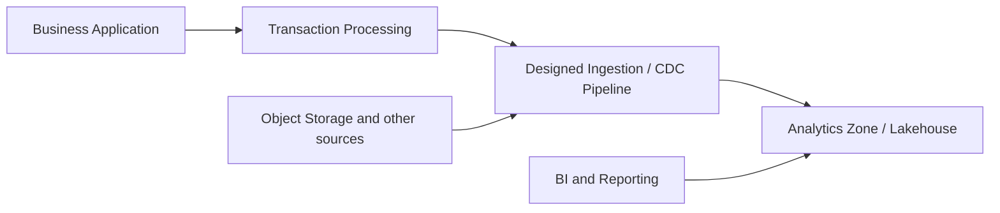

# Choosing Transaction, Analytics, and JSON Workloads

When creating an Autonomous Database, start from the operations the application needs to perform, latency requirements, and how data grows. An API returning JSON is not sufficient reason to choose the JSON workload; a system having reports is not sufficient reason to immediately split off an analytics database.

In the **CLOUD_PROVIDERS_ORACLE** module, this lesson helps learners choose a workload for **Autonomous Database** based on usage profile rather than product name. The decision is placed in the OCI context: compartment and IAM, network connectivity in VCN, storage, monitoring, automation, cost, and availability requirements.

This lesson focuses on Autonomous Database Serverless. Options, limits, and conversion operations must be checked against the actual region, database version, deployment type, and service tier. Dedicated Infrastructure or other services may have their own conditions.

After this lesson, learners will be able to:

- Distinguish transactional, analytical, and JSON document-centric application workloads.
- Choose between Transaction Processing, Lakehouse analytics, and JSON workloads.
- Recognize when a mixed workload is needed or when an analytics system should be separated.
- Distinguish workload type from the database service used when connecting.
- Design a small benchmark, measure results, and document the rationale for the choice.
- Plan a transition when data requirements change.

## 1. Three Independent Questions Before Choosing a Workload

### 1.1. How Is Data Organized?

Data can be organized as relational tables, JSON documents, files in Object Storage, or a combination of multiple forms. This is a question about the data model.

For example:

- Orders have a unique ID, total amount, and status.
- User profiles have optional attributes, a device list, and notification preferences.
- Multi-year sales history is used for aggregation by day, region, and product.

A single system may need all three. Not all data received over HTTP as JSON must be stored verbatim as documents.

### 1.2. How Does the Application Access Data?

Reading a single order by key, updating inventory, scanning sales history, and finding documents with a specific attribute are all different access patterns.

Two databases with the same size and the same read/write ratio can still require different designs:

- System A primarily reads a few rows by key.
- System B primarily scans millions of rows to compute aggregates.

A 95% read ratio does not by itself prove that a workload is analytical.

### 1.3. What Goal Is the System Optimized and Operated For?

Workload type is a service configuration choice tailored to a set of requirements. It is not synonymous with a data format or a single SQL statement.

Oracle documentation currently uses **Autonomous AI Lakehouse** for the evolution of Autonomous Data Warehouse. **Transaction Processing** serves transactions and mixed loads; **JSON** targets document-centric applications. Some older documentation or tools still use the names Data Warehouse/ADW. [Oracle: Autonomous Database Workloads](https://docs.oracle.com/en-us/iaas/autonomous-database-serverless/doc/about-autonomous-database-workloads.html).

This lesson focuses on the three groups in the syllabus. Other options appearing in the Console should be evaluated against their specific requirements rather than forcing them into the same comparison without a corresponding need.

## 2. Transactional Workloads: Completing One Business Operation Correctly

Transactional workloads, commonly called OLTP, consist of many short, concurrent operations. Applications typically read or modify a small amount of data per business operation.

For example:

- Creating an order and decrementing inventory.
- Recording a payment and updating status.
- Booking an appointment while capacity remains.
- Updating a profile or shopping cart.

### 2.1. The Focus Is Transaction Boundaries

Suppose a business rule requires creating an order simultaneously with reserving stock in inventory:

```text
Begin transaction
  Check and decrement inventory if sufficient stock exists
  Insert order
  Insert other required details
Commit when all operations succeed
Rollback if any step fails
```

If the application commits the inventory decrement before inserting the order, a failure in the subsequent step can leave the data in an unintended state. Choosing a workload type does not fix transaction boundaries in code.

Similarly, a fast read query does not prove the application handles contention correctly when two requests compete for the last item in stock.

### 2.2. Metrics to Observe

| Metric | Meaning |
| --- | --- |
| Successful transactions per second | Actual business processing throughput |
| p95/p99 latency | Tail latency under load |
| Error and rollback rate | Outcome quality |
| Lock wait time | Level of data contention |
| Connection wait time | Serving capacity of the application and pool |
| Commit time | Part of transaction completion cost |

Do not count a burst of failed requests as useful throughput. Measurement duration must also include the time the application actually waits, rather than measuring only the fastest single SQL query.

### 2.3. When to Consider Transaction Processing?

This is a suitable candidate to test when the system has business transactions, high concurrency, significant relational data, or needs to combine relational tables with JSON. It can also serve analytical queries and batch jobs; suitability must be verified alongside transactional load.

The initial choice must be paired with proper locking, constraints, indexes, queries, transactions, and connection pool design. Service automation of many operational tasks does not eliminate these application design decisions.

## 3. Analytical Workloads: Answering Questions Across Large Datasets

Analytical workloads, commonly called OLAP, focus on reading, joining, and aggregating data to answer business questions.

For example:

- Revenue by month and region.
- Customer retention rate after each campaign.
- Usage behavior across multiple events and time windows.
- Reconciling data from sales, shipping, and customer support.

An analytical query may run longer than a transactional request and still meet requirements if it finishes within the report deadline.

### 3.1. Identifying Characteristics

| Characteristic | Example |
| --- | --- |
| Reading many rows for one result | Aggregating 24 months of history |
| Many joins | Joining orders, customers, and catalogs |
| Large historical datasets | Fact tables growing steadily daily |
| Batch or streaming data ingestion | Syncing operational data to an analytics zone |
| Prioritizing batch completion time | Finishing the report suite before business hours |

A small number of users does not mean light load. One user running a query that scans a massive dataset can create significant resource demand.

### 3.2. Lakehouse and External Data

The Lakehouse direction is suitable to evaluate when the primary focus is analytics, data marts, historical data, or querying data across multiple systems. It evolved from Data Warehouse and expands capabilities to work with open data platforms, such as Apache Iceberg.

In a specific design, data can be loaded into database tables or queried from external sources via supported mechanisms. The two approaches have different access paths, costs, and operational behaviors.

Autonomous supports external tables for data in cloud storage via tools such as `DBMS_CLOUD`. Access permissions, formats, and source data validation must be prepared. [Oracle: Query External Data](https://docs.oracle.com/en-us/iaas/autonomous-database-serverless/doc/query-external-data.html).

Do not assume every file sitting in Object Storage is immediately queryable, or that reading external data always performs like data organized inside the database.

### 3.3. Key Metrics

- Completion time for each query group and the entire batch.
- Number of concurrent analytical queries.
- Wait time in queues.
- Volume of data read and filter predicate selectivity.
- Data load duration and update latency.
- Total resource consumption for a report suite.

Specify **data freshness**: how recent the data reflected in reports is. This is a different objective from RPO, which describes how much data can be lost during an outage.

## 4. JSON Workloads: Choosing by Document and Data Lifecycle

JSON is well suited for representing data with nested structures, optional attributes, or structures that vary by object type.

Example profile document:

```json
{
  "customerId": 501,
  "profileVersion": 2,
  "preferences": {
    "language": "vi",
    "emailNotification": true
  },
  "devices": [
    {
      "type": "mobile",
      "platform": "android"
    }
  ]
}
```

Such a document can be read, updated by key, or queried by internal attributes.

### 4.1. JSON Does Not Eliminate Data Design

The application still needs to decide:

- Which document represents a single unit of business work.
- Which attributes are required and how data types are validated.
- How document versions are represented.
- How frequently used fields are searched.
- How concurrent updates from two writers are handled.
- Data retention and deletion policies.

Putting every order for a customer into a single ever-growing document can create update hotspots and increase data transfer costs. Conversely, splitting documents too finely can force the application to make many calls for a single screen.

### 4.2. Document APIs and SQL Can Coexist

Autonomous JSON Database supports the document application model; SQL and document APIs are access methods to choose according to need. JSON does not mean key-value only, nor does it mean transactions cannot be used.

SODA is a set of APIs for documents. For Java applications, you can evaluate document APIs or JDBC with SQL/JSON, depending on how libraries map collections and query requirements. Do not assume a manually created JSON table is automatically a collection ready for every API. [Oracle: Autonomous JSON Database](https://docs.oracle.com/en/cloud/paas/autonomous-json-database/).

Oracle also supports storing JSON columns alongside relational columns in the same table. For example, order ID and amount can be relational columns, while extended product attributes reside in JSON. [Oracle: Tables with JSON Columns](https://docs.oracle.com/en/database/oracle/oracle-database/26/adjsn/tables-json-columns.html).

### 4.3. Limits to Check Before Choosing a JSON Workload

According to current documentation, Autonomous JSON Database limits **non-JSON document collections data to 20 GB**. This is not a 20 GB total limit on all JSON data; total storage used must still fit provisioned resources and service terms. [Oracle: JSON Workload and Upgrading to Transaction Processing](https://docs.oracle.com/en/cloud/paas/autonomous-database/serverless/adbsb/upgrade-json-transaction-processing.html).

Do not look only at table names or the fact that the application sends JSON. A text column containing a JSON string does not automatically prove the object is counted as a JSON object under service rules. Check column types, table structures, and dependent objects.

Administrators can use `DBA_NONJSON_OBJECTS` to identify objects counted toward the non-JSON limit. View permissions and classification rules must follow the environment's documentation. [Oracle: DBA_NONJSON_OBJECTS](https://docs.oracle.com/en/cloud/paas/autonomous-database/serverless/adbsb/dba-nonjson-objects-view.html).

If the application is expected to have many relational tables, audit data, binary files, or data outside JSON collections, calculate that portion from the start. Do not wait until hitting the limit to prepare an alternative.

## 5. Comparing the Three Groups to Form a Selection Hypothesis

The table below is an evaluation guide, not an absolute feature-limit matrix:

| Criterion | Transaction Processing | Lakehouse / Analytics | JSON workload |
| --- | --- | --- | --- |
| Primary need | Transactions and mixed loads | Analytics, aggregation, data mining | Document-centric applications |
| Typical operation pattern | Key lookup, short DML, commit | Scan, join, aggregate, data load | Document access, attribute filtering, document update |
| Data model to evaluate | Relational combined with JSON and other types | Analytical tables with external data sources | JSON collections and permitted non-JSON portion |
| Test objectives | Latency, TPS, contention | Report duration, concurrency, queuing | Document latency, size, indexes, and growth |
| Frequently missed risks | Heavy reports impacting APIs | Data freshness requirements and pipelines | Non-JSON limit, unbounded document growth |

A sales system with order tables, change history, and JSON attributes is not forced to pick the JSON workload just because it has a JSON column. A Transaction Processing database may be a reasonable hypothesis to test first.

Conversely, a document profile store with minimal relational data may be suitable for evaluating the JSON workload. If the primary need is analyzing large volumes of historical data from multiple sources, evaluate the Lakehouse direction.

## 6. Gathering a Workload Profile Before Provisioning

The profile should describe both average load and adverse scenarios.

| Question | Information to include |
| --- | --- |
| What is the business unit of work? | An order, a profile update, a report suite |
| What is peak load like? | Requests/sec, concurrency, batch schedule |
| How much data does one operation touch? | Row count, document size, time range |
| Is there contention? | Multiple requests writing to the same object |
| What are the latency targets? | p95/p99 for APIs, report completion deadline |
| How does data grow? | Growth of JSON, non-JSON, indexes, and history |
| How fresh must data be? | Read-after-write or delayed tolerance |
| How are failures handled? | RPO, RTO, and recovery verification method |
| Who accesses the database? | Runtime user, BI, ingestion job, operators |
| What budget limits apply? | Lab, production, resource scaling constraints |

### Illustrative Profile Example

```text
Application: order placement
Hypothetical peak load: 300 transactions/second
Hypothetical API target: p95 under 250 ms, error rate under 0.5%
Primary data: relational
Extended data: JSON describing product attributes
Operational reports: daily, queried every few minutes
Historical reports: 24 months, scheduled
RPO/RTO: defined separately per business requirements
```

The numbers above are simulated requirements, not guaranteed capacity of an OCI configuration. With this profile, you can start by testing Transaction Processing, then evaluate whether historical reports require separate resources.

## 7. Workload Type Differs from Connection Database Service

Workload type is chosen for the database. The database service is selected in the connection string so a group of sessions uses the corresponding resource allocation rules.

Services such as `TP`, `LOW`, `MEDIUM`, and `HIGH` have different concurrency and parallelism characteristics. Per Oracle guidance, `TP` or `LOW` are candidates to evaluate for short operations; `MEDIUM` serves many analytical needs; `HIGH` suits certain low-concurrency analytical loads. Verify actual services and rules of the instance. [Oracle: Predefined Database Services](https://docs.oracle.com/en/cloud/paas/autonomous-database/serverless/adbsb/predefined-database-services-names.html).

Example of grouping connection pools:

```text
API Pool       -> service for short transactions
Report Pool    -> service selected for analytics
Ingestion Job  -> service tested for batch
```

Switching to `_high` does not change the database's workload type and does not prove the system runs faster. If many requests queue up, end-to-end latency can increase even if each individual query executes quickly.

Splitting pools helps impose limits per application group. It does not create two independent databases; CPU, I/O, and instance resources can still be shared.

## 8. One Mixed Database or Separate Analytics Zone?

### 8.1. Keep the Same Database When Justified

This can be suitable when:

- Reports primarily serve operational needs.
- Very fresh data reads are required.
- Analytical load stays within bounds that do not break transactional SLOs.
- The team wants to limit pipelines and data copies.

Test reports and transactions **concurrently**. Two separate tests passing does not prove both will meet targets when contending for resources.

### 8.2. Separate Analytics When Benefits Are Clear

This may be worth evaluating when historical data is large, data sources are diverse, or analytical queries frequently impact APIs.



This is a conceptual architecture. An arrow does not mean the system synchronizes automatically just because two databases were created. You must choose tools, change capture mechanisms, schedules, and data verification methods.

Splitting systems adds responsibilities:

- Identify the authoritative data source.
- Measure latency from source to report.
- Handle duplicate records, late arrivals, and updates/deletes.
- Monitor schema changes.
- Authorize and protect replicated data.
- Maintain re-initialization or backfill capabilities.

A point-in-time clone also does not automatically become a continuous CDC pipeline. For each synchronization mechanism, know what state of data is being served to users.

## 9. Practice: Identifying the Three Operation Patterns with SQL

The examples below are for **a dedicated lab schema on Autonomous with Oracle AI Database 26ai**, with table creation privileges and necessary quota. Run via SQL*Plus, SQLcl, or an equivalent tool; adjust PL/SQL execution according to the client.

The native JSON portion cannot be copied verbatim to a 19c database. If your environment runs another version, use the JSON syntax and storage types supported by that version.

You do not need to create three databases to learn the query patterns. First you can use an authorized lab environment; workload comparison requires a separate test plan.

### 9.1. Prepare Transactional Tables

Create the tables once in the corresponding empty schema. DDL can create commit boundaries, so finish table creation before testing business rollbacks.

```sql
CREATE TABLE wl_inventory (
    product_id     NUMBER PRIMARY KEY,
    available_qty  NUMBER NOT NULL,
    CONSTRAINT wl_inventory_qty_ck CHECK (available_qty >= 0)
);

CREATE TABLE wl_orders (
    order_id       NUMBER PRIMARY KEY,
    customer_id    NUMBER NOT NULL,
    total_amount   NUMBER(12, 2) NOT NULL,
    order_status   VARCHAR2(20) NOT NULL,
    created_at     TIMESTAMP DEFAULT SYSTIMESTAMP NOT NULL,
    CONSTRAINT wl_orders_amount_ck CHECK (total_amount >= 0)
);

INSERT INTO wl_inventory (product_id, available_qty)
VALUES (101, 10);

COMMIT;
```

The `wl_*` names are reserved for examples. Do not reuse names of tables containing real data, and do not drop existing tables just to make a script re-runnable.

### 9.2. Transactional: Decrement Inventory and Insert Order Together

Disable client auto-commit. In SQL*Plus/SQLcl:

```sql
SET AUTOCOMMIT OFF
```

Then run in a dedicated lab session:

```sql
DECLARE
    v_requested_qty NUMBER := 2;
BEGIN
    UPDATE wl_inventory
       SET available_qty = available_qty - v_requested_qty
     WHERE product_id = 101
       AND available_qty >= v_requested_qty;

    IF SQL%ROWCOUNT <> 1 THEN
        RAISE_APPLICATION_ERROR(-20001, 'Insufficient stock or unknown product');
    END IF;

    INSERT INTO wl_orders (
        order_id, customer_id, total_amount, order_status
    )
    VALUES (
        10001, 501, 250000, 'PAID'
    );
EXCEPTION
    WHEN OTHERS THEN
        ROLLBACK;
        RAISE;
END;
/

SELECT available_qty
FROM wl_inventory
WHERE product_id = 101;

SELECT order_id, order_status
FROM wl_orders
WHERE order_id = 10001;

ROLLBACK;

SELECT available_qty
FROM wl_inventory
WHERE product_id = 101;

SELECT COUNT(*) AS remaining_demo_order
FROM wl_orders
WHERE order_id = 10001;
```

When the block succeeds, the same session sees remaining stock at 8 and the demo order inserted. After `ROLLBACK`, stock returns to 10 and order 10001 is gone. Uncommitted changes of a transaction are not published to other sessions.

This demonstrates atomicity, not a complete checkout implementation. Real applications also need idempotency handling, unique order IDs, connection error handling, and steps outside the database. A database transaction does not automatically cover calls to an external payment gateway.

### 9.3. Analytical: Aggregating Many Orders into a Report

Load a small **simulated** dataset into the lab table:

```sql
INSERT INTO wl_orders (
    order_id, customer_id, total_amount, order_status, created_at
)
SELECT
    LEVEL,
    MOD(LEVEL, 80) + 1,
    10000 + MOD(LEVEL * 97, 10000),
    CASE WHEN MOD(LEVEL, 5) = 0 THEN 'CANCELLED' ELSE 'PAID' END,
    TIMESTAMP '2026-10-01 00:00:00'
        + NUMTODSINTERVAL(MOD(LEVEL, 30), 'DAY')
FROM dual
CONNECT BY LEVEL <= 1000;

COMMIT;
```

This load step runs once on the newly created tables; running it again will cause primary key violations. Dates and amounts are solely for instructional purposes.

Reporting query:

```sql
SELECT
    TRUNC(CAST(created_at AS DATE), 'MM') AS report_month,
    order_status,
    COUNT(*) AS order_count,
    SUM(total_amount) AS total_amount
FROM wl_orders
WHERE created_at >= TIMESTAMP '2026-10-01 00:00:00'
  AND created_at <  TIMESTAMP '2026-11-01 00:00:00'
GROUP BY
    TRUNC(CAST(created_at AS DATE), 'MM'),
    order_status
ORDER BY
    report_month,
    order_status;
```

This pattern reads many records to return a small result set. A 1,000-row dataset only helps observe syntax and output semantics; it is not enough to conclude one workload type is faster than another.

In real applications, clarify how timestamps and timezones are interpreted. Monthly boundaries must be defined by business rules, not merely by client machine settings.

### 9.4. JSON: Storing, Reading, and Updating a Document

The example uses the native `JSON` type in the environment described above. This type represents data in Oracle's binary OSON format. [Oracle: JSON Data Type](https://docs.oracle.com/en/database/oracle/oracle-database/26/adjsn/json-data-type.html).

```sql
CREATE TABLE wl_documents (
    doc_id    VARCHAR2(64) PRIMARY KEY,
    document  JSON NOT NULL
);

INSERT INTO wl_documents (doc_id, document)
VALUES (
    'profile-501',
    JSON('{
      "customerId": 501,
      "profileVersion": 1,
      "preferences": {
        "language": "en",
        "emailNotification": true
      }
    }')
);

COMMIT;
```

Reading an attribute with SQL/JSON:

```sql
SELECT
    doc_id,
    JSON_VALUE(
        document,
        '$.preferences.language'
        RETURNING VARCHAR2(10)
        ERROR ON ERROR
    ) AS preferred_language
FROM wl_documents
WHERE doc_id = 'profile-501';
```

Testing an attribute update followed by rollback:

```sql
UPDATE wl_documents
SET document = JSON_TRANSFORM(
    document,
    SET '$.preferences.language' = 'vi'
)
WHERE doc_id = 'profile-501';

SELECT JSON_VALUE(
           document,
           '$.preferences.language'
           RETURNING VARCHAR2(10)
       ) AS preferred_language
FROM wl_documents
WHERE doc_id = 'profile-501';

ROLLBACK;
```

`JSON_TRANSFORM` returns the transformed JSON data; placing it inside `UPDATE` updates the stored value in the table. [Oracle: JSON_TRANSFORM](https://docs.oracle.com/en/database/oracle/oracle-database/26/sqlrf/JSON_TRANSFORM.html).

This example shows that JSON can participate in SQL operations and transactions. It does not prove the table structure meets all space-classification rules of the JSON workload; in real usage, verify using the service's tools.

## 10. Designing Benchmarks to Choose by Evidence

Do not provision a database, run one `SELECT`, and conclude you chose the right workload.

### 10.1. Define Pass Criteria Before Running

A hypothetical criteria table:

| Work group | Illustrative criterion |
| --- | --- |
| Transactional API | 300 tx/s, p95 under 250 ms, error rate under 0.5% |
| Document API | p95 under 150 ms at specified size and concurrency |
| Reporting | Report suite finishes within 10 minutes |
| Mixed load | Reports run while APIs still meet SLOs |
| Data freshness | Reports lag source by no more than 5 minutes |
| Operations | Alerts, backups, and clear ownership in place |

These are self-defined criteria for a learning scenario. They do not represent benchmark baselines or Oracle guarantees.

### 10.2. Keep Test Conditions Comparable

Record:

- Workload type, database version, tier, and region.
- ECPU, storage, and auto scaling state.
- Database service, connection count, and pool configuration.
- Schema, indexes, statistics, data size, and distribution.
- Data loading method, queries, and parameters.
- Client location, network path, and driver version.
- Warm-up duration, measurement duration, and iteration count.
- Concurrent load and configuration changes.

Matching ECPU count alone is not enough for a fair comparison. You can compare at **the same budget** or **the same service objective**, but state the comparison basis explicitly.

If one side runs auto scaling and the other does not, record actual resources consumed. If testing from two clients with different network latency, API results may reflect network differences more than database differences.

### 10.3. Cover Difficult Scenarios

Sample data should mirror real workload distribution:

- A few products receive far more requests than others.
- Some customers have large documents.
- Longer-than-usual reporting periods.
- Transactions reading and writing the same object.
- Data ingestion jobs running during peak hours.
- Documents with missing fields or invalid data.

Uniform, contention-free data can make a design look better than reality. Conversely, testing extreme edge cases outside business scope can lead to over-provisioning.

### 10.4. Measure End-to-End from Application to Database

User wait time can consist of:

```text
Connection wait
+ network round trip
+ resource / lock wait
+ SQL execution
+ commit and result transfer
+ application processing
```

Break down components whenever possible. An undersized pool, over-fetching queries, or repeated client-side JSON parsing can inflate latency even when the database has spare CPU.

Autonomous monitoring tools display signals such as CPU, active sessions, and queued statements. Correlate them with application metrics over the same time window. [Oracle: Monitor Activity and Utilization](https://docs.oracle.com/en/cloud/paas/autonomous-database/serverless/adbsb/mdw-monitoring-database-actions-database-monitor.html).

Do not report averages alone. p95/p99, error rates, and queue depth usually explain what happens under rising load much better.

## 11. Three Typical Selection Scenarios

### 11.1. Order System with Flexible Product Attributes

**Characteristics:** order, inventory, and payment tables are core; some product attributes are stored in JSON. APIs require low latency; daily reports serve operations.

**Hypothesis:** start by evaluating Transaction Processing with a hybrid relational and JSON model.

**Evidence needed:** inventory reservation accuracy under concurrency, latency under load, JSON attribute lookup queries, and impact of reports.

**Review trigger:** multi-year historical reports start violating API SLOs. At that point, compare optimizing/isolating load inside the database against building a separate analytics zone.

### 11.2. Multi-System Reporting Platform

**Characteristics:** ingests sales, advertising, and logistics data; heavy aggregation queries; tolerates data lag per reporting SLA.

**Hypothesis:** evaluate Lakehouse with a data loading strategy or external source access.

**Evidence needed:** ingestion duration, data reconciliation, batch completion time, BI concurrency, and cost when schedules overlap.

**Review trigger:** users ask to use reports for real-time transactional decisions. Re-check freshness, consistency, and business workflow paths rather than simply adding ECPUs for queries.

### 11.3. Document-Shaped Configuration Profile Store

**Characteristics:** most data is JSON documents whose structure varies by customer type; auxiliary relational data is small.

**Hypothesis:** evaluate JSON workload, document APIs or SQL/JSON, and indexing strategy.

**Evidence needed:** latency by document size, concurrent updates, validation quality, and non-JSON growth projection.

**Review trigger:** a need emerges to store substantial data outside JSON collections. If projections approach the service limit, prepare Transaction Processing before hitting the threshold.

Do not choose solely because "JSON looks cheaper." Benefits must be weighed alongside current pricing, data model fit, and migration cost as the system grows.

## 12. IAM, Networking, and Availability in Workload Decisions

### 12.1. Workload Type Does Not Determine Who Can Read Data

Design permissions by role:

| Role | Scope to review |
| --- | --- |
| Provisioner | OCI permissions in the assigned compartment |
| Transactional runtime | SQL privileges needed for business operations |
| BI user | Read privileges on permitted datasets |
| Ingestion job | Read source and write target within defined scope |
| Operator | Metrics, alerts, backups, and configuration changes |
| Secret manager | Credential distribution, rotation, and revocation |

Separating users/pools across transactions, reporting, and pipelines limits blast radius and improves auditability. Choosing an analytics database does not automatically grant the BI group read access to all data.

Personal data inside JSON still requires the same controls as in relational columns. Document flexibility does not remove access governance or retention requirements.

### 12.2. Place Clients Close to the Appropriate Data Path

Choose public/private access per network design; prepare DNS, routes, NSGs/ACLs, and TLS/mTLS accordingly. Use the same connection path when benchmarking applications to avoid false conclusions from network differences.

If separating transactional and analytical databases, also verify Object Storage permissions, pipeline permissions, data transfer traffic, and region placement. Do not copy admin credentials to every component just to connect quickly.

### 12.3. Backups, HA, and Analytics Replicas Serve Different Roles

- Backups serve policy-based recovery.
- HA/DR mechanisms are designed to meet availability and data-loss objectives.
- Analytics replicas serve queries and may transform or filter data.

An analytics zone with recent data does not automatically replace the transactional database during an outage. It may lack the constraints, users, secrets, services, or application state needed to take over.

Define RPO/RTO and practice recovery using service-supported methods. Do not treat being able to query a replica as sole proof that the DR plan is validated.

## 13. Cost and Auto Scaling

Compute, storage, backups, and add-on features have billing rules that must be reviewed per workload and billing model. Check the current pricing/cost estimator for the target region and configuration. [Oracle: Autonomous Database Billing Summary](https://docs.oracle.com/en-us/iaas/autonomous-database-serverless/doc/autonomous-database-billing-overview.html).

Do not rely solely on pricing copied from old documentation. Nor should you assume all workloads share the same minimum storage, allocation units, or tier conditions.

### 13.1. Compare Cost per Useful Outcome

Some comparison units:

```text
Transactional: total cost / number of successful transactions meeting SLO
Analytical:    total cost / completed reporting cycle
JSON:          total cost / number of document operations meeting SLO
```

Comparisons must use the same cost scope. If the Lakehouse option adds pipelines and storage copies, include them in the total. If an option requires higher operational effort, state that assumption explicitly instead of treating team time as free.

### 13.2. Auto Scaling Must Be Observed

Auto scaling helps handle load fluctuations within service-defined limits. It is not guaranteed to fix poor queries, lock contention, or external system bottlenecks.

During testing, record both the enabled/disabled state and actual resources used. After achieving technical targets, check whether peak-load scenarios still fit the budget.

Set budgets/cost alerts for visibility and design technical limits where needed. Do not assume a budget alert will automatically stop resources or enforce a hard cost cap.

### 13.3. Manage Test Resources

An evaluation may create databases, clones, Object Storage buckets, jobs, and logs. Attach tags such as owner, purpose, and expected expiration, and record who is responsible for cleanup.

Before creating another instance, define which question that test will answer. After testing, retain required evidence and dispose of resources in compliance with data policies.

## 14. When the Chosen Workload No Longer Fits

### 14.1. JSON to Transaction Processing

Oracle provides a flow to promote Autonomous JSON Database to Transaction Processing. This is a supported product change; review conditions, billing, and related resources such as clones.

Do not describe promotion as a guarantee that you can switch freely back and forth across all workloads. Prepare client testing, post-change monitoring, and a fallback plan if results fail to meet targets.

### 14.2. Switching Between Transactional and Analytical Workloads

Oracle supports certain **cross-workload-type clone** directions, including Transaction Processing and Lakehouse. There are limits on clone directions and refreshable clones; do not assume every combination is permitted.

Cross-workload cloning does not automatically rebuild all statistics and compression for existing objects. Therefore, evaluate actual data on the target rather than treating clone completion as full optimization. [Oracle: Clone to Change Workload](https://docs.oracle.com/en/cloud/paas/autonomous-database/serverless/adbsb/autonomous-clone-cross-workload-type.html).

An application migration plan may include:

1. Define the objective and supported migration direction.
2. Provision the target and compare configurations.
3. Reconcile data, schema, privileges, and connectivity.
4. Benchmark load on the target environment.
5. Determine how to handle new writes after the clone timestamp.
6. Cut over clients according to the tested plan.
7. Verify data and business operations after cutover.
8. Finalize or roll back per defined criteria.

A static clone does not automatically receive ongoing writes from the source. Rolling back after the target has accepted writes also requires data reconciliation; keeping the old source alone is not enough for a valid rollback plan.

### 14.3. Workload Type, Service, and Resources Are Three Separate Changes

| Change | Objective |
| --- | --- |
| Choose a different service | Adjust session group behavior via appropriate resource handling |
| Scale resources up/down | Adjust capacity within service configuration |
| Change workload or architecture | Match a different usage pattern and data scope |

Identify the bottleneck first. Do not use a major change like switching workload types to fix an unmeasured SQL bug or connection pool issue.

## 15. Practice: Decision-Making and Handover

Choose a real application or use the order-placement scenario from this lesson. The goal is an evidence-backed decision, not finding one workload that wins every benchmark.

### 15.1. Execution Steps

1. Describe relational data, JSON data, and external data sources.
2. List dominant operations along with peak load.
3. Set SLOs for relevant transactions, documents, and reports.
4. Project data growth, especially the non-JSON portion if considering a JSON workload.
5. Choose a workload hypothesis and explain why.
6. Run a small example to confirm data/transaction behavior.
7. Design a representative test with appropriate services and pools.
8. Test each group independently, then test concurrently.
9. Compare technical results, cost, and operational responsibilities.
10. Document conditions that would trigger the team to re-evaluate the choice.

If only one lab environment is available, you can still complete classification and test design. Clearly state which parts are actual observations and which are unverified hypotheses.

### 15.2. Decision Record Template

```text
Application and environment:
Primary workload:
Relational / JSON / external data:
Load and SLOs:
Required data freshness:
RPO / RTO:
Proposed workload type:
Database service and pools:
Resources / auto scaling:
Limits or exclusion conditions:
Isolated and mixed-load test results:
Cost and assumptions:
Access control, backup, and monitoring:
Rationale for selection:
Conditions for re-evaluation:
Owner and next steps:
```

Decision records should omit real usernames/passwords or wallet contents. Configuration references and measurement results are usually enough for others to understand why the choice was made.

## 16. Principles to Uphold in Practice

Choose workloads by business unit of work, access pattern, and service objective. Evaluate JSON from both angles: document modeling and JSON workload limits. For analytics, include data sources, freshness, and impact on transactions.

A well-grounded choice must be paired with the right service, mixed-load testing, growth projections, and clear operational ownership. When requirements change, use new evidence to decide whether to adjust resources, split systems, or switch workloads along a supported path.
