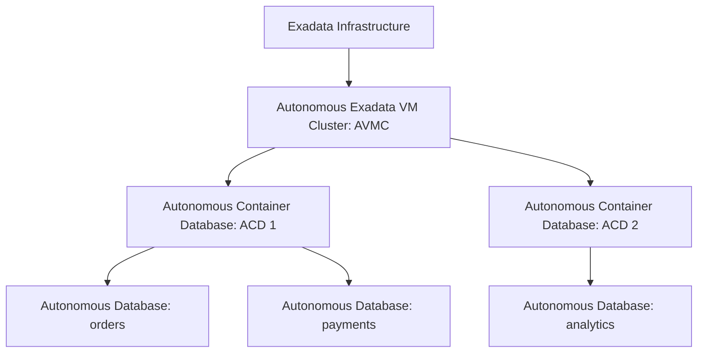
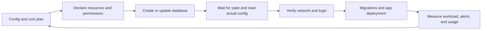

# Choosing Deployment Models and Resource Configuration

In the **Autonomous Database** chapter of the `CLOUD_PROVIDERS_ORACLE` module, this lesson guides you through choosing a deployment model and configuring resources for Oracle Autonomous Database on OCI. A suitable configuration must simultaneously satisfy processing requirements, connectivity paths, isolation level, recoverability, and operational budget.

The running example is a Java order-processing system: short transactions running all day, traffic spikes during promotional windows, and end-of-day reporting. Learners will plan the deployment, select initial ECPU and storage, decide whether to enable autoscaling, and measure results before making adjustments.

Oracle documentation currently uses the name **Autonomous AI Database** on many product pages. In this lesson, Autonomous Database refers to that same service family. The resource hands-on portion focuses on **paid Serverless, ECPU, standalone database outside an elastic pool**; the numeric rules of the lab do not apply by default to Dedicated, Always Free, or Developer.

## 1. Learning Outcomes

After this lesson, learners will be able to:

- Distinguish Serverless, Dedicated Exadata Infrastructure, and Exadata Cloud@Customer.
- Separate decisions about deployment model, workload type, service tier, networking, and resources.
- Read ECPU, base compute, compute autoscaling, base storage, and allocated storage accurately.
- Choose a starting configuration from workload characteristics and verify it against performance goals.
- Build a cost estimate covering baseline, autoscaling, backups, and HA/DR options.
- Execute a resource change with pre-change and post-change configuration readbacks.

## 2. Choose the Deployment Model Before Choosing ECPU Count

### 2.1. Serverless: Focus on the Application's Database

With **Autonomous Database Serverless**, Oracle manages database placement and the underlying infrastructure serving the service. Users select resources and settings provided by the service rather than first deploying a dedicated Exadata system to host databases. This model is suitable for initial evaluation when a team wants to reduce infrastructure administration overhead. [Oracle Autonomous AI Database](https://docs.oracle.com/en/cloud/paas/autonomous-database/).

In the order-system example, the team can start with a Serverless database for testing, connect from Compute over a private network, and measure a representative load. The main questions are: which workload type is needed, how many ECPUs, how data grows, and which connection service the application uses?

The word "serverless" does not mean no servers exist, no resource limits apply, or a running database never incurs compute charges when idle. Read the service's provisioning and billing model rather than inferring from the name.

### 2.2. Dedicated: Managing an Additional Dedicated Resource Layer

With **Autonomous Database on Dedicated Exadata Infrastructure**, the organization uses dedicated Exadata resources and gains more options for workload placement, fleet governance, and operational policies. This is still a managed Autonomous service, not a fully self-managed database server. [About Autonomous AI Database on Dedicated Exadata Infrastructure](https://docs.oracle.com/en/cloud/paas/autonomous-database/dedicated/adbaa/about-autonomous-ai-database-on-dedicated-exadata.html).

Key resource relationships:



The AVMC connects the Exadata infrastructure to ACDs and provides the configuration scope for compute, memory, storage, and networking. Therefore, beyond individual database configuration, operations teams must plan capacity across the layers containing it. [About Autonomous Exadata VM Cluster](https://docs.oracle.com/en/cloud/paas/autonomous-database/dedicated/adbaa/about-autonomous-exadata-vm-cluster.html).

A request to increase database resources should not be evaluated in isolation from available AVMC capacity and reserve requirements during node maintenance or failure. Dedicated adds control and capacity-planning obligations; the Dedicated label itself is not proof that a query will run faster than on Serverless.

### 2.3. Exadata Cloud@Customer: Considering Where Infrastructure Resides

**Autonomous Database on Exadata Cloud@Customer** brings the service to Exadata infrastructure inside the customer's data center, making it suitable to consider when data or workloads must remain at that location. Connectivity to Oracle Cloud and service deployment requirements still must be designed and met. [Oracle Autonomous AI Database — Deployment Choices](https://docs.oracle.com/en/cloud/paas/autonomous-database/).

When evaluating this option, list specific requirements: which data must remain on-premises, which connections are permitted, what latency to the application is required, and which team owns data-center facility conditions. Do not replace that entire analysis with a network option on the database creation screen.

### 2.4. Comparison Table for Architecture Planning

The table below is a design analysis framework:

| Criterion | Serverless | Dedicated on OCI | Exadata Cloud@Customer |
| --- | --- | --- | --- |
| Primary unit managed by app team | Database and service-provided settings | Database plus dedicated fleet/infrastructure structure | Database/fleet and on-premises deployment requirements |
| Capacity question | What configuration and limits does the database need? | Do both the database and its containing layers have enough resources? | Do on-premises capacity and connectivity meet the load? |
| Isolation question | Does service-provided isolation meet requirements? | At which layers must resources be separated? | Which components must stay in the customer data center? |
| Planning overhead | Start per database and workload | Add AVMC, ACD, and shared organizational resource planning | Add site constraints and on-premises infrastructure coordination |
| Verification method | Measure workload, privileges, network, and operations on the service | Measure workload plus contention/failover scenarios in the fleet | Also measure connectivity paths and on-premises site scenarios |

The scope of this lesson covers the core options in the OCI ecosystem. When an organization evaluates Dedicated Region or Oracle Database services in a multicloud environment, consult documentation and available features for that exact target environment; do not assume every combination shares identical capabilities. [Dedicated Deployment Choices](https://docs.oracle.com/en/cloud/paas/autonomous-database/dedicated/adbaa/about-autonomous-ai-database-on-dedicated-exadata.html).

## 3. Separating Five Decisions When Creating a Database

A configuration can be broken down into five layers:

```text
1. Deployment: which infrastructure model hosts the database?
2. Workload and version: optimized for which processing pattern and features?
3. Tier: Always Free, Developer, or an appropriate paid configuration?
4. Network and privileges: who has a network path and who can access data?
5. Resources: what are the ECPU, storage, autoscaling, and recovery capacities?
```

Placing a Serverless database behind a private endpoint does not turn it into Dedicated Exadata Infrastructure. Choosing a transactional workload also does not automatically create a complete recovery architecture for the application. Each layer needs its own rationale and evidence.

### 3.1. Workload Type by Processing Characteristics

In current Serverless documentation, Oracle describes workloads such as **Transaction Processing**, **Lakehouse**, **JSON Database**, **APEX Service**, and **Vector Database**. Each option has its own focus and conditions. [About Autonomous AI Database Workload Types](https://docs.oracle.com/en/cloud/paas/autonomous-database/serverless/adbsb/about-autonomous-database-workloads.html).

Approach for the order system:

| Primary need | Option to evaluate | Evidence to collect |
| --- | --- | --- |
| Many short transactions, continuous writes/updates | Transaction Processing | TPS, p95/p99 latency, contention, and transaction errors |
| Heavy data analytics, aggregation, and batch processing | Lakehouse | Scan size, batch duration, concurrency, and parallelism |
| Application primarily using JSON APIs/features | JSON Database or full-featured option as needed | Required APIs, data types, and related limits |
| Development centered on APEX | APEX Service or database with APEX as appropriate | Application deployment model and required connection types |
| Vector search as the central requirement | Supported workload/vector features on target version | Vector volume, indexes, latency, and required app features |

This is an evaluation starting point, not a claim that only one workload type can run a given SQL statement. An application with both transactions and reports must measure whether the two load groups interfere with each other, and whether databases or schedules should be separated.

Verify both version and region before designing around a feature. The lab does not require features exclusive to a brand-new release; choose a supported version compatible with the application. Workload and version lists appear in the official provisioning guide: [Provision an Autonomous AI Database Instance](https://docs.oracle.com/en-us/iaas/autonomous-database-serverless/doc/autonomous-provision.html).

### 3.2. Developer Tiers Do Not Replace Production Capacity Testing

Always Free and Autonomous Database for Developers have their own resource/feature scopes. Developer is a fixed configuration for development and testing; it is not a paid configuration with full resource customization like the scaling lab in this lesson. [OCI CLI — Autonomous Database Tier Options](https://docs.oracle.com/en-us/iaas/tools/oci-cli/latest/oci_cli_docs/cmdref/db/autonomous-database/create.html).

You can use a developer tier to learn schema, SQL, and connectivity within supported limits. When proving production capacity or testing compute scale-up/scale-down, use a representative environment with appropriate resource options. Results on a small fixed database are not enough to draw conclusions about throughput on another configuration.

### 3.3. Public/Private Endpoint Is a Networking Decision

Serverless supports public endpoint options with access control as well as private endpoints. For private endpoints, prepare the VCN, subnet, network rules, and appropriate access paths. Some configurations also allow enabling public access alongside private; therefore check the actual state, not just the initial option name. [Configure Network Access with Private Endpoints](https://docs.oracle.com/en-us/iaas/autonomous-database-serverless/doc/private-endpoints-autonomous.html).

In the lab, choose a private endpoint for a database that Compute instances in the VCN need to reach. Local workstations and SQL tools also need a path into that network. Switching to a larger ECPU count will not fix bad DNS, a missing route, or invalid credentials.

Autonomous connections use service-provided security mechanisms such as mTLS or TLS per configuration. Use the right descriptor, certificates/wallet, and compatible client. [About Connecting to an Autonomous AI Database Instance](https://docs.oracle.com/en-us/iaas/autonomous-database-serverless/doc/connect-introduction.html).

## 4. Reading Compute Configuration: ECPU, Memory, and Limits

### 4.1. ECPU Is the Unit of the Compute Model

In Serverless, Oracle uses **ECPU** as the abstract compute unit; documentation may still mention OCPU for the older model. For new configurations in this lesson, use ECPU and state the compute model explicitly when reading CPU counts. Do not take an OCPU number from an old example and enter it directly into the ECPU field. [Compute Models in Autonomous AI Database](https://docs.oracle.com/en-us/iaas/autonomous-database-serverless/doc/autonomous-compute-models.html).

Separate these values:

| Value | What does it explain? |
| --- | --- |
| Compute model | Which unit is the resource figure using? |
| Base ECPU count | Base compute level configured for the database |
| Compute autoscaling | Is the service allowed to allocate additional resources via the supported mechanism? |
| Limits and applicable conditions | Is the requested configuration valid and permitted? |
| Consumption/billing metrics | How much was used or billed during that interval? |

ECPU is not an OCI Compute shape name, the guest core count reported by `lscpu`, or the number of connections in a pool. Applications evaluate capacity through workloads and actual measurements on the service model in use.

### 4.2. Do Not Configure Serverless Like a Flex VM

At the Serverless database level, the hands-on exercises configure compute and storage exposed by the service rather than picking a VM OCPU/RAM pair or tuning the host OS. The service manages many underlying components; users manage schemas, privileges, and applications within the provided scope.

If a workload experiences memory pressure, collect SQL details, parallelism, concurrency, and memory metrics before changing resources. Do not infer "adding storage will add Java heap" or "doubling ECPU guarantees doubling single-query performance." Java heap of the service on Compute and database memory are two separate parts of the system.

With Dedicated, AVMC provides memory and storage choices at its own infrastructure layer. Sizing must account for both individual databases and AVMC capacity and headroom; do not apply a self-invented RAM/ECPU ratio across all models. [Plan and Observe Capacity on Dedicated Exadata Infrastructure](https://docs.oracle.com/en/cloud/paas/autonomous-database/dedicated/adbaa/plan-and-observe-capacity-for-autonomous-ai-database-on.html).

### 4.3. Quotas, Service Limits, and Usable Capacity

Before creating or scaling, check these constraint groups:

- Limits of the offering, compute model, tier, and workload in use.
- Tenancy service limits and compartment quotas where applied.
- Selected license/BYOL conditions.
- Available infrastructure/fleet capacity if using Dedicated.
- In-flight operations and combinations of attributes allowed to update together.

A configuration request considered appropriate for the workload is not guaranteed to be accepted by the API at submission time. Designs must handle failed operations and read back actual state rather than treating a submitted request as already scaled resources.

## 5. Compute Autoscaling: Scaling Within Limits Without Eliminating Baseline

### 5.1. Understanding the 3x Maximum Correctly

On Serverless configurations supporting compute autoscaling, a database can use **total compute up to three times its base CPU** under the service's mechanism, along with associated I/O resources. Oracle notes compute autoscaling is enabled by default on standard provisioning; the lab must set its state intentionally. [Use Auto Scaling](https://docs.oracle.com/en-us/iaas/autonomous-database-serverless/doc/autonomous-auto-scale.html).

For example, assuming all applicable limits allow:

```text
Base compute C = 4 ECPU
Compute autoscaling enabled

Maximum total compute under 3x mechanism = 3 * 4 = 12 ECPU
Maximum burst above baseline             = 12 - 4 = 8 ECPU
```

"Three times" means a maximum total of 12 in this example, not adding 12 to get 16. Nor does it mean the database always uses or is always billed at 12.

This is a resource boundary of the supported mechanism, not a promise that workloads will run three times faster. A transaction waiting on a lock, a query missing filter predicates, or an application generating excessive requests still needs separate investigation.

### 5.2. When to Consider Enabling Autoscaling?

| Load characteristic | How to evaluate configuration |
| --- | --- |
| Short, irregular traffic spikes | Measure baseline config, test autoscaling, monitor burst level and peak performance |
| Sustained high load most of the time | Compare raising base compute vs. frequently exceeding baseline |
| Lab needing comparison of two fixed configs | Disable autoscaling during fixed measurements to isolate which change caused differences |
| Workload mostly waiting on locks/network | Investigate wait root causes before increasing compute |
| Multiple databases with staggered peaks | Also evaluate the pool model if scale and conditions fit |

When a database runs under the standalone ECPU model in this lesson, base compute remains a billable component even when the application uses less CPU. Additional autoscaling usage is billed according to applicable rules; do not treat a low utilization chart as zero compute cost. [Serverless Features Billing](https://docs.oracle.com/en-us/iaas/autonomous-database-serverless/doc/autonomous-features-billing.html).

### 5.3. Distinguish Autoscaling from Changing Base Compute

Enabling autoscaling on 4 base ECPUs and changing base to 8 ECPUs are two different changes. They can alter base capacity, usage bounds, and service concurrency allocations.

When evaluating, record completely:

```text
Before: base 4 ECPU, autoscaling off, service TP
After:  base 8 ECPU, autoscaling off, service TP
```

Only after obtaining results for the two fixed configurations should you run a separate experiment:

```text
Separate test: base 4 ECPU, autoscaling on, service TP
```

If you change base, autoscaling, connection service, and pool size all at once, results may improve without revealing which factor made the difference.

## 6. Choosing Storage: Data Volume vs. Allocated Space

### 6.1. Storage Values to Separate

| Concept | Meaning when planning |
| --- | --- |
| Base/reserved storage | Base capacity configured for the database |
| Used storage | Space currently in use per metric definition |
| Allocated storage | Space allocated to the database/tablespaces |
| Backup storage | Space for backups per retention policy |
| Growth demand | Data, indexes, LOBs, and operations that grow space in the future |

These metrics are not interchangeable. A 40 GB dataset does not mean total database configuration, allocated storage, and backups only need 40 GB. Check metric definitions and service reporting to compare the same type of storage.

### 6.2. Budgeting Storage for the Order Example

A **simulated design calculation**, not a service minimum requirement:

```text
Expected table/LOB data in initial period: 24 GB
Expected indexes and related structures:   16 GB
Workspace during loads/migrations:         10 GB
Growth headroom and estimation margin:     20 GB
------------------------------------------------
Target space for initial test:             70 GB
Base storage selected to test:            100 GB
```

Each item must be grounded in sample data and actual operations. Do not double-count indexes if input figures already include them. TEMP and system areas have their own management; the headroom in this calculation is an assumption to verify, not a separate quota allocated per component.

After loading representative data, re-measure size and growth rate. If data grows by an average of `g` GB per month, forecasts must cover at least the time until the next expansion plus a safety buffer for major campaigns or migrations.

### 6.3. Storage Autoscaling Is an Independent Option

Per Serverless scaling procedures, storage autoscaling allows expansion up to three times base storage within supported bounds. For example, a 100 GB base has a 300 GB boundary under that mechanism. Compute autoscaling and storage autoscaling are two separate settings. [Add CPU or Storage Resources or Enable Auto Scaling](https://docs.oracle.com/en-us/iaas/autonomous-database-serverless/doc/autonomous-add-resources.html).

Do not infer from compute scaling back down after a spike that allocated storage will also drop immediately when deleting data. Check allocated space, base storage, and supported shrink mechanisms before concluding the bill will decrease. Changing storage autoscaling when a database has already exceeded base also requires reading the effect reported by Console/API.

Configuration units vary by workload and compute model. In the Transaction Processing ECPU lab, use 100 **GB**; do not enter 100 into a field expecting **TB**. For Lakehouse or another tier, re-check valid units and value ranges. [Autonomous AI Database Billing Summary](https://docs.oracle.com/en-us/iaas/autonomous-database-serverless/doc/autonomous-database-billing-overview.html).

### 6.4. Storage Relates to Performance, Not a Generic Speedup Button

Service configurations link compute, storage, and I/O/cache capabilities. Therefore, do not assume every storage size has identical I/O characteristics, or that adding storage always substitutes for adding compute. Read configuration conditions and measure the workload rather than applying a Block Volume IOPS/GB ratio directly to Autonomous Database. [Add CPU or Storage Resources](https://docs.oracle.com/en-us/iaas/autonomous-database-serverless/doc/autonomous-add-resources.html).

In the order example, if queries are waiting on locks from long transactions, adding storage capacity will not fix that cause. If queries scan large volumes and cache/I/O dominates, analyze SQL and I/O metrics before choosing resource changes.

## 7. Connection Services and Concurrency Are Part of Sizing

Autonomous Database provides predefined services such as `TP`, `TPURGENT`, `HIGH`, `MEDIUM`, and `LOW`, with different priority, parallelism, and concurrency characteristics. Choosing a service is part of workload configuration, not merely picking a memorable connection name. [Database Service Names for Autonomous AI Database](https://docs.oracle.com/en-us/iaas/autonomous-database-serverless/doc/predefined-database-services-names.html).

How to start evaluating:

| Example workload | Service to consider | What to measure |
| --- | --- | --- |
| Short transactional API requests | `TP` | Latency, throughput, active sessions, and contention |
| Transactional workload needing different priority | `TPURGENT` if suitable | Impact on remaining workloads |
| Reports that can benefit from parallelism | `MEDIUM` or `HIGH` | Runtime, concurrent statements, and queue wait time |
| Low-priority jobs not needing default parallelism | `LOW` | Completion within deadline and impact on APIs |

The name `HIGH` does not mean every application runs faster on it. A service with higher parallelism may suit a few heavy SQL statements while causing many concurrent requests to queue. Exact limits also depend on ECPU count and compute autoscaling state. [Service Concurrency](https://docs.oracle.com/en-us/iaas/autonomous-database-serverless/doc/manage-service-concurrency.html).

Having 200 connections in an application pool does not mean the database needs or will run 200 heavy SQL queries in parallel. With multiple pods/VMs, sum connections across all replicas and background jobs, then compare against session limits, active concurrency, and latency goals.

Illustrative reasoning with simulated numbers: four replicas, each with max 30 connections, create potential for 120 connections from the application tier, excluding migrations and reports. This number helps review pools but does not replace measuring actually busy sessions and wait times.

When testing connections with SQL, you can observe the session's service:

```sql
SELECT
    SYS_CONTEXT('USERENV', 'SESSION_USER') AS session_user,
    SYS_CONTEXT('USERENV', 'SERVICE_NAME') AS service_name
FROM dual;
```

Obtain the exact alias/descriptor from the database connection configuration; do not append a service suffix manually and assume configuration is complete. Configuration comparison benchmarks must keep both service and pool settings stable unless intentionally testing changes to them.

## 8. Choosing a Starting Configuration from Service Objectives

### 8.1. Write the Workload Profile Before Filling Out the Console

Minimum profile for the order system:

```text
Core business: short order transactions with writes/updates
Load pattern: steady baseline, campaign spikes, end-of-day reports
API targets: throughput and p95/p99 latency defined by product team
Data: current size, growth, LOBs/indexes, and retention
Connections: replica count, pool per replica, background jobs, and services
Recovery: acceptable downtime and data-loss tolerance
Cost: spending limit, alert recipients, and owners
```

Do not use registered user count as the sole input for ECPU. Concurrent requests, SQL complexity, transaction hold time, and data size explain actual load.

### 8.2. Lab Configuration Table to Begin Measuring

This is an **illustrative lab configuration**, not a validated production sizing:

| Attribute | Lab value | Reason in lesson |
| --- | --- | --- |
| Deployment | Serverless | Focus on learning per-database configuration |
| Tier | Standard paid, outside elastic pool | Practice supported resource modifications |
| Workload | Transaction Processing | Represents transactional APIs |
| Compute model | ECPU | Uses the lesson's current compute model |
| Base compute | 4 ECPU | Starting point to compare with other configs |
| Compute autoscaling | Off for initial run | Know exact fixed compute under test |
| Base storage | 100 GB | Verify against simulated data budget |
| Storage autoscaling | Off in controlled-data lab | Measure growth and intentional storage changes |
| Network | Private endpoint, access paths prepared | Connect from application inside VCN |
| API Service | `TP` | Starting point for measuring short transactions |
| License | Explicitly record applicable choice | Include licensing conditions in cost estimate |

If a value is invalid in the current region, offering, or tenancy, document the reason and choose a supported lab configuration before running comparisons. Do not silently tweak multiple parameters and compare results as if from the same experiment.

### 8.3. Reading Results to Decide Changes

| Evidence | Decision to evaluate |
| --- | --- |
| Sustained busy CPU, SQL can scale concurrently/in parallel, latency rising | Increase base ECPU or evaluate compute autoscaling |
| CPU still low while many SQL statements queue | Check service, concurrency, and resource policies |
| Blocking sessions increasing | Find locking transactions/SQL and lock hold duration |
| App waiting for connections, database not correspondingly busy | Check pool, connection leaks, timeouts, and network |
| Storage growing rapidly near limit | Project time to exhaustion, retention, and expansion plan |
| Compute increased but latency barely changed | Find dominant bottleneck in SQL, I/O, locks, or dependencies |

The goal is to explain why those resources are needed. Choosing a larger configuration just because one benchmark ran faster is insufficient if the added value does not meaningfully help meet service requirements.

## 9. Cost Estimation and Cost Control

### 9.1. Break Down the Components of the Solution

An estimation framework for standalone Serverless ECPU:

```text
Solution cost
  = base compute during active runtime
  + incremental compute from autoscaling/feature usage
  + database storage per workload rules
  + backups and retention
  + clones/standby or DR options
  + tooling and related application resources
```

This framework is not a universal billing formula for every deployment. For ECPU, Serverless documentation notes backup storage is billed separately; stopped databases have zero ECPU usage in that model, while persistent storage and related resources still must be accounted for. [Serverless Features Billing](https://docs.oracle.com/en-us/iaas/autonomous-database-serverless/doc/autonomous-features-billing.html).

Do not apply backup rules from legacy OCPU documentation to ECPU. If using Dedicated, estimate both the infrastructure/AVMC layer and usage aggregation under Dedicated's model. [Billing on Dedicated Exadata Infrastructure](https://docs.oracle.com/en/cloud/paas/autonomous-database/dedicated/adbaa/billing-autonomous-ai-database-on-dedicated-exadata.html).

### 9.2. Compute Quantity Example for Planning

Assume a standalone database runs a full 24 hours, with no standby or separate compute-consuming tools, and uses compute as follows:

```text
Base: 4 ECPU
22 hours at base compute level of 4 ECPU
 2 hours at total compute level of 8 ECPU via autoscaling

Illustrative compute usage = 4 * 22 + 8 * 2
                           = 104 ECPU-hours

If staying at baseline all day: 4 * 24 = 96 ECPU-hours
Incremental usage in example:             8 ECPU-hours
```

The example calculates on a **total** of 8 ECPUs during the two peak hours, without double-counting the 4 baseline ECPUs during those same two hours. This is a simulated usage calculation; converting to currency requires unit rates, metering rules, licensing, workload, and applicable contract terms. When budgeting, cross-check actual service usage/cost reports.

### 9.3. Budgets Are Spending Alerts

OCI Budgets provide soft limits and spending alerts; a budget does not by default prevent a database from continuing to autoscale or guarantee stopping resources right when the budget is hit. [Budgets](https://docs.oracle.com/en-us/iaas/Content/Billing/Concepts/budgetsoverview.htm).

Cost-control design should combine allowed resource configurations, change permissions, alerts, and assigned owners. Tag owner/environment for traceability; track lab databases, clones, backups, and app resources separately. For non-continuous environments, consider supported start/stop schedules after evaluating impact on users and background jobs.

### 9.4. Elastic Pools Are a Compute-Pooling Problem

Serverless provides elastic pools to group multiple databases for compute allocation/billing, with a pool leader and members. Pools have their own conditions, capacities, and billing rules; do not apply the lab's standalone database math directly to pools. Documentation also distinguishes dedicated elastic pools within Serverless, so do not infer from the word "dedicated" that it is Dedicated Exadata Infrastructure. [About Elastic Pools](https://docs.oracle.com/en-us/iaas/autonomous-database-serverless/doc/elastic-pools-about.html).

Evaluate pools when you have enough databases and load data to analyze pooling benefits. A single initial small database is not proof that an organization needs a pool; conversely, many simultaneously idle databases should be checked against actual pool pricing and capacity rules.

## 10. Practice: Creating the Lab Configuration and Verified Compute Scaling

### 10.1. Prepare the Environment

The lab uses a standard paid Serverless ECPU database outside an elastic pool, starting from the configuration in Section 8.2. Prepare:

- A lab compartment and IAM permissions to create/read/update databases and required network resources.
- A VCN, subnet, and network rules suitable for a private endpoint; application host/SQL tools have network access.
- OCI CLI configured with the right profile and region if using the commands below.
- An application account with necessary privileges, connection descriptor, and matching TLS/mTLS configuration.
- A repeatable test dataset and workload, along with latency/throughput targets.

The lab creates paid resources, so stay within the allocated practice budget and record created resources. If you only have Always Free or Developer, run the observation steps supported by that tier; running scaling comparisons requires a database with the corresponding configuration.

### 10.2. Create the Database from the Console

Following the Serverless provisioning flow, open the Autonomous Database service and create a database in the target compartment. Enter an identifiable display name, a valid database name, choose Transaction Processing, and select an appropriate version. Choose ECPU, 4 ECPU, 100 GB; explicitly disable both autoscaling options for the baseline measurement. Configure admin credentials, network access, and backup retention per the lab plan. [Provision an Autonomous AI Database Instance](https://docs.oracle.com/en-us/iaas/autonomous-database-serverless/doc/autonomous-provision.html).

Wait for the database to become available. Then verify the endpoint, secure connectivity, and runtime account. OCI resource managers and SQL login users have different roles; permission to create resources does not prove the application can read tables.

Record at least the OCID, region, compartment, deployment, workload, tier, compute model/count, storage/unit, autoscaling, network access, and license choice. If any parameter differs from the plan, document why before measuring.

### 10.3. Read Configuration via OCI CLI

PowerShell example—replace the OCID with the actual lab database. The `get` command only reads resource information:

```powershell
$ErrorActionPreference = 'Stop'
$env:ADB_OCID = '<LAB_DATABASE_OCID>'

$adbState = oci db autonomous-database get --autonomous-database-id $env:ADB_OCID | ConvertFrom-Json
if ($LASTEXITCODE -ne 0) {
    throw 'Unable to read Autonomous Database configuration'
}

$adbState.data | Select-Object 'id', 'display-name', 'lifecycle-state', 'db-workload', 'is-dedicated', 'is-free-tier', 'is-dev-tier', 'compute-model', 'compute-count', 'data-storage-size-in-gbs', 'is-auto-scaling-enabled', 'is-auto-scaling-for-storage-enabled'
```

Cross-check output with the Console and recorded OCID. CLI output field names usually use hyphens; do not mix them with camelCase names in API requests or Terraform attribute names. Refer to official syntax and parameters at [OCI CLI — autonomous-database get](https://docs.oracle.com/en-us/iaas/tools/oci-cli/latest/oci_cli_docs/cmdref/db/autonomous-database/get.html).

### 10.4. Measure the Baseline Configuration

Run the workload with the chosen data, service, and pool. Each measurement run needs a steady-state warm-up period to reduce startup and cache-loading skew. Collect within the same window:

```text
Configuration: base 4 ECPU, compute autoscaling off
Load: same data, same business flow, same concurrent requests
Application: throughput, p95/p99 latency, errors, pool active/pending
Database: CPU, active/queued statements, sessions, waits, and storage
Operations: measurement timestamp, background tasks, and resource state
```

Do not draw conclusions from a single run. If metrics look anomalous, look for differences in workload, data, or background tasks before using results for sizing decisions.

### 10.5. Scale Base Compute Up to 8 ECPU

Re-verify that this is a standard paid Serverless ECPU lab database outside an elastic pool and currently available. The following checks help avoid targeting the wrong tier/deployment in the example; being outside a pool must also be verified in the resource configuration:

```powershell
if ($adbState.data.'is-dedicated' -eq $true -or
    $adbState.data.'is-free-tier' -eq $true -or
    $adbState.data.'is-dev-tier' -eq $true) {
    throw 'This scale example is only for standard paid Serverless'
}
if ($adbState.data.'compute-model' -ne 'ECPU' -or
    $adbState.data.'lifecycle-state' -ne 'AVAILABLE') {
    throw 'Requires an ECPU database in AVAILABLE state'
}

$scaleArgs = @(
    'db', 'autonomous-database', 'update',
    '--autonomous-database-id', $env:ADB_OCID,
    '--compute-model', 'ECPU',
    '--compute-count', '8',
    '--is-auto-scaling-enabled', 'false',
    '--wait-for-state', 'AVAILABLE'
)
oci @scaleArgs
if ($LASTEXITCODE -ne 0) {
    throw 'Scale not confirmed successful; re-read state'
}
```

Re-run the `get` step, confirm compute model/count and autoscaling status, then test application connectivity. Do not treat an accepted update request as a completed readback. If the CLI times out waiting, re-read the state before sending further operations. [OCI CLI — autonomous-database update](https://docs.oracle.com/en-us/iaas/tools/oci-cli/latest/oci_cli_docs/cmdref/db/autonomous-database/update.html).

Keep the workload, service, data, and pool unchanged when re-measuring at 8 ECPU. Compare both goal attainment and added resource capacity, not just CPU percentage.

### 10.6. Evaluate Results and Scale Down with a Plan

If 8 ECPU clearly improves targets, determine whether that is the required baseline or only needed for a peak window. If it barely improves, use waits, queues, and SQL to find the dominant bottleneck.

Before returning to 4 ECPU, finish running lab jobs/transactions and prepare the application to reconnect. Serverless documentation notes that a significant ECPU reduction may drop connections, terminate sessions, or cancel/roll back unfinished jobs; do not interpret every scale-down operation as session-impact-free. [Compute Models in Autonomous AI Database](https://docs.oracle.com/en-us/iaas/autonomous-database-serverless/doc/autonomous-compute-models.html).

After reverting to the chosen configuration, read back state and verify functionality. To test autoscaling, run a separate test at base 4 ECPU, enable compute autoscaling in **Manage resource allocation**, hold other factors steady, and observe incremental usage. The 12 ECPU boundary is the supported maximum for this example, not a level guaranteed to be reached during testing.

### 10.7. Complete the Lab

Document the final configuration, measurement results, observed cost, and resources that will remain active. Retained databases/clones must have an owner and purpose. For resources no longer needed, follow the environment's lab teardown process after identifying data and related backups to retain; do not assume stopping a database eliminates all charges.

## 11. Monitoring to Know When to Change Resources

### 11.1. Read Metrics Together

| Serverless metric | What to examine | Interpretation caveat |
| --- | --- | --- |
| `CpuUtilization` | CPU used relative to permitted capacity | Do not convert to billed ECPUs by multiplying by base |
| `AverageActiveSessions` | Sessions actively processing or waiting on resources | Does not mean all are consuming CPU |
| `QueuedStatements` | Whether SQL statements are queuing | Must cross-check service and concurrency |
| `BlockingSessions` | Long-blocking sessions per metric definition | Must locate the offending SQL/transaction |
| `StorageUsed`, `StorageAllocated`, `StorageMax` | Used data, allocated space, and maximum capacity | Do not mix the three metrics to compute free space |

Verify definitions, units, collection intervals, and dimensions of the `oci_autonomous_database` namespace. Aggregate CPU metrics do not replace application latency targets. [Available Metrics: oci_autonomous_database](https://docs.oracle.com/en-us/iaas/autonomous-database-serverless/doc/autonomous-monitor-metrics-list.html).

When autoscaling is enabled, the utilization denominator and permitted capacity must be interpreted according to metric definitions. A lower CPU percentage after a change does not automatically prove lower billed compute. To reconcile billing, also inspect usage/cost reports by resource and corresponding time window.

### 11.2. Alerts Must Lead to Action

Recommended alerts for the example:

- API latency exceeds target alongside rising errors or pool pending count: check user impact first.
- Prolonged SQL queuing: verify service, load, and concurrency policies.
- Rapid storage growth: project time to limit rather than alerting only when nearly full.
- Usage/cost rises outside expected load windows: look for autoscaling, jobs, clones, tools, or newly created replicas.

Thresholds and evaluation windows must be chosen from baseline, metric collection cadence, and operations team response time. Do not create a static CPU threshold and assume it acts as the service's autoscaling policy. Alerts must identify the database, environment, owner, and first investigation step.

## 12. Availability and Automation Alongside Resource Choices

### 12.1. Autoscaling Does Not Replace a Recovery Plan

Autoscaling addresses resource changes within supported mechanisms. Backups address data recovery within retention policies. Standby/DR serves different outage scenarios. The service provides automated backup/recovery mechanisms, yet applications still need to define recovery points, permissions, and post-recovery data verification. [About Backup and Recovery](https://docs.oracle.com/en-us/iaas/autonomous-database-serverless/doc/backup-intro.html).

If service objectives require a standby option, evaluate Autonomous Data Guard or supported DR choices for your deployment. Local and cross-region options have distinct conditions, switchover behavior, and costs; verify against target option documentation. [About Standby Databases](https://docs.oracle.com/en-us/iaas/autonomous-database-serverless/doc/autonomous-data-guard-about.html).

Analytical example: a database surviving promotional traffic via autoscaling does not prove the application survives losing network connectivity to the region. Conversely, having a standby where the pool fails to reconnect properly or retries create duplicate orders also fails business requirements. Test the end-to-end application recovery flow within assigned drill scope.

### 12.2. Pipeline Automation with State Verification



IaC manages cloud properties within its ownership scope; migrations manage schema versions. When tools automatically adjust resources or operational schedules, decide which tool holds the desired state so the next apply does not inadvertently overwrite an approved sizing decision.

Do not let scripts modify compute, license, network, and numerous other properties simultaneously without checking supported API combinations. The CLI example in this lesson updates only the compute parameters needed for the test; concurrent update restrictions are published in the `update` reference. [OCI CLI — Update Parameters](https://docs.oracle.com/en-us/iaas/tools/oci-cli/latest/oci_cli_docs/cmdref/db/autonomous-database/update.html).

## 13. Misconceptions to Avoid

| Misconception | Appropriate check and decision |
| --- | --- |
| Serverless always scales to zero when idle | Read baseline, running/stopped state, and model billing rules |
| Private endpoint means Dedicated | Treat deployment and network access as two separate attributes |
| 4 ECPU with 3x autoscaling adds 12 ECPU | Compute 12 ECPU total bound in example; max above baseline is 8 |
| Compute autoscaling also expands storage | Check both autoscaling flags separately |
| Choosing `HIGH` makes every API faster | Measure parallelism, active concurrency, queues, and latency |
| Larger pool always increases throughput | Sum connections across the whole app and measure actual database capacity |
| Deleting data immediately reduces allocated storage and bill | Check used/allocated/base and supported shrink/billing behavior |
| Budgets are hard spending caps | Use budgets as alerts alongside resource limits and action runbooks |
| Dedicated databases can always scale on demand | Check AVMC/fleet capacity and required headroom |
| Doubling compute guarantees halving latency | Identify CPU-bound work vs. other wait points |
| CLI returning success means final config is right | Re-read resource, test connectivity, and measure post-change behavior |

## 14. Practice Completion Criteria

Learners complete the exercise when they can present:

1. Rationale for choosing deployment, workload, tier, and network access for the order system.
2. Initial configuration table with units, autoscaling states, license terms, and applicability scope.
3. Resource readback outputs proving actual configuration before and after scaling.
4. Controlled workload comparison across configurations, including latency, throughput, queues, and errors.
5. Compute/storage boundary math plus a cost estimate covering baseline, backups, and recovery options.
6. Final selected configuration, growth monitoring plan, and owners when thresholds are exceeded.

Deliverables must explain why that model and resource level serve the application, which assumptions were measured, and which conditions still require verification before production.
