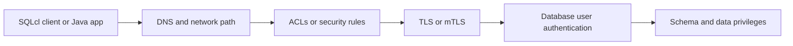
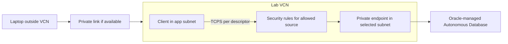

# Creating a Database with a Public Endpoint or Private Endpoint

## 1. Objectives and Scope

In the **Autonomous Database** chapter of the **CLOUD_PROVIDERS_ORACLE** module, this lesson guides you through creating a database with an appropriate network access option. Resource creation is placed in the context of tenancy, compartment, IAM, VCN, Java applications, monitoring, and cost control on Oracle Cloud Infrastructure.

The hands-on portion focuses on **Autonomous Database Serverless** on OCI, referred to as Autonomous AI Database in current documentation. Serverless networking steps cannot be applied verbatim to Autonomous Database on Dedicated Infrastructure.

After this lesson, you will be able to:

- Distinguish endpoint type from traffic path and authentication mechanisms.
- Create a public database with ACLs or a private-only database controlled by VCN networking.
- Prepare appropriate IAM, subnets, DNS, and security rules.
- Download the wallet/connection string and test connectivity from the right client location.
- Test both permitted and blocked access cases.
- Record configurations, costs, and resources to clean up after the lab.

The running scenario is a Java order-management application. During learning, developers want to access the database from a laptop; when deploying the application inside a VCN, the team wants the database accessible only over a private network. These two needs lead to two different designs, not merely toggling a label in the Console.

The commands and configurations below are examples for learners to execute in an environment where they hold administrative permissions. Do not use production data for the lab; sample resource names, CIDRs, and addresses must be replaced for your actual environment.

## 2. Understanding Endpoint Options Correctly

### 2.1. Public Endpoint vs. Private Endpoint

An endpoint is a service access point, typically used by applications via a hostname and connection descriptor. A **public endpoint** has a public address; a **private endpoint** provides a private access point attached to a chosen VCN/subnet.

| Console option | Characteristics | How source connections are restricted |
| --- | --- | --- |
| `Secure access from everywhere` | Public endpoint, no source restriction by ACL until ACLs are configured | Still requires authentication and secure connection |
| `Secure access from allowed IPs and VCNs only` | Public endpoint with ACL | Public IP/CIDR or VCN matching the network path |
| `Private endpoint access only` | Private access point inside a VCN | Private network path and associated security rules |

The baseline options are described in [Oracle: About Network Access Options](https://docs.oracle.com/en/cloud/paas/autonomous-database/serverless/adbsb/network-access-options.html).

Public does not mean anonymous login. Private does not automatically grant query permissions to every workload in the VCN. The endpoint determines part of reachability; database privileges still must be configured.

### 2.2. Endpoint Type Differs from Packet Path

A client in a private subnet can use a public endpoint via a NAT Gateway. In that case, the database sees the NAT's public egress IP rather than the application host's private IP.

Autonomous Database also supports VCN-based ACLs when connections traverse a Service Gateway. Therefore, traffic not crossing the public internet does not mean the database has a private endpoint inside your subnet. [Oracle: Overview of Restricting Access with ACLs](https://docs.oracle.com/en/cloud/paas/autonomous-database/serverless/adbsb/security-restrict-acl.html).

Three questions to document separately in the design:

```text
1. Which endpoint does the database have?
2. Which route does the client take to reach that endpoint?
3. By which IP or VCN does the database identify the source along that path?
```

### 2.3. A Private Endpoint Can Be Paired with Public Access

A supported private endpoint configuration includes an **Allow public access** option, creating an additional ACL-restricted public path. Therefore, when private-only is required, verify this option is disabled; seeing a private IP alone is not enough to conclude no public endpoint exists. [Oracle: Configure Network Access with Private Endpoints](https://docs.oracle.com/en/cloud/paas/autonomous-database/serverless/adbsb/private-endpoints-autonomous.html).

The private lab uses private-only. If an organization intentionally chooses both endpoints, the design document must specify which sources are allowed over each path and why both must be maintained.

## 3. Three Control Layers That Must Work Together

A successful login must pass through several distinct layers:



OCI resource IAM operates from a different perspective: who can create a database, change network settings, download connection information, or call the corresponding APIs.

| Layer | Control example | Does not replace |
| --- | --- | --- |
| OCI IAM | Allows operator to create database in compartment | `SELECT` privilege in schema |
| Network | ACLs, NSGs, security lists, routes, and DNS | Database user identity |
| Secure connection | TLS/mTLS and certificate verification | Business privileges inside database |
| Database | Accounts, roles, and object privileges | Network path from laptop to VCN |

Oracle describes client access control across network policies, connection protocols, and database user privileges. The `ADMIN` account is for administration; applications should use a separate account with appropriate privileges. [Oracle: Security and Authentication](https://docs.oracle.com/en/cloud/paas/autonomous-database/serverless/adbsb/gs-security-and-authentication-autonomous-database.html).

For example, a user who can open the database details page in the Console may still be unable to log in via SQL. Conversely, a database user can connect with a SQL tool without having permissions to modify OCI resources.

## 4. Preparing Resources and Shared Decisions

### 4.1. Lab Profile

Define two configurations to compare; they can be executed sequentially to reduce resource retention time:

| Item | Public branch | Private branch |
| --- | --- | --- |
| Illustrative display name | `adb-public-lab` | `adb-private-lab` |
| Illustrative database name | `ADBPUBLAB` | `ADBPRVLAB` |
| Network | Public with test-source ACL | Private-only |
| Test client | Laptop with identified public egress | Lab host inside VCN or with private connectivity |
| Connection security | Choose mTLS for lab | Choose mTLS for lab |
| Key evidence | Successful connection from ACL-allowed source | Connection via right private hostname/IP |

Database names must satisfy service naming and uniqueness rules. Do not treat display name as a unique identifier; record the OCID after creation.

Choose region, compartment, workload, release, compute, storage, auto scaling, backup, and license based on lab needs and available options. Do not assume Free-tier resource levels or features fit every endpoint. Review configuration before clicking Create. [Oracle: Provision an Autonomous AI Database Instance](https://docs.oracle.com/en/cloud/paas/autonomous-database/serverless/adbsb/autonomous-provision.html).

### 4.2. IAM Permissions

The operator needs permissions to create/manage Autonomous Databases in the assigned compartment. For a private endpoint, network permissions for VCN, subnet, NSG, private IP, and VNIC in the corresponding compartments are also required.

If the database and network reside in two different compartments, verify permissions in both. An empty VCN/subnet dropdown may be an IAM or region issue, not proof that the resource does not exist. Cross-check each operation against [Oracle: IAM Policies for Autonomous AI Database](https://docs.oracle.com/en-us/iaas/autonomous-database-serverless/doc/autonomous-database-iam-policies.html) and the private endpoint permissions section in the network configuration docs.

Do not grant tenancy-wide admin permissions just to make a subnet appear in a dropdown. Administrators can scope policies appropriately to the lab compartments.

### 4.3. Accounts and Secrets

Create an `ADMIN` password meeting current service requirements and store it in an appropriate secret store. Never commit passwords, wallets, or tokens to Git, submission screenshots, or application logs.

For the lab, use `ADMIN` to prepare the application account when needed, then test connections with the application account. This helps distinguish connection-path errors from schema-privilege errors.

## 5. Branch A: Creating a Database with a Public Endpoint and ACL

### 5.1. Identify the Source the Database Sees

For a laptop accessing over the internet, the ACL needs the public address of the active egress path. Do not enter the laptop's `192.168.x.x` address and expect the database to see it over the internet.

If an application goes through a NAT Gateway, the source to check is the NAT's public IP. If going through a Service Gateway, use the appropriate VCN-based ACL option. Do not treat a VCN name as a generic allowlist for every connection path. [Oracle: Configure Network Access with ACLs](https://docs.oracle.com/en/cloud/paas/autonomous-database/serverless/adbsb/access-control-rules-autonomous.html).

Example source plan:

| Client | Expected path | Information to verify before setting ACL |
| --- | --- | --- |
| Laptop at office | Internet via corporate network | Corporate-confirmed egress public IP/CIDR |
| Laptop on VPN | Depends on split/full tunnel config | Actual routing path of the database connection |
| VM in private subnet | NAT Gateway | Public IP of the active NAT |
| VM via Oracle Services Network | Service Gateway | VCN OCID and appropriate client scope |

An address like `203.0.113.10/32`, if seen in an illustrative design, is documentation-only. Replace it with an actual authorized source; never enter the sample address verbatim in the lab.

### 5.2. Console Steps

1. Open the Autonomous Database list in the target region and compartment.
2. Click Create; enter the general information prepared in Section 4.
3. Under network access, select **Secure access from allowed IPs and VCNs only**.
4. Add an ACL for the verified lab source. For a fixed public IPv4 address, enter the individual address or `/32` CIDR per the UI.
5. Intentionally select **Require mutual TLS (mTLS) authentication** for this lab.
6. Review workload, release, compute/storage, auto scaling, backup, and license, then create the resource.
7. Wait for lifecycle state to reach **Available**, and record the OCID and actual network configuration.

This is a lab runbook using the service's provisioning and ACL options. If the region, tier, or workload does not offer the planned option, stop at the prerequisite check; do not pick a different configuration merely to submit the form.

### 5.3. Verify the Public Endpoint

After creation, inspect the access type, ACL contents, and mTLS requirement on the details page. Download the connection string from the newly created database itself.

Test connecting from the allowed source using a valid wallet and lab account. If a second permitted test source is available, verify it is blocked when not in the ACL. Do not change both password and network simultaneously, as that obscures failure causes.

If the office or VPN public IP changes, connectivity may fail because the ACL no longer matches. The proper fix is updating the exact source via standard procedure, not opening the ACL to all addresses for a quick recovery.

## 6. Branch B: Network Design for Private-Only

### 6.1. Lab Topology

Example in a dedicated lab VCN:

```text
VCN: 10.20.0.0/16
  App subnet: 10.20.1.0/24
    Lab host / Java application
  Endpoint subnet: 10.20.2.0/24
    Autonomous Database private endpoint
```

The CIDRs are hypothetical for explanation, not OCI subnet size requirements. Check for non-overlapping networks and available addresses per service rules.



A private endpoint is a service access point inside the selected network; it does not mean you must install a new Oracle Database VM inside the endpoint subnet.

### 6.2. Network Path and DNS

Clients in the same VCN must be able to resolve the hostname and reach the endpoint's private IP. No NAT Gateway is needed just to connect two private points inside the same VCN. NAT serves a separate egress requirement if designed.

For clients in a peered VCN or on-premises, prepare peering or private connectivity such as VPN/FastConnect, bidirectional routes, and appropriate DNS configuration. Having routes alone does not prove DNS works.

Oracle provides the Internet and VCN Resolver and custom resolver mechanisms. For hybrid networks, design query forwarding across relevant DNS domains. [Oracle: DNS in a Virtual Cloud Network](https://docs.oracle.com/en-us/iaas/Content/Network/Concepts/dns.htm).

If DNS queries must be received from on-premises into a VCN, distinguish a **listening resolver endpoint** from a forwarding endpoint. Do not assume a link-local resolver address inside a VM can be used directly as a DNS server from every network. [Oracle: Resolver Endpoints](https://docs.oracle.com/en-us/iaas/Content/Network/Concepts/dns-topic-resolver_endpoints.htm).

For the basic lab, use a subnet with DHCP/DNS configured per Autonomous prerequisites and test from a host in the same VCN first. Extend to on-premises only after proving the baseline branch.

### 6.3. Security Rules

Using a dedicated NSG, such as `nsg-adb-lab`, clearly represents the group of connections to the database. Example design rule table:

| Where | Direction | Illustrative source/destination | Protocol and destination port |
| --- | --- | --- | --- |
| Database endpoint | Stateful ingress | From `10.20.1.0/24` of lab client | TCP 1522 for mTLS in this lesson |
| Application client | Stateful egress | To selected endpoint private IP or range | TCP per connection descriptor |
| Endpoint for web tools, if needed | Stateful ingress | From authorized admin network | TCP 443 |

Oracle provides a private endpoint example with TCP 1522 ingress. [Oracle Architecture Center: Sample Configuration for a Service Private Endpoint](https://docs.oracle.com/en/solutions/private-access-oracle-service-network/configure-private-endpoint.html).

mTLS typically uses 1522; TLS has port options per service-provided descriptor. Web tools using HTTPS must be evaluated separately. Do not assume an SQL rule implies Database Actions/APEX is also reachable.

Important: security lists and associated NSGs have union-based allow rules. A broad rule in a security list can still let traffic pass even if a dedicated NSG is very narrow; an NSG does not create a deny layer overriding other rules. [Oracle: Security Rules](https://docs.oracle.com/en-us/iaas/Content/Network/Concepts/securityrules.htm).

If the environment also has ZPR or firewall appliances, include those policies in the path evaluation. The table above only illustrates a simple lab design and does not replace inspecting the full network configuration.

## 7. Creating a Private-Only Database in the Console

Prepare the VCN/subnet in the database's region, corresponding network permissions, and security rules before starting.

1. Open the Create Autonomous Database page in the lab region and compartment.
2. Enter general details and select compute/storage within budget.
3. Under network access, choose **Private endpoint access only**.
4. Select the right VCN, subnet, and containing compartment. If in another compartment, switch the resource compartment filter accordingly.
5. Attach the prepared lab NSG in the corresponding selection field.
6. Keep **Allow public access** disabled for the private-only goal. Even if the option does not appear, still verify network configuration after creation.
7. Intentionally enable mTLS requirement for this hands-on branch.
8. Review remaining options and create the database. Monitor until **Available**.
9. Record the private hostname/IP, subnet OCID, NSG OCID, and public access status.

You can also inspect `subnetId`, `nsgIds`, `privateEndpointLabel`, and security options in the resource creation model at [Oracle OCI SDK: CreateAutonomousDatabaseDetails](https://docs.oracle.com/en-us/iaas/tools/typescript/latest/modules/_database_lib_model_create_autonomous_database_details_.createautonomousdatabasedetails.html).

Use the service-provided hostname to configure clients. Do not construct a hostname manually from the database name and region, or switch to a literal IP to bypass a DNS error; doing so can break proper TLS identity verification.

**Available** confirms that provisioning reached service readiness. The next step is still testing access from the actual client. A laptop outside the private network cannot automatically reach a private endpoint just because the user is logged into the OCI Console.

You can use a lab host inside the VCN, or Cloud Shell configured with appropriate **Private Networking**. Cloud Shell has private networking options and its own IAM/network requirements; do not assume a default Cloud Shell session is inside the database's VCN. [Oracle: Cloud Shell Networking](https://docs.oracle.com/en-us/iaas/Content/API/Concepts/cloudshellintro_topic-Cloud_Shell_Networking.htm).

## 8. TLS, mTLS, Wallets, and Database Accounts

### 8.1. Choose the Protocol Intentionally

| Configuration | Interpretation |
| --- | --- |
| Require mTLS enabled | Allows only mTLS connection types per service configuration |
| Require mTLS disabled | Allows both TLS and mTLS if prerequisites are met |
| JDBC Thin with mTLS | Requires appropriate client credentials, such as wallet/JKS |
| JDBC Thin with TLS | Can work without a wallet on clients meeting driver/JDK/trust requirements |

Allowing TLS requires an appropriate network configuration, such as a public endpoint with ACLs or a private endpoint. Do not interpret disabling Require mTLS as switching to plaintext traffic. [Oracle: Update Network Options for TLS/mTLS](https://docs.oracle.com/en/cloud/paas/autonomous-database/serverless/adbsb/support-tls-mtls-authentication.html).

This lesson chooses mTLS for both branches so learners can compare network paths while keeping connection security consistent. Database password and wallet-protection password are two values with different roles.

### 8.2. Download Wallet and Connection Information

On the created database, open **Database connection**, select instance wallet, and download per instructions. Instance wallets are scoped to the specific database; regional wallets have broader scope and are not the default choice for lab applications. [Oracle: Download Database Connection Information](https://docs.oracle.com/en/cloud/paas/autonomous-database/serverless/adbsb/connect-download-wallet.html).

Store the wallet in a directory with restricted read permissions. Use the TNS alias/descriptor from the connection info downloaded from the exact database, endpoint type, and protocol.

In the lab's username/password login approach, a valid database user and password are still required alongside mTLS client credentials. A wallet does not automatically create an application account or grant read access to all tables. If using IAM tokens or another auth mechanism, that is a separate configuration to prepare accordingly.

## 9. Verifying Resources with OCI CLI

The Bash example below only reads information. Replace OCID, region, and profile with your lab configuration:

```bash
REGION="ap-singapore-1"
PROFILE="LAB"
ADB_OCID="<lab-autonomous-database-ocid>"

oci db autonomous-database get \
  --region "$REGION" \
  --profile "$PROFILE" \
  --autonomous-database-id "$ADB_OCID"
```

The command retrieves database details by OCID. [OCI CLI: autonomous-database get](https://docs.oracle.com/en-us/iaas/tools/oci-cli/latest/oci_cli_docs/cmdref/db/autonomous-database/get.html).

Cross-check output against the Console and your documented plan:

- Are OCID, compartment, region, and lifecycle state correct?
- Do subnet, NSG, private endpoint, and ACL details match the deployment branch?
- Does the mTLS requirement match the selection?
- Is there any unintended public access?

Returned field names and structures depend on the API/CLI version in use. Do not inspect just one `subnet-id` field and conclude all security configurations are compliant.

**Control plane and data plane can use different network paths.** OCI CLI reading database metadata does not prove an SQL client can reach the database endpoint. Conversely, an IAM permission error when running this command does not necessarily mean the database user lacks SQL privileges.

When sharing evidence, retain sufficient identifiers for verification while redacting secrets. Do not include the entire wallet in submissions just to prove it downloaded.

## 10. Testing DNS and TCP from the Right Client

Run tests on the actual host that will run SQLcl or the Java application. A result from an admin machine on a different network does not represent the application's connection path.

### 10.1. Resolve the Hostname

PowerShell example on Windows:

```powershell
$AdbEndpointHost = '<hostname-from-connection-descriptor>'
Resolve-DnsName -Name $AdbEndpointHost
```

For the private-only branch, compare the resolved private IP against the actual endpoint info. If resolution fails, check active DNS, private resolvers, and hybrid configuration if present.

Do not assume nobody outside the VCN can know the hostname or private IP. Knowing an address and having a reachable path are two different issues; security criteria must evaluate actual routes and connection rules.

### 10.2. Test the Connection Port

Since the lab uses mTLS with a TCP 1522 descriptor:

```powershell
Test-NetConnection -ComputerName $AdbEndpointHost -Port 1522
```

If using a different descriptor, take the port from that descriptor. A TCP probe does not send an SQL transaction and does not verify schema access privileges.

| Result | What can be concluded | What is not yet proven |
| --- | --- | --- |
| DNS does not resolve properly | Fix name resolution layer | Whether database password is right or wrong |
| DNS succeeds, TCP fails | Check routes, ACLs, NAT/VPN source, and destination | Whether wallet is valid |
| TCP succeeds | TCP connection can be established to target | TLS, database login, and SQL privileges |
| SQL login succeeds | Secure connection and auth passed for that config | Whether all business operations are authorized |

For a private endpoint, do not enable public access just to bypass a DNS error. For a public endpoint with ACLs, do not remove the ACL just because a client changed VPN paths.

### 10.3. Test Both Permitted and Blocked Sources

Build an evidence table using the same endpoint and connection mechanism:

| Branch | Test source | Expectation |
| --- | --- | --- |
| Public with ACL | Permitted egress source | SQL connection succeeds with valid credentials |
| Public with ACL | Test source outside ACL | Access blocked by network policy |
| Private-only | Lab host with matching route/DNS and rules | Connection over private endpoint succeeds |
| Private-only | Host with no path into private network | Cannot connect over that path |
| Private-only | Source in private network not allowed by effective rules | Connection blocked by design |

Run negative tests only from hosts within authorized testing scope. Keep credentials valid and vary only the network condition being tested. A wrong-password error is not proof that an ACL/NSG blocked traffic.

If connections still succeed from a source expected to be blocked, inspect the union of security rules, VPN/peering paths, ACLs, and whether the client is hitting another public endpoint. Do not conclude network controls work based solely on one newly added rule.

## 11. Connecting with SQLcl and Verifying Session Identity

Start SQLcl and select the wallet for the right database:

```text
sql /nolog

SQL> set cloudconfig C:/lab-secrets/Wallet_lab.zip
SQL> connect app_user@actual_tns_alias
```

Replace the path and alias with real values from your wallet. Enter the password when prompted; do not write passwords directly into commands or documentation. Configuring a cloud wallet and connecting via alias is described in [Oracle: Connect SQLcl with a Wallet](https://docs.oracle.com/en/cloud/paas/autonomous-database/serverless/adbsb/connect-sqlcl.html).

After connecting:

```sql
SELECT USER AS db_user,
       SYS_CONTEXT('USERENV', 'SERVICE_NAME') AS service_name,
       SYS_CONTEXT('USERENV', 'CURRENT_SCHEMA') AS current_schema
FROM dual;
```

The output cross-checks the session's account and service. Having multiple aliases/services does not mean they are different databases; choose the service matching the workload and instance connection info.

Use a created/authorized lab table to test a business operation, such as reading a sample order. If testing writes, use test data with dedicated identifiers and verify commit/readback from another session per lab plan.

Do not grant additional admin privileges just because a business query reports insufficient privileges. When login succeeds but `SELECT` on a table is denied, check object/schema privileges, not network ACLs.

## 12. Configuring the Java Application

### 12.1. JDBC Thin with mTLS

With a driver supporting this configuration, the JDBC URL can use the TNS alias and wallet location:

```text
jdbc:oracle:thin:@actual_tns_alias?TNS_ADMIN=/run/secrets/adb-wallet
```

The path must exist inside the Java runtime environment. When running in containers, a directory on the host machine does not automatically appear inside the container; mount or distribute secrets properly.

Use a JDBC driver and wallet-supporting libraries compatible with the selected JDK and packaging. Do not add only an `ojdbc` file and assume all mTLS dependencies are satisfied. [Oracle: JDBC Thin Connections with a Wallet](https://docs.oracle.com/en/cloud/paas/autonomous-database/serverless/adbsb/connect-jdbc-thin-wallet.html).

Do not store wallets in public images or repositories. Keep the service-provided hostname/certificate verification mechanisms active rather than disabling validation to avoid TLS errors.

### 12.2. Connection Verification Example

The Java snippet below uses environment variables supplied by the lab's secret-management mechanism. It only demonstrates a single connection check; real applications need pools and proper timeout settings.

```java
import java.sql.Connection;
import java.sql.DriverManager;
import java.sql.ResultSet;
import java.sql.Statement;

public class AdbConnectionCheck {
    public static void main(String[] args) throws Exception {
        String url = requiredEnv("ADB_JDBC_URL");
        String user = requiredEnv("ADB_DB_USER");
        String password = requiredEnv("ADB_DB_PASSWORD");

        try (Connection connection = DriverManager.getConnection(url, user, password);
             Statement statement = connection.createStatement()) {
            statement.setQueryTimeout(10);

            try (ResultSet result = statement.executeQuery(
                    "select user, sys_context('USERENV', 'SERVICE_NAME') from dual")) {
                if (result.next()) {
                    System.out.println("Database user: " + result.getString(1));
                    System.out.println("Service: " + result.getString(2));
                }
            }
        }
    }

    private static String requiredEnv(String name) {
        String value = System.getenv(name);
        if (value == null || value.isBlank()) {
            throw new IllegalStateException("Missing configuration: " + name);
        }
        return value;
    }
}
```

The example uses Java 11 or higher with a compatible JDBC driver on the runtime classpath. Never print passwords or full secret configurations to logs. `setQueryTimeout(10)` limits SQL execution at the driver level; it does not configure total DNS/TCP/TLS time or pool connection acquisition wait time.

When moving the application from a laptop into the VCN, re-check hostname/alias, wallet path, account, DNS, egress, ACL/NSG, and secret injection. Do not copy laptop test results directly as deployment acceptance.

## 13. Layer-by-Layer Troubleshooting

| Symptom | Check first | Action to avoid |
| --- | --- | --- |
| VCN/subnet missing during creation | Region, compartment filter, and network IAM permissions | Granting tenancy-wide permissions reflexively |
| Provisioning fails | Operation details, IAM, resource limits, and subnet conditions | Creating multiple duplicate instances before checking old state |
| Cannot resolve hostname | Descriptor, resolver, and hybrid DNS | Hardcoding IPs to bypass DNS/TLS |
| TCP timeout | Routes, ACLs, NAT/VPN source, and union of security rules | Opening all sources and all ports |
| TCP succeeds but TLS fails | Connection type, wallet, trust, hostname, and driver | Disabling certificate validation |
| SQL login fails | Database user, password/auth mechanism, and account status | Changing VCN without evidence of network failure |
| Login works but table query fails | Schema and object privileges | Using ADMIN as a long-term application account |
| JDBC works but Database Actions won't open | HTTPS URL, DNS, and path to web tools | Assuming SQL ports suffice for HTTPS |
| Public access worked then stopped | Egress IP, VPN, ACL, and path changes | Removing ACLs as a temporary fix |

Error codes are clues, not final conclusions. Record timestamp, client source, hostname/port, database OCID, and failing step; cross-check against active configuration.

A browser successfully opening OCI Console only proves reachability to the Console. Database Actions or SQL endpoints may use different network targets, especially with private configurations.

## 14. Changing Endpoints, Outbound Control, and Automation

### 14.1. Changing Endpoints Is an Application Configuration Change

The service supports updating network access after provisioning under applicable conditions. Before changing:

1. Inventory applications, batch jobs, SQL tools, and integrations using the database.
2. Prepare routes, DNS, rules, and clients on the target side.
3. Review instance state, TLS, and wallet requirements for the transition path.
4. Pick a change window, monitor progress, and retry new connections.
5. Update connection strings/wallets per guidance and validate applications.

Public endpoint ACLs do not automatically become private endpoint security rules. After switching networks, use matching connection info and run full client verification. Do not treat changing endpoints as an automatic HA solution.

### 14.2. Inbound Differs from Outbound

Choosing a private endpoint for client access into the database is not enough to conclude all database-initiated outbound connections are controlled by your NSG. Activities like HTTP calls, database links, or Object Storage access have their own routing mechanisms and conditions.

If outbound control is required, read and configure the corresponding Autonomous mechanisms and test data integrations. Ingress endpoints and outbound policies must be separate sections in the network design.

### 14.3. Automation Can Verify Target Configuration

Once the Console workflow is well understood, you can move to API/SDK/CLI or supported declarative tools. Separate secrets from config files; specify compartment, region, subnet, NSG, ACL, and mTLS choices explicitly.

Example verification pseudocode for private-only:

```text
read actual database configuration
assert expected resource and compartment
assert expected private subnet and network controls
assert public access is not enabled
assert expected TLS/mTLS configuration
assert allowed client can connect and query
assert disallowed client is blocked for the intended reason
record evidence and resource owner
```

This is suggested verification logic, not literal API/field names to copy directly. On API timeout, read back state before retrying creation to avoid duplicate resources.

## 15. Cost, Availability, and Lab Cleanup

Public/private endpoint is a network access decision. Choosing private does not automatically provide a standby or disaster recovery design. Availability must be evaluated alongside service mechanisms, maintenance, application reconnect behavior, and data recovery requirements.

When estimating lab costs, include database compute/storage, auto scaling, backups, and supporting resources such as client hosts, NAT, or hybrid links if used. Do not assume Always Free includes all options, or that stopping a database removes all charges. Verify actual billing terms at [Oracle: Autonomous AI Database Serverless Features Billing](https://docs.oracle.com/en/cloud/paas/autonomous-database/serverless/adbsb/autonomous-features-billing.html).

Assign an owner and resource retention deadline. If running the two branches sequentially, save evidence from the public branch before cleaning up and moving to the private branch.

After the lab:

- Archive sanitized configurations and test evidence.
- Delete lab data/resources by exact OCID per selected retention policy.
- Verify impact on backups and related resources before confirming termination.
- Remove temporary ACLs and lab-only security rules once no dependencies remain.
- Revoke or dispose of lab wallets, accounts, and secrets via proper procedures.
- Clean up VCN/subnet/NSG or test hosts only if dedicated to this lab and unused by other workloads.

Do not delete shared networks to clean up a lab exercise.

## 16. Completion Criteria

The lab is complete when evidence exists for the following:

1. Exact region, compartment, OCID, and compute/storage/license configuration recorded.
2. Public endpoint has ACLs matching actual egress path and source.
3. Private-only has proper subnet, DNS, routes, and security rules; public access is not unexpectedly enabled.
4. Clear explanation of why NSGs must be evaluated alongside security lists and other policies.
5. DNS, TCP, TLS/mTLS, database login, and queries tested layer by layer.
6. Connection succeeds from permitted clients and negative tests fail due to the intended network control.
7. SQLcl or Java app uses the right wallet/descriptor and appropriate account.
8. Costs, ownership, and list of cleaned/retained resources documented.

The desired outcome is a database with a clearly designed, controlled, and verified access path: an endpoint matching client location, networking allowing only necessary sources, encrypted/authenticated connections, and database users holding only required business privileges.
