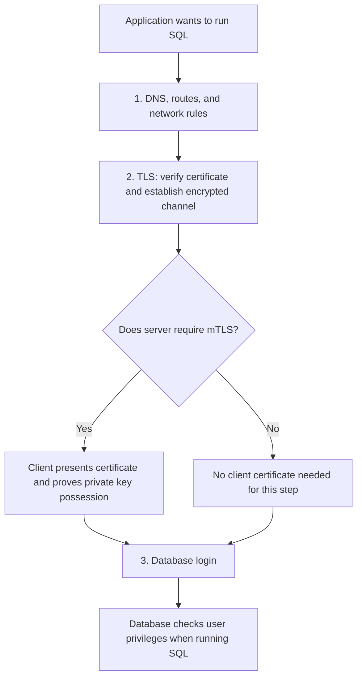

# Connecting with TLS, mTLS, and Database Wallets

In the **Autonomous Database** chapter of the **CLOUD_PROVIDERS_ORACLE** module, this lesson guides you through connecting an application to Autonomous Database on OCI using TLS or mutual TLS (mTLS). Learners will distinguish certificate authentication from database login, use wallets properly, and test connectivity from the actual application runtime environment.

Running scenario: a development team has an Autonomous Database serving an order application. A developer workstation uses mTLS with an instance wallet; a Java application deployed in an authorized network environment can use TLS without downloading a client wallet if service and driver prerequisites are met. Both use separate database accounts with privileges appropriate for their tasks.

After this lesson, learners will be able to:

- Explain TLS, mTLS, TCPS, truststore, keystore, and wallet.
- Identify the right endpoint, port, service name, and TNS alias.
- Prepare networking, database accounts, and OCI resource management permissions.
- Connect via JDBC Thin using TLS and mTLS.
- Diagnose errors layer by layer, manage wallets, and prepare controlled certificate rotation.
- Record connection evidence without exposing secrets in source code or logs.

The hands-on portion focuses on **Autonomous Database Serverless**. Current Oracle documentation may use the name **Autonomous AI Database**. For Dedicated or other deployment models, consult the corresponding documentation before following Console steps. Examples use username/password database login; IAM token authentication or federated systems require separate configuration.

## 1. Viewing a Connection Across Three Layers

A successful connection must pass through three independent layers:



For example: downloading a wallet from the Console does not prove the machine can reach a private endpoint. Opening the database port does not prove the certificate is trusted. A successful TLS handshake also does not prove the username/password is right or that the user has permission to read the orders table.

| Layer | Question to answer | Examples of related items |
|---|---|---|
| Network | Can the app host reach the endpoint? | DNS, IP, routes, ACL, NSG, firewall |
| Security channel | How do client and server verify certificates? | TLS, mTLS, trust anchor, client certificate |
| Database | How is the session authenticated and authorized? | Database user, password, create session privilege, table privileges |

IAM permissions for an OCI user to manage or download connection information belong to a different administrative layer. They do not automatically grant SQL privileges to an application account. The lab must record the OCI resource manager separately from the database login user.

## 2. How Do TLS and mTLS Differ?

**TLS** provides an encrypted transport channel with integrity protection. In Autonomous Database interface terminology, the **TLS** option typically refers to server-authenticated connections that do not require a client certificate.

**mTLS** is TLS with two-way certificate authentication. The client verifies the server certificate; the service also verifies the client certificate and proof of private key possession. mTLS is not a protocol unrelated to TLS.

Autonomous Database supports mTLS by default. It can be configured to additionally allow TLS; when enabled, both connection types can coexist. Both still use an encrypted channel. [Source: About Connecting to an Autonomous AI Database Instance](https://docs.oracle.com/en/cloud/paas/autonomous-database/serverless/adbsb/connect-introduction.html).

| Characteristic | Service-selected TLS | mTLS |
|---|---|---|
| Client verifies server identity | Yes | Yes |
| Server requires client certificate for this channel | No | Yes |
| Traffic encryption | Yes | Yes |
| Oracle client wallet in JDBC Thin lab | Not needed if conditions are met | Uses wallet or appropriate keystore |
| Example database login | Username/password | Username/password |
| Primary operational tasks | Runtime trust, networking, database credentials | TLS items plus client credential lifecycle |

JDBC currently uses TLS 1.3 when supported by the driver and can fall back to TLS 1.2. Do not copy legacy configs and hardcode every environment to one TLS version without checking the driver and active policies. [Source: Connect with JDBC Thin Driver](https://docs.oracle.com/en/cloud/paas/autonomous-database/serverless/adbsb/connect-jdbc-thin.html).

### Do Not Misuse the Term "Walletless"

Not needing to download a **client wallet** does not mean skipping certificate checks or using an unencrypted connection. The client still needs a trust source to verify the server, typically through the runtime's truststore in the JDBC Thin path.

Conversely, a client having a wallet does not prove mTLS is in use: a wallet might only contain trust material for a different configuration. Verify the connection type, descriptor, and actual runtime configuration.

This lesson covers only the Oracle-supported JDBC Thin flow. The "walletless" conditions should not be generalized to every version of SQL*Plus, ODBC, or every Oracle Client. [Source: Client Types and Autonomous Database Connections](https://docs.oracle.com/en/cloud/paas/autonomous-database/serverless/adbsb/connect-preparing.html).

## 3. What Does a Wallet Contain and Protect?

In this lesson, a **database connection wallet** is a bundle of client credentials for connectivity. It is distinct from an administrator-managed TDE wallet holding data encryption keys in another database model.

Concepts to separate:

| Concept | Role |
|---|---|
| Certificate | Credential binding an identity to a public key |
| Private key | Secret used to prove ownership of the corresponding key |
| Truststore | Store holding certificates or trust anchors trusted by the client |
| Keystore | Store holding keys and certificates for an identity, depending on format/use |
| Wallet | Oracle container for credentials/certificates; downloaded bundle also includes config files |
| TNS alias | Lookup name for a connect descriptor |

JDBC Thin uses Java's TLS mechanisms; Oracle Wallet and JKS are ways to supply security material to the client. When using Oracle Wallet format, appropriate Oracle PKI components are required. [Source: JDBC Client-Side Security Features](https://docs.oracle.com/en/database/oracle/oracle-database/19/jjdbc/client-side-security.html).

The downloaded bundle typically contains the following files; not every client uses all of them:

| File | Primary purpose |
|---|---|
| `cwallet.sso` | Auto-login wallet |
| `ewallet.p12` | PKCS#12 wallet |
| `keystore.jks` | Java keystore |
| `truststore.jks` | Java truststore |
| `tnsnames.ora` | Connect descriptors |
| `sqlnet.ora` | Oracle Net configuration |
| `ojdbc.properties` | JDBC connection properties |
| `README` | Certificate expiration and resource details |

[Source: Download Database Connection Information](https://docs.oracle.com/en/cloud/paas/autonomous-database/serverless/adbsb/connect-download-wallet.html).

### Three Types of Secrets Commonly Confused

- **Database user password** is used for database login in this lesson.
- **Wallet password** protects containers like PKCS#12/JKS depending on packaging.
- **Private keys and auto-login files** are sensitive material that must be protected even if the application does not prompt for a wallet password at every run.

Auto-login allows tools to open the wallet via its mechanism; do not infer the application can omit the database user/password in this example. Both authentication layers still must be prepared.

Setting a wallet password does not automatically make the entire extracted directory safe. A ZIP archive, auto-login file, or copy inside a container image all require access control. Changing a user password also does not replace the client certificate.

Recommendation for the order team: distribute wallets via a secret management system or secure vault; each application should read only the version for its environment. Never commit ZIPs, private keys, or wallet folders to Git.

## 4. Preparing Networking and Service Configuration

### 4.1. Match the Endpoint to Where the Application Runs

| Where the application runs | What to prepare |
|---|---|
| Dev workstation to public endpoint | Permitted source access and appropriate outbound path |
| Compute/app in VCN to private endpoint | Private DNS, routes, and associated network rules |
| Corporate network to private endpoint | Network connectivity into VCN and appropriate name resolution |
| Container or CI runner | DNS, networking, and secrets inside that exact runtime |

Do not use results from a laptop to assume a container on another host can also connect. A difference in egress IP, DNS, or wallet path is enough to make two environments behave differently.

For private endpoints, Oracle documentation describes rules for port 1522 with mTLS, or 1521/1522 with TLS per configuration. Port 443 serves web tools like Database Actions/ORDS as a separate flow. [Source: Configure Network Access with Private Endpoints](https://docs.oracle.com/en/cloud/paas/autonomous-database/serverless/adbsb/private-endpoints-autonomous.html).

Initial diagnostic example on Windows PowerShell:

```powershell
$adbHostName = '<HOST_FROM_CONNECTION_STRING>'
$adbPort = 1522  # Replace with the port of the descriptor being tested

Resolve-DnsName -Name $adbHostName
Test-NetConnection -ComputerName $adbHostName -Port $adbPort
```

A successful TCP test only proves the ability to open a connection to that port at the moment tested. It does not perform full certificate verification, login, or SQL execution.

### 4.2. When Allowing TLS Without a Client Certificate

On Serverless, allowing TLS requires an ACL on a public endpoint or a private endpoint configuration. Then, under **Network**, edit **Mutual TLS (mTLS) Authentication**, uncheck **Require mutual TLS (mTLS) authentication**, update, and wait for the appropriate state. mTLS remains allowed. [Source: Update Network Options to Allow TLS or Require Only mTLS](https://docs.oracle.com/en/cloud/paas/autonomous-database/serverless/adbsb/support-tls-mtls-authentication.html).

Only change configuration when the lab environment permits and active clients are known. Never open an allowlist to the entire internet just to resolve a connection error.

If the environment mandates mTLS, complete the mTLS branch and explicitly note that the TLS branch was skipped due to policy. Do not lower environment security requirements just to collect screenshots for a lab report.

### 4.3. Prepare the Database User

Use a dedicated user for the application or lab, granted create session and only the SQL privileges actually needed. Do not use `ADMIN` as the application runtime account merely because it is the first user provided.

Autonomous Database allows administrators to grant individual privileges instead of forcing a broad role. For example, a connection test running only session/DUAL queries does not need the full data development privileges of `DWROLE`. [Source: Manage User Roles and Privileges](https://docs.oracle.com/en/cloud/paas/autonomous-database/serverless/adbsb/manage-users-privileges.html).

## 5. Getting the Right Connection String and Service

Open the database in the right compartment/region, select **Database connection**, and choose the appropriate TLS/mTLS type and endpoint if the UI offers multiple options. Copy the descriptor for the desired service. TNS aliases can look identical across both connection types while descriptors differ; mTLS uses port 1522, while TLS can use 1521 or 1522. [Source: View TNS Names and Connection Strings](https://docs.oracle.com/en/cloud/paas/autonomous-database/serverless/adbsb/connect-download-wallet.html).

### Distinguish Three Values

| Value | Illustrative example | Meaning |
|---|---|---|
| Host | `<ADB_HOST>` | Endpoint name for DNS resolution and connection |
| TNS alias | `orders_low` | Name the client looks up in `tnsnames.ora` |
| Service name | `<FULL_SERVICE_NAME>` | Service name sent to the listener/database |

Do not use the database display name as the service name if the Console provides a different value. Nor should you replace the service name with an OCID or SID.

Conceptual structure of a descriptor:

```text
(description=
  (address=
    (protocol=tcps)
    (host=<ADB_HOST>)
    (port=<PORT_FROM_CONSOLE>)
  )
  (connect_data=
    (service_name=<FULL_SERVICE_NAME>)
  )
  (security=
    (ssl_server_dn_match=yes)
  )
)
```

This is a structural diagram, not a string to run verbatim. When practicing, use the full descriptor from your database, including any included security or retry attributes. Do not turn an mTLS descriptor into TLS by merely editing the port.

Services like `low`, `medium`, `high`, `tp`, and `tpurgent` serve different resource/workload allocation policies; the actual list depends on database type. For short tests in the lab, choose the assigned appropriate service rather than assuming `high` is always fastest. [Source: Database Service Names for Autonomous AI Database](https://docs.oracle.com/en/cloud/paas/autonomous-database/serverless/adbsb/predefined-database-services-names.html).

### Keep Server Identity Verification Active

The trust chain answers whether the certificate was issued by a source the client trusts. Endpoint identity verification also confirms the certificate matches the target server.

Preserve verification attributes provided by Oracle, such as `ssl_server_dn_match=yes`. Do not change it to `no`, use "trust all," or substitute an IP for the hostname to bypass certificate errors. For a specific descriptor and driver, hostname/DN matching must follow the corresponding guidance. [Source: JDBC Client-Side Security Features — TLS](https://docs.oracle.com/en/database/oracle/oracle-database/19/jjdbc/client-side-security.html).

If the organization uses a custom truststore, it must trust the exact CA chain for the current endpoint. Never download a certificate from an unverified source and add it to the truststore just to silence PKIX errors.

## 6. Preparing Java and a Shared Probe Program

The example uses Java 17 or higher, JDBC Thin, and a lab account. Prepare an Oracle JDBC driver bundle supported for your JDK. The illustrative files below are created by the learner in the practice environment; this lesson does not assume they already exist.

For walletless TLS, JDBC Thin uses the appropriate Java trust configuration. For Oracle Wallet, include the companion JARs such as `oraclepki.jar`, `osdt_core.jar`, and `osdt_cert.jar` matching the driver bundle. If using UCP, add the compatible UCP library. [Source: JDBC Thin Connections with a Wallet](https://docs.oracle.com/en/cloud/paas/autonomous-database/serverless/adbsb/connect-jdbc-thin-wallet.html).

Suggested layout for the lab program directory:

```text
adb-connection-lab/
  AdbConnectionProbe.java
  lib/
    <Compatible Oracle JDBC driver and companion JARs>
```

Place the wallet in a separate secure location; do not copy it into the source folder or package it inside the application JAR. Inside `lib`, avoid placing multiple JDBC driver versions competing on the classpath.

### Read-Only Session Probe Program

Create `AdbConnectionProbe.java`:

```java
import java.io.Console;
import java.sql.Connection;
import java.sql.DriverManager;
import java.sql.ResultSet;
import java.sql.Statement;
import java.util.Arrays;

public final class AdbConnectionProbe {
    private static String requiredEnv(String name) {
        String value = System.getenv(name);
        if (value == null || value.isBlank()) {
            throw new IllegalArgumentException("Missing environment variable: " + name);
        }
        return value;
    }

    public static void main(String[] args) throws Exception {
        String url = requiredEnv("ADB_JDBC_URL");
        String user = requiredEnv("ADB_DB_USER");

        Console console = System.console();
        if (console == null) {
            throw new IllegalStateException("Run this probe from an interactive terminal.");
        }

        char[] password = console.readPassword("Database password: ");
        if (password == null) {
            throw new IllegalStateException("No password was supplied.");
        }

        try {
            try (Connection connection =
                         DriverManager.getConnection(url, user, new String(password));
                 Statement statement = connection.createStatement()) {

                statement.setQueryTimeout(15);

                String query = """
                    SELECT SYS_CONTEXT('USERENV', 'SESSION_USER') AS session_user,
                           SYS_CONTEXT('USERENV', 'SERVICE_NAME') AS service_name,
                           SYS_CONTEXT('USERENV', 'NETWORK_PROTOCOL') AS network_protocol,
                           SYS_CONTEXT('USERENV', 'AUTHENTICATION_METHOD') AS auth_method
                    FROM dual
                    """;

                try (ResultSet result = statement.executeQuery(query)) {
                    if (!result.next()) {
                        throw new IllegalStateException("Session probe returned no row.");
                    }

                    System.out.printf(
                        "user=%s%nservice=%s%nprotocol=%s%nauth_method=%s%n",
                        result.getString("session_user"),
                        result.getString("service_name"),
                        result.getString("network_protocol"),
                        result.getString("auth_method")
                    );
                }
            }
        } finally {
            Arrays.fill(password, '\0');
        }
    }
}
```

The password is entered at the terminal rather than stored in source code or the JDBC URL. Clearing the `char[]` array only reduces one copy in memory; the code still creates a `String` for the JDBC API, so do not claim every copy of the secret has been erased.

This program is an interactive probe, not a production secret-delivery mechanism. Background applications should obtain credentials through the environment's secret-management system.

### Compile and Run on Windows

From the lab program directory, with drivers in `lib`:

```powershell
javac -cp ".\lib\*" AdbConnectionProbe.java

# Set ADB_JDBC_URL according to the TLS or mTLS branch below.
$env:ADB_DB_USER = '<LAB_DATABASE_USER>'

java -cp ".;.\lib\*" AdbConnectionProbe
```

The `;` here is inside the Windows classpath string, not a PowerShell command separator. On Linux/macOS, classpaths use `:`.

`setQueryTimeout(15)` applies to the query, not a 15-second budget for total DNS, TCP, TLS, and login time. Connection setup/retry timeouts must be configured separately per driver and application requirements.

### Interpret Results Within Proper Scope

`SYS_CONTEXT` lets you observe the session's user, service, protocol, and authentication method. `NETWORK_PROTOCOL` reflects the connection protocol; it does not expose the full cipher suite or which client certificate was used. [Source: SYS_CONTEXT — USERENV](https://docs.oracle.com/en/database/oracle/oracle-database/19/sqlrf/SYS_CONTEXT.html).

Lab expectations:

- `user` is the assigned lab account.
- `service` matches the target service, not another environment.
- `protocol` shows a TCPS connection.
- `auth_method` may show password-based authentication in this lesson.

`PASSWORD` at login does not mean TLS is disabled. Similarly, `TCPS` alone does not prove mTLS is in use: correlate it with server configuration, descriptor, and client material for that run.

## 7. Branch A — JDBC Thin Using TLS Without Downloading a Wallet

### 7.1. Prerequisites

The database permits TLS at the network layer; the client has a supported driver/JDK, proper trust, valid user/password, and a network path to the endpoint.

Oracle supports walletless JDBC Thin TLS without downloading an Oracle Wallet/JKS. Use the **TLS connection string** from **Database connection** and prepend the JDBC prefix rather than mistakenly using an mTLS descriptor. [Source: JDBC Thin Connections Without a Wallet](https://docs.oracle.com/en/cloud/paas/autonomous-database/serverless/adbsb/connect-jdbc-thin-tls.html).

Set in the same terminal running the probe:

```powershell
$env:ADB_JDBC_URL = 'jdbc:oracle:thin:@<FULL_TLS_CONNECT_DESCRIPTOR>'
$env:ADB_DB_USER = '<LAB_DATABASE_USER>'

java -cp ".;.\lib\*" AdbConnectionProbe
```

Replace the placeholder with the actual descriptor, not just a service name. The sample URL above contains no password.

### 7.2. Ensure the Test Does Not Rely on an Old Wallet

To verify this branch accurately, use a clean runtime without client wallet or mTLS keystore settings from a prior run. Check JVM properties and connection config files that the application actually reads.

Settings like `oracle.net.wallet_location`, `javax.net.ssl.keyStore`, or an `ojdbc.properties` loaded from elsewhere can alter results unexpectedly. Reading the URL from an environment variable does not clear previously set JVM properties.

Do not delete or modify the shared JDK truststore to create a "clean environment." The client still needs a trust source to verify the server. For applications with custom settings, adjust only configurations within lab scope.

### 7.3. Evidence to Record

Record the selected connection type, JDK/driver versions, observed user/service/protocol, timestamp, and runtime environment. Never paste passwords or dump full runtime configs into reports.

If TLS is disallowed by environment policy, the right outcome is to document that this branch was not executed. Do not switch to unencrypted TCP as a substitute.

## 8. Branch B — JDBC Thin Using mTLS with an Instance Wallet

### 8.1. Obtain the Wallet for the Right Database

An authorized user opens **Database connection → Instance wallet → Download wallet**, sets a password, and saves the ZIP securely; or receives the bundle from an administrator via an approved channel.

An instance wallet serves a single database; a regional wallet spans multiple databases in a tenancy/region. Choose an instance wallet for a single-database lab. [Source: Download Database Connection Information — Wallet Types](https://docs.oracle.com/en/cloud/paas/autonomous-database/serverless/adbsb/connect-download-wallet.html).

Extract the entire bundle to a secure location dedicated to the runtime. Illustrative path example:

```text
C:/oci-lab-secrets/orders-wallet/
```

Only authorized processes/users should have access. Do not place this folder in a web-server public directory, a public sync folder, or a shared container image.

### 8.2. Specify TNS_ADMIN and Alias

Pick a TNS alias present in the bundle's `tnsnames.ora`. With a JDBC driver supporting this URL form:

```powershell
$env:ADB_JDBC_URL = 'jdbc:oracle:thin:@<TNS_ALIAS>?TNS_ADMIN=C:/oci-lab-secrets/orders-wallet'
$env:ADB_DB_USER = '<LAB_DATABASE_USER>'

java -cp ".;.\lib\*" AdbConnectionProbe
```

`TNS_ADMIN` points to the configuration directory, not directly to the ZIP archive. JDBC can use settings from `tnsnames.ora` and `ojdbc.properties`; this URL syntax is documented by Oracle for drivers 18.3 and later. [Source: JDBC Thin Connections with a Wallet — TNS_ADMIN](https://docs.oracle.com/en/cloud/paas/autonomous-database/serverless/adbsb/connect-jdbc-thin-wallet.html).

Practical notes:

- Substitute the exact alias; do not concatenate alias and service name into a new string.
- Keep the bundle's `ojdbc.properties` alongside the config; do not blindly overwrite properties from internet snippets.
- Ensure Oracle Wallet companion JARs are on the runtime classpath.
- Verify the process runs under an OS account with read permissions on the directory.
- When running in a container, use the path inside the container, not an unmounted host path.

With JKS, keystore/truststore configuration is a separate approach. Do not enable multiple wallet/JKS configurations simultaneously just to see which stops failing. The main lab selects Oracle Wallet to keep one observable configuration flow.

### 8.3. Verify with a Fresh Session

Run the probe to open a new connection; verify user, service, and protocol as in the TLS branch. Record which database the wallet belongs to and which bundle version is in use, without putting certificate/private key contents into reports.

To prove client certificate enforcement in an mTLS-only environment, you can run a separate test with a client config lacking mTLS material while keeping valid database credentials. The expected outcome is connection failure, but only run this after confirming no hidden wallet/JKS config remains.

Do not intentionally enter wrong passwords repeatedly to "test mTLS"; password errors belong to a different layer and can lock the user account.

## 9. Connecting with SQL Developer

You can use SQL Developer to test independently of the Java program. Results from SQL Developer represent only that tool's runtime; the separate Java program still requires the right driver, trust, and paths.

### mTLS with Cloud Wallet

1. Create a new database connection.
2. Select **Connection Type: Cloud Wallet**.
3. Select the client credentials ZIP under **Configuration File**.
4. Enter database user/password and choose a service from the bundle.
5. Connect and run the session verification query.

[Source: Connect Oracle SQL Developer with a Wallet](https://docs.oracle.com/en/cloud/paas/autonomous-database/serverless/adbsb/connect-sql-dev182.html).

A GUI tool accepting a ZIP does not mean the JDBC URL `TNS_ADMIN` parameter also accepts a ZIP. The two interfaces handle the bundle differently.

### TLS with Custom JDBC

When TLS is allowed:

1. Copy the database's TLS descriptor.
2. Create a connection of type **Custom JDBC**.
3. Enter `jdbc:oracle:thin:@` followed by that descriptor.
4. Enter database user/password and connect.

[Source: Connect Oracle SQL Developer Without a Wallet](https://docs.oracle.com/en/cloud/paas/autonomous-database/serverless/adbsb/connect-sqldev-tls.html).

Do not treat a browser opening Database Actions as proof that JDBC is configured. That is a different client and access path.

## 10. Managing Wallets and Credentials in Operations

### 10.1. Inventory Where Credentials Are Used

Example operational inventory for the order team:

| Item | Information to maintain |
|---|---|
| Target database | Region, OCID, or verified internal identifier |
| Connection type | TLS or mTLS; public/private endpoint |
| Runtime | Host, container, service, and owner |
| Database user | Account dedicated to the app or job |
| Wallet if applicable | Instance/regional, distribution version, mount path |
| Certificate expiration | Value from actual bundle/certificate |
| Driver/JDK | Deployed version set |
| New connection behavior | How the pool/runtime loads configuration |
| Change mechanism | Secret distribution, rollout, and verification |
| Monitoring | Latest probe result, errors, owner |

Expiration details are inside the wallet bundle's `README`. Never guess expiration dates from filenames or word-of-mouth timelines. [Source: Wallet README File](https://docs.oracle.com/en/cloud/paas/autonomous-database/serverless/adbsb/connect-download-wallet.html).

Database passwords, wallet passwords, and client certificates have different lifecycles. A rotation schedule for one credential type does not automatically handle the others.

### 10.2. Runtime Distribution

Operational recommendations:

- Provision environment-specific wallets and restrict read access to authorized users/processes.
- Mount secrets into the runtime via platform mechanisms, preferably read-only to the app.
- Never bake wallets into Docker images, release packages, or shared artifacts.
- Never pass passwords in CLI arguments, source code, or JDBC URLs.
- Log the deployed credential version without logging the credential itself.
- Purge copies in download folders, temporary hosts, and CI workspaces per agreed policy.

With walletless TLS, you still must manage database credentials and update runtime truststores. Having one fewer secret file does not remove those responsibilities.

If multiple apps share one instance wallet, credential rotation affects multiple places. A single wallet also does not uniquely identify individual apps; combine database users, privileges, and session metadata for per-app visibility.

### 10.3. Re-Downloading Differs from Rotating

Downloading a new bundle fetches connection material for deployment. **Rotating a wallet** changes client keys/certificates via the service mechanism to invalidate old keys according to selected scope and timing. Never assume an exposed copy became invalid just because you downloaded another ZIP.

Current documentation supports immediate rotation or a 1–72 hour grace period; Always Free supports immediate rotation only. Rotating an instance wallet does not invalidate a regional wallet; rotating a regional wallet affects corresponding instance wallets as well. With a grace period, existing sessions may continue even after old keys expire. [Source: Rotate Wallets for Autonomous AI Database](https://docs.oracle.com/en/cloud/paas/autonomous-database/serverless/adbsb/wallet-rotate.html).

Therefore, runbooks must specify the credential scope to revoke, client impact, and handling of existing sessions. Changing a database password or deleting a file on a laptop does not replace the full wallet revocation procedure.

### 10.4. Recommended Rollout Procedure

For environments supporting a transition window:

1. Inventory all runtimes using the credential and their owners.
2. Select rotation scope, timing, and window per policy.
3. Obtain the new bundle and stage it in a new secret version/directory.
4. From a test runtime, open a **new connection** with the new configuration and run the session query.
5. Roll out to applications in waves; monitor connection errors and pool health.
6. Confirm all runtimes loaded the new version and successfully open new connections.
7. After the revocation timestamp, verify old credentials are rejected as planned.
8. Clean up old copies and update operational records.

This is a recommended procedure in this lesson, not an automatic OCI guarantee. For immediate rotation or suspected credential compromise, adjust order and urgency to match incident severity.

Do not revert to an old wallet after it has been invalidated and call that a rollback plan. Recovery plans must rely on still-valid credentials, deployment capability, and the chosen revocation mechanism.

### 10.5. Connection Pools Easily Mask Broken New Credentials

A successful request may simply borrow an existing connection from the pool. After replacing a wallet, that request does not prove the process can open a new connection.

In the lab, the Java probe always opens a fresh connection, making it useful for this check. In real applications, run controlled tests forcing the pool to open new connections via supported pool mechanisms.

Do not shut down an entire pool or restart the database just to test a file without a corresponding change plan. Distinguish the goal of "verifying new connections" from "terminating all existing sessions."

If switching the service from allowing TLS to requiring mTLS, Oracle notes that existing TLS connections are dropped. Prepare affected clients before making this change. [Source: Require mTLS and Disallow TLS Authentication](https://docs.oracle.com/en/cloud/paas/autonomous-database/serverless/adbsb/support-tls-mtls-authentication.html).

## 11. Diagnosing Errors Layer by Layer

Start from the **failing process's** actual runtime state rather than only the intended config:

1. Which database and endpoint are being called?
2. Which URL/alias, driver, and JDK is the process using?
3. Do DNS and TCP work from that exact runtime?
4. Where are trust, client keys, and wallet configs loaded from?
5. Does the failure occur at handshake, login, or post-login SQL?

| Symptom | Initial check |
|---|---|
| Hostname fails to resolve | DNS, private zone, container/VPN environment |
| TCP timeout | Routes, source access, ACL/NSG/firewall, descriptor port |
| Handshake failure | TLS version, certificate chain, client certificate if required |
| Java reports PKIX or trust path not found | Actual truststore in use, CA chain, unexpected runtime overrides |
| DN/hostname mismatch | Verify endpoint and descriptor; check for arbitrary IP/alias substitution |
| Oracle JDBC driver not found | Classpath and JARs in use |
| Wallet works on laptop but fails in container | Secret mount, container path, and process permissions |
| Login succeeds but table read fails | User/schema and SQL privileges; no longer a TLS issue |
| App keeps running after wallet change then fails on restart | Old pool kept sessions; new runtime hasn't loaded valid credentials |
| Same alias hits wrong environment | Actual `tnsnames.ora` source and `TNS_ADMIN` setting |

Useful error codes for triage:

| Error code | Meaning and what to inspect |
|---|---|
| [ORA-12154](https://docs.oracle.com/en/error-help/db/ora-12154/) | Connect identifier could not be resolved; inspect alias, naming config, and where `tnsnames.ora` is read from |
| [ORA-28759](https://docs.oracle.com/en/error-help/db/ora-28759/) | Failure to open file; identify the failing file, path, and permissions |
| [ORA-29024](https://docs.oracle.com/en/error-help/db/ora-29024/) | Certificate validation failure; investigate certificates and validity |
| [ORA-01017](https://docs.oracle.com/en/error-help/db/ora-01017/) | Invalid credentials or logon denied; inspect auth method and target account |

Error codes are starting points, not sole proof of root cause. A generic SSL error may wrap a deeper file or trust error; inspect the full exception chain/diagnostics in a controlled environment.

When collaborating with operations, share timestamp, redacted database/endpoint identifiers, client versions, error code, and last verified step. Never send wallet ZIPs, private keys, passwords, or secret-containing dumps to illustrate an error.

## 12. Choosing TLS or mTLS for an Application

| Condition | Option to evaluate |
|---|---|
| Policy mandates client certificates | mTLS with wallet/keystore management workflow |
| JDBC Thin supported, network restricted, client certificate not required | Walletless TLS can reduce client credential distribution overhead |
| Mix of legacy and modern clients | Verify support per client; do not generalize from JDBC Thin |
| App has many replicas or short-lived CI jobs | Evaluate secret injection, trust, and new connection creation per runtime |
| Frequent credential rotation required | Evaluate rollout, connection pools, and post-change verification |

Do not rank them as "mTLS is always best" or "walletless TLS is more convenient so use it everywhere." The decision depends on threat model, policy, clients, and team operational maturity.

For the order application in this lesson, the team can maintain mTLS in environments requiring client certificates while using TLS elsewhere if permitted. Both connection modes must be declared explicitly in config; do not let runtimes silently pick up an unexpected old wallet.

### Availability and Cost of Connectivity

Reliable connectivity design requires proper timeouts, bounded pools, driver updates, and credential rotation plans. Unbounded retries can keep requests hanging; synchronized retries across replicas can hinder recovery.

Having TLS or mTLS does not automatically provide application failover, transaction replay, or exactly-once request execution. Those capabilities require separate configuration and testing.

A connectivity lab does not need a second database just to compare both protocols if one lab database permits both. When budgeting an environment, include database compute/storage, client runtime hosts, network links, and secret operations; do not assume choosing one TLS mode dictates total cost.

After practicing, stop unnecessary test processes, revoke temporary network rules if granted, and dispose of wallet copies per plan. Leave shared resources or resources serving other work untouched.

## 13. Completion Criteria

Learners complete the lesson when they can:

1. Explain the difference between endpoint reachability, certificate authentication, and database login.
2. Distinguish host, TNS alias, service name, and descriptor.
3. Explain why walletless connections can still use encrypted TLS with server verification.
4. Explain why an auto-login wallet does not replace the example's database credentials.
5. Connect via mTLS using the right database's wallet and right runtime `TNS_ADMIN`.
6. Connect via walletless TLS if permitted by environment policy; otherwise, document the limitation clearly.
7. Observe exact user/service/protocol via a fresh connection.
8. State the limitations of `TCPS` and authentication method outputs in `SYS_CONTEXT`.
9. Diagnose at least one controlled configuration error at the right layer without disabling server verification.
10. Maintain an inventory of credential locations, certificate expiration, and rotation workflow for the application.

Lab reports record the exact branches executed. These examples guide actions and verification criteria; they do not imply this article connected to the learner's tenancy or database.

### Oracle Reference Documentation

- [About Connecting to an Autonomous AI Database Instance](https://docs.oracle.com/en/cloud/paas/autonomous-database/serverless/adbsb/connect-introduction.html)
- [Network Options for TLS and mTLS](https://docs.oracle.com/en/cloud/paas/autonomous-database/serverless/adbsb/support-tls-mtls-authentication.html)
- [JDBC Thin Connections Without a Wallet](https://docs.oracle.com/en/cloud/paas/autonomous-database/serverless/adbsb/connect-jdbc-thin-tls.html)
- [JDBC Thin Connections with a Wallet](https://docs.oracle.com/en/cloud/paas/autonomous-database/serverless/adbsb/connect-jdbc-thin-wallet.html)
- [Download Database Connection Information](https://docs.oracle.com/en/cloud/paas/autonomous-database/serverless/adbsb/connect-download-wallet.html)
- [Rotate Wallets for Autonomous AI Database](https://docs.oracle.com/en/cloud/paas/autonomous-database/serverless/adbsb/wallet-rotate.html)
